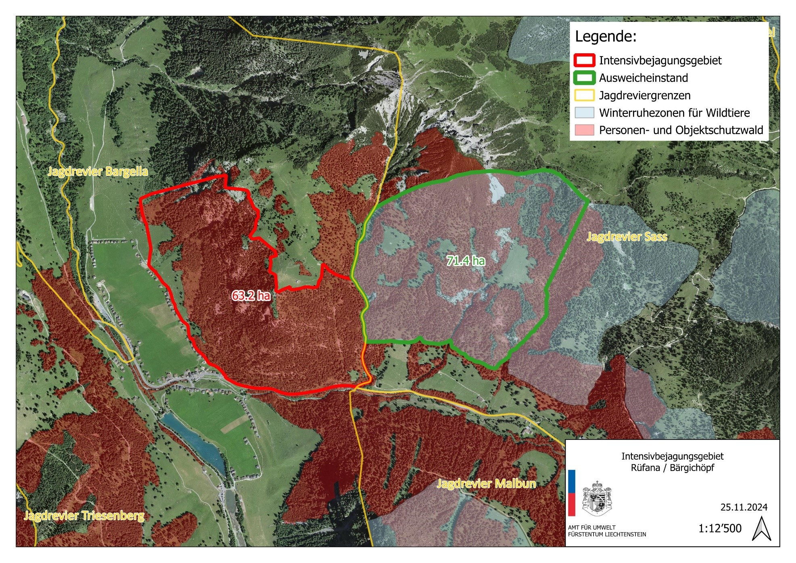
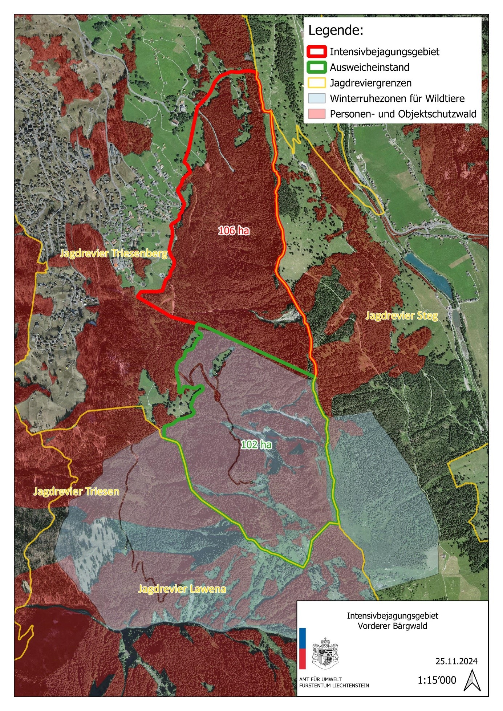

Verordnung vom 10. Dezember 2024 über die Ausscheidung und Betreuung von Intensivbejagungsgebieten (Intensivbejagungsgebieteverordnung; IBGV) Aufgrund von Art. 19i und 59 des Jagdgesetzes vom 30. Januar 1962, LGBl. 1962 Nr. 4, in der geltenden Fassung, verordnet die Regierung: I. Allgemeine Bestimmungen Art. 1 Gegenstand Diese Verordnung regelt in Durchführung von Art. 19i des Gesetzes insbesondere: a) die Anforderungen an die Ausscheidung von Intensivbejagungsgebieten und Ausweicheinständen; b) die Festlegung der Intensivbejagungsgebiete und Ausweicheinstände; c) die Betreuung von Intensivbejagungsgebieten; d) das Monitoring und die Evaluation. Art. 2 Bezeichnungen Unter den in dieser Verordnung verwendeten Personenbezeichnungen sind alle Personen unabhängig ihres Geschlechts zu verstehen, sofern sich die Personenbezeichnungen nicht ausdrücklich auf ein bestimmtes Geschlecht beziehen. II. Intensivbejagungsgebiete und Ausweicheinstände A. Anforderungen an die Ausscheidung von Intensivbejagungsgebieten Art. 3 Grundsatz 1) Bei der Beurteilung, ob ein bestimmtes Gebiet nach Massgabe von Art. 19i des Gesetzes als Intensivbejagungsgebiet ausgeschieden wird, sind zu berücksichtigen: a) die Qualität und Quantität der Waldverjüngung (Art. 4); b) der Wildbestand (Art. 5); c) der Einfluss des Wildes auf die Waldverjüngung (Art. 6); d) die Bedeutung der Schutzleistung des Personen- und Objektschutzwaldes; e) die vorhandenen Ressourcen und der zu erwartende Betreuungsaufwand. 2) Die betroffenen Jagdgemeinschaften und deren Jagdaufsicht sind bei der Beurteilung des Wildbestandes und -einflusses nach Abs. 1 Bst. b und c anzuhören. Art. 4 Ungenügende Waldverjüngung 1) Die Waldverjüngung gilt in einem bestimmten Gebiet als ungenügend, wenn sie in qualitativer und quantitativer Hinsicht nicht ausreicht, um die Erfüllung der waldbaulichen Ziele und Waldfunktionen sicherzustellen. 2) Ob die Waldverjüngung nach Abs. 1 ungenügend ist, beurteilt das Amt für Wald, Natur und Landwirtschaft. 3) Grundlagen der Beurteilung nach Abs. 2 bilden: a) die gutachterliche Einschätzung durch die Forstorgane; b) die forstlichen Erhebungen; c) die Erhebung der aktuellen Schutzleistung des betreffenden Waldes. Art. 5 Wildbestand 1) Der Wildbestand in einem bestimmten Gebiet ist unter Berücksichtigung des Habitats und der jahreszeitlichen Raumnutzung vom Amt für Wald, Natur und Landwirtschaft zu beurteilen. 2) Grundlagen der Beurteilung nach Abs. 1 bilden: a) die Überwachung der Wildbestände durch die Wildhut; b) die Wildbestandserhebungen; c) eine Analyse der Jagdstrecke; d) die Auswertung des Fotofallenmonitorings; e) die Habitatmodelle. Art. 6 Übermässiger Wildeinfluss 1) Der Wildeinfluss in einem bestimmten Gebiet gilt als übermässig, wenn er eine der Hauptursachen für die ungenügende Waldverjüngung darstellt. 2) Ob der Wildeinfluss nach Abs. 1 übermässig ist, beurteilt das Amt für Wald, Natur und Landwirtschaft in Zusammenarbeit mit den Forstorganen der betroffenen Gemeinden und der Wildhut. 3) Grundlagen der Beurteilung nach Abs. 2 bilden: a) ein Vergleich von eingezäunten und nicht eingezäunten Waldflächen; b) das Verbissprozent und die Baumartenverteilung; c) die potentielle natürliche Vegetation des Waldstandortes. B. Anforderungen an die Ausscheidung von Ausweicheinständen Art. 7 Grundsatz 1) Ausweicheinstände müssen eine zusammenhängende Lebensraumeinheit mit dem Intensivbejagungsgebiet bilden und in ihrem Raumangebot und ihrer Attraktivität für Schalenwild mit diesem vergleichbar sein. 2) Ausweicheinstände sind soweit möglich in Winterruhezonen für Wildtiere einzurichten. 3) Soweit die Ausscheidung von Ausweicheinständen Einfluss auf den Jagdbetrieb hat, sind die betroffenen Jagdgemeinschaften und deren Jagdaufsicht vorgängig anzuhören. C. Festlegung der Intensivbejagungsgebiete und Ausweicheinstände Art. 8 Grundsatz Die nach Massgabe der Art. 3 bis 7 ausgeschiedenen Intensivbejagungsgebiete und Ausweicheinstände sind im Anhang aufgeführt. D. Betreuung von Intensivbejagungsgebieten Art. 9 Bejagungskonzept 1) Die Wildhut erstellt für jedes Intensivbejagungsgebiet nach vorgängiger Anhörung der betroffenen Jagdgemeinschaft ein Bejagungskonzept. 2) Im Bejagungskonzept wird insbesondere geregelt, von wem, zu welchen Zeiten und in welchen Intervallen Abschuss- und Vergrämungsmassnahmen vorgenommen werden. 3) Die Koordination der Abschuss- und Vergrämungsmassnahmen erfolgt durch die Wildhut. 4) Die Bejagung durch die Jagdgemeinschaften hat im Intensivbejagungsgebiet nach Massgabe des Bejagungskonzepts und in Abstimmung mit den Massnahmen der Wildhut zu erfolgen. 5) Das Bejagungskonzept ist regelmässig zu überprüfen und bei Bedarf anzupassen. Art. 10 Jagdeinrichtungen 1) Die Nutzung bestehender Jagdeinrichtungen in Intensivbejagungsgebieten hat im Einvernehmen mit der Jagdgemeinschaft zu erfolgen. 2) Das Amt für Wald, Natur und Landwirtschaft kann im Einvernehmen mit dem Grundeigentümer darüber hinaus notwendige Jagdeinrichtungen in Intensivbejagungsgebieten errichten; Art. 37 Abs. 2 des Gesetzes findet sinngemäss Anwendung. Solche Einrichtungen sind vom Amt für Wald, Natur und Landwirtschaft zu unterhalten. 3) Gilt ein Gebiet nicht länger als Intensivbejagungsgebiet, ist eine Vereinbarung mit der Jagdgemeinschaft über den künftigen Gebrauch der Jagdeinrichtungen zu treffen. 4) Das Amt für Wald, Natur und Landwirtschaft hat nicht mehr in Gebrauch stehende, von ihm errichtete Jagdeinrichtungen zu entfernen. III. Vollzug Art. 11 Monitoring und Evaluation 1) Das Amt für Wald, Natur und Landwirtschaft beobachtet laufend den Zustand der Waldverjüngung, den Wildbestand und den Einfluss des Wildes auf die Waldverjüngung in den ausgeschiedenen Intensivbejagungsgebieten. 2) Es überprüft alle zehn Jahre nach Ausscheidung der Intensivbejagungsgebiete und Ausweicheinstände, ob die Anforderungen nach Art. 19i des Gesetzes und Art. 3 bis 7 dieser Verordnung weiterhin erfüllt sind. IV. Strafbestimmungen Art. 12 Übertretung Nach Art. 56 Abs. 1 Bst. p des Gesetzes wird bestraft, wer die Jagd wiederholt entgegen der Regelungen des Bejagungskonzepts (Art. 9) ausübt. V. Schlussbestimmung Art. 13 Inkrafttreten Diese Verordnung tritt am 1. Januar 2025 in Kraft. Fürstliche Regierung: gez. Dr. Daniel Risch Fürstlicher Regierungschef Anhang (Art. 8) Intensivbejagungsgebiete und Ausweicheinstände A. Rüfana / Bärgichöpf 

 B. Vorderer Bärgwald 

