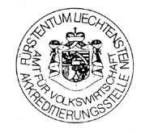
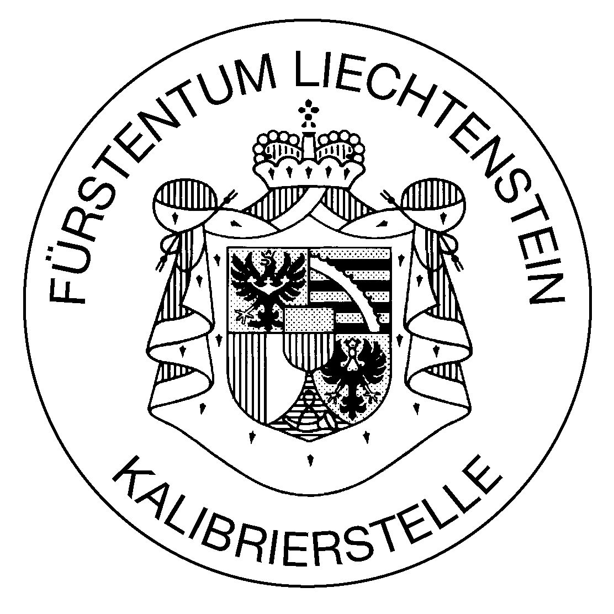
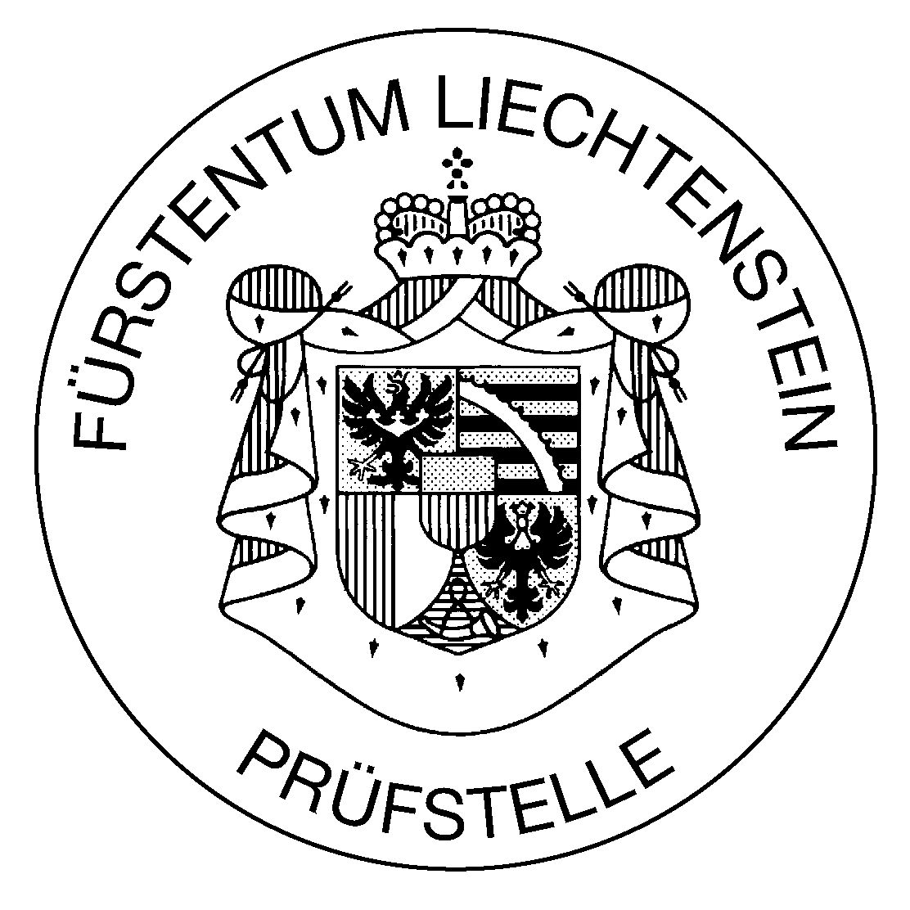
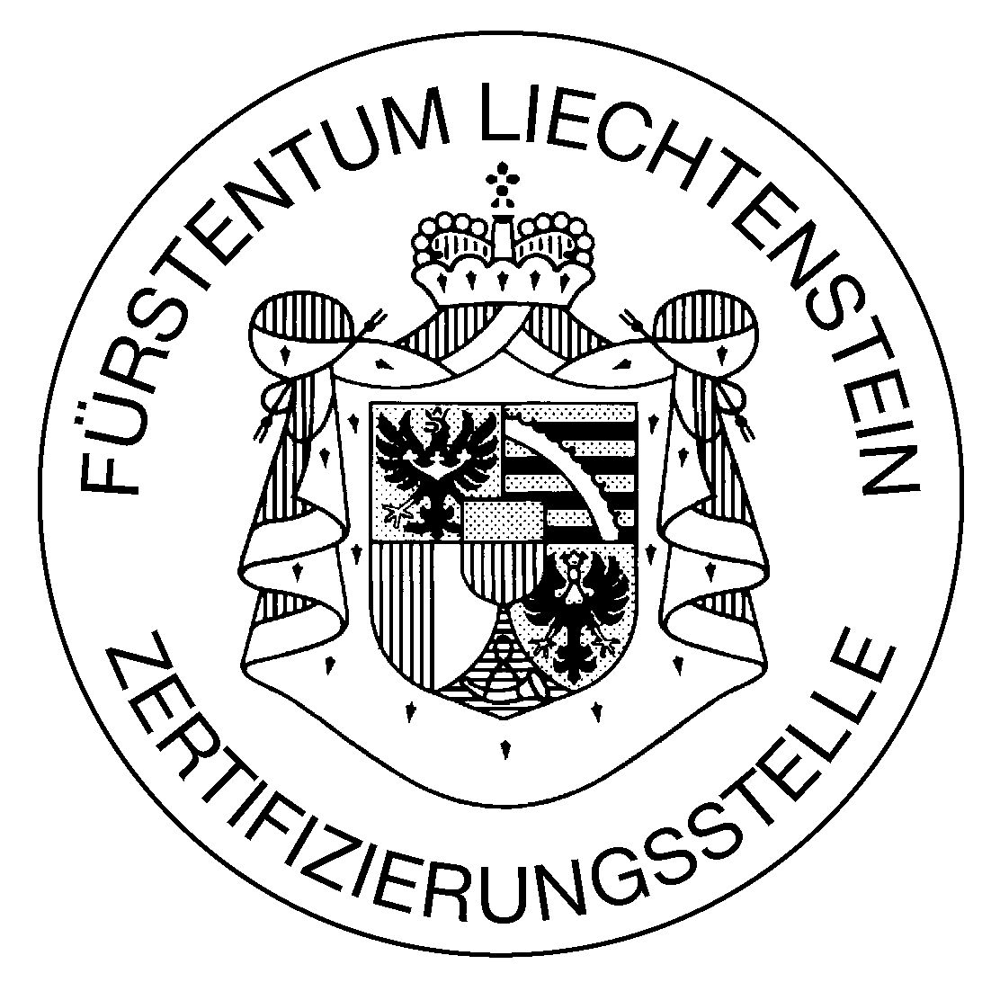

Verordnung vom 6. August 1996 über die Akkreditierung und Notifizierung Aufgrund von Art. 5 Abs. 3 und 4, Art. 6 Abs. 1, Art. 7 Abs. 2, Art. 13 Abs. 2, Art. 17 Abs. 1 und 2, Art. 18 Abs. 1, Art. 34 und 35 des Gesetzes vom 2. Mai 1996 über die Akkreditierung und Notifizierung, LGBl. 1996 Nr. 82 , verordnet die Regierung: I. Allgemeine Bestimmungen Art. 1 Zweck Diese Verordnung regelt: a) die Liechtensteinische Akkreditierungsstelle; b) den Akkreditierungsrat; c) die Liechtensteinische Notifizierungsstelle; d) die Voraussetzungen und das Verfahren der Akkreditierung und der Notifizierung; e) das Akkreditierungszeichen. Art. 2 Begriffe Im Sinne dieser Verordnung sind: a) "EWRA": Abkommen vom 2. Mai 1992 über den Europäischen Wirtschaftsraum, LGBl. 1995 Nr. 68; b) "EWR": Europäischer Wirtschaftsraum. Art. 3 Anhänge Die Anhänge 1 bis 8 bilden einen integrierenden Bestandteil dieser Verordnung. II. Liechtensteinische Akkreditierungsstelle Art. 4 Einrichtung der Liechtensteinischen Akkreditierungsstelle Die Liechtensteinische Akkreditierungsstelle wird bei der Technischen Prüf-, Mess- und Normenstelle beim Amt für Volkswirtschaft eingerichtet. Art. 5 Zeichen der Liechtensteinischen Akkreditierungsstelle Die Liechtensteinische Akkreditierungsstelle führt als Zeichen das Signet gemäss Anhang 1. Art. 6 Anforderungen an die Liechtensteinische Akkreditierungsstelle Die Liechtensteinische Akkreditierungsstelle hat die international anerkannten Anforderungen, insbesondere gemäss Anhang 2, zu erfüllen. Art. 7 Beizug Dritter 1) Die Liechtensteinische Akkreditierungsstelle kann zur Erfüllung ihrer Aufgaben, insbesondere in bezug auf die Anforderungen gemäss Art. 6 sowie im Rahmen von Begutachtungen gemäss Art. 18, Dritte beiziehen. 2) Diese Dritten müssen die Anforderungen gemäss Art. 6 erfüllen und im Rahmen von Staatsverträgen oder Abkommen im Bereich der Akkreditierung überprüft und anerkannt sein oder gleichwertige Anforderungen erfüllen. III. Akkreditierungsrat Art. 8 Zusammensetzung 1) Der Akkreditierungsrat besteht aus mindestens drei und höchstens sechs ständigen Mitgliedern, die des Akkreditierungswesens kundig sind. 2) Die Mitglieder müssen die Liechtensteinische Staatsbürgerschaft besitzen oder Bürger eines Mitgliedstaates des EWRA mit Wohnsitz im EWR sein. Art. 9 Ernennung 1) Die Regierung ernennt die ständigen Mitglieder des Akkreditierungsrates und des Vorsitzenden für eine Dauer von vier Jahren. 2) Eine Wiederwahl für jeweils vier weitere Jahre ist möglich. Art. 10 Aufgaben Der Akkreditierungsrat hat folgende Aufgaben: a) Beratung der Liechtensteinischen Akkreditierungsstelle; b) Überprüfung von Begutachtungen gemäss Art. 22 Abs. 2; c) Erarbeitung von Entscheidungsanträgen gemäss Art. 23 Abs. 1; d) Überprüfung bestehender Akkreditierungen gemäss Art. 33 Abs. 3; e) Entscheidungen in den Fällen von Art. 19 Abs. 2. Art. 11 Sekretariat Das Sekretariat des Akkreditierungsrates wird durch die Liechtensteinische Akkreditierungsstelle geführt. Art. 12 Entschädigung Die Regierung bestimmt Art und Umfang der Entschädigung für die ständigen Mitglieder des Akkreditierungsrates. IV. Liechtensteinische Notifizierungsstelle Art. 13 Aufgaben 1) Der Liechtensteinischen Notifizierungsstelle obliegen insbesondere: a) die Prüfung der Voraussetzungen der Notifizierung; b) die Notifizierung. Die Notifizierung im Sinne dieses Buchstabens umfasst auch die Meldung von Akkreditierungen, von Entzügen und des Erlöschens von Akkreditierungen, von Einschränkungen oder Änderungen des Fachbereiches, von Firmenbezeichnungen oder Adressen. Sie erfolgt an die im Rahmen des EWRA dafür vorgesehenen Stellen gemäss Anhang 3; c) der Widerruf der Notifizierung; d) das Führen eines Verzeichnisses der nach Massgabe des Gesetzes und dieser Verordnung notifizierten Stellen mit Namen, Adresse und verantwortlichen Personen sowie mit Angaben über die Dauer der Akkreditierung und den Fachbereich, für den die Akkreditierung erteilt worden ist. 2) Die Liechtensteinische Notifizierungsstelle nimmt bei der Notifizierung gemäss Abs. 1 Bst. b bezug auf die Richtlinien des Neuen oder Globalen Ansatzes in ihren jeweils gültigen Fassungen gemäss Anhang 4. Art. 14 Liste notifizierter Stellen Die Liechtensteinische Akkreditierungsstelle hält die Liste der von den Mitgliedstaaten des EWRA im Rahmen der Richtlinien des Neuen Ansatzes notifizierten Stellen zu Amtsstunden zur Einsicht bereit. V. Voraussetzungen und Verfahren der Akkreditierung A. Allgemeine Bestimmungen Art. 15 Antrag 1) Anträge auf Akkreditierung sind bei der Liechtensteinischen Akkreditierungsstelle einzureichen. 2) Aus dem Antrag muss hervorgehen, ob sich der Antragsteller als a) Kalibrierstelle, b) Prüfstelle, c) Inspektionsstelle, d) Zertifizierungsstelle, akkreditieren lassen will und für welchen Fachbereich die Akkreditierung erteilt werden soll. 3) Der Antragsteller hat die Angaben gemäss und nach Massgabe der Fristsetzung von Anhang 5 zu machen und ohne Verzug alle für die Akkreditierung notwendigen Unterlagen einzureichen, die von der Liechtensteinischen Akkreditierungsstelle verlangt werden. Art. 16 Zusätzliche Akkreditierung 1) Inspektionsstellen, die Stichproben ziehen oder Prüfungen durchführen, müssen sich auch als Prüfstellen akkreditieren lassen. 2) Zertifizierungsstellen, die Prüfungen oder Inspektionen durchführen, müssen sich auch als Prüfstellen bzw. als Inspektionsstellen akkreditieren lassen. Art. 17 Akkreditierungsvoraussetzungen 1) Der Antragsteller muss die international anerkannten Anforderungen nach Massgabe der Normen gemäss Anhang 6 in ihren jeweils gültigen Fassungen erfüllen. 2) Will er sich für in Staatsverträgen, Gesetzen oder Verordnungen geregelte Verfahren akkreditieren lassen, muss er die darin enthaltenen zusätzlichen Anforderungen erfüllen. B. Begutachtung Art. 18 Anforderungen an die Begutachtung 1) Die Begutachtung des Antrages durch die Liechtensteinische Akkreditierungsstelle hat nach den international anerkannten Anforderungen, insbesondere gemäss Anhang 2, zu erfolgen. 2) Sie erfolgt durch einen oder mehrere Begutachter, die von der Liechtensteinischen Akkreditierungsstelle bestimmt werden. Art. 19 Ernennung der Begutachter 1) Die Liechtensteinische Akkreditierungsstelle gibt die Namen der von ihr gemäss Art. 18 Abs. 2 bestimmten Begutachter dem Antragsteller bekannt. Soweit es sich nicht um Mitarbeiter der Liechtensteinischen Akkreditierungsstelle handelt, kann der Antragsteller innerhalb von zehn Tagen nach dem Zugang der Bekanntgabe die Ernennung anderer Begutachter verlangen. 2) Können sich der Antragsteller und die Liechtensteinische Akkreditierungsstelle über die Ernennung der Begutachter nicht einigen, entscheidet der Akkreditierungsrat. 3) In den Fällen von Art. 17 Abs. 2 erfolgt die Begutachtung unter Beizug zuständiger Ämter oder Dienststellen. Art. 20 Ort der Begutachtung; Zutrittsrecht Die Begutachtung wird in den Räumlichkeiten des Antragstellers vorgenommen. Zu diesem Zweck hat der Antragsteller den Begutachtern Zutritt zu diesen zu gewähren. Art. 21 Auskunftspflicht 1) Der Antragsteller hat alle Auskünfte über die Erfüllung der Akkreditierungsvoraussetzungen gemäss Art. 5 des Gesetzes und Art. 17 dieser Verordnung zu erteilen. 2) Der Antragsteller hat insbesondere: a) Einsicht in seine Handbücher und Prüfunterlagen zu gewähren; b) seine Prüf- und Messgeräte vorzuführen; c) von ihm verlangte Leistungs- oder Vergleichsprüfungen durchzuführen; d) die Einzelheiten seines Qualitätssicherungssystems offenzulegen. Art. 22 Stellungnahme des Antragstellers zur Begutachtung 1) Nach dem Abschluss der Begutachtung gibt die Liechtensteinische Akkreditierungsstelle dem Antragsteller deren Ergebnis bekannt und lädt ihn zur Stellungnahme innert einer Frist von mindestens zwei Wochen ein. 2) Die Liechtensteinische Akkreditierungsstelle leitet die Begutachtung und die Stellungnahme gemäss Abs. 1 an den Akkreditierungsrat zur Prüfung weiter. C. Erteilung der Akkreditierung Art. 23 Empfehlung des Akkreditierungsrates 1) Der Akkreditierungsrat prüft die Begutachtung und die Stellungnahme gemäss Art. 22 Abs. 1 und gibt eine zustimmende oder ablehnende Empfehlung ab (Entscheidungsantrag). 2) Hat der Akkreditierungsrat eine zustimmende Empfehlung abgegeben, erteilt die Liechtensteinische Akkreditierungsstelle die Akkreditierung. 3) Auflagen oder Bedingungen gemäss Art. 6 Abs. 3 des Gesetzes bedürfen der Zustimmung des Akkreditierungsrates. Art. 24 Akkreditierungsurkunde 1) Nach der Erteilung der Akkreditierung stellt die Liechtensteinische Akkreditierungsstelle dem Antragsteller eine Akkreditierungsurkunde aus, die den Namen und die Adresse der akkreditierten Stelle sowie den Fachbereich, die Dauer und die Nummer der Akkreditierung (Akkreditierungsnummer) enthält. 2) Die Akkreditierungsurkunde dient als Bestätigung der Erteilung der Akkreditierung. D. Rechte und Pflichten akkreditierter Stellen Art. 25 Akkreditierungszeichen 1) Akkreditierte Stellen sind berechtigt, die Akkreditierungszeichen gemäss Anhang 8 im Geschäftsverkehr zu verwenden. 2) Das Akkreditierungszeichen darf nur im Zusammenhang mit der Akkreditierungsnummer verwendet werden. Art. 26 Informationspflicht 1) Akkreditierte Stellen haben der Liechtensteinischen Akkreditierungsstelle unaufgefordert und ohne Verzug alle für ihre Akkreditierung wesentlichen Änderungen zu melden. 2) Sie haben insbesondere alle Änderungen zu melden in bezug auf: a) die Rechtsform und Rechtsverhältnisse; b) die verantwortlichen Personen; c) die Räumlichkeiten; d) die Einrichtungen und Geräte; e) die Betriebsstruktur; f) die Arbeitsweise; g) den Fachbereich. Art. 27 Unteraufträge 1) Dritte, denen akkreditierte Stellen Tätigkeiten ganz oder teilweise übertragen, müssen für diese Tätigkeiten eine Akkreditierung der Liechtensteinischen Akkreditierungsstelle besitzen oder über eine gleichwertige Befähigung verfügen. 2) Eine gleichwertige Befähigung gemäss Abs. 1 besteht insbesondere dann, wenn diese Stellen im EWR notifiziert oder von einer Akkreditierungsstelle akkreditiert sind, die die Voraussetzungen gemäss Art. 7 Abs. 2 erfüllt. 3) Die akkreditierten Stellen tragen in jedem Fall die Verantwortung für die im Unterauftrag ausgeübten Tätigkeiten und deren Ergebnisse. Sie müssen für die Befähigung der Dritten gemäss Abs. 1 Gewähr bieten können. E. Verlängerung, Einschränkung, Änderung und Entzug von Akkreditierungen Art. 28 Verlängerung der Akkreditierung 1) Akkreditierungen können von der Liechtensteinischen Akkreditierungsstelle auf Antrag verlängert werden. 2) Anträge gemäss Abs. 1 sind mindestens sechs Monate vor dem Ablauf der Dauer der Akkreditierung bei der Liechtensteinischen Akkreditierungsstelle einzureichen. 3) In Fällen einer Unterschreitung der Frist gemäss Abs. 2 kann eine Verlängerung von höchstens sechs Monaten beantragt werden. 4) Auf Anträge gemäss Abs. 1 findet Art. 15 sinngemäss Anwendung. Art. 29 Einschränkung, Änderung und Entzug der Akkreditierung 1) In den Fällen einer Einschränkung oder Änderung der Akkreditierung wird eine neue Akkreditierungsurkunde ausgestellt. 2) Die Dauer der Akkreditierung wird durch deren Einschränkung oder Änderung nicht verändert. 3) Der Entzug der Akkreditierung gemäss Art. 10 des Gesetzes ist der akkreditierten Stelle per Einschreiben mitzuteilen. Die akkreditierte Stelle ist zur Rückgabe der Akkreditierungsurkunde binnen acht Tagen nach dem Zugang der Mitteilung an die Liechtensteinische Akkreditierungsstelle verpflichtet. VI. Voraussetzungen und Verfahren der Notifizierung Art. 30 Antrag 1) Anträge auf Notifizierung sind an die Liechtensteinische Notifizierungsstelle zu richten und bei der Liechtensteinischen Akkreditierungsstelle einzureichen. 2) Aus dem Antrag muss hervorgehen, für welchen Fachbereich die Notifizierung erfolgen soll. Art. 31 Notifizierungsvoraussetzungen 1) Notifizierungen setzen eine Akkreditierung durch die Liechtensteinische Akkreditierungsstelle voraus. 2) Der Antragsteller muss nachweisen, dass er: a) über eine ausreichende Kapitalausstattung verfügt, die es ihm voraussichtlich ermöglicht, die akkreditierte Stelle während mindestens zwei Jahren im ursprünglichen Umfang zu betreiben; b) über einen ausreichenden Versicherungsschutz verfügt. 3) Der Antragsteller muss sich in schriftlicher Form dazu bereit erklären, die aus der Notifizierung erwachsenen Pflichten wahrzunehmen. Eine Pflicht im Sinne dieses Absatzes ist insbesondere die Teilnahme an Koordinierungstätigkeiten notifizierter Stellen innerhalb des EWR sowie die Teilnahme an Vergleichs- und Ringversuchen. Diese Teilnahme kann unentgeltlich sein. Art. 32 Prüfung 1) Die Liechtensteinische Akkreditierungsstelle prüft den Antrag auf Notifizierung. 2) Sie schlägt den Antragsteller zur Notifizierung durch die Liechtensteinische Notifizierungsstelle vor. VII. Übergangs- und Schlussbestimmungen Art. 33 Anerkennung bestehender Akkreditierungen 1) Bestehende Akkreditierungen einer liechtensteinischen Kalibrier-, Prüf-, Inspektions- oder Zertifizierungsstelle können von der Liechtensteinischen Akkreditierungsstelle auf Antrag anerkannt werden, sofern a) die Akkreditierungsstelle, die die Akkreditierung erteilt hat, den Voraussetzungen gemäss Art. 7 Abs. 2 entspricht, und b) der Antragsteller die Akkreditierungsvoraussetzungen gemäss Art. 5 des Gesetzes und Art. 17 dieser Verordnung erfüllt. 2) Der Antrag muss die Angaben gemäss Anhang 5 Ziff. 1 und 2 enthalten und bei der Liechtensteinischen Akkreditierungsstelle eingereicht werden mit: a) der Akkreditierungsurkunde der ausländischen Akkreditierungsstelle; b) der der Akkreditierung zugrundeliegenden Begutachtung; c) Nachweisen über Nachkontrollen. 3) Auf die Voraussetzungen und das Verfahren der Anerkennung bestehender Akkreditierungen findet Art. 23 sinngemäss Anwendung. Die Dauer der Akkreditierung bestimmt sich nach der Laufzeit der bestehenden Akkreditierung, die von der Liechtensteinischen Akkreditierungsstelle anerkannt worden ist. 4) Die Aufrechterhaltung bestehender Akkreditierungen über den Zeitpunkt ihrer Erteilung durch die Liechtensteinische Akkreditierungsstelle hinaus berührt die Rechte und Pflichten akkreditierter Stellen nicht. Art. 34 Inkrafttreten Diese Verordnung tritt am Tage der Kundmachung in Kraft. Fürstliche Regierung: gez. Dr. Mario Frick Fürstlicher Regierungschef Anhang 1 Signet der Liechtensteinischen Akkreditierungsstelle (Art. 5) 

 Anhang 2 Normen und Grundsätze (Art. 6 und 18 Abs. 1) EN ISO/IEC 17011 "Konformitätsbewertung - Allgemeine Anforderungen an Akkreditierungsstellen, die Konformitätsbewertungsstellen akkreditieren" Anhang 3 Stellen (Art. 13 Abs. 1 Bst. b) 1. EFTA-Sekretariat, Brüssel 2. EFTA-Überwachungsbehörde (ESA), Brüssel Anhang 4 Richtlinien des Neuen und Globalen Ansatzes (Art. 13 Abs. 2) Fundstelle EWR-Rechtssammlung Celex-Nummer; Titel der EWR-Rechtsvorschriften sowie deren Abänderungen LGBl. Anh. II - Kap. V - 2.01 390 L 0396: Richtlinie 90/396/EWG des Rates vom 29. Juni 1990 zur Angleichung der Rechtsvorschriften der Mitgliedstaaten für Gasverbrauchseinrichtungen (ABl. Nr. L 196 vom 26.7.1990, S. 15) 1995 68 Anh. II - Kap. V - 3.01 392 L 0042: Richtlinie 92/42/EWG des Rates vom 21. Mai 1992 über die Wirkungsgrade von mit flüssigen oder gasförmigen Brennstoffen beschickten neuen Warmwasserheizkesseln (ABl. Nr. L 167 vom 22.6.1992, S. 17) 1995 71 Anh. II - Kap. VIII - 6.01 387 L 0404: Richtlinie 87/404/EWG des Rates vom 25. Juni 1987 zur Angleichung der Rechtsvorschriften der Mitgliedstaaten für einfache Druckbehälter (ABl. Nr. L 220 vom 8.8.1987, S. 48) 1995 68 Anh. II - Kap. IX - 27.01 390 L 0384: Richtlinie 90/384/EWG des Rates vom 20. Juni 1990 zur Angleichung der Rechtsvorschriften der Mitgliedstaaten über nichtselbsttätige Waagen (ABl. Nr. L 189 vom 20.7.1990, S. 1) , berichtigt in ABl. Nr. L 258 vom 22.9.1990, S. 35 1995 68 Anh. II - Kap. X - 1.01 373 L 0023: Richtlinie 73/23/EWG des Rates vom 19. Februar 1973 zur Angleichung der Rechtsvorschriften der Mitgliedstaaten betreffend elektrische Betriebsmittel zur Verwendung innerhalb bestimmter Spannungsgrenzen (ABl. Nr. L 77 vom 26.3.1973, S. 29) 1995 68 Anh. II - Kap. X - 6.01 389 L 0336: Richtlinie 89/336/EWG des Rates vom 3. Mai 1989 zur Angleichung der Rechtsvorschriften der Mitgliedstaaten über die elektromagnetische Verträglichkeit (ABl. Nr. L 139 vom 23.5.1989, S. 19) 1995 68 Anh. II - Kap. X - 7.01 390 L 0385: Richtlinie 90/385/EWG des Rates vom 20. Juni 1990 zur Angleichung der Rechtsvorschriften der Mitgliedstaaten über aktive implantierbare medizinische Geräte (ABl. Nr. L 189 vom 20.7.1990, S. 17) 1995 68 Anh. II - Kap. X - 7a.01 394 L 0009: Richtlinie 94/9/EG des Europäischen Parlaments und des Rates vom 23. März 1994 zur Angleichung der Rechtsvorschriften der Mitgliedstaaten für Geräte und Schutzsysteme zur bestimmungsmässigen Verwendung in explosionsgefährdeten Bereichen (ABl. Nr. L 100 vom 19.4.1994, S. 1) 1995 71 Anh. II - Kap. XVIII - 4.01 391 L 0263: Richtlinie 91/263/EWG des Rates vom 29. April 1991 zur Angleichung der Rechtsvorschriften der Mitgliedstaaten über Telekommunikationsendeinrichtungen einschliesslich der gegenseitigen Anerkennung ihrer Konformität (ABl. Nr. L 128 vom 23.5.1991, S. 1) 1995 68 Anh. II - Kap. XXI - 1.01 389 L 0106: Richtlinie 89/106/EWG des Rates vom 21. Dezember 1988 zur Angleichung der Rechts- und Verwaltungsvorschriften der Mitgliedstaaten über Bauprodukte (ABl. Nr. L 40 vom 11.2.1989, S. 12) 1995 68 Anh. II - Kap. XXII - 1.01 389 L 0686: Richtlinie 89/686/EWG des Rates vom 21. Dezember 1989 zur Angleichung der Rechtsvorschriften der Mitgliedstaaten für persönliche Schutzausrüstungen (ABl. Nr. L 399 vom 30.12.1989, S. 18) 1995 68 Anh. II - Kap. XXIII - 1.01 388 L 0378: Richtlinie 88/378/EWG des Rates vom 3. Mai 1988 zur Angleichung der Rechtsvorschriften der Mitgliedstaaten über die Sicherheit von Spielzeug (ABl. Nr. L 187 vom 16.7.1988, S. 1) 1995 68 Anh. II - Kap. XXIV - 1.01 389 L 0392: Richtlinie 89/392/EWG des Rates vom 14. Juni 1989 zur Angleichung der Rechtsvorschriften der Mitgliedstaaten für Maschinen (ABl. Nr. L 183 vom 29.6.1989, S. 9) 1995 68 Anh. II - Kap. XXIX - 1.01 393 L 0015: Richtlinie 93/15/EWG des Rates vom 5. April 1993 zur Harmonisierung der Bestimmungen über das Inverkehrbringen und die Kontrolle von Explosivstoffen für zivile Zwecke (ABl. Nr. L 121 vom 15.5.1993, S. 20) 1995 71 Anh. II - Kap. XXX - 1.01 393 L 0042: Richtlinie 93/42/EWG des Rates vom 14. Juni 1993 über Medizinprodukte (ABl. Nr. L 169 vom 12.7.1993, S. 1) 1995 71 Anh. II - Kap. XXXI - 1.01 394 L 0025: Richtlinie 94/25/EWG des Europäischen Parlaments und des Rates vom 16. Juni 1994 zur Angleichung der Rechts- und Verwaltungsvorschriften der Mitgliedstaaten über Sportboote (ABl. Nr. L 164 vom 30.6.1994, S. 15) 1995 71 Anhang 5 Angaben (Art. 15 Abs. 3 sowie Art. 33 Abs. 2) 1. Persönliche Angaben: a) Name des Antragstellers; b) Adresse der zu akkreditierenden Stelle; c) Firmenbezeichnung mit Handelsregisterauszug oder Gewerberegisterauszug; d) Eigentumsverhältnisse, Konzernzugehörigkeit. 2. Betriebliche Angaben: a) Organisation der zu akkreditierenden Stelle (Organigramm); b) Liste der im zu akkreditierenden Fachbereich beschäftigten Mitarbeiter mit Ausbildung und Funktion; c) Bezeichnung für die Überprüfung der Qualitätssicherungsmassnahmen verantwortlichen Personen, sofern diese Personen nicht zu dem zu akkreditierenden Fachbereich gehören. 3. Unterlagen (je nach Erfordernis): a) QS-Handbuch und allfällige qualitätswirksame Bestimmungen; b) Liste der gültigen Prüfverfahren (Standard-Arbeitsanweisungen) für den zu akkreditierenden Fachbereich; c) Liste der Prüfeinrichtungen und Geräte; d) Angaben für spezielle Eigenschaften der Prüfräume; e) Liste der verwendeten Referenzmaterialien oder Referenznormale; f) Qualitätssicherungshandbuch sowie zusätzliche qualitätsrelevante Bestimmungen und Verfahren für den zu akkreditierenden Fachbereich; g) Beispiele von Prüfberichten, Resultatsangaben, Konformitätsbescheinigungen usw., wie sie für die Zeit nach der Akkreditierung geplant sind; h) Liste der Unterauftragnehmer und der laufenden Unteraufträge; i) weitere Unterlagen, die vom Begutachter zu bestimmen sind. Die Angaben unter Ziff. 1 müssen bei Einreichung des Antrages vorliegen, die Angaben in Ziff. 2 und 3 mindestens sechs Wochen vor der Begutachtung. Anhang 6 Normen (Art. 17 Abs. 1) 1. EN ISO/IEC 17025 "Allgemeine Anforderungen an die Kompetenz von Prüf- und Kalibrierlaboratorien" 2. EN ISO/IEC 17020 "Konformitätsbewertung - Anforderungen an den Betrieb verschiedener Typen von Stellen, die Inspektionen durchführen" 3. EN ISO/IEC 17065 "Konformitätsbewertung - Anforderungen an Stellen, die Produkte, Prozesse und Dienstleistungen zertifizieren" 4. EN ISO/IEC 17021 "Konformitätsbewertung - Anforderungen an Stellen, die Managementsysteme auditieren und zertifizieren" 5. EN ISO/IEC 17024 "Konformitätsbewertung - Allgemeine Anforderungen an Stellen, die Personen zertifizieren" 6. EN ISO 15189 "Medizinische Laboratorien - Anforderungen an die Qualität und Kompetenz" 7. EN ISO/IEC 17025 und ISO Guide 34 "Allgemeine Anforderungen für die Kompetenz von Herstellern von Referenzmaterialien" 8. EN ISO/IEC 17043 "Konformitätsbewertung - Allgemeine Anforderungen an Eignungsprüfungen" Anhang 7 Anhang 8 Akkreditierungszeichen der akkreditierten Stellen (Art. 25 Abs. 1) 1. Liechtensteinische Kalibrierstelle 

 FLCS … 2. Liechtensteinische Prüfstelle 

 FLTS … 3. Liechtensteinische Inspektionsstelle 

 FLIS … 4. Liechtensteinische Zertifizierungsstelle 

 FLCES … Übergangsbestimmungen 941.221 V über die Akkreditierung und Notifizierung Verordnung vom 13. Mai 2014 betreffend die Abänderung der Verordnung über die Akkreditierung und Notifizierung ... II. Übergangsbestimmung Akkreditierungszeichen, die nach bisherigem Recht ausgestellt wurden, bleiben bis zum Ablauf der Akkreditierung weiterhin gültig. ...
