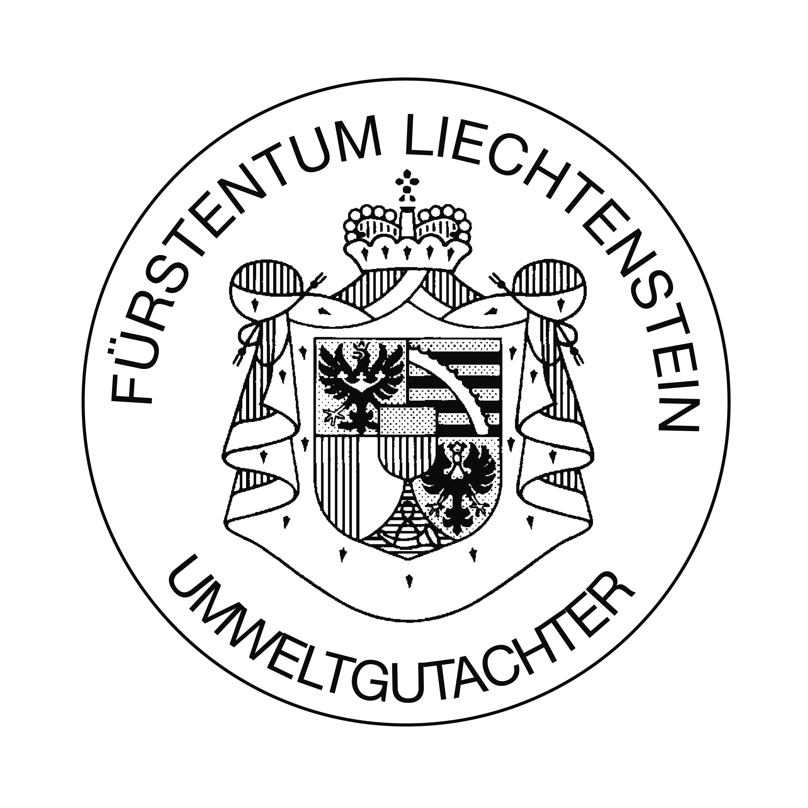

Verordnung vom 10. März 1998 über die Akkreditierung und Notifizierung von Umweltgutachtern Aufgrund von Art. 35 des Gesetzes vom 2. Mai 1996 über die Akkreditierung und Notifizierung, LGBl. 1996 Nr. 82 , verordnet die Regierung: I. Allgemeine Bestimmungen Art. 1 Gegenstand und Zweck 1) Diese Verordnung regelt insbesondere: a) die Voraussetzungen und das Verfahren der Akkreditierung und Notifizierung von Umweltgutachtern; b) die besonderen Pflichten akkreditierter Umweltgutachter; c) die Überwachung akkreditierter Umweltgutachter; d) die Registrierung von Organisationen gemäss Art. 12 und 13 der EMAS-Verordnung. 2) Sie dient der Ausführung der Verordnung (EG) Nr. 1221/2009 des Europäischen Parlaments und des Rates vom 25. November 2009 über die freiwillige Teilnahme von Organisationen an einem Gemeinschaftssystem für Umweltmanagement und Umweltbetriebsprüfung und zur Aufhebung der Verordnung (EG) Nr. 761/2001, sowie der Beschlüsse der Kommission 2001/681/EG und 2006/193/EG (EMAS-Verordnung; EWR-Rechtssammlung: Anh. XX - 1ea.01). Art. 2 Geltungsbereich Diese Verordnung gilt für Organisationen im Sinne von Art. 2 Ziff. 21 der EMAS-Verordnung. Art. 3 Begriffe 1) Auf diese Verordnung finden die Begriffsbestimmungen der EMAS-Verordnung und des Gesetzes sinngemäss Anwendung. 2) Im Sinne dieser Verordnung sind: a) "EWR": Europäischer Wirtschaftsraum; b) "Umweltgutachter": natürliche oder juristische Personen, die in Liechtenstein oder in einem anderem Vertragsstaat des Abkommens vom 2. Mai 1992 über den Europäischen Wirtschaftsraum (EWRA), LGBl. 1995 Nr. 68, Tätigkeiten gemäss der EMAS-Verordnung ausüben dürfen. c) Aufgehoben 3) Unter den in dieser Verordnung verwendeten Berufs- und Personenbezeichnungen werden Personen männlichen und weiblichen Geschlechts verstanden. II. Akkreditierung von Umweltgutachtern A. Allgemeine Bestimmungen Art. 4 Inhalt der Akkreditierungsurkunde 1) Die Akkreditierungsurkunde hat den Namen und die Anschrift des Umweltgutachters und gegebenenfalls der fachkundigen Personen gemäss Art. 13 Abs. 1 Bst. a Unterbst. aa sowie die Angabe zu enthalten, auf welche Bereiche sich die Akkreditierung erstreckt. Bei juristischen Personen sind die Namen und Anschriften der akkreditierten Umweltgutachter sowie der Inhaber der Fachkenntnisbescheinigungen gemäss Art. 15 Bst. a Unterbst. aa und Bst. b Unterbst. bb zu vermerken. 2) Die Liechtensteinische Akkreditierungsstelle stellt Antragstellern ein Antragsformular sowie einen Leitfaden auf Antrag zur Verfügung. Art. 5 Bezeichnung, Akkreditierungszeichen 1) Umweltgutachter haben im Geschäftsverkehr die Berufsbezeichnung "Umweltgutachter" zu führen. Die Berufsbezeichnung darf nicht führen, wer keine gültige Akkreditierung gemäss Art. 7 oder Art. 15 besitzt. 2) Die Form und der Inhalt des Akkreditierungszeichens für Umweltgutachter gemäss Art. 7 Abs. 2 des Gesetzes ist im Anhang zu dieser Verordnung enthalten. Art. 6 Listen 1) Die Liechtensteinische Akkreditierungsstelle führt die Liste gemäss Art. 28 Abs. 8 der EMAS-Verordnung der in Liechtenstein akkreditierten Umweltgutachter sowie der Inhaber der Fachkenntnisbescheinigungen. 2) Sie führt auch eine Liste der von einem anderen EWR-Mitgliedstaat gemäss der EMAS-Verordnung zugelassenen Umweltgutachter, die gemäss Art. 17 eine gutachterliche Tätigkeit in Liechtenstein ausüben dürfen. 3) Jedermann ist berechtigt, diese Listen bei der Liechtensteinischen Akkreditierungsstelle einzusehen. B. Natürliche Personen (Einzelgutachter) Art. 7 Akkreditierungsvoraussetzungen Natürliche Personen können als Umweltgutachter akkreditiert werden, wenn sie die Voraussetzungen gemäss Art. 20 und 21 der EMAS-Verordnung und insbesondere von Art. 8 bis 11 dieser Verordnung erfüllen. Art. 8 Ausbildung 1) Der Antragsteller muss den Abschluss eines Hochschulstudiums auf den Gebieten der Wirtschafts- oder Verwaltungswissenschaften, der Naturwissenschaften oder Technik, der Biowissenschaften oder des Rechts an einer Hochschule nachweisen. Abs. 2 bleibt vorbehalten. 2) Von der Voraussetzung einer Hochschulausbildung gemäss Abs. 1 kann abgesehen werden, wenn in den Bereichen, für die eine Akkreditierung beantragt ist, a) eine Fachhochschulausbildung, die Qualifikation als Meister oder eine gleichwertige Zulassung oder Anerkennung vorliegt und b) Aufgaben in leitender Stellung oder als Selbständigerwerbender mindestens während fünf Jahren vor der Antragstellung hauptberuflich wahrgenommen wurden. Art. 9 Berufserfahrung im betrieblichen Umweltschutz Der Antragsteller hat eine mindestens dreijährige Tätigkeit beim Aufbau, der Betreuung oder der Durchführung von Umweltbetriebsprüfungen oder vergleichbaren betrieblichen Umweltschutzaufgaben als Selbstständigerwerbender in der Wirtschaft, in der Umweltverwaltung oder bei in der Umweltberatung tätigen Stellen nachzuweisen, bei der praktische Kenntnisse über den betrieblichen Umweltschutz erworben wurden. Art. 10 Fachkenntnisbescheinigungen 1) Zum Nachweis der Fachkenntnisse des Antragstellers gemäss Art. 20 und 21 der EMAS-Verordnung sind Bescheinigungen über den erfolgreichen Abschluss einer Prüfung in den folgenden Fachbereichen vorzulegen: a) Methodik und Durchführung der Umweltbetriebsprüfung; b) betriebliches Management; c) betriebsbezogene Umweltangelegenheiten; d) technische Zusammenhänge zu Tätigkeiten, auf die sich die Begutachtung erstreckt; e) einschlägige Rechts- und Verwaltungsvorschriften und Normen des betrieblichen Umweltschutzes. 2) Die erforderlichen Fachkenntnisse können ausnahmsweise auch auf andere geeignete Weise nachgewiesen werden. Art. 11 Aufgehoben Art. 12 Aufgehoben Art. 13 Erweiterung der Akkreditierung 1) Die Akkreditierung als Einzelgutachter ist auch auf Bereiche zu erstrecken, für die der Umweltgutachter nicht selbst über die erforderlichen Fachkenntnisse verfügt, wenn: a) er im Hinblick auf Art. 4 Abs. 5 der EMAS-Verordnung zeichnungsberechtigte Personen im Angestelltenverhältnis beschäftigt, die für die Bereiche aa) als Umweltgutachter zugelassen sind, oder bb) die erforderlichen Fachkenntnisbescheinigungen besitzen; b) er sicherstellt, dass die in Bst. a genannten Personen regelmässig an Fortbildungskursen teilnehmen. 2) In der Akkreditierungsurkunde sind die Zulassungsbereiche genau zu bezeichnen, für die der Umweltgutachter selbst und für welche die Personen gemäss Abs. 1 Bst. a die erforderlichen Fachkenntnisse besitzen. 3) Soweit sich die Akkreditierung auf Bereiche erstreckt, für die der Umweltgutachter nicht selbst über die erforderlichen Fachkenntnisse verfügt, gestattet diese Akkreditierung eine gutachterliche Tätigkeit nur im Zusammenwirken mit den in Abs. 1 genannten Personen. Insbesondere sind Berichte und die Gültigkeitserklärung von Umwelterklärungen von diesen Personen mitzuzeichnen. 4) Die Akkreditierung umfasst die Befugnis, gemäss Art. 45 der EMAS-Verordnung Zertifizierungsbescheinigungen nach dem von der Europäischen Kommission anerkannten Verfahren zu erteilen. Art. 14 Fachkundige Personen Wer für einen Einzelgutachter oder eine Umweltgutachter-Organisation gutachterliche Tätigkeiten aufgrund der EMAS-Verordnung wahrnimmt, ohne selbst als Umweltgutachter akkreditiert zu sein, muss die Anforderungen an Zuverlässigkeit und Unabhängigkeit im Sinne der Europäischen Norm EN ISO/IEC 17021 erfüllen. Er muss den Voraussetzungen nach Art. 8 und 9 genügen und eine Fachkenntnisbescheinigung in mindestens einem der in Art. 10 Abs. 1 Bst. a bis e genannten Bereichen vorweisen. C. Juristische Personen (Umweltgutachter-Organisationen) Art. 15 Akkreditierungsvoraussetzungen Juristische Personen werden als Umweltgutachter akkreditiert, wenn: a) mindestens ein Drittel der persönlich haftenden Gesellschafter oder Partner oder der Mitglieder des Vorstandes, oder der Geschäftsführer aa) als Umweltgutachter akkreditiert sind, oder bb) aus Personen mit Fachkenntnisbescheinigungen und mindestens einem Umweltgutachter bestehen; b) im Hinblick auf Art. 4 Abs. 5 der EMAS-Verordnung zeichnungsberechtigte Vertreter oder zeichnungsberechtigte Angestellte oder durch Werkvertrag verpflichtete Personen für die Bereiche, für die die Akkreditierung beantragt ist, aa) als Umweltgutachter akkreditiert sind, oder bb) die erforderlichen Fachkenntnisbescheinigungen besitzen; c) sichergestellt ist, dass die in Bst. b genannten Personen regelmässig an Fortbildungskursen teilnehmen; d) die wirtschaftliche und finanzielle Unabhängigkeit besteht; und e) die Unparteilichkeit gewährleistet ist. Art. 16 Mitwirkung fachkundiger Personen Die Akkreditierung gestattet gutachterliche Tätigkeiten fachkundiger Personen im Sinne von Art. 15 Bst. b Unterbst. bb nur im Zusammenwirken mit einem zugelassenen Umweltgutachter, der Berichte und die Gültigkeitserklärung der Umwelterklärungen als Verantwortlicher zeichnet; die genannten Personen müssen mitzeichnen. D. Ausländische Gutachter Art. 17 Meldepflicht 1) Ausländische Umweltgutachter gemäss Art. 6 Abs. 2 haben sich vor Aufnahme einer gutachterlichen Tätigkeit in Liechtenstein bei der Liechtensteinischen Akkreditierungsstelle zu melden. 2) Sie haben eine Ausfertigung oder beglaubigte Abschrift der Zulassung und eine beglaubigte deutsche Übersetzung vorzulegen. III. Rechte und Pflichten der Umweltgutachter Art. 18 Aufbewahrung der Unterlagen Umweltgutachter und Inhaber von Fachkenntnisbescheinigungen sind verpflichtet, Zweitschriften folgender von ihnen (mit)gezeichneten Unterlagen gemäss Art. 18 der EMAS-Verordnung mindestens fünf Jahre aufzubewahren: a) Vereinbarungen mit den Unternehmen über Gegenstand und Umfang der Begutachtung; b) Berichte an die Unternehmensleitung; c) für gültig erklärte Umwelterklärungen; und d) Niederschriften über Besuche auf dem Betriebsgelände und über Gespräche mit dem Betriebspersonal. Art. 19 Veränderungen 1) Umweltgutachter und Inhaber von Fachkenntnisbescheinigungen sind verpflichtet: a) die Liechtensteinische Akkreditierungsstelle unverzüglich über alle Veränderungen zu unterrichten, die auf die Akkreditierung oder die Fachkenntnisbescheinigung Einfluss haben können; b) auf Verlangen der Liechtensteinischen Akkreditierungsstelle die zur Überprüfung erforderlichen Unterlagen vorzulegen. 2) Die Bestimmungen gemäss Abs. 1 finden auf Umweltgutachter gemäss Art. 6 Abs. 2 sinngemäss Anwendung. IV. Überwachung Art. 20 Aufsicht Die Aufsicht über den Vollzug dieser Verordnung, insbesondere über die Umweltgutachter, obliegt der Liechtensteinischen Akkreditierungsstelle. Art. 21 Überprüfung, Erlöschen, Entzug 1) Umweltgutachter gemäss Art. 3 Abs. 2 Bst. b sowie Inhaber von Fachkenntnisbescheinigungen gemäss Art. 15 Bst. b Unterbst. bb sind von der Liechtensteinischen Akkreditierungsstelle in Abständen von 24 Monaten nach Wirksamwerden der Akkreditierung oder der Fachkenntnisbescheinigung daraufhin zu überprüfen, ob die Voraussetzungen für die Zulassung oder die Erteilung der Fachkenntnisbescheinigung weiterhin erfüllt sind. Dabei erfolgt auch eine Überprüfung der Qualität der vorgenommenen Begutachtungen. 2) Die Überprüfung erfolgt auf Antrag des Umweltgutachters oder des Inhabers der Fachkenntnisbescheinigung. Wird der Antrag nicht innerhalb der Frist von 24 Monaten gestellt, erlischt die Akkreditierung oder der Eintrag der Fachkenntnisbescheinigung wird in der Liste gemäss Art. 6 Abs. 1 gestrichen. 3) Wird bei der Überprüfung gemäss Abs. 1 festgestellt, dass die Voraussetzungen der Akkreditierung oder der Fachkenntnisbescheinigung nicht oder nicht mehr erfüllt sind, wird die Akkreditierung oder die Erlaubnis zur Fortführung der gutachterlichen Tätigkeit entzogen und mit eingeschriebenem Brief mitgeteilt. Vorgängig ist die Stellungnahme des Umweltgutachters einzuholen. 4) Die Aufsicht über die ausländischen Umweltgutachter gemäss Art. 6 Abs. 2 erfolgt in der Weise, dass diese jeweils vor Aufnahme einer Begutachtung der Liechtensteinischen Akkreditierungsstelle den Fortbestand ihrer Zulassung in einem EWR-Mitgliedstaat nachzuweisen haben. V. Organisationen Art. 22 Registrierung der geprüften Organisationen 1) Die Liechtensteinische Akkreditierungsstelle führt ein Register der geprüften Organisationen gemäss Art. 13 der EMAS-Verordnung. 2) Die Eintragung der Organisationen erfolgt auf Antrag gemäss Anhang VI der EMAS-Verordnung. 3) Die Liechtensteinische Akkreditierungsstelle unterrichtet die Unternehmensleitung der geprüften Organisation über die Eintragung. 4) Sie meldet die jeweils gültige, gemäss der EMAS-Verordnung aktualisierte Fassung des Registers monatlich an die nach Massgabe von Art. 12 der EMAS-Verordnung vorgesehenen Stellen. Art. 23 Streichung und vorübergehende Aufhebung von Eintragungen Der betroffenen Organisation ist vorgängig Gelegenheit zur Stellungnahme zu geben, wenn die Liechtensteinische Akkreditierungsstelle beabsichtigt, eine Eintragung: a) gemäss Art. 15 Abs. 3 der EMAS-Verordnung aufgrund nachträglicher Nichterfüllung der einschlägigen Bedingungen der EMAS-Verordnung vorübergehend aufzuheben oder zu streichen; oder b) gemäss Art. 13 Abs. 4 und Art. 15 Abs. 4 der EMAS-Verordnung aufgrund eines Verstosses gegen einschlägige Umweltvorschriften zu verweigern oder vorübergehend aufzuheben oder zu streichen. Art. 24 Verwendung des EMAS-Zeichens 1) Das EMAS-Zeichen darf gemäss Art. 10 der EMAS-Verordnung nicht verwendet werden: a) auf Produkten oder auf ihrer Verpackung; b) in Verbindung mit Vergleichen mit anderen Tätigkeiten und Dienstleistungen oder in einer Weise, die zu Verwechslungen mit Umwelt-Produktkennzeichnungen führen kann. 2) Das EMAS-Zeichen gemäss Anhang V der EMAS-Verordnung dürfen nur Organisationen verwenden, die im Register nach Art. 22 eingetragen sind. VI. Gebühren Art. 25 Gebühren 1) Die Gebühren für den Antrag und die Akkreditierung der Umweltgutachter bestimmen sich nach den Gebühren für Zertifizierstellen gemäss der Verordnung vom 12. November 1996 über die Erhebung von Gebühren für die Akkreditierung und Notifizierung, LGBl. 1996 Nr. 197. 2) Die Eintragung der Organisationen im Register gemäss Art. 22 ist gebührenfrei. VII. Schlussbestimmung Art. 26 Inkrafttreten Diese Verordnung tritt am Tage der Kundmachung in Kraft. Fürstliche Regierung: gez. Dr. Mario Frick Fürstlicher Regierungschef Anhang (Art. 5 Abs. 2) Akkreditierungszeichen für Umweltgutachter 

 FL-EMAS ...
