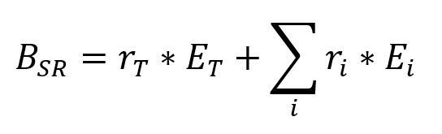
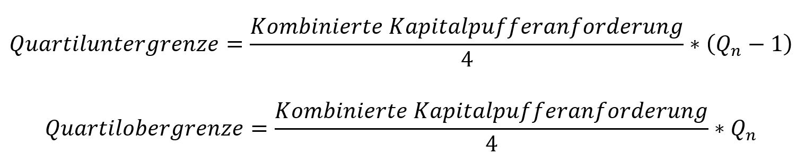
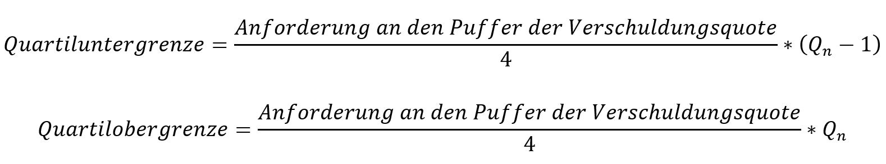

Gesetz vom 5. Dezember 2024 über die Tätigkeit und Beaufsichtigung von Banken, Finanzholdinggesellschaften und gemischten Finanzholdinggesellschaften (Bankengesetz; BankG) Dem nachstehenden vom Landtag gefassten Beschluss erteile Ich Meine Zustimmung: I. Allgemeine Bestimmungen Art. 1 Gegenstand und Zweck 1) Dieses Gesetz regelt die Aufnahme, Ausübung und Beaufsichtigung der Tätigkeit von Banken, Finanzholdinggesellschaften und gemischten Finanzholdinggesellschaften auf Einzel-, teil- und konsolidierter Basis. 2) Es bezweckt den Schutz der Gläubiger und Anleger von Banken sowie die Sicherung der Funktionsfähigkeit und des Vertrauens in das liechtensteinische Geld- und Kreditwesen sowie die Sicherung der Stabilität des Finanzsystems. 3) Es dient zudem der Umsetzung bzw. Durchführung folgender EWR-Rechtsvorschriften: a) Richtlinie 2013/36/EU über den Zugang zur Tätigkeit von Kreditinstituten und die Beaufsichtigung von Kreditinstituten ; b) Richtlinie 2014/65/EU über Märkte für Finanzinstrumente ; c) Richtlinie 2014/59/EU zur Festlegung eines Rahmens für die Sanierung und Abwicklung von Kreditinstituten und Wertpapierfirmen ; d) Richtlinie 2014/49/EU über Einlagensicherungssysteme ; e) Richtlinie 2001/24/EG über die Sanierung und Liquidation von Kreditinstituten ; f) Verordnung (EU) Nr. 575/2013 über Aufsichtsanforderungen an Kreditinstitute ; g) Verordnung (EU) 2019/2033 über die Aufsichtsanforderungen an Wertpapierfirmen ; h) Verordnung (EU) 2020/1503 über Europäische Schwarmfinanzierungsdienstleister für Unternehmen . 4) Die gültige Fassung der EWR-Rechtsvorschriften, auf die in diesem Gesetz Bezug genommen wird, ergibt sich aus der Kundmachung der Beschlüsse des Gemeinsamen EWR-Ausschusses im Liechtensteinischen Landesgesetzblatt nach Art. 3 Bst. k des Kundmachungsgesetzes. Art. 2 Geltungsbereich 1) Dieses Gesetz gilt vorbehaltlich Abs. 2 bis 8 für nach diesem Gesetz bewilligte Banken, Finanzholdinggesellschaften und gemischte Finanzholdinggesellschaften. 2) Soweit dies gesetzlich ausdrücklich geregelt ist, gilt es zudem für: a) Finanzholdinggesellschaften und gemischte Finanzholdinggesellschaften ohne Bewilligung nach Art. 26 Abs. 1 oder 2 sowie gemischte Holdinggesellschaften; b) EWR-Kreditinstitute und EWR-Finanzinstitute, die in Liechtenstein im Rahmen des freien Dienstleistungsverkehrs oder im Rahmen der Niederlassungsfreiheit über eine Zweigstelle tätig sind; c) Tochterunternehmen, die nach Teil 1 Titel II Kapitel 2 der Verordnung Nr. 575/2013 in die aufsichtliche Konsolidierung einzubeziehen sind; d) natürliche und juristische Personen, die Bankgeschäfte nach Art. 6 Abs. 1 ohne die erforderliche Bewilligung gewerbsmässig erbringen oder deren Erbringung anbieten. 3) Auf Banken, die nicht als Kreditinstitute nach Art. 4 Abs. 1 Ziff. 1 der Verordnung (EU) Nr. 575/2013 gelten, finden die Bestimmungen der genannten Verordnung sowie deren Durchführungsvorschriften Anwendung, so als ob diese Banken Kreditinstitute nach Art. 4 Abs. 1 Ziff. 1 der genannten Verordnung wären. 4) Art. 48, 52, 53, 63 bis 88, 90 bis 167, 169 bis 173, 176 bis 188 und 243 bis 251 dieses Gesetzes sowie die dazu erlassenen Verordnungen gelten für: a) Wertpapierfirmen nach dem Wertpapierfirmengesetz, die nach Art. 1 Abs. 2 der Verordnung (EU) 2019/2033 die Anforderungen der Verordnung (EU) Nr. 575/2013 einzuhalten haben; b) Wertpapierfirmen nach dem Wertpapierfirmengesetz, die aufgrund einer Entscheidung der Finanzmarktaufsicht (FMA) nach Art. 1 Abs. 5 der Verordnung (EU) 2019/2033 oder nach Art. 60 des genannten Gesetzes die Anforderungen der Verordnung (EU) Nr. 575/2013 einzuhalten haben. 5) Dieses Gesetz gilt mit Ausnahme der Art. 94 bis 116 auch für Zentralverwahrer, welche die ihnen nach Art. 54 oder 56 der Verordnung (EU) Nr. 909/2014 erlaubten bankartigen Nebendienstleistungen nach Abschnitt C des Anhangs der genannten Verordnung erbringen. 6) Es findet vorbehaltlich Abs. 2 Bst. c keine Anwendung auf folgende Unternehmen oder Personen, sofern sie den Umfang ihrer jeweiligen Bewilligung oder Zulassung nicht überschreiten: a) E-Geld-Institute nach dem E-Geld-Gesetz; b) Zahlungsinstitute nach dem Zahlungsdienstegesetz; c) Versicherungsunternehmen nach dem Versicherungsaufsichtsgesetz; d) anerkannte Vorsorgeeinrichtungen nach dem Gesetz über die betriebliche Personalvorsorge; e) Einrichtungen der betrieblichen Altersvorsorge nach dem Pensionsfondsgesetz; f) Verwalter alternativer Investmentfonds (AIFM) nach dem Gesetz über die Verwalter alternativer Investmentfonds; g) Organismen für gemeinsame Anlagen in Wertpapieren (OGAW) und Verwaltungsgesellschaften nach dem Gesetz über bestimmte Organismen für gemeinsame Anlagen in Wertpapieren; h) Verwaltungsgesellschaften nach dem Investmentunternehmengesetz; i) Wertpapierfirmen nach dem Wertpapierfirmengesetz; vorbehalten bleiben Abs. 4 und Art. 17 Abs. 1; k) Vermögensverwaltungsgesellschaften nach dem Vermögensverwaltungsgesetz; l) Pfandbriefinstitute nach dem Pfandbriefgesetz; m) Zentrale Gegenparteien nach Art. 2 Ziff. 1 der Verordnung (EU) Nr. 648/2012 , soweit sie die ihnen nach Art. 14 und 15 der genannten Verordnung erlaubten Tätigkeiten erbringen; n) Zentralverwahrer, wenn sie die ihnen nach Art. 16 und 19 der Verordnung (EU) Nr. 909/2014 erlaubten Kerndienstleistungen nach Abschnitt A des Anhangs der genannten Verordnung und nicht bankartigen Nebendienstleistungen nach Abschnitt B des Anhangs der genannten Verordnung erbringen; o) die Liechtensteinische Post Aktiengesellschaft im Rahmen der Erbringung ihrer Dienstleistungen nach Art. 18a des Gesetzes über die Liechtensteinische Post; p) Schwarmfinanzierungsdienstleister, sofern diese ausschliesslich Schwarmfinanzierungsdienstleistungen nach der Verordnung (EU) 2020/1503 erbringen und dabei keine Einlagen oder anderen rückzahlbaren Gelder entgegennehmen; q) Projektträger oder Anleger, die Tätigkeiten nach Art. 1 Abs. 3 der Verordnung 2020/1503 ausüben, die ausschliesslich mit der Erbringung von Schwarmfinanzierungsdienstleistungen durch Schwarmfinanzierungsdienstleister in Zusammenhang stehen; r) Treuhänder nach dem Treuhändergesetz; s) Anbieter von Kryptowerte-Dienstleistungen nach der Verordnung (EU) 2023/1114 , sofern deren Geschäftsmodell oder die Kryptowerte-Dienstleistungen, die sie anbieten, das Halten von Geldbeträgen von Kunden erfordert. 7) Es gilt nicht für die Entgegennahme von Geldern durch: a) das Land oder die Gemeinden; und b) internationale Organisationen. 8) Es gilt nicht für Unternehmen, deren geschäftliche Tätigkeit ausschliesslich umfasst: a) das Pfandleihgewerbe durch die Gewährung von Darlehen gegen Faustpfand (Art. 365 des Sachenrechts); b) den Abschluss von Leasingverträgen als Leasinggeber (Finanzierungsleasinggeschäft); c) das Kreditgeschäft nach Art. 6 Abs. 1 Bst. b, sofern die Ausleihung von Geldern ausschliesslich aus eigenen Mitteln erfolgt; d) den Betrieb des Wechselstubengeschäfts nach Art. 6 Abs. 2 Bst. e; e) Schliessfachverwaltungsdienste nach Art. 6 Abs. 2 Bst. f; f) das Factoringgeschäft nach Art. 6 Abs. 1 Bst. h, sofern dies ausschliesslich aus eigenen Mitteln erfolgt. Art. 3 Begriffsbestimmungen und Bezeichnungen 1) Im Sinne dieses Gesetzes gelten als: 1. "Drittstaatsbank": ein Unternehmen mit Sitz in einem Drittstaat, das nach dem Recht seines Sitzstaats über eine Bewilligung zur Erbringung von Bankgeschäften verfügt; 2. "Wertpapierfirma": eine Wertpapierfirma nach Art. 4 Abs. 1 Ziff. 1 des Wertpapierfirmengesetzes; 3. "Institut": ein Institut nach Art. 4 Abs. 1 Ziff. 3 der Verordnung (EU) Nr. 575/2013; 4. "Repräsentanz": jeder Teil der Organisation einer Bank, eines EWR-Kreditinstituts, eines EWR-Finanzinstituts oder einer Drittstaatsbank, der weder Geschäfte abschliesst oder abwickelt noch für eigene Rechnung vermittelt; 5. "Versicherungsunternehmen": ein Versicherungsunternehmen nach Art. 4 Abs. 1 Ziff. 5 der Verordnung (EU) Nr. 575/2013; 6. "Verwaltungsrat": das Organ einer Bank, einer Finanzholdinggesellschaft oder gemischten Finanzholdinggesellschaft, das nach Gesetz oder Satzung bestellt wurde und befugt ist, Strategie, Ziele und Gesamtpolitik festzulegen und die Entscheidungen der Geschäftsleitung zu kontrollieren und zu überwachen; 7. "Geschäftsleitung": diejenigen natürlichen Personen, die nach Gesetz oder Satzung in einer Bank, einer Finanzholdinggesellschaft oder gemischten Finanzholdinggesellschaft Geschäftsführungsaufgaben wahrnehmen und für das Tagesgeschäft verantwortlich und gegenüber dem Verwaltungsrat rechenschaftspflichtig sind; 8. "Inhaber von Schlüsselfunktionen": Personen, die einen wesentlichen Einfluss auf die Leitung einer Bank haben, die jedoch weder Mitglieder des Verwaltungsrats noch der Geschäftsleitung sind und anhand eines risikobasierten Ansatzes von der Bank als solche ermittelt werden; dazu können insbesondere die Leiter von Zweigstellen sowie die Leiter der internen Kontrollfunktionen und der Finanzvorstand (Chief Financial Officer) zählen, soweit diese keine Mitglieder der Geschäftsleitung sind; 9. "Leiter einer Repräsentanz": diejenige natürliche Person, die zur Leitung des Betriebs der Repräsentanz und der Vertretung der Repräsentanz nach aussen vorgesehen ist; 10. "Systemrisiko": das Risiko einer Störung des Finanzsystems mit möglicherweise schwerwiegenden negativen Auswirkungen auf das Finanzsystem und die Realwirtschaft; 11. "Modellrisiko": der potenzielle Verlust, der einer Bank als Folge von Entscheidungen entsteht, die sich grundsätzlich auf das Ergebnis interner Modelle stützen könnten, wenn diese Modelle Fehler bei der Konzeption, Ausführung oder Nutzung aufweisen; 12. "Mutterunternehmen": ein Mutterunternehmen nach Art. 4 Abs. 1 Ziff. 15 der Verordnung (EU) Nr. 575/2013; 13. "Tochterunternehmen": ein Tochterunternehmen nach Art. 4 Abs. 1 Ziff. 16 der Verordnung (EU) Nr. 575/2013; 14. "Zweigstelle": eine Zweigstelle nach Art. 4 Abs. 1 Ziff. 17 der Verordnung (EU) Nr. 575/2013; 15. "Leiter der Zweigstelle": diejenige natürliche Person, die zur Führung der Geschäfte und zur Vertretung der Zweigstelle nach aussen vorgesehen ist; 16. "Anbieter von Nebendienstleistungen": ein Anbieter von Nebendienstleistungen nach Art. 4 Abs. 1 Ziff. 18 der Verordnung (EU) Nr. 575/2013; 17. "Vermögensverwaltungsgesellschaft": eine Verwaltungsgesellschaft nach Art. 3 Abs. 1 Ziff. 4 des Gesetzes über bestimmte Organismen für gemeinsame Anlagen in Wertpapieren oder ein AIFM nach Art. 4 Abs. 1 Ziff. 2 des Gesetzes über die Verwalter alternativer Investmentfonds einschliesslich - sofern nicht anders festgelegt - Drittstaatsunternehmen, die ähnliche Tätigkeiten ausüben und die dem Recht eines Drittstaats unterliegen, dessen aufsichtliche und rechtliche Anforderungen denen im Europäischen Wirtschaftsraum (EWR) zumindest gleichwertig sind; 18. "Finanzholdinggesellschaft": eine Finanzholdinggesellschaft nach Art. 4 Abs. 1 Ziff. 20 der Verordnung (EU) Nr. 575/2013; 19. "gemischte Finanzholdinggesellschaft": eine gemischte Finanzholdinggesellschaft nach Art. 4 Abs. 1 Ziff. 21 der Verordnung (EU) Nr. 575/2013; 20. "gemischte Holdinggesellschaft": eine gemischte Holdinggesellschaft nach Art. 4 Abs. 1 Ziff. 22 der Verordnung (EU) Nr. 575/2013; 21. "Finanzinstitut": ein Finanzinstitut nach Art. 4 Abs. 1 Ziff. 26 der Verordnung (EU) Nr. 575/2013; 22. "Unternehmen der Finanzbranche": ein Unternehmen der Finanzbranche nach Art. 4 Abs. 1 Ziff. 27 der Verordnung (EU) Nr. 575/2013; 23. "Mutterinstitut in einem EWR-Mitgliedstaat": ein Mutterinstitut in einem EWR-Mitgliedstaat nach Art. 4 Abs. 1 Ziff. 28 der Verordnung (EU) Nr. 575/2013; 24. "EWR-Mutterinstitut": ein EWR-Mutterinstitut nach Art. 4 Abs. 1 Ziff. 29 der Verordnung (EU) Nr. 575/2013; 25. "Mutterfinanzholdinggesellschaft in einem EWR-Mitgliedstaat": eine Mutterfinanzholdinggesellschaft in einem EWR-Mitgliedstaat nach Art. 4 Abs. 1 Ziff. 30 der Verordnung (EU) Nr. 575/2013; 26. "EWR-Mutterfinanzholdinggesellschaft": eine EWR-Mutterfinanzholdinggesellschaft nach Art. 4 Abs. 1 Ziff. 31 der Verordnung (EU) Nr. 575/2013; 27. "gemischte Mutterfinanzholdinggesellschaft in einem EWR-Mitgliedstaat": eine gemischte Mutterfinanzholdinggesellschaft in einem EWR-Mitgliedstaat nach Art. 4 Abs. 1 Ziff. 32 der Verordnung (EU) Nr. 575/2013; 28. "gemischte EWR-Mutterfinanzholdinggesellschaft": eine gemischte EWR-Mutterfinanzholdinggesellschaft nach Art. 4 Abs. 1 Ziff. 33 der Verordnung (EU) Nr. 575/2013; 29. "systemrelevantes Institut": ein EWR-Mutterinstitut, eine EWR-Mutterfinanzholdinggesellschaft, eine gemischte EWR-Mutterfinanzholdinggesellschaft oder ein Institut, dessen Ausfall oder Versagen zu einem Systemrisiko führen könnte; 30. "Beteiligung": eine Beteiligung nach Art. 4 Abs. 1 Ziff. 35 der Verordnung (EU) Nr. 575/2013; 31. "qualifizierte Beteiligung": eine qualifizierte Beteiligung nach Art. 4 Abs. 1 Ziff. 36 der Verordnung (EU) Nr. 575/2013; 32. "Kontrolle": Kontrolle nach Art. 4 Abs. 1 Ziff. 37 der Verordnung (EU) Nr. 575/2013; 33. "enge Verbindung": eine enge Verbindung nach Art. 4 Abs. 1 Ziff. 38 der Verordnung (EU) Nr. 575/2013; 34. "zuständige Behörde": eine zuständige Behörde nach Art. 4 Abs. 1 Ziff. 40 der Verordnung (EU) Nr. 575/2013; 35. "konsolidierende Aufsichtsbehörde": eine konsolidierende Aufsichtsbehörde nach Art. 4 Abs. 1 Ziff. 41 der Verordnung (EU) Nr. 575/2013; 36. "EBA": die Europäische Bankenaufsichtsbehörde; 37. "EIOPA": die Europäische Aufsichtsbehörde für das Versicherungswesen und die betriebliche Altersversorgung; 38. "ESMA": die Europäische Wertpapier- und Marktaufsichtsbehörde; 39. "ESRB": der Europäische Ausschuss für Systemrisiken; 40. "Europäische Aufsichtsbehörden": die EBA, EIOPA, ESMA und der ESRB im Rahmen ihrer jeweiligen Zuständigkeiten; 41. "Bewilligung": eine Zulassung nach Art. 4 Abs. 1 Ziff. 42 der Verordnung (EU) Nr. 575/2013; 42. "Herkunftsmitgliedstaat": ein Herkunftsmitgliedstaat nach Art. 4 Abs. 1 Ziff. 43 der Verordnung (EU) Nr. 575/2013; 43. "Aufnahmemitgliedstaat": ein Aufnahmemitgliedstaat nach Art. 4 Abs. 1 Ziff. 44 der Verordnung (EU) Nr. 575/2013; 44. "Drittstaat": ein Staat, der nicht EWR-Mitgliedstaat ist; 45. "Zentralbanken des ESZB": Zentralbanken des Europäischen Systems der Zentralbanken (ESZB) nach Art. 4 Abs. 1 Ziff. 45 der Verordnung (EU) Nr. 575/2013; 46. "Zentralbank": eine Zentralbank nach Art. 4 Abs. 1 Ziff. 46 der Verordnung (EU) Nr. 575/2013 sowie die Schweizerische Nationalbank im Rahmen der ihr übertragenen Aufgaben; 47. "konsolidierte Lage": die konsolidierte Lage nach Art. 4 Abs. 1 Ziff. 47 der Verordnung (EU) Nr. 575/2013; 48. "auf konsolidierter Basis": auf Basis der konsolidierten Lage nach Art. 4 Abs. 1 Ziff. 48 der Verordnung (EU) Nr. 575/2013; 49. "auf teilkonsolidierter Basis": auf teilkonsolidierter Basis nach Art. 4 Abs. 1 Ziff. 49 der Verordnung (EU) Nr. 575/2013; 50. "Finanzinstrument": ein Finanzinstrument nach Art. 4 Abs. 1 Ziff. 50 der Verordnung (EU) Nr. 575/2013; 51. "Eigenmittel": die Eigenmittel nach Art. 4 Abs. 1 Ziff. 118 der Verordnung (EU) Nr. 575/2013; 52. "operationelles Risiko": das operationelle Risiko nach Art. 4 Abs. 1 Ziff. 52 der Verordnung (EU) Nr. 575/2013; 53. "Kreditrisikominderung": die Kreditrisikominderung nach Art. 4 Abs. 1 Ziff. 57 der Verordnung (EU) Nr. 575/2013; 54. "Verbriefung": eine Verbriefung nach Art. 4 Abs. 1 Ziff. 61 der Verordnung (EU) Nr. 575/2013; 55. "Verbriefungsposition": eine Verbriefungsposition nach Art. 4 Abs. 1 Ziff. 62 der Verordnung (EU) Nr. 575/2013; 56. "Verbriefungszweckgesellschaft": eine Verbriefungszweckgesellschaft nach Art. 4 Abs. 1 Ziff. 66 der Verordnung (EU) Nr. 575/2013; 57. "freiwillige Altersvorsorgeleistungen": freiwillige Altersvorsorgeleistungen nach Art. 4 Abs. 1 Ziff. 73 der Verordnung (EU) Nr. 575/2013; 58. "Handelsbuch": das Handelsbuch nach Art. 4 Abs. 1 Ziff. 86 der Verordnung (EU) Nr. 575/2013; 59. "geregelter Markt": ein geregelter Markt nach Art. 4 Abs. 1 Ziff. 92 der Verordnung (EU) Nr. 575/2013; 60. "Verschuldung": die Verschuldung nach Art. 4 Abs. 1 Ziff. 93 der Verordnung (EU) Nr. 575/2013; 61. "Risiko einer übermässigen Verschuldung": das Risiko einer übermässigen Verschuldung nach Art. 4 Abs. 1 Ziff. 94 der Verordnung (EU) Nr. 575/2013; 62. "interne Ansätze": folgende Ansätze oder Modelle zur Ermittlung der Eigenmittelanforderungen nach der Verordnung (EU) Nr. 575/2013: a) der auf internen Einstufungen basierende Ansatz (Art. 143 Abs. 1 der Verordnung (EU) Nr. 575/2013); b) der auf internen Modellen beruhende Ansatz (Art. 221 der Verordnung (EU) Nr. 575/2013); c) der auf eigenen Schätzungen beruhende Ansatz (Art. 225 der Verordnung (EU) Nr. 575/2013); d) die fortgeschrittenen Messansätze (Art. 312 Abs. 2 der Verordnung (EU) Nr. 575/2013); e) die auf internen Modellen beruhende Methode (Art. 283 und 363 der Verordnung (EU) Nr. 575/2013); und f) der interne Bemessungsansatz (Art. 259 Abs. 3 der Verordnung (EU) Nr. 575/2013); 63. "Abwicklungsbehörde": eine Abwicklungsbehörde nach Art. 3 Abs. 1 Ziff. 5 des Sanierungs- und Abwicklungsgesetzes; 64. "global systemrelevantes Institut" oder "G-SRI": ein G-SRI nach Art. 4 Abs. 1 Ziff. 133 der Verordnung (EU) Nr. 575/2013; 65. "global systemrelevantes Nicht-EWR-Institut" oder "Nicht-EWR-G-SRI": ein Nicht-EWR-G-SRI nach Art. 4 Abs. 1 Ziff. 134 der Verordnung (EU) Nr. 575/2013; 66. "Gruppe": eine Gruppe nach Art. 4 Abs. 1 Ziff. 138 der Verordnung (EU) Nr. 575/2013; 67. "Drittstaatsgruppe": eine Gruppe, deren Mutterunternehmen in einem Drittstaat niedergelassen ist; 68. "geschlechtsneutrale Vergütungspolitik": eine Vergütungspolitik, die auf dem Grundsatz des gleichen Entgelts für Männer und Frauen bei gleicher oder gleichwertiger Arbeit beruht; 69. "Exceptions to policy-Geschäfte" oder "ETP-Geschäfte": Geschäfte, die von Banken ausnahmsweise in Abweichung von ihren internen Weisungen abgeschlossen werden; 70. "Sanierungsmassnahmen": Massnahmen, mit denen die finanzielle Lage einer Bank gesichert oder wiederhergestellt werden soll und welche die bestehenden Rechte Dritter beeinträchtigen könnten, einschliesslich der Massnahmen, die eine Aussetzung der Zahlungen, eine Aussetzung der Vollstreckungsmassnahmen oder eine Kürzung der Forderungen erlauben; 71. "Liquidationsverfahren": ein von einer Verwaltungs- oder Gerichtsbehörde eines EWR-Mitgliedstaats eröffnetes und unter deren Aufsicht durchgeführtes Gesamtverfahren mit dem Ziel, die Vermögenswerte unter Aufsicht der genannten Verwaltungs- oder Gerichtsbehörde zu verwerten; dazu zählen auch Verfahren, die durch einen Nachlassvertrag im Konkurs oder eine ähnliche Massnahme abgeschlossen werden; 72. "Gesamtnettoumsatz" bzw. "Bruttoertrag": die Summe aus Zinserträgen abzüglich Zinsaufwand (Zinserfolg), laufenden Erträgen aus Wertpapieren, Erträgen aus dem Kommissions- und Dienstleistungsgeschäft abzüglich Kommissionsaufwand (Erfolg aus dem Kommissions- und Dienstleistungsgeschäft), Erfolg aus Finanzgeschäften sowie übriger ordentlicher Ertrag des Unternehmens im vorangegangenen Geschäftsjahr; ist das Unternehmen Tochterunternehmen eines Mutterunternehmens, bezeichnet "Bruttoertrag" den Bruttoertrag, der im vorangegangenen Geschäftsjahr im konsolidierten Abschluss des Mutterunternehmens an der Spitze der Gruppe ausgewiesen wurde; 73. "Bank von erheblicher Bedeutung": eine Bank, die aufgrund ihrer Grösse, ihrer internen Organisation sowie der Art, des Umfangs und der Komplexität ihrer Geschäfte von erheblicher Bedeutung ist; als Banken von erheblicher Bedeutung gelten jedenfalls Banken, die als G-SRI nach Art. 101 oder als A-SRI nach Art. 102 festgelegt wurden; 74. "gemeinsam handelnde Personen": natürliche oder juristische Personen, die aufgrund einer expliziten oder impliziten Vereinbarung zwischen ihnen beschliessen, eine qualifizierte Beteiligung an einer Bank zu erwerben oder zu erhöhen; 75. "Nettingvereinbarungen": bilaterale Schuldumwandlungsverträge und sonstige bilaterale Aufrechnungsvereinbarungen; ein bilateraler Schuldumwandlungsvertrag liegt vor, wenn gegenseitige Forderungen und Verbindlichkeiten automatisch so zusammengefasst werden, dass sich bei jeder Schuldumwandlung ein einziger Nettobetrag ergibt und ein einziger rechtsverbindlicher neuer Vertrag geschaffen wird, der die früheren Verträge erlöschen lässt; 76. "Auslagerung": Vereinbarungen gleich welcher Form zwischen einer Bank und einem Dienstleister, in deren Rahmen der Dienstleister einen Prozess durchführt, eine Dienstleistung erbringt oder eine Tätigkeit ausführt, der bzw. die von der Bank selbst wahrzunehmen wäre. 2) Werden in diesem Gesetz die Begriffe "Institut", "Mutterinstitut in einem EWR-Mitgliedstaat", "EWR-Mutterinstitut" und "Mutterunternehmen" verwendet, so sind darunter zur Sicherstellung der Erfüllung der Anforderungen auf konsolidierter und teilkonsolidierter Basis sowie der Ausübung von Aufsichtsbefugnissen durch die FMA als konsolidierende Aufsichtsbehörde auch zu verstehen: a) Finanzholdinggesellschaften und gemischte Finanzholdinggesellschaften mit einer Bewilligung nach Art. 26 Abs. 1 oder 2; b) benannte Institute, die von einer EWR-Mutterfinanzholdinggesellschaft oder gemischten EWR-Mutterfinanzholdinggesellschaft oder einer Mutterfinanzholdinggesellschaft oder gemischten Mutterfinanzholdinggesellschaft in einem EWR-Mitgliedstaat kontrolliert werden, sofern die betreffende Muttergesellschaft nach Art. 26 Abs. 3 keiner Bewilligungspflicht unterliegt; und c) nach Aufforderung der FMA nach Art. 154 Abs. 5 Bst. d benannte Finanzholdinggesellschaften, gemischte Finanzholdinggesellschaften oder Institute. 3) Im Übrigen finden die Begriffsbestimmungen der anwendbaren EWR-Rechtsvorschriften, insbesondere der Richtlinie 2013/36/EU sowie der Verordnung (EU) Nr. 575/2013, ergänzend Anwendung. 4) Unter den in diesem Gesetz verwendeten Personenbezeichnungen sind alle Personen unabhängig ihres Geschlechts zu verstehen, sofern sich die Personenbezeichnungen nicht ausdrücklich auf ein bestimmtes Geschlecht beziehen. II. Geschäftsbereiche und Bankgeschäfte A. Allgemeines Art. 4 Banken und Finanzinstitute 1) Banken sind Unternehmen mit einer Bewilligung nach diesem Gesetz, die: a) gewerbsmässig ein oder mehrere Bankgeschäfte nach Art. 6 Abs. 1 erbringen; oder b) gewerbsmässig eine Wertpapierdienstleistung oder Anlagetätigkeit nach Anhang 1 Abschnitt A Ziff. 3 oder 6 des Wertpapierdienstleistungsgesetzes erbringen bzw. ausüben und die übrigen Voraussetzungen nach Art. 4 Abs. 1 Ziff. 1 Bst. b der Verordnung (EU) Nr. 575/2013 erfüllen. 2) Banken gelten als Kreditinstitute nach Art. 4 Abs. 1 Ziff. 1 der Verordnung (EU) Nr. 575/2013, wenn: a) ihre Bewilligung die Erbringung von Bankgeschäften nach Art. 6 Abs. 1 Bst. a und b umfasst; oder b) ihre Bewilligung eine Wertpapierdienstleistung oder Anlagetätigkeit nach Anhang 1 Abschnitt A Ziff. 3 oder 6 des Wertpapierdienstleistungsgesetzes umfasst und sie die übrigen Voraussetzungen nach Art. 4 Abs. 1 Ziff. 1 Bst. b der Verordnung (EU) Nr. 575/2013 erfüllen. 3) Banken nach Abs. 1 Bst. a, deren Bewilligung die Erbringung eines oder mehrere der Bankgeschäfte nach Art. 6 Abs. 1 Bst. b bis k umfasst, gelten als Finanzinstitut. Art. 5 EWR-Kreditinstitute und EWR-Finanzinstitute 1) EWR-Kreditinstitute sind Kreditinstitute nach Art. 4 Abs. 1 Ziff. 1 der Verordnung (EU) Nr. 575/2013, die ihren Sitz in einem anderen EWR-Mitgliedstaat haben. 2) EWR-Finanzinstitute sind Finanzinstitute nach Art. 4 Abs. 1 Ziff. 26 der Verordnung (EU) Nr. 575/2013, die ihren Sitz in einem anderen EWR-Mitgliedstaat haben. Art. 6 Bankgeschäfte und andere Dienstleistungen 1) Bankgeschäfte sind: a) die Annahme von Einlagen und anderen rückzahlbaren Geldern (Einlagengeschäft); b) die Ausleihung von Geldern an einen unbestimmten Kreis von Kreditnehmern (Kreditgeschäft); c) die Verwahrung und Verwaltung von Finanzinstrumenten für andere (Depotgeschäft); d) die Übernahme von Bürgschaften, Garantien und sonstigen Haftungen für andere, sofern die übernommene Verpflichtung auf Geldleistungen lautet (Garantiegeschäft); e) die Ausgabe, Verwaltung und der Einzug von Wechseln, Schecks oder Reiseschecks, sofern es sich dabei nicht um einen Zahlungsdienst nach Art. 2 Abs. 2 des Zahlungsdienstegesetzes handelt (Scheck- und Wechselgeschäft); f) der Ankauf von Wechseln und Schecks (Diskontgeschäft); g) der Handel auf eigene oder fremde Rechnung mit Devisen, Schecks oder Wechseln (Devisen- und Valutengeschäft); h) der laufende Ankauf von Forderungen auf der Grundlage von Rahmenverträgen mit oder ohne Rückgriff (Factoringgeschäft); i) die Emission von gedeckten Schuldverschreibungen nach dem Gesetz über Europäische gedeckte Schuldverschreibungen; k) die Durchführung von bankmässigen Ausserbilanzgeschäften. 2) Banken, die nach Art. 4 Abs. 2 dieses Gesetzes als Kreditinstitute nach der Verordnung (EU) Nr. 575/2013 gelten, dürfen darüber hinaus ohne weitere spezialgesetzliche Bewilligung folgende andere Dienstleistungen erbringen bzw. ausüben: a) Wertpapierdienstleistungen und/oder Anlagetätigkeiten sowie Nebendienstleistungen nach Anhang 1 Abschnitte A und B des Wertpapierdienstleistungsgesetzes; b) Datenbereitstellungsdienste nach Art. 2 Abs. 1 Ziff. 34 und 36 der Verordnung (EU) Nr. 600/2014 , soweit es sich um Datenbereitstellungsdienste mit begrenzter Bedeutung für den Binnenmarkt nach Massgabe des aufgrund von Art. 2 Abs. 3 der Verordnung (EU) Nr. 600/2014 erlassenen Durchführungsrechtsakts handelt; c) Zahlungsdienste nach Art. 2 Abs. 2 des Zahlungsdienstegesetzes; d) die Ausgabe von E-Geld nach Art. 3 Abs. 1 Bst. b des E-Geldgesetzes; e) den schaltermässigen An- und Verkauf ausländischer Zahlungsmittel (z.B. Geldsorten, Schecks, Reisekreditbriefe und Anweisungen) sowie Reiseschecks (Wechselstubengeschäft); f) die Verwahrung fremder Vermögenswerte sowie die Vermietung von Räumlichkeiten und Behältnissen zur Wertaufbewahrung (Schliessfachverwaltungsdienste). Art. 7 Verbot des Erbringens von Bankgeschäften ohne Bewilligung Natürliche oder juristische Personen, die keine Bewilligung nach diesem Gesetz haben, dürfen weder Bankgeschäfte nach Art. 6 Abs. 1 gewerbsmässig erbringen noch deren Erbringung anbieten. Art. 8 Werbung 1) Natürliche oder juristische Personen, die keine Bewilligung nach Art. 16 Abs. 1 haben, dürfen in keiner Form für die Erbringung von Bankgeschäften Werbung betreiben, insbesondere nicht in Inseraten, Prospekten, Rundschreiben oder elektronischen Medien. 2) Banken haben im In- und Ausland irreführende oder aufdringliche Werbung, insbesondere mit ihrem liechtensteinischen Sitz oder mit liechtensteinischen Einrichtungen, zu unterlassen. Der Vermarktung von Produkten oder Dienstleistungen dienende Werbung muss als solche erkennbar sein. 3) EWR-Kreditinstitute und EWR-Finanzinstitute, die nach Art. 44 bis 47 in Liechtenstein tätig sind, können für ihre Dienstleistungen über alle verfügbaren Kommunikationskanäle Werbung betreiben. Abs. 2 gilt sinngemäss. Art. 9 Verbot der Verwendung irreführender Bezeichnungen in Firma und Geschäftszweck 1) Unternehmen, die keine Bewilligung nach diesem Gesetz haben, dürfen in der Firma oder in der Bezeichnung des Geschäftszweckes keine Bezeichnungen verwenden, die eine Tätigkeit als Bank vermuten lassen. 2) EWR-Kreditinstitute, EWR-Finanzinstitute und Drittstaatsbanken dürfen ihre Firma in Liechtenstein führen, sofern die Bezeichnung der Firma nicht irreführend ist und keine falschen Vermutungen betreffend ihren Tätigkeitsbereich hervorruft. Besteht die Gefahr einer Verwechslung, kann die FMA einen erläuternden Zusatz verlangen. Art. 10 Verbot des Betriebs einer Sitzbank Der Betrieb einer Sitzbank ist verboten. Als Sitzbank gilt eine Bank, die: a) in Liechtenstein keine physische Präsenz unterhält; und b) nicht Teil einer Gruppe ist, die: 1. im Finanzbereich tätig ist und auf konsolidierter Ebene den Vorschriften der Richtlinie (EU) 2015/849 oder einer gleichwertigen Regelung unterliegt; und 2. hinsichtlich der Vorschriften nach Ziff. 1 einer gleichwertigen Beaufsichtigung durch eine zuständige Behörde unterliegt. Art. 11 Einlagensicherung und Anlegerschutz Banken, die aufgrund ihrer Bewilligung Einlagen oder andere rückzahlbare Gelder annehmen oder Wertpapierdienstleistungen und/oder Anlagetätigkeiten sowie Nebendienstleistungen nach Anhang 1 Abschnitte A und B des Wertpapierdienstleistungsgesetzes erbringen bzw. ausüben dürfen, müssen einer Sicherungseinrichtung nach dem Einlagensicherungs- und Anlegerentschädigungsgesetz angehören. Art. 12 Bankgeheimnis 1) Die Mitglieder der Organe von Banken sowie Finanzholdinggesellschaften oder gemischten Finanzholdinggesellschaften und ihre Mitarbeiter oder sonst für diese Unternehmen tätige Personen sind zur Geheimhaltung von Tatsachen verpflichtet, die ihnen auf Grund der Geschäftsverbindungen mit Kunden oder ihrer Tätigkeit anvertraut oder zugänglich gemacht worden sind. Die Geheimhaltungspflicht gilt zeitlich unbegrenzt. 2) Vorbehalten bleiben: a) die gesetzlichen Vorschriften über die Zeugnis- und Auskunftspflicht gegenüber den Gerichten, den Strafverfolgungsbehörden, der FMA, den anerkannten Wirtschaftsprüfungsgesellschaften und der Stabsstelle FIU; b) die Bestimmungen über die Zusammenarbeit mit der Stabsstelle FIU und anderen Aufsichtsbehörden; c) die Verpflichtungen zur Offenlegung von Informationen über Einleger oder Anleger gegenüber der Sicherungseinrichtung nach dem Einlagensicherungs- und Anlegerentschädigungsgesetz; sowie d) die Bestimmungen betreffend die Offenlegung von Informationen über die Identität von Aktionären nach Art. 367b des Personen- und Gesellschaftsrechts. B. Zivilrechtliche Sonderbestimmungen Art. 13 Differenzeinwand Der Differenzeinwand nach § 1271 ABGB ist bei der Entscheidung von Rechtsstreitigkeiten aus Bankgeschäften nach Art. 6 Abs. 1 oder anderen Dienstleistungen nach Art. 6 Abs. 2 unzulässig, wenn zumindest eine Vertragspartei zur gewerbsmässigen Durchführung von Bankgeschäften oder anderen Dienstleistungen berechtigt ist. Art. 14 Weiterverpfändung 1) Eine Bank, die ein Faustpfand weiterverpfänden oder in Report geben will, muss sich dazu vom Verpfänder für jeden einzelnen Fall in einer besonderen Urkunde ermächtigen lassen. 2) Die Bank darf das Faustpfand nur für den Betrag weiterverpfänden oder in Report geben, für den ihr das Faustpfand haftet. 3) Sie muss sich von ihrem Gläubiger schriftlich bestätigen lassen, dass: a) das Faustpfand ausschliesslich der Sicherung der Forderung dient, die mit der Weiterverpfändung oder dem Reportgeschäft zusammenhängt; und b) Dritten keine Rechte am Faustpfand eingeräumt werden. 4) Die Regierung kann das Nähere mit Verordnung regeln. C. Datenverarbeitung Art. 15 Verarbeitung personenbezogener Daten Banken dürfen personenbezogene Daten, einschliesslich besonderer Kategorien personenbezogener Daten sowie personenbezogener Daten über strafrechtliche Verurteilungen und Straftaten, zum Zwecke der Erbringung von Bankgeschäften nach Art. 6 Abs. 1 oder anderen Dienstleistungen nach Art. 6 Abs. 2 verarbeiten, soweit dies für die Erbringung dieser Geschäfte erforderlich ist. III. Bewilligungen von Banken sowie Finanzholdinggesellschaften und gemischten Finanzholdinggesellschaften A. Bewilligungspflicht, -voraussetzungen und -verfahren für Banken 1. Bewilligungspflicht Art. 16 Grundsatz 1) Banken benötigen zur Aufnahme ihrer Geschäftstätigkeit eine Bewilligung der FMA. 2) Zweigstellen von EWR-Kreditinstituten oder EWR-Finanzinstituten, die nach Art. 44 bis 47 in Liechtenstein tätig sind, benötigen keine Bewilligung nach diesem Gesetz. Art. 17 Verpflichtung zur Einholung einer Bewilligung als Bank für bestimmte Wertpapierfirmen 1) Eine Wertpapierfirma, die eine Wertpapierdienstleistung nach Anhang 1 Abschnitt A Ziff. 3 und 6 des Wertpapierdienstleistungsgesetzes erbringt und die bereits über eine Zulassung nach Art. 5 des Wertpapierfirmengesetzes verfügt, hat innerhalb von sechs Monaten eine Bewilligung als Bank nach diesem Gesetz zu beantragen, wenn: a) der über einen Zeitraum von zwölf aufeinanderfolgenden Monaten berechnete Monatsdurchschnitt der gesamten Vermögenswerte 30 Milliarden Euro oder dem Gegenwert in Schweizer Franken entspricht oder überschreitet; oder b) der über einen Zeitraum von zwölf aufeinanderfolgenden Monaten berechnete Monatsdurchschnitt der gesamten Vermögenswerte unter 30 Milliarden Euro oder dem Gegenwert in Schweizer Franken liegt und das Unternehmen zu einer Gruppe gehört, in welcher der Gesamtwert der konsolidierten Bilanzsumme aller Unternehmen der Gruppe, die einzeln über Gesamtvermögenswerte von weniger als 30 Milliarden Euro oder dem Gegenwert in Schweizer Franken verfügen und eine Tätigkeit nach Anhang 1 Abschnitt A Ziff. 3 oder 6 des Wertpapierdienstleistungsgesetzes ausüben, 30 Milliarden Euro oder dem Gegenwert in Schweizer Franken entspricht oder überschreitet, beides berechnet als Durchschnitt von zwölf aufeinanderfolgenden Monaten. 2) Bis zur Erteilung der Bewilligung nach diesem Gesetz kann die Wertpapierfirma ihre Tätigkeit auf Grundlage ihrer Zulassung nach dem Wertpapierfirmengesetz weiter ausüben. 3) Ist eine Wertpapierfirma ihrer Verpflichtung zur Beantragung einer Bewilligung nach diesem Gesetz innerhalb der Frist nach Abs. 1 nicht nachgekommen, kann die FMA von allen ihren Befugnissen nach Art. 154 Gebrauch machen, um die Rechtmässigkeit des Umfangs der Geschäftstätigkeit der betreffenden Wertpapierfirma sicherzustellen. 4) Liegen die durchschnittlichen gesamten Vermögenswerte während fünf aufeinanderfolgender Jahre nach Erteilung der Bewilligung nach Abs. 1 unterhalb der dort genannten Schwellenwerte, ist innerhalb von sechs Monaten eine Zulassung nach dem Wertpapierfirmengesetz zu beantragen. Wird diese Zulassung erteilt, hat die FMA gleichzeitig die Bewilligung als Bank nach Art. 33 Abs. 1 Bst. m zu entziehen. 5) Im Falle einer erneuten Bewilligung hat die FMA einen möglichst standardisierten Ablauf sicherzustellen, bei dem die aufgrund der bestehenden Bewilligung vorliegenden Angaben zu verwenden sind. 6) Die Regierung kann das Nähere, insbesondere über die für den Antrag nach Abs. 1 erforderlichen Angaben und Unterlagen, mit Verordnung regeln. 2. Bewilligungsvoraussetzungen Art. 18 Anfangs- und Mindestkapital 1) Das Anfangskapital einer Bank beträgt mindestens 10 Millionen Euro oder den Gegenwert in Schweizer Franken oder US-Dollar (Mindestkapital). Bis zum Zeitpunkt der Aufnahme der Geschäftstätigkeit muss das Anfangskapital voll einbezahlt sein. Es muss der Bank unbeschränkt und ohne Belastung zur freien Verfügung stehen. 2) Das Anfangskapital setzt sich ausschliesslich aus einem oder mehreren der Bestandteile nach Art. 26 Abs. 1 Bst. a bis e der Verordnung (EU) Nr. 575/2013 zusammen. 3) Die FMA kann in begründeten Fällen je nach Art und Umfang des Geschäftskreises ein abweichendes Anfangskapital vorschreiben. Das von der FMA vorgeschriebene abweichende Anfangskapital darf bei Banken den Betrag von 5 Millionen Euro oder den Gegenwert in Schweizer Franken oder US-Dollar nicht unterschreiten. 4) Das zum Zeitpunkt der Bewilligung vorgeschriebene Anfangskapital darf, unter Einbezug der Anfangsaufwendungen, zu keinem Zeitpunkt unterschritten werden; dies ist im Geschäftsplan aufzuzeigen. Art. 19 Rechtsform und Sitz 1) Banken dürfen nur in der Rechtsform der Aktiengesellschaft oder der Europäischen Gesellschaft (SE) errichtet werden. 2) Firmensitz und Hauptverwaltung einer Bank müssen sich in Liechtenstein befinden. Art. 20 Firma 1) Die Firma einer Bank darf nicht irreführend sein, insbesondere dürfen keine falschen Vermutungen betreffend ihren Tätigkeitsbereich hervorgerufen werden. 2) Banken dürfen in ihrer Firma den Namen eines Mutterunternehmens nur führen, wenn das Mutterunternehmen aufgrund einer Mehrheitsbeteiligung beherrschenden Einfluss ausübt. Überdies ist bei Verwendung wesentlicher Bestandteile des Namens eines EWR-Kreditinstituts, eines EWR-Finanzinstituts oder einer Drittstaatsbank in der Firma ein unterscheidender Zusatz zu verwenden, der klarstellt, dass es sich um ein liechtensteinisches Tochterunternehmen dieser ausländischen Unternehmen handelt. 3) Die FMA prüft, ob die Firma den Vorgaben nach Abs. 1 und 2 entspricht und kann gegebenenfalls Änderungen der Firma verlangen. Wird die Firma nicht geändert, kann die FMA von allen ihren Befugnissen nach Art. 154 Gebrauch machen. Art. 21 Organisatorische Anforderungen 1) Banken müssen entsprechend ihrem Geschäftskreis organisiert sein. Sie benötigen insbesondere: a) einen aus mindestens drei Mitgliedern bestehenden Verwaltungsrat für die Oberleitung, Aufsicht und Kontrolle; besteht der Verwaltungsrat aus fünf oder mehr Mitgliedern, kann er die Aufgaben, die ihm nach diesem Gesetz nicht ausdrücklich vorbehalten sind, an einen aus seiner Mitte gebildeten Ausschuss delegieren; der Ausschuss muss mindestens drei Mitglieder haben; b) eine für den operativen Betrieb verantwortliche Geschäftsleitung mit einem Arbeitspensum von insgesamt mindestens 200 Stellenprozent bestehend aus mindestens zwei Mitgliedern, die ihre Tätigkeit in gemeinsamer Verantwortung ausüben und nicht gleichzeitig dem Verwaltungsrat angehören dürfen. 2) Die Aufgabenteilung zwischen dem Verwaltungsrat und der Geschäftsleitung muss eine sachgerechte Überwachung der Geschäftsführung gewährleisten. 3) Die Mitglieder des Verwaltungsrats und der Geschäftsleitung haben jederzeit die Anforderungen nach Art. 63 zu erfüllen. Sie dürfen nicht der FMA, der FMA-Beschwerdekommission oder deren Organen angehören. 4) Die Organisation, Regelungen, Verfahren und Mechanismen entsprechen den Anforderungen nach Art. 71 und ermöglichen jederzeit ein solides und wirksames Risikomanagement. 5) Die Regierung kann das Nähere über die organisatorischen Anforderungen mit Verordnung regeln. Art. 22 Aktionäre 1) Aktionäre, die direkt oder indirekt eine qualifizierte Beteiligung an der Bank halten, müssen den im Interesse der Gewährleistung einer soliden und umsichtigen Führung der Bank zu stellenden Ansprüchen genügen. Dazu haben sie die Anforderungen nach Art. 60 Abs. 1 zu erfüllen. 2) Falls der Einfluss von Aktionären die umsichtige und solide Führung beeinträchtigen könnte, ergreift die FMA die erforderlichen Massnahmen, um diesen Zustand zu beenden. Diese Massnahmen können sich gegen die Bank, deren Aktionäre, die Mitglieder des Verwaltungsrats und der Geschäftsleitung richten. 3) Die FMA kann einen Antrag auf Bewilligung abweisen, wenn im Rahmen des Antrags nicht nachgewiesen werden kann, dass alle Aktionäre, die direkt oder indirekt eine qualifizierte Beteiligung an der Bank halten, die Anforderungen nach Art. 60 Abs. 1 erfüllen. 4) Bestehen zwischen der Bank und anderen natürlichen oder juristischen Personen enge Verbindungen, erteilt die FMA die Bewilligung nur, wenn diese Verbindungen sie nicht an der ordnungsgemässen Wahrnehmung ihrer Aufsichtsaufgaben hindern. 5) Die ordnungsgemässe Aufsicht über Banken darf ferner durch Rechts- und Verwaltungsvorschriften eines Drittstaats oder durch Schwierigkeiten bei deren Anwendung, denen natürliche oder juristische Personen unterstehen, zu denen die Bank enge Verbindungen besitzt, nicht behindert werden. 6) Banken haben auf Verlangen der FMA die Erfüllung der Anforderungen nach Abs. 4 und 5 nachzuweisen. Art. 23 Statuten und Reglemente 1) Der Inhalt der Statuten richtet sich nach Art. 279 des Personen- und Gesellschaftsrechts. Die Statuten und Reglemente müssen zudem den sachlichen und den geografischen Geschäftskreis der Bank genau umschreiben. 2) Andere Tätigkeiten als Bankgeschäfte nach Art. 6 Abs. 1 oder andere Dienstleistungen nach Art. 6 Abs. 2 müssen in den Statuten ausdrücklich erwähnt werden. 3) Das Geschäftsreglement hat die Organisation sowie die Grundsätze der Geschäftstätigkeit und der finanziellen Führung der Bank festzulegen. Es enthält insbesondere: a) die Aufgaben und Kompetenzen des Verwaltungsrats, der Geschäftsleitung, der Risikomanagement-Funktion, der Compliance-Funktion, der internen Revision und, sofern sie von der Bank einzurichten sind, der Ausschüsse des Verwaltungsrats; b) eine Kompetenzordnung und Vorschriften über das Risikomanagement nach Art. 79; c) Vorschriften über Organ- und Mitarbeitergeschäfte. 4) Jede Änderung der Statuten und des Geschäftsreglements bedarf einer Genehmigung der FMA. 5) Banken haben die laufende Einhaltung der Statuten und Reglemente sicherzustellen. 6) Die Regierung kann das Nähere mit Verordnung regeln. 3. Bewilligungsverfahren Art. 24 Antrag auf Erteilung einer Bewilligung 1) Wer beabsichtigt, als Bank tätig zu sein, hat dies bei der FMA schriftlich zu beantragen. Im Antrag auf Erteilung einer Bewilligung als Bank ist die Einhaltung der Bewilligungsvoraussetzungen nach Art. 18 bis 23 hinreichend nachzuweisen. Jede Änderung der für die Beurteilung der Einhaltung der Bewilligungsvoraussetzungen relevanten Tatsachen während des laufenden Verfahrens zur Erteilung einer Bewilligung ist der FMA unverzüglich mitzuteilen. 2) Die Regierung regelt das Nähere, insbesondere über die für den Antrag erforderlichen Angaben und Unterlagen, mit Verordnung. Art. 25 Entscheidung über den Antrag auf Erteilung einer Bewilligung 1) Die Bewilligung als Bank wird erteilt, wenn ein vollständiger Antrag eingereicht wurde und sämtliche Voraussetzungen nach Art. 18 bis 23 erfüllt sind. 2) Die Bewilligung ist bei sonstiger Nichtigkeit schriftlich zu erteilen. Sie kann erforderlichenfalls mit entsprechenden Bedingungen und Auflagen versehen werden, nur auf einzelne oder mehrere der Bankgeschäfte nach Art. 6 Abs. 1 lauten und Teile von einzelnen Bankgeschäften aus dem Bewilligungsumfang ausnehmen. 3) Die FMA entscheidet über einen Antrag auf Erteilung einer Bewilligung binnen sechs Monaten nach Eingang des vollständigen Antrags. Wurden binnen zwölf Monaten nach Eingang des Antrags nicht alle erforderlichen Angaben und Unterlagen vom Antragsteller übermittelt, hat die FMA den Antrag zurückzuweisen. 4) Vor Erteilung einer Bewilligung als Bank hat die FMA die zuständigen Behörden eines anderen EWR-Mitgliedstaats zu konsultieren, wenn die Bank: a) ein Tochterunternehmen eines EWR-Kreditinstituts ist; b) ein Tochterunternehmen des Mutterunternehmens eines EWR-Kreditinstituts ist; c) von denselben natürlichen oder juristischen Personen kontrolliert wird wie ein EWR-Kreditinstitut. 5) Vor Erteilung einer Bewilligung als Bank hat die FMA die zuständigen Behörden für die Beaufsichtigung von Versicherungsunternehmen oder Wertpapierfirmen eines anderen EWR-Mitgliedstaats zu konsultieren, wenn die Bank: a) ein Tochterunternehmen eines Versicherungsunternehmens oder einer Wertpapierfirma mit Sitz in einem anderen EWR-Mitgliedstaat ist; b) ein Tochterunternehmen des Mutterunternehmens eines Versicherungsunternehmens oder einer Wertpapierfirma mit Sitz in einem anderen EWR-Mitgliedstaat ist; c) von denselben natürlichen oder juristischen Personen kontrolliert wird wie ein Versicherungsunternehmen oder eine Wertpapierfirma mit Sitz in einem anderen EWR-Mitgliedstaat. 6) In Fällen nach Abs. 4 und 5 konsultiert die FMA die zuständigen Behörden anderer EWR-Mitgliedstaaten insbesondere, wenn sie die Eignung der Aktionäre sowie den Leumund und die Erfahrung der Mitglieder der Geschäftsleitung und des Verwaltungsrats, welche auch Leitungsfunktionen in anderen Unternehmen derselben Gruppe wahrnehmen, überprüft. Sie tauscht mit den zuständigen Behörden anderer EWR-Mitgliedstaaten alle Informationen hinsichtlich Eignung der Aktionäre und des Leumunds und der Erfahrung der Mitglieder der Geschäftsleitung oder des Verwaltungsrats aus, die für die Erteilung der Bewilligung und die laufende Überprüfung der Einhaltung der Anforderungen nach diesem Gesetz relevant sind. 7) Ist die Bank Teil einer Drittstaatsgruppe, wird die Bewilligung zusätzlich zu den Voraussetzungen nach Art. 18 bis 23 nur erteilt, wenn: a) die Gruppe einer der liechtensteinischen Aufsicht vergleichbaren konsolidierten Aufsicht unterliegt; b) die für die Aufsicht über das Mutterunternehmen mit Sitz in einem Drittstaat oder die für die Aufsicht über die Drittstaatsbank zuständige Behörde keine Einwände gegen die Errichtung eines Tochterunternehmens in Liechtenstein erhebt. 8) Bei der Prüfung des Antrags darf die FMA nicht auf die wirtschaftlichen Bedürfnisse des Marktes abstellen. 9) Die FMA hat der EFTA-Überwachungsbehörde und den Europäischen Aufsichtsbehörden jede Bewilligungserteilung nach Abs. 1 mitzuteilen. Sie meldet diesen sowie den zuständigen Behörden der anderen EWR-Mitgliedstaaten zudem jede Bewilligungserteilung für ein Tochterunternehmen mit zumindest einem Mutterunternehmen, das dem Recht eines Drittstaats unterliegt, sowie den Erwerb einer Beteiligung an einer Bank durch ein solches Mutterunternehmen, durch den die Bank zu einem Tochterunternehmen wird. Wird einer Bank eine Bewilligung erteilt, so teilt die FMA zusätzlich mit, welchem Einlagensicherungssystem die Bank angeschlossen ist. B. Bewilligungspflicht, -voraussetzungen und -verfahren für Finanzholdinggesellschaften und gemischte Finanzholdinggesellschaften Art. 26 Bewilligungspflicht 1) Mutterfinanzholdinggesellschaften oder gemischte Mutterfinanzholdinggesellschaften sowie EWR-Mutterfinanzholdinggesellschaften oder gemischte EWR-Mutterfinanzholdinggesellschaften, die der Aufsicht auf konsolidierter Basis durch die FMA nach Art. 161 unterliegen, benötigen eine Bewilligung der FMA. 2) Andere Finanzholdinggesellschaften oder gemischte Finanzholdinggesellschaften, die der Aufsicht auf konsolidierter Basis durch die FMA nach Art. 161 unterliegen, benötigen eine Bewilligung der FMA, wenn sie verpflichtet sind, die Anforderungen dieses Gesetzes oder der Verordnung (EU) Nr. 575/2013 auf teilkonsolidierter Basis zu erfüllen. 3) Die FMA kann auf Antrag eine Finanzholdinggesellschaft oder gemischte Finanzholdinggesellschaft von der Bewilligungspflicht nach Abs. 1 oder 2 befreien, wenn: a) die Tätigkeit der Finanzholdinggesellschaft ausschliesslich im Erwerb oder Halten von Beteiligungen an Tochterunternehmen oder im Falle einer gemischten Finanzholdinggesellschaft die Haupttätigkeit in Bezug auf Banken oder Finanzinstitute ausschliesslich im Erwerb oder Halten von Beteiligungen an Tochterunternehmen besteht; b) die Finanzholdinggesellschaft oder gemischte Finanzholdinggesellschaft nicht als eine Abwicklungseinheit in einer der Abwicklungsgruppen der Gruppe im Einklang mit der von der Abwicklungsbehörde nach dem Sanierungs- und Abwicklungsgesetz oder von einer anderen Abwicklungsbehörde nach der Richtlinie 2014/59/EU festgelegten Abwicklungsstrategie benannt worden ist; c) eine Tochterbank als dafür verantwortlich benannt ist, sicherzustellen, dass die Gruppe die Aufsichtsanforderungen auf konsolidierter Basis einhält, und sie über alle erforderlichen Mittel und rechtlichen Befugnisse verfügt, diese Verpflichtungen wirksam zu erfüllen; d) die Finanzholdinggesellschaft oder gemischte Finanzholdinggesellschaft sich zu keinem Zeitpunkt direkt oder indirekt an geschäftlichen, betrieblichen oder finanziellen Entscheidungen mit Auswirkungen auf die Gruppe oder ihre Tochterunternehmen beteiligt, bei denen es sich um Banken oder Finanzinstitute handelt; und e) kein Hindernis für die wirksame Beaufsichtigung der Gruppe auf konsolidierter Basis besteht. 4) Um zu beurteilen, ob die Voraussetzungen nach Abs. 3 vorliegen, kann die FMA sämtliche Informationen und Unterlagen nach Art. 27 verlangen. 5) Finanzholdinggesellschaften oder gemischte Finanzholdinggesellschaften, die nach Abs. 3 keiner Bewilligungspflicht unterliegen, sind nicht vom Konsolidierungskreis nach diesem Gesetz und der Verordnung (EU) Nr. 575/2013 ausgenommen. Art. 27 Antrag auf Erteilung einer Bewilligung als Finanzholdinggesellschaft oder gemischte Finanzholdinggesellschaft 1) Eine Bewilligung als Finanzholdinggesellschaft oder gemischte Finanzholdinggesellschaft ist bei der FMA schriftlich zu beantragen. Im Antrag auf Erteilung einer Bewilligung als Finanzholdinggesellschaft oder gemischte Finanzholdinggesellschaft ist die Einhaltung der Bewilligungsvoraussetzungen nach Art. 28 hinreichend nachzuweisen. Die Finanzholdinggesellschaften nach Art. 26 Abs. 1 und 2 haben zusammen mit dem Antrag auf Erteilung einer Bewilligung der FMA als konsolidierende Aufsichtsbehörde oder, sofern eine Behörde eines anderen EWR-Mitgliedstaats für die Aufsicht auf konsolidierter Basis zuständig ist, als zuständige Behörde im Niederlassungsmitgliedstaat die notwendigen Informationen vorzulegen. 2) Bis zur Erteilung der Bewilligung nach Art. 28 kann die FMA von allen Befugnissen nach Art. 154 bis 158 Gebrauch machen, um sicherzustellen, dass auch für die Dauer des Bewilligungsverfahrens die Anforderungen nach diesem Gesetz oder der Verordnung (EU) Nr. 575/2013 auf konsolidierter oder teilkonsolidierter Basis erfüllt werden. Sie kann insbesondere eine Bank innerhalb einer Gruppe benennen, welche für die Dauer des Bewilligungsverfahrens für die Sicherstellung der Erfüllung der Anforderungen nach diesem Gesetz oder der Verordnung (EU) Nr. 575/2013 auf konsolidierter oder teilkonsolidierter Basis verantwortlich ist. 3) Die Regierung regelt das Nähere, insbesondere über die für den Antrag erforderlichen Angaben, Informationen und Unterlagen, mit Verordnung. Art. 28 Entscheidung über den Antrag auf Erteilung der Bewilligung 1) Die Bewilligung für Finanzholdinggesellschaften und gemischte Finanzholdinggesellschaften nach Art. 26 Abs. 1 oder 2 wird von der FMA als konsolidierende Aufsichtsbehörde erteilt, wenn: a) die gruppeninternen Strategien, Verfahren sowie Aufgaben- und Kompetenzverteilungen für die Zwecke der Einhaltung der Anforderungen dieses Gesetzes und der Verordnung (EU) Nr. 575/2013 auf konsolidierter oder teilkonsolidierter Basis angemessen und zumindest geeignet sind: 1. alle Tochterunternehmen der Finanzholdinggesellschaft oder gemischten Finanzholdinggesellschaft nach Art. 26 Abs. 1 oder 2 effektiv zu steuern und zu koordinieren; 2. gruppeninterne Konflikte zu lösen oder zu verhindern; und 3. die von der Mutterfinanzholdinggesellschaft oder gemischten Mutterfinanzholdinggesellschaft nach Art. 26 Abs. 1 festgelegten gruppenweiten Strategien und Verfahren in der gesamten Gruppe effektiv durchzusetzen; b) der organisatorische Aufbau der Gruppe, der die Finanzholdinggesellschaft oder gemischte Finanzholdinggesellschaft nach Art. 26 Abs. 1 oder 2 angehört, nicht die wirksame Beaufsichtigung der Tochterbanken bzw. der Mutterbanken hinsichtlich der Einhaltung ihrer Pflichten auf Einzelbasis, auf konsolidierter und gegebenenfalls auf teilkonsolidierter Basis beeinträchtigt oder verhindert. Bei der Bewertung dieses Kriteriums berücksichtigt die FMA insbesondere: 1. die gruppeninterne Positionierung der Finanzholdinggesellschaft oder gemischten Finanzholdinggesellschaft nach Art. 26 Abs. 1 oder 2; 2. die Beteiligungsstruktur; und 3. die gruppeninterne Rolle der Finanzholdinggesellschaft oder gemischten Finanzholdinggesellschaft nach Art. 26 Abs. 1 oder 2; und c) die Anforderungen nach Art. 60 Abs. 1 sowie Art. 135 eingehalten werden. 2) Die Bewilligung ist bei sonstiger Nichtigkeit schriftlich zu erteilen. Sie kann erforderlichenfalls mit entsprechenden Bedingungen und Auflagen versehen werden. 3) Die FMA entscheidet über einen Antrag auf Erteilung einer Bewilligung binnen vier Monaten nach Eingang des vollständigen Antrags. Erforderlichenfalls kann die FMA zusätzlich zu einer Ablehnung des Antrags auch Massnahmen nach Art. 154 Abs. 5 anordnen. Wurden binnen sechs Monaten nach Eingang des Antrags nicht alle erforderlichen Angaben und Unterlagen vom Antragsteller übermittelt, hat die FMA den Antrag zurückzuweisen und gegebenenfalls von ihren Befugnissen nach Art. 154 Abs. 5 Gebrauch zu machen. 4) Führt die FMA ein Bewilligungsverfahren nach diesem Artikel zeitgleich mit der Prüfung nach Art. 22 der Richtlinie 2013/36/EU durch die zuständige Behörde eines anderen EWR-Mitgliedstaats, so stimmt sie sich mit dieser Behörde ab. Führt eine konsolidierende Aufsichtsbehörde in einem anderen EWR-Mitgliedstaat mit einer Finanzholdinggesellschaft oder gemischten Finanzholdinggesellschaft ein Verfahren nach Art. 21a der genannten Richtlinie zeitgleich mit einem Verfahren nach Art. 59 durch die FMA, so stimmt sich die FMA mit der konsolidierenden Aufsichtsbehörde ab; der Beurteilungszeitraum nach Art. 59 Abs. 2 wird für mehr als 20 Arbeitstage unterbrochen, bis das Verfahren nach diesem Artikel abgeschlossen ist. 5) Die Regierung kann das Nähere, insbesondere über die Anforderungen an die Voraussetzungen nach Abs. 1, mit Verordnung regeln. Art. 29 Laufende Einhaltung der Bewilligungsvoraussetzungen 1) Finanzholdinggesellschaften oder gemischte Finanzholdinggesellschaften haben der FMA als konsolidierende Aufsichtsbehörde für die fortlaufende Überwachung der Gruppenstruktur und die Überprüfung der Einhaltung der in Art. 28 Abs. 1 oder, soweit anwendbar, der in Art. 26 Abs. 3 genannten Voraussetzungen jährlich, bis spätestens zum 31. März des Folgejahres, zumindest folgende Angaben zum Stichtag 31. Dezember zu melden oder einzureichen: a) eine vollständige Auflistung sämtlicher Unternehmen einer Gruppe einschliesslich der jeweiligen Einordnung dieser Unternehmen nach Massgabe der Verordnung (EU) Nr. 575/2013; und b) eine vollständige Auflistung sämtlicher Eigentümer und Begünstigten der Finanzholdinggesellschaft oder gemischten Finanzholdinggesellschaft. 2) Die FMA als konsolidierende Aufsichtsbehörde übermittelt der zuständigen Behörde des Niederlassungsmitgliedstaats der Finanzholdinggesellschaft oder gemischten Finanzholdinggesellschaft mit einer Bewilligung nach Art. 26 Abs. 1 oder 2 alle Angaben, die sie nach Abs. 1 erhalten hat. 3) Stellt die FMA als konsolidierende Aufsichtsbehörde fest, dass die Voraussetzungen nach Art. 26 Abs. 3 nicht oder nicht mehr erfüllt sind, teilt sie dies der betroffenen Finanzholdinggesellschaft oder gemischten Finanzholdinggesellschaft unverzüglich mit. Die betroffene Finanzholdinggesellschaft oder gemischte Finanzholdinggesellschaft hat binnen drei Monaten nach der Mitteilung der FMA eine Bewilligung nach Art. 26 Abs. 1 oder 2 zu beantragen. Wurde der Antrag auf Erteilung einer Bewilligung nicht innert drei Monaten gestellt, kann die FMA von allen ihren Befugnissen nach Art. 154 Abs. 5 Gebrauch machen. 4) Die Regierung kann das Nähere über die Melde- und Einreichungspflichten nach Abs. 1, insbesondere zum Inhalt und zu den Fristen, mit Verordnung regeln. Art. 30 Gemeinsame Entscheidung im Rahmen der Bewilligung und der Aufsicht über Finanzholdinggesellschaften und gemischte Finanzholdinggesellschaften 1) Unterliegt eine Finanzholdinggesellschaft oder gemischte Finanzholdinggesellschaft nach Art. 26 Abs. 1 oder 2 mit Sitz in einem anderen EWR-Mitgliedstaat der konsolidierten Aufsicht durch die FMA, arbeitet die FMA als konsolidierende Aufsichtsbehörde für die Zwecke der Art. 26 Abs. 3, Art. 28 Abs. 1, Art. 29 Abs. 3 sowie Art. 154 Abs. 5 mit der zuständigen Behörde des EWR-Mitgliedstaats, in dem die Finanzholdinggesellschaft oder gemischte Finanzholdinggesellschaft ihren Sitz hat, zusammen. Die FMA als konsolidierende Aufsichtsbehörde erstellt für die Zwecke der Art. 26 Abs. 3, Art. 28 Abs. 1, Art. 29 Abs. 3 sowie Art. 154 Abs. 5 eine Bewertung, wobei sie, soweit anwendbar, insbesondere berücksichtigt, ob: a) die Voraussetzungen nach Art. 26 Abs. 3 oder Art. 28 Abs. 1 erfüllt sind; b) die FMA nach Art. 154 Abs. 5 festgestellt hat, dass die Voraussetzungen nach Art. 28 Abs. 1 nicht mehr erfüllt sind und sie ihre Befugnisse nach Art. 35, 36 oder 154 Abs. 5 ausgeübt hat; c) die FMA nach Art. 29 Abs. 3 festgestellt hat, dass die Voraussetzungen nach Art. 26 Abs. 3 nicht mehr erfüllt sind. 2) Die FMA als konsolidierende Aufsichtsbehörde leitet ihre Bewertung an die zuständige Behörde des EWR-Mitgliedstaats, in dem die Finanzholdinggesellschaft oder gemischte Finanzholdinggesellschaft nach Art. 26 Abs. 1 oder 2 ihren Sitz hat, weiter. Sie hat sich zu bemühen, um mit der zuständigen Behörde des EWR-Mitgliedstaats, in dem die Finanzholdinggesellschaft oder gemischte Finanzholdinggesellschaft ihren Sitz hat, innerhalb von zwei Monaten nach Übermittlung einer Bewertung zu einer gemeinsamen Entscheidung zu gelangen. Die gemeinsame Entscheidung ist ordnungsgemäss zu dokumentieren und zu begründen. Die FMA übermittelt die gemeinsame Entscheidung der Finanzholdinggesellschaft oder der gemischten Finanzholdinggesellschaft. 3) Unterliegt eine Finanzholdinggesellschaft oder gemischte Finanzholdinggesellschaft nach Art. 26 Abs. 1 oder 2 mit Sitz im Inland nicht der konsolidierten Aufsicht durch die FMA, arbeitet die FMA mit der konsolidierenden Aufsichtsbehörde umfassend zusammen. Sie hat sich zu bemühen, um mit der konsolidierenden Aufsichtsbehörde innerhalb von zwei Monaten nach Übermittlung einer Bewertung zu einer gemeinsamen Entscheidung zu gelangen. 4) Bei Uneinigkeit sieht die FMA von einer Entscheidung ab und verweist die Angelegenheit nach Art. 19 der Verordnung (EU) Nr. 1093/2010 in Fällen, in denen ausschliesslich zuständige Behörden von EFTA-Staaten betroffen sind, an die EFTA-Überwachungsbehörde. In Fällen, in denen sowohl die FMA als auch zuständige Behörden von Mitgliedstaaten der Europäischen Union betroffen sind, verweist die FMA die Angelegenheit nach Art. 19 der genannten Verordnung an die EFTA-Überwachungsbehörde und die EBA. Die FMA trifft ihre Entscheidung gemeinsam mit der anderen zuständigen Behörde im Einklang mit dem Beschluss der EFTA-Überwachungsbehörde oder dem gemeinsamen Beschluss der EFTA-Überwachungsbehörde und der EBA. Nach Ablauf der Zweimonatsfrist oder nach Erzielen einer gemeinsamen Entscheidung kann die Angelegenheit nicht mehr an die EFTA-Überwachungsbehörde und die EBA verwiesen werden. 5) Ist im Falle gemischter Finanzholdinggesellschaften nach Art. 26 Abs. 1 oder 2 weder die FMA als konsolidierende Aufsichtsbehörde noch die zuständige Behörde des EWR-Mitgliedstaats, in dem die gemischte Finanzholdinggesellschaft ihren Sitz hat, Koordinator nach Art. 19 des Finanzkonglomeratsgesetzes, so ist für die Zwecke von Entscheidungen oder gemeinsamen Entscheidungen nach diesem Artikel die Zustimmung des Koordinators erforderlich. Ist die Zustimmung des Koordinators erforderlich, werden Uneinigkeiten nach Art. 19 der Verordnung (EU) Nr. 1093/2010 an die EFTA-Überwachungsbehörde und die EBA bzw. nach Art. 19 der Verordnung (EU) Nr. 1094/2010 an die EFTA-Überwachungsbehörde und die EIOPA verwiesen. C. Errichtung eines zwischengeschalteten EWR-Mutterunternehmens Art. 31 Grundsatz 1) Soweit ein liechtensteinisches Institut und zumindest ein weiteres Institut mit Sitz im EWR derselben Drittstaatsgruppe angehören, müssen sie ein einziges, im EWR niedergelassenes zwischengeschaltetes EWR-Mutterunternehmen haben. 2) Die FMA kann liechtensteinischen Instituten nach Abs. 1 gestatten, zwei zwischengeschaltete EWR-Mutterunternehmen zu errichten, wenn sie feststellt, dass die Errichtung eines einzigen zwischengeschalteten EWR-Mutterunternehmens: a) mit einer zwingenden Anforderung zur Trennung der Geschäftsbereiche unvereinbar wäre, die durch die Regelungen oder Aufsichtsbehörden des Drittstaats, in dem das oberste Mutterunternehmen der Drittstaatsgruppe seinen Hauptsitz hat, vorgeschrieben sind; oder b) gemäss einer Bewertung, die von der für das zwischengeschaltete EWR-Mutterunternehmen zuständigen Abwicklungsbehörde erstellt wurde, die Abwicklungsfähigkeit im Vergleich zur Situation mit zwei zwischengeschalteten EWR-Mutterunternehmen schwächen würde. 3) Als zwischengeschaltetes EWR-Mutterunternehmen gilt: a) eine Bank, die nach Art. 4 Abs. 2 als Kreditinstitut gemäss der Verordnung (EU) Nr. 575/2013 gilt; b) ein EWR-Kreditinstitut; c) eine Finanzholdinggesellschaft oder gemischte Finanzholdinggesellschaft mit einer Bewilligung nach Art. 26 Abs. 1 oder 2; oder d) eine Finanzholdinggesellschaft oder gemischte Finanzholdinggesellschaft aus einem anderen EWR-Mitgliedstaat mit einer Bewilligung nach Art. 21a der Richtlinie 2013/36/EU. 4) Abweichend von Abs. 3 darf ein zwischengeschaltetes EWR-Mutterunternehmen eine nach Art. 5 des Wertpapierfirmengesetzes zugelassene Wertpapierfirma, die dem Sanierungs- und Abwicklungsgesetz unterliegt, oder eine Wertpapierfirma aus einem anderen EWR-Mitgliedstaat mit einer Zulassung nach Art. 5 Abs. 1 der Richtlinie 2014/65/EU, die der Richtlinie 2014/59/EU unterliegt, sein, wenn: a) der Drittstaatsgruppe nach Abs. 1 weder eine Bank, die nach Art. 4 Abs. 2 als Kreditinstitut gemäss der Verordnung (EU) Nr. 575/2013 gilt, noch ein EWR-Kreditinstitut angehört; oder b) ein zweites zwischengeschaltetes EWR-Mutterunternehmen im Zusammenhang mit Anlagetätigkeiten eingerichtet werden muss, um eine zwingende Anforderung nach Abs. 2 zu erfüllen. 5) Abs. 1 bis 4 finden keine Anwendung, wenn der Gesamtwert der Vermögenswerte der Drittstaatsgruppe im EWR 40 Milliarden Euro oder den Gegenwert in Schweizer Franken unterschreitet. Der Gesamtwert der Vermögenswerte der Drittstaatsgruppe im EWR ist die Summe aus: a) dem Gesamtwert der Vermögenswerte jeder Bank bzw. jedes Kreditinstituts der Drittstaatsgruppe im EWR, die in seiner konsolidierten Bilanz oder, sofern bei einer Bank bzw. beim Kreditinstitut keine Konsolidierung der Bilanz erfolgt, in ihrer Einzelbilanz ausgewiesen ist; und b) dem Gesamtwert der Vermögenswerte jeder im EWR nach diesem Gesetz, der Richtlinie 2014/65/EU oder der Verordnung (EU) Nr. 600/2014 bewilligten Zweigstelle der Drittstaatsgruppe. 6) Die FMA teilt der EBA hinsichtlich jeder Drittstaatsgruppe, die in ihrem Zuständigkeitsbereich tätig ist, folgende Angaben mit: a) die Namen und den Gesamtwert der Vermögenswerte der beaufsichtigten Institute, die einer Drittstaatsgruppe angehören; und b) den Namen und die in Abs. 3 festgelegte Art eines etwaigen zwischengeschalteten EWR-Mutterunternehmens, das in Liechtenstein eingerichtet worden ist, sowie den Namen der Drittstaatsgruppe, der es angehört. 7) Die FMA stellt sicher, dass jedes Institut, für dessen Beaufsichtigung sie zuständig ist: a) ein zwischengeschaltetes EWR-Mutterunternehmen hat; b) ein zwischengeschaltetes EWR-Mutterunternehmen ist; c) das einzige Institut der Drittstaatsgruppe im EWR ist; oder d) einer Drittstaatsgruppe angehört, deren Gesamtwert der Vermögenswerte im EWR weniger als 40 Milliarden Euro oder den Gegenwert in Schweizer Franken beträgt. 8) Gehört ein liechtensteinisches Institut einer Drittstaatsgruppe an, welche entgegen den Bestimmungen dieses Artikels kein zwischengeschaltetes EWR-Mutterunternehmen hat, kann die FMA einen der in Abs. 3 genannten Bewilligungsträger vorläufig als zwischengeschaltetes EWR-Mutterunternehmen benennen. 9) Für die Zwecke dieses Artikels bezeichnet der Begriff "Institut" auch Wertpapierfirmen nach Art. 3 Abs. 1 Ziff. 2. D. Erlöschen und Entzug von Bewilligungen für Banken Art. 32 Erlöschen der Bewilligung 1) Die Bewilligung einer Bank erlischt, wenn schriftlich darauf verzichtet wird und: a) zuvor sämtliche Bankgeschäfte abgewickelt wurden; und b) dem schriftlichen Verzicht eine Bestätigung einer anerkannten Wirtschaftsprüfungsgesellschaft beigelegt wurde, dass sämtliche Bankgeschäfte abgewickelt wurden. 2) Das Erlöschen einer Bewilligung ist von der FMA festzustellen und dem Betroffenen mitzuteilen. Die FMA veröffentlicht das Erlöschen auf Kosten des Betroffenen im Amtsblatt und auf ihrer Internetseite. Der Eintrag im Register nach Art. 168 wird von der FMA gelöscht. Die FMA teilt jedes Erlöschen einer Bewilligung den zuständigen Behörden der EWR-Mitgliedstaaten, in denen die Bank nach Art. 40 bis 43 tätig war, der EFTA-Überwachungsbehörde und der EBA mit. Art. 33 Entzug der Bewilligung 1) Bewilligungen werden von der FMA entzogen, wenn: a) die Geschäftstätigkeit nicht innert Jahresfrist aufgenommen wurde; b) die Geschäftstätigkeit während mindestens sechs Monaten nicht mehr ausgeübt wurde; c) über das Vermögen der Bank rechtskräftig der Konkurs eröffnet oder ein Konkursantrag mangels kostendeckenden Vermögens rechtskräftig abgewiesen worden ist; d) die Bank beschliesst, die Gesellschaft aufzulösen und zu liquidieren; e) die Voraussetzungen für deren Erteilung nicht mehr erfüllt sind; f) die Bank die Erteilung der Bewilligung durch falsche Angaben oder auf andere Weise erschlichen hat; g) die Bank folgenden Anforderungen nicht mehr genügt: 1. den Eigenmittelanforderungen nach Art. 92 und 93 bis 386 der Verordnung (EU) Nr. 575/2013 oder den zusätzlichen Anforderungen der FMA nach Art. 154 Abs. 3 Bst. a; 2. den Anforderungen für Grosskredite nach Art. 387 bis 403 der Verordnung (EU) Nr. 575/2013; 3. den Liquiditätsanforderungen nach Art. 411 bis 428az der Verordnung (EU) Nr. 575/2013 oder den zusätzlichen Anforderungen der FMA nach Art. 157; oder 4. die Erfüllung ihrer Verpflichtungen gegenüber ihren Gläubigern, namentlich Sicherheit für die ihr von Einlegern anvertrauten Vermögenswerte zu bieten; h) die Bank ein Vergehen nach Art. 245 Abs. 1 Bst. c oder Abs. 2 Bst. b, eine strafbare Handlung nach dem Strafgesetzbuch oder nach anderen in Art. 5 Abs. 1 des Finanzmarktaufsichtsgesetzes angeführten Gesetzen begangen hat; i) die Bank eine schwerwiegende, wiederholte oder systematische Übertretung nach Art. 246 Abs. 1 begangen hat; k) die Bank den Aufforderungen der FMA zur Wiederherstellung des rechtmässigen Zustandes nicht Folge leistet; l) die Bank die gesetzlichen Pflichten systematisch, schwerwiegend oder wiederholt verletzt; oder m) die Bank im Rahmen ihrer Bewilligung ausschliesslich eine Wertpapierdienstleistung nach Anhang 1 Abschnitt A Ziff. 3 oder 6 des Wertpapierdienstleistungsgesetzes erbringt und ihre durchschnittlichen gesamten Vermögenswerte während fünf aufeinanderfolgender Jahre unterhalb der in Art. 4 Abs. 1 Ziff. 1 Bst. b der Verordnung (EU) Nr. 575/2013 genannten Schwellenwerte lagen. 2) Der rechtskräftige Entzug der Bewilligung wird auf Kosten des Bewilligungsträgers im Amtsblatt und auf der Internetseite der FMA veröffentlicht. Der Eintrag im Register nach Art. 168 wird von der FMA gelöscht. Die FMA hat jeden Entzug einer Bewilligung den zuständigen Behörden der EWR-Mitgliedstaaten, in denen die Bank nach Art. 40 bis 43 tätig war, der EFTA-Überwachungsbehörde und der EBA unter Angabe der Gründe mitzuteilen. Art. 34 Folgen des Erlöschens bzw. Entzugs der Bewilligung 1) Wird die Bewilligung nach Art. 33 Abs. 1 Bst. b bis m entzogen, hat die FMA gleichzeitig die Beendigung sämtlicher Bankgeschäfte anzuordnen und diese Tätigkeit an eine geeignete Person zu übertragen, die zum Geschäftsabwickler bestellt wird. 2) Die FMA hat die für die Beendigung sämtlicher Bankgeschäfte notwendigen Aufgaben und Befugnisse des Geschäftsabwicklers zu bestimmen. Die Befugnisse können einige oder sämtliche Befugnisse umfassen, über welche die Geschäftsleiter der Bank nach deren Satzung und aufgrund der für die entsprechende Bank geltenden Bestimmungen des Personen- und Gesellschaftsrechts verfügen, unter anderem die Befugnis, einige oder sämtliche Verwaltungsfunktionen der Geschäftsleiter auszuüben. Die FMA hat festzulegen, ob der Geschäftsabwickler die Geschäftsleiter vorübergehend ersetzt oder ob diese vorübergehend mit dem Geschäftsabwickler zusammenzuarbeiten haben. Die FMA kann den Geschäftsleitern die Verpflichtung auferlegen, den Geschäftsabwickler anzuhören und seine Einwilligung einzuholen, bevor bestimmte Beschlüsse gefasst oder Massnahmen ergriffen werden. Die FMA hat die Bestellung eines Geschäftsabwicklers auf ihrer Internetseite öffentlich bekanntzumachen und das Amt für Justiz anzuweisen, den Geschäftsabwickler samt dessen Zeichnungsrecht im Handelsregister einzutragen. Zudem kann die FMA veranlassen, dass Zeichnungsrechte von bestehenden Mitgliedern der Geschäftsleitung im Handelsregister gelöscht oder abgeändert werden. 3) Der Geschäftsabwickler hat in fachlicher und persönlicher Hinsicht jederzeit Gewähr für eine ordnungsgemässe Beendigung der Bankgeschäfte zu bieten. Die Anforderungen nach Art. 63 gelten sinngemäss. Die FMA kann dem Geschäftsabwickler die für die Beendigung der offenen Bankgeschäfte notwendigen Weisungen erteilen. Erfüllt der Geschäftsabwickler die Anforderungen nicht oder nicht mehr oder kommt er den Weisungen der FMA nicht nach, ergreift die FMA die erforderlichen Massnahmen nach Art. 154 Abs. 3, insbesondere dessen Abberufung nach Art. 154 Abs. 3 Bst. s unter gleichzeitiger Bestellung eines anderen geeigneten Geschäftsabwicklers. 4) Der Geschäftsabwickler hat der FMA in regelmässigen Abständen über den Fortgang der Beendigung der offenen Bankgeschäfte zu berichten. Der Inhalt und die Periodizität der Berichte werden von der FMA festgelegt. Die FMA kann jederzeit zusätzliche Informationen und Dokumente über den Fortgang der Beendigung der offenen Bankgeschäfte verlangen. 5) Wurde die Bewilligung nach Art. 33 Abs. 1 Bst. d entzogen oder hat das oberste Organ nach dem Entzug der Bewilligung nach Art. 33 Abs. 1 Bst. b, c und e bis m die Auflösung und Liquidation der Bank beschlossen und sind noch nicht sämtliche Bankgeschäfte beendet worden, bestellt die FMA für die Dauer der Beendigung sämtlicher noch offener Bankgeschäfte abweichend von Art. 132 und 133 des Personen- und Gesellschaftsrechts den Liquidator. Die FMA hat das Amt für Justiz anzuweisen, den Liquidator samt dessen Zeichnungsrecht im Handelsregister einzutragen und die Bestellung eines Liquidators auf ihrer Internetseite öffentlich bekanntzumachen. Abweichend von Abs. 1 kann die FMA den Liquidator gleichzeitig mit der Bestellung auch mit der Beendigung sämtlicher Bankgeschäfte beauftragen. Der Liquidator hat in persönlicher und fachlicher Hinsicht jederzeit die Anforderungen nach Abs. 3 zu erfüllen und den Berichtspflichten nach Abs. 4 sowie den erteilten Weisungen der FMA nachzukommen. Die FMA kann dem Liquidator die für die Beendigung der offenen Bankgeschäfte notwendigen Weisungen erteilen. Erfüllt der Liquidator die Anforderungen nicht oder nicht mehr oder kommt er den Weisungen der FMA nicht nach, ergreift sie die erforderlichen Massnahmen, insbesondere dessen Abberufung nach Art. 154 Abs. 3 Bst. s unter gleichzeitiger Bestellung eines anderen geeigneten Liquidators. Abs. 4 gilt sinngemäss. Art. 146 des Personen- und Gesellschaftsrechts findet bei einer Auflösung und Liquidation nach diesem Absatz keine Anwendung. 6) Entzieht die FMA nach Art. 33 Abs. 1 Bst. b, c und e bis m eine Bewilligung, kann sie gleichzeitig die Auflösung und Liquidation der Bank verfügen, sofern dies zum Schutz der Gläubiger sowie zur Sicherung des Vertrauens in das liechtensteinische Geld-, Wertpapier- und Kreditwesen und der Stabilität des Finanzsystems notwendig ist. Eine solche Verfügung hat dieselbe Wirkung wie ein Auflösungsbeschluss durch das oberste Organ und ist in das Handelsregister einzutragen. Art. 146 des Personen- und Gesellschaftsrechts findet bei einer Auflösung und Liquidation nach diesem Absatz keine Anwendung. 7) Hat die FMA die Auflösung und Liquidation nach Abs. 6 verfügt, bestellt sie den Liquidator. Gleichzeitig ist dem Liquidator die Beendigung der laufenden Bankgeschäfte zu übertragen. Die FMA trifft die für die Beendigung der laufenden Bankgeschäfte und die Durchführung der Liquidation erforderlichen Massnahmen und erteilt dem Liquidator die notwendigen Weisungen. Der von der FMA bestellte Liquidator hat in persönlicher und fachlicher Hinsicht jederzeit Gewähr für eine ordnungsgemässe Auflösung und Liquidation sowie Beendigung der laufenden Geschäfte zu bieten. Die Anforderungen nach Art. 63 gelten sinngemäss. Erfüllt der Liquidator die Anforderungen nicht oder nicht mehr oder kommt er den Weisungen der FMA nicht nach, ergreift die FMA die erforderlichen Massnahmen, insbesondere dessen Abberufung nach Art. 154 Abs. 3 Bst. s unter gleichzeitiger Bestellung eines anderen geeigneten Liquidators. Die FMA hat das Amt für Justiz anzuweisen, den Liquidator samt dessen Zeichnungsrecht in das Handelsregister einzutragen. Art. 132 und 133 des Personen- und Gesellschaftsrechts finden keine Anwendung. 8) Die FMA kann als Geschäftsabwickler und Liquidator folgende Personen bestellen: a) ein oder mehrere Mitglieder der Geschäftsleitung; b) einen oder mehrere Inhaber von Schlüsselfunktionen; c) eine nach Art. 124 anerkannte Wirtschaftsprüfungsgesellschaft; oder d) sofern sie über gründliche Kenntnisse im Bank- und Finanzwesen verfügen: 1. eine Wirtschaftsprüfungsgesellschaft, die über eine Bewilligung nach dem Wirtschaftsprüfergesetz verfügt oder nach Art. 69 des Wirtschaftsprüfergesetzes registriert ist; oder 2. einen Rechtsanwalt oder eine Rechtsanwaltsgesellschaft nach dem Rechtsanwaltsgesetz. 9) Der Wegfall der Bewilligung hindert den Geschäftsabwickler oder den Liquidator nicht daran, bewilligungspflichtige Geschäfte der Bank weiter zu betreiben, soweit dies für Zwecke der Beendigung der Bankgeschäfte oder des Liquidationsverfahrens erforderlich ist. Die Annahme neuer Einlagen oder neuer anderer rückzahlbarer Gelder sowie die Erbringung anderer Bankgeschäfte oder Wertpapierdienstleistungen und/oder Ausübung von Anlagetätigkeiten nach Art. 3 Abs. 1 Ziff. 1 des Wertpapierdienstleistungsgesetzes für Kunden sind unzulässig. Bis zur vollständigen Beendigung sämtlicher Bankgeschäfte gilt die Bank als Sorgfaltspflichtige nach Art. 3 Abs. 1 des Sorgfaltspflichtgesetzes. Bis zur vollständigen Beendigung sämtlicher Bankgeschäfte finden Art. 12, 72, 75, 92 Abs. 1 Bst. b, d bis f, h und l bis n sowie Art. 93, 119, 120 und 246 weiterhin Anwendung. 10) Ein von der FMA eingesetzter Geschäftsabwickler oder Liquidator hat einen Anspruch auf Entlohnung gegenüber der Bank. Wird die Höhe der Entlohnung von der Bank nicht anerkannt, so hat die FMA die Entlohnung festzulegen und der Bank deren Auszahlung aufzutragen. 11) Ist eine Bewilligung nach Art. 32 erloschen oder hat die FMA die Bewilligung nach Art. 33 entzogen, hat die Bank innerhalb von 30 Tagen nach Einlangen des schriftlichen Verzichts bei der FMA oder nach Rechtskraft der entsprechenden Verfügung, mit der die Bewilligung entzogen wird: a) das Erbringen von Bankgeschäften und anderen Dienstleistungen nach Art. 6 als Geschäftszweck aufzugeben und die Statuten entsprechend zu ändern; und b) beim Amt für Justiz die Löschung der unter der Rubrik "Firma" und "Zweck" auf die Bank oder andere bewilligungspflichtige Geschäfte schliessende Firmenbezeichnung und Zweckeintragungen im Handelsregister anzumelden. 12) Die Eintragungen im Handelsregister nach Abs. 11 Bst. b sind der FMA nachzuweisen. Wird der Nachweis nicht erbracht, informiert die FMA das Amt für Justiz. Das Amt für Justiz hat die Auflösung und Liquidation der Gesellschaft nach Art. 971 des Personen- und Gesellschaftsrechts zu verfügen. E. Erlöschen und Entzug von Bewilligungen für Finanzholdinggesellschaften und gemischte Finanzholdinggesellschaften Art. 35 Erlöschen der Bewilligung 1) Bewilligungen nach Art. 26 Abs. 1 oder 2 erlöschen, wenn: a) keine Bank mehr Tochterunternehmen einer bewilligten Finanzholdinggesellschaft oder gemischten Finanzholdinggesellschaft ist; b) gegenüber der FMA schriftlich darauf verzichtet wird. 2) Das Erlöschen einer Bewilligung ist von der FMA festzustellen und dem Betroffenen mitzuteilen. Die FMA veröffentlicht das Erlöschen auf Kosten des Betroffenen im Amtsblatt und auf ihrer Internetseite. Der Eintrag im Register nach Art. 168 wird von der FMA gelöscht. Die FMA teilt jedes Erlöschen einer Bewilligung den zuständigen Behörden des EWR-Mitgliedstaats, in dem die Finanzholdinggesellschaft oder gemischte Finanzholdinggesellschaft ihren Sitz hat, mit. Art. 36 Entzug der Bewilligung 1) Bewilligungen nach Art. 26 Abs. 1 oder 2 werden von der FMA entzogen, wenn: a) die Voraussetzungen für deren Erteilung nicht mehr erfüllt sind; b) die Finanzholdinggesellschaft oder gemischte Finanzholdinggesellschaft die Erteilung durch falsche Angaben oder auf andere Weise erschlichen hat oder der FMA wesentliche Umstände nicht bekannt waren; c) die Finanzholdinggesellschaft oder gemischte Finanzholdinggesellschaft den in Art. 33 Abs. 1 Bst. g genannten Anforderungen auf konsolidierter oder teilkonsolidierter Basis nicht mehr genügt; d) die Finanzholdinggesellschaft oder gemischte Finanzholdinggesellschaft ein Vergehen nach Art. 245 Abs. 2 Bst. b, eine strafbare Handlung nach dem Strafgesetzbuch oder nach anderen in Art. 5 Abs. 1 des Finanzmarktaufsichtsgesetzes angeführten Gesetzen begangen hat; e) die Finanzholdinggesellschaft oder gemischte Finanzholdinggesellschaft eine schwerwiegende, wiederholte oder systematische Übertretung nach Art. 246 Abs. 1 begangen hat; f) die Finanzholdinggesellschaft oder gemischte Finanzholdinggesellschaft den Aufforderungen der FMA zur Wiederherstellung des rechtmässigen Zustandes nicht Folge leistet; g) die Finanzholdinggesellschaft oder gemischte Finanzholdinggesellschaft die gesetzlichen Pflichten systematisch, schwerwiegend oder wiederholt verletzt; h) die Finanzholdinggesellschaft oder gemischte Finanzholdinggesellschaft beschliesst, die Gesellschaft aufzulösen und zu liquidieren; oder i) über das Vermögen der Finanzholdinggesellschaft oder gemischten Finanzholdinggesellschaft rechtskräftig der Konkurs eröffnet oder ein Konkursantrag mangels kostendeckenden Vermögens rechtskräftig abgewiesen worden ist. 2) Der rechtskräftige Entzug der Bewilligung wird auf Kosten der Finanzholdinggesellschaft oder gemischten Finanzholdinggesellschaft im Amtsblatt und auf der Internetseite der FMA veröffentlicht. Der Eintrag im Register nach Art. 168 wird von der FMA gelöscht. Die FMA hat jeden Entzug einer Bewilligung den zuständigen Behörden der EWR-Mitgliedstaaten, in denen die Finanzholdinggesellschaft oder gemischte Finanzholdinggesellschaft ihren Sitz hat, mitzuteilen. Art. 37 Folgen des Erlöschens bzw. des Entzugs der Bewilligung Zeitgleich mit der Mitteilung nach Art. 35 Abs. 2 oder Art. 36 Abs. 2 hat die FMA nach Art. 154 Abs. 5 Bst. d eine andere Finanzholdinggesellschaft oder gemischte Finanzholdinggesellschaft, eine andere Bank oder ein anderes EWR-Kreditinstitut innerhalb der Gruppe zu benennen, die bis zur neuerlichen Erteilung einer Bewilligung nach Art. 26 Abs. 1 oder 2 für die Sicherstellung der Erfüllung der Anforderungen nach diesem Gesetz und der Verordnung (EU) Nr. 575/2013 auf konsolidierter Basis verantwortlich ist. IV. Verhältnis zum Europäischen Wirtschaftsraum und zu Drittstaaten A. Europäischer Wirtschaftsraum 1. Voraussetzungen zur Errichtung von Zweigstellen und zur Ausübung des freien Dienstleistungsverkehrs Art. 38 Tätigkeit liechtensteinischer Banken, Finanzholdinggesellschaften und gemischter Finanzholdinggesellschaften in anderen EWR-Mitgliedstaaten 1) Banken, die nach Art. 4 Abs. 2 dieses Gesetzes als Kreditinstitute nach der Verordnung (EU) Nr. 575/2013 gelten, können die von ihrer Bewilligung umfassten Tätigkeiten nach Anhang 1 dieses Gesetzes oder Wertpapierdienstleistungen und/oder Anlagetätigkeiten nach Anhang 1 Abschnitt A und B des Wertpapierdienstleistungsgesetzes in anderen EWR-Mitgliedstaaten nach Massgabe der Art. 40 und 41 über eine Zweigstelle oder im Rahmen des freien Dienstleistungsverkehrs erbringen bzw. ausüben. Zur Erbringung von Wertpapierdienstleistungen und/oder Ausübung von Anlagetätigkeiten können sie auch vertraglich gebundene Vermittler nach Art. 3 Abs. 1 Ziff. 16 des Wertpapierdienstleistungsgesetzes heranziehen, die ihren Sitz entweder im Inland oder in einem anderen EWR-Mitgliedstaat haben. 2) Banken, die nach Art. 4 Abs. 3 dieses Gesetzes als Finanzinstitute gelten, sowie deren Tochterunternehmen können die von ihrer Bewilligung umfassten Tätigkeiten nach Anhang 1 Ziff. 2 bis 12 und 15 in anderen EWR-Mitgliedstaaten nach Massgabe der Art. 42 und 43 über eine Zweigstelle oder im Rahmen des freien Dienstleistungsverkehrs ausüben, sofern sie folgende zusätzliche Voraussetzungen erfüllen: a) Sie sind ein Tochterunternehmen einer Bank oder ein gemeinsames Tochterunternehmen mehrerer Banken, die nach Art. 4 Abs. 2 dieses Gesetzes als Kreditinstitute nach der Verordnung (EU) Nr. 575/2013 gelten. b) Die betreffenden Tätigkeiten gehören zum Geschäftskreis, der in den Statuten der Bank umschrieben ist und werden im Inland tatsächlich ausgeübt. c) Das oder die Mutterunternehmen halten mindestens 90 % der mit den Anteilen oder Aktien der jeweiligen Bank verbundenen Stimmrechte. d) Das oder die Mutterunternehmen machen gegenüber der zuständigen Behörde des Aufnahmemitgliedstaats die umsichtige Geschäftsführung der jeweiligen Bank glaubhaft und verbürgen sich nach vorgängiger Genehmigung der FMA gesamtschuldnerisch für die von der Bank eingegangenen Verpflichtungen. e) Die jeweilige Bank ist nach diesem Gesetz und Titel VII Kapitel 3 sowie Teil 1 Titel II Kapitel 2 der Verordnung (EU) Nr. 575/2013, insbesondere betreffend die in Art. 92 der genannten Verordnung festgelegten Eigenmittelanforderungen, die Überwachung von Grosskrediten nach Teil 4 der genannten Verordnung und die Begrenzung von Beteiligungen nach den Art. 89 und 90 der genannten Verordnung, wirksam in die Beaufsichtigung durch das oder die Mutterunternehmen auf konsolidierter Basis einbezogen. 3) Für Finanzholdinggesellschaften oder gemischte Finanzholdinggesellschaften sowie deren Tochterunternehmen gelten Abs. 2 sowie Art. 42 und 43 sinngemäss. Art. 39 Tätigkeit von EWR-Kreditinstituten, EWR-Finanzinstituten sowie Finanzholdinggesellschaften oder gemischten Finanzholdinggesellschaften aus dem EWR 1) EWR-Kreditinstitute dürfen die von ihrer Zulassung umfassten Tätigkeiten nach Anhang I der Richtlinie 2013/36/EU oder Wertpapierdienstleistungen und/oder Anlagetätigkeiten nach Anhang I Abschnitte A und B der Richtlinie 2014/65/EU, die sich auf Finanzinstrumente nach Anhang I Abschnitt C jener Richtlinie beziehen, in Liechtenstein nach Massgabe der Art. 44 und 45 über eine Zweigstelle oder im Rahmen des freien Dienstleistungsverkehrs erbringen bzw. ausüben. Zur Erbringung von Wertpapierdienstleistungen und/oder Ausübung von Anlagetätigkeiten können sie auch vertraglich gebundene Vermittler nach Art. 4 Abs. 1 Ziff. 29 der Richtlinie 2014/65/EU heranziehen, die ihren Sitz entweder im Inland oder in einem anderen EWR-Mitgliedstaat haben. 2) EWR-Finanzinstitute sowie deren Tochterunternehmen dürfen die von ihrer Zulassung umfassten Tätigkeiten nach Anhang I Ziff. 2 bis 12 und 15 der Richtlinie 2013/36/EU in Liechtenstein nach Massgabe der Art. 46 und 47 über eine Zweigstelle oder im Rahmen des freien Dienstleistungsverkehrs ausüben, sofern sie die Voraussetzungen nach Art. 34 Abs. 1 Richtlinie 2013/36/EU erfüllen. 3) Für Finanzholdinggesellschaften mit Sitz in einem anderen EWR-Mitgliedstaat oder gemischte Finanzholdinggesellschaften mit Sitz in einem anderen EWR-Mitgliedstaat sowie deren Tochterunternehmen gelten Abs. 2 sowie Art. 46 und 47 sinngemäss. 2. Verfahren zur Errichtung von Zweigstellen und zur Ausübung des freien Dienstleistungsverkehrs Art. 40 Zweigstellen liechtensteinischer Banken, die als Kreditinstitute gelten, in einem anderen EWR-Mitgliedstaat 1) Banken, die nach Art. 4 Abs. 2 dieses Gesetzes als Kreditinstitut nach der Verordnung (EU) Nr. 575/2013 gelten, haben der FMA die Errichtung einer Zweigstelle in einem anderen EWR-Mitgliedstaat vorgängig anzuzeigen. Die Anzeige hat folgende Angaben zu enthalten: a) den EWR-Mitgliedstaat, in dem die Zweigstelle errichtet werden soll; b) einen Geschäftsplan, in dem unter anderem die Art der vorgesehenen Geschäfte und die Organisationsstruktur der Zweigstelle angegeben sind; c) die Anschrift, unter der im Aufnahmemitgliedstaat Unterlagen der Bank angefordert werden können; d) die Namen der Leiter der Zweigstelle. 2) Zusätzlich zu den Angaben nach Abs. 1 teilt die FMA den zuständigen Behörden des Aufnahmemitgliedstaats Folgendes mit: a) die Höhe und Zusammensetzung der Eigenmittel; b) die Summe der Eigenmittelanforderungen nach Art. 92 der Verordnung (EU) Nr. 575/2013; und c) die näheren Angaben über das Einlagensicherungssystem, mit dem der Schutz der Einleger der Zweigstelle gewährleistet werden soll. 3) Die FMA übermittelt die Angaben innerhalb von drei Monaten nach deren Eingang der zuständigen Behörde des Aufnahmemitgliedstaats, sofern sie in Anbetracht der geplanten Tätigkeit keinen Grund hat, die Angemessenheit der Verwaltungsstrukturen und der Finanzlage der betreffenden Bank anzuzweifeln. Sie teilt die Übermittlung der betreffenden Bank mit. 4) Verweigert die FMA die Übermittlung der Angaben an die zuständige Behörde des Aufnahmemitgliedstaats, nennt sie der betroffenen Bank innerhalb von drei Monaten nach Eingang sämtlicher Angaben die Gründe. Bei einer solchen Weigerung oder bei Nichtäusserung der FMA ist Art. 243 sinngemäss anwendbar. 5) Bei einer Änderung der nach Abs. 1 Bst. b bis d übermittelten Angaben teilt die Bank der FMA diese Änderung mindestens einen Monat vor deren Durchführung schriftlich mit. Die FMA setzt die zuständige Behörde des Aufnahmemitgliedstaates davon in Kenntnis. Abs. 3 und 4 finden sinngemäss Anwendung. 6) Die FMA teilt der EFTA-Überwachungsbehörde und der EBA die Anzahl und Art jener Fälle mit, in denen sie die Übermittlung der Angaben nach Abs. 3 oder 5 an die zuständigen Behörden des Aufnahmemitgliedstaats verweigert hat. 7) Banken, die nach Art. 4 Abs. 2 dieses Gesetzes als Kreditinstitut nach der Verordnung (EU) Nr. 575/2013 gelten und die eine oder mehrere Wertpapierdienstleistungen und/oder Anlagetätigkeiten nach Art. 3 Abs. 1 Ziff. 1 des Wertpapierdienstleistungsgesetzes in anderen EWR-Mitgliedstaaten durch einen vertraglich gebundenen Vermittler mit Sitz in einem anderen EWR-Mitgliedstaat erbringen bzw. ausüben möchten, haben dies der FMA vorgängig anzuzeigen. Die Anzeige hat alle Angaben nach Art. 47 Abs. 2 des Wertpapierfirmengesetzes zu enthalten. Das Verfahren richtet sich nach Art. 13 bis 16, 18 und 20 der Durchführungsverordnung (EU) 2017/2382 . Art. 41 Freier Dienstleistungsverkehr liechtensteinischer Banken, die als Kreditinstitute gelten, in einem anderen EWR-Mitgliedstaat 1) Banken, die nach Art. 4 Abs. 2 dieses Gesetzes als Kreditinstitut nach der Verordnung (EU) Nr. 575/2013 gelten, haben der FMA die erstmalige Aufnahme einer oder mehrerer Tätigkeiten nach Anhang 1 dieses Gesetzes oder einer oder mehrerer Wertpapierdienstleistungen und/oder Anlagetätigkeiten nach Art. 3 Abs. 1 Ziff. 1 des Wertpapierdienstleistungsgesetzes in anderen EWR-Mitgliedstaaten im Rahmen des freien Dienstleistungsverkehrs vorgängig anzuzeigen. Die Anzeige hat folgende Angaben zu enthalten: a) den EWR-Mitgliedstaat, in dem sie ihre Tätigkeiten auszuüben beabsichtigen; und b) die beabsichtigten Tätigkeiten. 2) Die FMA leitet der zuständigen Behörde des Aufnahmemitgliedstaats die Angaben nach Abs. 1 innerhalb eines Monats nach deren Eingang weiter. 3) Banken, die nach Art. 4 Abs. 2 dieses Gesetzes als Kreditinstitut nach der Verordnung (EU) Nr. 575/2013 gelten, haben vor der erstmaligen Aufnahme einer oder mehrerer Wertpapierdienstleistungen und/oder Anlagetätigkeiten nach Art. 3 Abs. 1 Ziff. 1 des Wertpapierdienstleistungsgesetzes durch einen vertraglich gebundenen Vermittler in anderen EWR-Mitgliedstaaten im Rahmen des freien Dienstleistungsverkehrs dies der FMA unter Angabe des Namens des vertraglich gebundenen Vermittlers vorgängig anzuzeigen. Die Anzeige hat alle Angaben nach Art. 45 Abs. 2 des Wertpapierfirmengesetzes zu enthalten. Die FMA leitet der zuständigen Behörde des Aufnahmemitgliedstaats die Anzeige innerhalb eines Monats nach deren Eingang weiter. Das Verfahren richtet sich nach Art. 13 bis 16, 18 und 20 der Durchführungsverordnung (EU) 2017/2382. Art. 42 Zweigstellen liechtensteinischer Banken, die als Finanzinstitut gelten, in einem anderen EWR-Mitgliedstaat 1) Banken, die nach Art. 4 Abs. 3 dieses Gesetzes als Finanzinstitut nach der Verordnung (EU) Nr. 575/2013 gelten, sowie deren Tochterunternehmen haben der FMA die Errichtung einer Zweigstelle in einem anderen EWR-Mitgliedstaat vorgängig anzuzeigen. Die Anzeige hat folgende Angaben zu enthalten: a) den EWR-Mitgliedstaat, in dem die Zweigstelle errichtet werden soll; b) einen Geschäftsplan, in dem unter anderem die Art der vorgesehenen Geschäfte und die Organisationsstruktur der Zweigstelle angegeben sind; c) die Anschrift, unter der im Aufnahmemitgliedstaat Unterlagen der Bank angefordert werden können; d) den Namen der Leiter der Zweigstelle; und e) die Angaben zur Einhaltung der Voraussetzungen nach Art. 38 Abs. 2. 2) Die FMA prüft bei Einlangen der Anzeige das Vorliegen der Voraussetzungen nach Art. 38 Abs. 2. Sind die Voraussetzungen erfüllt, stellt die FMA eine entsprechende Bestätigung aus, die der zuständigen Behörde des Aufnahmemitgliedstaats zusammen mit den anderen Angaben nach Abs. 1 zu übermitteln ist. 3) Zusätzlich zu den Angaben nach Abs. 1 teilt die FMA den zuständigen Behörden des Aufnahmemitgliedstaats Folgendes mit: a) die Höhe und Zusammensetzung der Eigenmittel; und b) die nach Art. 92 Abs. 3 und 4 der Verordnung (EU) Nr. 575/2013 errechneten Gesamtrisikobeträge der Mutterbank. 4) Die FMA übermittelt die Angaben innerhalb von drei Monaten nach deren Eingang der zuständigen Behörde des Aufnahmemitgliedstaats, sofern sie in Anbetracht der geplanten Tätigkeit kein Grund hat, die Angemessenheit der Verwaltungsstrukturen und der Finanzlage der betreffenden Bank anzuzweifeln. Sie teilt die Übermittlung der betreffenden Bank mit. 5) Verweigert die FMA die Übermittlung der Angaben an die zuständige Behörde des Aufnahmemitgliedstaats, nennt sie der betroffenen Bank innerhalb von drei Monaten nach Eingang sämtlicher Angaben die Gründe. Bei einer solchen Weigerung oder bei Nichtäusserung der FMA ist Art. 243 sinngemäss anwendbar. 6) Bei einer Änderung der nach Abs. 1 Bst. b bis d übermittelten Angaben teilt die Bank der FMA diese Änderung mindestens einen Monat vor deren Durchführung schriftlich mit. Die FMA setzt die zuständige Behörde des Aufnahmemitgliedstaats davon in Kenntnis. Abs. 4 und 5 finden sinngemäss Anwendung. 7) Liegen die Voraussetzungen nach Art. 38 Abs. 2 nicht mehr vor, teilt die FMA dies der zuständigen Behörde des Aufnahmemitgliedstaats mit. 8) Die FMA teilt der EFTA-Überwachungsbehörde und der EBA die Anzahl und Art jener Fälle mit, in denen sie die Übermittlung der Angaben nach Abs. 4 oder 6 an die zuständigen Behörden des Aufnahmemitgliedstaats verweigert hat. Art. 43 Freier Dienstleistungsverkehr liechtensteinischer Banken, die als Finanzinstitute gelten, in einem anderen EWR-Mitgliedstaat 1) Banken, die nach Art. 4 Abs. 3 dieses Gesetzes als Finanzinstitut nach der Verordnung (EU) Nr. 575/2013 gelten, sowie deren Tochterunternehmen haben der FMA die erstmalige Aufnahme einer oder mehrerer Tätigkeiten nach Anhang 1 in anderen EWR-Mitgliedstaaten im Rahmen des freien Dienstleistungsverkehrs vorgängig anzuzeigen. Die Anzeige hat folgende Angaben zu enthalten: a) den EWR-Mitgliedstaat, in dem sie ihre Tätigkeiten auszuüben beabsichtigen; und b) die beabsichtigten Tätigkeiten. 2) Die FMA leitet der zuständigen Behörde des Aufnahmemitgliedstaats die Angaben nach Abs. 1 innerhalb eines Monats nach deren Eingang weiter. Art. 44 Zweigstellen von EWR-Kreditinstituten in Liechtenstein 1) EWR-Kreditinstitute dürfen in Liechtenstein eine Zweigstelle errichten, wenn: a) die zuständige Behörde des Herkunftsmitgliedstaats der FMA alle Angaben nach Art. 35 Abs. 1 bis 3 der Richtlinie 2013/36/EU übermittelt hat; und b) die Frist nach Abs. 4 abgelaufen ist. 2) Hat ein EWR-Kreditinstitut mehrere Zweigstellen in Liechtenstein errichtet, werden diese als eine einzige Zweigstelle betrachtet. 3) Innerhalb von zwei Monaten, nachdem die Angaben nach Abs. 1 von der zuständigen Behörde des Herkunftsmitgliedstaats bei der FMA eingegangen sind, teilt die FMA dem EWR-Kreditinstitut die für die Tätigkeit in Liechtenstein vorgeschriebenen Meldungen und Bedingungen mit, die für die Ausübung der Tätigkeit aus Gründen des Allgemeininteresses nach Abs. 6 gelten. 4) Nach Eingang der Mitteilung nach Abs. 3 oder, bei Nichtäusserung der FMA, nach Ablauf einer Frist von zwei Monaten nach Weiterleitung der Mitteilung durch die zuständige Behörde des Herkunftsmitgliedstaats darf das EWR-Kreditinstitut die Zweigstelle errichten und den Geschäftsbetrieb aufnehmen. 5) Bei einer Änderung der nach Art. 35 Abs. 2 Bst. b bis d der Richtlinie 2013/36/EU übermittelten Angaben teilt das EWR-Kreditinstitut der FMA diese Änderung mindestens einen Monat vor deren Durchführung schriftlich mit. Abs. 3 findet sinngemäss Anwendung. 6) Für Zweigstellen von EWR-Kreditinstituten gelten Art. 8, 12, 14, 20, 72, 76, 78, 79, 87, 88 und 120 Abs. 8 dieses Gesetzes sowie Art. 4 und 5 und Teil III des Zahlungsdienstegesetzes. Bei der Erbringung von Wertpapierdienstleistungen und/oder der Ausübung von Anlagetätigkeiten nach Anhang I Abschnitte A und B der Richtlinie 2014/65/EU, die sich auf Finanzinstrumente nach Anhang I Abschnitt C jener Richtlinie beziehen, gelten darüber hinaus Art. 6, 7, 8 Abs. 2, Art. 9 bis 15, 17, 18 und 20 bis 23 des Wertpapierdienstleistungsgesetzes sowie Art. 14 bis 16 der Verordnung (EU) Nr. 600/2014. Der Leiter der Zweigstelle ist für die Einhaltung der Anforderungen nach Abs. 1 und diesem Absatz verantwortlich. 7) Die FMA kann in Erfüllung der ihr nach diesem Gesetz übertragenen Aufgaben verlangen, dass EWR-Kreditinstitute ihr halbjährlich über die Tätigkeiten der Zweigstellen Bericht erstatten. Diese Berichte dürfen nur angefordert werden, um die Einhaltung der für die Zweigstellen massgebenden Vorschriften zu beaufsichtigen. Die FMA kann von EWR-Kreditinstituten insbesondere Informationen verlangen, anhand derer sie beurteilen kann, ob es sich bei einer Zweigstelle um eine bedeutende Zweigstelle im Sinne des Art. 52 handelt. 8) EWR-Kreditinstitute dürfen eine oder mehrere Wertpapierdienstleistungen und/oder Anlagetätigkeiten nach Art. 4 Abs. 1 Ziff. 2 der Richtlinie 2014/65/EU in Liechtenstein durch einen vertraglich gebundenen Vermittler nach Art. 3 Abs. 1 Ziff. 16 des Wertpapierdienstleistungsgesetzes erbringen bzw. ausüben, wenn die zuständige Behörde des Herkunftsmitgliedstaats der FMA alle Angaben nach Art. 35 Abs. 7 der genannten Richtlinie übermittelt hat und die Frist nach Abs. 4 abgelaufen ist. Das Verfahren richtet sich nach Art. 13 bis 16, 18 und 20 der Durchführungsverordnung (EU) 2017/2382. Art. 45 Freier Dienstleistungsverkehr von EWR-Kreditinstituten in Liechtenstein 1) Das erstmalige Tätigwerden eines EWR-Kreditinstituts im Rahmen des freien Dienstleistungsverkehrs in Liechtenstein bedarf der Mitteilung der zuständigen Behörde des Herkunftsmitgliedstaats nach Art. 39 der Richtlinie 2013/36/EU an die FMA. 2) Das EWR-Kreditinstitut kann nach Eingang der Mitteilung bei der FMA mit der Erbringung der entsprechenden Dienstleistungen beginnen. 3) Das Erbringen von Wertpapierdienstleistungen und/oder das Ausüben von Anlagetätigkeiten nach Art. 4 Abs. 1 Ziff. 2 der Richtlinie 2014/65/EU in Liechtenstein im Rahmen des freien Dienstleistungsverkehrs durch die Heranziehung vertraglich gebundener Vermittler nach Art. 3 Abs. 1 Ziff. 16 des Wertpapierdienstleistungsgesetzes bedarf einer Mitteilung der zuständigen Behörde nach Art. 34 Abs. 5 der genannten Richtlinie. Das Verfahren richtet sich nach Art. 13 bis 16, 18 und 20 der Durchführungsverordnung (EU) 2017/2382. Die FMA hat die entsprechenden Angaben im Register nach Art. 168 zu veröffentlichen. Art. 46 Zweigstellen von EWR-Finanzinstituten in Liechtenstein 1) EWR-Finanzinstitute sowie deren Tochterunternehmen dürfen in Liechtenstein eine Zweigstelle errichten, wenn: a) die zuständige Behörde des Herkunftsmitgliedstaats der FMA alle Angaben nach Art. 35 Abs. 1 bis 3 der Richtlinie 2013/36/EU und eine Bestätigung über das Vorliegen der Voraussetzungen nach Art. 34 Abs. 1 der genannten Richtlinie übermittelt hat; und b) die Frist nach Abs. 3 abgelaufen ist. 2) Innerhalb von zwei Monaten, nachdem die Angaben nach Abs. 1 von der zuständigen Behörde des Herkunftsmitgliedstaats bei der FMA eingegangen sind, teilt die FMA dem EWR-Finanzinstitut die für die Tätigkeit in Liechtenstein vorgeschriebenen Meldungen und Bedingungen mit, die für die Ausübung der Tätigkeit aus Gründen des Allgemeininteresses nach Abs. 5 gelten. 3) Nach Eingang der Mitteilung nach Abs. 2 oder bei Nichtäusserung der FMA nach Ablauf einer Frist von zwei Monaten nach Weiterleitung der Mitteilung durch die zuständige Behörde des Herkunftsmitgliedstaats darf das EWR-Finanzinstitut die Zweigstelle errichten und den Geschäftsbetrieb aufnehmen. 4) Bei einer Änderung der nach Art. 35 Abs. 2 Bst. b bis d der Richtlinie 2013/36/EU übermittelten Angaben teilt das EWR-Finanzinstitut der FMA diese Änderung mindestens einen Monat vor deren Durchführung schriftlich mit. Abs. 3 findet sinngemäss Anwendung. 5) Für Zweigstellen von EWR-Finanzinstituten gelten Art. 8, 12, 14, 20, 72, 76, 78, 79, 87, 88 und 120 Abs. 8 dieses Gesetzes sowie Art. 4 und 5 und Teil III des Zahlungsdienstegesetzes. Der Leiter der Zweigstelle ist für die Einhaltung der Anforderungen nach Abs. 1 und diesem Absatz verantwortlich. 6) Die FMA kann in Erfüllung der ihr nach diesem Gesetz übertragenen Aufgaben verlangen, dass EWR-Finanzinstitute ihr halbjährlich über die Tätigkeiten der Zweigstellen Bericht erstatten. Diese Berichte dürfen nur angefordert werden, um die Einhaltung der für die Zweigstellen massgebenden Vorschriften zu beaufsichtigen. Die FMA kann von EWR-Finanzinstituten insbesondere Informationen verlangen, anhand derer sie beurteilen kann, ob es sich bei einer Zweigstelle um eine bedeutende Zweigstelle im Sinne des Art. 52 handelt. 7) Teilt die zuständige Behörde des Herkunftsmitgliedstaats der FMA mit, dass das EWR-Finanzinstitut die Voraussetzungen nach Art. 34 Abs. 1 der Richtlinie 2013/36/EU nicht mehr erfüllt, unterliegt dessen Tätigkeit in Liechtenstein diesem Gesetz. Der FMA stehen gegenüber dem EWR-Finanzinstitut alle Befugnisse nach Art. 154 zur Verfügung, insbesondere um sicherzustellen, dass Bankgeschäfte oder andere Dienstleistungen nach Art. 6 in Liechtenstein nur erbracht werden, wenn das EWR-Finanzinstitut über eine Bewilligung nach Art. 16 verfügt. Art. 47 Freier Dienstleistungsverkehr von EWR-Finanzinstituten in Liechtenstein 1) Das erstmalige Tätigwerden eines EWR-Finanzinstituts oder seines Tochterunternehmens im Rahmen des freien Dienstleistungsverkehrs in Liechtenstein bedarf der Mitteilung der zuständigen Behörde des Herkunftsmitgliedstaats nach Art. 39 der Richtlinie 2013/36/EU an die FMA. 2) Das EWR-Finanzinstitut kann nach Eingang der Mitteilung bei der FMA mit der Erbringung der entsprechenden Dienstleistungen beginnen. 3) Teilt die zuständige Behörde des Herkunftsmitgliedstaats der FMA mit, dass das EWR-Finanzinstitut die Voraussetzungen nach Art. 34 Abs. 1 der Richtlinie 2013/36/EU nicht mehr erfüllt, unterliegt dessen Tätigkeit in Liechtenstein diesem Gesetz. Der FMA stehen gegenüber dem EWR-Finanzinstitut alle Befugnisse nach Art. 154 zur Verfügung, insbesondere um sicherzustellen, dass Bankgeschäfte oder andere Dienstleistungen nach Art. 6 in Liechtenstein nur erbracht werden, wenn das EWR-Finanzinstitut über eine Bewilligung nach Art. 16 verfügt. 3. Aufsicht im Rahmen des freien Dienstleistungsverkehrs und der Errichtung von Zweigstellen Art. 48 Beaufsichtigung der Tätigkeit von Zweigstellen von EWR-Kreditinstituten oder EWR-Finanzinstituten; Nachprüfungen vor Ort und Ermittlungen 1) Die zuständige Behörde des Herkunftsmitgliedstaats kann in Zusammenhang mit der Beaufsichtigung eines EWR-Kreditinstituts oder EWR-Finanzinstituts, das ihrer Aufsicht unterliegt und über eine Zweigstelle in Liechtenstein tätig ist: a) die FMA um Zusammenarbeit bei einer Nachprüfung vor Ort oder einer Ermittlung in einer Zweigstelle ersuchen; oder b) nach vorheriger Unterrichtung der FMA, selbst oder durch von ihr Beauftragte die für die Aufsicht erforderlichen Nachprüfungen der Informationen vor Ort vornehmen. 2) Erhält die FMA ein Ersuchen nach Abs. 1, kann sie diesem im Rahmen ihrer Befugnisse nachkommen, indem sie: a) die Nachprüfung vor Ort oder Ermittlungen selbst vornimmt; oder b) anerkannte Wirtschaftsprüfungsgesellschaften oder Sachverständige mit der Durchführung der Nachprüfung oder Ermittlung beauftragt. 3) Werden Nachprüfungen vor Ort oder Ermittlungen nicht durch die FMA selbst vorgenommen, können Mitarbeiter der FMA die Prüfer der zuständigen Behörde des Herkunftsmitgliedstaats oder von ihr Beauftragte begleiten. 4) Die FMA als zuständige Behörde des Aufnahmemitgliedstaats kann ungeachtet der Bestimmungen dieses Unterabschnitts im Rahmen der ihr nach diesem Gesetz obliegenden Aufgaben die in Liechtenstein ausgeübten Tätigkeiten der Zweigstellen von EWR-Kreditinstituten oder EWR-Finanzinstituten vor Ort nachprüfen und inspizieren oder anerkannte Wirtschaftsprüfungsgesellschaften und Sachverständige damit beauftragen. Die FMA kann zu Aufsichtszwecken von einer Zweigstelle Informationen über deren Tätigkeiten anfordern. Vor der Durchführung derartiger Nachprüfungen und Inspektionen konsultiert die FMA die zuständige Behörde des Herkunftsmitgliedstaats. Nach derartigen Nachprüfungen und Inspektionen übermittelt die FMA der zuständigen Behörde des Herkunftsmitgliedstaats die erlangten Informationen und Erkenntnisse, die für die Risikobewertung des EWR-Kreditinstituts oder EWR-Finanzinstituts oder die Bewertung der Stabilität des Finanzsystems in Liechtenstein zweckdienlich sind. 5) Die FMA kann die zuständigen Behörden eines anderen EWR-Mitgliedstaats um Zusammenarbeit bei einer Nachprüfung vor Ort oder Ermittlung ersuchen. Art. 49 Befugnisse der FMA als zuständige Behörde des Herkunftsmitgliedstaats 1) Verletzt eine Bank, die ihre Tätigkeiten in einem anderen EWR-Mitgliedstaat durch eine Zweigstelle oder im Wege des freien Dienstleistungsverkehrs erbringt, die Rechtsvorschriften des Aufnahmemitgliedstaats zur Umsetzung der Richtlinie 2013/36/EU oder der Verordnung (EU) Nr. 575/2013, ergreift die FMA nach Verständigung durch die zuständige Behörde des Aufnahmemitgliedstaats unverzüglich die zur Herstellung des rechtmässigen Zustandes bzw. die zur frühzeitigen Abhilfe notwendigen Massnahmen. Zu diesem Zweck stehen der FMA insbesondere alle Befugnisse nach Art. 154 zur Verfügung. Die FMA informiert die zuständige Behörde des Aufnahmemitgliedstaats umgehend über die von ihr getroffenen Massnahmen. 2) Die FMA hat Informationen der zuständigen Behörde des Aufnahmemitgliedsstaats, die sie nach Art. 48 Abs. 4 erlangt hat, bei der Festlegung ihres aufsichtsrechtlichen Prüfungsprogramms nach Massgabe von Art. 150 gebührend zu berücksichtigen und trägt ausserdem der Stabilität des Finanzsystems im Aufnahmemitgliedstaat Rechnung. Art. 50 Befugnisse der FMA als zuständige Behörde des Aufnahmemitgliedstaats 1) Verstösst ein EWR-Kreditinstitut oder ein EWR-Finanzinstitut, das seine Tätigkeiten in Liechtenstein durch eine Zweigstelle oder im Wege des freien Dienstleistungsverkehrs erbringt, gegen Bestimmungen dieses Gesetzes, insbesondere Art. 44 Abs. 6 bzw. Art. 46 Abs. 5, oder der Verordnung (EU) Nr. 575/2013, oder besteht ein erhebliches Risiko eines solchen Verstosses, teilt die FMA dies den zuständigen Behörden des Herkunftsmitgliedstaats unverzüglich mit. 2) Ist die FMA der Ansicht, dass die zuständige Behörde des Herkunftsmitgliedstaats ihren Pflichten zur Beendigung des Verstosses nach Abs. 1 nicht nachgekommen ist oder nicht nachkommen wird, kann sie die Angelegenheit nach Art. 19 der Verordnung (EU) Nr. 1093/2010 in Fällen, in denen ausschliesslich zuständige Behörden von EFTA-Staaten betroffen sind, an die EFTA-Überwachungsbehörde verweisen und diese um Unterstützung ersuchen. In Fällen, in denen sowohl die FMA als auch zuständige Behörden von Mitgliedstaaten der Europäischen Union betroffen sind, verweist die FMA die Angelegenheit nach Art. 19 der genannten Verordnung an die EFTA-Überwachungsbehörde und die EBA. 3) Teilt die zuständige Behörde des Herkunftsmitgliedstaats der FMA mit, dass einem EWR-Kreditinstitut oder einem EWR-Finanzinstitut, das über eine Zweigstelle oder im Rahmen des freien Dienstleistungsverkehrs in Liechtenstein tätig ist, die Zulassung nach den Rechtsvorschriften des Herkunftsmitgliedstaats entzogen worden oder erloschen ist, trifft die FMA unverzüglich geeignete Massnahmen, damit keine weiteren Geschäfte in Liechtenstein getätigt werden und die Interessen der Einleger und Anleger geschützt werden. Zu diesem Zweck stehen der FMA insbesondere alle Befugnisse nach Art. 154 zur Verfügung. 4) Unbeschadet Abs. 1 bis 3 stehen der FMA insbesondere alle Befugnisse nach Art. 154 zur Verfügung, um geeignete Massnahmen zu ergreifen, um Verstösse gegen die Bestimmungen dieses Gesetzes zu verhindern oder zu ahnden. Dies umfasst auch die Möglichkeit, einem EWR-Kreditinstitut oder einem EWR-Finanzinstitut, das einen Verstoss begangen hat, die Aufnahme neuer Geschäftstätigkeiten im Inland zu untersagen. Art. 51 Sicherungsmassnahmen 1) Sofern die zuständigen Behörden des Herkunftsmitgliedstaats noch keine wirksamen Massnahmen ergriffen haben, kann die FMA in Krisensituationen noch vor der Mitteilung an die zuständigen Behörden des Herkunftsmitgliedstaats nach Art. 50 Abs. 1 sämtliche Sicherungsmassnahmen, insbesondere alle Befugnisse nach Art. 154, gegenüber einem EWR-Kreditinstitut oder einem EWR-Finanzinstitut ergreifen, die zum Schutz vor finanzieller Instabilität oder zum Schutz der Einleger, Anleger oder sonstiger Dienstleistungsempfänger in Liechtenstein notwendig sind. Die FMA informiert unverzüglich die zuständigen Behörden der anderen betroffenen EWR-Mitgliedstaaten, die EFTA-Überwachungsbehörde und die EBA. 2) Sicherungsmassnahmen müssen in einem angemessenen Verhältnis zu dem in Abs. 1 genannten Schutzzweck stehen. Zu den Sicherungsmassnahmen kann die Aussetzung von Zahlungen gehören. Die Massnahmen dürfen Gläubiger des EWR-Kreditinstituts oder des EWR-Finanzinstituts in Liechtenstein nicht gegenüber den Gläubigern und Anlegern in anderen EWR-Mitgliedstaaten bevorzugen. 3) Sicherungsmassnahmen werden unwirksam, wenn die Behörden oder Gerichte des Herkunftsmitgliedstaats Sanierungsmassnahmen nach Art. 3 der Richtlinie 2001/24/EG ergreifen. 4) Die FMA hat die Sicherungsmassnahmen aufzuheben oder zu beenden, wenn diese aufgrund von Massnahmen der Behörde des Herkunftsmitgliedstaats nach Art. 41 der Richtlinie 2013/36/EU hinfällig geworden sind. 5) Ergreift eine zuständige Behörde eines anderen EWR-Mitgliedstaats Sicherungsmassnahmen nach Art. 43 der Richtlinie 2013/36/EU gegenüber einer liechtensteinischen Bank und hat die FMA Einwände gegen diese Massnahmen, kann sie die Angelegenheit nach Art. 19 der Verordnung (EU) Nr. 1093/2010 in Fällen, in denen ausschliesslich zuständige Behörden von EFTA-Staaten betroffen sind, an die EFTA-Überwachungsbehörde verweisen und diese um Unterstützung ersuchen. In Fällen, in denen sowohl die FMA als auch zuständige Behörden von Mitgliedstaaten der Europäischen Union betroffen sind, verweist die FMA die Angelegenheit nach Art. 19 der genannten Verordnung an die EFTA-Überwachungsbehörde und die EBA. 4. Bedeutende Zweigstellen Art. 52 Einstufung als bedeutende Zweigstelle 1) Die FMA kann bei der konsolidierenden Aufsichtsbehörde oder, sofern es keine konsolidierende Aufsichtsbehörde gibt, bei der zuständigen Behörde des Herkunftsmitgliedstaats beantragen, dass die liechtensteinische Zweigstelle eines EWR-Kreditinstituts als bedeutend eingestuft wird. Die FMA hat in diesem Antrag die Gründe dafür zu nennen, warum die Zweigstelle als bedeutend eingestuft werden soll, wobei sie insbesondere berücksichtigt: a) ob der Marktanteil der Zweigstelle gemessen an den Einlagen 2 % übersteigt; b) wie sich eine Aussetzung oder Einstellung der Tätigkeit des EWR-Kreditinstituts auf die systemische Liquidität und die Zahlungsverkehrs-, Clearing- und Abrechnungssysteme auswirken könnte; und c) die Grösse und Bedeutung der Zweigstelle gemessen an der Kundenzahl innerhalb des Bank- und Finanzsystems in Liechtenstein. 2) Die FMA und die konsolidierende Aufsichtsbehörde oder, sofern es keine konsolidierende Aufsichtsbehörde gibt, die zuständige Behörde des Herkunftsmitgliedstaats setzen alles daran, bei der Einstufung einer Zweigstelle als bedeutend zu einer gemeinsamen Entscheidung zu gelangen. 3) Liegt innerhalb von zwei Monaten nach Stellung des Antrags nach Abs. 1 keine gemeinsame Entscheidung vor, so entscheidet die FMA innerhalb von weiteren zwei Monaten. Bei ihrer Entscheidung berücksichtigt die FMA etwaige Auffassungen und Vorbehalte der konsolidierenden Aufsichtsbehörde oder, sofern es keine konsolidierende Aufsichtsbehörde gibt, die der zuständigen Behörde des Herkunftsmitgliedstaats. 4) Entscheidungen nach Abs. 2 und 3 werden in einem Dokument, das die vollständige Begründung enthält, dargelegt und den betroffenen zuständigen Behörden übermittelt. Entscheidungen der zuständigen Behörden anderer EWR-Mitgliedstaaten werden in Liechtenstein angewendet. Art. 53 Zusammenarbeit bei der Aufsicht über bedeutende Zweigstellen 1) Die FMA als konsolidierende Aufsichtsbehörde oder zuständige Behörde des Herkunftsmitgliedstaats hat mit den zuständigen Behörden eines Aufnahmemitgliedstaats, in dem sich eine bedeutende Zweigstelle einer liechtensteinischen Bank befindet, die nach Art. 4 Abs. 2 dieses Gesetzes als Kreditinstitut nach der Verordnung (EU) Nr. 575/2013 gilt, bei den Aufgaben nach Art. 162 Abs. 1 Bst. c zusammenzuarbeiten und die Informationen nach Art. 182 Abs. 2 Bst. c und d zu übermitteln. 2) Die FMA übermittelt den zuständigen Behörden des Aufnahmemitgliedstaats, in dem sich eine bedeutende Zweigstelle einer liechtensteinischen Bank befindet, die nach Art. 4 Abs. 2 dieses Gesetzes als Kreditinstitut nach der Verordnung (EU) Nr. 575/2013 gilt, zudem folgende Informationen: a) die Ergebnisse der Risikobewertung der betreffenden Bank, die eine bedeutende Zweigstelle errichtet hat, nach Art. 148 und gegebenenfalls nach Art. 163 Abs. 2 bis 5; und b) Entscheidungen nach Art. 154 Abs. 3 und Art. 157, sofern diese für die betreffenden bedeutenden Zweigstellen relevant sind. 3) Die FMA konsultiert die zuständigen Behörden des Aufnahmemitgliedstaats, in denen eine bedeutende Zweigstelle einer liechtensteinischen Bank, die nach Art. 4 Abs. 2 dieses Gesetzes als Kreditinstitut nach der Verordnung (EU) Nr. 575/2013 gilt, errichtet wurde, in Bezug auf die von Banken zu ergreifenden notwendigen operativen Massnahmen, sofern dies für die Liquiditätsrisiken aus der Währung des Aufnahmemitgliedstaats relevant ist. 4) Falls die zuständigen Behörden des Herkunftsmitgliedstaats die FMA nicht konsultiert haben oder falls die FMA nach einer derartigen Konsultation daran festhält, dass die notwendigen operativen Massnahmen nicht angemessen sind, kann die FMA die Angelegenheit nach Art. 19 der Verordnung (EU) Nr. 1093/2010 in Fällen, in denen ausschliesslich zuständige Behörden von EFTA-Staaten betroffen sind, an die EFTA-Überwachungsbehörde verweisen und diese um Unterstützung ersuchen. In Fällen, in denen sowohl die FMA als auch zuständige Behörden von Mitgliedstaaten der Europäischen Union betroffen sind, verweist die FMA die Angelegenheit nach Art. 19 der genannten Verordnung an die EFTA-Überwachungsbehörde und die EBA. 5) Ist die FMA für die Beaufsichtigung einer Bank, die nach Art. 4 Abs. 2 dieses Gesetzes als Kreditinstitut nach der Verordnung (EU) Nr. 575/2013 gilt, mit bedeutenden Zweigstellen in anderen EWR-Mitgliedstaaten zuständig und findet Art. 164 Abs. 1 und 2 über die Einrichtung von Aufsichtskollegien durch die konsolidierende Aufsichtsbehörde keine Anwendung, so richtet sie unter eigenem Vorsitz ein Aufsichtskollegium ein, um die Zusammenarbeit bei der Aufsicht über bedeutende Zweigstellen liechtensteinischer Banken und die Übermittlung von Informationen nach diesem Artikel zu erleichtern. Die Modalitäten für die Einrichtung und Arbeitsweise des Kollegiums werden nach Konsultation der betroffenen zuständigen Behörden der Aufnahmemitgliedstaaten von der FMA schriftlich festgelegt. Die FMA entscheidet, welche zuständigen Behörden an einer Sitzung oder einer Tätigkeit des Aufsichtskollegiums teilnehmen. Bei dieser Entscheidung hat die FMA die Relevanz der zu planenden oder zu koordinierenden Aufsichtstätigkeit für die betreffenden Behörden, insbesondere die möglichen Auswirkungen der Entscheidung auf die Stabilität des Finanzsystems in den betreffenden EWR-Mitgliedstaaten nach Art. 147 Abs. 3 und die Pflichten nach Abs. 1 bis 4 dieses Artikels zu berücksichtigen. 6) Die FMA informiert alle Mitglieder des Aufsichtskollegiums vorab laufend und umfassend über die Organisation solcher Sitzungen, die wesentlichen Tagesordnungspunkte und die zu prüfenden Massnahmen. Des Weiteren informiert die FMA alle Mitglieder des Kollegiums rechtzeitig und umfassend über das in diesen Sitzungen beschlossene Vorgehen oder die durchgeführten Massnahmen. 5. Repräsentanzen von EWR-Kreditinstituten oder EWR-Finanzinstituten Art. 54 Repräsentanzen von EWR-Kreditinstituten oder EWR-Finanzinstituten in Liechtenstein 1) Die Errichtung einer Repräsentanz eines EWR-Kreditinstituts oder EWR-Finanzinstituts in Liechtenstein ist der FMA vor deren Eröffnung vom Leiter der Repräsentanz anzuzeigen. Die Anzeige hat Folgendes zu enthalten: a) den geplanten Zeitpunkt der Eröffnung; b) die Leiter der Repräsentanz; und c) den Sitz der Repräsentanz. 2) Änderungen der Angaben nach Abs. 1 sowie die Schliessung der Repräsentanz sind der FMA vom Leiter der Repräsentanz unverzüglich anzuzeigen. 3) Der Leiter einer Repräsentanz ist für die Einhaltung der Pflichten nach Abs. 1 und 2 verantwortlich. 4) Die FMA hat den Betrieb einer Repräsentanz eines EWR-Kreditinstituts oder EWR-Finanzinstituts zu untersagen, wenn Grund zur Annahme besteht, dass entgegen Art. 7 und 16 bewilligungspflichtige Geschäfte ausgeübt werden. Art. 55 Befugnisse gegenüber Repräsentanzen Die FMA kann bei Repräsentanzen von EWR-Kreditinstituten oder EWR-Finanzinstituten zur Überwachung der Einhaltung der Anforderungen nach Art. 7, 8, 16 und 54 insbesondere: a) die in Art. 154 Abs. 2 Bst. a oder b genannten Auskünfte und sonstigen Informationen einholen bzw. deren Vorlage verlangen; b) nach Art. 154 Abs. 2 Bst. c Vor-Ort-Kontrollen durchführen; c) nach Art. 154 Abs. 2 Bst. f ausserordentliche Prüfungen anordnen oder durchführen; d) Massnahmen nach Art. 154 Abs. 3 ergreifen; e) im Wiederholungs- oder Fortsetzungsfall die Abberufung des Leiters der Repräsentanz verlangen. B. Drittstaaten Art. 56 Zweigstellen und Repräsentanzen von liechtensteinischen Banken in Drittstaaten 1) Banken, die in einem Drittstaat eine Zweigstelle oder eine Repräsentanz errichten wollen, haben dies der FMA nach Art. 92 vorgängig anzuzeigen. 2) Ist der Leiter der Zweigstelle oder der Repräsentanz im Drittstaat auch Inhaber einer Schlüsselfunktion innerhalb der Bank oder der Gruppe, hat er jederzeit die Anforderungen nach Art. 63 zu erfüllen. Bei Banken von erheblicher Bedeutung darf er seine Funktion erst aufnehmen, nachdem die FMA das Vorliegen der persönlichen und fachlichen Anforderungen nach Art. 63 Abs. 1 bis 4 und 7 beurteilt und eine entsprechende Genehmigung erteilt hat. Art. 57 Repräsentanzen von Drittstaatsbanken in Liechtenstein 1) Die Errichtung einer Repräsentanz einer Drittstaatsbank in Liechtenstein ist der FMA vor deren Eröffnung vom Leiter der Repräsentanz anzuzeigen. Der Inhalt dieser Anzeige richtet sich nach Art. 54 Abs. 1. Der Anzeige ist eine Erklärung der zuständigen Behörde des Herkunftsstaats beizufügen, dass diese keine Bedenken gegen die Errichtung oder den Betrieb der Repräsentanz hat. Weiters haben Repräsentanzen von Drittstaatsbanken der FMA vor ihrer Eröffnung mitzuteilen, welche Bankgeschäfte die Bank in ihrem Herkunftsstaat betreibt, wer eine qualifizierte Beteiligung an der Bank hält und welche Aktivitäten im Inland geplant sind. 2) Art. 54 Abs. 2 und 3 findet sinngemäss Anwendung. 3) Die FMA hat den Betrieb einer Repräsentanz einer Drittstaatsbank zu untersagen, wenn: a) der Betrieb einer Repräsentanz aufgenommen wurde, obwohl die Anzeige nach Abs. 1 nicht oder nicht vollständig bei der FMA eingereicht wurde; b) die Unbedenklichkeitserklärung der Herkunftsstaatsbehörde nicht vorliegt oder nachträglich eine gegenteilige Erklärung erfolgt; c) Grund zur Annahme besteht, dass entgegen Art. 7 und 16 bewilligungspflichtige Geschäfte ausgeübt werden; oder d) ein hinreichender Verdacht besteht, dass die Bank an Transaktionen mitwirkt, welche in Zusammenhang mit Geldwäscherei nach § 165 des Strafgesetzbuches oder Terrorismusfinanzierung nach § 278d des Strafgesetzbuches stehen. 4) Untersagt die FMA den Betrieb der Repräsentanz, ist spätestens gleichzeitig mit der Untersagung die zuständige Behörde des Herkunftsstaates zu verständigen. 5) Zur Überwachung der Einhaltung der Anforderungen nach Art. 7, 8, 16 und diesem Artikel findet Art. 55 sinngemäss Anwendung. V. Anforderungen an Banken A. Qualifizierte Beteiligungen Art. 58 Qualifizierte Beteiligungen 1) Jeder beabsichtigte direkte oder indirekte Erwerb oder jede beabsichtigte Veräusserung einer qualifizierten Beteiligung an einer Bank sowie jede beabsichtigte direkte oder indirekte Erhöhung oder Verringerung einer qualifizierten Beteiligung mit der Folge, dass die Schwellenwerte von 20 %, 30 % oder 50 % am Kapital oder an den Stimmrechten der Bank erreicht, über- oder unterschritten werden oder die Bank Tochterunternehmen eines Erwerbers würde oder nicht mehr Tochterunternehmen des Veräusserers wäre, ist der FMA von der oder den am Erwerb bzw. der Veräusserung interessierten Person oder Personen unverzüglich schriftlich anzuzeigen. Für die Feststellung der Stimmrechte sind die Art. 25 bis 27 und 31 des Offenlegungsgesetzes anzuwenden. 2) Die Anzeigepflicht nach Abs. 1 gilt auch für gemeinsam handelnde Personen, die zusammengenommen eine qualifizierte Beteiligung erwerben, veräussern, erreichen, über- oder unterschreiten würden. Die Anzeige kann durch alle gemeinsam, mehrere oder jede einzelne der gemeinsam handelnden Personen vorgenommen werden. 3) Eine Anzeige nach Abs. 1 durch den Veräusserer kann entfallen, wenn ihm bekannt ist, dass der Erwerber bereits eine Anzeige nach Abs. 1 an die FMA erstattet hat. 4) Die FMA arbeitet bei der Beurteilung eines beabsichtigten Erwerbs oder einer Erhöhung einer Beteiligung umfassend mit den zuständigen Behörden eines anderen EWR-Mitgliedstaats zusammen, wenn es sich bei dem interessierten Erwerber um folgende natürliche oder juristische Personen handelt: a) ein EWR-Kreditinstitut, eine Wertpapierfirma nach Art. 4 Abs. 1 Ziff. 22 der Verordnung (EU) 2019/2033, ein Versicherungs- oder Rückversicherungsunternehmen nach Art. 13 Ziff. 1 bzw. 4 der Richtlinie 2009/138/EG oder eine Verwaltungsgesellschaft nach Art. 2 Abs. 1 Bst. b der Richtlinie 2009/65/EG , das oder die in einem anderen EWR-Mitgliedstaat zugelassen ist; b) ein Mutterunternehmen eines Unternehmens nach Bst. a, das in einem anderen EWR-Mitgliedstaat oder in einer anderen Branche als dem oder der, in welchem oder welcher der Erwerb beabsichtigt wird, zugelassen ist; oder c) eine natürliche oder juristische Person, die ein Unternehmen nach Bst. a kontrolliert. 5) Die Zusammenarbeit nach Abs. 4 umfasst insbesondere den Austausch sämtlicher für die Beurteilung des Erwerbs oder der Erhöhung einer Beteiligung relevanten Informationen. Die FMA hat in ihrer Entscheidung alle Bemerkungen oder Vorbehalte seitens der für den interessierten Erwerber zuständigen Behörde zu vermerken. 6) Erhält eine Bank Kenntnis von einem Erwerb, einer Veräusserung sowie einer direkten oder indirekten Erhöhung oder Verringerung nach Abs. 1, zeigt sie dies unverzüglich schriftlich der FMA an; dies gilt auch, sofern ein Erwerb, eine Veräusserung, Erhöhung oder Verringerung nach Abs. 1 beabsichtigt wird. Die Anzeige an die FMA kann entfallen, wenn der Bank bekannt ist, dass der Erwerber bereits eine Anzeige nach Abs. 1 an die FMA erstattet hat. 7) Bei der Prüfung, ob eine qualifizierte Beteiligung vorliegt, berücksichtigt die FMA diejenigen Stimmrechte oder Kapitalanteile nicht, die von Banken oder EWR-Kreditinstituten infolge der Erbringung von Dienstleistungen nach Anhang 1 Abschnitt A Ziff. 6 des Wertpapierdienstleistungsgesetzes gehalten werden, sofern: a) diese Rechte nicht ausgeübt oder anderweitig benutzt werden, um in die Geschäftsführung einzugreifen; und b) sie diese Rechte oder Anteile innert Jahresfrist nach Erwerb veräussern. 8) Die Regierung kann das Nähere, insbesondere über Form und Inhalt der Anzeige sowie die Kriterien zur Beurteilung eines die umsichtige und solide Führung beeinträchtigenden Einflusses, mit Verordnung regeln. Art. 59 Verfahren zur Beurteilung des Erwerbs qualifizierter Beteiligungen 1) Die FMA hat dem interessierten Erwerber umgehend, spätestens jedoch innerhalb von zwei Arbeitstagen nach Erhalt der vollständigen Anzeige nach Art. 58 Abs. 1 schriftlich deren Eingang zu bestätigen und ihm das Datum, an dem der Beurteilungszeitraum abläuft, mitzuteilen. 2) Sie hat innerhalb von 60 Arbeitstagen ab dem Datum der schriftlichen Bestätigung des Eingangs der Anzeige nach Abs. 1 sowie sämtlicher nach Art. 60 Abs. 3 erforderlichen Informationen und Unterlagen die Beurteilung des beabsichtigten Erwerbs bzw. der beabsichtigten Erhöhung der qualifizierten Beteiligung vorzunehmen (Beurteilungszeitraum). Die Durchführung des beabsichtigten Erwerbs bzw. der beabsichtigten Erhöhung während des Beurteilungszeitraums ist untersagt. 3) Die FMA kann bis spätestens am 50. Arbeitstag des Beurteilungszeitraums nach Abs. 2 weitere für den Abschluss der Beurteilung notwendige Informationen und Unterlagen schriftlich anfordern. Dabei sind die zusätzlich benötigten Informationen und Unterlagen anzugeben. Der Beurteilungszeitraum wird für die Dauer vom Zeitpunkt der Anforderung von Informationen und Unterlagen durch die FMA bis zum Eingang der entsprechenden Antwort des interessierten Erwerbers, längstens jedoch für 20 Arbeitstage, unterbrochen. Es liegt im Ermessen der FMA, weitere Ergänzungen oder Klarstellungen zu den Informationen anzufordern; dies führt jedoch nicht zu einer Unterbrechung des Beurteilungszeitraums. 4) Abweichend von Abs. 3 kann die FMA die Unterbrechung des Beurteilungszeitraums auf 30 Arbeitstage ausdehnen, wenn der interessierte Erwerber: a) in einem Drittstaat ansässig ist oder von einer zuständigen Behörde eines Drittstaats beaufsichtigt wird; oder b) eine natürliche oder juristische Person ist, die weder nach diesem Gesetz, dem Gesetz über bestimmte Organismen für gemeinsame Anlagen in Wertpapieren, dem Investmentunternehmensgesetz, dem Gesetz über die Verwalter alternativer Investmentfonds, dem Vermögensverwaltungsgesetz noch dem Versicherungsaufsichtsgesetz der Aufsicht durch die FMA unterliegt. 5) Die FMA erhebt Einspruch gegen den beabsichtigten Erwerb bzw. die beabsichtigte Erhöhung, wenn auf Grundlage der Beurteilungskriterien nach Art. 60 Abs. 1 berechtigte Gründe dafür vorliegen oder die vom interessierten Erwerber vorgelegten Informationen unvollständig sind. Die Entscheidung über den Einspruch ist dem interessierten Erwerber innerhalb von zwei Tagen nach Abschluss der Beurteilung, jedenfalls jedoch innerhalb des Beurteilungszeitraums, unter Angabe der Gründe schriftlich mitzuteilen. Die FMA kann eine Begründung der Entscheidung über den Einspruch auf Antrag des interessierten Erwerbers oder auch ohne entsprechenden Antrag unter Beachtung der Grundsätze nach Art. 21a des Finanzmarktaufsichtsgesetzes der Öffentlichkeit zugänglich machen. 6) Erhebt die FMA keinen schriftlichen Einspruch innerhalb des Beurteilungszeitraums, so gilt der Erwerb bzw. die Erhöhung als genehmigt. Die FMA kann den Erwerb bzw. die Erhöhung an Bedingungen und Auflagen knüpfen sowie eine Frist für den Abschluss des beabsichtigten Erwerbs festlegen und diese Frist gegebenenfalls verlängern. Art. 60 Kriterien zur Beurteilung des Erwerbs oder der Erhöhung qualifizierter Beteiligungen 1) Bei der Beurteilung einer Anzeige nach Art. 58 Abs. 1 hat die FMA im Interesse einer soliden und umsichtigen Führung der Bank, an welcher der Erwerb bzw. bei welcher die Erhöhung einer qualifizierten Beteiligung beabsichtigt wird, und unter Berücksichtigung des voraussichtlichen Einflusses des interessierten Erwerbers auf die Bank die Eignung des interessierten Erwerbers und die finanzielle Solidität des beabsichtigten Erwerbs bzw. der beabsichtigten Erhöhung im Hinblick auf sämtliche der folgenden Kriterien zu prüfen: a) die Zuverlässigkeit des interessierten Erwerbers; b) die Zuverlässigkeit, Kenntnisse, Fähigkeiten und Erfahrung nach Art. 63 jeder Person, die infolge des Erwerbs oder der Erhöhung Mitglied des Verwaltungsrats oder der Geschäftsleitung der Bank sein und deren Geschäfte leiten wird; c) die finanzielle Solidität des interessierten Erwerbers, insbesondere hinsichtlich der tatsächlichen und geplanten Geschäfte der Bank, an der die Beteiligung erworben werden soll; d) die Tatsache, ob: 1. die Bank in der Lage ist und bleiben wird, den Anforderungen nach diesem Gesetz sowie der Verordnung (EU) Nr. 575/2013 und gegebenenfalls anderer anwendbarer Rechtsvorschriften, wie insbesondere dem Finanzkonglomeratsgesetz, dem E-Geld-Gesetz oder dem Zahlungsdienstegesetz, zu genügen; und 2. die Gruppe, zu der die Bank aufgrund des Erwerbs oder der Erhöhung gehören wird, derart strukturiert ist, dass eine wirksame Aufsicht, eine vernünftige Aufteilung der Zuständigkeiten sowie ein wirksamer Austausch von Informationen zwischen der FMA und den sonst zuständigen Behörden möglich ist oder wird; e) die Tatsache, ob ein hinreichender Verdacht besteht, dass im Zusammenhang mit dem beabsichtigten Erwerb Geldwäscherei nach § 165 des Strafgesetzbuches oder Terrorismusfinanzierung nach § 278d des Strafgesetzbuches stattfindet oder stattgefunden hat oder ob diese Straftaten versucht wurden oder ob der beabsichtigte Erwerb das Risiko eines solchen Verhaltens erhöhen könnte. 2) Bei der Beurteilung des beabsichtigten Erwerbs bzw. der beabsichtigten Erhöhung darf nicht auf die wirtschaftlichen Bedürfnisse des Marktes abgestellt werden. 3) Die FMA veröffentlicht eine Liste der für die Beurteilung durch die FMA erforderlichen Informationen und Unterlagen; sie hat dabei der Art des interessierten Erwerbers und des beabsichtigten Erwerbs bzw. der beabsichtigten Erhöhung Rechnung zu tragen. 4) Werden der FMA zwei oder mehrere Erwerbs-, Erhöhungs- oder Veräusserungsabsichten betreffend qualifizierte Beteiligungen an derselben Bank nach Art. 58 Abs. 1 angezeigt, so hat die FMA alle interessierten Erwerber in nichtdiskriminierender Weise zu behandeln. Art. 61 Beeinträchtigung der umsichtigen und soliden Führung durch qualifiziert beteiligte Aktionäre oder interessierte Erwerber Falls der Einfluss von qualifiziert beteiligten Aktionären oder am Erwerb von qualifizierten Beteiligungen Interessierter die umsichtige und solide Führung der Bank beeinträchtigen könnte, ergreift die FMA die erforderlichen Massnahmen, um diesen Zustand zu beenden. Diese Massnahmen können sich gegen die Bank, deren Aktionäre, die Mitglieder des Verwaltungsrats und der Geschäftsleitung sowie gegen natürliche oder juristische Personen richten, die ihren Anzeigepflichten nach Art. 58 Abs. 1 und 2 nicht nachkommen. Art. 62 Erwerb einer qualifizierten Beteiligung trotz Einspruchs der FMA Wird eine Beteiligung trotz Einspruchs der FMA erworben oder erhöht, dürfen die Stimmrechte des Erwerbers bis zur Abänderung oder Aufhebung des Einspruchs im Rechtsmittelweg oder der Rücknahme des Einspruchs durch die FMA nicht ausgeübt werden; eine dennoch erfolgte Stimmabgabe ist nichtig. B. Organisatorische Anforderungen 1. Gewähr für einwandfreie Geschäftstätigkeit Fachliche und persönliche Anforderungen an Mitglieder des Verwaltungsrats und der Geschäftsleitung sowie an Inhaber von Schlüsselfunktionen Art. 63 a) Grundsatz 1) Banken haben sicherzustellen, dass die Mitglieder des Verwaltungsrats und der Geschäftsleitung sowie der Leiter der internen Revision in fachlicher und persönlicher Hinsicht jederzeit Gewähr für eine einwandfreie Geschäftstätigkeit bieten, indem sie: a) über einen guten Leumund verfügen sowie aufrichtig, integer und unvoreingenommen handeln; b) ausreichende Kenntnisse, Fähigkeiten und Erfahrungen für die Wahrnehmung ihrer Aufgaben besitzen. 2) Banken haben sicherzustellen, dass auch alle anderen Inhaber von Schlüsselfunktionen die Voraussetzungen nach Abs. 1 erfüllen. 3) Jedes Mitglied der Geschäftsleitung oder des Verwaltungsrats hat für die Erfüllung seiner Aufgaben ausreichend Zeit aufzuweisen. 4) Jedes Mitglied des Verwaltungsrats hat aufrichtig, integer und unvoreingenommen zu handeln, um die Entscheidungen der Geschäftsleitung wirksam zu überwachen, zu beurteilen und erforderlichenfalls in Frage zu stellen sowie die Entscheidungsfindung der Geschäftsleitung wirksam zu kontrollieren und zu überwachen. Der Umstand, dass eine Person Mitglied eines verbundenen Unternehmens oder einer verbundenen Rechtsperson ist, stellt für sich alleine noch kein Hindernis für unvoreingenommenes Handeln dar. 5) Bei der Anzahl der Geschäftsleitungs- oder Verwaltungsratsmandate, die ein Mitglied der Geschäftsleitung oder des Verwaltungsrats gleichzeitig innehaben kann, sind der Einzelfall und die Art, der Umfang und die Komplexität der Geschäfte der Bank zu berücksichtigen. Bei Banken von erheblicher Bedeutung dürfen die Mitglieder der Geschäftsleitung oder des Verwaltungsrats gleichzeitig nur eine der folgenden Kombinationen von Mandaten innehaben: a) ein Geschäftsleitungs- und zwei Verwaltungsratsmandate; oder b) vier Verwaltungsratsmandate. 6) Die FMA kann neben den nach Abs. 5 zulässigen Verwaltungsratsmandaten die Übernahme eines weiteren Verwaltungsratsmandats genehmigen. Sie hat die EBA über derartige Genehmigungen regelmässig zu informieren. 7) Banken haben sicherzustellen, dass die Mitglieder der Geschäftsleitung und des Verwaltungsrats kollektiv über die notwendigen Kenntnisse, Fähigkeiten und Erfahrungen verfügen, um die Tätigkeiten der Bank samt ihren Risken zu verstehen und zu überwachen. Die Zusammensetzung der Geschäftsleitung und des Verwaltungsrats spiegelt ein angemessen breites Spektrum an Erfahrung wider. 8) Banken haben angemessene personelle und finanzielle Ressourcen für die Einführung und Fortbildung der Mitglieder der Geschäftsleitung und des Verwaltungsrats bereitzustellen. 9) Bei der Auswahl der Mitglieder von Geschäftsleitung und Verwaltungsrat ist auf eine grosse Bandbreite von Eigenschaften und Fähigkeiten sowie Diversität zu achten. Die FMA übermittelt der EBA die Informationen zur Förderung der Diversität nach Art. 435 Abs. 2 Bst. c der Verordnung (EU) Nr. 575/2013. 10) Bei der Auswahl der Mitglieder des Verwaltungsrats ist auf die jederzeitige Erreichung einer angemessenen Anzahl an unabhängigen Mitgliedern zu achten. Jede Bank muss zumindest über ein unabhängiges Mitglied im Verwaltungsrat verfügen. 11) Die Regierung kann das Nähere, insbesondere die Berechnung der zulässigen Anzahl der Verwaltungsrats- oder Geschäftsleitungsmandate, mit Verordnung regeln. Art. 64 b) Prüfung 1) Personen, die für den Verwaltungsrat, die Geschäftsleitung oder die Leitung der internen Revision einer Bank vorgesehen sind, dürfen ihre Funktion erst aufnehmen, nachdem die FMA das Vorliegen der persönlichen und fachlichen Anforderungen nach Art. 63 Abs. 1 bis 4 und 7 beurteilt und eine entsprechende Genehmigung erteilt hat. Bei Banken von erheblicher Bedeutung gilt dies zusätzlich auch für alle anderen Inhaber von Schlüsselfunktionen. 2) Die FMA kann jederzeit überprüfen, ob die Anforderungen nach Art. 63 Abs. 1 bis 4 und 7 erfüllt sind. Eine Überprüfung hat jedenfalls zu erfolgen, wenn der hinreichende Verdacht besteht, dass: a) im Zusammenhang mit einer Bank Geldwäscherei nach § 165 des Strafgesetzbuches, Terrorismusfinanzierung nach § 278d des Strafgesetzbuches, Korruption nach §§ 304 bis 309 des Strafgesetzbuches, Insiderhandel nach Art. 6 des EWR-Marktmissbrauchsverordnung-Durchführungsgesetzes, Marktmanipulation nach Art. 7 des EWR-Marktmissbrauchsverordnung-Durchführungsgesetzes, Untreue nach § 153 des Strafgesetzbuches oder Betrug nach §§ 146 bis 148 des Strafgesetzbuches oder eine vergleichbare strafbare Handlung stattfindet, stattgefunden hat oder versucht wurde; oder b) die in Art. 63 Abs. 1 und 2 genannten natürlichen Personen eine Straftat nach Bst. a begehen, begangen haben oder zu begehen versucht haben. 3) Bei der Beurteilung nach Abs. 1 prüft die FMA aufgrund eines eingereichten Strafregisterauszuges, ob die Personen nach Abs. 1 einschlägig verurteilt sind. Sie berücksichtigt auch die Eintragungen in die Datenbanken der Europäischen Aufsichtsbehörden. 4) Erfüllen die Mitglieder des Verwaltungsrats oder der Geschäftsleitung, der Leiter der internen Revision einer Bank oder andere Inhaber von Schlüsselfunktionen die Anforderungen nach Art. 63 Abs. 1 bis 4 und 7 nicht oder nicht mehr, ergreift die FMA die erforderlichen Massnahmen, insbesondere deren Abberufung nach Art. 154 Abs. 3 Bst. s. 2. Unternehmensorganisation und -führung Art. 65 Organisation 1) Die Organisation von Banken hat den Anforderungen dieses Gesetzes zu entsprechen. Sie benötigen insbesondere: a) folgende Ausschüsse des Verwaltungsrats, sofern diese von der Bank einzurichten sind: 1. einen Nominierungsausschuss nach Art. 68; 2. einen Vergütungsausschuss nach Art. 69; 3. einen Risikoausschuss nach Art. 70; und 4. einen Prüfungsausschuss nach Massgabe des Personen- und Gesellschaftsrechts; b) solide Unternehmensführungsregelungen nach Art. 71; c) eine vom operativen Geschäft unabhängige Risikomanagement-Funktion nach Art. 73; d) eine Compliance-Funktion nach Art. 74; e) eine direkt dem Verwaltungsrat unterstehende interne Revision nach Art. 75; f) angemessene Verfahren, über die Mitarbeiter Verstösse gegen dieses Gesetz und die Verordnung (EU) Nr. 575/2013 intern über einen speziellen, unabhängigen und autonomen Kanal melden können; g) angemessene Verfahren zur Dokumentation sämtlicher Dienstleistungen, Tätigkeiten und Geschäfte sowie sämtlicher Verfahren oder interner Kontrollmechanismen, die nach diesem Gesetz oder der Verordnung (EU) Nr. 575/2013 erforderlich sind; h) transparente und angemessene Verfahren zur Bearbeitung von Beschwerden ihrer Kunden und Geschäftspartner, um wiederholt auftretende sowie potenzielle rechtliche und operationelle Risiken feststellen, analysieren und beheben zu können. 2) Banken haben kundenbezogene Unterlagen, Geschäftskorrespondenz und Belege während zehn Jahren nach Beendigung der Geschäftsbeziehung bzw. nach Abwicklung einer gelegentlichen Transaktion, transaktionsbezogene Unterlagen, Geschäftskorrespondenz und Belege dagegen während zehn Jahren nach Abschluss der Transaktion bzw. nach Erstellung aufzubewahren. 3) Ein Mitglied der Geschäftsleitung darf frühestens nach Ablauf einer Periode von einem Jahr nach Beendigung seiner Funktion eine Tätigkeit als Vorsitzender oder stellvertretender Vorsitzender des Verwaltungsrats innerhalb derselben Bank aufnehmen, in der es zuvor als Mitglied der Geschäftsleitung tätig war. Dies gilt auch in Fällen, in denen die Funktion als Mitglied der Geschäftsleitung nur interimistisch wahrgenommen wurde. Nimmt ein Mitglied der Geschäftsleitung eine Funktion als Vorsitzender des Verwaltungsrats oder stellvertretender Vorsitzender dennoch ein, so gilt er als nicht gewählt. 4) Die Regierung kann das Nähere mit Verordnung regeln. Art. 66 Aufgaben des Verwaltungsrats 1) Dem Verwaltungsrat obliegen die Oberleitung, Aufsicht und Kontrolle der Bank. 2) Er hat insbesondere folgende unübertragbare Aufgaben: a) die Festlegung der Organisation und der Erlass von Reglementen für die Unternehmensführung und -kontrolle und für die Steuerung der Risikostrategie sowie deren regelmässige Überprüfung und Anpassung; b) die Ausgestaltung des Rechnungswesens, der Finanzkontrolle sowie der Finanzplanung, sofern dies Art und Umfang der Geschäftstätigkeit erfordern; c) die Ernennung und Abberufung der Mitglieder der Geschäftsleitung; d) die Aufsicht über die Mitglieder der Geschäftsleitung, auch in Bezug auf die Befolgung der Rechtsvorschriften, Statuten und Reglemente und auf die wirtschaftliche Entwicklung des Unternehmens; e) die Erstellung des Geschäftsberichts und die Genehmigung des Zwischenabschlusses sowie die Vorbereitung der Generalversammlung und die Ausführung ihrer Beschlüsse; f) der Erlass eines Reglements für die Tätigkeit der internen Revision sowie deren regelmässige Evaluierung; g) die regelmässige Genehmigung und Prüfung der Risikopolitik. Art. 67 Aufgaben der Geschäftsleitung 1) Die Geschäftsleitung trägt die Verantwortung für den operativen Betrieb und die Umsetzung der vom Verwaltungsrat festgelegten Strategien und Geschäftsgrundsätze. 2) Sie ist insbesondere verantwortlich für: a) die Entwicklung geeigneter Prozesse für die Ermittlung, Messung, Beurteilung, Steuerung, Minderung, Überwachung und Berichterstattung der durch die Bank eingegangenen Risiken; b) die operative Umsetzung der vom Verwaltungsrat festgelegten Organisation und Unternehmensführungsregelungen. 3) Sie trifft ihre Entscheidungen auf einer fundierten und sachkundigen Grundlage. Sie überprüft bei ihrer Entscheidungsfindung sämtliche Vorschläge, Erklärungen und Informationen und hinterfragt diese kritisch. 4) Sie erstattet dem Verwaltungsrat regelmässig, bei Bedarf unverzüglich, umfassend Bericht über die massgeblichen Elemente für die Beurteilung der Lage der Bank sowie über die Risiken und Entwicklungen, die sich auf die Bank auswirken oder auswirken könnten, insbesondere über: a) wesentliche Entscheidungen zur Geschäftstätigkeit oder eingegangene Risiken; b) die Bewertung der wirtschaftlichen und geschäftlichen Rahmenbedingungen der Bank; c) die Liquidität und solide Eigenkapitalausstattung der Bank sowie die Bewertung der wesentlichen Risikopositionen. Art. 68 Nominierungsausschuss 1) Banken von erheblicher Bedeutung haben einen Nominierungsausschuss einzurichten, der sich aus Mitgliedern des Verwaltungsrats zusammensetzt. Die Mitglieder des Nominierungsausschusses nehmen bei der Bank keine Führungsaufgaben wahr. 2) Die Aufgaben des Nominierungsausschusses umfassen insbesondere: a) die Ermittlung und Empfehlung der Bewerber für die Besetzung freiwerdender Stellen in der Geschäftsleitung bzw. bei der Vorbereitung von Wahlvorschlägen an die Hauptversammlung für die Wahl der Mitglieder des Verwaltungsrats; hierbei bewertet der Nominierungsausschuss die Ausgewogenheit der Kenntnisse und Fähigkeiten, der Diversität und der Erfahrung des betreffenden Organs und erstellt eine Tätigkeitsbeschreibung mit Bewerberprofil und beurteilt den mit der Aufgabe verbundenen Zeitaufwand; b) die Entscheidung über eine Zielvorgabe für die Vertretung des unterrepräsentierten Geschlechts im Verwaltungsrat oder der Geschäftsleitung und die Erstellung einer Strategie für die Anhebung des Anteils des unterrepräsentierten Geschlechts, um diese Zielvorgabe zu erreichen; die Zielvorgabe, die Strategie und ihre Umsetzung werden nach Art. 435 Abs. 2 Bst. c der Verordnung (EU) Nr. 575/2013 bekanntgemacht; c) die regelmässige, jedoch zumindest jährliche, Bewertung der Struktur, Grösse, Zusammensetzung und Leistung der Geschäftsleitung und des Verwaltungsrats und nötigenfalls Empfehlungen für Änderungen; d) die regelmässige, jedoch zumindest jährliche, Beurteilung der Kenntnisse, Fähigkeiten und Erfahrung der einzelnen Mitglieder des Verwaltungsrats und der Geschäftsleitung sowie des jeweiligen Organs in seiner Gesamtheit und die Mitteilung der Beurteilung an den Verwaltungsrat und die Geschäftsleitung; e) die Überprüfung des Kurses des Verwaltungsrats bei der Auswahl und Bestellung der Geschäftsleitung und die Abgabe von Empfehlungen an den Verwaltungsrat. 3) Der Nominierungsausschuss hat im Rahmen der Wahrnehmung seiner Aufgaben darauf zu achten, dass die Entscheidungsfindung der Geschäftsleitung oder des Verwaltungsrats nicht durch eine einzelne Person oder eine Gruppe von Personen in einer Weise beeinflusst wird, die den Interessen der Bank nachteilig ist. 4) Bei der Wahrnehmung seiner Aufgaben kann der Nominierungsausschuss auf alle Ressourcen zurückgreifen, die er für angemessen hält, und auch externe Berater beiziehen. Zu diesem Zweck erhält er von der Bank angemessene Finanzmittel. Art. 69 Vergütungsausschuss 1) Banken von erheblicher Bedeutung haben einen Vergütungsausschuss einzurichten. 2) Die Zusammensetzung des Vergütungsausschusses hat zu gewährleisten, dass der Ausschuss die Vergütungspolitik und -praxis und die für das Risiko-, Kapital- und Liquiditätsmanagement geschaffenen Anreize sachkundig und unabhängig bewerten kann. 3) Die Aufgaben des Vergütungsausschusses umfassen insbesondere: a) die Vorbereitung von Beschlüssen über die Vergütung, die vom Verwaltungsrat zu fassen sind, einschliesslich derjenigen mit Auswirkungen auf das Risiko und das Risikomanagement der Bank; b) die Unterstützung und Beratung des Verwaltungsrats bei der Gestaltung der Vergütungspolitik der Bank, einschliesslich der Tatsache, dass diese Vergütungspolitik geschlechtsneutral ist und die Gleichbehandlung von Mitarbeitern unterschiedlichen Geschlechts unterstützt; c) die Unterstützung des Verwaltungsrats bei der Überwachung der Vergütungspolitik, der Vergütungspraxis und der entsprechenden Verfahren sowie bei der Einhaltung der Vergütungspolitik; d) die Kontrolle, ob die bestehende Vergütungspolitik nach wie vor aktuell ist und gegebenenfalls die Unterbreitung von Vorschlägen zu ihrer Änderung; e) die Überprüfung der Bestellung externer Vergütungsberater, deren Beauftragung der Verwaltungsrat zur Beratung und Unterstützung beschliesst; f) die Sicherstellung der Angemessenheit der Informationen, die den Aktionären zur Vergütungspolitik und -praxis bereitgestellt werden, insbesondere zu einem vorgeschlagenen höheren Höchstwert des Verhältnisses zwischen der festen und der variablen Komponente der Vergütung; g) die Bewertung der Mechanismen und Systeme, mit denen sichergestellt werden soll, dass: 1. alle Arten von Risiken, die Liquidität und die Kapitalausstattung im Vergütungssystem ordnungsgemäss berücksichtigt werden; 2. die allgemeine Vergütungspolitik mit einem soliden und wirksamen Risikomanagement kohärent und diesem förderlich ist; und 3. die allgemeine Vergütungspolitik mit der Unternehmensstrategie, den Zielen, der Unternehmenskultur und den Unternehmenswerten, der Risikokultur sowie dem langfristigen Interesse der Bank in Einklang steht; h) die Bewertung des Erreichens der Leistungsziele und der Notwendigkeit einer Ex-post-Risikoanpassung, einschliesslich der Anwendung von Malus- und Rückforderungsvereinbarungen; i) die Überprüfung einer Reihe von möglichen Szenarien, um die Reaktion der Vergütungspolitik und -praxis auf externe und interne Ereignisse zu testen, sowie der Rückvergleich der für die Festlegung der Gewährung und die Ex-ante-Risikoanpassung zugrunde gelegten Kriterien auf der Grundlage der tatsächlichen Risikoergebnisse; k) die Überwachung der Vergütung der Mitglieder der Geschäftsleitung, des Leiters der internen Revision, des Leiters der Risikomanagement-Funktion, des Leiters der Compliance-Funktion und gegebenenfalls der Leiter anderer unabhängiger Kontrollfunktionen sowie die Unterbreitung von Empfehlungen an den Verwaltungsrat zur Gestaltung der Vergütung. 4) Der Vorsitzende des Vergütungsausschusses und die Mehrheit seiner Mitglieder sind Mitglieder des Verwaltungsrats, die in der betreffenden Bank keine Führungsaufgaben wahrnehmen. Die Mitglieder des Vergütungsausschusses verfügen kollektiv über angemessene Kenntnisse, Fachwissen und Berufserfahrung betreffend Vergütungspolitik und -praxis, Risikomanagement und Kontrolltätigkeiten und zwar im Hinblick auf die Mechanismen zur Ausrichtung der Vergütungsstruktur auf die Risiko- und Kapitalprofile von Banken. Bei der Vorbereitung der entsprechenden Beschlüsse berücksichtigt der Vergütungsausschuss die langfristigen Interessen der Aktionäre, der Anleger und der sonstigen Beteiligten wie Stakeholder an der Bank. Art. 70 Risikoausschuss 1) Banken von erheblicher Bedeutung haben einen Risikoausschuss einzurichten. Die Mitglieder des Risikoausschusses nehmen bei der Bank keine Führungsaufgaben wahr und besitzen für die vollständige Erfassung und Überwachung von Risikostrategie und Risikobereitschaft die nötigen Kenntnisse, Fähigkeiten und Erfahrung. Die allgemeine Verantwortung für Risiken verbleibt beim Verwaltungsrat. 2) Die Aufgaben des Risikoausschusses umfassen insbesondere: a) die Beratung des Verwaltungsrats zur aktuellen und künftigen Gesamtrisikobereitschaft und -strategie der Bank; b) die Unterstützung des Verwaltungsrats bei der Kontrolle der Umsetzung der Risikostrategie durch die Geschäftsleitung; c) die Überprüfung, ob die Preisgestaltung der angebotenen Verbindlichkeiten und Anlagen das Geschäftsmodell und die Risikostrategie der Bank angemessen berücksichtigt und, sofern dies nicht der Fall ist, die Vorlage eines Plans mit Abhilfemassnahmen; d) die Prüfung, ob bei den vom Vergütungssystem angebotenen Anreizen das Risiko, das Kapital, die Liquidität sowie die Wahrscheinlichkeit und der Zeitpunkt von Einnahmen berücksichtigt werden. 3) Banken, die nicht von erheblicher Bedeutung sind, können nach vorgängiger Genehmigung der FMA den Risikoausschuss mit dem Prüfungsausschuss nach Art. 347a des Personen- und Gesellschaftsrechts kombinieren. Die Mitglieder des kombinierten Ausschusses besitzen die nötigen Kenntnisse, Fähigkeiten und Erfahrung für beide Ausschüsse. Art. 71 Regelungen für die Unternehmensführung und -kontrolle 1) Banken haben über solide Regelungen für die Unternehmensführung und -kontrolle zu verfügen, die insbesondere eine wirksame und umsichtige Führung der Bank gewährleisten und eine Aufgaben- und Funktionentrennung in der Organisation und angemessene Massnahmen zur Vermeidung von Interessenkonflikten vorsehen. Für die Festlegung der Regelungen für die Unternehmensführung und -kontrolle ist der Verwaltungsrat verantwortlich. Zu den Regelungen für die Unternehmensführung und -kontrolle gehören insbesondere: a) eine klare Organisationsstruktur mit genau abgegrenzten, transparenten und kohärenten Verantwortungsbereichen, insbesondere die Trennung zwischen den Bereichen Markt und Marktfolge, sowie angemessenen Personalressourcen; b) wirksame Verfahren zur Ermittlung, Messung, Beurteilung, Steuerung, Minderung, Überwachung und Berichterstattung der Risiken, denen sie ausgesetzt sind oder ausgesetzt sein könnten; c) angemessene interne Kontrollmechanismen, einschliesslich solider Verwaltungs- und Rechnungslegungsverfahren; d) eine geschlechtsneutrale Vergütungspolitik und -praxis, die mit einem soliden und wirksamen Risikomanagement vereinbar und diesem förderlich sind; e) klare Grundsätze und effektive Verfahren für die Aggregation von Risikodaten und die Risikoberichterstattung; f) die Einrichtung und Überwachung der Umsetzung sowie Aufrechterhaltung wirksamer Massnahmen zur Identifizierung, Bewertung, Steuerung, Minderung oder Vermeidung tatsächlicher und/oder potenzieller Interessenkonflikte auf institutioneller Ebene, auf Mitarbeiter-Ebene und Aktionärs-Ebene; g) Netzwerk- und Informationssysteme, die gemäss der Verordnung (EU) 2022/2554 eingerichtet und verwaltet werden. 2) Die Regelungen, Verfahren und Mechanismen nach Abs. 1 sind der Art, dem Umfang und der Komplexität der dem Geschäftsmodell innewohnenden Risiken und den Geschäften der Bank angemessen und lassen keinen Aspekt ausser Acht. Den Anforderungen dieses Artikels und der Art. 63 bis 70, 72 bis 76, 78 sowie 79 bis 84 ist Rechnung zu tragen. 3) Bei der Festlegung der Regelungen für die Unternehmensführung und -kontrolle hat der Verwaltungsrat folgende Grundsätze zu beachten: a) Er trägt die Gesamtverantwortung für die Bank und genehmigt und überwacht die Umsetzung der strategischen Ziele, der Risikostrategie und der internen Führung und Kontrolle der Bank. b) Er stellt die Zuverlässigkeit des Rechnungswesens, der Finanzkontrolle sowie der Finanzplanung sicher, wozu auch die finanzielle und operative Kontrolle und die Einhaltung von Rechtsvorschriften und einschlägigen Bestimmungen gehören. c) Er überwacht die Offenlegung und die Kommunikation. d) Er ist für die wirksame Überwachung der Geschäftsleitung verantwortlich. e) Der Vorsitzende des Verwaltungsrats darf in derselben Bank nicht gleichzeitig Mitglied der Geschäftsleitung sein, es sei denn, es liegt eine Genehmigung der FMA vor. 4) Der Verwaltungsrat überprüft und bewertet die Regelungen für die Unternehmensführung und -kontrolle regelmässig auf ihre Wirksamkeit und nimmt die notwendigen Anpassungen vor. 5) Die Regierung kann das Nähere mit Verordnung regeln. Art. 72 Organgeschäfte 1) Geschäfte von Banken mit Mitgliedern ihres Verwaltungsrats, ihrer Geschäftsleitung, der anerkannten Wirtschaftsprüfungsgesellschaft, mit ihren direkten und indirekten Aktionären, die als natürliche oder juristische Personen eine qualifizierte Beteiligung halten, und mit den diesen Kategorien nahestehenden natürlichen oder juristischen Personen nach Abs. 3 müssen den allgemein anerkannten Grundsätzen des Bankgewerbes entsprechen. 2) Banken haben Daten über Kredite an Mitglieder ihres Verwaltungsrats oder ihrer Geschäftsleitung, ihre Aktionäre, die eine qualifizierte Beteiligung halten, sowie diesen Kategorien nahestehenden Personen und Gesellschaften nach Abs. 3 angemessen zu dokumentieren und der FMA auf Verlangen zur Verfügung zu stellen. 3) Nahestehende Personen und Gesellschaften im Sinne dieses Artikels sind: a) Ehegatten oder eingetragene Partner, Kinder oder Elternteile von Mitgliedern des Verwaltungsrats, der Geschäftsleitung oder der Aktionäre; b) ein gewerbliches Unternehmen, an dem ein Aktionär, ein Mitglied des Verwaltungsrats oder der Geschäftsleitung bzw. sein enger Familienangehöriger nach Bst. a eine qualifizierte Beteiligung von 10 % oder mehr hält bzw. in dem diese Personen der Geschäftsleitung angehören oder Mitglieder des Verwaltungsrats sind. 4) Die anerkannte Wirtschaftsprüfungsgesellschaft prüft regelmässig die an Personen und Gesellschaften nach Abs. 3 gewährten Kredite und für diese getätigten Geschäfte und stellt fest, ob diese mit den anerkannten Grundsätzen des Bankgewerbes übereinstimmen. Art. 73 Risikomanagement-Funktion 1) Banken haben eine von den operativen Geschäftsbereichen unabhängige Risikomanagement-Funktion einzurichten. Die Risikomanagement-Funktion hat über ausreichende Autorität, ausreichendes Gewicht, ausreichende Ressourcen zur Aufgabenerfüllung und einen ausreichenden Zugang zum Verwaltungsrat und dessen Ausschüssen, insbesondere zum Risikoausschuss, zu verfügen. 2) Die Funktionsfähigkeit der Risikomanagement-Funktion ist dauerhaft sicherzustellen. Sie muss personell so ausgestattet sein, dass sie ihre Aufgaben jederzeit erfüllen kann. Die Mitarbeiter der Risikomanagement-Funktion müssen: a) über das Wissen, die Fähigkeiten und Erfahrung mit Blick auf die Techniken und Verfahren des Risikomanagements sowie Märkte und Produkte verfügen, um ihre Aufgaben und Verantwortlichkeiten nach diesem Gesetz zu erfüllen; und b) sich kontinuierlich weiterbilden, um ihre beruflichen Fertigkeiten und Qualifikationen auf einem ausreichend hohen Stand zu halten. 3) Die Aufgaben der Risikomanagement-Funktion umfassen insbesondere: a) die Ermittlung, Messung, Beurteilung, Steuerung, Minimierung, Überwachung und Berichterstattung aller wesentlicher Risiken an den Verwaltungsrat und die Geschäftsleitung; b) die aktive Beteiligung an der Ausarbeitung der Risikostrategie der Bank und an allen wesentlichen Entscheidungen zum Risikomanagement; c) die Sicherstellung eines vollständigen Überblicks über das gesamte Risikospektrum, insbesondere über die Ausprägung der vorhandenen Risikoarten und die Risikolage der Bank. 4) Banken stellen sicher, dass die Risikomanagement-Funktion dem Verwaltungsrat auch unabhängig von der Geschäftsleitung unmittelbar Bericht erstatten und gegebenenfalls ihm gegenüber Besorgnis äussern und ihn warnen kann, wenn sich bestimmte riskante Entwicklungen auf die Bank auswirken oder auswirken könnten. 5) An der Spitze der Risikomanagement-Funktion steht ein unabhängiges Mitglied der Geschäftsleitung, das eigens für diese Funktion zuständig ist. Wenn Art, Umfang und Komplexität der Geschäfte der Bank es rechtfertigen, kann die Leitung der Risikomanagement-Funktion von einem Leiter einer anderen Funktion innerhalb der Bank wahrgenommen werden, sofern kein Interessenkonflikt besteht. Der Leiter der Risikomanagement-Funktion hat über ausreichende Fachkenntnisse, Unabhängigkeit und eine ausreichend lange Erfahrung zu verfügen, um Entscheidungen, welche die Risikoposition der Bank beeinflussen, zu hinterfragen. 6) Der Leiter der Risikomanagement-Funktion kann nur vom Verwaltungsrat seines Amtes enthoben werden. 7) Die Risikomanagement-Funktion hat zur Wahrnehmung ihrer Tätigkeiten ein umfassendes und uneingeschränktes Auskunfts-, Einsichts- und Prüfrecht hinsichtlich sämtlicher Unterlagen, Arbeitspapiere und IT-Systeme. Dies gilt auch gegenüber einem von einer Bank beauftragten Dritten sowie allen Unternehmen der Gruppe. 8) Die Regierung kann das Nähere mit Verordnung regeln. Art. 74 Compliance-Funktion 1) Banken haben eine von den operativen Geschäftsbereichen unabhängige Compliance-Funktion einzurichten. Die Compliance-Funktion hat über ausreichende Autorität, ausreichendes Gewicht und ausreichende Ressourcen, die unter Berücksichtigung der Art, des Umfangs und der Komplexität der Geschäfte der Bank zur Aufgabenerfüllung angemessen sind, zu verfügen. 2) Die Funktionsfähigkeit der Compliance-Funktion ist dauerhaft sicherzustellen. Sie muss personell so ausgestattet sein, dass sie ihre Aufgaben jederzeit erfüllen kann. Die Mitarbeiter der Compliance-Funktion müssen: a) über das Wissen, die Fähigkeiten und sonstige Qualifikationen verfügen, um ihre Aufgaben und Verantwortlichkeiten nach diesem Gesetz zu erfüllen; und b) sich im Rahmen angemessener Programme kontinuierlich weiterbilden, um ihre beruflichen Fertigkeiten und Qualifikationen auf einem ausreichend hohen Stand zu halten. 3) Die Aufgaben der Compliance-Funktion umfassen insbesondere: a) die Steuerung von Compliance-Risiken; b) die laufende Bewertung der vom Verwaltungsrat erlassenen Reglemente für die Compliance und der möglichen Auswirkungen von Änderungen im rechtlichen oder regulatorischen Umfeld auf die Geschäftstätigkeit der Bank; c) die Beratung des Verwaltungsrats und der Geschäftsleitung zu Massnahmen zur Sicherstellung der Compliance. 4) Die Compliance-Funktion hat ihre Aufgaben im Rahmen eines strukturierten und genau definierten Überwachungsprogramms wahrzunehmen. Zur Steuerung des Compliance-Risikos arbeitet sie mit der Risikomanagement-Funktion nach Art. 73 zusammen und tauscht mit ihr alle dazu notwendigen Informationen aus. 5) Die Funktion des Leiters der Compliance-Funktion kann mit der Funktion des Leiters der Risikomanagement-Funktion nach Art. 73 oder einem anderen Inhaber einer Schlüsselfunktion kombiniert werden, falls die Benennung eines eigenständigen Leiters für die Compliance-Funktion unverhältnismässig ist und keine Interessenkonflikte bestehen. 6) Der Leiter der Compliance-Funktion und deren Mitarbeiter dürfen keine Tätigkeiten verrichten oder leiten, für deren Überwachung sie zuständig sind. Ihre Entlöhnung oder Honorierung darf ihre Objektivität weder beeinträchtigen noch diese als beeinträchtigt erscheinen lassen. 7) Der Leiter der Compliance-Funktion erstattet dem Verwaltungsrat und der Geschäftsleitung regelmässig, jedoch zumindest jährlich, schriftlich Bericht über die Tätigkeit der Compliance-Funktion, die von ihr dabei gemachten Feststellungen sowie die getroffenen Massnahmen. Der Verwaltungsrat und die Geschäftsleitung haben den Berichten der Compliance-Funktion bei ihren Entscheidungen Rechnung zu tragen. Die Berichte der Compliance-Funktion sind der FMA auf Verlangen vorzuweisen. 8) Die Compliance-Funktion hat zur Wahrnehmung ihrer Tätigkeiten ein umfassendes und uneingeschränktes Auskunfts-, Einsichts- und Prüfrecht hinsichtlich sämtlicher Unterlagen, Arbeitspapiere und IT-Systeme. Dies gilt auch gegenüber einem von einer Bank beauftragten Dritten sowie allen Unternehmen der Gruppe. 9) Die Regierung kann das Nähere mit Verordnung regeln. Art. 75 Interne Revision 1) Banken haben auf Einzel- und konsolidierter Basis eine funktionsfähige interne Revision einzurichten. Sie untersteht unmittelbar dem Verwaltungsrat. Der Verwaltungsrat regelt die Tätigkeit der internen Revision in einem besonderen Reglement. Er hat die Funktionsfähigkeit der internen Revision regelmässig zu evaluieren. 2) Die Funktionsfähigkeit der internen Revision ist dauerhaft sicherzustellen. Sie muss personell und technisch so ausgestattet sein, dass sie ihre Aufgaben jederzeit erfüllen kann. Die Mitarbeiter der internen Revision müssen: a) über das Wissen, die Fähigkeiten und sonstige Qualifikationen verfügen, um ihre Aufgaben und Verantwortlichkeiten nach diesem Gesetz zu erfüllen; und b) sich im Rahmen angemessener Programme kontinuierlich weiterbilden, um ihre beruflichen Fertigkeiten und Qualifikationen auf einem ausreichend hohen Stand zu halten. 3) Die interne Revision hat ihre Aufgaben zweckentsprechend, unabhängig, risikoorientiert, objektiv, prozessunabhängig und unparteiisch zu erfüllen. Sie unterliegt bei der Prüfungsplanung, Prüfungsdurchführung, Berichterstattung und der Beurteilung der Prüfungsergebnisse keinen Weisungen. Die Prüfungsplanung muss vorausschauend auf zumindest drei Jahre konzipiert sein und auf Basis einer dokumentierten Risikobeurteilung erfolgen, die mindestens einmal pro Jahr durchzuführen ist. Die Risikobeurteilung und die Prüfungsplanung müssen alle wesentlichen Geschäftsaktivitäten, Kontrollsysteme und Risiken der Bank umfassen. Sowohl die Risikobeurteilung als auch die Prüfungsplanung sind durch den Verwaltungsrat zu genehmigen. 4) Die interne Revision hat die Wirksamkeit und Angemessenheit des internen Kontrollsystems sowie die Ordnungsmässigkeit aller Aktivitäten und Prozesse von Unternehmen der gleichen Gruppe zu prüfen, unabhängig davon, ob diese ausgelagert sind oder nicht. Banken haben die fristgerechte Beseitigung der von der internen Revision festgestellten Mängel sicherzustellen. 5) Die Mitarbeiter und der Leiter der internen Revision dürfen keine Aufgaben wahrnehmen, die mit den Tätigkeiten der internen Revision nicht im Einklang stehen oder eine Selbstprüfung darstellen würden. Die Mitarbeiter und der Leiter der internen Revision dürfen keine Mitglieder des Verwaltungsrats oder der Geschäftsleitung einer Bank sein oder tatsächlich die Geschäfte einer Finanzholdinggesellschaft oder gemischten Finanzholdinggesellschaft mit einer Bewilligung nach Art. 26 Abs. 1 oder 2 führen. 6) Der Leiter der internen Revision hat deren Unabhängigkeit mindestens jährlich gegenüber dem Verwaltungsrat zu bestätigen. Diese Bestätigung ist zu dokumentieren. Darüber hinaus hat die interne Revision Interessenkonflikte, welche die Unabhängigkeit oder Objektivität tatsächlich oder dem Anschein nach beeinträchtigen können, unverzüglich dem Verwaltungsrat offenzulegen. 7) Die interne Revision hat zur Wahrnehmung ihrer Tätigkeiten ein umfassendes und uneingeschränktes Auskunfts-, Einsichts- und Prüfrecht hinsichtlich sämtlicher Unterlagen, Arbeitspapiere und IT-Systeme. Dies gilt auch gegenüber einem von einer Bank beauftragten Dritten sowie allen Unternehmen der Gruppe. 8) Die interne Revision hat dem Verwaltungsrat regelmässig, zumindest jährlich, objektiv, vollständig, klar und zeitnah über die Prüfungstätigkeiten zumindest durch Darlegung des Prüfungsgegenstands, der Prüfungsfeststellungen und der Massnahmen zu berichten. Die Berichte der internen Revision sind der FMA auf Verlangen vorzuweisen. 9) Die interne Revision hat neben ihrer Berichtspflicht nach Abs. 8 das Recht, dem Verwaltungsrat, der Geschäftsleitung, der anerkannten Wirtschaftsprüfungsgesellschaft und der FMA jederzeit Bericht zu erstatten. 10) Die Regierung kann das Nähere mit Verordnung regeln. Art. 76 Auslagerung 1) Banken können Prozesse, Dienstleistungen oder Tätigkeiten auslagern. 2) Auslagerungen dürfen nicht zu einer Delegation der Aufgaben und Verantwortlichkeiten des Verwaltungsrats oder der Geschäftsleitung führen oder die laufende Einhaltung der Bestimmungen dieses Gesetzes oder der Verordnung (EU) Nr. 575/2013 beeinträchtigen. Auslagerungen dürfen weder die Qualität der internen Kontrolle noch die Beaufsichtigung durch die FMA beeinträchtigen. 3) Eine Auslagerung der internen Revision ist nur mit Genehmigung der FMA zulässig. Die FMA verweigert die Genehmigung, wenn die interne Revision nicht an ein Unternehmen der gleichen Gruppe mit Sitz im EWR oder in der Schweiz bzw. eine von der FMA nach diesem Gesetz anerkannte Wirtschaftsprüfungsgesellschaft übertragen wird und die Anforderungen nach diesem Artikel und den von der Regierung dazu erlassenen Durchführungsbestimmungen nicht eingehalten werden. 4) Die Regierung kann das Nähere, insbesondere über die Bedingungen, unter welchen eine Auslagerung zulässig ist, mit Verordnung regeln. Art. 77 Veröffentlichungen betreffend Unternehmensführung und -kontrolle Banken, die eine Internetseite betreiben, erläutern darauf, wie sie die Anforderungen der Art. 63, 64, 66 Abs. 2 Bst. a, Art. 68, 71 und 72 sowie die Anforderungen der von der Regierung zur länderspezifischen Berichterstattung und zur Offenlegung der Kapitalrendite nach Art. 119 Abs. 4 erlassenen Durchführungsbestimmungen erfüllen. C. Anforderungen an das interne Kapital, das Risikomanagement und die Vergütung 1. Internes Kapital Art. 78 Beurteilung und Angemessenheit des internen Kapitals 1) Banken verfügen über solide, wirksame und umfassende Strategien, Methoden und Verfahren, mit denen sie die Höhe, die Arten und die Verteilung des internen Kapitals, das sie zur quantitativen und qualitativen Absicherung ihrer aktuellen und etwaigen künftigen Risiken für angemessen halten, kontinuierlich bewerten und auf einem ausreichend hohen Stand halten können. 2) Die Strategien, Methoden und Verfahren nach Abs. 1 werden regelmässig intern überprüft, um zu gewährleisten, dass sie der Art, dem Umfang und der Komplexität der Geschäfte des Instituts stets angemessen sind und keinen Aspekt ausser Acht lassen. 2. Risikomanagement Art. 79 Grundsätze des Risikomanagements 1) Banken haben die Grundzüge des Risikomanagements sowie die Zuständigkeit und das Verfahren für die Bewilligung von risikobehafteten Geschäften in einem Reglement oder in internen Richtlinien zu regeln. Sie müssen alle wesentlichen Risiken, denen sie ausgesetzt sind oder sein könnten, ermitteln, messen, beurteilen, steuern, mindern und überwachen. Diese Risiken umfassen insbesondere: a) das Kredit- und Gegenparteirisiko; b) das Restrisiko; c) das Konzentrationsrisiko; d) das Verbriefungsrisiko; e) das Marktrisiko; f) das Zinsänderungsrisiko; g) das operationelle Risiko, einschliesslich des Modellrisikos und der mit Auslagerungen verbundenen Risiken; h) das Liquiditätsrisiko; i) das Risiko einer übermässigen Verschuldung; k) das Risiko aus der Durchführung von ETP-Geschäften. 2) Der Verwaltungsrat genehmigt in Bezug auf die Phase des Geschäftszyklus regelmässig die Strategien und Grundsätze für die Ermittlung, Messung, Beurteilung, Steuerung, Minderung, Überwachung und Berichterstattung der Risiken, denen die Bank ausgesetzt ist oder sein könnte ("Risikopolitik"). Die Risikopolitik schliesst ebenfalls die Risiken aus dem makroökonomischen Umfeld mit ein. Die Strategien und Grundsätze und deren Einhaltung werden vom Verwaltungsrat regelmässig überprüft. 3) Der Verwaltungsrat und die Geschäftsleitung haben der Erörterung von Risiken ausreichend Zeit zu widmen. 4) Die Geschäftsleitung beteiligt sich aktiv an der Steuerung aller in diesem Gesetz und in der Verordnung (EU) Nr. 575/2013 bezeichneten wesentlichen Risiken und stellt sicher, dass ausreichende Ressourcen bereitgestellt werden. Sie beteiligt sich ferner an der Bewertung der Vermögenswerte sowie an der Verwendung externer Bonitätsbeurteilungen und interner Modelle im Zusammenhang mit solchen Risiken. 5) Banken haben die Berichterstattungspflichten gegenüber dem Verwaltungsrat und der Geschäftsleitung festzulegen, die alle wesentlichen Risiken und Risikomanagementvorschriften sowie deren Änderungen abdecken. 6) Dem Verwaltungsrat und dem Risikoausschuss, sofern ein solcher eingerichtet wurde, ist ein angemessener Zugang zu Informationen über die Risikosituation der Bank und, soweit erforderlich und angebracht, zum Risikomanagement einzuräumen. Bei Bedarf kann auch der Rat externer Sachverständiger eingeholt werden. 7) Der Verwaltungsrat und der Risikoausschuss, sofern ein solcher eingerichtet wurde, legen Art, Umfang, Format und Häufigkeit der risikobezogenen Informationen fest, die ihm vorzulegen sind. 8) Der Vorsitzende des Risikoausschusses oder, falls kein Risikoausschuss eingerichtet wurde, der Verwaltungsrat kann unmittelbar bei der internen Revision und der Risikomanagement-Funktion Auskünfte einholen. 9) Die Geschäftsleitung stellt in Bezug auf die mit Risiko verbundenen Geschäfte alle Unterlagen zusammen, die für die Beschlussfassung und die Überwachung erforderlich sind. Diese Unterlagen müssen es auch der anerkannten Wirtschaftsprüfungsgesellschaft erlauben, sich ein zuverlässiges Urteil über die Geschäftstätigkeit und die finanzielle Lage der Bank zu bilden. Die Geschäftsleitung hat bei ihrer Berichterstattung an den Verwaltungsrat jedenfalls alle wesentlichen Risiken mitzuteilen und die Risikomanagementvorschriften dieses Gesetzes sowie der Verordnung (EU) Nr. 575/2013 zu beachten. 10) Die anerkannte Wirtschaftsprüfungsgesellschaft hat jährlich in ihrem Prüfbericht zur Angemessenheit und Wirksamkeit der in Bezug auf das Risikomanagement getroffenen Regelungen Stellung zu nehmen. 11) Die Regierung kann das Nähere, insbesondere über die Vorgaben für Ermittlung, Messung, Beurteilung, Steuerung, Minderung, Überwachung und Berichterstattung der Risiken nach Abs. 1, mit Verordnung regeln. Art. 80 Interne Ansätze zur Berechnung der Eigenmittelanforderungen 1) Die FMA kann von Banken von erheblicher Bedeutung verlangen: a) interne Kapazitäten für die Kreditrisikobewertung zu entwickeln und zur Berechnung der Eigenmittelanforderungen für das Kreditrisiko nach Teil 3 Titel II der Verordnung (EU) Nr. 575/2013 den auf internen Beurteilungen basierenden Ansatz zu verwenden, sofern ihre Risikopositionen in absoluten Zahlen bedeutend sind und sie gleichzeitig eine grosse Zahl bedeutender Gegenparteien haben; b) interne Kapazitäten für die Risikobewertung zu entwickeln und zur Berechnung der Eigenmittelanforderungen für das spezifische Risiko von Schuldinstrumenten sowie zur internen Berechnung der Eigenmittelanforderungen für das Ausfall- und Migrationsrisiko nach Teil 3 Titel IV Kapitel 5 der Verordnung (EU) Nr. 575/2013 interne Modelle zu verwenden, sofern ihre Positionen mit spezifischem Risiko absolut gesehen bedeutend sind und sie eine grosse Zahl bedeutender Positionen in Schuldinstrumenten verschiedener Emittenten halten. 2) Die FMA prüft unter Berücksichtigung der Art, des Umfangs und der Komplexität der Geschäfte einer Bank, ob diese sich bei der Bewertung eines Finanzinstruments oder der Kreditwürdigkeit eines Unternehmens nicht ausschliesslich oder automatisch auf externe Bonitätsurteile stützt. 3) Die FMA kann die anerkannte Wirtschaftsprüfungsgesellschaft mit der Überprüfung nach Abs. 2 beauftragen. Die Kosten trägt die Bank. Art. 81 Aufsichtlicher Vergleich interner Ansätze zur Berechnung der Eigenmittelanforderungen 1) Banken, die für die Berechnung von risikogewichteten Positionsbeträgen oder Eigenmittelanforderungen, ausser für das operationelle Risiko, interne Ansätze verwenden, haben die Ergebnisse der Berechnungen ihrer internen Ansätze für diejenigen ihrer Risikopositionen oder Positionen, die in den Referenzportfolios enthalten sind, der FMA zu melden. Die Meldung der Ergebnisse ihrer Berechnungen hat zusammen mit einer Erläuterung der dabei angewandten Methoden in von der FMA festgelegten Abständen, jedoch mindestens einmal jährlich zu erfolgen. 2) Banken haben der FMA und der EBA die Ergebnisse der Berechnungen nach Abs. 1 entsprechend dem von der EBA erstellten Muster zu übermitteln. Erstellt die FMA spezifische Portfolios, tut sie dies in Abstimmung mit der EBA und stellt sicher, dass die Banken die Ergebnisse der Berechnungen getrennt von den Ergebnissen der Berechnungen für die Portfolios der EBA melden. 3) Die FMA überwacht anhand der von den Banken nach Abs. 1 übermittelten Informationen die Spanne der risikogewichteten Positionsbeträge bzw. der Eigenmittelanforderungen, ausser für das operationelle Risiko, für die Risikopositionen oder Geschäfte im Referenzportfolio, die sich aus den internen Ansätzen dieser Banken ergeben. Die FMA bewertet die Qualität dieser Ansätze einmal jährlich und konzentriert sich dabei insbesondere auf: a) die Ansätze, die erhebliche Unterschiede in Bezug auf die Eigenmittelanforderungen für dieselbe Risikoposition aufweisen; b) die Ansätze, die eine besonders hohe oder niedrige Vielfalt aufweisen, sowie ferner Fälle von signifikanter und systematischer Unterschätzung der Eigenmittelanforderungen. 4) Wenn bestimmte Banken erheblich von der Mehrheit der anderen Banken abweichen oder nur wenige Gemeinsamkeiten bei den Ansätzen bestehen, sodass sich eine weite Spanne an Ergebnissen ergibt, untersucht die FMA die Gründe dafür. Stellt die FMA eine Unterschreitung der Eigenmittelanforderungen einer Bank fest, die nicht auf Unterschiede bei den zugrunde liegenden Risiken der Risikopositionen oder Positionen zurückgeführt werden kann, stehen der FMA alle Befugnisse nach Art. 154 zur Verfügung, um den rechtmässigen Zustand wiederherzustellen. 5) Bei der Ausübung ihrer Befugnisse nach Abs. 4 trägt die FMA dem Grundsatz Rechnung, dass die angeordneten Massnahmen die Ziele eines internen Ansatzes aufrechterhalten müssen und daher: a) nicht zu Standardisierungen oder bevorzugten Methoden führen; b) keine falschen Anreize schaffen; oder c) kein Herdenverhalten verursachen. 6) Die FMA kann die anerkannte Wirtschaftsprüfungsgesellschaft mit der Überprüfung und Bewertung nach Abs. 1 bis 5 beauftragen. Die Kosten trägt die Bank. 3. Vergütung Art. 82 Allgemeine Grundsätze der Vergütungspolitik 1) Bei der Festlegung und Anwendung der Gesamtvergütungspolitik, einschliesslich der Gehälter und freiwilligen Rentenzahlungen für verschiedene Mitarbeiterkategorien, deren Tätigkeit sich wesentlich auf das Risikoprofil auswirkt, wenden Banken die nachstehend genannten Grundsätze in einer Art und einem Ausmass an, die ihrer Grösse, ihrer internen Organisation und der Art, dem Umfang und der Komplexität ihrer Geschäfte nach angemessen sind: a) Die Vergütungspolitik ist mit einem soliden und wirksamen Risikomanagement vereinbar und diesem förderlich und ermutigt nicht zur Übernahme von Risiken, die über das von der Bank tolerierte Mass hinausgehen. b) Die Vergütungspolitik ist in allen Fällen geschlechtsneutral. c) Die Vergütungspolitik steht mit Geschäftsstrategie, Zielen, Werten und langfristigen Interessen der Bank im Einklang und beinhaltet Massnahmen zur Vermeidung von Interessenkonflikten. d) Der Verwaltungsrat der Bank beschliesst die allgemeinen Grundsätze der Vergütungspolitik, überprüft sie regelmässig und ist für ihre Umsetzung verantwortlich. e) Mindestens einmal jährlich wird im Rahmen einer zentralen und unabhängigen internen Überprüfung festgestellt, ob die Vergütungspolitik gemäss den vom Verwaltungsrat beschlossenen Vergütungsvorschriften und -verfahren umgesetzt wurde. f) Mitarbeiter, die Kontrollfunktionen innehaben, haben unabhängig von den von ihnen kontrollierten Geschäftsbereichen zu sein, über ausreichende Befugnisse zu verfügen und werden unabhängig von den Leistungen in den von ihnen kontrollierten Geschäftsbereichen entsprechend der Erreichung der mit ihren Aufgaben verbundenen Ziele entlohnt. g) Die Vergütung der Mitglieder der Geschäftsleitung und der Leiter der Risikomanagement-Funktion und der Compliance-Funktion wird vom Vergütungsausschuss nach Art. 69, oder sofern ein solcher Ausschuss nicht eingerichtet worden ist, vom Verwaltungsrat unmittelbar überprüft. h) Die Vergütungspolitik unterscheidet deutlich, unter Berücksichtigung der inländischen Gepflogenheiten für die Festlegung der Löhne und Gehälter, zwischen den Kriterien für die Festlegung: 1. der fixen Vergütungskomponente, die hauptsächlich die einschlägige Berufserfahrung und die organisatorische Verantwortung im Unternehmen widerspiegeln sollte, wie sie als Teil des Arbeitsvertrags in der Tätigkeitsbeschreibung des Mitarbeiters festgelegt ist; und 2. der variablen Vergütungskomponente, die eine nachhaltige und risikobereinigte Leistung und Leistungen widerspiegeln sollte, die über die Erfüllung der arbeitsvertraglichen Pflichten nach Massgabe der Tätigkeitsbeschreibung des Mitarbeiters hinausgehen. 2) Mitarbeiterkategorien, deren berufliche Tätigkeit sich im Sinne des Abs. 1 wesentlich auf das Risikoprofil der Bank auswirkt, sind zumindest folgende: a) alle Mitglieder des Verwaltungsrats und der Geschäftsleitung; b) Mitarbeiter mit Managementverantwortung für die Kontrollaufgaben der Bank oder für die wesentlichen Geschäftsbereiche; c) Mitarbeiter, die im vorhergehenden Geschäftsjahr Anspruch auf eine Vergütung in beträchtlicher Höhe hatten, wenn: 1. die Vergütung des Mitarbeiters zumindest der durchschnittlichen Vergütung der Mitglieder des Verwaltungsrats und der Geschäftsleitung der Bank und nicht weniger als 500 000 Euro oder dem Gegenwert in Schweizer Franken entsprach; und 2. die Mitarbeiter die berufliche Tätigkeit in einem wesentlichen Geschäftsbereich ausüben und sich diese Tätigkeit erheblich auf das Risikoprofil des betreffenden Geschäftsbereichs auswirkt. Art. 83 Grundsätze der Vergütungspolitik für Banken, die staatliche Unterstützung erhalten Im Falle von Banken, die in den Genuss ausserordentlicher staatlicher Unterstützung kommen, gelangen zusätzlich zu den Grundsätzen nach Art. 82 die nachfolgenden zur Anwendung: a) Die variable Vergütung bleibt als Prozentanteil der Nettoeinnahmen streng begrenzt oder entfällt gänzlich, wenn sie mit der Wahrung einer soliden Eigenmittel- und Liquiditätsausstattung im Falle einer potenziellen frühzeitigen Beendigung der staatlichen Unterstützung nicht im Einklang steht. b) Die Vergütungsstruktur der Bank steht mit einem soliden Risikomanagement und langfristigem Wachstum im Einklang, ist angemessen dokumentiert und offengelegt. Erforderlichenfalls sind Obergrenzen für die Vergütung von Mitgliedern der Geschäftsleitung und des Verwaltungsrats festzusetzen. c) Die Mitglieder der Geschäftsleitung und des Verwaltungsrats von Banken erhalten keine variable Vergütung, wenn die Bank ohne die staatliche Unterstützung voraussichtlich gegen gesetzliche Bestimmungen, insbesondere Kapital- oder Liquiditätsbestimmungen, verstossen würde oder eine variable Vergütung aus anderen Gründen nicht gerechtfertigt ist. Art. 84 Grundsätze für variable Vergütungsbestandteile 1) Für variable Vergütungsbestandteile gelten zusätzlich folgende Grundsätze: a) Bei erfolgsabhängiger Vergütung liegt der Vergütung insgesamt eine Bewertung sowohl der Leistung des betreffenden Mitarbeiters und seiner Abteilung als auch des Gesamtergebnisses der Bank zugrunde, und bei der Bewertung der individuellen Leistung werden finanzielle wie auch nicht finanzielle Kriterien berücksichtigt. b) Die Leistungsbeurteilung erfolgt in einem mehrjährigen Rahmen, um zu gewährleisten, dass die Beurteilung auf die längerfristige Leistung abstellt und die tatsächliche Auszahlung erfolgsabhängiger Vergütungskomponenten über einen Zeitraum verteilt ist, der dem Geschäftszyklus der Bank und ihren Geschäftsrisiken Rechnung trägt. c) Die variable Vergütung in ihrer Gesamtheit darf die Fähigkeiten der Bank zur Verbesserung ihrer Eigenmittelausstattung nicht einschränken. d) Eine garantierte variable Vergütung steht nicht in Einklang mit einem soliden Risikomanagement oder dem Prinzip leistungsorientierter Vergütung und darf nicht Bestandteil künftiger Vergütungssysteme sein. e) Eine garantierte variable Vergütung wird, sofern die Bank über eine solide und ausreichende Eigenmittelausstattung verfügt, nur ausnahmsweise bei der Einstellung neuer Mitarbeiter gewährt und ist auf das erste Jahr beschränkt. f) Bei der Gesamtvergütung stehen feste und variable Bestandteile in einem angemessenen Verhältnis; der Anteil der festen Komponente ist so hoch, dass eine flexible Politik in Bezug auf die variablen Vergütungskomponenten uneingeschränkt möglich ist und auch ganz auf die Zahlung einer variablen Vergütungskomponente verzichtet werden kann. g) Banken legen für das Verhältnis zwischen der festen und der variablen Komponente der Gesamtvergütung angemessene Werte fest. Dabei gelten folgende Grundsätze: 1. Der variable Bestandteil darf 100 % des festen Bestandteils der Gesamtvergütung für jede einzelne Person nicht überschreiten. 2. Abweichend von Ziff. 1 kann die variable Vergütungskomponente durch einen Beschluss der Aktionäre auf bis zu 200 % der fixen Vergütungskomponente erhöht werden, wenn folgende Voraussetzungen erfüllt sind: aa) Der Beschlussfassung hat eine umfangreiche Empfehlung der Bank voranzugehen, welche die Gründe und den Umfang der ersuchten Billigung darlegt, einschliesslich der Anzahl der betroffenen Mitarbeiter, ihrer Aufgaben sowie der erwarteten Auswirkungen auf die Anforderung, eine solide Eigenmittelausstattung aufrechtzuerhalten. bb) Eine wirksame Beschlussfassung erfordert die Anwesenheit von mindestens der Hälfte des stimmberechtigen Kapitals und eine Stimmenmehrheit von 66 %. Abweichend davon kann ein wirksamer Beschluss bei Nichterreichen des erforderlichen Anwesenheitsquorums durch eine Stimmenmehrheit von 75 % gefasst werden. cc) Die Bank setzt alle ihre Aktionäre rechtzeitig im Voraus über die geplante Beschlussfassung in Kenntnis. dd) Die Bank hat die FMA unverzüglich über die abgegebene Empfehlung zu informieren. Diese Information hat insbesondere den vorgeschlagenen höheren Höchstwert der Quote und deren Begründung zu enthalten. Weiters ist darzulegen, dass durch diese Erhöhung die Einhaltung der Anforderungen dieses Gesetzes oder der Verordnung (EU) Nr. 575/2013 durch die Bank, insbesondere der Eigenmittelanforderungen, nicht beeinträchtigt wird. ee) Die Bank informiert die FMA unverzüglich über die Beschlüsse ihrer Aktionäre über die Erhöhung der fixen Vergütungskomponente, einschliesslich aller gebilligten höheren Höchstwerte der Quote. Die FMA vergleicht die diesbezüglichen Methoden der Banken in diesem Bereich und informiert die EBA. ff) Mitarbeiter einer Bank, die direkt von einer Erhöhung der variablen Vergütungskomponente betroffen sind, sind bei der Beschlussfassung sowohl von der direkten als auch der indirekten Stimmrechtsausübung ausgeschlossen. gg) Die Angemessenheit des Beschlusses ist regelmässig zu evaluieren. Der Beschluss ist bei signifikanten Änderungen insbesondere des Geschäftsmodells, der Organisation, des Risikoappetits oder der Eigentumsverhältnisse jedenfalls zu erneuern. 3. Die Bank darf den Diskontsatz nach Ziff. 1 oder 2 auf maximal 25 % des Gesamtwerts der variablen Vergütung anwenden, sofern die Vergütung in Instrumenten gezahlt wird, die für mindestens fünf Jahre zurückbehalten werden. h) Zahlungen im Zusammenhang mit der vorzeitigen Beendigung eines Vertrags spiegeln die Leistung im Laufe der Zeit wider und sind so gestaltet, dass sie mangelnde Leistung oder Fehlverhalten nicht belohnen. i) Vergütungspakete im Zusammenhang mit Ausgleichs- oder Abfindungszahlungen aus Verträgen in früheren Beschäftigungsverhältnissen müssen mit den langfristigen Interessen der Bank, einschliesslich Einbehaltungs-, Zurückbehaltungs-, Leistungs- und Rückforderungsvereinbarungen, im Einklang stehen. k) Die Leistungsmessung, anhand derer variable Vergütungskomponenten oder Pools von variablen Vergütungskomponenten berechnet werden, schliesst die Berichtigung für alle Arten von laufenden und künftigen Risiken ein und trägt den Kapitalkosten und der erforderlichen Liquidität Rechnung. l) Bei der Verteilung der variablen Vergütungskomponenten innerhalb der Bank ist allen Arten von laufenden und künftigen Risiken Rechnung zu tragen. m) Ein erheblicher Anteil, mindestens aber 50 % der variablen Vergütung, hat aus folgenden Anteilen zu bestehen, die in einem ausgewogenen Verhältnis zueinander stehen: 1. Aktien bzw. gleichwertige Beteiligungen der Bank oder mit Anteilen verknüpfte Instrumente bzw. gleichwertige nicht liquiditätswirksame Instrumente; und 2. Instrumente des zusätzlichen Kernkapitals nach Art. 52 oder Instrumente des Ergänzungskapitals nach Art. 63 der Verordnung (EU) Nr. 575/2013 oder andere Instrumente, die vollständig in Instrumente des harten Kernkapitals gemäss der genannten Verordnung umgewandelt oder abgeschrieben werden können und die Bonität der Bank unter der Annahme der Unternehmensfortführung angemessen widerspiegeln und die für eine Verwendung für die Zwecke der variablen Vergütung geeignet sind. Für diese Instrumente gilt eine geeignete Sperrfristpolitik, die darauf abstellt, die Anreize an den längerfristigen Interessen der betreffenden Bank auszurichten. Die FMA kann Einschränkungen betreffend die Arten und Formen dieser Instrumente vorschreiben oder, sofern dies angemessen ist, bestimmte Instrumente verbieten oder andere Beteiligungsmöglichkeiten zulassen. Diese Bestimmung ist sowohl auf den Anteil der variablen Vergütungskomponente anzuwenden, die nach Bst. n zurückgestellt wird, als auch auf den Anteil der nicht zurückgestellten variablen Vergütungskomponente. n) Ein erheblicher Anteil der variablen Vergütung, der mindestens 40 % beträgt, wird für einen Zeitraum von vier bis fünf Jahren zurückgestellt und entsprechend auf die Art der Geschäftstätigkeit, ihre Risiken und die Tätigkeiten des betreffenden Mitarbeiters ausgerichtet. Für Mitglieder des Verwaltungsrats und der Geschäftsleitung von Banken von erheblicher Bedeutung hat der Rückstellungszeitraum mindestens fünf Jahre zu betragen. Der Anspruch auf die im Rahmen von Regelungen zur Rückstellung der Vergütungsauszahlung zu entrichtende Vergütung wird anteilig erworben. Macht die variable Komponente einen besonders hohen Betrag aus, so wird die Auszahlung von mindestens 60 % des Betrags zurückgestellt. Die Dauer des Rückstellungszeitraums wird unter Berücksichtigung des Geschäftszyklus, der Art des Geschäfts, dessen Risiken und den Tätigkeiten der betreffenden Mitarbeiter festgelegt. o) Die variable Vergütung, einschliesslich des zurückgestellten Anteils, wird nur dann ausgezahlt oder erdient, wenn sie angesichts der Finanzlage der Bank insgesamt tragbar ist und nach dem Ergebnis der Bank sowie der Leistung des betreffenden Geschäftsbereichs und der betreffenden Person gerechtfertigt erscheint. Ein schwaches oder negatives finanzielles Ergebnis der Bank führt in der Regel unbeschadet der allgemeinen Grundsätze des Vertrags- und Arbeitsrechts zu einer erheblichen Schrumpfung der gesamten variablen Vergütung, wobei sowohl laufende Kompensationen als auch Verringerungen bei Auszahlungen von zuvor erwirtschafteten Beträgen - auch durch Malus- oder Rückforderungsvereinbarungen - berücksichtigt werden. Malus- oder Rückforderungsvereinbarungen können mit bis zu 100 % des Gesamtbetrages der variablen Vergütungskomponente abgeschlossen werden. Dabei haben Banken spezifische Kriterien für die Anwendung der Malus- und Rückforderungsregeln festzusetzen. Diese Kriterien haben insbesondere Situationen zu berücksichtigen, in denen Mitarbeiter an Handlungen, welche zu erheblichen Verlusten geführt haben, teilgenommen haben oder für diese verantwortlich waren, sowie Situationen, in denen Mitarbeiter die einschlägigen fachlichen Eignungs- oder persönlichen Zuverlässigkeitsanforderungen nicht erfüllt haben. p) Die Rentenpolitik steht mit Geschäftsstrategie, Zielen, Werten und langfristigen Interessen der Bank im Einklang. Verlässt der Mitarbeiter die Bank vor Antritt des Ruhestands, hat die Bank fünf Jahre lang die im Rahmen der variablen Vergütung vereinbarten freiwilligen Rentenzahlungen in der unter Bst. m festgelegten Form zu halten. Tritt ein Mitarbeiter in Ruhestand, sollten die freiwilligen Rentenzahlungen dem Mitarbeiter in Form der unter Bst. m festgelegten Instrumente nach einer Wartezeit von fünf Jahren ausgezahlt werden. q) Die Mitarbeiter müssen sich verpflichten, keine persönlichen Hedging-Strategien oder vergütungs- und haftungsbezogenen Versicherungen einzusetzen, um die in ihren Vergütungsregelungen verankerte Ausrichtung am Risikoverhalten zu unterlaufen. r) Die variable Vergütung wird nicht über Instrumente oder Verfahren gezahlt, die eine Umgehung der Anforderungen dieses Gesetzes oder der Verordnung (EU) Nr. 575/2013 erleichtern. 2) Die Bestimmungen von Abs. 1 Bst. m, n und p zweiter Satz finden keine Anwendung auf: a) eine Bank, die kein grosses Institut im Sinne von Art. 4 Abs. 1 Ziff. 146 der Verordnung (EU) Nr. 575/2013 ist und deren Gesamtaktiva sich auf Einzel- oder konsolidierter Basis nach diesem Gesetz und der genannten Verordnung im Durchschnitt der letzten vier Jahre unmittelbar vor dem laufenden Geschäftsjahr auf höchstens fünf Milliarden Euro oder den Gegenwert in Schweizer Franken belaufen; b) einen Mitarbeiter, dessen jährliche variable Vergütung nicht über 50 000 Euro oder den Gegenwert in Schweizer Franken hinausgeht und nicht mehr als ein Drittel der Gesamtjahresvergütung des Mitarbeiters ausmacht. 3) Die Regierung kann den besonders hohen Betrag der variablen Komponente der Vergütung nach Abs. 1 Bst. n mit Verordnung festlegen. Art. 85 Veröffentlichungen betreffend Vergütung Banken, die eine Internetseite betreiben, erläutern darauf, wie sie die Anforderungen nach Art. 69 und 82 bis 84 erfüllen. Art. 86 Vergleich der Vergütungspolitik Die FMA nutzt die gemäss den Offenlegungskriterien nach Art. 450 Abs. 1 Bst. g bis i und k der Verordnung (EU) Nr. 575/2013 offengelegten Daten sowie die von Banken nach Art. 92 Abs. 1 Bst. i gemeldeten Informationen zum geschlechtsspezifischen Lohngefälle, um Vergütungstrends und -praxis zu vergleichen. Die FMA stellt diese Informationen der EBA zur Verfügung. 4. Anwendung der Anforderungen an das interne Kapital, das Risikomanagement und die Vergütung Art. 87 Beurteilung der Angemessenheit des internen Kapitals 1) Folgende Banken müssen den Anforderungen nach Art. 78 auf Einzelbasis nachkommen: a) Banken, die: 1. nach Art. 16 bewilligt wurden und von der FMA beaufsichtigt werden; und 2. weder ein Tochterunternehmen noch ein Mutterunternehmen sind; b) Banken, die nicht in die Konsolidierung nach Art. 19 der Verordnung (EU) Nr. 575/2013 einbezogen sind. 2) Eine Bank, die ständig einer Zentralorganisation nach Art. 10 der Verordnung (EU) Nr. 575/2013 zugeordnet ist, hat den Anforderungen nach Art. 78 auf Einzelbasis nicht nachzukommen, sofern die FMA dies genehmigt. 3) Mutterinstitute haben die Anforderungen nach Art. 78 in dem in Teil I Titel II Kapitel 2 Abschnitte 2 und 3 der Verordnung (EU) Nr. 575/2013 vorgesehenen Umfang und der dort vorgesehenen Weise zu erfüllen. 4) Tochterinstitute haben die Anforderungen nach Art. 78 auf teilkonsolidierter Basis zu erfüllen, wenn sie oder ihr Mutterunternehmen, sofern es sich bei dem Mutterunternehmen um eine Finanzholdinggesellschaft oder gemischte Finanzholdinggesellschaft handelt, in einem Drittstaat eine Bank, ein Finanzinstitut oder eine Vermögensverwaltungsgesellschaft nach Art. 5 Abs. 1 Bst. c des Finanzkonglomeratsgesetzes als Tochterunternehmen haben oder eine Beteiligung an einem solchen Unternehmen halten. Art. 88 Anforderungen an die Unternehmensführung, das Risikomanagement und die Vergütung 1) Banken haben die Anforderungen nach Art. 63 bis 77 und 79 bis 85 auf Einzelbasis zu erfüllen, sofern die FMA nicht eine Ausnahme nach Art. 7 der Verordnung (EU) Nr. 575/2013 erteilt. 2) Unter dieses Gesetz fallende Mutter- und Tochterunternehmen haben: a) die Pflichten nach Abs. 1 auf konsolidierter oder teilkonsolidierter Basis zu erfüllen; b) zu gewährleisten, dass die gruppeninternen Regelungen, Verfahren und Mechanismen im Sinne des Abs. 1 kohärent und gut ineinandergreifen und alle für die Aufsicht relevanten Daten und Informationen jederzeit vorgelegt werden können; und c) sicherzustellen, dass auch deren nicht unter dieses Gesetz fallende Tochterunternehmen, einschliesslich solche mit Sitz in Offshore-Finanzzentren, die Regelungen, Verfahren und Mechanismen nach Bst. b anwenden und alle für die Aufsicht relevanten Daten und Informationen jederzeit vorgelegt werden können. 3) Tochterunternehmen, die nicht unter dieses Gesetz fallen, erfüllen die branchenspezifischen Anforderungen auf Einzelbasis. 4) Die Pflichten nach Abs. 1 sind in Bezug auf Tochterunternehmen, die nicht unter dieses Gesetz fallen, nicht anzuwenden, wenn das EWR-Mutterinstitut der FMA nachweist, dass die Pflichten nach Abs. 1 nach den gesetzlichen Bestimmungen des Drittstaats, in dem das Tochterunternehmen seinen Sitz hat, widerrechtlich sind. 5) Die Anforderungen nach Art. 69, 82 und 84 gelten auf konsolidierter Basis nicht für: a) Tochterunternehmen mit Sitz im EWR, die an besondere Vergütungsanforderungen nach Massgabe anderer EWR-Rechtsvorschriften gebunden sind; und b) Tochterunternehmen mit Sitz in einem Drittstaat, die an besondere Vergütungsanforderungen nach Massgabe anderer EWR-Rechtsvorschriften gebunden wären, wenn sie ihren Sitz im EWR hätten. 6) Abweichend von Abs. 5 finden die Anforderungen nach Art. 69, 82 und 84 in folgenden Fällen auf Mitarbeiter von Tochterunternehmen, die nicht auf Einzelbasis diesem Gesetz unterliegen, jedenfalls Anwendung: a) Das Tochterunternehmen ist entweder eine Vermögensverwaltungsgesellschaft im Sinne des Art. 4 Abs. 1 Ziff. 19 der Verordnung (EU) Nr. 575/2013 oder Wertpapierfirma, die Wertpapierdienstleistungen und/oder Anlagetätigkeiten nach Anhang 1 Abschnitt A Ziff. 2 bis 4, 6 und 7 des Wertpapierdienstleistungsgesetzes erbringt bzw. ausübt. b) Die Mitarbeiter von Tochterunternehmen, die nicht auf Einzelbasis diesem Gesetz unterliegen, führen Tätigkeiten aus, die sich direkt und wesentlich auf das Risikoprofil oder die Geschäftstätigkeit von Banken innerhalb der Gruppe auswirken. c) Das Tochterunternehmen ist ein bedeutendes Tochterunternehmen im Sinne des Art. 4 Abs. 1 Ziff. 135 der Verordnung (EU) Nr. 575/2013, auf das Abs. 5 nicht anwendbar ist. D. Bankenverbund Art. 89 Anwendbare Bestimmungen 1) Eine Bank, die ständig einer in Liechtenstein niedergelassenen und beaufsichtigten Zentralorganisation zugeordnet ist (Bankenverbund), ist, sofern die FMA dies genehmigt, nach Massgabe von Art. 10 der Verordnung (EU) Nr. 575/2013 auf Einzelbasis von der Erfüllung folgender Anforderungen ganz oder teilweise befreit: a) der Einhaltung der Anforderungen nach den Teilen 2 bis 8 der Verordnung (EU) Nr. 575/2013; b) der Erstellung eines Geschäftsplans nach Art. 5 der Delegierten Verordnung (EU) 2022/2580 ; c) dem Risikomanagement (Art. 65 Abs. 1 Bst. c sowie Art. 73 und 79); d) der internen Revision (Art. 65 Abs. 1 Bst. e und Art. 75); und e) dem Anfangs- und Mindestkapital (Art. 18). 2) Bei einer Befreiung nach Abs. 1 gelten für den Bankenverbund die Bestimmungen über: a) die grenzüberschreitende Tätigkeit (Art. 38, 40 bis 43 und 49); b) die Gewähr für die einwandfreie Geschäftstätigkeit, die Unternehmensorganisation und -führung, das interne Kapital, das Risikomanagement und die Vergütung (Art. 63 bis 86); c) die Kapitalpuffer (Art. 94 bis 116); d) den Informationsaustausch und die Geheimhaltungspflicht (Art. 142 bis 146 und 177 bis 188); und e) die Aufsichts- und Sanktionsbefugnisse sowie die Rechtsmittel (Art. 154 und 243 bis 250). 3) Die Zentralorganisation ist für die Einhaltung der Bestimmungen dieses Gesetzes und der Verordnung (EU) Nr. 575/2013, die für den Bankenverbund gelten, verantwortlich. Sie hat im Rahmen dieser Verpflichtung insbesondere die Solvenz und Liquidität des Bankenverbunds sicherzustellen und zu überwachen. Die Zentralorganisation hat sicherzustellen, dass die Mitglieder der Geschäftsleitung der zugeordneten Banken die Anforderungen nach Art. 63 Abs. 1 bis 7 erfüllen. E. Genehmigungspflichten und Anerkennung von Nettingvereinbarungen Art. 90 Genehmigungspflichten 1) Einer vorgängigen Genehmigung der FMA bedürfen: a) Änderungen der Statuten und des Geschäftsreglements; b) jede Fusion durch Übernahme oder durch Vereinigung mit einem Unternehmen mit Sitz im Inland, in einem anderen EWR-Mitgliedstaat oder einem Drittstaat; c) jeder direkte durch eine Bank beabsichtigte Erwerb oder jede direkte durch eine Bank beabsichtigte Veräusserung einer qualifizierten Beteiligung an: 1. einer Drittstaatsbank; oder 2. einem Unternehmen mit Sitz in einem Drittstaat, das ein EWR-Finanzinstitut wäre, wenn es seinen Sitz im EWR hätte; d) die Übernahme der Haftung als Gesamtschuldner nach Art. 38 Abs. 2 Bst. d für die Verpflichtungen, die von einem Tochterunternehmen, das nach Art. 42 und 43 über eine Zweigstelle oder im Rahmen des freien Dienstleistungsverkehrs in einem anderen EWR-Mitgliedstaat tätig ist, eingegangen werden; e) die Übernahme eines weiteren Verwaltungsratsmandates nach Art. 63 Abs. 6, das zusätzlich zu den zulässigen Verwaltungsratsmandaten übernommen werden soll; f) die Aufnahme der Funktion als Mitglied des Verwaltungsrats, der Geschäftsleitung oder als Leiter der internen Revision nach Art. 64 Abs. 1; g) die Aufnahme der Tätigkeit als Inhaber einer Schlüsselfunktion bei Banken von erheblicher Bedeutung nach Art. 64 Abs. 1; h) die Kombination von Risiko- und Prüfungsausschuss nach Art. 70 Abs. 3; i) die gleichzeitige Wahrnehmung der Funktion des Verwaltungsratsvorsitzenden und eines Mitglieds der Geschäftsleitung in derselben Bank nach Art. 71 Abs. 3 Bst. e; k) die Auslagerung der internen Revision nach Art. 76 Abs. 3; l) in Bezug auf Banken, die einem Bankenverbund angehören, die Befreiung von der Einhaltung der Anforderungen zur Beurteilung der Angemessenheit des internen Kapitals nach Art. 87 Abs. 2 und die Befreiung von der Einhaltung der Anforderungen auf Einzelbasis nach Art. 89 Abs. 1; m) der Abschluss von Nettingvereinbarungen, sofern diese nicht der Anerkennung nach Art. 91 unterliegen; n) ein Kapitalerhaltungsplan nach Art. 116; o) die Erteilung einer Ausnahme von der Beschränkung der Honorareinnahmen für anerkannte Wirtschaftsprüfungsgesellschaften nach Art. 127 Abs. 3; p) die erstmalige Beauftragung einer anerkannten Wirtschaftsprüfungsgesellschaft oder die Beauftragung einer neuen anerkannten Wirtschaftsprüfungsgesellschaft nach Art. 130 Abs. 2; q) der Wechsel der anerkannten Wirtschaftsprüfungsgesellschaft nach Art. 132 Abs. 1. 2) Bei der Erteilung von Genehmigungen nach Abs. 1 Bst. a bis d prüft die FMA insbesondere Auswirkungen auf die dauerhafte Einhaltung der Bewilligungsvoraussetzungen nach Art. 18 bis 23 oder 28 Abs. 1 und die Einhaltung der Anforderungen nach Art. 63 bis 89, 94 bis 118 und 135 bis 139 durch die antragstellende Bank bzw. die antragstellende Finanzholdinggesellschaft oder gemischte Finanzholdinggesellschaft mit einer Bewilligung nach Art. 26 Abs. 1 oder 2. 3) Folgende Eintragungen ins Handelsregister sind erst zulässig, nachdem die FMA die entsprechende Genehmigung nach Abs. 1 erteilt hat: a) Änderungen der Statuten; b) Änderungen in der Zusammensetzung des Verwaltungsrats oder der Geschäftsleitung; und c) der Wechsel der anerkannten Wirtschaftsprüfungsgesellschaft. 4) Die Regierung kann das Nähere, insbesondere über die für den Antrag auf Erteilung einer Genehmigung nach Abs. 1 erforderlichen Angaben und Unterlagen, mit Verordnung regeln. Art. 91 Anerkennung und Genehmigung vertraglicher Nettingvereinbarungen 1) Die Regierung kann mit Verordnung die Bedingungen festlegen, unter welchen vertragliche Nettingvereinbarungen nach Art. 296 Abs. 1 der Verordnung (EU) Nr. 575/2013 als anerkannt gelten. 2) Für den Abschluss von vertraglichen Nettingvereinbarungen nach Art. 296 Abs. 1 der Verordnung (EU) Nr. 575/2013, welche die Bedingungen nach Abs. 1 nicht erfüllen, ist eine vorgängige Genehmigung der FMA einzuholen. F. Anzeige- und Meldepflichten sowie periodische Meldungen von Finanzinformationen Art. 92 Anzeige- und Meldepflichten 1) Banken haben der FMA Folgendes anzuzeigen: a) unverzüglich jede Änderung des Geschäftsplans sowie jede Nichteinhaltung der Bewilligungsvoraussetzungen nach Art. 18 bis 23; b) spätestens bis zum 31. März jeden Jahres eine vollständige Aufstellung aller geltenden Reglemente zum Stichtag 31. Dezember; c) unverzüglich die Errichtung einer Repräsentanz in einem anderen EWR-Mitgliedstaat; d) vor Aufnahme ihrer Tätigkeit die Tochterunternehmen in anderen EWR-Mitgliedstaaten oder Drittstaaten sowie die Zweigstellen und Repräsentanzen in Drittstaaten nach Art. 56 Abs. 1, einschliesslich den oder die Leiter; e) jeden Erwerb oder jede Veräusserung einer Beteiligung an einem EWR-Kreditinstitut, einem EWR-Finanzinstitut oder an einem Unternehmen nach Art. 90 Abs. 1 Bst. c durch eine Bank oder ein Unternehmen, das nach Art. 18 der Verordnung (EU) Nr. 575/2013 in die aufsichtliche Konsolidierung einzubeziehen ist, für den bzw. die keine vorgängige Genehmigung der FMA erforderlich ist; f) die Schlüsselfunktionen sowie deren Inhaber, sofern keine Genehmigungspflicht nach Art. 90 besteht; g) unverzüglich die Gründe für das Ausscheiden einer Person nach Art. 63 Abs. 1 und 2; h) unverzüglich jede Tatsache, die bei bestehenden Mitgliedern des Verwaltungsrats oder der Geschäftsleitung zu einer Überprüfung durch die FMA nach Art. 64 Abs. 2 führen kann; i) spätestens bis zum 15. Juni jeden Jahres die Informationen nach Art. 450 Abs. 1 Bst. g bis i und k der Verordnung (EU) Nr. 575/2013 sowie Informationen zum geschlechtsspezifischen Lohngefälle; k) unverzüglich jede mehr als einen Monat andauernde Nichterfüllung von Anforderungen nach der Verordnung (EU) Nr. 575/2013; l) unverzüglich das Ausscheiden aus der Sicherungseinrichtung nach Art. 6 oder 35 des Einlagensicherungs- und Anlegerentschädigungsgesetzes; m) unverzüglich jede Tatsache, welche die Erfüllbarkeit der Verpflichtungen gegenüber den Gläubigern gefährdet; n) unverzüglich den Eintritt der Zahlungsunfähigkeit oder der Überschuldung; und o) unverzüglich den Beschluss über die Auflösung und Liquidation. 2) Banken, deren Aktien zum Handel an einem geregelten Markt zugelassen sind, melden der FMA mindestens jährlich die Identität der ihnen bekannten qualifiziert beteiligten Aktionäre und die Höhe solcher Beteiligungen, die sich aus den anlässlich der jährlichen Hauptversammlung der Aktionäre oder Gesellschafter getroffenen Feststellungen oder aus den im Rahmen der Pflichten der zum Handel an einem geregelten Markt zugelassenen Gesellschaften erhaltenen Informationen ergibt. Sind keine qualifizierten Beteiligungen vorhanden, melden sie die Identität und Höhe der Beteiligungen der 20 grössten Aktionäre. 3) Banken, deren Aktien nicht zum Handel an einem geregelten Markt zugelassen sind, melden der FMA spätestens bis zum 31. März des Folgejahres eine vollständige Aufstellung der Identität und Höhe der Beteiligungen aller direkten und indirekten Aktionäre zum Stichtag 31. Dezember, die als natürliche oder juristische Personen eine Beteiligung an der Bank halten. 4) Banken haben der FMA einmal jährlich die Anzahl der Personen, die in ihrem Unternehmen eine Vergütung ab einem Gegenwert von 1 Million Euro oder dem Gegenwert in Schweizer Franken pro Geschäftsjahr beziehen, zu melden. Die Anzahl dieser Personen ist von der Bank, aufgeschlüsselt nach Vergütungsstufen von 1 Million Euro oder dem Gegenwert in Schweizer Franken, einschliesslich deren Aufgabenbereiche, der betreffenden Geschäftsbereiche und der wesentlichen Bestandteile des Gehalts, Bonuszahlungen, langfristiger Prämien und Pensionsbeiträgen an die FMA zu übermitteln. Die FMA übermittelt diese Informationen an die EBA. 5) Banken haben in Bezug auf Unternehmen, die nach Art. 18 der Verordnung (EU) Nr. 575/2013 in die aufsichtliche Konsolidierung einzubeziehen sind, der FMA jährlich Informationen zu diesen Unternehmen, ihrer Organisation, den Haftungs- und Vertretungsverhältnissen, den Eigentumsverhältnissen, den Stimmrechten und zu ihrer Beaufsichtigung zu melden. 6) Banken haben der FMA auf konsolidierter Basis jährlich, bis spätestens drei Monate nach Ende des Kalenderjahres, die Höhe der verwalteten Kundenvermögen sowie das Gesamtvolumen der Bareingänge und -ausgänge sowie der unbaren Zahlungseingänge und -ausgänge pro Jahr unter Berücksichtigung des Wohnsitzes oder Sitzes der wirtschaftlich berechtigten Person des Kunden zu melden. 7) Banken haben der FMA die beabsichtigte Auslagerung von kritischen oder wesentlichen Funktionen vor Abschluss einer Auslagerungsvereinbarung schriftlich anzuzeigen. Die FMA kann von Banken alle erforderlichen Informationen über Dienstleister, mit denen Auslagerungsvereinbarungen geschlossen werden sollen oder bereits wurden, verlangen. 8) Banken haben der FMA Änderungen bei den in Abs. 1, 5 und 7 genannten Tatsachen unverzüglich zu melden. Diese Meldung hat vor einer öffentlichen Bekanntmachung zu erfolgen. 9) Banken haben der FMA unverzüglich ab Kenntnisnahme anzuzeigen: a) die Einleitung von gerichtlichen Strafverfahren gegen die Bank sowie gegen die Mitglieder des Verwaltungsrats bzw. der Geschäftsleitung; b) die Einleitung von Verwaltungs- und Verwaltungsstrafverfahren gegen die Bank sowie gegen die Mitglieder des Verwaltungsrats bzw. der Geschäftsleitung, die im Zusammenhang mit ihrer Geschäftstätigkeit stehen. 10) Banken haben die FMA von jeder Entscheidung oder Einstellung in einem Verfahren nach Abs. 9 zu informieren und ihr eine Ausfertigung der entsprechenden Entscheidung zu übermitteln. 11) Die Regierung kann das Nähere über die Anzeige- und Meldepflichten, insbesondere zum Inhalt und zu den Fristen, mit Verordnung regeln. Art. 93 Periodische Meldungen von Finanzinformationen 1) Banken haben der FMA quartalsweise, halbjährlich oder jährlich folgende Finanzinformationen auf Einzel- oder konsolidierter Basis zu melden: a) die Bilanz, bestehend aus Aktiven und Passiven, gegliedert nach den jeweils angewendeten Rechnungslegungsvorschriften; b) die Erfolgsrechnung, gegliedert nach den jeweils angewendeten Rechnungslegungsvorschriften; und c) andere mit Verordnung nach Abs. 3 festgelegte Finanzinformationen. 2) Die Meldungen nach Abs. 1 sind in standardisierter Form mittels elektronischer Übermittlung zu erstatten. Die Übermittlung hat bestimmten, von der FMA bekanntzugebenden Mindestanforderungen zu entsprechen. Die FMA kann im Bedarfsfall weitere Unterlagen oder Angaben verlangen. 3) Die Regierung regelt das Nähere über die periodischen Meldungen von Finanzinformationen, insbesondere zu den Meldestichtagen, den Meldeintervallen, der Gliederung und dem Inhalt, mit Verordnung. Sie kann dabei auch für einzelne Meldungen von Abs. 1 abweichende Meldestichtage oder -intervalle vorsehen. G. Kapitalpuffer 1. Arten der Kapitalpuffer und kombinierte Kapitalpufferanforderung Art. 94 Grundsatz 1) Banken haben zusätzlich zum harten Kernkapital, das zur Einhaltung der Eigenmittelanforderungen nach Art. 92 Abs. 1 Bst. a bis c der Verordnung (EU) Nr. 575/2013 erforderlich ist, folgende Kapitalpuffer aus hartem Kernkapital vorzuhalten: a) einen Kapitalerhaltungspuffer nach Art. 95; b) einen institutsspezifischen antizyklischen Kapitalpuffer nach Art. 96; c) bei G-SRI einen G-SRI-Puffer nach Art. 101 und bei anderen systemrelevanten Instituten (A-SRI) einen A-SRI-Puffer nach Art. 102; d) einen Systemrisikopuffer nach Art. 104; und e) bei G-SRI einen Puffer der Verschuldungsquote nach Art. 92 Abs. 1a der Verordnung (EU) Nr. 575/2013. 2) Die kombinierte Kapitalpufferanforderung ist die Gesamtheit des harten Kernkapitals, das zur Einhaltung der Anforderungen nach Abs. 1 erforderlich ist. 3) Banken dürfen hartes Kernkapital, das zur Einhaltung der kombinierten Kapitalpufferanforderung vorgehalten wird, nicht zur Unterlegung folgender Anforderungen einsetzen: a) der Eigenmittelanforderung nach Art. 92 Abs. 1 Bst. a bis c der Verordnung (EU) Nr. 575/2013; b) der zusätzlichen Eigenmittelanforderung nach Art. 154 Abs. 3 Bst. a und Art. 155; sowie c) der Empfehlung für zusätzliche Eigenmittel nach Art. 156. 4) Sie dürfen hartes Kernkapital, das zur Einhaltung eines der Bestandteile der kombinierten Kapitalpufferanforderung nach Abs. 2 vorgehalten wird, nicht zur Unterlegung der anderen anwendbaren Bestandteile ihrer kombinierten Kapitalpufferanforderung einsetzen. 5) Sie dürfen hartes Kernkapital, das zur Einhaltung der kombinierten Kapitalpufferanforderung nach Abs. 2 vorgehalten wird, nicht zur Unterlegung der risikobasierten Komponenten der Eigenmittelanforderungen nach Art. 92a und 92b der Verordnung (EU) Nr. 575/2013 oder Art. 58 bis 62 des Sanierungs- und Abwicklungsgesetzes einsetzen. 2. Kapitalerhaltungspuffer Art. 95 Berechnung Der Kapitalerhaltungspuffer entspricht 2,5 % jenes Gesamtrisikobetrags, der nach Massgabe von Art. 6 bis 24 der Verordnung (EU) Nr. 575/2013 auf Einzel- oder konsolidierter Basis nach Art. 92 Abs. 3 der genannten Verordnung berechnet wird. 3. Institutsspezifischer antizyklischer Kapitalpuffer Art. 96 Berechnung 1) Der institutsspezifische antizyklische Kapitalpuffer entspricht der Höhe des nach Art. 92 Abs. 3 der Verordnung (EU) Nr. 575/2013 berechneten Gesamtrisikobetrags, multipliziert mit dem gewichteten Durchschnittswert der folgenden Pufferquoten: a) die Quoten für den antizyklischen Kapitalpuffer für wesentliche Risikopositionen im Inland nach Art. 97; b) die Quoten für den antizyklischen Kapitalpuffer für wesentliche Risikopositionen, die in anderen EWR-Mitgliedstaaten oder Drittstaaten belegen sind, nach Art. 100; c) gegebenenfalls die nach Art. 98 anerkannten Quoten für den antizyklischen Kapitalpuffer für wesentliche Risikopositionen, die in anderen EWR-Mitgliedstaaten oder Drittstaaten belegen sind; d) gegebenenfalls die nach Art. 99 festgelegten Quoten für den antizyklischen Kapitalpuffer für wesentliche Risikopositionen, die in Drittstaaten belegen sind. 2) Wesentliche Risikopositionen umfassen alle Risikopositionen, mit Ausnahme der Risikopositionsklassen nach Art. 112 Bst. a bis f der Verordnung (EU) Nr. 575/2013, für die Folgendes gilt: a) Sie unterliegen den Eigenmittelanforderungen für Kreditrisiken nach Teil 3 Titel II der Verordnung (EU) Nr. 575/2013. b) Für Risikopositionen aus Verbriefungen sind die Eigenmittelanforderungen nach Teil 3 Titel II Kapitel 5b der Verordnung (EU) Nr. 575/2013 anzuwenden. c) Auf im Handelsbuch gehaltene Risikopositionen sind die Eigenmittelanforderungen für das spezifische Risiko nach Teil 3 Titel IV Kapitel 2 der Verordnung (EU) Nr. 575/2013 oder für das zusätzliche Ausfall- und Migrationsrisiko nach Teil 3 Titel IV Kapitel 5 der genannten Verordnung anzuwenden. Art. 97 Festlegung der Quoten des antizyklischen Kapitalpuffers im Inland 1) Die FMA berechnet quartalsweise einen Puffer-Richtwert zur Festlegung der Quote für den antizyklischen Kapitalpuffer. Der Puffer-Richtwert: a) spiegelt in aussagekräftiger Form den Kreditzyklus und die durch das übermässige Kreditwachstum in Liechtenstein bedingten Risiken wider; b) trägt den spezifischen Gegebenheiten der liechtensteinischen Volkswirtschaft Rechnung; und c) basiert auf der Abweichung des Verhältnisses der gewährten Kredite zum Bruttoinlandsprodukt vom langfristigen Trend, wobei zu berücksichtigen sind: 1. ein Indikator für das Kreditwachstum innerhalb Liechtensteins; 2. ein Indikator, der Veränderungen beim Verhältnis der in Liechtenstein gewährten Kredite zum Bruttoinlandsprodukt widerspiegelt; und 3. etwaige Orientierungen des ESRB nach Art. 135 Abs. 1 Bst. b der Richtlinie 2013/36/EU. 2) Die FMA bewertet quartalsweise die Intensität des zyklischen Systemrisikos und beurteilt die Angemessenheit der Quote für den antizyklischen Kapitalpuffer. Dabei berücksichtigt sie insbesondere: a) den nach Abs. 1 berechneten Puffer-Richtwert; b) die Grundsätze und Orientierungshilfen des ESRB nach Art. 135 Abs. 1 Bst. a, c und d der Richtlinie 2013/36/EU; c) andere Variablen, welche die FMA für wesentlich hält, um das zyklische Systemrisiko abzuwenden. 3) Die Regierung legt auf Antrag der FMA, auf Empfehlung des Ausschusses für Finanzmarktstabilität oder nach eigenem Ermessen auf der Grundlage der Berechnungen der FMA sowie unter Berücksichtigung der Faktoren nach Abs. 2 eine Quote für den antizyklischen Kapitalpuffer von Banken fest. Sie kann vor Festlegung der Quote für den antizyklischen Kapitalpuffer eine Stellungnahme des Ausschusses für Finanzmarktstabilität einholen. 4) Die Quote für den antizyklischen Kapitalpuffer beträgt zwischen 0 % und 2,5 % des Gesamtrisikobetrags nach Art. 92 Abs. 3 der Verordnung (EU) Nr. 575/2013 von Banken mit Risikopositionen in Liechtenstein. Die Pufferquote wird in Schritten von jeweils 0,25 Prozentpunkten oder einem Vielfachen davon festgelegt. Die Regierung kann auch eine Pufferquote über 2,5 % festlegen, sofern dies nach Berücksichtigung der Faktoren nach Abs. 2 gerechtfertigt ist. 5) Beträgt die von der Regierung festgelegte Quote für den antizyklischen Kapitalpuffer bei deren erstmaliger Festlegung mehr als 0 % oder wird sie nach der erstmaligen Festlegung angehoben, hat die Regierung ein Datum festzulegen, ab dem Banken die Pufferquote zur Berechnung des antizyklischen Kapitalpuffers anzuwenden haben. Dieses Datum muss innerhalb von zwölf Monaten nach der Veröffentlichung der Pufferquote nach Abs. 7 liegen. Die Regierung kann auf Antrag der FMA eine kürzere Frist festlegen, wenn dies ausnahmsweise zur Abwendung des zyklischen Systemrisikos erforderlich ist. Sie kann vor Festlegung einer Fristverkürzung eine Stellungnahme des Ausschusses für Finanzmarktstabilität einholen. 6) Setzt die Regierung auf Antrag der FMA, auf Empfehlung des Ausschusses für Finanzmarktstabilität oder nach eigenem Ermessen die bestehende Quote für den antizyklischen Kapitalpuffer herab, teilt sie gleichzeitig einen Zeitraum mit, in dem voraussichtlich keine Erhöhung der Pufferquote zu erwarten ist. 7) Die FMA veröffentlicht quartalsweise die von der Regierung nach Abs. 3 oder 6 festgelegte Quote für den antizyklischen Kapitalpuffer von über 0 % unter Angabe folgender Informationen auf ihrer Internetseite: a) die anzuwendende Pufferquote; b) das massgebliche Verhältnis der Kredite zum Bruttoinlandsprodukt und dessen Abweichung vom langfristigen Trend; c) den nach Abs. 1 berechneten Puffer-Richtwert; d) eine Begründung für die Pufferquote; e) bei Anhebung der Pufferquote das Datum, ab dem Banken die höhere Pufferquote zur Berechnung des institutsspezifischen antizyklischen Kapitalpuffers heranzuziehen haben; f) wenn zwischen der Festlegung des Datums nach Abs. 5 und der Veröffentlichung weniger als zwölf Monate liegen, eine Begründung, warum die kürzere Frist zur Abwendung des zyklischen Systemrisikos erforderlich ist; und g) bei Herabsetzung der Pufferquoten den Zeitraum, in dem voraussichtlich keine Erhöhung der Pufferquote zu erwarten ist, und eine Begründung für diesen Zeitraum. 8) Die FMA hat unter Angabe der Informationen nach Abs. 7 jede Änderung der festgelegten Quote für den antizyklischen Kapitalpuffer an den ESRB zu melden. 9) Die Regierung kann das Nähere über die Höhe der Quote für den antizyklischen Kapitalpuffer und das Datum, ab dem eine erhöhte Pufferquote zur Berechnung des institutsspezifischen antizyklischen Kapitalpuffers heranzuziehen ist, mit Verordnung regeln. Art. 98 Anerkennung von Pufferquoten für Risikopositionen in anderen EWR-Mitgliedstaaten oder Drittstaaten 1) Hat eine zuständige oder benannte Behörde eines anderen EWR-Mitgliedstaats oder eine zuständige oder benannte Drittstaatsbehörde eine Quote für den antizyklischen Kapitalpuffer festgelegt, die 2,5 % des Gesamtrisikobetrags nach Art. 92 Abs. 3 der Verordnung (EU) Nr. 575/2013 übersteigt, kann die Regierung auf Antrag der FMA oder auf Empfehlung des Ausschusses für Finanzmarktstabilität diese Pufferquote für die Berechnung der institutsspezifischen antizyklischen Kapitalpuffer durch die in Liechtenstein bewilligten Banken anerkennen. 2) Die FMA veröffentlicht die Anerkennung einer Quote für den antizyklischen Kapitalpuffer nach Abs. 1 unter Angabe folgender Informationen auf ihrer Internetseite: a) die anzuwendende Pufferquote des EWR-Mitgliedstaats oder Drittstaats; b) den EWR-Mitgliedstaat oder Drittstaat, für den diese Quote gilt; c) bei Anhebung der Pufferquote das Datum, ab dem die Banken die höhere Pufferquote zur Berechnung des institutsspezifischen antizyklischen Kapitalpuffers heranzuziehen haben; und d) wenn zwischen der Anerkennung nach Abs. 1 und der Veröffentlichung weniger als zwölf Monate liegen, eine Begründung, warum die kürzere Frist zur Abwendung des zyklischen Systemrisikos erforderlich ist. 3) Die Regierung kann das Nähere über die Anerkennung von Quoten für den antizyklischen Kapitalpuffer nach Abs. 1 mit Verordnung regeln. Art. 99 Festlegung von Pufferquoten für Risikopositionen in Drittstaaten 1) Die Regierung kann auf Antrag der FMA oder auf Empfehlung des Ausschusses für Finanzmarktstabilität für die in Liechtenstein bewilligten Banken eine Quote für den antizyklischen Kapitalpuffer für wesentliche Risikopositionen in einem Drittstaat festlegen, wenn die zuständige oder benannte Drittstaatsbehörde keine Pufferquote festgelegt und veröffentlicht hat. Die Regierung kann vor Festlegung einer Quote für den antizyklischen Kapitalpuffer für wesentliche Risikopositionen eine Stellungnahme des Ausschusses für Finanzmarktstabilität einholen. 2) Hat eine zuständige oder benannte Drittstaatsbehörde eine Quote für den antizyklischen Kapitalpuffer festgelegt und veröffentlicht, kann die Regierung auf Antrag der FMA oder auf Empfehlung des Ausschusses für Finanzmarktstabilität für die in diesem Drittstaat belegenen wesentlichen Risikopositionen mit Wirkung für die in Liechtenstein bewilligten Banken eine andere Pufferquote festlegen, wenn sie begründete Zweifel hat, dass die von der Drittstaatsbehörde festgesetzte Quote ausreicht, um Banken angemessen vor den Risiken eines übermässigen Kreditwachstums in dem Drittstaat zu schützen. Die Regierung darf die Quote für den antizyklischen Kapitalpuffer nicht niedriger als die im Drittstaat geltende Quote festlegen, es sei denn, diese Pufferquote beträgt mehr als 2,5 % des Gesamtrisikobetrags. Die Regierung kann vor Festlegung einer anderen Quote für den antizyklischen Kapitalpuffer für in einem Drittstaat belegene wesentliche Risikopositionen eine Stellungnahme des Ausschusses für Finanzmarktstabilität einholen. 3) Legt die Regierung nach Abs. 2 eine Quote für den antizyklischen Kapitalpuffer fest, die über die Pufferquote hinausgeht, welche von der zuständigen oder benannten Drittstaatsbehörde festgesetzt wurde, legt sie das Datum fest, ab dem Banken die höhere Pufferquote zur Berechnung des institutsspezifischen antizyklischen Kapitalpuffers heranzuziehen haben. Dieses Datum muss innerhalb von zwölf Monaten nach der Veröffentlichung der Pufferquote nach Abs. 4 liegen. Die Regierung kann auf Antrag der FMA oder auf Empfehlung des Ausschusses für Finanzmarktstabilität eine kürzere Frist festlegen, wenn dies ausnahmsweise zur Abwendung des zyklischen Systemrisikos erforderlich ist. Sie kann vor Festlegung einer Fristverkürzung eine Stellungnahme des Ausschusses für Finanzmarktstabilität einholen. 4) Die FMA veröffentlicht die für Drittstaaten festgelegten Quoten für den antizyklischen Kapitalpuffer nach Abs. 1 und 2 unter Angabe folgender Informationen auf ihrer Internetseite: a) die anzuwendende Pufferquote; b) den Drittstaat, für den sie gilt; c) eine Begründung für die Pufferquote; d) bei erstmaliger Festlegung oder Anhebung der Pufferquote das Datum, ab dem die Banken die höhere Pufferquote zur Berechnung des institutsspezifischen antizyklischen Kapitalpuffers heranzuziehen haben; und e) wenn zwischen der Festlegung einer höheren Pufferquote nach Abs. 2 und der Veröffentlichung weniger als zwölf Monate liegen, eine Begründung, warum die kürzere Frist zur Abwendung des zyklischen Systemrisikos erforderlich ist. 5) Die Regierung kann das Nähere über die Festlegung von Quoten für wesentliche Risikopositionen in Drittstaaten mit Verordnung regeln. Art. 100 Anwendung von Pufferquoten zuständiger oder benannter Behörden aus einem EWR-Mitgliedstaat oder Drittstaat 1) Legt die zuständige oder benannte Behörde eines anderen EWR-Mitgliedstaats oder eines Drittstaats eine Quote für den antizyklischen Kapitalpuffer von bis zu 2,5 % des Gesamtrisikobetrags nach Art. 92 Abs. 3 der Verordnung (EU) Nr. 575/2013 fest, wenden die in Liechtenstein bewilligten Banken für die in diesem EWR-Mitgliedstaat oder Drittstaat belegenen wesentlichen Kreditrisikopositionen diese Kapitalpufferquote an. 2) Legt die zuständige Behörde eines anderen EWR-Mitgliedstaats oder eines Drittstaats eine Quote für den antizyklischen Kapitalpuffer von über 2,5 % des Gesamtrisikobetrags nach Art. 92 Abs. 3 der Verordnung (EU) Nr. 575/2013 fest, wenden die in Liechtenstein bewilligten Banken für die in diesem EWR-Mitgliedstaat oder Drittstaat belegenen wesentlichen Kreditrisikopositionen die folgenden Pufferquoten an: a) wenn die über 2,5 % hinausgehende Pufferquote nach Art. 98 von der Regierung anerkannt oder nach Art. 99 von der Regierung festgesetzt wurde, die über 2,5 % hinausgehende Pufferquote; oder b) wenn die über 2,5 % hinausgehende Pufferquote von der Regierung nach Art. 98 nicht anerkannt oder keine höhere Pufferquote nach Art. 99 festgesetzt wurde, eine Pufferquote von 2,5 % des Gesamtrisikobetrags. 3) Eine Quote für den antizyklischen Kapitalpuffer, die von der zuständigen oder benannten Behörde eines Drittstaats festgelegt wurde, gilt für liechtensteinische Banken zwölf Monate nach der Veröffentlichung der Pufferquote durch die jeweilige Drittstaatsbehörde. 4. Kapitalpuffer für systemrelevante Institute (G-SRI- und A-SRI-Puffer) Art. 101 Zusätzliche Kapitalpufferanforderungen für G-SRI 1) Die FMA legt fest, welche Gruppen oder Banken auf konsolidierter Basis G-SRI sind. G-SRI können sein: a) Gruppen, an deren Spitze ein EWR-Mutterinstitut oder eine EWR-Mutterfinanzholdinggesellschaft oder gemischte EWR-Mutterfinanzholdinggesellschaft steht; oder b) Banken, die nicht Tochterunternehmen eines EWR-Mutterinstituts oder einer EWR-Mutterfinanzholdinggesellschaft oder gemischten EWR-Mutterfinanzholdinggesellschaft sind. 2) Für die Ermittlung von G-SRI nach Abs. 1 errechnet die FMA für jede in Frage kommende Gruppe oder Bank ein Gesamtbewertungsergebnis, auf dessen Grundlage die Festlegung als G-SRI und die Einstufung in eine Teilkategorie nach Abs. 4 erfolgt. Zur Berechnung dieses Gesamtbewertungsergebnisses zieht die FMA die folgenden gleich zu gewichtenden, quantifizierbaren Indikatoren heran: a) die Grösse der Gruppe; b) die Verflechtung der Gruppe mit dem Finanzsystem; c) die Ersetzbarkeit der Finanzdienstleistungen oder der Finanzinfrastruktur der Gruppe; d) die Komplexität der Gruppe; und e) die grenzüberschreitende Tätigkeit der Gruppe zwischen EWR-Mitgliedstaaten und zwischen EWR-Mitgliedstaaten und Drittstaaten. 3) Abweichend von Abs. 2 kann die FMA für die Ermittlung von G-SRI nach Abs. 1 ein zusätzliches Gesamtbewertungsergebnis errechnen und dafür die folgenden gleich zu gewichtenden, quantifizierbaren Indikatoren heranziehen: a) die Indikatoren nach Abs. 2 Bst. a bis d; und b) die grenzüberschreitende Tätigkeit der Gruppe mit Ausnahme der Tätigkeiten in teilnehmenden Mitgliedstaaten nach Art. 4 der Verordnung (EU) Nr. 806/2014 . 4) Die G-SRI werden in mindestens fünf Teilkategorien eingestuft. Die Untergrenze und die Grenzen zwischen den einzelnen Teilkategorien werden durch die Bewertungsergebnisse der Ermittlungsmethode bestimmt. Die Grenzwerte für den Übergang von einer Teilkategorie zur nächsten werden eindeutig definiert und folgen dem Grundsatz, dass die Systemrelevanz von einer Teilkategorie zur nächsten linear ansteigt. Für die Zwecke dieses Absatzes gilt als Systemrelevanz die erwartete Auswirkung einer Notlage des G-SRI auf den globalen Finanzmarkt. 5) Der niedrigsten Teilkategorie nach Abs. 4 entspricht ein G-SRI-Puffer von 1 % des Gesamtrisikobetrags nach Art. 92 Abs. 3 der Verordnung (EU) Nr. 575/2013. Für jede folgende Teilkategorie steigt der Puffer in Schritten von mindestens 0,5 % des Gesamtrisikobetrags nach Art. 92 Abs. 3 der genannten Verordnung. 6) Jedes G-SRI hält auf konsolidierter Basis einen G-SRI-Puffer vor, welcher der Teilkategorie entspricht, in die es eingestuft wurde. 7) Unter Zugrundelegung der Teilkategorien nach Abs. 4 und der Grenzwerte nach Abs. 5 kann die FMA: a) die Neueinstufung eines G-SRI von einer niedrigeren in eine höhere Teilkategorie vornehmen; b) eine Gruppe oder Bank, deren Gesamtbewertungsergebnis nach Abs. 2 niedriger ist als der Grenzwert für die niedrigste Teilkategorie, in diese oder in eine höhere Teilkategorie und damit als G-SRI einstufen; oder c) auf der Grundlage des Gesamtbewertungsergebnisses nach Abs. 3 die Neueinstufung eines G-SRI von einer höheren Teilkategorie in eine niedrigere Teilkategorie vornehmen. Art. 102 Zusätzliche Kapitalpufferanforderungen für A-SRI 1) Die FMA legt fest, welche Gruppen oder Banken auf konsolidierter Basis, teilkonsolidierter Basis oder Einzelbasis A-SRI sind. A-SRI können sein: a) Gruppen, an deren Spitze ein EWR-Mutterinstitut, eine EWR-Mutterfinanzholdinggesellschaft oder gemischte EWR-Mutterfinanzholdinggesellschaft, ein Mutterinstitut oder eine Mutterfinanzholdinggesellschaft oder gemischte Mutterfinanzholdinggesellschaft steht; oder b) Banken. 2) Bei der Ermittlung von A-SRI nach Abs. 1 zieht die FMA die folgenden Kriterien zur Bewertung der Systemrelevanz heran: a) die Grösse der Gruppe oder Bank; b) die Relevanz für die Wirtschaft des EWR oder Liechtensteins; c) die grenzüberschreitende Tätigkeit zwischen EWR-Mitgliedstaaten sowie zwischen EWR-Mitgliedstaaten und Drittstaaten; oder d) die Verflechtung mit dem Finanzsystem. 3) Die FMA kann für jedes A-SRI auf konsolidierter, teilkonsolidierter oder Einzelbasis einen aus hartem Kernkapital bestehenden A-SRI-Puffer von bis zu 3 % des Gesamtrisikobetrags nach Art. 92 Abs. 3 der Verordnung (EU) Nr. 575/2013 festlegen. Die FMA überprüft die Höhe des A-SRI-Puffers mindestens jährlich. 4) Vorbehaltlich der Genehmigung durch den Ständigen Ausschuss der EFTA-Staaten kann die FMA für jedes A-SRI auf konsolidierter, teilkonsolidierter oder Einzelbasis einen aus hartem Kernkapital bestehenden A-SRI-Puffer von mehr als 3 % des Gesamtrisikobetrags nach Art. 92 Abs. 3 der Verordnung (EU) Nr. 575/2013 festlegen. Die FMA überprüft die Höhe des A-SRI-Puffers mindestens jährlich. 5) Ist ein A-SRI ein Tochterunternehmen eines G-SRI oder eines anderen A-SRI, das eine Bank bzw. eine Gruppe ist, an dessen bzw. deren Spitze ein EWR-Mutterinstitut steht und für das ein A-SRI-Puffer auf konsolidierter Basis gilt, entspricht der A-SRI-Puffer für das Tochterunternehmen auf Einzel- oder auf teilkonsolidierter Basis höchstens dem niedrigeren Wert der folgenden Beträge: a) die Summe aus der höheren der beiden für die Gruppe auf konsolidierter Basis geltenden Quoten des G-SRI- oder A-SRI-Puffers und 1 % des Gesamtrisikobetrags nach Art. 92 Abs. 3 der Verordnung (EU) Nr. 575/2013; und b) 3 % des Gesamtrisikobetrags nach Art. 92 Abs. 3 der Verordnung (EU) Nr. 575/2013 oder dem vom Ständigen Ausschuss der EFTA-Staaten nach Abs. 4 für die Gruppe genehmigten Puffer von über 3 %. 6) Der A-SRI-Puffer darf den europäischen Binnenmarkt sowie die Gesamtheit oder Teile des Finanzsystems anderer EWR-Mitgliedstaaten oder des EWR nicht unverhältnismässig beeinträchtigen. 7) Die FMA hat die Festlegung oder die Abänderung eines A-SRI-Puffers einen Monat, im Fall von Abs. 4 jedoch drei Monate vor der Veröffentlichung nach Art. 103 Abs. 3 dem ESRB anzuzeigen. Die Anzeige beinhaltet: a) eine Begründung, warum der A-SRI-Puffer das Risiko wirksam und angemessen verringert; b) eine Bewertung der voraussichtlichen positiven oder negativen Auswirkungen des A-SRI-Puffers auf den Binnenmarkt; und c) die Quote des A-SRI-Puffers. Art. 103 Überprüfung, Anzeige und Veröffentlichung der Einstufung als systemrelevante Institute 1) Die FMA hat die Einstufung der Gruppen oder Banken als G-SRI und A-SRI sowie bei G-SRI zusätzlich die Zuordnung zu den jeweiligen Teilkategorien jährlich zu überprüfen und der Regierung und dem Ausschuss für Finanzmarktstabilität über die Ergebnisse dieser Überprüfung zu berichten. Die Ergebnisse dieser Überprüfung sind dem ESRB und den als G-SRI oder A-SRI eingestuften Gruppen oder Banken zu übermitteln. 2) Bei der erstmaligen Einstufung hat die FMA dem ESRB anzuzeigen: a) die Namen der ermittelten G-SRI sowie die jeweilige Teilkategorie, in die sie eingestuft wurden; b) die Namen der ermittelten A-SRI; und c) gegebenenfalls eine Begründung für die Ausübung oder Nichtausübung des Ermessens durch die FMA nach Art. 101 Abs. 7. 3) Die FMA veröffentlicht die erstmalige Einstufung, bei G-SRI zusätzlich unter Angabe der Teilkategorie, sowie das Ergebnis der Überprüfung nach Abs. 1 auf ihrer Internetseite. 5. Systemrisikopuffer Art. 104 Zusätzliche Kapitalpufferanforderungen für Systemrisiken 1) Um nicht von der Verordnung (EU) Nr. 575/2013 oder Art. 96 bis 103 erfasste Makroaufsichtsrisiken oder Systemrisiken zu vermeiden oder zu mindern, kann die Regierung auf Antrag der FMA, auf Empfehlung des Ausschusses für Finanzmarktstabilität oder nach eigenem Ermessen festlegen, dass Banken zusätzlich zum harten Kernkapital, das zur Einhaltung der Eigenmittelanforderungen nach Art. 92 der genannten Verordnung dient, für sämtliche oder eine Teilgruppe der Risikopositionen nach Abs. 3 einen Systemrisikopuffer aus hartem Kernkapital vorzuhalten haben. Dabei kann die Regierung für eine oder mehrere Teilgruppen von Banken unterschiedliche Systemrisikopuffer festlegen. Sie kann vorschreiben, ob der Systemrisikopuffer nach Massgabe von Art. 6 bis 24 der genannten Verordnung auf Einzelbasis und/oder auf konsolidierter oder teilkonsolidierter Basis vorzuhalten ist. Sie kann vor der Festlegung des Systemrisikopuffers eine Stellungnahme des Ausschusses für Finanzmarktstabilität einholen. 2) Der Systemrisikopuffer berechnet sich nach der in Anhang 2 festgelegten Methode. 3) Die Regierung kann den Systemrisikopuffer für folgende Risikopositionen festlegen: a) alle Risikopositionen im Inland; b) alle oder Teilgruppen der folgenden branchenbezogenen Risikopositionen im Inland: 1. Risikopositionen des Mengengeschäfts gegenüber natürlichen Personen aus der Vergabe grundpfandgesicherter Kredite, die durch Wohnimmobilien besichert sind; 2. Risikopositionen gegenüber juristischen Personen aus der Vergabe grundpfandgesicherter Kredite, die durch Gewerbeimmobilien besichert sind; 3. Risikopositionen gegenüber natürlichen Personen mit Ausnahme von Risikopositionen nach Ziff. 1; oder 4. Risikopositionen gegenüber juristischen Personen mit Ausnahme von Risikopositionen nach Ziff. 2; c) vorbehaltlich Abs. 7 und Art. 105 Abs. 7 alle Risikopositionen in anderen EWR-Mitgliedstaaten; d) branchenbezogene Risikopositionen nach Bst. b in anderen EWR-Mitgliedstaaten im Rahmen der Anerkennung nach Art. 106; e) alle Risikopositionen in Drittstaaten. 4) Die Quote für den Systemrisikopuffer wird in Schritten von jeweils 0,5 Prozentpunkten oder einem Vielfachen davon festgelegt. 5) Der Systemrisikopuffer darf keine unverhältnismässigen nachteiligen Auswirkungen für die Gesamtheit oder Teile des Finanzsystems anderer EWR-Mitgliedstaaten oder für das Finanzsystem innerhalb des EWR in Form oder durch Schaffung eines Hindernisses für das reibungslose Funktionieren des Binnenmarkts nach sich ziehen. 6) Der Systemrisikopuffer darf nicht dazu eingesetzt werden, um Risiken abzudecken, die bereits durch folgende Kapitalpuffer abgedeckt sind: a) den institutsspezifischen antizyklischen Kapitalpuffer nach Art. 96; b) den G-SRI-Puffer nach Art. 101; und c) den A-SRI-Puffer nach Art. 102. 7) Beschliesst die Regierung, auf der Grundlage der in anderen EWR-Mitgliedstaaten belegenen Risikopositionen einen Systemrisikopuffer festzusetzen, ist dieser für alle im EWR belegenen Risikopositionen gleichermassen festzusetzen, es sei denn, der Puffer wird festgesetzt, um die von einem anderen EWR-Mitgliedstaat festgelegte Systemrisikopufferquote nach Art. 106 anzuerkennen. 8) Die FMA hat den Systemrisikopuffer mindestens alle zwei Jahre zu überprüfen und der Regierung und dem Ausschuss für Finanzmarktstabilität über die Ergebnisse dieser Überprüfung zu berichten. 9) Der Ausschuss für Finanzmarktstabilität kann den ESRB ersuchen, eine Empfehlung nach Art. 16 der Verordnung (EU) Nr. 1092/2010 an jene EWR-Mitgliedstaaten zu richten, welche die nach Abs. 1 festgesetzte Quote für den Systemrisikopuffer nach Art. 134 der Richtlinie 2013/36/EU anerkennen können. 10) Die Regierung kann das Nähere mit Verordnung regeln. Sie kann dabei insbesondere Folgendes festlegen: a) die Risikopositionen bzw. Teilgruppen der Risikopositionen nach Abs. 3, für die ein Systemrisikopuffer vorzuhalten ist; b) die Banken oder Teilgruppen von Banken, die einen Systemrisikopuffer vorzuhalten haben; und c) die Höhe der Quote für den Systemrisikopuffer. Art. 105 Veröffentlichung der Quoten für den Systemrisikopuffer 1) Die FMA zeigt die Festlegung oder Abänderung der Quote für den Systemrisikopuffer vor der Veröffentlichung nach Abs. 8 folgenden Behörden an: a) dem ESRB; und b) den zuständigen oder benannten Behörden der betroffenen EWR-Mitgliedstaaten, sofern eine Bank, für die eine oder mehrere Quoten für den Systemrisikopuffer nach Art. 104 festgelegt wurden, ein Tochterunternehmen eines in einem anderen EWR-Mitgliedstaat niedergelassenen Mutterunternehmens ist. 2) Die Anzeige nach Abs. 1 beinhaltet: a) die Quoten für den Systemrisikopuffer, welche die Regierung festgelegt hat; b) die Risikopositionen sowie Banken, für welche die Pufferquoten gelten sollen; c) das in Liechtenstein bestehende Systemrisiko oder Makroaufsichtsrisiko und eine Begründung, warum diese Risiken die Stabilität des Finanzsystems in Liechtenstein in einem Ausmass gefährden, das die festgelegte Quote für den Systemrisikopuffer rechtfertigt; d) eine Begründung, warum der Systemrisikopuffer voraussichtlich zu einer wirksamen und angemessenen Verringerung der Risiken führen wird; e) eine Bewertung der voraussichtlichen positiven oder negativen Auswirkungen des Systemrisikopuffers auf den Binnenmarkt auf der Grundlage der Informationen, die der Regierung vorliegen; und f) eine Begründung, warum sich der Systemrisikopuffer nicht mit dem A-SRI-Puffer nach Art. 102 überschneidet, für den Fall, dass die Regierung einen Systemrisikopuffer für alle Risikopositionen festzulegen beabsichtigt. 3) Führt die Entscheidung über die Neufestlegung der Quote für den Systemrisikopuffer zu einem Rückgang oder zu keiner Änderung gegenüber der zuvor festgesetzten Systemrisikopufferquote, hat die FMA ausschliesslich nach Abs. 1 und 2 vorzugehen. 4) Führt die Entscheidung über die Festlegung der Quote für den Systemrisikopuffer für eine Risikoposition oder eine Teilgruppe der Risikopositionen nach Art. 104 Abs. 3 zu einer kombinierten Systemrisikopufferquote von bis zu 3 % für jedwede dieser Risikopositionen, zeigt die FMA dies dem ESRB einen Monat vor der Veröffentlichung nach Abs. 8 an. Form und Inhalt der Anzeige richten sich nach Abs. 2. Eine nach Art. 106 anerkannte Systemrisikopufferquote eines anderen EWR-Mitgliedstaats ist bei der Berechnung der kombinierten Systemrisikopufferquote nicht miteinzubeziehen. 5) Führt die Entscheidung über die Festlegung der Quote für den Systemrisikopuffer für eine Risikoposition oder eine Teilgruppe der Risikopositionen nach Art. 104 Abs. 3 zu einer kombinierten Systemrisikopufferquote zwischen 3 % und 5 % für jedwede dieser Risikopositionen, zeigt die FMA dies dem ESRB vor der Veröffentlichung nach Abs. 8 an. Form und Inhalt der Anzeige richten sich nach Abs. 2. Die FMA hat in ihrer Anzeige den Ständigen Ausschuss der EFTA-Staaten um eine Stellungnahme zu ersuchen. Gibt der Ständige Ausschuss der EFTA-Staaten eine negative Stellungnahme ab, kann die Regierung dieser Stellungnahme nachkommen oder begründen, warum sie dies nicht tut. 6) Führt die Entscheidung über die Festlegung der Quote für den Systemrisikopuffer für eine Risikoposition oder eine Teilgruppe der Risikopositionen nach Art. 104 Abs. 3 zu einer kombinierten Systemrisikopufferquote zwischen 3 % und 5 % für jedwede dieser Risikopositionen und ist eine Bank ein Tochterunternehmen eines in einem anderen EWR-Mitgliedstaat niedergelassenen Mutterunternehmens, ersucht die FMA in einer Anzeige den Ständigen Ausschuss der EFTA-Staaten und den ESRB um eine Empfehlung. Geben sowohl der Ständige Ausschuss der EFTA-Staaten als auch der ESRB eine negative Empfehlung ab und bestehen zwischen der FMA und der für das Mutterunternehmen zuständigen Behörde unterschiedliche Auffassungen in Bezug auf die für ein Tochterunternehmen geltenden Systemrisikopufferquoten, kann die FMA die EFTA-Überwachungsbehörde oder die EFTA-Überwachungsbehörde und die EBA nach Art. 19 der Verordnung (EU) Nr. 1093/2010 um Unterstützung bitten. Bis zur Entscheidung der EFTA-Überwachungsbehörde bzw. EFTA-Überwachungsbehörde und der EBA setzt die Regierung die Entscheidung über die Systemrisikopufferquote aus. 7) Führt die Entscheidung über die Festlegung der Quote für den Systemrisikopuffer für eine Risikoposition oder eine Teilgruppe der Risikopositionen nach Art. 104 Abs. 3 zu einer kombinierten Systemrisikopufferquote von über 5 % für jedwede dieser Risikopositionen, zeigt die FMA dies dem ESRB vor der Veröffentlichung nach Abs. 8 an. Form und Inhalt der Anzeige richten sich nach Abs. 2. Die FMA hat in ihrer Anzeige den Ständigen Ausschuss der EFTA-Staaten um seine Genehmigung zu ersuchen. 8) Nach der Festlegung einer oder mehrerer Quoten für den Systemrisikopuffer veröffentlicht die FMA folgende Informationen auf ihrer Internetseite: a) die Quoten für den Systemrisikopuffer; b) die Risikopositionen sowie die Banken, für die der Systemrisikopuffer gilt; c) die Begründung für die Festlegung bzw. die Neufestlegung der Pufferquoten; d) den Zeitpunkt, ab dem der festgelegte oder angehobene Systemrisikopuffer einzuhalten ist; und e) die Namen der Staaten, sofern die in diesen Staaten belegenen Risikopositionen bei der Festlegung bzw. Berechnung des Systemrisikopuffers mitberücksichtigt werden. 9) Kann die Veröffentlichung der Angaben nach Abs. 8 Bst. c die Stabilität des Finanzsystems in Liechtenstein oder in einem anderen EWR-Mitgliedstaat gefährden, hat die Veröffentlichung dieser Angaben zu unterbleiben. Art. 106 Anerkennung einer Systemrisikopufferquote aus anderen EWR-Mitgliedstaaten 1) Die Regierung kann auf Grundlage einer Empfehlung der FMA oder des Ausschusses für Finanzmarktstabilität Quoten für den Systemrisikopuffer aus einem anderen EWR-Mitgliedstaat für in Liechtenstein bewilligte Banken hinsichtlich Risikopositionen, die in diesem EWR-Mitgliedstaat belegen sind, anerkennen. Die FMA zeigt die Anerkennung dem ESRB an. 2) Bei der Entscheidung über die Anerkennung einer Systemrisikopufferquote aus anderen EWR-Mitgliedstaaten berücksichtigt die Regierung die Informationen, welche der die Pufferquote festlegende EWR-Mitgliedstaat nach Art. 133 Abs. 9 und 13 der Richtlinie 2013/36/EU vorlegt. 3) Erkennt die Regierung eine Quote für den Systemrisikopuffer aus einem anderen EWR-Mitgliedstaat für in Liechtenstein bewilligte Banken an, gilt der entsprechende Systemrisikopuffer zusätzlich zu dem Systemrisikopuffer, den die Regierung nach Art. 104 festgelegt hat, sofern die beiden Systemrisikopuffer unterschiedliche Risiken abdecken. Decken die beiden Puffer dasselbe Risiko ab, gilt nur der höhere der beiden Systemrisikopuffer. 4) Die Regierung kann das Nähere über die Anerkennung von Quoten für den Systemrisikopuffer mit Verordnung regeln. Art. 107 Zusammenwirken der G-SRI-, A-SRI- und Systemrisikopuffer 1) Unterliegt eine Gruppe einem G-SRI-Puffer nach Art. 101 und einem A-SRI-Puffer nach Art. 102, so gilt jeweils die höhere Anforderung. 2) Unterliegt eine Bank einem Systemrisikopuffer nach Art. 104 und einem G-SRI-Puffer oder A-SRI-Puffer, gilt der Systemrisikopuffer zusätzlich zu dem G-SRI-Puffer oder A-SRI-Puffer. Würde die Summe der Systemrisikopufferquote und der G-SRI- oder A-SRI-Pufferquote über 5 % betragen, hat die FMA die Genehmigung durch den Ständigen Ausschuss der EFTA-Staaten nach Art. 102 Abs. 4 einzuholen. 6. Kapitalerhaltungsmassnahmen Ausschüttungsbeschränkungen Art. 108 a) Allgemeines 1) Banken, welche die kombinierte Kapitalpufferanforderung nach Art. 94 Abs. 2 erfüllen, nehmen keine Ausschüttungen im Zusammenhang mit hartem Kernkapital vor, durch die ihr hartes Kernkapital unter den Betrag der für sie geltenden kombinierten Kapitalpufferanforderung fällt. 2) Banken, welche die für sie geltende kombinierte Kapitalpufferanforderung nach Art. 94 Abs. 2 nicht erfüllen, haben den ausschüttungsfähigen Höchstbetrag nach Art. 109 zu berechnen und diesen der FMA zu melden. Bis zur Berechnung des ausschüttungsfähigen Höchstbetrags sind folgende Massnahmen zu unterlassen: a) Ausschüttungen im Zusammenhang mit hartem Kernkapital vorzunehmen; b) Verpflichtungen zur Zahlung einer variablen Vergütung oder freiwilliger Altersvorsorgeleistungen einzugehen oder eine variable Vergütung zu zahlen, wenn die entsprechende Verpflichtung zu einer Zeit geschaffen wurde, in der die Bank die für sie geltende kombinierte Kapitalpufferanforderung nicht erfüllt hat; oder c) Zahlungen in Bezug auf zusätzliche Kernkapitalinstrumente nach Art. 51 bis 61 der Verordnung (EU) Nr. 575/2013 vorzunehmen. 3) Eine Ausschüttung nach Abs. 1 und 2 ist jeder Kapitalabfluss, der zu einem Absinken des harten Kernkapitals oder der Gewinne des laufenden Geschäftsjahrs führt, insbesondere durch: a) Zahlung von Bardividenden; b) Ausgabe, Rücknahme oder Rückkauf teilweiser oder voll eingezahlter Gratisaktien, eigener Aktien oder anderer Kapitalinstrumente nach Art. 26 Abs. 1 Bst. a der Verordnung (EU) Nr. 575/2013 durch eine Bank; c) Rückzahlung von in Verbindung mit Kapitalinstrumenten nach Art. 26 Abs. 1 Bst. a der Verordnung (EU) Nr. 575/2013 eingezahlten Beträgen; oder d) Ausschüttung von in Art. 26 Abs. 1 Bst. b bis e der Verordnung (EU) Nr. 575/2013 genannten Posten. 4) Banken, welche die für sie geltende kombinierte Kapitalpufferanforderung nach Art. 94 Abs. 2 nicht erfüllen, dürfen durch eine der Massnahmen nach Abs. 2 keinen höheren Betrag als den ausschüttungsfähigen Höchstbetrag nach Art. 109 ausschütten. 5) Die Beschränkungen dieses Artikels finden ausschliesslich auf Auszahlungen Anwendung, die zu einem Absinken des harten Kernkapitals oder der Gewinne führen, und sofern die Aussetzung oder Verzögerung einer Ausschüttung weder ein Ausfallereignis darstellt noch zur Eröffnung des Konkursverfahrens über das Vermögen der Bank führt. 6) Erhöht sich durch die Anwendung dieser Ausschüttungsbeschränkungen das harte Kernkapital einer Bank nicht in zufriedenstellendem Masse, kann die FMA von ihren Befugnissen nach Art. 154 Abs. 3 und 5 sowie Art. 157 Gebrauch machen oder nach Art. 33 die Bewilligung entziehen. Art. 109 b) Berechnung des ausschüttungsfähigen Höchstbetrags 1) Banken berechnen den ausschüttungsfähigen Höchstbetrag nach Art. 108 Abs. 2 gemäss der in Anhang 3 festgelegten Methode. 2) Banken treffen Vorkehrungen, um zu gewährleisten, dass die Höhe der ausschüttungsfähigen Gewinne und der ausschüttungsfähige Höchstbetrag genau berechnet werden, und müssen in der Lage sein, die Genauigkeit der Berechnung gegenüber der FMA auf Anfrage nachzuweisen. Art. 110 c) Ausschüttung bei Unterschreiten der kombinierten Kapitalpufferanforderung Wenn eine Bank die kombinierte Kapitalpufferanforderung nach Art. 94 Abs. 2 nicht erfüllt und beabsichtigt, eine Ausschüttung ausschüttungsfähiger Gewinne vorzunehmen oder eine Massnahme nach Art. 108 Abs. 2 zu ergreifen, zeigt sie dies der FMA unter Angabe der folgenden Informationen unverzüglich an: a) die von der Bank vorgehaltenen Eigenmittel, aufgeschlüsselt nach: 1. hartem Kernkapital; 2. zusätzlichem Kernkapital; 3. Ergänzungskapital; b) die Höhe der Zwischengewinne und Gewinne zum Jahresende; c) den nach Art. 109 berechneten ausschüttungsfähigen Höchstbetrag; und d) die Höhe der ausschüttungsfähigen Gewinne und deren beabsichtigte Aufteilung auf: 1. Dividendenzahlungen; 2. Aktienrückkäufe; 3. Zahlungen in Bezug auf zusätzliche Kernkapitalinstrumente; 4. Zahlung einer variablen Vergütung oder freiwilliger Altersvorsorgeleistungen, entweder aufgrund der Schaffung einer neuen Zahlungsverpflichtung oder einer zu einer Zeit, in der die Bank die kombinierte Kapitalpufferanforderung nicht erfüllte, geschaffenen Zahlungsverpflichtung. Art. 111 Nichterfüllung der kombinierten Kapitalpufferanforderung Die kombinierte Kapitalpufferanforderung nach Art. 94 Abs. 2 gilt für die Zwecke der Art. 108 bis 110 als nicht erfüllt, wenn eine Bank nicht über Eigenmittel in der erforderlichen Höhe und Qualität verfügt, um gleichzeitig die kombinierte Kapitalpufferanforderung und alle der folgenden Anforderungen zu erfüllen: a) Art. 92 Abs. 1 Bst. a der Verordnung (EU) Nr. 575/2013 und die zusätzliche Eigenmittelanforderung zur Abdeckung anderer Risiken als des Risikos der übermässigen Verschuldung nach Art. 154 Abs. 3 Bst. a und Art. 155; b) Art. 92 Abs. 1 Bst. b der Verordnung (EU) Nr. 575/2013 und die zusätzliche Eigenmittelanforderung zur Abdeckung anderer Risiken als des Risikos der übermässigen Verschuldung nach Art. 154 Abs. 3 Bst. a und Art. 155; und c) Art. 92 Abs. 1 Bst. c der Verordnung (EU) Nr. 575/2013 und die zusätzliche Eigenmittelanforderung zur Abdeckung anderer Risiken als des Risikos der übermässigen Verschuldung nach Art. 154 Abs. 3 Bst. a und Art. 155. Ausschüttungsbeschränkungen im Falle der Nichterfüllung der Anforderung an den Puffer der Verschuldungsquote Art. 112 a) Allgemeines 1) Banken, welche die Anforderung an den Puffer der Verschuldungsquote nach Art. 92 Abs. 1a der Verordnung (EU) Nr. 575/2013 erfüllen, nehmen keine Ausschüttungen im Zusammenhang mit Kernkapital vor, durch die ihr Kernkapital unter den Betrag der für sie geltenden Anforderung an den Puffer der Verschuldungsquote fällt. 2) Banken, welche die für sie geltenden Anforderungen an den Puffer der Verschuldungsquote nach Art. 92 Abs. 1a der Verordnung (EU) Nr. 575/2013 nicht erfüllen, haben den ausschüttungsfähigen Höchstbetrag in Bezug auf die Verschuldungsquote nach Art. 113 zu berechnen und diesen der FMA unverzüglich zu melden. Bis zur Berechnung des ausschüttungsfähigen Höchstbetrags sind folgende Massnahmen zu unterlassen: a) Ausschüttungen im Zusammenhang mit hartem Kernkapital vorzunehmen; b) eine Verpflichtung zur Zahlung einer variablen Vergütung oder freiwilliger Altersvorsorgeleistungen einzugehen oder eine variable Vergütung zu zahlen, wenn die entsprechende Verpflichtung zu einer Zeit eingegangen wurde, in der die Bank die Anforderung an den Puffer der Verschuldungsquote nicht erfüllt hat; oder c) Zahlungen in Bezug auf zusätzliche Kernkapitalinstrumente nach Art. 51 bis 61 der Verordnung (EU) Nr. 575/2013 vorzunehmen. 3) Banken, welche die für sie geltende Anforderung an den Puffer der Verschuldungsquote nach Art. 92 Abs. 1a der Verordnung (EU) Nr. 575/2013 nicht erfüllen, dürfen durch eine der Massnahmen nach Abs. 2 keinen höheren Betrag als den ausschüttungsfähigen Höchstbetrag nach Art. 113 ausschütten. 4) Auf Ausschüttungen nach Abs. 1 und 2 findet Art. 108 Abs. 3 sinngemäss Anwendung. 5) Die Beschränkungen dieses Artikels finden ausschliesslich auf Ausschüttungen Anwendung, die zu einem Absinken des Kernkapitals oder der Gewinne führen, und sofern die Aussetzung oder Verzögerung einer Ausschüttung weder ein Ausfallereignis darstellt noch zur Eröffnung des Konkursverfahrens über das Vermögen der Bank führt. Art. 113 b) Berechnung des ausschüttungsfähigen Höchstbetrags 1) Banken berechnen den ausschüttungsfähigen Höchstbetrag in Bezug auf die Verschuldungsquote nach Art. 92 Abs. 1a der Verordnung (EU) Nr. 575/2013 gemäss der in Anhang 3 festgelegten Methode. 2) Banken treffen Vorkehrungen, um zu gewährleisten, dass die Höhe der ausschüttungsfähigen Gewinne und der ausschüttungsfähige Höchstbetrag in Bezug auf die Verschuldungsquote genau berechnet werden und müssen in der Lage sein, die Genauigkeit der Berechnung gegenüber der FMA auf Anfrage jederzeit nachzuweisen. Art. 114 c) Ausschüttung bei Unterschreiten der Anforderung an den Puffer der Verschuldungsquote Wenn eine Bank die Anforderung an den Puffer der Verschuldungsquote nach Art. 92 Abs. 1a der Verordnung (EU) Nr. 575/2013 nicht erfüllt und beabsichtigt, eine Ausschüttung ausschüttungsfähiger Gewinne vorzunehmen oder eine Massnahme nach Art. 112 Abs. 2 zu ergreifen, zeigt sie dies der FMA unter Angabe der folgenden Informationen an: a) die von der Bank vorgehaltenen Eigenmittel, aufgeschlüsselt nach: 1. hartem Kernkapital; 2. zusätzlichem Kernkapital; b) die Höhe der Zwischengewinne und Gewinne zum Jahresende; c) den nach Art. 113 berechneten ausschüttungsfähigen Höchstbetrag; und d) die Höhe der ausschüttungsfähigen Gewinne und deren beabsichtigte Aufteilung auf: 1. Dividendenzahlungen; 2. Aktienrückkäufe; 3. Zahlungen in Bezug auf zusätzliche Kernkapitalinstrumente; 4. Zahlung einer variablen Vergütung oder freiwilliger Altersvorsorgeleistungen, entweder aufgrund der Schaffung einer neuen Zahlungsverpflichtung oder einer zu einer Zeit, in der die Bank die kombinierte Kapitalpufferanforderung nicht erfüllte, geschaffenen Zahlungsverpflichtung. Art. 115 Nichterfüllung der Anforderung an den Puffer der Verschuldungsquote Die Anforderung an den Puffer der Verschuldungsquote nach Art. 92 Abs. 1a der Verordnung (EU) Nr. 575/2013 gilt für die Zwecke der Art. 112 bis 114 als nicht erfüllt, wenn eine Bank nicht über Kernkapital in der erforderlichen Höhe und Qualität verfügt, um gleichzeitig alle der folgenden Anforderungen zu erfüllen: a) Art. 92 Abs. 1a der Verordnung (EU) Nr. 575/2013; b) Art. 92 Abs. 1 Bst. d der Verordnung (EU) Nr. 575/2013; c) zusätzliche Eigenmittelanforderung zur Abdeckung des Risikos der übermässigen Verschuldung nach Art. 154 Abs. 3 Bst. a und Art. 155, das nicht ausreichend durch Art. 92 Abs. 1 Bst. d der Verordnung (EU) Nr. 575/2013 abgedeckt ist. Art. 116 Verpflichtung zur Vorlage eines Kapitalerhaltungsplans 1) Erfüllt eine Bank die für sie geltende kombinierte Kapitalpufferanforderung nach Art. 94 Abs. 2 oder gegebenenfalls die Anforderung an den Puffer der Verschuldungsquote nach Art. 92 Abs. 1a der Verordnung (EU) Nr. 575/2013 nicht, so legt sie der FMA innerhalb von fünf Arbeitstagen, nachdem sie festgestellt hat, dass sie die Anforderungen nicht erfüllen kann, einen Kapitalerhaltungsplan vor. Die FMA kann diese Frist unter Berücksichtigung des Umfangs und der Komplexität der Tätigkeiten der Bank auf bis zu zehn Arbeitstage erstrecken. 2) Der Kapitalerhaltungsplan umfasst zumindest: a) eine aktuelle Einnahmen- und Ausgabenschätzung und eine Bilanzprognose; b) konkrete Massnahmen zur Erhöhung der Kapitalquote; sowie c) einen Plan und einen Zeitplan für die Erhöhung der Eigenmittel zur Erfüllung der kombinierten Kapitalpufferanforderung nach Art. 94 Abs. 2. 3) Die FMA kann zusätzlich zu den in Abs. 2 genannten Informationen weitere Informationen verlangen, die für die Genehmigung des Kapitalerhaltungsplans erforderlich sind. 4) Die FMA genehmigt den Kapitalerhaltungsplan nur dann, wenn die Bank durch die Umsetzung des Plans sehr wahrscheinlich die für sie geltende kombinierte Kapitalpufferanforderung nach Art. 94 Abs. 2 innerhalb eines von der FMA als angemessen erachteten Zeitraums erfüllen wird. 5) Genehmigt die FMA den Kapitalerhaltungsplan nicht, kann sie: a) von der Bank die Erhöhung ihrer Eigenmittel innerhalb eines bestimmten Zeitraums auf eine bestimmte Höhe verlangen; oder b) durch Ausübung ihrer Befugnisse nach Art. 154 Abs. 3 strengere als nach Art. 108 bis 110 gebotene Ausschüttungsbeschränkungen verhängen. 6) Die Regierung kann das Nähere über den Inhalt des Kapitalerhaltungsplans mit Verordnung regeln. H. Massnahmen in Bezug auf bestimmte Risikopositionen und bei Gefahren für die Stabilität des Finanzsystems Art. 117 Risikopositionen, die durch Wohn- oder Gewerbeimmobilien besichert sind 1) Bei Risikopositionen, die durch Wohn- oder Gewerbeimmobilien besichert sind, können nach Art. 124 und 164 der Verordnung (EU) Nr. 575/2013 höhere Risikogewichte angesetzt oder strengere Kriterien, als in der genannten Verordnung vorgesehen, angewendet werden. 2) Die Regierung kann das Nähere mit Verordnung regeln. Art. 118 Massnahmen zur Begrenzung des systemischen Risikos 1) Stellt der Ausschuss für Finanzmarktstabilität Veränderungen der Intensität des Makroaufsichts- oder Systemrisikos mit möglicherweise schweren negativen Auswirkungen auf das Finanzsystem und die Realwirtschaft fest, kann er der Regierung empfehlen, eine oder mehrere der Massnahmen nach Art. 458 Abs. 2 der Verordnung (EU) Nr. 575/2013 zu ergreifen. 2) Die Regierung kann unter Berücksichtigung des Verfahrens nach Art. 458 Abs. 2 der Verordnung (EU) Nr. 575/2013 das Nähere über die Festlegung der Massnahmen mit Verordnung regeln, insbesondere über: a) den Geltungsbereich und die Geltungsdauer der Massnahmen; sowie b) die Periodizität der Überprüfung der Massnahmen. I. Rechnungslegung, Berichterstattung und gesellschaftsrechtliche Sonderbestimmungen Art. 119 Geschäftsbericht, konsolidierter Geschäftsbericht, Zwischenabschluss und konsolidierter Zwischenabschluss 1) Banken erstellen für jedes Geschäftsjahr einen Geschäftsbericht, der sich aus der Jahresrechnung und dem Jahresbericht (Lagebericht) zusammensetzt. Die Jahresrechnung selbst hat aus der Bilanz, der Erfolgsrechnung und dem Anhang zu bestehen. 2) Banken erstellen, sofern sie dazu verpflichtet sind, für jedes Geschäftsjahr zusätzlich einen konsolidierten Geschäftsbericht, der sich aus der konsolidierten Jahresrechnung und dem konsolidierten Jahresbericht (Lagebericht) zusammensetzt. Die konsolidierte Jahresrechnung selbst hat aus der konsolidierten Bilanz, der konsolidierten Erfolgsrechnung und dem konsolidierten Anhang zu bestehen. 3) Der Geschäftsbericht, der konsolidierte Geschäftsbericht, der Zwischenabschluss und der konsolidierte Zwischenabschluss sind nach den Vorschriften des Personen- und Gesellschaftsrechts und den Bestimmungen dieses Gesetzes zu erstellen. Werden die Jahresrechnung, die konsolidierte Jahresrechnung, der Zwischenabschluss und der konsolidierte Zwischenabschluss nach den internationalen Rechnungslegungsstandards des IASB erstellt, findet Art. 1139 des Personen- und Gesellschaftsrechts Anwendung. 4) Die Regierung regelt das Nähere mit Verordnung. Sie kann dabei insbesondere festlegen: a) wie der Geschäftsbericht, der konsolidierte Geschäftsbericht, der Zwischenabschluss, der konsolidierte Zwischenabschluss und der Anhang zu erstellen sind und bestimmte Erleichterungen vorsehen; b) welche Banken als weiteren Bestandteil der Jahresrechnung zusätzlich eine Mittelflussrechnung, als weiteren Bestandteil der konsolidierten Jahresrechnung eine konsolidierte Mittelflussrechnung, einen Zwischenabschluss und einen konsolidierten Zwischenabschluss erstellen müssen. Art. 120 Veröffentlichung von Geschäftsberichten und Zwischenabschlüssen 1) Banken haben den Geschäftsbericht (Jahresrechnung und Jahresbericht) und den konsolidierten Geschäftsbericht (konsolidierte Jahresrechnung und konsolidierter Jahresbericht (Lagebericht)) auf ihrer Internetseite zu veröffentlichen und dort in einfach zugänglicher Form zur Verfügung zu stellen. Betreiben Banken keine Internetseite, haben sie den Geschäftsbericht und den konsolidierten Geschäftsbericht in gedruckter Form zu veröffentlichen. Darüber hinaus ist jedermann, der es verlangt, auch der Zwischenabschluss und der konsolidierte Zwischenabschluss zur Verfügung zu stellen. 2) Der Geschäftsbericht und der konsolidierte Geschäftsbericht sind innerhalb von vier Monaten nach Abschluss des Geschäftsjahres, der Zwischenabschluss und der konsolidierte Zwischenabschluss innerhalb von zwei Monaten nach dem Stichtag des Zwischenabschlusses bzw. des konsolidierten Zwischenabschlusses im Sinne von Abs. 1 zu veröffentlichen und der FMA zusammen mit den für die Führung der Geld-, Kredit- und Währungspolitik sowie einer Bankenstatistik erforderlichen Angaben einzureichen. 3) Die ordnungsgemäss gebilligte Jahresrechnung und der gesellschaftsrechtliche Prüfungsbericht sowie der Vorschlag für die Verwendung des Ergebnisses und der Beschluss über dessen Verwendung unter Angabe des Jahresgewinnes oder des Jahresverlustes sind, sofern diese Angaben nicht in der Jahresrechnung enthalten sind, bis spätestens vor Ablauf des fünften Monates des dem Bilanzstichtag nachfolgenden Geschäftsjahres beim Amt für Justiz einzureichen. Nach Einreichung der Unterlagen macht das Amt für Justiz auf Kosten der einreichenden Bank im elektronischen Amtsblatt bekannt, unter welcher Registernummer diese Unterlagen beim Amt für Justiz eingereicht worden sind und trägt das Datum der Einreichung im Handelsregister ein. 4) Für die Offenlegung der ordnungsgemäss gebilligten konsolidierten Jahresrechnung und des diese betreffenden Prüfungsberichtes ist Abs. 3 anzuwenden. 5) Der Jahresbericht (Lagebericht) und der konsolidierte Jahresbericht (Lagebericht) müssen nicht beim Amt für Justiz eingereicht werden; er ist jedoch am Sitz der Gesellschaft zur Einsichtnahme für jedermann, der es verlangt, zur Verfügung zu stellen. 6) Sind die Wertpapiere einer Bank oder einer Gesellschaft, die in die konsolidierte Jahresrechnung einer Bank einzubeziehen ist, in einem EWR-Mitgliedstaat zum Handel an einem geregelten Markt im Sinne des Art. 4 Abs. 1 Ziff. 21 der Richtlinie 2014/65/EU zugelassen, ist der Jahresbericht (Lagebericht) bzw. der konsolidierte Jahresbericht (Lagebericht) nicht nach Abs. 5, sondern nach Abs. 1 bis 4 offenzulegen. 7) Banken haben die ordnungsgemäss gebilligte Jahresrechnung, die ordnungsgemäss gebilligte konsolidierte Jahresrechnung, den Jahresbericht (Lagebericht), den konsolidierten Jahresbericht (Lagebericht), den gesellschaftsrechtlichen Bericht über die Prüfung der Jahresrechnung und den Bericht über die Prüfung der konsolidierten Jahresrechnung in jedem EWR-Mitgliedstaat offenzulegen, in dem sie eine Zweigstelle betreiben. Die Offenlegung (Einreichung zu einem Register, Bekanntmachung in einem Amtsblatt, anzuwendende Sprache) richtet sich nach dem Recht des jeweiligen EWR-Mitgliedstaats. 8) Zweigstellen von EWR-Kreditinstituten, EWR-Finanzinstituten oder Drittstaatsbanken haben die in Abs. 7 Satz 1 bezeichneten Unterlagen ihrer Hauptniederlassung, die nach deren Recht aufgestellt und geprüft worden sind, nach Abs. 1 bis 5 offenzulegen. Zweigstellen von EWR-Kreditinstituten oder EWR-Finanzinstituten müssen auf ihre eigene Geschäftstätigkeit bezogene gesonderte Rechnungslegungsunterlagen nach Abs. 7 Satz 1 nicht offenlegen. Zweigstellen von Drittstaatsbanken müssen auf ihre eigene Geschäftstätigkeit bezogene gesonderte Rechnungslegungsunterlagen nach Abs. 7 Satz 1 nicht offenlegen, sofern die nach Satz 1 offenzulegenden Unterlagen nach einem an die Richtlinie 86/635/EWG angepassten Recht aufgestellt und geprüft worden oder den nach einem dieser Rechte aufgestellten Unterlagen gleichwertig sind. Sind die Unterlagen nicht in deutscher Sprache erstellt, so ist jeweils eine beglaubigte Übersetzung in deutscher Sprache beizufügen. Der Leiter der Zweigstelle ist für die Einhaltung der Vorschriften nach diesem Absatz verantwortlich. Art. 121 Gesetzliche Reserven 1) Banken, die Kundengelder oder Finanzinstrumente von Kunden halten oder Finanzinstrumente emittieren, haben wenigstens ein Zwanzigstel ihres jährlichen Reingewinns den gesetzlichen Reserven zuzuweisen, bis diese ein Fünftel des Grundkapitals erreicht haben. 2) Die gesetzlichen Reserven dürfen, soweit sie die Hälfte des Grundkapitals nicht übersteigen, nur zur Deckung von Verlusten herangezogen werden. 3) Ein bei der Ausgabe von Aktien oder Anteilscheinen nach Deckung der Ausgabekosten über den Nennwert hinaus erzielter Mehrerlös ist den Kapitalreserven zuzuweisen. Art. 122 Kapitalherabsetzung 1) Für Banken gelten für die Herabsetzung des Aktienkapitals durch Rückzahlung von Aktien die Bestimmungen des Personen- und Gesellschaftsrechts unter Vorbehalt dieses Artikels. 2) Beabsichtigt eine Bank, ihr Aktienkapital herabzusetzen, ohne es gleichzeitig bis zur bisherigen Höhe durch neues, voll einzubezahlendes Kapital zu ersetzen, hat die Generalversammlung eine entsprechende Änderung der Statuten zu beschliessen. Dieser Beschluss ist mit einer Mehrheit von zwei Dritteln der vertretenen Stimmen zu fällen. 3) Die Generalversammlung darf die Kapitalherabsetzung nur beschliessen, wenn durch besonderen Revisionsbericht der anerkannten Wirtschaftsprüfungsgesellschaft festgestellt ist, dass die Forderungen der Gläubiger trotz der Herabsetzung des Aktienkapitals voll gedeckt sind und die Liquidität gesichert ist. 4) Der Herabsetzungsbeschluss ist im Amtsblatt und in der in den Statuten vorgesehenen Form zu veröffentlichen. Es ist den Gläubigern bekanntzugeben, dass sie binnen zwei Monaten, von der Bekanntmachung an gerechnet, unter Anmeldung ihrer Forderungen Befriedigung oder Sicherstellung verlangen können. 5) Die Kapitalherabsetzung darf durchgeführt werden nach Ablauf von zwei Monaten von dem Tag an gerechnet, an dem der Beschluss mit der Aufforderung zur Anmeldung der Ansprüche bekannt gemacht worden ist, und nachdem diejenigen Gläubiger, die innert dieser Frist ihre Ansprüche anmelden, ausbezahlt oder sichergestellt worden sind. 6) Den Gläubigern, deren Forderungen begründet wurden, bevor der Beschluss bekannt gemacht worden ist, muss, wenn sie sich binnen zwei Monaten nach der dritten Bekanntmachung zu diesem Zweck melden, Sicherheit geleistet werden, soweit sie nicht Befriedigung verlangen können. Die Gläubiger sind in der Bekanntmachung auf dieses Recht hinzuweisen. Das Recht, Sicherheit zu verlangen, steht Gläubigern nicht zu, die schon angemessene Sicherheiten haben oder wenn diese in Anbetracht des Gesellschaftsvermögens nicht notwendig sind. 7) Zahlungen an die Aktionäre, die nur aufgrund der Herabsetzung des Grundkapitals erfolgen, dürfen erst nach Ablauf der den Gläubigern gesetzten Frist und nach Befriedigung oder Sicherstellung der angemeldeten Gläubiger geleistet werden. Auch eine Befreiung der Aktionäre von der Verpflichtung zur Leistung von Einlagen wird nicht vor dem bezeichneten Zeitpunkt und nicht vor Befriedigung oder Sicherstellung der Gläubiger wirksam, die sich rechtzeitig gemeldet haben. 8) Ein aus der Kapitalherabsetzung allfällig sich ergebender Buchgewinn ist den Kapitalreserven zuzuweisen. 9) In keinem Fall darf bei Banken das Grundkapital unter den Betrag des jeweiligen Anfangskapitals nach Art. 18 herabgesetzt werden. K. Wirtschaftsprüfungsgesellschaften Art. 123 Verpflichtung zur externen Revision 1) Banken haben ihre Geschäftstätigkeit auf Einzel- sowie gegebenenfalls konsolidierter Basis jedes Jahr durch eine von ihnen unabhängige und von der FMA nach Art. 124 anerkannte Wirtschaftsprüfungsgesellschaft prüfen zu lassen. 2) Banken haben der anerkannten Wirtschaftsprüfungsgesellschaft jederzeit Einsicht in die Bücher, Belege, Geschäftskorrespondenz und die Protokolle des Verwaltungsrats und der Geschäftsleitung zu gewähren, die für die Feststellung und Bewertung der Aktiven und Passiven im liechtensteinischen Bankgeschäft üblichen Unterlagen bereitzuhalten sowie alle Auskünfte zu erteilen, die zur Erfüllung der Prüfungspflicht erforderlich sind. 3) Die anerkannte Wirtschaftsprüfungsgesellschaft hat das Recht, in sämtliche Unterlagen, Arbeitspapiere und IT-Systeme der internen Revision Einsicht zu nehmen. Art. 124 Anerkennung durch die FMA 1) Wirtschaftsprüfungsgesellschaften, welche Banken prüfen, bedürfen für diese Tätigkeit der Anerkennung durch die FMA. 2) Die FMA anerkennt nur Wirtschaftsprüfungsgesellschaften in Form einer Aktiengesellschaft, die ein einbezahltes Aktienkapital von wenigstens 1 Million Franken ausweisen. 3) Wirtschaftsprüfungsgesellschaften werden anerkannt, wenn: a) ihre Geschäftsleitung, die verantwortlichen Wirtschaftsprüfer und die Organisation gewährleisten, dass sie die Prüfaufträge dauernd und sachgemäss ausführen; b) sie über eine Bewilligung nach dem Wirtschaftsprüfergesetz verfügen, oder nach Art. 69 des Wirtschaftsprüfergesetzes registriert sind; c) sie über mindestens zwei verantwortliche Wirtschaftsprüfer mit einer Bewilligung nach dem Wirtschaftsprüfergesetz verfügen; d) die Organisation des Betriebs in den Statuten bzw. dem Gesellschaftsvertrag oder in einem Reglement genau umschrieben ist; e) die Mitglieder der Geschäftsleitung einen guten Ruf besitzen und mehrheitlich über gründliche Kenntnisse im Prüf-, Bank-, Finanz- oder Rechtswesen verfügen; f) die verantwortlichen Wirtschaftsprüfer einen guten Ruf besitzen sowie gründliche Kenntnisse des Bank- und Wertpapiergeschäfts sowie über die Prüfung von Banken nachweisen; g) die Wirtschaftsprüfungsgesellschaft sich verpflichtet, sich auf Dienstleistungen für Dritte zu beschränken und Geschäfte auf eigene Rechnung und Gefahr zu unterlassen, soweit sie nicht für den Betrieb der Gesellschaft nötig sind (z.B. Anlage der eigenen Mittel); und h) die Wirtschaftsprüfungsgesellschaft über eine ihrer Geschäftstätigkeit angemessene Berufshaftpflicht verfügt. 4) Die FMA widerruft die Anerkennung der Wirtschaftsprüfungsgesellschaft, wenn: a) die Voraussetzungen nach Abs. 3 nicht mehr erfüllt sind; oder b) die Wirtschaftsprüfungsgesellschaft ihre Pflichten nach diesem Gesetz schwerwiegend, wiederholt oder systematisch verletzt. 5) Eine Anerkennung erlischt, wenn eine Wirtschaftsprüfungsgesellschaft schriftlich darauf verzichtet. Ein schriftlicher Verzicht ist erst zulässig, wenn die Wirtschaftsprüfungsgesellschaft sämtliche Aufträge als anerkannte Wirtschaftsprüfungsgesellschaft nach diesem Gesetz beendet hat. 6) Die Wirtschaftsprüfungsgesellschaft hat sich ausschliesslich der Prüftätigkeit und den unmittelbar damit zusammenhängenden Geschäften wie Kontrollen, Liquidationen und Sanierungen zu widmen. Sie darf keine Bankgeschäfte, Wertpapierdienstleistungen und/oder Anlagetätigkeiten oder Vermögensverwaltungen erbringen bzw. ausüben. 7) Die Wirtschaftsprüfungsgesellschaft darf die Leitung der Prüfung von Banken nur verantwortlichen Wirtschaftsprüfern anvertrauen, die der FMA vorgängig gemeldet wurden und die erforderlichen Voraussetzungen nach Abs. 3 erfüllen. 8) Die Regierung kann das Nähere über die Anerkennung von Wirtschaftsprüfungsgesellschaften mit Verordnung regeln. Art. 125 Antrag auf Anerkennung 1) Jeder Antrag auf Anerkennung als Wirtschaftsprüfungsgesellschaft ist bei der FMA schriftlich einzubringen und hat die Voraussetzungen für die Anerkennung nach Art. 124 hinreichend zu dokumentieren. 2) Die Regierung regelt das Nähere mit Verordnung. Sie kann insbesondere die für den Antrag erforderlichen Angaben und Unterlagen regeln. Art. 126 Entscheidung über den Antrag auf Anerkennung 1) Die Anerkennung ist bei sonstiger Nichtigkeit schriftlich zu erteilen. Sie kann erforderlichenfalls mit entsprechenden Bedingungen und Auflagen versehen werden. 2) Die FMA entscheidet über einen Antrag auf Anerkennung binnen zwölf Monaten nach Eingang des vollständigen Antrags. Wurden binnen zwölf Monaten nach Eingang des Antrags nicht alle erforderlichen Angaben und Unterlagen vom Antragsteller übermittelt, hat die FMA den Antrag zurückzuweisen. Art. 127 Unabhängigkeit 1) Die anerkannte Wirtschaftsprüfungsgesellschaft muss von der zu prüfenden Bank unabhängig sein und sich ihr Prüfungsurteil objektiv bilden. Die Unabhängigkeit darf weder tatsächlich noch dem Anschein nach beeinträchtigt sein. 2) Mit der Unabhängigkeit nicht vereinbar ist insbesondere: a) die Mitgliedschaft im Verwaltungsrat und der Geschäftsleitung sowie die Ausübung anderer Schlüsselfunktionen bei der zu prüfenden Bank; b) eine direkte oder indirekte Beteiligung an bzw. eine wesentliche Forderung oder Schuld gegenüber der zu prüfenden Bank; c) das Mitwirken bei der Rechnungslegung sowie das Erbringen anderer Dienstleistungen, durch die das Risiko entsteht, als anerkannte Wirtschaftsprüfungsgesellschaft eigene Arbeiten überprüfen zu müssen; oder d) der Abschluss eines Vertrags zu nicht marktkonformen Bedingungen oder eines Vertrags, der ein Interesse der anerkannten Wirtschaftsprüfungsgesellschaft am Prüfungsergebnis begründet. 3) Die aus den Aufträgen einer zu prüfenden Bank und der mit ihr verbundenen Unternehmen unter normalen Verhältnissen zu erwartenden jährlichen Honorareinnahmen dürfen nicht mehr als 10 % der gesamten jährlichen Honorareinnahmen der anerkannten Wirtschaftsprüfungsgesellschaft ausmachen. Die FMA kann Ausnahmen genehmigen. Art. 128 Aufgaben und Berichterstattung 1) Die anerkannte Wirtschaftsprüfungsgesellschaft prüft, ob die Bestimmungen dieses Gesetzes, der Verordnung (EU) Nr. 575/2013, anderer unmittelbar auf Banken anwendbarer EWR-Rechtsvorschriften oder anderer in Art. 5 Abs. 1 des Finanzmarktaufsichtsgesetzes angeführter Gesetze eingehalten sind (Aufsichtsprüfung). 2) Sie prüft zudem, ob der Geschäftsbericht und der konsolidierte Geschäftsbericht der zu prüfenden Bank nach Form und Inhalt den gesetzlichen, statutarischen und reglementarischen Erfordernissen entsprechen (Abschlussprüfung). 3) Die Aufsichtsprüfung ist von der Abschlussprüfung getrennt durchzuführen. Soweit im Einzelfall zweckmässig, kann die anerkannte Wirtschaftsprüfungsgesellschaft im Rahmen der Durchführung einer Aufsichtsprüfung die Ergebnisse der Abschlussprüfung berücksichtigen. 4) Die Aufsichtsprüfung ist mit der sachgemässen Sorgfalt eines ordentlichen und sachkundigen Wirtschaftsprüfers durchzuführen und durch eine angemessene interne Qualitätssicherung zu gewährleisten. 5) Die anerkannte Wirtschaftsprüfungsgesellschaft hat das Ergebnis ihrer Aufsichtsprüfung in einem schriftlichen Bericht umfassend, eindeutig und objektiv zusammenzufassen. Der Bericht ist vom verantwortlichen Wirtschaftsprüfer sowie einer weiteren zeichnungsberechtigten Person zu unterzeichnen. 6) Die anerkannte Wirtschaftsprüfungsgesellschaft übermittelt den Bericht über die Aufsichtsprüfung gleichzeitig an den Verwaltungsrat der Bank und an die FMA. 7) Die FMA kann sich auf die Richtigkeit und Vollständigkeit der Ergebnisse der Aufsichtsprüfung verlassen, es sei denn, sie hat begründete Zweifel daran. 8) Hat die anerkannte Wirtschaftsprüfungsgesellschaft gegen ihre Pflichten nach Abs. 1 bis 6 verstossen, kann die FMA verlangen, dass die verantwortlichen Wirtschaftsprüfer aus ihrer Funktion abberufen werden. Art. 124 Abs. 4 und Art. 130 Abs. 3 bleiben vorbehalten. 9) Anerkannte Wirtschaftsprüfungsgesellschaften, deren Organe und deren Mitarbeiter unterliegen hinsichtlich der vertraulichen Informationen, die ihnen bei Wahrnehmung ihrer Aufgaben bekannt werden, zeitlich unbeschränkt der Geheimhaltungspflicht. Art. 26 des Wirtschaftsprüfergesetzes findet sinngemäss Anwendung. 10) Die Regierung kann die weiteren Grundsätze der Prüfung von Banken nach Abs. 1 mit Verordnung regeln. Die FMA legt die Einzelheiten in einer Richtlinie fest, insbesondere über: a) die Prüfungsgebiete, -periodizität und -tiefe; b) die Feststellung und Berichterstattung von Beanstandungen; c) den Aufbau und die Einreichungsfrist des Berichts über die Aufsichtsprüfung, die einzureichenden Unterlagen sowie die Empfänger. Art. 129 Meldepflichten 1) Die anerkannte Wirtschaftsprüfungsgesellschaft ist verpflichtet: a) der FMA jede personelle Änderung bei den der FMA gemeldeten verantwortlichen Wirtschaftsprüfern unverzüglich zu melden; b) für jedes übernommene Mandat den jeweils verantwortlichen Wirtschaftsprüfer der FMA vor Prüfungsbeginn, spätestens jedoch bis zum 30. November des Vorjahres, zu melden; und c) bei der FMA alljährlich den Geschäftsbericht innerhalb von vier Monaten nach Geschäftsjahresabschluss einzureichen. 2) Die FMA kann über die Gründe des Ausscheidens von Mitgliedern der Geschäftsleitung und den der FMA gemeldeten verantwortlichen Wirtschaftsprüfern Auskunft verlangen. Art. 130 Pflichten der zu prüfenden Bank 1) Die zu prüfende Bank hat jeweils zu Beginn eines Rechnungsjahres eine anerkannte Wirtschaftsprüfungsgesellschaft mit der Abschlussprüfung und der Aufsichtsprüfung zu beauftragen. 2) Die zu prüfende Bank holt die Genehmigung der FMA ein, bevor sie erstmals eine anerkannte Wirtschaftsprüfungsgesellschaft bezeichnet oder eine neue anerkannte Wirtschaftsprüfungsgesellschaft beauftragt. Die FMA verweigert die Genehmigung, wenn die vorgesehene anerkannte Wirtschaftsprüfungsgesellschaft unter den gegebenen Verhältnissen nicht Gewähr für eine ordnungsgemässe Durchführung der Abschlussprüfung oder Aufsichtsprüfung bietet. 3) Nimmt eine anerkannte Wirtschaftsprüfungsgesellschaft die Prüfung einer zu prüfenden Bank nicht ordnungsgemäss vor, so kann die FMA von der zu prüfenden Bank verlangen, dass sie zu Beginn des folgenden Rechnungsjahres eine andere anerkannte Wirtschaftsprüfungsgesellschaft mit der Abschlussprüfung und der Aufsichtsprüfung beauftragt. Art. 131 Berichtspflichten 1) Stellt die anerkannte Wirtschaftsprüfungsgesellschaft Verletzungen von Bestimmungen dieses Gesetzes, der Verordnung (EU) Nr. 575/2013, anderer unmittelbar auf Banken anwendbarer EWR-Rechtsvorschriften oder anderer in Art. 5 Abs. 1 des Finanzmarktaufsichtsgesetzes angeführter Gesetze fest, berichtet die anerkannte Wirtschaftsprüfungsgesellschaft dies der FMA. 2) Die anerkannte Wirtschaftsprüfungsgesellschaft hat die FMA unverzüglich zu benachrichtigen, wenn sie feststellt, dass von der Geschäftsleitung strafbare Handlungen begangen wurden oder andere schwere Missstände bestehen, welche dem Zweck dieses Gesetzes zuwiderlaufen. 3) Eine Meldepflicht nach Abs. 2 gilt ungeachtet von Abs. 1: a) bei schwerwiegenden Verstössen der Bank gegen die Bewilligungsvoraussetzungen und die für die Ausübung der Tätigkeit geltenden Regelungen; b) bei Sachverhalten oder Entscheidungen, welche die fortdauernde Funktionsfähigkeit der zu prüfenden Bank gefährden können; und c) bei Sachverhalten oder Entscheidungen, welche die Rückweisung der Jahresrechnung oder der konsolidierten Jahresrechnung oder Einschränkungen im Prüfbericht nach sich ziehen können. 4) Eine Meldepflicht besteht auch dann, wenn die anerkannte Wirtschaftsprüfungsgesellschaft in Ausübung ihrer Prüftätigkeit Feststellungen im Sinne von Abs. 3 bei Unternehmen macht, die mit der zu prüfenden Bank in einer engen Verbindung stehen. 5) Anerkannte Wirtschaftsprüfungsgesellschaften, die der FMA in gutem Glauben Sachverhalte oder Entscheidungen zur Kenntnis bringen, verstossen dadurch nicht gegen eine etwaige vertragliche oder gesetzliche Beschränkung der Informationsweitergabe. Die Erfüllung der Informationspflicht zieht insoweit keine nachteiligen Folgen für die anerkannte Wirtschaftsprüfungsgesellschaft oder die Person, welche die Information weitergeleitet hat, nach sich. Sofern keine zwingenden Gründe dagegensprechen, sind diese Sachverhalte und Entscheidungen auch dem Verwaltungsrat der zu prüfenden Bank zur Kenntnis zu bringen. Art. 132 Wechsel der Wirtschaftsprüfungsgesellschaft 1) Die FMA kann auf begründeten Antrag der zu prüfenden Bank einen Wechsel der anerkannten Wirtschaftsprüfungsgesellschaft genehmigen. Sie hat über einen Antrag auf Genehmigung innerhalb von sechs Wochen ab Eingang aller erforderlichen Unterlagen zu entscheiden. Vor ihrer Entscheidung konsultiert sie die bisherige anerkannte Wirtschaftsprüfungsgesellschaft. 2) Die FMA genehmigt den Wechsel der anerkannten Wirtschaftsprüfungsgesellschaft, wenn dadurch der Zweck der Prüfung nicht gefährdet wird. 3) Die zu prüfende Bank hat der neu gewählten anerkannten Wirtschaftsprüfungsgesellschaft den letzten Bericht über die Abschlussprüfung und den letzten Bericht über die Aufsichtsprüfung zur Verfügung zu stellen. Art. 133 Aufsicht über die Wirtschaftsprüfungsgesellschaft 1) Bei der Aufsicht über anerkannte Wirtschaftsprüfungsgesellschaften kann die FMA insbesondere Qualitätskontrollen durchführen und die anerkannte Wirtschaftsprüfungsgesellschaft bei ihrer Prüftätigkeit bei Banken begleiten. 2) Für die Zwecke der Aufsicht über anerkannte Wirtschaftsprüfungsgesellschaften stehen der FMA alle Befugnisse nach Art. 154 Abs. 2 sowie 3 Bst. c, e, k, m, o, r und s unter sinngemässer Anwendung zur Verfügung. Art. 134 Kosten der Prüfung 1) Die zu prüfende Bank trägt die Kosten der Prüfung. Die Kosten der Prüfung richten sich nach einem allgemein anerkannten Tarif. 2) Die Vereinbarung einer Pauschalentschädigung oder eines bestimmten Zeitaufwandes für die Prüfung ist untersagt. VI. Anforderungen an Finanzholdinggesellschaften und gemischte Finanzholdinggesellschaften Art. 135 Persönliche und fachliche Anforderungen an Mitglieder der Geschäftsleitung 1) Finanzholdinggesellschaften und gemischte Finanzholdinggesellschaften haben sicherzustellen, dass die Mitglieder der Geschäftsleitung über einen guten Leumund sowie über ausreichende Kenntnisse, Fähigkeiten und Erfahrung für die Wahrnehmung ihrer Aufgaben verfügen. Die Anforderungen nach Art. 22 Abs. 1, Art. 63 Abs. 4 und 7 sowie die von der Regierung nach Art. 63 festgelegten Mandatsgrenzen gelten sinngemäss. 2) Bei der Beurteilung der Anforderungen nach Abs. 1 berücksichtigt die FMA die Eintragungen in die Datenbanken der EBA. 3) Die FMA kann jederzeit überprüfen, ob die Anforderungen nach Abs. 1 erfüllt sind. Eine Überprüfung hat jedenfalls zu erfolgen, wenn der hinreichende Verdacht besteht, dass: a) im Zusammenhang mit einer Bank Geldwäscherei nach § 165 des Strafgesetzbuches, Terrorismusfinanzierung nach § 278d des Strafgesetzbuches, Korruption nach §§ 304 bis 309 des Strafgesetzbuches, Insiderhandel nach Art. 6 des EWR-Marktmissbrauchsverordnung-Durchführungsgesetzes, Marktmanipulation nach Art. 7 des EWR-Marktmissbrauchsverordnung-Durchführungsgesetzes, Untreue nach § 153 des Strafgesetzbuches oder Betrug nach §§ 146 bis 148 des Strafgesetzbuches oder eine vergleichbare strafbare Handlung stattfindet, stattgefunden hat oder versucht wurde; oder b) die natürlichen Personen nach Abs. 1 eine Straftat nach Bst. a begehen, begangen haben oder zu begehen versucht haben. 4) Erfüllen die Mitglieder der Geschäftsleitung die Anforderungen nach Abs. 1 nicht oder nicht mehr, ergreift die FMA die erforderlichen Massnahmen, insbesondere deren Abberufung nach Art. 154 Abs. 5 Bst. b. 5) Die Regierung kann das Nähere mit Verordnung regeln. Art. 136 Verpflichtung zur externen Revision Finanzholdinggesellschaften oder gemischte Finanzholdinggesellschaften mit einer Bewilligung nach Art. 26 Abs. 1 oder 2 haben ihre Geschäftstätigkeit auf Einzel- sowie gegebenenfalls konsolidierter Basis jedes Jahr durch eine von ihnen unabhängige und von der FMA anerkannte Wirtschaftsprüfungsgesellschaft prüfen zu lassen. Art. 123 Abs. 2 und 3 sowie Art. 124 bis 134 gelten sinngemäss. Art. 137 Auslagerung Finanzholdinggesellschaften oder gemischte Finanzholdinggesellschaften mit einer Bewilligung nach Art. 26 Abs. 1 oder 2 können Prozesse, Dienstleistungen oder Tätigkeiten auslagern. Art. 76 gilt sinngemäss. VII. Anforderungen an Banken sowie Finanzholdinggesellschaften und gemischte Finanzholdinggesellschaften auf konsolidierter Basis Art. 138 Einhaltung der Aufsichtsanforderungen auf konsolidierter Basis 1) Banken haben die Aufsichtsanforderungen auf konsolidierter oder teilkonsolidierter Basis nach Massgabe dieses Gesetzes und der Verordnung (EU) Nr. 575/2013 einzuhalten bzw. deren Einhaltung sicherzustellen, wenn sie eines der nachfolgenden Unternehmen sind: a) ein Mutterinstitut; oder b) ein EWR-Mutterinstitut. 2) Finanzholdinggesellschaften und gemischte Finanzholdinggesellschaften mit einer Bewilligung nach Art. 26 Abs. 1 oder 2 haben die Aufsichtsanforderungen auf konsolidierter oder teilkonsolidierter Basis nach Massgabe dieses Gesetzes und der Verordnung (EU) Nr. 575/2013 einzuhalten bzw. deren Einhaltung sicherzustellen, wenn sie eines der nachfolgenden Unternehmen sind: a) eine Mutterfinanzholdinggesellschaft bzw. eine gemischte Mutterfinanzholdinggesellschaft; oder b) eine EWR-Mutterfinanzholdinggesellschaft bzw. eine gemischte EWR-Mutterfinanzholdinggesellschaft. 3) Banken sowie Finanzholdinggesellschaften und gemischte Finanzholdinggesellschaften mit einer Bewilligung nach Art. 26 Abs. 1 oder 2 haben die Aufsichtsanforderungen nach Massgabe dieses Gesetzes und der Verordnung (EU) Nr. 575/2013 auf konsolidierter oder teilkonsolidierter Basis einzuhalten, wenn ihr Mutterunternehmen eines der nachfolgenden Unternehmen ist: a) eine Mutterbank bzw. eine EWR-Mutterbank; b) eine Mutterwertpapierfirma bzw. eine EWR-Mutterwertpapierfirma; oder c) eine Mutterfinanzholdinggesellschaft oder eine gemischte Mutterfinanzholdinggesellschaft bzw. eine EWR-Mutterfinanzholdinggesellschaft oder eine gemischte EWR-Mutterfinanzholdinggesellschaft. Art. 139 Anforderungen im Zusammenhang mit gemischten Holdinggesellschaften 1) Ist eine gemischte Holdinggesellschaft Mutterunternehmen einer oder mehrerer Banken, haben diese Banken über angemessene Risikomanagementverfahren und interne Kontrollmechanismen, einschliesslich eines ordnungsgemässen Berichtswesens und ordnungsgemässer Rechnungslegungsverfahren, zu verfügen, damit Geschäfte mit dem Mutterunternehmen und den Tochterunternehmen angemessen ermittelt, quantifiziert, überwacht und kontrolliert werden können. 2) Banken haben über Art. 394 der Verordnung (EU) Nr. 575/2013 hinaus jedes weitere bedeutende Geschäft mit einem Mutterunternehmen nach Abs. 1 der FMA zu melden. Art. 140 Anwendung anderer Rechtsvorschriften in Sonderfällen 1) Sofern eine gemischte Finanzholdinggesellschaft, insbesondere in Bezug auf die risikoorientierte Beaufsichtigung, sowohl diesem Gesetz als auch den gleichwertigen Bestimmungen des Finanzkonglomeratsgesetzes unterliegt, kann die FMA als konsolidierende Aufsichtsbehörde nach Konsultation der anderen für die Beaufsichtigung von Tochterunternehmen zuständigen Behörden beschliessen, dass auf diese gemischte Finanzholdinggesellschaft nur die Bestimmungen des Finanzkonglomeratsgesetzes anzuwenden sind. 2) Sofern eine gemischte Finanzholdinggesellschaft, insbesondere in Bezug auf die risikoorientierte Beaufsichtigung, sowohl diesem Gesetz als auch den gleichwertigen Bestimmungen des Versicherungsaufsichtsgesetzes unterliegt, kann die FMA als konsolidierende Aufsichtsbehörde im Einvernehmen mit der für die Gruppenaufsicht zuständigen Behörde im Versicherungssektor beschliessen, dass auf diese gemischte Finanzholdinggesellschaft nur die Bestimmungen dieses Gesetzes oder des Versicherungsaufsichtsgesetzes anzuwenden sind, je nachdem, welche die am stärksten vertretene Finanzbranche im Sinne des Art. 7 des Finanzkonglomeratsgesetzes ist. 3) Die FMA als konsolidierende Aufsichtsbehörde informiert die EBA und die EIOPA über die Entscheidungen nach Abs. 1 und 2. VIII. Aufsicht A. Allgemeines Art. 141 Organisation und Durchführung Mit der Durchführung dieses Gesetzes und der Verordnung (EU) Nr. 575/2013 werden betraut: a) die FMA; b) das Landgericht. Art. 142 Amtsgeheimnis 1) Organe und Mitarbeiter der FMA und allfällig durch diese beigezogene weitere Personen unterliegen hinsichtlich der vertraulichen Informationen, die ihnen bei ihrer dienstlichen Tätigkeit bekannt werden, zeitlich unbeschränkt dem Amtsgeheimnis. 2) Vertrauliche Informationen, welche die Organe und Personen nach Abs. 1 in Ausübung ihrer Aufgaben nach diesem Gesetz oder der Verordnung (EU) Nr. 575/2013 erhalten, dürfen diese in Wahrnehmung ihrer Aufgaben nur für folgende Zwecke verwenden: a) zur Prüfung, ob die Bewilligungsvoraussetzungen für Banken erfüllt sind; b) zur Aufsicht auf Einzel- oder konsolidierter Basis, insbesondere hinsichtlich der Solvenz, der Grosskredite, der verwaltungsmässigen und buchhalterischen Organisation, der internen Kontrollmechanismen sowie der Liquidität; c) zur Verfolgung und Ahndung von Vergehen nach Art. 245 und Übertretungen nach Art. 246; d) im Rahmen von Rechtsmittelverfahren nach Art. 243 dieses Gesetzes sowie nach §§ 218 bis 244 der Strafprozessordnung; e) im Rahmen aussergerichtlicher Verfahren für Kundenbeschwerden nach Art. 244; f) im Rahmen von Gerichtsverfahren, die aufgrund spezialgesetzlicher Bestimmungen oder besonderer Bestimmungen des EWR-Rechts in Zusammenhang mit Banken eingeleitet werden; g) zur Wahrnehmung sonstiger Aufgaben nach diesem Gesetz oder der Verordnung (EU) Nr. 575/2013, die nicht unter die Bst. a bis f fallen; h) zum Informationsaustausch und zur Zusammenarbeit mit anderen inländischen Behörden nach Art. 143, mit Clearing- und Abwicklungssystemen nach Art. 145 sowie mit den Europäischen Aufsichtsbehörden und zuständigen Behörden aus anderen EWR-Mitgliedstaaten oder mit Behörden und Stellen von Drittstaaten nach Art. 176 bis 188; und i) zum Informationsaustausch und zur Zusammenarbeit mit der EFTA-Überwachungsbehörde und der Europäischen Kommission nach Massgabe dieses Gesetzes oder der Verordnung (EU) Nr. 575/2013. 3) Vertrauliche Informationen dürfen grundsätzlich nur in zusammengefasster und aggregierter Form weitergegeben werden, es sei denn, dieses Gesetz oder die Verordnung (EU) Nr. 575/2013 bestimmen anderes oder eine Weitergabe vertraulicher Informationen in nicht zusammengefasster und nicht aggregierter Form ist zur Erfüllung der Aufgaben der FMA erforderlich. Vorbehalten bleibt § 53 der Strafprozessordnung. Die FMA ist insbesondere befugt, den anerkannten Wirtschaftsprüfungsgesellschaften alle erforderlichen Informationen zu übermitteln, die für die Erfüllung ihrer Aufgaben notwendig sind. 4) Wurde über eine Bank durch Gerichtsbeschluss das Konkursverfahren eröffnet oder die Liquidation eingeleitet, so können vertrauliche Informationen, die sich nicht auf Dritte beziehen, in zivil- oder handelsrechtlichen Verfahren weitergegeben werden, sofern dies für das betreffende Verfahren erforderlich ist. 5) Die FMA ist befugt, die Ergebnisse durchgeführter Stresstests zu veröffentlichen und den Europäischen Aufsichtsbehörden zur öffentlichen Bekanntgabe zu übermitteln. Art. 143 Zusammenarbeit mit anderen inländischen Behörden 1) Die FMA arbeitet im Rahmen ihrer Zuständigkeit nach diesem Gesetz mit anderen inländischen Behörden zusammen, soweit es für die Erfüllung ihrer Aufgaben erforderlich ist. Art. 12 und 142 stehen der Zusammenarbeit nach diesem Artikel nicht entgegen. 2) Die zuständigen inländischen Behörden dürfen einander personenbezogene Daten, einschliesslich personenbezogener Daten über strafrechtliche Verurteilungen und Straftaten, übermitteln, soweit dies zur Erfüllung ihrer Aufgaben erforderlich ist. 3) Das Amt für Justiz hat der FMA alle Änderungen von Einträgen im Handelsregister, die eine Bank, eine Finanzholdinggesellschaft oder eine gemischte Finanzholdinggesellschaft nach Art. 26 Abs. 1 oder 2 betreffen, mitzuteilen. Art. 144 Weitergabe von Informationen an parlamentarische Untersuchungskommissionen 1) Die FMA kann Informationen im Zusammenhang mit der Beaufsichtigung von Banken an parlamentarische Untersuchungskommissionen weitergeben, wenn: a) die Untersuchungskommission ein gesetzliches oder durch Landtagsbeschluss definiertes Mandat zur Untersuchung oder Prüfung der Tätigkeiten der FMA hat; b) die Informationen für die Erfüllung des Mandats nach Bst. a unbedingt erforderlich sind; c) Personen, die Zugang zu den Informationen haben, einer Geheimhaltungspflicht unterliegen, die jener des Art. 142 mindestens gleichwertig ist; und d) die Informationen, soweit sie aus einem anderen EWR-Mitgliedstaat stammen, nur mit ausdrücklicher Zustimmung der zuständigen Behörden, die diese Informationen mitgeteilt haben, und nur für Zwecke weitergegeben werden, denen diese Behörden zugestimmt haben. 2) Umfasst die Weitergabe von Informationen im Zusammenhang mit der Aufsichtstätigkeit der FMA die Verarbeitung personenbezogener Daten, ist von der Untersuchungskommission sicherzustellen, dass die Verarbeitung dieser Daten nach Massgabe der Datenschutzgesetzgebung erfolgt. 3) Die aufgrund der Art. 48 Abs. 4 und 5, Art. 176 bis 178 und 180 bis 185 oder im Wege der in Art. 48 Abs. 1 genannten Prüfung vor Ort erlangten Informationen sind nicht Gegenstand der Weitergabe nach Abs. 1, es sei denn, das ausdrückliche Einverständnis der zuständigen Behörden, welche die Informationen weitergegeben haben, oder der zuständigen Behörden des EWR-Mitgliedstaats, in dem die Prüfung vor Ort durchgeführt worden ist, liegt vor. Art. 145 Weitergabe von Informationen über Clearing- und Abwicklungssysteme 1) Die FMA kann unter Berücksichtigung des Amtsgeheimnisses nach Art. 142 Informationen an Clearing- und Abwicklungsstellen übermitteln, sofern diese Informationen nach Auffassung der FMA erforderlich sind, um das ordnungsgemässe Funktionieren solcher Stellen im Fall von Verstössen oder möglichen Verstössen der Marktteilnehmer sicherzustellen. 2) Die FMA kann Informationen nach Abs. 1, die sie von den Europäischen Aufsichtsbehörden oder einer zuständigen Behörde eines anderen EWR-Mitgliedstaats erhalten hat, nur mit ausdrücklicher Zustimmung der jeweiligen Behörde weitergeben. Art. 146 Verarbeitung personenbezogener Daten Die mit der Durchführung dieses Gesetzes betrauten Behörden, Stellen und Personen dürfen personenbezogene Daten, einschliesslich personenbezogener Daten über strafrechtliche Verurteilungen und Straftaten von mit der Verwaltung und Geschäftsleitung einer Bank oder einer Zweigstelle einer Bank, einer Finanzholdinggesellschaft oder einer gemischten Finanzholdinggesellschaft, eines EWR-Kreditinstituts oder eines EWR-Finanzinstituts sowie von Repräsentanzen betrauten Personen verarbeiten oder verarbeiten lassen, soweit dies zur Erfüllung ihrer Aufgaben nach diesem Gesetz erforderlich ist. B. FMA 1. Zuständigkeit Art. 147 Grundsatz 1) Die FMA ist die zuständige Behörde im Sinne der Verordnung (EU) Nr. 575/2013. Sie überwacht die Einhaltung der Bestimmungen dieses Gesetzes und der genannten Verordnung auf Einzel-, teil- oder konsolidierter Basis durch: a) Banken; b) Finanzholdinggesellschaften und gemischte Finanzholdinggesellschaften; c) gemischte Holdinggesellschaften; d) EWR-Kreditinstitute und EWR-Finanzinstitute, die nach Massgabe der Art. 44 bis 53 in Liechtenstein tätig sind; und e) Repräsentanzen von EWR-Kreditinstituten, EWR-Finanzinstituten oder Drittstaatsbanken, die nach Massgabe der Art. 54, 55 und 57 in Liechtenstein tätig sind. 2) Die FMA ist die zuständige Behörde im Sinne von Art. 458 Abs. 1 der Verordnung (EU) Nr. 575/2013. 3) Sie berücksichtigt bei der Ausübung ihrer Aufgaben nach diesem Gesetz oder der Verordnung (EU) Nr. 575/2013 in gebührender Weise die möglichen Auswirkungen ihrer Entscheidungen auf die Stabilität des Finanzsystems in allen anderen betroffenen EWR-Mitgliedstaaten und insbesondere in Krisensituationen, wobei sie die zum jeweiligen Zeitpunkt verfügbaren Informationen zugrunde legt. 2. Aufsichtliche Überprüfung und Bewertung Art. 148 Überprüfung und Bewertung des Risikomanagements und der Risikodeckung 1) Die FMA prüft die Regelungen, Strategien, Verfahren und Mechanismen, welche Banken zur Einhaltung dieses Gesetzes und der Verordnung (EU) Nr. 575/2013 geschaffen haben, und bewertet die Risiken: a) denen die Banken ausgesetzt sind oder sein könnten; b) die anhand von Stresstests ermittelt wurden; und c) die bei Tests der digitalen operationalen Resilienz gemäss Kapitel IV der Verordnung (EU) 2022/2554 aufgedeckt werden. 2) Die Überprüfung und Bewertung nach Abs. 1 erstreckt sich auf sämtliche Anforderungen dieses Gesetzes und der Verordnung (EU) Nr. 575/2013. Bei der Durchführung der Überprüfung und Bewertung nach Abs. 1 wendet die FMA den Grundsatz der Verhältnismässigkeit nach Massgabe der Kriterien nach Abs. 4 an. 3) Auf der Grundlage der Überprüfung und Bewertung nach Abs. 1 stellt die FMA fest, ob die von einer Bank angewandten Regelungen, Strategien, Verfahren und Mechanismen sowie ihre Organisation, Eigenmittelausstattung und Liquidität ein solides Risikomanagement und eine solide Risikoabdeckung gewährleisten. 4) Die FMA legt unter Berücksichtigung der Grösse, der Systemrelevanz und der Art, des Umfangs und der Komplexität der Geschäfte der betreffenden Bank die Häufigkeit und Intensität der Überprüfung und Bewertung nach Abs. 1 fest und trägt dabei dem Grundsatz der Verhältnismässigkeit Rechnung. Die Überprüfung und Bewertung nach Abs. 1 erfolgt bei Banken, auf die sich das aufsichtliche Prüfungsprogramm nach Art. 150 Abs. 2 erstreckt, mindestens jährlich. 5) Die FMA kann die Methoden für die Überprüfung und Bewertung nach Abs. 1 anpassen, um Banken mit einem ähnlichen Risikoprofil, insbesondere in Bezug auf das Geschäftsmodell oder den Belegenheitsort der Risikopositionen, Rechnung zu tragen. Diese angepassten Methoden können risikoorientierte Referenzwerte und quantitative Indikatoren beinhalten, sie müssen geeignet sein, spezifische Risiken gebührend zu berücksichtigen, denen eine Bank ausgesetzt sein kann, und dürfen die institutsspezifische Art der nach Art. 154 Abs. 3 Bst. a auferlegten Massnahmen nicht beeinträchtigen. 6) Soweit sich aus einer Überprüfung nach Abs. 1, insbesondere der Unternehmenssteuerung, dem Geschäftsmodell oder den Tätigkeiten einer Bank, der hinreichende Verdacht ergibt, dass im Zusammenhang mit dieser Bank Geldwäscherei nach § 165 des Strafgesetzbuches oder Terrorismusfinanzierung nach § 278d des Strafgesetzbuches stattfindet, stattgefunden hat oder diese Straftaten versucht wurden oder dass ein erhöhtes Risiko dafür besteht, übermittelt die FMA der EBA unverzüglich ihre Bewertung. Gegebenenfalls ergreift sie die notwendigen Massnahmen nach diesem Gesetz. 7) Die FMA informiert die EBA: a) über die Anwendung angepasster Methoden nach Abs. 5; und b) unverzüglich, wenn von einer Bank ein Systemrisiko nach Art. 23 der Verordnung (EU) Nr. 1093/2010 ausgeht. Art. 149 Technische Kriterien für die Überprüfung und Bewertung des Risikomanagements und der Risikodeckung 1) Die Überprüfung und Bewertung nach Art. 148 umfasst neben dem Kreditrisiko, dem Marktrisiko und dem operationellen Risiko zumindest Folgendes: a) die Ergebnisse der von einer Bank durchgeführten Stresstests nach Art. 177 der Verordnung (EU) Nr. 575/2013, soweit sie einen auf internen Beurteilungen basierenden Ansatz anwenden; b) das Ausmass, in dem eine Bank Konzentrationsrisiken ausgesetzt ist, und das Management dieser Risiken durch diese Bank, einschliesslich der Einhaltung der Vorschriften über Grosskredite nach Teil IV der Verordnung (EU) Nr. 575/2013 und den Anforderungen zur Ermittlung, Messung, Beurteilung, Steuerung, Minderung und Überwachung des Konzentrationsrisikos nach diesem Gesetz; c) die Robustheit, Eignung und Umsetzung der von einer Bank vorgesehenen Verfahren für das Management des mit der Anwendung anerkannter Kreditrisikominderungstechniken verbundenen Restrisikos; d) die Angemessenheit der Eigenmittel, die eine Bank zur Unterlegung der von ihr verbrieften Risikopositionen hält, unter Berücksichtigung der wirtschaftlichen Substanz der Transaktion, einschliesslich des Grads an erreichter Risikoübertragung; e) die Liquiditätsrisiken, denen eine Bank ausgesetzt ist, sowie deren Messung und Steuerung, einschliesslich der Entwicklung von Alternativszenarioanalysen, der Steuerung risikomindernder Faktoren (insbesondere Höhe, Zusammensetzung und Qualität von Liquiditätspuffern) und wirkungsvoller Notfallpläne; f) die Auswirkung von Diversifizierungseffekten und die Art ihrer Berücksichtigung im Risikomesssystem; g) die Ergebnisse der Stresstests einer Bank, die zur Berechnung der in Teil 3 Titel IV Kapitel 5 der Verordnung (EU) Nr. 575/2013 festgelegten Eigenmittelanforderungen für das Marktrisiko ein internes Modell verwenden; h) den Belegenheitsort der Risikopositionen einer Bank; i) das Geschäftsmodell. 2) Für die Zwecke von Abs. 1 Bst. e führt die FMA in regelmässigen Abständen eine umfassende Bewertung des Liquiditätsrisikomanagements der Banken durch und fördert die Entwicklung solider interner Methoden. Bei der Durchführung dieser Überprüfungen trägt die FMA der Rolle der Banken an den Finanzmärkten Rechnung. Die FMA berücksichtigt die möglichen Auswirkungen ihrer Entscheidungen auf die Stabilität des Finanzsystems in allen anderen betroffenen EWR-Mitgliedstaaten in gebührendem Masse. 3) Die FMA überprüft, ob Banken eine Verbriefung stillschweigend unterstützt haben. Wird von der FMA festgestellt, dass eine Bank mehr als einmal stillschweigende Unterstützung geleistet hat, ergreift sie geeignete Massnahmen, die der gestiegenen Erwartung Rechnung tragen, dass die Bank auch künftig weitere Unterstützung für ihre Verbriefungen zur Verfügung stellen wird und somit keine signifikante Risikoübertragung erzielt. 4) Um die in Art. 148 Abs. 3 vorgesehene Feststellung treffen zu können, überprüft die FMA auch, ob die nach Art. 105 der Verordnung (EU) Nr. 575/2013 vorgenommenen Bewertungskorrekturen für Positionen oder Portfolios des Handelsbuches der Bank ermöglichen, ihre Positionen unter normalen Marktbedingungen kurzfristig und ohne nennenswerte Verluste zu veräussern oder abzusichern. 5) Die FMA überprüft das Zinsänderungsrisiko, dem Banken bei Geschäften des Anlagebuchs ausgesetzt sind. Die FMA hat von ihren Befugnissen nach Art. 154 insbesondere Gebrauch zu machen, wenn: a) sich der wirtschaftliche Wert des Eigenkapitals einer Bank aufgrund einer plötzlichen und unerwarteten Zinsänderung, wie sie sich aus einem der sechs auf Zinssätze angewandten aufsichtlichen Schockszenarien ergibt, um mehr als 15 % ihres Kernkapitals verringert; oder b) der Nettozinsertrag einer Bank aufgrund einer plötzlichen oder unerwarteten Zinsänderung, wie sie sich aus einem der zwei auf Zinssätze angewandten aufsichtlichen Schockszenarien ergibt, stark rückläufig ist. 6) Sie kann von der Ausübung ihrer Befugnisse absehen, wenn sie ausgehend von den Ergebnissen der Überprüfung und Bewertung nach Abs. 5 der Auffassung ist, dass die Steuerung des sich aus den Geschäften des Anlagebuchs ergebenden Zinsänderungsrisikos durch die Bank angemessen ist und die Bank diesem Risiko nicht übermässig ausgesetzt ist. 7) Sie überprüft das Risiko einer übermässigen Verschuldung, wie es aus den Indikatoren für eine übermässige Verschuldung hervorgeht, zu denen auch die nach Art. 429 der Verordnung (EU) Nr. 575/2013 ermittelte Verschuldungsquote zählt. Sie entscheidet unter Berücksichtigung des Geschäftsmodells der Bank über die Angemessenheit der Verschuldungsquote einer Bank und der von dieser zur Steuerung dieses Risikos eingeführten Regelungen, Strategien, Verfahren und Mechanismen. 8) Sie überprüft die Regelungen zur Unternehmensführung und -kontrolle von Banken, ihre Unternehmenskultur und die Fähigkeit der Mitglieder des Verwaltungsrats und der Geschäftsleitung zur Erfüllung ihrer Pflichten. Dafür machen Banken der FMA Tagesordnungen und Begleitdokumente der Sitzungen des Verwaltungsrats, der Geschäftsleitung und der Ausschüsse des Verwaltungsrats sowie die Ergebnisse der internen oder externen Bewertung der Leistung des Verwaltungsrats oder der Geschäftsleitung auf Verlangen zugänglich. Art. 150 Aufsichtliches Prüfungsprogramm 1) Die FMA legt mindestens einmal jährlich ein aufsichtliches Prüfungsprogramm fest, das der Überprüfung und Bewertung nach Art. 148 Rechnung trägt. Das Prüfungsprogramm hat Angaben zu enthalten über: a) die von der FMA eingesetzten Aufgaben und Ressourcen; b) diejenigen Banken, die einer verstärkten Aufsicht unterzogen werden sollen, und die Massnahmen nach Abs. 3, die der Umsetzung einer verstärkten Aufsicht dienen; und c) einen Plan für Vor-Ort-Kontrollen bei Banken unter Einbeziehung der Zweigstellen und Tochterunternehmen in anderen EWR-Mitgliedstaaten. 2) Das aufsichtliche Prüfungsprogramm nach Abs. 1 erstreckt sich auf Banken: a) bei denen die Ergebnisse der Stresstests im Rahmen der Überprüfung und Bewertung nach Art. 148 oder 151 oder das Ergebnis der Überprüfung und Bewertung nach Art. 148 auf erhebliche Risiken für ihre finanzielle Solidität oder Verstösse gegen die Anforderungen dieses Gesetzes sowie der Verordnung (EU) Nr. 575/2013 vermuten lassen; oder b) bei denen die FMA es aus anderen Gründen für erforderlich hält. 3) Im Rahmen der verstärkten Aufsicht nach Abs. 1 Bst. b kann die FMA insbesondere folgende Massnahmen setzen: a) häufigere Vor-Ort-Kontrollen; b) die dauerhafte Anwesenheit der FMA oder eines von ihr Beauftragten; c) zusätzliche Melde- oder Berichtspflichten; d) zusätzliche oder häufigere Überprüfungen der operativen oder strategischen Pläne sowie der Geschäftspläne; e) themenbezogene Prüfungen zur Überwachung spezifischer Risiken, deren Eintritt wahrscheinlich ist. Art. 151 Aufsichtliche Stresstests Die FMA führt mindestens jährlich Stresstests durch, um die Überprüfung und Bewertung nach Art. 148 zu erleichtern. Art. 152 Laufende Überprüfung interner Ansätze 1) Die FMA überprüft regelmässig, mindestens jedoch alle drei Jahre, ob: a) die Bank unter Berücksichtigung neuer Geschäftstätigkeiten und Produkte die Voraussetzungen für die Verwendung interner Ansätze zur Berechnung von Eigenmittelanforderungen nach Teil 3 der Verordnung (EU) Nr. 575/2013 erfüllt; und b) diese Ansätze auf gut ausgearbeiteten und zeitgemässen Methoden beruhen. 2) Stellt die FMA erhebliche Mängel bei der Risikoerfassung fest, stehen der FMA sämtliche Befugnisse nach Art. 154 zur Verfügung, um diese Mängel durch geeignete Massnahmen zu beseitigen oder deren Folgen, insbesondere durch Vorgabe höherer Multiplikationsfaktoren oder Kapitalaufschläge, abzuschwächen. 3) Stellt die FMA bei einem internen Modell für das Marktrisiko zahlreiche Überschreitungen nach Art. 366 der Verordnung (EU) Nr. 575/2013 fest, die auf die fehlende Präzision des Modells schliessen lassen, hat die FMA: a) der Bank vorzuschreiben, das Modell umgehend zu verbessern; oder b) die Genehmigung zur Verwendung des internen Modells zu widerrufen. 4) Hat eine Bank die vorherige Genehmigung zur Verwendung eines internen Ansatzes erlangt, erfüllt sie aber nicht mehr die Anforderungen für die Anwendung dieses Ansatzes, verlangt die FMA: a) den Nachweis, dass die Auswirkungen der Nichterfüllung der Voraussetzungen dieses Gesetzes oder der Verordnung (EU) Nr. 575/2013 unerheblich sind; oder b) die Vorlage eines Plans zur Wiederherstellung des rechtmässigen Zustands binnen einer von der FMA gesetzten Frist; können die Anforderungen für die Anwendung des Modells mit dem vorgelegten Plan nicht vollständig erfüllt werden, kann die FMA Nachbesserungen verlangen. 5) Kann die Bank die Voraussetzungen dieses Gesetzes oder der Verordnung (EU) Nr. 575/2013 voraussichtlich nicht binnen angemessener Frist wieder erfüllen und auch nicht die Unerheblichkeit der Nichterfüllung nachweisen, wird: a) die Genehmigung zur Verwendung des internen Ansatzes widerrufen; oder b) die Genehmigung auf die Bereiche beschränkt, in denen die Anforderungen erfüllt werden oder innerhalb einer angemessenen Frist erfüllt werden können. 6) Die FMA berücksichtigt bei der Überprüfung der internen Ansätze die Referenzwerte der EBA. Art. 153 Anwendung der Vorschriften über die aufsichtliche Überprüfung und Bewertung auf konsolidierter Basis Bei der Überprüfung und Bewertung nach Art. 148 bis 152 berücksichtigt die FMA die Vorschriften über die Konsolidierung nach Art. 6 bis 24 der Verordnung (EU) Nr. 575/2013. 3. Befugnisse Art. 154 Grundsatz 1) Die FMA besitzt alle erforderlichen Befugnisse, um ihre Aufgaben nach diesem Gesetz und der Verordnung (EU) Nr. 575/2013 zu erfüllen. Sie trifft die notwendigen Massnahmen direkt, in Zusammenarbeit mit anderen inländischen Behörden oder durch Anzeige bei der Staatsanwaltschaft. 2) Die FMA ist insbesondere befugt: a) von folgenden juristischen oder natürlichen Personen die Vorlage sämtlicher Informationen zu verlangen, die sie für die Wahrnehmung ihrer Aufgaben benötigt, einschliesslich der Informationen, die in regelmässigen Abständen und in festgelegten Formaten zu Aufsichts- oder entsprechenden Statistikzwecken zur Verfügung zu stellen sind: 1. Banken mit Sitz in Liechtenstein; 2. Finanzholdinggesellschaften mit Sitz in Liechtenstein oder Finanzholdinggesellschaften mit Sitz in einem anderen EWR-Mitgliedstaat, die von der FMA nach Art. 26 Abs. 1 oder 2 bewilligt wurden; 3. gemischte Finanzholdinggesellschaften mit Sitz in Liechtenstein oder gemischte Finanzholdinggesellschaften mit Sitz in einem anderen EWR-Mitgliedstaat, die von der FMA nach Art. 26 Abs. 1 oder 2 bewilligt wurden; 4. gemischte Holdinggesellschaften mit Sitz in Liechtenstein; 5. Mitarbeiter, Mitglieder des Verwaltungsrats oder der Geschäftsleitung sowie Aktionäre oder Anteilseigner der Unternehmen nach Ziff. 1 bis 4; und 6. Dritte, mit denen die Unternehmen nach Ziff. 1 bis 4 Auslagerungsvereinbarungen abgeschlossen haben, einschliesslich IKT-Drittdienstleister gemäss Kapitel V der Verordnung (EU) 2022/2554; b) alle erforderlichen Untersuchungen im Hinblick auf jede Person nach Bst. a durchzuführen, einschliesslich: 1. das Recht, Unterlagen zu verlangen; 2. die Bücher und Aufzeichnungen von Personen nach Bst. a zu prüfen und Kopien oder Auszüge dieser Bücher und Aufzeichnungen anzufertigen; 3. von einer Person nach Bst. a oder deren Organen, Vertretern oder Mitarbeitern schriftliche oder mündliche Erklärungen einzuholen; und 4. jede andere relevante Person zum Zweck der Einholung von Informationen über den Gegenstand einer Untersuchung zu befragen; c) vorbehaltlich anderer Regelungen des EWR-Rechts alle erforderlichen Vor-Ort-Kontrollen von juristischen Personen nach Bst. a und von sonstigen Unternehmen, die in die Beaufsichtigung auf konsolidierter Basis einbezogen sind und für welche die FMA konsolidierende Aufsichtsbehörde ist, nach vorheriger Unterrichtung der betroffenen zuständigen Behörden durchzuführen; d) bereits existierende Aufzeichnungen von Telefongesprächen, elektronische Mitteilungen oder sonstige Datenübermittlungen, die im Besitz einer Bank sind, anzufordern; e) von anerkannten Wirtschaftsprüfungsgesellschaften alle erforderlichen Informationen und Unterlagen zu verlangen; f) ausserordentliche Prüfungen anzuordnen oder durchzuführen. 3) Ist es zur Erfüllung der Aufgaben der FMA nach diesem Gesetz oder der Verordnung (EU) Nr. 575/2013 erforderlich, verstösst eine Bank gegen Bestimmungen dieses Gesetzes oder der genannten Verordnung, ist der FMA nachweislich bekannt, dass eine Bank innerhalb der nächsten zwölf Monate voraussichtlich gegen dieses Gesetz oder die genannte Verordnung verstossen wird oder ist es aufgrund der Ergebnisse der Überprüfung und Bewertung nach Art. 148 und 152 erforderlich, kann die FMA die notwendigen Massnahmen ergreifen. Zu diesem Zweck ist sie insbesondere befugt: a) Banken unter Berücksichtigung der Voraussetzungen nach Art. 155 vorzuschreiben, zusätzliche Eigenmittel vorzuhalten, welche über die Anforderungen der Verordnung (EU) Nr. 575/2013 hinausgehen; b) von Banken eine Verstärkung der nach Art. 71 und 78 eingeführten Regelungen, Mechanismen, Strategien und Verfahren zu verlangen; c) von Banken die Vorlage eines Plans für die Herstellung des rechtmässigen Zustandes zu verlangen und eine Frist für die Durchführung des Plans zu setzen, sowie gegebenenfalls Nachbesserungen hinsichtlich seines Anwendungsbereichs und Zeitrahmens aufzutragen; d) Banken eine bestimmte Rückstellungspolitik oder eine bestimmte Behandlung ihrer Vermögenswerte vorzuschreiben; e) die Geschäftsbereiche, Tätigkeiten oder das Netz von Banken einzuschränken oder zu begrenzen sowie die Veräusserung von die Solidität der Bank gefährdenden Geschäftszweigen zu verlangen; f) von Banken eine Verringerung des mit den Tätigkeiten, Produkten und Systemen der Bank verbundenen Risikos, einschliesslich des mit ausgelagerten Tätigkeiten verbundenen Risikos, zu verlangen; g) Banken die Begrenzung der variablen Vergütung auf einen Prozentsatz der Nettoeinkünfte vorzuschreiben, sofern die variable Vergütung mit einer soliden Kapitalausstattung unvereinbar ist; h) Banken den Einsatz von Nettogewinnen zur Stärkung der Eigenmittel vorzuschreiben; i) Kapital- und Gewinnentnahmen sowie Ausschüttungen oder Zinszahlungen an Aktionäre oder Inhaber von Instrumenten des zusätzlichen Kernkapitals einzuschränken oder zu verbieten; die Einschränkung oder das Verbot darf jedoch kein Ausfallereignis für die Bank darstellen; k) Banken zusätzliche Melde- und Berichtspflichten oder kürzere Melde- und Berichtsintervalle, insbesondere zur Eigenmittel- und Liquiditätslage sowie zur Verschuldung, vorzuschreiben; l) Banken besondere Liquiditätsanforderungen, einschliesslich der Beschränkung von Laufzeitinkongruenzen zwischen Aktiva und Passiva, vorzuschreiben; m) von Banken die Übermittlung ergänzender Informationen zu verlangen; n) Banken Meldepflichten zu geplanten Geschäften vorzuschreiben und die Durchführung dieser geplanten Geschäfte zu untersagen; o) ein vorübergehendes Berufsausübungsverbot zu verhängen; p) Modell- und Parameterannahmen festzulegen, welche die Bank bei der Berechnung des wirtschaftlichen Werts des Eigenkapitals nach der standardisierten Methode oder der vereinfachten standardisierten Methode durch entsprechende Systeme berücksichtigen muss, und bei denen es sich um andere als die nach Art. 98 Abs. 5a Bst. b der Richtlinie 2013/36/EU von der EBA ermittelten Angaben handelt; q) Banken zu untersagen, Auszahlungen zu leisten, Einlagen oder andere rückzahlbare Gelder sowie Zahlungen entgegenzunehmen oder Transaktionen in Finanzinstrumenten zu tätigen; r) die Stimmrechte eines Aktionärs bis zum Zeitpunkt, an dem aus einer Verletzung durch Stimmrechtsausübung kein Nutzen mehr zu ziehen ist, höchstens aber bis zu fünf Jahre auszusetzen; s) die Abberufung einer natürlichen Person aus dem Verwaltungsrat oder der Geschäftsleitung einer Bank sowie aus ihrer Position als Inhaber einer Schlüsselfunktion, Geschäftsabwickler oder Liquidator zu verlangen; t) nach Massgabe von Art. 21a des Finanzmarktaufsichtsgesetzes den Namen der Bank, der Finanzholdinggesellschaft oder der gemischten Finanzholdinggesellschaft mit einer Bewilligung nach Art. 26 Abs. 1 oder 2 bzw. der natürlichen Person, die für den Verstoss verantwortlich ist, und die Art des Verstosses öffentlich bekanntzumachen; u) die Staatsanwaltschaft zu ersuchen, Massnahmen zur Sicherung des Verfalls von Vermögenswerten nach Massgabe der Strafprozessordnung zu beantragen; v) die Bewilligung zu entziehen. 4) Die FMA kann einer Bank zusätzliche Meldepflichten oder kürzere Meldeintervalle nach Abs. 3 Bst. k nur dann vorschreiben, wenn sie geeignet und im Hinblick auf den Zweck verhältnismässig sind und die damit angeforderten Informationen der FMA nicht bereits vorliegen. 5) Ist es zur Erfüllung der Aufgaben der FMA nach diesem Gesetz oder der Verordnung (EU) Nr. 575/2013 erforderlich, verstösst eine Finanzholdinggesellschaft, eine gemischte Finanzholdinggesellschaft oder eine gemischte Holdinggesellschaft gegen Bestimmungen dieses Gesetzes oder der genannten Verordnung oder ist der FMA nachweislich bekannt, dass eine Finanzholdinggesellschaft, eine gemischte Finanzholdinggesellschaft oder eine gemischte Holdinggesellschaft innerhalb der nächsten zwölf Monate voraussichtlich gegen dieses Gesetz oder die genannte Verordnung verstossen wird, kann die FMA die notwendigen Massnahmen ergreifen. Zu diesem Zweck ist sie, sofern anwendbar nach Massgabe des in Art. 30 festgelegten Verfahrens, insbesondere befugt: a) die Ausübung der Stimmrechte, die mit den Kapitalanteilen an den Tochterinstituten verbunden sind und von Finanzholdinggesellschaften oder gemischten Finanzholdinggesellschaften gehalten werden, bis zu fünf Jahre auszusetzen; b) die Abberufung einer natürlichen Person aus dem Verwaltungsrat oder der Geschäftsleitung einer Finanzholdinggesellschaft oder gemischten Finanzholdinggesellschaft zu verlangen; c) von Finanzholdinggesellschaften oder gemischten Finanzholdinggesellschaften zu verlangen, Beteiligungen an ihren Tochterinstituten auf ihre Aktionäre oder Anteilseigner zu übertragen; d) eine andere Finanzholdinggesellschaft oder gemischte Finanzholdinggesellschaft oder ein anderes Institut innerhalb der Gruppe, die für die Sicherstellung der Erfüllung der Anforderungen nach diesem Gesetz oder der Verordnung (EU) Nr. 575/2013 auf konsolidierter Basis verantwortlich ist, befristet zu benennen; e) Ausschüttungen oder Zinszahlungen an Anteilseigner der Finanzholdinggesellschaft oder gemischten Finanzholdinggesellschaft einzuschränken oder zu verbieten; f) von Finanzholdinggesellschaften oder gemischten Finanzholdinggesellschaften zu verlangen, Beteiligungen an Banken, anderen Unternehmen der Finanzbranche oder Anbietern von Nebendienstleistungen zu begrenzen, zu reduzieren oder zu veräussern; g) Finanzholdinggesellschaften oder gemischten Finanzholdinggesellschaften die Herstellung des rechtmässigen Zustandes samt Vorlage eines Plans zur Wiederherstellung des rechtmässigen Zustands binnen einer von der FMA gesetzten Frist aufzutragen; h) alle ihr zustehenden Befugnisse nach Abs. 3 auszuüben. 6) Ist eine gemischte Finanzholdinggesellschaft mit einer Bewilligung nach Art. 26 Abs. 1 oder 2 Teil eines Finanzkonglomerates im Sinne des Finanzkonglomeratsgesetzes, berücksichtigt die FMA als konsolidierende Aufsichtsbehörde bei der Ausübung ihrer Befugnisse in gebührender Weise die möglichen Auswirkungen auf das Finanzkonglomerat. 7) Bei der Ausübung ihrer Befugnisse nach Abs. 3 und 5 trägt die FMA allen massgeblichen Umständen Rechnung. Sie berücksichtigt gegebenenfalls die Grundsätze nach Art. 247 Abs. 1. 8) Die Kosten, die bei der Ausübung der Befugnisse nach Abs. 1 bis 5 durch die FMA entstehen, tragen die Betroffenen. 9) Die FMA kann einen Sachverständigen als ihren Beobachter in eine Bank abordnen, wenn dies zur Erfüllung der Aufgaben der FMA erforderlich erscheint. Mit dieser Aufgabe kann eine anerkannte Wirtschaftsprüfungsgesellschaft betraut werden. Die Kosten trägt die Bank. Der Beobachter überwacht die Tätigkeit der leitenden Organe, insbesondere die Durchführung allfällig angeordneter Massnahmen, und erstattet der FMA laufend Bericht. Der Beobachter geniesst ein uneingeschränktes Recht zur Einsicht in die Geschäftstätigkeit und die Bücher, Aufzeichnungen und Akten der Bank. Die FMA kann dem Beobachter alle zur Erfüllung seiner Aufgaben notwendigen Informationen über die Bank mitteilen. 10) Sofern die Belange der Einleger und Kunden nicht auf andere Weise gewahrt werden können, kann die FMA auf Kosten der Bank Befugnisse, die nach Gesetz oder Statuten dem Verwaltungsrat oder der Geschäftsleitung zustehen, ganz oder teilweise auf einen Sonderbeauftragten übertragen, der zur Wahrung dieser Befugnisse geeignet ist. Art. 155 Anforderung für zusätzliche Eigenmittel 1) Die FMA schreibt einer Bank die zusätzliche Eigenmittelunterlegung nach Art. 154 Abs. 3 Bst. a vor, wenn sie der Deckung von Risiken dient, denen die Bank aufgrund ihrer Tätigkeiten ausgesetzt ist, einschliesslich der Risiken, welche die Auswirkungen von Wirtschafts- und Marktentwicklungen auf das Risikoprofil der Bank widerspiegeln, und sie bei den Überprüfungen nach Art. 148 und 152 feststellt, dass: a) eine Bank Risiken oder Risikokomponenten ausgesetzt ist, die durch die in den Teilen 3, 4 und 7 der Verordnung (EU) Nr. 575/2013 und in Kapitel 2 der Verordnung (EU) 2017/2402 festgelegten Eigenmittelanforderungen nicht oder nicht ausreichend abgedeckt sind; b) eine Bank die Anforderungen nach Art. 71 und 78 oder an den Umgang mit Grosskrediten nach Art. 393 der Verordnung (EU) Nr. 575/2013 nicht erfüllt und es unwahrscheinlich ist, dass andere Massnahmen für die Sicherstellung der Einhaltung binnen angemessener Frist ausreichen würden; c) die nach Art. 105 der Verordnung (EU) Nr. 575/2013 vorgenommenen Bewertungskorrekturen für Positionen oder Portfolios des Handelsbuches nicht ausreichen, um es der Bank zu ermöglichen, ihre Positionen kurzfristig zu veräussern oder abzusichern, ohne dabei unter normalen Marktbedingungen wesentliche Verluste zu erleiden; d) nach der Bewertung gemäss Art. 152 Abs. 4 und 5 die Nichterfüllung der Anforderungen für die Verwendung des genehmigten internen Modells voraussichtlich zu unzureichenden Eigenmittelanforderungen führen wird; e) die Bank wiederholt keine zusätzlichen Eigenmittel in angemessener Höhe bildet und beibehält, um den Empfehlungen nach Art. 156 Abs. 3 nachzukommen; oder f) andere wesentliche institutsspezifische Gründe vorliegen, aufgrund derer die FMA eine zusätzliche Eigenmittelunterlegung nach Art. 154 Abs. 3 Bst. a für erforderlich hält. 2) Risiken oder Risikokomponenten nach Abs. 1 Bst. a sind nur dann durch die Eigenmittelanforderungen nach den Teilen 3, 4 und 7 der Verordnung (EU) Nr. 575/2013 und Kapitel 2 der Verordnung (EU) 2017/2402 nicht oder nicht ausreichend abgedeckt, wenn die Beträge, die Arten und die Verteilung des internen Eigenkapitals, das von der FMA unter Berücksichtigung ihrer Überprüfung der nach Art. 78 von der Bank vorgenommenen Bewertung als angemessen erachtet wird, über die in den Teilen 3, 4 und 7 der Verordnung (EU) Nr. 575/2013 und in Kapitel 2 der Verordnung (EU) 2017/2402 festgelegten Eigenmittelanforderungen hinausgehen. 3) Für die Zwecke des Abs. 2 bewertet die FMA unter Berücksichtigung des jeweiligen Risikoprofils die Risiken, denen die Bank ausgesetzt ist, einschliesslich der institutsspezifischen Risiken oder Risikokomponenten, die: a) ausdrücklich von den in den Teilen 3, 4 und 7 der Verordnung (EU) Nr. 575/2013 und in Kapitel 2 der Verordnung (EU) 2017/2402 festgelegten Eigenmittelanforderungen ausgenommen oder nicht umfasst sind; b) trotz Erfüllung der in den Teilen 3, 4 und 7 der Verordnung (EU) Nr. 575/2013 und in Kapitel 2 der Verordnung (EU) 2017/2402 festgelegten Anforderungen voraussichtlich unterschätzt werden. 4) Das als angemessen erachtete interne Eigenkapital deckt alle nach Abs. 3 als wesentlich ermittelten Risiken oder Risikokomponenten ab, die nicht oder nicht ausreichend von den in den Teilen 3, 4 und 7 der Verordnung (EU) Nr. 575/2013 oder in Kapitel 2 der Verordnung (EU) 2017/2402 festgelegten Eigenmittelanforderungen abgedeckt sind. 5) Zinsänderungsrisiken aus Positionen im Anlagebuch können insbesondere in den Fällen nach Art. 149 Abs. 5 als wesentlich erachtet werden, es sei denn, die FMA kommt bei der Durchführung der Überprüfung und Bewertung nach Art. 148 zum Schluss, dass die Steuerung des Zinsrisikos aus Geschäften des Anlagebuchs durch die Bank angemessen ist und die Bank dem Zinsrisiko aus den Geschäften des Anlagebuchs nicht übermässig ausgesetzt ist. 6) Risiken oder Risikokomponenten, die Übergangsregelungen oder Besitzstandsklauseln nach diesem Gesetz oder der Verordnung (EU) Nr. 575/2013 unterliegen, sind keine Risiken nach Abs. 3 Bst. b. 7) Werden zusätzliche Eigenmittel verlangt, um das Risiko einer übermässigen Verschuldung abzudecken, das nicht ausreichend durch Art. 92 Abs. 1 Bst. d der Verordnung (EU) Nr. 575/2013 abgedeckt ist, so legt die FMA die Höhe der nach Abs. 1 Bst. a verlangten zusätzlichen Eigenmittel als Differenz zwischen dem als angemessen erachteten internen Eigenkapital nach Abs. 4 und den in den Teilen 3 und 7 der genannten Verordnung festgelegten Eigenmittelanforderungen fest. 8) Werden zusätzliche Eigenmittel verlangt, um andere Risiken als das Risiko einer übermässigen Verschuldung abzudecken, die nicht ausreichend durch Art. 92 Abs. 1 Bst. d der Verordnung (EU) Nr. 575/2013 abgedeckt sind, so legt die FMA die Höhe der nach Abs. 1 Bst. a verlangten zusätzlichen Eigenmittel als Differenz zwischen dem als angemessen erachteten internen Eigenkapital nach Abs. 4 und den in den Teilen 3 und 4 der genannten Verordnung und in Kapitel 2 der Verordnung (EU) 2017/2402 festgelegten Eigenmittelanforderungen fest. 9) Eigenmittel, die Banken aufgrund einer von der FMA verlangten zusätzlichen Eigenmittelanforderung nach Art. 154 Abs. 3 Bst. a vorzuhalten haben, um das Risiko einer übermässigen Verschuldung abzudecken, müssen aus Kernkapital bestehen. 10) Eigenmittel, die Banken aufgrund einer von der FMA verlangten zusätzlichen Eigenmittelanforderung nach Art. 154 Abs. 3 Bst. a vorzuhalten haben, um andere Risiken als das Risiko einer übermässigen Verschuldung abzudecken, müssen mindestens zu 75 % aus Kernkapital bestehen, wobei sich das Kernkapital wiederum mindestens zu 75 % aus hartem Kernkapital zusammensetzen muss. Die FMA kann unter Berücksichtigung der spezifischen Situation der Bank verlangen, dass die zusätzliche Eigenmittelanforderung zu einem höheren Anteil aus Kernkapital oder hartem Kernkapital besteht. 11) Banken dürfen für die Erfüllung einer vorgeschriebenen zusätzlichen Eigenmittelanforderung nach Art. 154 Abs. 3 Bst. a, um die Risiken einer übermässigen Verschuldung abzudecken, keine Eigenmittel einsetzen, die zur Erfüllung einer der folgenden Anforderungen dienen: a) der in Art. 92 Abs. 1 Bst. d der Verordnung (EU) Nr. 575/2013 festgelegten Eigenmittelanforderungen; b) der in Art. 92 Abs. 1a der Verordnung (EU) Nr. 575/2013 festgelegten Anforderungen an den Puffer der Verschuldungsquote; und c) der Empfehlungen für zusätzliche Eigenmittel nach Art. 156 Abs. 3 in Bezug auf die Risiken einer übermässigen Verschuldung. 12) Banken dürfen für die Erfüllung einer vorgeschriebenen zusätzlichen Eigenmittelanforderung nach Art. 154 Abs. 3 Bst. a, um andere Risiken als das Risiko einer übermässigen Verschuldung abzudecken, keine Eigenmittel einsetzen, die zur Erfüllung einer der folgenden Anforderungen dienen: a) der in Art. 92 Abs. 1 Bst. a bis c der Verordnung (EU) Nr. 575/2013 festgelegten Eigenmittelanforderungen; b) der kombinierten Kapitalanforderung nach Art. 94 Abs. 2; c) der Empfehlungen für zusätzliche Eigenmittel nach Art. 156 Abs. 3, sofern sie sich auf andere Risiken als das Risiko einer übermässigen Verschuldung beziehen. 13) Die Anordnung einer zusätzlichen Eigenmittelanforderung nach Art. 154 Abs. 3 Bst. a ist zu begründen und der Bank schriftlich mitzuteilen. Die Begründung umfasst einen Überblick über die vollständige Bewertung nach Abs. 1 bis 12 und zusätzlich im Falle von Abs. 1 Bst. e die Gründe, warum die Festlegung von Empfehlungen für zusätzliche Eigenmittel nicht länger als ausreichend betrachtet wird. 14) Die FMA informiert die Abwicklungsbehörde über die Anordnung einer zusätzlichen Eigenmittelanforderung nach Art. 154 Abs. 3 Bst. a. Art. 156 Empfehlungen für zusätzliche Eigenmittel 1) Banken legen anhand der Strategien und Verfahren nach Art. 78 ihr internes Kapital auf eine angemessene Höhe an Eigenmitteln fest, die ausreichend ist, um alle Risiken abzudecken, denen eine Bank ausgesetzt ist, und um zu gewährleisten, dass die Eigenmittel der Bank potenzielle Verluste absorbieren können, die sich aufgrund von Stressszenarien ergeben, einschliesslich jener, die anhand der aufsichtlichen Stresstests nach Art. 151 ermittelt werden. 2) Die FMA prüft im Rahmen der nach Art. 148 und 152 durchgeführten Überprüfungen und Bewertungen, einschliesslich anhand der Ergebnisse der Stresstests nach Art. 151, regelmässig die von jeder Bank nach Abs. 1 festgelegte Höhe des internen Kapitals und legt für jede Bank die Gesamthöhe der Eigenmittel fest, die sie für angemessen hält. 3) Entspricht die Höhe des nach Abs. 1 festgelegten internen Kapitals nicht der Gesamthöhe der Eigenmittel, welche die FMA nach Abs. 2 für angemessen hält, teilt die FMA den Banken ihre Empfehlungen für zusätzliche Eigenmittel mit. Zusätzliche Eigenmittel im Sinne der Empfehlungen sind solche, welche die Eigenmittelanforderungen nach den Teilen 3, 4 und 7 der Verordnung (EU) Nr. 575/2013, Kapitel 2 der Verordnung (EU) 2017/2402, Art. 154 Abs. 3 Bst. a und Art. 94 Abs. 2 dieses Gesetzes bzw. Art. 92 Abs. 1a der Verordnung (EU) Nr. 575/2013 übersteigen und die benötigt werden, um die von der FMA nach Abs. 2 für angemessen gehaltene Gesamthöhe der Eigenmittel zu erreichen. 4) Empfehlungen für zusätzliche Eigenmittel nach Abs. 3 müssen institutsspezifisch sein. Nicht von der Empfehlung umfasst sind Risikoaspekte, die durch eine nach Art. 154 Abs. 3 Bst. a vorgeschriebene zusätzliche Eigenmittelanforderung bereits erfasst sind. 5) Banken dürfen Eigenmittel, die aufgrund von Empfehlungen für zusätzliche Eigenmittel nach Abs. 3 vorgehalten werden, um Risiken einer übermässigen Verschuldung abzudecken, nicht zur Erfüllung der folgenden Anforderungen einsetzen: a) der Eigenmittelanforderung nach Art. 92 Abs. 1 Bst. d der Verordnung (EU) Nr. 575/2013; b) Eigenmittel, die zur Erfüllung der zusätzlichen Eigenmittelanforderung nach Art. 154 Abs. 3 Bst. a vorgehalten werden müssen, um Risiken einer übermässigen Verschuldung abzudecken; und c) der in Art. 92 Abs. 1a der Verordnung (EU) Nr. 575/2013 festgelegten Anforderung an den Puffer der Verschuldungsquote. 6) Banken dürfen Eigenmittel, die aufgrund von Empfehlungen für zusätzliche Eigenmittel nach Abs. 3 vorgehalten werden, um andere Risiken als das einer übermässigen Verschuldung abzudecken, nicht zur Erfüllung der folgenden Anforderungen einsetzen: a) der Eigenmittelanforderung nach Art. 92 Abs. 1 Bst. a bis c der Verordnung (EU) Nr. 575/2013; b) Eigenmittel, die zur Erfüllung der zusätzlichen Eigenmittelanforderung nach Art. 154 Abs. 3 Bst. a vorgehalten werden müssen, um andere Risiken als das einer übermässigen Verschuldung abzudecken; und c) der kombinierten Kapitalanforderung nach Art. 94 Abs. 2. 7) Hält eine Bank die Empfehlungen nach diesem Artikel nicht ein, erfüllt aber gleichzeitig die Eigenmittelanforderungen nach den Teilen 3, 4 und 7 der Verordnung (EU) Nr. 575/2013 und Kapitel 2 der Verordnung (EU) 2017/2402, die zusätzliche Eigenmittelanforderung nach Art. 154 Abs. 3 Bst. a und, je nachdem welcher Anforderung die Bank unterliegt, die kombinierte Kapitalpufferanforderung nach Art. 94 Abs. 2 oder die Anforderung an den Puffer der Verschuldungsquote nach Art. 92 Abs. 1a der Verordnung (EU) Nr. 575/2013, kommen weder Ausschüttungsbeschränkungen nach Art. 108 oder 112 noch die Verpflichtung zur Vorlage eines Kapitalerhaltungsplans nach Art. 116 zur Anwendung. 8) Die FMA informiert die Abwicklungsbehörde über die Mitteilung einer Empfehlung nach Abs. 3. Art. 157 Besondere Liquiditätsanforderungen Die FMA kann einer Bank besondere Liquiditätsanforderungen vorschreiben, wenn dies notwendig ist, um Liquiditätsrisiken zu unterlegen, denen eine Bank ausgesetzt ist oder ausgesetzt sein könnte. Bei der Beurteilung der Notwendigkeit besonderer Liquiditätsanforderungen berücksichtigt die FMA: a) das Geschäftsmodell der Bank; b) die Regelungen, Verfahren und Mechanismen nach Art. 63 bis 86; und c) das Ergebnis der Überprüfung und Bewertung nach Art. 148. Art. 158 Besondere Publizitätsanforderungen 1) Die FMA kann von Banken verlangen: a) mehr als einmal jährlich die nach Teil 8 der Verordnung (EU) Nr. 575/2013 offenzulegenden Angaben binnen einer von der FMA festzusetzenden Frist zu veröffentlichen; b) andere Informationen als den Geschäftsbericht auf eine von der FMA vorgeschriebene Art zu veröffentlichen. 2) Sie kann von Mutterunternehmen verlangen, jährlich entweder in Vollform oder durch einen Verweis auf gleichwertige Angaben eine Beschreibung ihrer rechtlichen Struktur und der Unternehmensführungs- und Organisationsstruktur der Gruppe nach Art. 22 Abs. 4 bis 6, Art. 71 Abs. 1 und Art. 88 Abs. 2 und 3 zu veröffentlichen. 3) Kommt eine Bank ihren Offenlegungspflichten in anderen Fällen als jenen nach Art. 432 der Verordnung (EU) Nr. 575/2013 nicht, nicht richtig, nicht vollständig oder nicht rechtzeitig nach, kann die FMA sämtliche Massnahmen ergreifen, die geeignet und erforderlich sind, die ordnungsgemässe Offenlegung zu veranlassen. Art. 159 Anwendung der Vorschriften über die Befugnisse der FMA auf konsolidierter Basis Bei der Ausübung ihrer Befugnisse nach Art. 154 bis 158 berücksichtigt die FMA die Vorschriften über die Konsolidierung nach Art. 6 bis 24 der Verordnung (EU) Nr. 575/2013. Art. 160 Mitteilungen an die EBA Um es der EBA zu ermöglichen, die Kohärenz der Verwaltungspraxis in Zusammenhang mit der aufsichtlichen Überprüfung und Bewertung und der daraus resultierenden Anwendung von Befugnissen innerhalb des EWR zu bewerten, informiert die FMA die EBA regelmässig über: a) die Funktionsweise der Überprüfungen nach Art. 148; und b) die Methoden, nach denen sie die Ergebnisse der Überprüfungen nach Art. 148 in Stresstests nach Art. 151, die Überprüfungen interner Ansätze nach Art. 152, die Ausübung von Aufsichtsbefugnissen nach Art. 154 Abs. 3 oder der Vorschreibung besonderer Liquiditätsanforderungen nach Art. 157 einfliessen lässt. 4. Aufsicht auf konsolidierter Basis Art. 161 Zuständigkeit der FMA als konsolidierende Aufsichtsbehörde 1) Die FMA ist in folgenden Fällen als konsolidierende Aufsichtsbehörde für die Aufsicht auf konsolidierter Basis zuständig, wenn das Mutterunternehmen eines der nachfolgenden Unternehmen ist: a) eine Mutterbank oder eine EWR-Mutterbank mit Sitz in Liechtenstein, die von der FMA auf Einzelbasis beaufsichtigt wird; b) eine Mutterwertpapierfirma oder eine EWR-Mutterwertpapierfirma mit Sitz in Liechtenstein und zumindest eines ihrer Tochterunternehmen eine Bank ist, die von der FMA auf Einzelbasis beaufsichtigt wird; c) eine Mutterwertpapierfirma oder eine EWR-Mutterwertpapierfirma mit Sitz in Liechtenstein und mehrere ihrer Tochterunternehmen Banken oder EWR-Kreditinstitute sind, wobei die Bank mit der höchsten Bilanzsumme von der FMA auf Einzelbasis beaufsichtigt wird; d) eine Mutterfinanzholdinggesellschaft, eine gemischte Mutterfinanzholdinggesellschaft, eine EWR-Mutterfinanzholdinggesellschaft oder eine gemischte EWR-Mutterfinanzholdinggesellschaft mit Sitz in einem anderen EWR-Mitgliedstaat und zumindest eines ihrer Tochterunternehmen eine Bank ist, die von der FMA auf Einzelbasis beaufsichtigt wird. 2) Handelt es sich bei einem Mutterunternehmen um eine Mutterwertpapierfirma oder eine EWR-Mutterwertpapierfirma mit Sitz in Liechtenstein und ist keines ihrer Tochterunternehmen eine Bank, ist die FMA nur dann als konsolidierende Aufsichtsbehörde für die Aufsicht auf konsolidierter Basis zuständig, wenn sie die Mutterwertpapierfirma oder eine EWR-Mutterwertpapierfirma auf Einzelbasis beaufsichtigt. 3) Haben mindestens zwei in EWR-Mitgliedstaaten bewilligte Banken bzw. EWR-Kreditinstitute oder Wertpapierfirmen als Mutterunternehmen dieselbe Mutterfinanzholdinggesellschaft oder gemischte Mutterfinanzholdinggesellschaft in einem EWR-Mitgliedstaat oder dieselbe EWR-Mutterfinanzholdinggesellschaft oder gemischte EWR-Mutterfinanzholdinggesellschaft, ist die FMA für die Beaufsichtigung auf konsolidierter Basis zuständig, wenn: a) es in der Gruppe nur eine Bank gibt, und die FMA für die Aufsicht der Bank auf Einzelbasis zuständig ist; b) es mehrere Banken bzw. EWR-Kreditinstitute in der Gruppe gibt, und die FMA für die Aufsicht der Bank mit der höchsten Bilanzsumme auf Einzelbasis zuständig ist; oder c) es keine Bank bzw. kein EWR-Kreditinstitut in der Gruppe gibt, und die FMA für die Aufsicht der Wertpapierfirma mit der höchsten Bilanzsumme auf Einzelbasis zuständig ist. 4) Soweit eine Konsolidierung nach Art. 18 Abs. 3 oder 6 der Verordnung (EU) Nr. 575/2013 notwendig ist, ist die FMA für die Beaufsichtigung auf konsolidierter Basis zuständig, wenn sie für die Aufsicht der Bank mit der höchsten Bilanzsumme auf Einzelbasis oder, sofern es keine Bank in der Gruppe gibt, die Wertpapierfirma mit der höchsten Bilanzsumme auf Einzelbasis zuständig ist. 5) Ist die FMA für die Beaufsichtigung mehrerer Banken in einer Gruppe auf Einzelbasis zuständig, so ist sie in Abweichung von Abs. 1 Bst. b und c, Abs. 3 Bst. b sowie Abs. 4 gleichzeitig konsolidierende Aufsichtsbehörde, wenn die Bilanzsummen der von ihr beaufsichtigten Banken in der Summe höher sind als die Summe der Bilanzsummen der von einer anderen zuständigen Behörde auf Einzelbasis beaufsichtigten EWR-Kreditinstitute. 6) Ist die FMA für die Beaufsichtigung mehrerer Wertpapierfirmen in einer Gruppe auf Einzelbasis zuständig, so ist sie in Abweichung von Abs. 3 Bst. c gleichzeitig konsolidierende Aufsichtsbehörde, wenn sie eine oder mehrere Wertpapierfirmen in der Gruppe mit der höchsten aggregierten Bilanzsumme beaufsichtigt. 7) In Fällen, in denen die Anwendung der in Abs. 1 Bst. a bis c, Abs. 3 und 4 genannten Kriterien für bestimmte Banken oder Wertpapierfirmen aufgrund der relativen Bedeutung ihrer Geschäfte in verschiedenen EWR-Mitgliedstaaten oder aufgrund der Notwendigkeit, eine laufende Aufsicht auf konsolidierter Basis durch dieselbe zuständige Behörde zu gewährleisten, unangemessen wäre, kann die FMA im Einvernehmen mit den zuständigen Behörden der anderen EWR-Mitgliedstaaten von diesen Kriterien abweichen und für die Beaufsichtigung auf konsolidierter Basis eine andere Behörde benennen. Der EWR-Mutterbank oder EWR-Mutterwertpapierfirma, der EWR-Mutterfinanzholdinggesellschaft oder gemischten EWR-Mutterfinanzholdinggesellschaft oder der Bank oder Wertpapierfirma mit der höchsten Bilanzsumme ist vor einer solchen Entscheidung rechtliches Gehör zu gewähren. 8) Die FMA meldet der EFTA-Überwachungsbehörde und der EBA jede im Rahmen von Abs. 7 getroffene Vereinbarung. Art. 162 Aufgaben der FMA als konsolidierende Aufsichtsbehörde 1) Die FMA als konsolidierende Aufsichtsbehörde hat folgende Aufgaben: a) Sie koordiniert in Normal- und Krisensituationen die Sammlung und Verbreitung zweckdienlicher und wesentlicher Informationen. b) Sie plant und koordiniert die Aufsichtstätigkeit im Rahmen der konsolidierten Aufsicht im Normalfall und arbeitet dafür eng mit den zuständigen Behörden anderer EWR-Mitgliedstaaten und mit der EBA zusammen. c) Sie plant und koordiniert die Aufsichtstätigkeit im Rahmen der konsolidierten Aufsicht im Vorfeld und im Laufe von Krisensituationen, einschliesslich im Falle widriger Entwicklungen bei Banken oder Finanzmärkten, mit den jeweils zuständigen Behörden und erforderlichenfalls den Zentralbanken des ESZB oder der Schweizer Nationalbank; ihre Aufgaben umfassen insbesondere die Anordnung aussergewöhnlicher Massnahmen nach Art. 182 Abs. 2 Bst. d und Abs. 8 Bst. b, die Erstellung gemeinsamer Bewertungen, die Durchführung von Notfallplänen und die Unterrichtung der Öffentlichkeit. 2) Die FMA als konsolidierende Aufsichtsbehörde erstellt eine Liste, in der alle Finanzholdinggesellschaften und gemischten Finanzholdinggesellschaften nach Art. 11 der Verordnung (EU) Nr. 575/2013 aufgeführt sind, für deren Beaufsichtigung auf konsolidierter Basis sie zuständig ist. Die Liste wird den zuständigen Behörden der anderen EWR-Mitgliedstaaten, der EFTA-Überwachungsbehörde und der EBA übermittelt. 3) Arbeiten die zuständigen Behörden anderer EWR-Mitgliedstaaten mit der FMA als konsolidierende Aufsichtsbehörde nicht in dem erforderlichen Ausmass zusammen, kann die FMA die Angelegenheit nach Art. 19 der Verordnung (EU) Nr. 1093/2010 in Fällen, in denen ausschliesslich zuständige Behörden von EFTA-Staaten betroffen sind, die EFTA-Überwachungsbehörde um Unterstützung bitten. In Fällen, in denen sowohl die FMA als auch zuständige Behörden von Mitgliedstaaten der Europäischen Union betroffen sind, kann die FMA nach Art. 19 der genannten Verordnung die EFTA-Überwachungsbehörde und die EBA um Unterstützung bitten. Art. 163 Gemeinsame Entscheidung 1) Die FMA als konsolidierende Aufsichtsbehörde setzt alles daran, mit den für die Aufsicht der Tochterunternehmen zuständigen Behörden anderer EWR-Mitgliedstaaten zu einer gemeinsamen Entscheidung zu gelangen in Bezug auf: a) die Anwendung der Art. 78 und 148, um festzustellen, ob die konsolidierte Eigenmittelausstattung der Gruppe ihrer Finanzlage und ihrem Risikoprofil angemessen ist, und welche Eigenmittelausstattung für die Anwendung von Art. 154 Abs. 3 Bst. a auf jedes einzelne Unternehmen der Gruppe und auf konsolidierter Basis erforderlich ist; b) die Massnahmen zur Behandlung aller wichtigen Fragen und wesentlichen Erkenntnisse im Zusammenhang mit der Liquiditätsaufsicht, einschliesslich der nach diesem Gesetz vorgeschriebenen angemessenen Organisation und Behandlung von Risiken sowie der Notwendigkeit institutsspezifischer Liquiditätsanforderungen nach Art. 157; und c) Empfehlungen für zusätzliche Eigenmittel nach Art. 156. 2) Die gemeinsame Entscheidung nach Abs. 1 wird innerhalb folgender Fristen getroffen: a) im Fall von Abs. 1 Bst. a innerhalb von vier Monaten, nachdem die FMA den jeweils zuständigen Behörden anderer EWR-Mitgliedstaaten einen Bericht zu den Risiken der Gruppe nach Art. 155 übermittelt hat; b) im Fall von Abs. 1 Bst. b innerhalb von vier Monaten, nachdem die FMA den jeweils zuständigen Behörden anderer EWR-Mitgliedstaaten einen Bericht zum Liquiditätsrisikoprofil der Gruppe nach Art. 157 sowie nach den von der Regierung zur Ermittlung, Messung, Beurteilung, Steuerung, Minimierung und Überwachung des Liquiditätsrisikos nach Art. 79 Abs. 11 erlassenen Durchführungsbestimmungen übermittelt hat; und c) im Fall von Abs. 1 Bst. c innerhalb von vier Monaten, nachdem die FMA den jeweils zuständigen Behörden anderer EWR-Mitgliedstaaten einen Bericht zu den Risiken der Gruppe nach Art. 156 übermittelt hat. 3) Die FMA als konsolidierende Aufsichtsbehörde berücksichtigt in der gemeinsamen Entscheidung die Risikobewertung der zuständigen Behörden anderer EWR-Mitgliedstaaten nach Art. 73, 97, 104a und 104b der Richtlinie 2013/36/EU in Bezug auf die von diesen beaufsichtigten Tochterunternehmen in angemessenem Umfang. 4) Die gemeinsame Entscheidung nach Abs. 1 Bst. a oder b wird samt Begründung in einem Dokument schriftlich festgehalten. Die FMA übermittelt die gemeinsame Entscheidung dem EWR-Mutterinstitut und den betroffenen zuständigen Behörden anderer EWR-Mitgliedstaaten. 5) Bei Uneinigkeit konsultiert die FMA als konsolidierende Aufsichtsbehörde auf Verlangen einer der anderen zuständigen Behörden: a) die EFTA-Überwachungsbehörde in Fällen, in denen ausschliesslich zuständige Behörden von EFTA-Staaten betroffen sind; oder b) die EFTA-Überwachungsbehörde und die EBA in Fällen, in denen sowohl die FMA als auch zuständige Behörden von Mitgliedstaaten der Europäischen Union betroffen sind. 6) Die FMA als konsolidierende Aufsichtsbehörde kann auch von sich aus die EFTA-Überwachungsbehörde und/oder die EBA konsultieren. Wenn die FMA nicht konsolidierende Aufsichtsbehörde ist, kann sie verlangen, dass die zuständige konsolidierende Aufsichtsbehörde die EFTA-Überwachungsbehörde und/oder die EBA konsultiert. 7) Kommt es innerhalb der Fristen nach Abs. 2 nicht zu einer gemeinsamen Entscheidung, entscheidet die FMA als konsolidierende Aufsichtsbehörde allein über die Anwendung von Art. 78, 148, 154 Abs. 3 Bst. a, Art. 156 und 157 sowie der von der Regierung zur Ermittlung, Messung, Beurteilung, Steuerung, Minimierung und Überwachung des Liquiditätsrisikos nach Art. 79 Abs. 11 erlassenen Durchführungsbestimmungen auf konsolidierter Basis, jedoch unter angemessener Berücksichtigung der von den jeweils anderen zuständigen Behörden durchgeführten Risikobewertung der Tochterunternehmen. 8) Hat die FMA die EFTA-Überwachungsbehörde und/oder die EBA konsultiert, stellt sie ihre Entscheidung zurück, bis ein Beschluss der EFTA-Überwachungsbehörde oder der EFTA-Überwachungsbehörde und der EBA ergangen ist. Hat eine andere zuständige Aufsichtsbehörde die EFTA-Überwachungsbehörde und/oder die EBA konsultiert, stellt die FMA ihre Entscheidung zurück, bis ein Beschluss der EFTA-Überwachungsbehörde oder der EFTA-Überwachungsbehörde und der EBA ergangen ist. Die FMA als konsolidierende Aufsichtsbehörde trifft ihren Beschluss im Einklang mit dem Beschluss der EFTA-Überwachungsbehörde oder dem Beschluss der EFTA-Überwachungsbehörde und der EBA. 9) Ist die FMA für die Beaufsichtigung auf Einzel- oder teilkonsolidierter Basis von Tochterunternehmen einer EWR-Mutterbank oder einer EWR-Mutterfinanzholdinggesellschaft oder gemischten EWR-Mutterfinanzholdinggesellschaft zuständig und kommt es innerhalb der Fristen nach Abs. 2 nicht zu einer gemeinsamen Entscheidung, entscheidet die FMA alleine über die Anwendung von Art. 78, 148, 154 Abs. 3 Bst. a, Art. 156 und 157 sowie der von der Regierung zur Ermittlung, Messung, Beurteilung, Steuerung, Minimierung und Überwachung des Liquiditätsrisikos nach Art. 79 Abs. 11 erlassenen Durchführungsbestimmungen auf Einzel- oder teilkonsolidierter Basis. Sie berücksichtigt bei dieser Entscheidung die Standpunkte und Vorbehalte der konsolidierenden Aufsichtsbehörde. Die Entscheidungen werden begründet und berücksichtigen die Risikobewertungen sowie die innerhalb der Fristen nach Abs. 2 geäusserten Standpunkte und Vorbehalte. Die Abs. 4 bis 6 und 8 gelten sinngemäss. 10) Hat die FMA die EFTA-Überwachungsbehörde oder die EBA nach Abs. 5 oder 6 konsultiert, trägt sie deren Stellungnahme Rechnung und begründet jede erhebliche Abweichung davon. 11) Die gemeinsamen Entscheidungen nach Abs. 1 und die Entscheidungen, welche die zuständigen Behörden anderer EWR-Mitgliedstaaten bei Fehlen einer gemeinsamen Entscheidung nach Abs. 7 treffen, werden von der FMA als massgebend anerkannt und ihrer Aufsichtstätigkeit nach diesem Gesetz oder der Verordnung (EU) Nr. 575/2013 zugrunde gelegt. 12) Entscheidungen nach Abs. 1, 7 und 9 werden grundsätzlich jährlich aktualisiert. Die FMA aktualisiert die Entscheidung über die Anwendung von Art. 154 Abs. 3 Bst. a, Art. 156 und 157 darüber hinaus, wenn die für die Beaufsichtigung eines Tochterunternehmens eines EWR-Mutterinstituts oder einer EWR-Mutterfinanzholdinggesellschaft oder gemischten EWR-Mutterfinanzholdinggesellschaft zuständige Behörde eines anderen EWR-Mitgliedstaats bei der FMA als konsolidierende Aufsichtsbehörde schriftlich samt Begründung eine Aktualisierung beantragt. Häufigkeit und Umfang der Aktualisierung sind zwischen der FMA und den zuständigen Behörden anderer EWR-Mitgliedstaaten zu regeln. Art. 164 Aufsichtskollegien 1) Die FMA als konsolidierende Aufsichtsbehörde richtet Aufsichtskollegien ein, um die Durchführung der Aufgaben nach Art. 162, 163 und 185 zu erleichtern und gegebenenfalls auch eine angemessene Koordinierung und Zusammenarbeit mit den jeweils zuständigen Behörden von Drittstaaten zu gewährleisten. 2) Die Aufsichtskollegien geben den Rahmen vor, innerhalb dessen die FMA, die EBA und die anderen jeweils zuständigen Behörden folgende Aufgaben wahrnehmen: a) Austausch von Informationen; b) gegebenenfalls Einigung über die freiwillige Übertragung von Aufgaben und Zuständigkeiten; c) Festlegung von aufsichtsrechtlichen Prüfungsprogrammen auf der Grundlage einer Risikobewertung der Gruppe nach Art. 148; d) Steigerung der Effizienz der Aufsicht durch Beseitigung unnötiger aufsichtsrechtlicher Doppelanforderungen, auch in Bezug auf Informationsanfragen nach Art. 182 Abs. 6 und Art. 185; e) einheitliche Anwendung der Anforderungen dieses Gesetzes und der Verordnung (EU) Nr. 575/2013 auf alle Unternehmen der Gruppe vorbehaltlich der durch das EWR-Recht eröffneten Wahlrechte und Ermessensspielräume; und f) Planung und Koordination der Aufsichtstätigkeiten bei der Vorbereitung auf und in Krisensituationen nach Art. 162 Abs. 1 Bst. c unter Berücksichtigung der Arbeiten anderer Foren, die in diesem Bereich eingerichtet werden könnten. 3) Die FMA als konsolidierende Aufsichtsbehörde richtet für die Zwecke von Art. 162 Abs. 1, Art. 165 Abs. 1 und 2 sowie Art. 185 Abs. 1 auch dann Aufsichtskollegien ein, wenn alle grenzüberschreitend tätigen Tochterunternehmen eines EWR-Mutterinstituts oder einer EWR-Mutterfinanzholdinggesellschaft oder gemischten EWR-Mutterfinanzholdinggesellschaft ihren Sitz in Drittstaaten haben, sofern die zuständigen Behörden dieser Drittstaaten einer der in Art. 142 und, soweit anwendbar, der in Art. 29 des Wertpapierdienstleistungsgesetzes geregelten gleichwertigen Geheimhaltungspflicht unterstehen. 4) Die Zusammenarbeit und der Informationsaustausch zwischen der FMA, den zuständigen Behörden anderer EWR-Mitgliedstaaten und der EBA richten sich nach Art. 176 bis 185. Art. 12 und 142 stehen einer Übermittlung von Informationen nach Abs. 2 nicht entgegen. 5) Die FMA legt nach Konsultation der betroffenen zuständigen Behörden schriftliche Koordinierungs- und Kooperationsvereinbarungen nach Art. 165 über die Einrichtung und Funktionsweise der Kollegien fest. 6) Die für die Beaufsichtigung von Finanzholdinggesellschaften oder gemischten Finanzholdinggesellschaften mit einer Bewilligung nach Art. 26 Abs. 1 oder 2, Tochterunternehmen eines EWR-Mutterinstituts oder einer EWR-Mutterfinanzholdinggesellschaft oder gemischten EWR-Mutterfinanzholdinggesellschaft zuständigen Behörden und die zuständigen Behörden eines Aufnahmemitgliedstaats, in dem bedeutende Zweigstellen nach Art. 52 errichtet wurden, sowie gegebenenfalls Zentralbanken des ESZB und die zuständigen Behörden und Zentralbanken von Drittstaaten können, sofern sie einer Geheimnispflicht unterliegen, die nach Auffassung aller zuständigen Behörden den Vorschriften nach Art. 142 und, soweit anwendbar, Art. 56 des Wertpapierfirmengesetzes gleichwertig sind, an Aufsichtskollegien der FMA teilnehmen. 7) Ist die FMA für die Aufsicht auf konsolidierter Basis zuständig, führt sie bei den Sitzungen des Kollegiums den Vorsitz und entscheidet, welche zuständigen Behörden an einer Sitzung oder einer Tätigkeit des Kollegiums teilnehmen. Die FMA informiert alle Mitglieder des Kollegiums vorab laufend und umfassend über die Organisation solcher Sitzungen, die wesentlichen zu erörternden Fragen und die in Betracht zu ziehenden Tätigkeiten. Weiters informiert die FMA die Mitglieder des Kollegiums rechtzeitig und umfassend über das in diesen Sitzungen beschlossene Vorgehen und die durchgeführten Massnahmen. 8) Die FMA berücksichtigt bei ihren Entscheidungen die Relevanz der zu planenden oder zu koordinierenden Aufsichtstätigkeit für die betreffenden Behörden. Insbesondere berücksichtigt sie die möglichen Auswirkungen auf die Stabilität des Finanzsystems in den betreffenden EWR-Mitgliedstaaten und die Pflichten nach Art. 53. 9) Die FMA unterrichtet nach Art. 182 Abs. 1 die EBA über die Tätigkeiten der Aufsichtskollegien, einschliesslich in Krisensituationen, und übermittelt ihnen alle Informationen, die für die Zwecke der Aufsichtskonvergenz von besonderer Bedeutung sind. Vorbehalten bleibt die Geheimnispflicht nach Art. 142 und, soweit anwendbar, nach Art. 56 des Wertpapierfirmengesetzes. 10) Bei Uneinigkeit zwischen der FMA und den zuständigen Behörden anderer EWR-Mitgliedstaaten über die Funktionsweise der Aufsichtskollegien kann die FMA die Angelegenheit nach Art. 19 der Verordnung (EU) Nr. 1093/2010 in Fällen, in denen ausschliesslich zuständige Behörden von EFTA-Staaten betroffen sind, die EFTA-Überwachungsbehörde um Unterstützung bitten. In Fällen, in denen sowohl die FMA als auch zuständige Behörden von Mitgliedstaaten der Europäischen Union betroffen sind, kann die FMA nach Art. 19 der genannten Verordnung die EFTA-Überwachungsbehörde und die EBA um Unterstützung bitten. Art. 165 Koordinierungs- und Kooperationsvereinbarungen 1) Um die Beaufsichtigung zu erleichtern und eine wirksame Aufsicht zu errichten, schliesst die FMA mit anderen im Rahmen der Aufsicht auf konsolidierter Basis zuständigen Behörden der EWR-Mitgliedstaaten schriftliche Koordinierungs- und Kooperationsvereinbarungen ab. 2) Im Rahmen dieser Vereinbarungen können der für die Aufsicht auf konsolidierter Basis zuständigen Behörde eines anderen EWR-Mitgliedstaats zusätzliche Aufgaben übertragen und Verfahren für die Beschlussfassung und die Zusammenarbeit mit anderen zuständigen Behörden festgelegt werden. 3) Ist die FMA für die Bewilligung eines Tochterunternehmens eines Mutterunternehmens, das eine Bank ist, zuständig, kann sie ihre Verantwortung für die Beaufsichtigung nach Art. 28 der Verordnung (EU) Nr. 1093/2010 durch bilaterale Übereinkunft auf die zuständige Behörde eines anderen EWR-Mitgliedstaats, die das Mutterunternehmen zugelassen hat und beaufsichtigt, übertragen, damit diese die Beaufsichtigung des Tochterunternehmens übernehmen . Die EFTA-Überwachungsbehörde und die EBA werden über das Bestehen und den Inhalt derartiger Übereinkünfte unterrichtet. 4) Ist die FMA konsolidierende Aufsichtsbehörde, hat jedoch die bewilligte Finanzholdinggesellschaft oder gemischte Finanzholdinggesellschaft ihren Sitz nicht in Liechtenstein, schliesst die FMA Koordinierungs- und Kooperationsvereinbarungen nach Abs. 1 auch mit der zuständigen Behörde des EWR-Mitgliedstaats, in dem das Mutterunternehmen seinen Sitz hat, ab. Art. 166 Zusätzliche Befugnisse der FMA als konsolidierende Aufsichtsbehörde 1) Um ihre Aufgaben nach diesem Gesetz und der Verordnung (EU) Nr. 575/2013 als konsolidierende Aufsichtsbehörde zu erfüllen, kann die FMA zusätzlich zu den Befugnissen nach Art. 154 insbesondere: a) von einem Mutterunternehmen Informationen verlangen, dessen Tochterunternehmen eine Bank mit Sitz in Liechtenstein ist, und die in einem der in Art. 19 der Verordnung (EU) Nr. 575/2013 genannten Fälle nicht in die Beaufsichtigung auf konsolidierter Basis einbezogen wird; b) von Tochterunternehmen einer Bank, einer Finanzholdinggesellschaft oder einer gemischten Finanzholdinggesellschaft, die nicht in die Beaufsichtigung auf konsolidierter Basis einbezogen sind, Informationen nach Abs. 2 verlangen. 2) Handelt es sich bei einem Mutterunternehmen einer oder mehrerer Banken mit Sitz in Liechtenstein um eine gemischte Holdinggesellschaft, kann die FMA von der gemischten Holdinggesellschaft und allen ihren Tochterunternehmen alle Informationen verlangen, die zur Aufsicht über diese Tochterunternehmen zweckdienlich sind. Sie kann die Informationen entweder unmittelbar von der gemischten Holdinggesellschaft oder den Tochterunternehmen anfordern und die erhaltenen Informationen im Rahmen einer Vor-Ort-Kontrolle nachprüfen oder durch die anerkannte Wirtschaftsprüfungsgesellschaft nachprüfen lassen. Ist die gemischte Holdinggesellschaft oder eines ihrer Tochterunternehmen ein Versicherungsunternehmen, kann auch auf das Verfahren nach Art. 184 zurückgegriffen werden. Hat die gemischte Holdinggesellschaft oder eines ihrer Tochterunternehmen den Sitz in einem anderen EWR-Mitgliedstaat, ist Art. 182 Abs. 4 anzuwenden. Art. 167 Bewertung der Gleichwertigkeit der konsolidierten Aufsicht durch Behörden aus Drittstaaten 1) Unterliegt eine Bank, deren Mutterunternehmen eine Drittstaatsbank oder eine Finanzholdinggesellschaft oder eine gemischte Finanzholdinggesellschaft mit Sitz in einem Drittstaat ist, nicht der Beaufsichtigung auf konsolidierter Basis nach Art. 161, überprüft die FMA zusammen mit den anderen von dieser Unternehmenskonstellation betroffenen zuständigen Behörden aus anderen EWR-Mitgliedstaaten, ob die Bank von der zuständigen Drittstaatsbehörde auf konsolidierter Basis beaufsichtigt wird und diese Aufsicht den Grundsätzen dieses Gesetzes und den Anforderungen an die aufsichtliche Konsolidierung nach Art. 11 bis 24 der Verordnung (EU) Nr. 575/2013 entspricht. 2) Die FMA nimmt diese Überprüfung auf Antrag des Mutterunternehmens oder eines der im EWR beaufsichtigten Unternehmens oder von sich aus vor, soweit sie nach Abs. 4 für die Beaufsichtigung auf konsolidierter Basis zuständig wäre. Sie konsultiert die anderen jeweils zuständigen Behörden aus anderen EWR-Mitgliedstaaten. 3) Bei der Überprüfung nach Abs. 1 berücksichtigt die FMA die Orientierungen des Europäischen Bankenausschusses. Zu diesem Zweck konsultiert sie den Ausschuss, bevor sie entscheidet. 4) Findet keine oder keine gleichwertige Aufsicht auf konsolidierter Basis statt, ist die FMA für die Aufsicht auf konsolidierter Basis zuständig und wendet die Bestimmungen dieses Gesetzes und der Verordnung (EU) Nr. 575/2013 sinngemäss auf die entsprechende Bank an. Stattdessen kann die FMA auch zu angemessenen anderen Aufsichtstechniken greifen, soweit diese die Erreichung der mit der Beaufsichtigung von Banken auf konsolidierter Basis verfolgten Ziele gewährleisten. Die FMA kann insbesondere verlangen, dass eine Finanzholdinggesellschaft oder eine gemischte Finanzholdinggesellschaft mit Sitz im EWR gegründet wird, und die Bestimmungen über die Beaufsichtigung auf den konsolidierten Abschluss dieser Finanzholdinggesellschaft oder gemischten Finanzholdinggesellschaft anwenden. 5) Andere Aufsichtstechniken nach Abs. 4 können von zuständigen Behörden anderer EWR-Mitgliedstaaten im Rahmen der konsolidierten Aufsicht nach Abs. 4 nur dann angewendet werden, wenn die FMA diesen Techniken nach Anhörung der beteiligten zuständigen Behörden des EWR zugestimmt hat. 6) Die Aufsichtstechniken werden den jeweils zuständigen Behörden anderer EWR-Mitgliedstaaten, der EFTA-Überwachungsbehörde sowie der EBA mitgeteilt. 7) Die Zusammenarbeit mit zuständigen Behörden von Drittstaaten im Rahmen der konsolidierten Aufsicht nach diesem Artikel richtet sich vorbehaltlich Art. 186 und 187 dieses Gesetzes nach Art. 26b Abs. 3 und 4 des Finanzmarktaufsichtsgesetzes. 5. Veröffentlichungspflichten der FMA Art. 168 Register 1) Die FMA hat ein öffentlich zugängliches Register zu führen, in das einzutragen sind: a) Banken; b) Zweigstellen von EWR-Kreditinstituten und EWR-Finanzinstituten in Liechtenstein; c) EWR-Kreditinstitute und EWR-Finanzinstitute, die in Liechtenstein im Rahmen der Dienstleistungsfreiheit tätig sind; d) Finanzholdinggesellschaften und gemischte Finanzholdinggesellschaften mit einer Bewilligung nach Art. 26 Abs. 1 oder 2; e) die zur Prüfung von Banken, Finanzholdinggesellschaften und gemischten Finanzholdinggesellschaften mit einer Bewilligung nach Art. 26 Abs. 1 oder 2 anerkannten Wirtschaftsprüfungsgesellschaften; und f) vertraglich gebundene Vermittler mit Sitz in einem anderen EWR-Mitgliedstaat, die nach Art. 45 Abs. 3 von EWR-Kreditinstituten herangezogen werden, um in Liechtenstein Wertpapierdienstleitungen und/oder Anlagetätigkeiten im Rahmen des freien Dienstleistungsverkehrs zu erbringen bzw. auszuüben. 2) Die FMA hat Eintragungen nach Abs. 1 periodisch zu überprüfen. Soweit erforderlich, sind Eintragungen unverzüglich zu aktualisieren. 3) Die FMA hat das Register nach Abs. 1 kostenlos über ihre Internetseite zur Verfügung zu stellen. Darüber hinaus hat die FMA an ihrem Sitz nach Massgabe der technischen Möglichkeiten jedermann Einsicht in das Register zu gewähren. 4) Die Regierung kann das Nähere mit Verordnung regeln. Art. 169 Aufsichtliche Offenlegung 1) Die FMA veröffentlicht auf ihrer Internetseite die folgenden Informationen: a) den Wortlaut der Rechts- und Verwaltungsvorschriften und allgemeinen Leitlinien, die in Liechtenstein im Bereich der Finanzdienstleistungsaufsicht verabschiedet wurden; b) die Art und Weise, in der die in der Richtlinie 2013/36/EU oder der Verordnung (EU) Nr. 575/2013 eröffneten Wahlrechte und Ermessensspielräume genutzt werden; c) die allgemeinen Kriterien und Methoden der Überprüfung und Bewertung nach Art. 148, einschliesslich der Kriterien zur Berücksichtigung des Grundsatzes der Verhältnismässigkeit nach Art. 148 Abs. 2 und 4; sowie d) aggregierte statistische Daten zu zentralen Aspekten der Umsetzung der aufsichtsrechtlichen Rahmenvorschriften, einschliesslich Angaben zu Anzahl und Art der nach Art. 154 Abs. 3 ergriffenen Aufsichtsmassnahmen sowie der nach Art. 245 und 246 verhängten Strafen; vorbehalten bleiben Art. 142 bis 146, 177 bis 179 und 188 bis 189 dieses Gesetzes und, soweit anwendbar, Art. 52 Abs. 1 Bst. a, b und f, Art. 56 Abs. 1 bis 3 und 7, Art. 86 Abs. 3 und 5 bis 7 sowie Art. 89 Abs. 2 und 3 Bst. a bis f des Wertpapierfirmengesetzes. 2) Die Angaben nach Abs. 1 müssen einen aussagekräftigen Vergleich unter den Vorgehensweisen der verschiedenen zuständigen Behörden der EWR-Mitgliedstaaten ermöglichen. Die FMA hat bei der Veröffentlichung nach Abs. 1 die massgeblichen EWR-rechtlichen Vorgaben zum gemeinsamen Format zu beachten. Die nach Abs. 1 veröffentlichen Daten sind regelmässig zu aktualisieren. Art. 170 Besondere Offenlegungspflichten 1) Die FMA veröffentlicht zu Verbriefungspositionen nach Teil 5 der Verordnung (EU) 2017/2402: a) die allgemeinen Kriterien und Methoden zur Überprüfung der Einhaltung der Vorschriften nach Art. 405 bis 409 der Verordnung (EU) Nr. 575/2013; und b) einen jährlichen Bericht über die Ergebnisse der Überprüfung und der Massnahmen der FMA bei Verletzung der Vorschriften nach Bst. a; vorbehalten bleiben Art. 142 bis 146, 177 bis 179 und 188 bis 189. 2) Gestattet die FMA einer Bank die Nichtanwendung der Eigenmittelvorschriften auf Einzelbasis nach Art. 7 Abs. 3 der Verordnung (EU) Nr. 575/2013, veröffentlicht sie folgende Informationen: a) die Kriterien, nach denen festgestellt wird, dass kein wesentliches tatsächliches oder rechtliches Hindernis für die unverzügliche Übertragung von Eigenmitteln oder Begleichung von Verbindlichkeiten gegeben oder abzusehen ist; b) die Zahl der Mutterinstitute, zu deren Gunsten das Ermessen ausgeübt wird, unter Angabe der Zahl, wie viele dieser Institute Tochterunternehmen in einem Drittstaat in ihre Eigenmittelberechnung einbeziehen; und c) aggregiert für Liechtenstein: 1. den Gesamtbetrag der auf konsolidierter Basis ermittelten, in Tochterunternehmen in einem Drittstaat gehaltenen Eigenmittel von Mutterinstituten, zu deren Gunsten das Ermessen ausgeübt wird; 2. den prozentualen Anteil der in Tochterunternehmen in einem Drittstaat gehaltenen Eigenmittel an den auf konsolidierter Basis ermittelten Gesamteigenmitteln von Mutterinstituten, zu deren Gunsten das Ermessen ausgeübt wird; und 3. den prozentualen Anteil der in Tochterunternehmen in einem Drittstaat gehaltenen Eigenmittel an den auf konsolidierter Basis ermittelten und nach Art. 92 der Verordnung (EU) Nr. 575/2013 vorgeschriebenen Gesamteigenmitteln von Mutterinstituten, zu deren Gunsten das Ermessen ausgeübt wird. 3) Gestattet die FMA nach Art. 9 Abs. 1 der Verordnung (EU) Nr. 575/2013 einer Bank die Einbeziehung von Tochterunternehmen auf Einzelbasis in ihre Berechnung nach Art. 6 Abs. 1 der genannten Verordnung, veröffentlicht sie folgende Angaben: a) die Kriterien, nach denen festgestellt wird, dass kein wesentliches tatsächliches oder rechtliches Hindernis für die unverzügliche Übertragung von Eigenmitteln oder Begleichung von Verbindlichkeiten gegeben oder abzusehen ist; b) die Zahl der Mutterinstitute, zu deren Gunsten das Ermessen ausgeübt wird, sowie die Zahl solcher Mutterinstitute, die Tochterunternehmen in einem Drittstaat in ihre Eigenmittelberechnung einbeziehen; und c) aggregiert für Liechtenstein: 1. den Gesamtbetrag der in Tochterunternehmen in Drittstaaten gehaltenen Eigenmittel von Mutterinstituten, zu deren Gunsten das Ermessen ausgeübt wird; 2. den prozentualen Anteil der in Tochterunternehmen in einem Drittstaat gehaltenen Eigenmittel an den Gesamteigenmitteln von Mutterinstituten, zu deren Gunsten das Ermessen ausgeübt wird; und 3. den prozentualen Anteil der in Tochterunternehmen in einem Drittstaat gehaltenen Eigenmittel an den Gesamteigenmitteln von Mutterinstituten nach Art. 92 der Verordnung (EU) Nr. 575/2013, zu deren Gunsten das Ermessen ausgeübt wird. 6. Meldung von Gesetzesverstössen Art. 171 Meldesystem der FMA 1) Die FMA hat über ein wirksames und verlässliches Meldesystem zu verfügen, in das über einen allgemein zugänglichen, sicheren Berichtsweg potenzielle oder tatsächliche Verstösse gegen dieses Gesetz, die dazu erlassenen Verordnungen und die Verordnung (EU) Nr. 575/2013 gemeldet werden können. 2) Das Meldesystem umfasst zumindest: a) spezielle Verfahren für den Empfang der Meldungen über Verstösse und deren Weiterverfolgung; b) einen angemessenen Schutz für Mitarbeiter von Banken, Finanzholdinggesellschaften oder gemischten Finanzholdinggesellschaften, die innerhalb dieser Unternehmen begangene Verstösse melden, zumindest vor Vergeltungsmassnahmen, Diskriminierung und anderen Arten von ungerechtfertigter Behandlung; c) den Schutz personenbezogener Daten im Einklang mit der Datenschutzgesetzgebung sowohl für die Person, welche die Verstösse meldet, als auch für die natürliche Person, von der behauptet wird, sie sei für den Verstoss verantwortlich, es sei denn, eine Weitergabe der Information ist im Rahmen eines staatsanwaltlichen, gerichtlichen oder verwaltungsrechtlichen Verfahrens erforderlich; und d) klare Vorschriften, die gewährleisten, dass in Bezug auf die Person, welche die in einer Bank, Finanzholdinggesellschaft oder gemischten Finanzholdinggesellschaft begangenen Verstösse meldet, in allen Fällen Vertraulichkeit garantiert wird, es sei denn, eine Weitergabe der Information ist im Rahmen eines staatsanwaltlichen, gerichtlichen oder verwaltungsrechtlichen Verfahrens erforderlich. 3) Eine Meldung durch Mitarbeiter von Banken, Finanzholdinggesellschaften oder gemischten Finanzholdinggesellschaften an die FMA gilt nicht als Verstoss gegen eine vertragliche oder gesetzliche Geheimhaltungspflicht und hat keine diesbezügliche Haftung der meldenden Person zur Folge. 4) Die Regierung kann das Nähere mit Verordnung regeln. 7. Aufsichtsabgaben und Gebühren Art. 172 Grundsatz Die Aufsichtsabgaben und Gebühren richten sich nach der Finanzmarktaufsichtsgesetzgebung. C. Landgericht Art. 173 Strafbehörde Das Landgericht ist Strafbehörde bei Vergehen nach Art. 245. IX. Unerlaubter Geschäftsbetrieb Art. 174 Befugnisse der FMA 1) Besteht Grund zur Annahme, dass ohne Bewilligung eine diesem Gesetz unterstehende Tätigkeit ausgeübt wird, kann die FMA von den betreffenden natürlichen oder juristischen Personen Auskünfte und Unterlagen, einschliesslich Kopien verlangen, wie wenn es sich um beaufsichtigte Personen handelt. Dieses Recht umfasst auch die Befugnis, in Bücher, Schriftstücke und IT-Systeme vor Ort Einsicht zu nehmen, sich Auszüge davon herstellen zu lassen und die erforderlichen Daten zu verarbeiten. 2) Übt eine natürliche oder juristische Person eine diesem Gesetz unterstehende Tätigkeit ohne Bewilligung aus, ergreift die FMA die jeweils notwendigen Massnahmen. Insbesondere kann die FMA zur Herstellung des rechtmässigen Zustands innerhalb einer angemessenen Frist auffordern und die sofortige Einstellung der Tätigkeit und gegebenenfalls die Auflösung der juristischen Person anordnen. 3) Ist die natürliche oder juristische Person der Aufforderung zur Herstellung des rechtmässigen Zustandes nach Abs. 2 nachgekommen und ist zu erwarten, dass in Hinkunft jene bewilligungsrechtlichen Vorschriften, deren Nichteinhaltung für die Massnahmen nach Abs. 2 bestimmend waren, von der natürlichen oder juristischen Person dauerhaft eingehalten werden, hat die FMA auf Antrag die nach Abs. 2 getroffenen Massnahmen ehestens aufzuheben. Art. 175 Aufgehoben X. Informationsaustausch und internationale Zusammenarbeit A. Informationsaustausch und internationale Zusammenarbeit im EWR 1. Zusammenarbeit im Rahmen des Europäischen Finanzaufsichtssystems Art. 176 Grundsatz 1) Die FMA arbeitet im Rahmen ihrer Aufgaben nach diesem Gesetz nach Massgabe von Art. 5 Abs. 5 des Finanzmarktaufsichtsgesetzes mit den Europäischen Aufsichtsbehörden und den anderen Teilnehmern des Europäischen Finanzaufsichtssystems (ESFS) eng zusammen. 2) Für die Zwecke des Abs. 1 kann die FMA den Teilnehmern des ESFS auf Anfrage alle Informationen zur Verfügung stellen, die zur Wahrnehmung der Aufgaben im Rahmen des ESFS erforderlich sind. Sie kann dazu von allen ihren Befugnissen nach Art. 154 Gebrauch machen. Vertrauliche Informationen dürfen nur in zusammengefasster und aggregierter Form weitergegeben werden, es sei denn: a) dieses Gesetz oder die Verordnung (EU) Nr. 575/2013 bestimmen etwas anderes; oder b) eine Weitergabe vertraulicher Informationen in nicht zusammengefasster und nicht aggregierter Form ist zur Erfüllung der Aufgaben im Rahmen des ESFS erforderlich. 3) Art. 12 und 142 stehen einer Übermittlung von Informationen nach Abs. 2 nicht entgegen. 2. Informationsaustausch und Zusammenarbeit mit zuständigen Behörden anderer EWR-Mitgliedstaaten, den Europäischen Aufsichtsbehörden, der EFTA-Überwachungsbehörde, dem Ständigen Ausschuss der EFTA-Staaten und der Europäischen Kommission Art. 177 Grundsatz 1) Die FMA arbeitet im Rahmen ihrer Aufsicht über Banken, insbesondere auch über deren Zweigstellen nach Art. 40 und 42, Finanzholdinggesellschaften und gemischten Finanzholdinggesellschaften sowie über Zweigstellen von EWR-Kreditinstituten und EWR-Finanzinstituten nach Art. 44 und 46, mit den zuständigen Behörden der anderen EWR-Mitgliedstaaten und der EBA nach Massgabe dieses Gesetzes eng zusammen. 2) Sie tauscht zur Erfüllung ihrer Aufgaben nach diesem Gesetz sowie der Verordnung (EU) Nr. 575/2013 im Rahmen der Zusammenarbeit mit den zuständigen Behörden anderer EWR-Mitgliedstaaten und der EBA alle erforderlichen Informationen nach Massgabe von Art. 178 Abs. 1 und Art. 179 aus. Vorbehalten bleiben die besonderen Bestimmungen betreffend den Informationsaustausch und die Zusammenarbeit mit den zuständigen Behörden anderer EWR-Mitgliedstaaten, der EBA und zuständigen Behörden von Drittstaaten nach Art. 48 und 180 bis 186. 3) Für die Zwecke der Zusammenarbeit und des Informationsaustausches kann die FMA von allen ihren Befugnissen nach Art. 154 Gebrauch machen und die erforderlichen Informationen von anderen inländischen Behörden anfordern. Erhält die FMA im Rahmen der Zusammenarbeit nach diesem Unterabschnitt ein Ersuchen einer zuständigen Behörde aus einem anderen EWR-Mitgliedstaat auf Zusammenarbeit bei einer Überwachung, einer Nachprüfung vor Ort oder einer Ermittlung, kann sie diesem Ersuchen auch dadurch nachkommen, dass sie: a) die Nachprüfung vor Ort oder Ermittlungen selbst vornimmt; b) der ersuchenden Behörde die Durchführung der Nachprüfung vor Ort oder Ermittlung gestattet; oder c) anerkannten Wirtschaftsprüfungsgesellschaften oder Sachverständigen die Durchführung der Nachprüfung vor Ort oder Ermittlung gestattet. 4) Werden Nachprüfungen vor Ort oder Ermittlungen nicht durch die FMA selbst vorgenommen, können Mitarbeiter der FMA die Prüfer der zuständigen Behörde aus einem anderen EWR-Mitgliedstaat oder von ihr Beauftragte begleiten. 5) Art. 12 und 142 stehen einer Übermittlung von Informationen an zuständige Behörden anderer EWR-Mitgliedstaaten im Rahmen der Zusammenarbeit und des Informationsaustausches nach Art. 178 bis 186 nicht entgegen. Art. 178 Informationsaustausch 1) Die FMA übermittelt einer ersuchenden zuständigen Behörde eines anderen EWR-Mitgliedstaats alle Informationen, die diese zur Wahrnehmung ihrer Aufgaben nach der Richtlinie 2013/36/EU oder der Verordnung (EU) Nr. 575/2013 benötigt, wenn: a) die Empfänger bzw. die beschäftigten und beauftragten Personen der zuständigen Behörden einer der in Art. 142 geregelten gleichwertigen Geheimhaltungspflicht unterstehen; b) gewährleistet ist, dass die mitgeteilten Informationen nur für finanzmarktaufsichtsrechtliche Belange, insbesondere die Aufsicht über Banken, Finanzholdinggesellschaften oder gemischten Finanzholdinggesellschaften verwendet werden; und c) bei Informationen, die aus einem anderen EWR-Mitgliedstaat oder Drittstaat stammen, eine ausdrückliche Zustimmung jener Behörde, die diese Informationen mitgeteilt hat, vorliegt und gewährleistet ist, dass diese gegebenenfalls nur für jene Zwecke weitergegeben werden, denen diese Behörde zugestimmt hat. 2) Sie kann unter sinngemässer Anwendung der Voraussetzungen des Abs. 1 zudem folgenden Behörden, Stellen und Personen in anderen EWR-Mitgliedstaaten Informationen für die Zwecke und die Wahrnehmung ihrer Aufgaben übermitteln: a) Behörden oder Stellen, die im öffentlichen Auftrag mit der Aufsicht über andere Unternehmen der Finanzbranche betraut sind, und die mit der Aufsicht über die Finanzmärkte betrauten Behörden oder Stellen; b) Behörden oder Stellen, die mit der Verantwortung für den Erhalt der Stabilität des Finanzsystems in den EWR-Mitgliedstaaten durch Anwendung der Vorschriften für die Makrofinanzaufsicht betraut sind; c) Behörden oder Stellen, die für die Durchführung von Sanierungen oder den Schutz der Stabilität des Finanzsystems zuständig sind; d) vertraglichen oder institutsbezogenen Sicherungssystemen im Sinne des Art. 113 Abs. 7 der Verordnung (EU) Nr. 575/2013; e) Behörden oder Stellen, die an der Abwicklung und an Konkursverfahren oder ähnlichen Verfahren in Bezug auf EWR-Kreditinstitute beteiligt sind; f) Personen, welche die gesetzliche Prüfung der Jahresrechnung von EWR-Kreditinstituten, Versicherungsunternehmen und EWR-Finanzinstituten vornehmen; g) zentralen Meldestellen nach Art. 32 der Richtlinie (EU) 2015/849 und zuständigen Behörden oder Stellen, die für die Überwachung der Einhaltung der genannten Richtlinie zuständig sind; h) zuständigen Behörden oder Stellen, die für die Anwendung der Regelungen zur strukturellen Trennung innerhalb einer Bankengruppe verantwortlich sind; i) Einlagensicherungssysteme im Sinne der Richtlinie 2014/49/EU oder Anlegerentschädigungssysteme im Sinne der Richtlinie 97/9/EG ; k) der Europäischen Zentralbank, anderen Zentralbanken des Europäischen Systems der Zentralbanken und anderen Einrichtungen mit ähnlichen Aufgaben in ihrer Eigenschaft als Währungsbehörden zum Zwecke der Durchführung der Geldpolitik und der damit zusammenhängenden Bereitstellung von Liquidität, der Überwachung der Zahlungsverkehrs-, Clearing- und Abwicklungssysteme und der Erhaltung der Stabilität des Finanzsystems; l) gegebenenfalls anderen staatlichen Behörden, die mit der Überwachung der Zahlungssysteme betraut sind. 3) Sie kann unter sinngemässer Anwendung der Voraussetzungen des Abs. 1 auch den Behörden anderer EWR-Mitgliedstaaten Informationen übermitteln, die für die Aufsicht über die Stellen, Behörden und Personen nach Abs. 2 Bst. d bis f zuständig sind. 4) Sie teilt der EBA mit, welche Behörden, Stellen und Personen nach Abs. 2 und 3 Informationen erhalten dürfen. 5) Sie kann die zuständigen Behörden und Stellen anderer EWR-Mitgliedstaaten um Übermittlung aller Informationen ersuchen, die zur Erfüllung der Aufgaben nach diesem Gesetz und der Verordnung (EU) Nr. 575/2013 notwendig sind. Die erhaltenen Informationen darf sie an das Landgericht, die Staatsanwaltschaft sowie die Stabsstelle FIU weiterleiten. Die FMA hat unverzüglich die Behörde, welche die Informationen übermittelt hat, darüber zu unterrichten. Ausser in gebührend begründeten Fällen darf sie diese Informationen nur unter sinngemässer Wahrung von Abs. 1 Bst. c an andere Stellen oder natürliche oder juristische Personen weitergeben. 6) Die FMA kann in Krisensituationen nach Art. 185 Informationen an den Ständigen Ausschuss der EFTA-Staaten, den ESRB sowie die Zentralbanken nach Abs. 2 Bst. k weiterleiten, wenn diese Informationen für die Wahrnehmung ihrer jeweiligen gesetzlichen Aufgaben erforderlich sind. 7) Sie arbeitet im Rahmen ihrer Aufgaben nach diesem Gesetz mit dem Ständigen Ausschuss der EFTA-Staaten, der EFTA-Überwachungsbehörde und der Europäischen Kommission zusammen. Zu diesem Zweck übermittelt sie dem Ständigen Ausschuss der EFTA-Staaten, der EFTA-Überwachungsbehörde und der Europäischen Kommission alle Informationen, die für die Zwecke und die Wahrnehmung ihrer nach diesem Gesetz, der Richtlinie 2013/36/EU, der Verordnung (EU) Nr. 575/2013 oder in anderen auf Banken anwendbaren EWR-Rechtsvorschriften vorgesehenen Aufgaben erforderlich sind. Die Voraussetzungen nach Abs. 1 finden auf den Informationsaustausch nach diesem Absatz keine Anwendung. Art. 179 Ablehnung der Zusammenarbeit 1) Die FMA kann ein Ersuchen auf Zusammenarbeit oder auf Austausch von Informationen nach Art. 178 nur ablehnen, wenn: a) aufgrund derselben Handlungen und gegen dieselben Personen bereits ein Verfahren vor einem inländischen Gericht anhängig ist; b) in Liechtenstein gegen die betreffenden Personen aufgrund derselben Handlungen bereits ein rechtskräftiges Urteil ergangen ist; oder c) dadurch die Souveränität, Sicherheit, öffentliche Ordnung oder andere wesentliche Landesinteressen Liechtensteins verletzt werden. 2) Im Falle einer Ablehnung teilt die FMA dies der ersuchenden zuständigen Behörde mit und informiert sie über den Grund der Ablehnung. Art. 180 Informationsaustausch und Zusammenarbeit in Zusammenhang mit Zweigstellen 1) Sind Banken im Rahmen von Art. 40 oder 42 über eine Zweigstelle in anderen EWR-Mitgliedstaaten tätig, übermittelt die FMA als zuständige Behörde des Herkunftsmitgliedstaats den zuständigen Behörden der Aufnahmemitgliedstaaten unverzüglich alle Informationen zur Überwachung der Liquidität im Einklang mit Teil 6 der Verordnung (EU) Nr. 575/2013 und alle Informationen in Zusammenhang mit Art. 135, 139, 140, 142, 147, 154, 161 bis 167, 182 bis 185 und 246 in Bezug auf die über die Zweigstelle ausgeübten Tätigkeiten, wenn diese Informationen dem Schutz der Einleger und Anleger in den Aufnahmemitgliedstaaten dienen. 2) Die FMA als zuständige Behörde des Herkunftsmitgliedstaats informiert unverzüglich die zuständigen Behörden aller Aufnahmemitgliedstaaten, wenn Liquiditätsengpässe auftreten oder wahrscheinlich auftreten werden. Sie informiert in diesen Fällen detailliert über die Planung und Umsetzung eines Sanierungsplans sowie über diesbezüglich ergriffene Aufsichtsmassnahmen. 3) Die FMA als zuständige Behörde des Herkunftsmitgliedstaats informiert die zuständigen Behörden der Aufnahmemitgliedstaaten, wie die von ihnen nach Art. 50 der Richtlinie 2013/36/EU bereitgestellten Informationen und Erkenntnisse berücksichtigt wurden. Auf Verlangen hat sie den zuständigen Behörden der Aufnahmemitgliedstaaten entsprechende Erläuterungen zu übermitteln. 4) Lehnt die FMA als zuständige Behörde des Herkunftsmitgliedstaats die von den zuständigen Behörden der Aufnahmemitgliedstaaten nach Art. 50 der Richtlinie 2013/36/EU gegenüber einer Zweigstelle einer Bank ergriffenen Massnahmen ab, kann sie die Angelegenheit nach Art. 19 der Verordnung (EU) Nr. 1093/2010 in Fällen, in denen ausschliesslich zuständige Behörden von EFTA-Staaten betroffen sind, an die EFTA-Überwachungsbehörde verweisen und diese damit befassen. In Fällen, in denen sowohl die FMA als auch zuständige Behörden von Mitgliedstaaten der Europäischen Union betroffen sind, verweist die FMA die Angelegenheit nach Art. 19 der genannten Verordnung an die EFTA-Überwachungsbehörde und die EBA. 5) Die FMA als zuständige Behörde des Aufnahmemitgliedstaats kann die zuständige Behörde des Herkunftsmitgliedstaats um Auskunft ersuchen, wie die nach Abs. 1 und 2 bereitgestellten Informationen berücksichtigt wurden und welche Massnahmen auf dieser Grundlage ergriffen wurden, wobei sie auch ergänzende Erläuterungen verlangen kann. Sind die Massnahmen der zuständigen Behörden der Herkunftsmitgliedstaaten nach Ansicht der FMA nicht ausreichend, kann die FMA, nachdem sie die zuständigen Behörden der Herkunftsmitgliedstaaten und die EBA informiert hat, selbst alle Massnahmen nach Art. 154 ergreifen, um die Interessen der Einleger, Anleger oder sonstiger Dienstleistungsempfänger in Liechtenstein zu schützen oder die Stabilität des Finanzsystems zu sichern. 6) Die FMA kann alle Fälle an die EBA und/oder die EFTA-Überwachungsbehörde verweisen, in denen ein Ersuchen um Zusammenarbeit, insbesondere um Informationsaustausch, zurückgewiesen oder abgelehnt wurde oder innerhalb einer angemessenen Frist zu keiner Reaktion geführt hat. Art. 181 Informationsaustausch und Zusammenarbeit in Zusammenhang mit Drittstaatsgruppen Gehört eine liechtensteinische Bank derselben Drittstaatsgruppe an wie eine Zweigstelle einer Drittstaatsbank, und wird diese Zweigstelle von der zuständigen Behörde eines anderen EWR-Mitgliedstaats beaufsichtigt, arbeitet die FMA mit dieser Behörde eng zusammen und übermittelt dieser Behörde alle notwendigen Informationen, um sicherzustellen, dass alle Tätigkeiten der Drittstaatsgruppe einer umfassenden Beaufsichtigung nach diesem Gesetz und der Verordnung (EU) Nr. 575/2013 unterliegen und eine Umgehung der für Drittstaatsgruppen geltenden Anforderungen sowie negative Auswirkungen auf die Finanzstabilität des EWR verhindert werden. 3. Informationsaustausch und Zusammenarbeit mit zuständigen Behörden anderer EWR-Mitgliedstaaten sowie der EBA im Rahmen der konsolidierten Aufsicht Art. 182 Grundsatz 1) Die FMA arbeitet im Rahmen der Aufsicht auf konsolidierter Basis mit den daran beteiligten zuständigen Behörden anderer EWR-Mitgliedstaaten und der EBA nach Massgabe dieses Gesetzes eng zusammen. Sie übermittelt auf Verlangen alle zweckdienlichen Informationen und legt auf eigene Initiative alle wesentlichen Informationen vor, die für die Wahrnehmung der Aufgaben erforderlich sind, die den beteiligten zuständigen Behörden anderer EWR-Mitgliedstaaten und der EBA durch die Richtlinie 2013/36/EU und die Verordnung (EU) Nr. 575/2013 übertragen worden sind, insbesondere sämtliche Informationen über: a) Personen mit engen Verbindungen zu einer Bank nach Art. 22 Abs. 4; b) sämtliche Informationen über die Einhaltung der Anforderungen nach Art. 71 Abs. 1 und Art. 88 Abs. 2 und 3 auf konsolidierter Basis hinsichtlich der rechtlichen und organisatorischen Struktur der Gruppe und ihrer Unternehmensführung. 2) Informationen nach Abs. 1 gelten als wesentlich, wenn sie die Beurteilung der finanziellen Solidität einer Bank, eines EWR-Kreditinstituts oder eines EWR-Finanzinstituts in einem anderen EWR-Mitgliedstaat wesentlich beeinflussen könnten. Wesentliche Informationen umfassen insbesondere Folgendes: a) die Offenlegung der rechtlichen Struktur und der Unternehmensführungsstruktur, einschliesslich der Organisationsstruktur der Gruppe unter Erfassung aller beaufsichtigten Unternehmen, nicht beaufsichtigten Unternehmen, nicht beaufsichtigten Tochterunternehmen und bedeutenden Zweigstellen der Gruppe, der Mutterunternehmen im Einklang mit Art. 22 Abs. 2 bis 4, Art. 71 Abs. 1 und Art. 88 Abs. 2 und 3 sowie Angabe der für die beaufsichtigten Unternehmen der Gruppe zuständigen Behörden; b) die Angabe der Verfahren, nach denen bei den Banken einer Gruppe Informationen gesammelt und diese Informationen überprüft werden; c) ungünstige Entwicklungen bei Banken oder anderen Unternehmen einer Gruppe, die den Banken ernsthaft schaden könnten; und d) erhebliche Sanktionen und aussergewöhnliche Massnahmen, welche die FMA aufgrund dieses Gesetzes getroffen hat, insbesondere einer speziellen Eigenmittelanforderung nach Art. 154 Abs. 3 Bst. a und einer etwaigen Beschränkung der Möglichkeit, die Eigenmittelanforderungen nach Art. 312 Abs. 2 der Verordnung (EU) Nr. 575/2013 mittels fortgeschrittener Messansätze zu berechnen. 3) Für die Zwecke der Zusammenarbeit und des Informationsaustausches nach diesem Artikel und Art. 183 bis 185 kann die FMA von allen ihren Befugnissen nach Art. 154 Gebrauch machen. Die FMA kann als konsolidierende Aufsichtsbehörde oder auf Ersuchen der für die Beaufsichtigung auf konsolidierter Basis zuständigen Behörden anderer EWR-Mitgliedstaaten alle die erforderlichen Informationen von anderen inländischen Behörden anfordern. 4) Die FMA kann eine zuständige Behörde eines anderen EWR-Mitgliedstaats ersuchen, Informationen über eine Bank, eine Finanzholdinggesellschaft, eine gemischte Finanzholdinggesellschaft, ein EWR-Kreditinstitut, ein EWR-Finanzinstitut, einen Anbieter von Nebendienstleistungen, eine gemischte Holdinggesellschaft, ein Tochterunternehmen nach Art. 184 oder ein Tochterunternehmen nach Art. 183 Abs. 1 Bst. b mit Sitz in einem anderen EWR-Mitgliedstaat nachzuprüfen. Wird die FMA im Rahmen der konsolidierten Aufsicht von einer zuständigen Behörde eines anderen EWR-Mitgliedstaats um die Nachprüfung solcher Informationen gebeten, kommt sie diesem Ersuchen unter Anwendung von Art. 177 Abs. 3 nach. 5) Insbesondere übermittelt die FMA, falls sie für die Beaufsichtigung auf konsolidierter Basis von EWR-Mutterinstituten oder Banken, die von EWR-Mutterfinanzholdinggesellschaften oder von gemischten EWR-Mutterfinanzholdinggesellschaften kontrolliert werden, zuständig ist, den zuständigen Behörden in anderen EWR-Mitgliedstaaten, welche die Tochterunternehmen dieser Mutterunternehmen beaufsichtigen, alle zweckdienlichen Informationen. Bei der Bestimmung des Umfangs der Informationsübermittlung ist der Bedeutung dieser Tochterunternehmen für das Finanzsystem der betreffenden EWR-Mitgliedstaaten Rechnung zu tragen. 6) Die FMA kann Fälle an die EFTA-Überwachungsbehörde verweisen, sofern ausschliesslich zuständige Behörden von EFTA-Staaten betroffen sind, oder an die EFTA-Überwachungsbehörde und die EBA, sofern sowohl die FMA als auch zuständige Behörden von Mitgliedstaaten der Europäischen Union betroffen sind, in denen: a) eine andere zuständige Behörde wesentliche Informationen nicht übermittelt hat; oder b) ein Ersuchen um Zusammenarbeit, insbesondere um Austausch zweckdienlicher Informationen, zurückgewiesen oder abgelehnt wurde bzw. innerhalb einer angemessenen Frist zu keiner Reaktion geführt hat. 7) Ist die FMA für die Beaufsichtigung einer von einem EWR-Mutterinstitut kontrollierten Bank zuständig, setzt sie sich wann immer möglich mit der für die Beaufsichtigung auf konsolidierter Basis zuständigen Behörde in Verbindung, wenn sie Informationen über die Anwendung von Ansätzen und Methoden nach diesem Gesetz oder der Verordnung (EU) Nr. 575/2013 benötigt und jene zuständige Behörde bereits über diese verfügen könnte. 8) Die FMA konsultiert die zuständigen Behörden anderer EWR-Mitgliedstaaten, bevor sie eine Entscheidung fällt, die für die Aufsichtstätigkeiten einer anderen zuständigen Behörde von Bedeutung ist, in Bezug auf folgende Punkte: a) Änderungen in der Aktionärs-, Organisations- oder Führungsstruktur der Banken einer Gruppe, die von der FMA bewilligt oder genehmigt werden müssen; und b) erhebliche Sanktionen oder aussergewöhnliche Massnahmen, insbesondere einer spezifischen Eigenmittelanforderung nach Art. 154 Abs. 3 Bst. a und einer etwaigen Beschränkung der Möglichkeit, die Eigenmittelanforderungen nach Art. 312 Abs. 2 der Verordnung (EU) Nr. 575/2013 mittels fortgeschrittener Messansätze zu berechnen. 9) Bei der Anwendung von Abs. 8 Bst. b wird stets die für die Beaufsichtigung auf konsolidierter Basis zuständige Behörde konsultiert. In dringenden Fällen oder in Fällen, in denen eine solche Konsultation die Wirksamkeit der Entscheidung in Frage stellen könnte, kann die FMA von einer Konsultation absehen. In diesem Fall setzt die FMA die anderen zuständigen Behörden unverzüglich davon in Kenntnis, nachdem sie die Entscheidung getroffen hat. 10) Die FMA arbeitet mit den zuständigen Behörden anderer EWR-Mitgliedstaaten, zentralen Meldestellen und Behörden anderer EWR-Mitgliedstaaten, die im öffentlichen Auftrag mit der Beaufsichtigung der Verpflichteten nach Art. 2 Abs. 1 Ziff. 1 und 2 der Richtlinie (EU) 2015/849 bezüglich der Einhaltung der genannten Richtlinie betraut sind, im Rahmen ihrer jeweiligen Zuständigkeiten eng zusammen. Sie stellt ihnen Informationen zur Verfügung, die für ihre jeweiligen Aufgaben relevant sind, sofern diese Zusammenarbeit und dieser Informationsaustausch keine laufenden straf- oder verwaltungsrechtlichen Untersuchungen, Ermittlungen oder Verfahren beeinträchtigen, in denen sich entweder die FMA oder die zuständige Behörde eines anderen EWR-Mitgliedstaats, die zentrale Meldestelle oder die Behörde eines anderen EWR-Mitgliedstaats, die im öffentlichen Auftrag mit der Beaufsichtigung der Verpflichteten nach Art. 2 Abs. 1 Ziff. 1 und 2 der genannten Richtlinie benannt ist, befinden. Art. 183 Informationsaustausch und Zusammenarbeit in Zusammenhang mit Finanzholdinggesellschaften, gemischten Finanzholdinggesellschaften, gemischten Holdinggesellschaften und anderen Gruppengesellschaften 1) Im Rahmen der Zusammenarbeit und des Informationsaustausches nach Art. 182 kann die FMA den beteiligten zuständigen Behörden anderer EWR-Mitgliedstaaten und der EBA alle zweckdienlichen Informationen in Bezug auf folgende Gruppengesellschaften übermitteln: a) Unternehmen sowie gemischte Holdinggesellschaften und deren Tochterunternehmen, die in die Aufsicht auf konsolidierter Basis einbezogen sind; und b) Tochterunternehmen einer Bank, einer Finanzholdinggesellschaft oder einer gemischten Finanzholdinggesellschaft, die nicht in die Aufsicht auf konsolidierter Basis einbezogen sind. 2) Falls das Mutterunternehmen und eine oder mehrere Banken, die Tochterunternehmen sind, sich in verschiedenen EWR-Mitgliedstaaten befinden, übermittelt die FMA den beteiligten zuständigen Behörden jedes EWR-Mitgliedstaats die Informationen, die zweckdienlich sind, um die Beaufsichtigung auf konsolidierter Basis zu ermöglichen oder zu erleichtern. 3) Falls die FMA als für ein Mutterunternehmen mit Sitz in Liechtenstein zuständige Behörde die Beaufsichtigung auf konsolidierter Basis nicht selbst durchführt, kann sie auf Ersuchen der für die Beaufsichtigung auf konsolidierter Basis zuständigen Behörde des EWR-Mitgliedstaats vom Mutterunternehmen die Informationen, die für die Beaufsichtigung auf konsolidierter Basis zweckdienlich sind, verlangen und an diese Behörde weiterleiten. Art. 184 Informationsaustausch und Zusammenarbeit in Zusammenhang mit Gruppengesellschaften, die Versicherungsunternehmen sind oder Wertpapierdienstleistungen erbringen 1) Kontrolliert eine Bank, eine Finanzholdinggesellschaft, eine gemischte Finanzholdinggesellschaft oder eine gemischte Holdinggesellschaft ein oder mehrere Tochterunternehmen, bei denen es sich um Versicherungsunternehmen oder um Unternehmen handelt, die zulassungspflichtige Wertpapierdienstleistungen und/oder Anlagetätigkeiten erbringen bzw. ausüben, arbeitet die FMA mit den für die Aufsicht über diese Unternehmen zuständigen Behörden aus anderen EWR-Mitgliedstaaten eng zusammen. Die FMA übermittelt alle Informationen, welche diese zuständigen Behörden zur Erfüllung ihrer Aufgaben nach der Richtlinie 2013/36/EU oder der Verordnung (EU) Nr. 575/2013 benötigen bzw. die zur Ermöglichung der Beaufsichtigung der Tätigkeit und der finanziellen Situation aller Gruppengesellschaften erforderlich sind. 2) Ist die FMA als konsolidierende Aufsichtsbehörde einer Gruppe mit einer gemischten Mutterfinanzholdinggesellschaft nicht identisch mit dem Koordinator im Sinne des Finanzkonglomeratsgesetzes, so arbeitet sie mit dem Koordinator für die Zwecke der Anwendung dieses Gesetzes und der Verordnung (EU) Nr. 575/2013 auf konsolidierter Basis eng zusammen. Um eine wirksame Zusammenarbeit zu schaffen und zu erleichtern, schliessen die FMA und der Koordinator schriftliche Koordinations- und Kooperationsvereinbarungen. Art. 185 Informationsaustausch und Zusammenarbeit in Krisensituationen 1) Bei Eintritt einer Krisensituation, einschliesslich einer Situation nach Art. 18 der Verordnung (EU) Nr. 1093/2010, oder einer Situation widriger Entwicklungen an den Finanzmärkten, welche die Marktliquidität und die Stabilität des Finanzsystems in einem der EWR-Mitgliedstaaten, in denen Unternehmen einer Gruppe bewilligt oder bedeutende Zweigstellen nach Art. 52 errichtet wurden, gefährden könnte, unterrichtet die FMA, soweit sie nach Art. 161 für die Beaufsichtigung auf konsolidierter Basis zuständig ist, so rasch wie möglich die EBA, die beteiligten zuständigen Behörden anderer EWR-Mitgliedstaaten, die Behörden und Stellen nach Art. 178 Abs. 6 sowie die Schweizerische Nationalbank, wenn diese Informationen für die Wahrnehmung ihrer jeweiligen gesetzlichen Aufgaben relevant sind, und übermittelt ihnen alle für die Wahrnehmung ihrer Aufgaben erforderlichen Informationen. Die FMA nutzt, soweit möglich, bestehende Informationskanäle. 2) Benötigt die FMA in Krisensituationen nach Abs. 1 Informationen, die bereits einer der in Art. 182 Abs. 1 genannten zuständigen Behörden eines anderen EWR-Mitgliedstaats vorliegen, nimmt sie mit dieser zuständigen Behörde Kontakt auf. 3) Befindet sich in einem anderen EWR-Mitgliedstaat eine bedeutende Zweigstelle einer liechtensteinischen Bank, unterrichtet die FMA als zuständige Behörde des Herkunftsmitgliedstaats bei Eintritt einer Krisensituation nach Abs. 1 unverzüglich die Behörden und Stellen nach Art. 178 Abs. 6 sowie die Schweizerische Nationalbank und übermittelt ihnen alle für die Wahrnehmung ihrer Aufgaben erforderlichen Informationen. Abs. 1 gilt sinngemäss. B. Informationsaustausch und internationale Zusammenarbeit mit Drittstaaten Art. 186 Informationsaustausch, Aufsicht, Nachprüfung vor Ort und Ermittlungen 1) Die FMA arbeitet im Rahmen ihrer Aufgaben mit den zuständigen Behörden und Stellen eines Drittstaats bei der Beaufsichtigung, einer Nachprüfung vor Ort, bei Ermittlungen oder bei der Übermittlung von Informationen sowie mit den Zentralbanken von Drittstaaten in ihrer Eigenschaft als Währungsbehörden unter sinngemässer Anwendung der Art. 48, 177 Abs. 3, Art. 178 und 179 eng zusammen. Für die Zwecke der Zusammenarbeit und des Informationsaustausches kann die FMA von allen ihren Befugnissen nach Art. 154 Gebrauch machen und die erforderlichen Informationen von anderen inländischen Behörden anfordern. 2) Art. 12 und 142 stehen einer Übermittlung von Informationen an Behörden und Stellen nach Abs. 1 nicht entgegen. 3) Im Übrigen richtet sich die Zusammenarbeit mit den zuständigen Behörden und Stellen eines Drittstaats vorbehaltlich Abs. 1 und Art. 187 nach Art. 26b Abs. 3 und 4 des Finanzmarktaufsichtsgesetzes. Art. 187 Kooperationsvereinbarungen 1) Für die Zwecke der Zusammenarbeit und des Informationsaustausches nach Art. 186 kann die FMA mit den zuständigen Behörden, Stellen und Zentralbanken von Drittstaaten unter folgenden Voraussetzungen Kooperationsvereinbarungen abschliessen: a) Die zuständigen Behörden, Stellen oder Zentralbanken unterliegen einer nach Art. 142 mindestens gleichwertigen Geheimhaltungspflicht. b) Es ist sichergestellt, dass Informationen aus einem anderen EWR-Mitgliedstaat nur mit ausdrücklicher Zustimmung der übermittelnden Behörden und gegebenenfalls nur für Zwecke weitergegeben werden, denen diese Behörden zugestimmt haben. 2) Die FMA kann Kooperationsvereinbarungen nach Abs. 1 mit Behörden, Stellen oder Zentralbanken von Drittstaaten abschliessen, die dafür zuständig sind: a) Banken, Versicherungsunternehmen, Wertpapierfirmen, UCITS-Verwaltungsgesellschaften, AIFM oder Finanzmärkte zu beaufsichtigen; b) Abwicklungen, Insolvenzverfahren und ähnliche Verfahren bei Banken durchzuführen; c) in Wahrnehmung ihrer Aufsichtsbefugnisse die Pflichtprüfung der Rechnungslegung von Banken, Versicherungsunternehmen und Wertpapierfirmen vorzunehmen oder in Wahrnehmung ihrer Aufgaben Entschädigungssysteme zu verwalten; d) die an der Abwicklung und an Insolvenzverfahren oder ähnlichen Verfahren in Bezug auf Banken beteiligten Stellen zu beaufsichtigen; e) die Personen zu beaufsichtigen, die die Pflichtprüfung der Rechnungslegungsunterlagen von Banken, Versicherungsunternehmen oder Wertpapierfirmen vornehmen; oder f) in ihrer Eigenschaft als Währungsbehörden für die Durchführung der Geldpolitik und der damit zusammenhängenden Bereitstellung von Liquidität, der Überwachung der Zahlungsverkehrs-, Clearing- und Abwicklungssysteme und der Erhaltung der Stabilität des Finanzsystems. C. Informationsaustausch mit internationalen Organisationen Art. 188 Grundsatz 1) Die FMA kann unter den Voraussetzungen nach Abs. 2 und 3 folgenden internationalen Organisationen oder Stellen Informationen übermitteln oder mit diesen austauschen: a) dem Internationalen Währungsfonds und der Weltbank für die Zwecke der Bewertungen im Rahmen des Programms zur Bewertung des Finanzsektors; b) der Bank für Internationalen Zahlungsausgleich für die Zwecke quantitativer Folgenabschätzungen; und c) dem Rat für Finanzstabilität für die Zwecke seiner Überwachungsaufgaben. 2) Die FMA darf mit internationalen Organisationen oder Stellen nach Abs. 1 vertrauliche Informationen nur austauschen, wenn: a) eine ausdrückliche Anfrage der betreffenden Stelle vorliegt; b) die Anfrage zur Wahrnehmung spezifischer Aufgaben der anfragenden Stelle im Rahmen ihres gesetzlichen Auftrags erfolgt und hinreichend begründet ist; c) die Anfrage in Bezug auf Art, Umfang und Format der angeforderten Information sowie das Mittel für deren Offenlegung oder Übermittlung ausreichend dargelegt ist; d) die angeforderten Informationen unbedingt erforderlich sind, damit die anfragende Stelle die spezifischen Aufgaben wahrnehmen kann, und nicht über die ihr übertragenen gesetzlichen Aufgaben hinausgehen; e) die Informationen ausschliesslich den Personen übermittelt oder offengelegt werden, die unmittelbar mit der Wahrnehmung der spezifischen Aufgabe befasst sind; und f) die beschäftigten und beauftragten Personen, die Zugang zu den Informationen haben, einer nach Art. 142 gleichwertigen Geheimnispflicht unterliegen. 3) Einer ersuchenden internationalen Organisation oder Stelle nach Abs. 1 dürfen nur aggregierte oder anonymisierte Informationen übermittelt werden. Personenbezogene Daten dürfen nur dann übermittelt werden, wenn: a) die Voraussetzungen nach Abs. 2 erfüllt sind; b) die Auskunft über die personenbezogenen Daten in den Räumlichkeiten der FMA stattfindet; und c) die ersuchende internationale Organisation oder Stelle bei der Verarbeitung personenbezogener Daten die Anforderungen der Verordnung (EU) 2016/679 einhält. 4) Art. 12 und 142 stehen einer Übermittlung von Informationen an Behörden und Stellen nach Abs. 1 nicht entgegen. XI. Sanierung und Liquidation A. Stundung Art. 189 Voraussetzungen und Ansuchen 1) Eine Bank, die ausserstande ist, ihre Verbindlichkeiten zeitgerecht zu erfüllen, kann beim Landgericht um die Gewährung einer Stundung nachsuchen. 2) Die Bank hat dem Landgericht gleichzeitig einen Status, ihre letzte Jahresrechnung, ihre letzte Zwischenbilanz und den letzten Revisionsbericht einzureichen. 3) Rechtshandlungen, welche die Bank nach Schliessung der Schalter oder nach Einreichung des Gesuchs bis zur Bestellung des provisorischen Kommissärs vornimmt, sind ihren Gläubigern gegenüber ungültig. Rechtshandlungen im Zusammenhang mit der Teilnahme an Systemen im Sinne des Finalitätsgesetzes richten sich nach dessen Bestimmungen, insbesondere nach dessen Art. 15. 4) Die Regierung kann das Nähere über die Gewährung einer Stundung und das Verfahren mit Verordnung regeln. Art. 190 Bewilligung der Stundung 1) Das Landgericht bewilligt nach Anhörung der FMA die Stundung für die Dauer eines Jahres, sofern die Bank nicht überschuldet ist. In begründeten Fällen kann die Stundung um ein weiteres Jahr verlängert werden. 2) Die Stundung ist durch Edikt öffentlich bekannt zu machen. 3) Über Entscheide des Landgerichts, womit die Stundung betreffend einen Teilnehmer eines Systems im Sinne des Finalitätsgesetzes bewilligt wird, ist die FMA unverzüglich zu verständigen. Art. 191 Provisorischer Kommissär 1) Das Landgericht bestellt einen provisorischen Kommissär, dem bis zum Entscheid über das Gesuch oder bis zur Konkurseröffnung die gleichen Befugnisse wie den ordentlichen Kommissären zustehen. 2) Als provisorischer Kommissär kann die anerkannte Wirtschaftsprüfungsgesellschaft bezeichnet werden. Art. 192 Kommissär 1) Bewilligt das Landgericht die Stundung, so bestellt es unbescholtene, verlässliche und sachkundige Personen als Kommissäre der Bank. Als Kommissär kann auch eine Bank oder eine Treuhandgesellschaft bestellt werden. 2) Bei Bestellung mehrerer Kommissäre muss einem Kommissär die Leitung zukommen. 3) Gesellschafter und frühere Gesellschafter, die im letzten Jahr vor der Konkurseröffnung ausgeschieden sind, dürfen nicht als Kommissäre bestellt werden. 4) Der Kommissär steht unter der Aufsicht des Landgerichts und kann von diesem aus wichtigen Gründen abberufen werden. Art. 193 Aufgaben des Kommissärs Der Kommissär hat unverzüglich nach seiner Bestellung mit der anerkannten Wirtschaftsprüfungsgesellschaft die Vermögenslage der Bank festzustellen, darüber dem Landgericht und der Bank Bericht zu erstatten und die zur Aufrechterhaltung des Betriebes erforderlichen Massnahmen zu treffen. Art. 194 Geschäftsführung 1) Die Bank führt während der Stundung unter der Aufsicht des Kommissärs und nach dessen Weisung ihren Geschäftsbetrieb weiter. 2) Die Bank darf keine Rechtshandlungen vornehmen, durch welche die berechtigten Interessen der Gläubiger beeinträchtigt oder einzelne Gläubiger zum Nachteil anderer begünstigt werden. 3) Die Bank hat dem Landgericht und dem Kommissär in sämtliche Bücher und Belege Einsicht zu gewähren sowie alle verlangten Aufschlüsse zu erteilen. 4) Der Kommissär ist zu allen Verhandlungen der Organe der Bank einzuladen; er kann solche Verhandlungen auch selbst anordnen. Art. 195 Zahlungen an Gläubiger 1) Zahlungen an die Gläubiger dürfen nur mit Zustimmung des Kommissärs geleistet werden. 2) Der Kommissär ist ermächtigt, nach seinem Ermessen Auszahlungen an die Gläubiger mit Einnahmen aus fälligen Forderungen der Bank anzuordnen. Die Interessen der durch Rechtsgeschäft oder Gesetz privilegierten sowie der kleinen Gläubiger sind dabei angemessen zu berücksichtigen. 3) Diese Auszahlungen dürfen die Hälfte derjenigen Beträge nicht übersteigen, für die nach der Vermögensfeststellung des Kommissärs Deckung vorhanden ist. Art. 196 Weitere Massnahmen 1) Das Landgericht kann nach Anhörung der FMA während der Stundung jederzeit weitere durch die Sachlage gebotene und im Interesse der Bank oder der Gläubiger liegende Massnahmen treffen. 2) Das Landgericht kann insbesondere anordnen, dass der Abschluss neuer Geschäfte, die Veräusserung von Liegenschaften, die Bestellung von Pfändern oder die Eingehung von Bürgschaften zu ihrer Gültigkeit der Zustimmung des Kommissärs bedürfen. 3) Das Landgericht hat solche Anordnungen zu veröffentlichen. Art. 197 Exekutionen 1) Während der Dauer der Stundung können Exekutionen gegen den Schuldner nur bis zur Pfändung und Schätzung geführt werden. 2) Einem Verwertungs- oder Konkursbegehren darf keine Folge gegeben werden. 3) Die Fristen für die Stellung der Verwertungsanträge verlängern sich um die Dauer der Stundung. Ebenso erstreckt sich die Haftung des Grundpfandes für die Zinsen der Grundpfandschuld (Art. 290 Abs. 1 Ziff. 3 des Sachenrechts) um die Dauer der Stundung. Art. 198 Aussergerichtliche Sanierung 1) Falls die Bank eine aussergerichtliche Sanierung oder einen Nachlassvertrag anstrebt, hat der Kommissär ihre Anträge zuhanden der Gesellschaftsorgane, der Gläubiger oder des Landgerichts zu beurteilen. 2) Zeigt sich während der Stundung, dass der Bank eine aussergerichtliche Sanierung möglich ist, kann das Landgericht die Stundung ausnahmsweise um weitere sechs Monate verlängern. Art. 199 Widerruf der Stundung 1) Auf Antrag des Kommissärs oder eines Gläubigers hat das Landgericht die Stundung zu widerrufen, wenn die Bank: a) die Stundung aufgrund unrichtiger Angaben erreicht hat; b) den Weisungen des Kommissärs zuwiderhandelt; c) die berechtigten Interessen der Gläubiger beeinträchtigt; d) einzelne Gläubiger zum Nachteil anderer begünstigt. 2) Das Landgericht hat den Widerruf der Stundung zu veröffentlichen. Art. 200 Hinfall der Stundung 1) Das Landgericht kann die Stundung auf Antrag des Kommissärs als dahingefallen erklären, wenn sie nach dem Ermessen des Kommissärs nicht mehr notwendig ist. 2) Das Landgericht hat den Hinfall der Stundung zu veröffentlichen. B. Besondere Bestimmungen über das Konkursverfahren bei Banken Art. 201 Anwendbares Recht und Konkurseröffnung 1) Auf das Konkursverfahren über das Vermögen von Banken sind, soweit nichts anderes angeordnet wird, die Bestimmungen der Insolvenzordnung anzuwenden. Über das Vermögen einer Bank kann ein Sanierungsverfahren nicht eröffnet werden. Im Konkurs einer Bank findet ein Sanierungsplanantrag nicht statt. 2) Art. 201 bis 211 sind neben Banken auch auf sonstige Institute und Unternehmen nach Art. 2 Abs. 1 Bst. a bis d des Sanierungs- und Abwicklungsgesetzes anzuwenden. 3) Über das Vermögen einer in Abwicklung befindlichen Bank, für die festgestellt wurde, dass die Voraussetzungen für eine Abwicklung nach dem Sanierungs- und Abwicklungsgesetz gegeben sind, darf ein Konkursverfahren nur auf Antrag oder mit Zustimmung der Abwicklungsbehörde eröffnet werden; vorbehalten bleibt Art. 101 Abs. 2 Bst. b des Sanierungs- und Abwicklungsgesetzes. Für die Durchführung des Konkursverfahrens gelten folgende Anforderungen: a) das Landgericht hat die FMA und die Abwicklungsbehörde unverzüglich über jeden Antrag auf Eröffnung eines Konkursverfahrens über das Vermögen einer Bank zu informieren, und zwar unabhängig davon, ob sich die Bank in Abwicklung befindet oder eine Entscheidung nach Art. 102 Abs. 4 und 5 des Sanierungs- und Abwicklungsgesetzes veröffentlicht wurde; b) über den Antrag ist erst zu entscheiden, sobald die Mitteilungen nach Bst. a erfolgt sind, und einer der beiden folgenden Fälle eingetreten ist: 1. die Abwicklungsbehörde hat das Landgericht darüber unterrichtet, dass sie in Bezug auf die Bank keine Abwicklungsmassnahmen plant; 2. seit dem Datum des Eingangs der Mitteilungen nach Bst. a ist ein Zeitraum von sieben Tagen verstrichen. 4) Soweit das Sanierungs- und Abwicklungsgesetz nicht anzuwenden ist, ist ein Konkursverfahren nur auf Antrag oder mit Zustimmung der FMA zu eröffnen. 5) Im Konkursverfahren über das Vermögen von Banken kommt der FMA Parteistellung zu. 6) Über das Vermögen von Unternehmen, die Bankgeschäfte ohne Bewilligung der FMA erbringen oder anbieten, kann ebenfalls ein Konkursverfahren nach diesem Abschnitt eröffnet werden. Art. 202 Bankliquidatoren 1) Das Landgericht hat bei Eröffnung des Konkursverfahrens einen oder mehrere Bankliquidatoren zu bestellen. Diese unterstehen der Aufsicht des Landgerichts. 2) Als Bankliquidatoren können natürliche oder juristische Personen bestellt werden, die über entsprechendes Fachwissen im Banken- und Wertpapierrecht sowie im Insolvenzrecht verfügen. 3) Das Landgericht präzisiert auf Antrag oder nach Anhörung der FMA die Einzelheiten des Auftrags an die Bankliquidatoren, insbesondere: a) die Berichterstattung gegenüber dem Landgericht; b) die Kontrolle der Bankliquidatoren durch das Landgericht. 4) Die Bankliquidatoren erstatten den Gläubigern und der FMA mindestens einmal im Jahr Bericht. Das Landgericht kann im Auftrag nach Abs. 3 festlegen, dass die Berichterstattung an die Gläubiger durch Bekanntmachung im Amtsblatt erfolgt. 5) Die Bankliquidatoren treiben das Konkursverfahren rasch voran. Sie haben insbesondere: a) die Konkursmasse festzustellen; b) die Konkursaktiven zu sichern und zu verwerten; c) die im Rahmen des Verfahrens erforderliche Geschäftsführung zu besorgen; d) die angemeldeten Forderungen zu prüfen; e) die Konkursmasse vor Gericht zu vertreten; f) Anfechtungsansprüche nach Art. 70 der Insolvenzordnung geltend zu machen; g) in Zusammenarbeit mit den Trägern der Sicherungseinrichtungen die Erhebung und die Auszahlung der gedeckten Einlagen sowie die Auszahlung der Entschädigung für die gedeckten Anlagen vorzunehmen; h) die Erlöse aus der Konkursmasse zu verteilen und dem Landgericht einen Schlussbericht vorzulegen. 6) Das Landgericht kann auf Antrag oder nach Anhörung der FMA die Bestellung der Bankliquidatoren jederzeit aus wichtigen Gründen widerrufen. 7) Die Bankliquidatoren sind im Handelsregister für die Dauer ihrer Tätigkeit einzutragen. Auf Verlangen des Landgerichts hat das Amt für Justiz die Bankliquidatoren samt deren Zeichnungsrecht in das Handelsregister einzutragen. 8) Im Übrigen sind auf die Bankliquidatoren, soweit in diesem Gesetz nichts anderes vorgesehen ist, die Bestimmungen nach Art. 4 der Insolvenzordnung über den Insolvenzverwalter anzuwenden. Art. 203 Kündigungssperre 1) Ungeachtet etwaiger gesetzlicher oder vertraglicher Kündigungsklauseln darf ein Dauerschuldverhältnis mit einer Bank nach Eröffnung des Konkursverfahrens von der anderen Partei aus folgenden Gründen nicht gekündigt werden: a) Eröffnung eines Konkursverfahrens; b) Zahlungsverzug, der in der Zeit vor der Eröffnung eines Konkursverfahrens entstanden ist; oder c) Verschlechterung der Vermögensverhältnisse der Bank oder Wertpapierfirma. 2) Abs. 1 ist auf Arbeits- und Kreditverträge nicht anzuwenden. Art. 204 Rang der Einlagen in der Konkursrangfolge 1) Folgende Forderungen haben im Konkursverfahren denselben Rang, der höher ist als der Rang von Forderungen von nicht abgesicherten Gläubigern: a) der Teil erstattungsfähiger Einlagen von natürlichen Personen, Kleinstunternehmen sowie kleinen und mittleren Unternehmen, der den Höchstbetrag für nach dem Einlagensicherungs- und Anlegerentschädigungsgesetz gedeckte Einlagen überschreitet; b) Einlagen, die als erstattungsfähige Einlagen von natürlichen Personen, Kleinstunternehmen sowie kleinen und mittleren Unternehmen gelten würden, wenn sie nicht auf Zweigstellen von Banken mit Sitz im EWR zurückgehen würden, die sich ausserhalb des EWR befinden. 2) Folgende Forderungen haben im Konkursverfahren denselben Rang, der höher als der Rang nach Abs. 1 ist: a) nach dem Einlagensicherungs- und Anlegerentschädigungsgesetz gedeckte Einlagen; b) Einlagensicherungssysteme, die im Sicherungsfall in die Rechte und Pflichten der gedeckten Einleger nach Art. 15 des Einlagensicherungs- und Anlegerentschädigungsgesetzes eintreten. 3) Die erstattungsfähigen Einlagen nach Abs. 1 umfassen nur Einlagen, die auf einen Namen lauten. 4) Einlagen bei Unternehmen, die ohne Bewilligung der FMA als Banken oder Wertpapierfirmen tätig sind, werden nicht privilegiert. 5) Eingebrachte Freizügigkeitsleistungen nach Art. 12 Abs. 2 des Gesetzes über die betriebliche Personalvorsorge sind unabhängig von den übrigen Einlagen des einzelnen Kunden bis zum Betrag von 100 000 Franken im Rang nach Abs. 1 privilegiert. Art. 205 Rang der unbesicherten Forderungen aus Schuldtiteln in der Konkursrangfolge 1) Bei Unternehmen nach Art. 2 Abs. 1 Bst. a bis d des Sanierungs- und Abwicklungsgesetzes haben unbesicherte Forderungen aus Schuldtiteln einen höheren Rang als Forderungen aus Instrumenten nach Art. 65 Abs. 1 Bst. a bis d des Sanierungs- und Abwicklungsgesetzes, jedoch einen niedrigeren Rang als gewöhnliche unbesicherte Insolvenzforderungen, soweit: a) die ursprüngliche vertragliche Laufzeit der Schuldtitel mindestens ein Jahr beträgt; b) die Schuldtitel keine eingebetteten Derivate enthalten und selbst keine Derivate sind; c) in den einschlägigen Vertragsunterlagen und gegebenenfalls dem Prospekt im Zusammenhang mit der Emission der Schuldtitel ausdrücklich auf den niedrigeren Rang nach diesem Absatz hingewiesen wird. 2) Für die Zwecke von Abs. 1 Bst. b werden Schuldtitel mit variabler Verzinsung, die sich aus einem in grossem Umfang genutzten Referenzsatz herleiten, und nicht auf die Landeswährung des Emittenten lautende Schuldtitel, soweit Hauptforderung, Rückzahlung und Zinsen auf dieselbe Währung lauten, nicht allein wegen dieser Merkmale als Schuldtitel, die eingebettete Derivate umfassen, betrachtet. 3) Schuldtitel im Sinne dieses Artikels sind Anleihen und andere Formen übertragbarer Schuldtitel und Instrumente, mit denen eine Schuld begründet oder anerkannt wird. 4) Für den im Konkursverfahren vorgesehenen Rang von unbesicherten Forderungen aus Schuldtiteln, die von den Unternehmen nach Art. 2 Abs. 1 Bst. a bis d des Sanierungs- und Abwicklungsgesetzes vor Inkrafttreten der Gesetzesänderung vom 6. September 2018 ausgegeben wurden, sind die Bestimmungen über das Konkursverfahren in der am 31. Dezember 2016 geltenden Fassung anzuwenden. Art. 206 Vorgängige Auszahlung privilegierter Einlagen 1) Privilegierte Einlagen nach Art. 204 können aus den verfügbaren liquiden Aktiven unabhängig der Anmeldung von Forderungen und unter Ausschluss jeglicher Verrechnung vorab ausbezahlt werden. 2) Das Landgericht legt im Einzelfall den Höchstbetrag der vorab auszahlbaren Einlagen fest. Es trägt dabei der Rangordnung der übrigen Gläubiger Rechnung. Art. 207 Aussonderung von Finanzinstrumenten und Unterbestand 1) Finanzinstrumente, welche im Eigentum eines Kunden stehen und welche die Bank im Namen und für Rechnung eines Kunden hält oder verwahrt, fallen im Konkursverfahren über das Vermögen der Bank nicht in die Konkursmasse, sondern werden unter Vorbehalt sämtlicher Ansprüche der Bank gegenüber dem Kunden zu dessen Gunsten ausgesondert. Entsprechendes gilt für Finanzinstrumente, welche die Bank für Rechnung eines Kunden fiduziarisch hält. 2) Sofern die im Konkursverfahren befindliche Bank selber Deponentin bei einem Dritten ist, so wird vermutet, die Depotwerte seien Bestände ihrer Depotkunden; sie werden nach Abs. 1 ausgesondert. Die Depotverpflichtungen gegenüber einem Drittverwalter sind vom Bankliquidator zu erfüllen. 3) Die ausgesonderten Finanzinstrumente sind auf eine vom Kunden bezeichnete Bank oder Wertpapierfirma zu übertragen oder in Form von Wertpapieren an den Kunden auszuliefern. 4) Genügen die ausgesonderten Finanzinstrumente nicht zur vollständigen Befriedigung der Ansprüche der Kunden, so werden zu deren Gunsten im Umfang des Unterbestandes Finanzinstrumente derselben Gattung ausgesondert, die die Bank auf eigene Rechnung hält, auch wenn sie getrennt von den Finanzinstrumenten der Kunden verwahrt werden. 5) Sind danach die Ansprüche der Kunden immer noch nicht vollständig befriedigt, so tragen die Kunden den Unterbestand im Verhältnis ihrer Guthaben an Finanzinstrumenten der betreffenden Gattung. In diesem Umfang steht den Kunden eine als angemeldet geltende Konkursforderung gegen die Bank zu. 6) Die auszusondernden Finanzinstrumente sind zum Gegenwert im Zeitpunkt der Eröffnung des Konkursverfahrens im Inventar vorzumerken. Das Inventar weist auf die Ansprüche der Bank gegenüber dem Kunden hin, die einer Aussonderung entgegenstehen. Art. 208 Feststellung der Forderungen und Anmeldeverzeichnis 1) Die aus den ordnungsgemäss geführten Büchern ersichtlichen Forderungen gelten als angemeldet. 2) Der Bankliquidator prüft die angemeldeten Forderungen nach Bestand und Rang und merkt sie vor. Er kann die Gläubiger auffordern, zusätzliche Beweismittel einzureichen. Über die nicht aus den Büchern ersichtlichen Forderungen holt der Bankliquidator die Erklärung der Bank ein. Der Bankliquidator erstattet dem Landgericht über seine Prüfung Bericht und erklärt sich über die Richtigkeit und Rangordnung jeder angemeldeten Forderung. 3) Das Landgericht entscheidet, ob und in welchem Rang Forderungen anerkannt werden. Eine öffentliche Prüfungsverhandlung findet nicht statt. 4) Die Entscheidung des Landgerichts ist in das Anmeldeverzeichnis aufzunehmen. Art. 209 Einsicht in das Anmeldeverzeichnis 1) Die Gläubiger können das Anmeldeverzeichnis während mindestens 20 Tagen beim Landgericht einsehen. 2) Das Landgericht macht im Amtsblatt bekannt, ab welchem Zeitpunkt und in welcher Form die Einsichtnahme erfolgen kann. 3) Jedem Gläubiger, dessen Forderung nicht wie angemeldet oder wie aus den Büchern der Bank ersichtlich ins Anmeldeverzeichnis aufgenommen wurde, wird schriftlich mitgeteilt, weshalb seine Forderung bestritten wurde. Art. 210 Prüfungsklage 1) Gläubiger, deren Forderungen festgestellt sind, können innerhalb von 20 Tagen ab der Auflage des Anmeldeverzeichnisses im Amtsblatt die Richtigkeit und die Rangordnung angemeldeter Forderungen beim Landgericht bestreiten. Die Forderung gilt dann als im Sinne von Art. 66 der Insolvenzordnung nicht festgestellt und der Gläubiger hat auf Anordnung des Landgerichts die Prüfungsklage nach Art. 67 Abs. 1 der Insolvenzordnung zu erheben. 2) Im Übrigen gelten Art. 67 bis 69 der Insolvenzordnung. Art. 211 Verwertung 1) Der Bankliquidator entscheidet über die Art und den Zeitpunkt der Verwertung und führt diese durch. 2) Vermögenswerte können ohne Aufschub verwertet werden, wenn sie: a) schneller Wertverminderung ausgesetzt sind; b) unverhältnismässig hohe Verwaltungskosten verursachen; c) an einem repräsentativen Markt gehandelt werden; oder d) nicht von bedeutendem Wert sind. 3) Der Bankliquidator erstellt über die zu verwertenden Konkursaktiven einen Verwertungsplan, der über die Art der Verwertung Auskunft gibt und teilt ihn den Gläubigern mit. Die Gläubiger können während einer vom Bankliquidator angesetzten Frist vom Landgericht über die im Verwertungsplan angeführten Verwertungshandlungen eine anfechtbare Entscheidung verlangen. 4) Verwertungshandlungen nach Abs. 2 müssen nicht in den Verwertungsplan aufgenommen werden. 5) Der Bankliquidator hat den Verwertungsplan und die beabsichtigte Veräusserung von wesentlichen Teilen des Vermögens dem Landgericht und der FMA mitzuteilen. 6) Auf die gerichtliche Veräusserung finden Art. 72 und 73 der Insolvenzordnung sinngemäss Anwendung. C. Besondere Bestimmungen über das Nachlassverfahren Art. 212 Anwendbares Recht 1) Auf das Nachlassverfahren über das Vermögen von Banken sind, soweit in diesem Abschnitt oder in den nach Abs. 4 von der Regierung erlassenen Durchführungsbestimmungen nichts anderes angeordnet wird, die Bestimmungen des Gesetzes betreffend den Nachlassvertrag anzuwenden. 2) Ein Sanierungsverfahren nach der Insolvenzordnung kann nicht eröffnet werden. 3) Im Konkursverfahren über das Vermögen einer Bank findet ein Sanierungsplanantrag nicht statt. 4) Die Regierung kann das Nähere über das Nachlassverfahren mit Verordnung regeln. Art. 213 Ansuchen; Provisorischer Sachwalter 1) Stellt eine Bank das Gesuch um Nachlassstundung, ernennt das Landgericht einen provisorischen Sachwalter, dem bis zum Entscheid über das Gesuch oder bis zur Konkurseröffnung die gleichen Befugnisse wie dem ordentlichen Sachwalter zustehen. 2) Als provisorischer Sachwalter kann die anerkannte Wirtschaftsprüfungsgesellschaft bezeichnet werden. Ist bereits ein Kommissär bestellt worden, wird dieser provisorischer Sachwalter. Art. 214 Sachwalter Entspricht das Landgericht dem Gesuch um Nachlassstundung, ernennt es definitiv einen Sachwalter, falls nicht schon ein Kommissär dafür bestellt ist. Art. 215 Nachlassstundung 1) Die Nachlassstundung beträgt sechs Monate. Sie kann nötigenfalls um weitere sechs Monate verlängert werden. 2) Die aus den Büchern der Bank ersichtlichen Forderungen gelten als angemeldet. 3) Rechtshandlungen, welche die Bank nach Schliessung der Schalter oder nach Einreichung des Gesuches bis zur Bestellung des provisorischen Sachwalters vornimmt, sind ihren Gläubigern gegenüber ungültig. Art. 216 Nachlassvertrag 1) Die Gläubiger sind im Amtsblatt aufzufordern, allfällige Einwendungen gegen den zu ihrer Einsicht aufgelegten Nachlassvertragsentwurf geltend zu machen. Eine Gläubigerversammlung findet nicht statt. 2) Der Nachlassvertrag ist zu genehmigen, wenn die angebotene Summe im richtigen Verhältnis zu den Hilfsmitteln des Schuldners steht und die Vollziehung des Nachlassvertrags sowie die vollständige Befriedigung der anerkannten privilegierten Gläubiger sichergestellt ist und wenn sich ausserdem nach Prüfung aller Verhältnisse ergibt, dass die Interessen der Gesamtheit der Gläubiger durch den Nachlassvertrag besser gewahrt werden als durch das Konkursverfahren. 3) Die durch Pfänder gesicherten Forderungen können im Nachlassvertrag angemessen gestundet werden. 4) Im Übrigen findet Art. 203 über die Kündigungssperre sinngemäss Anwendung. D. Liquidation Art. 217 Übertragung der Kundengelder an eine andere Bank oder Wertpapierfirma Die FMA kann anordnen, dass im Falle der Liquidation einer Bank die von ihr gehaltenen Kundengelder und Finanzinstrumente an eine andere inländische Bank oder Wertpapierfirma zu übertragen sind. XII. Grenzüberschreitende Konkursverfahren A. Allgemeine Bestimmungen Art. 218 Anwendungsbereich 1) Art. 219 bis 242 sind auf Banken und deren Zweigstellen in anderen EWR-Mitgliedstaaten anzuwenden. 2) Im Fall einer Anwendung der Abwicklungsinstrumente und einer Ausübung der Abwicklungsbefugnisse nach dem Sanierungs- und Abwicklungsgesetz gelten Art. 219 bis 242 darüber hinaus für die in den Anwendungsbereich des genannten Gesetzes fallenden Finanzinstitute, Firmen und Mutterunternehmen. Art. 219 Internationale Zuständigkeit 1) Zur Gewährung einer Stundung oder Nachlassstundung sowie zur Eröffnung eines Konkursverfahrens ist das Landgericht nur dann zuständig, wenn der Bank in Liechtenstein die Bewilligung erteilt worden ist. 2) Abs. 1 gilt sinngemäss für die Abwicklungsbehörde in Bezug auf die Anwendung der Abwicklungsinstrumente und die Ausübung der Abwicklungsbefugnisse. Art. 220 Informationspflicht und Bekanntmachungen im Ausland 1) Die FMA ist unverzüglich zu verständigen über: a) die Entscheidung auf Bewilligung der Stundung, Nachlassstundung oder der Konkurseröffnung und den konkreten Wirkungen dieser Massnahmen durch das Landgericht; und b) die Anwendung der Abwicklungsinstrumente und die Ausübung der Abwicklungsbefugnisse durch die Abwicklungsbehörde. 2) Die FMA hat von der Entscheidung nach Abs. 1 Bst. a unverzüglich die zuständigen Behörden des Aufnahmemitgliedstaats zu unterrichten. Vor jeder Entscheidung der Organe der Bank über eine freiwillige Liquidation werden die zuständigen Behörden des Herkunftsmitgliedstaats von der FMA gehört. Die freiwillige Liquidation der Bank steht der Einleitung einer Sanierungsmassnahme oder der Eröffnung eines Liquidationsverfahrens nicht entgegen. 3) Das Landgericht veranlasst weiters unverzüglich die Bekanntmachung der Stundung, der Nachlassstundung oder der Konkurseröffnung durch Edikt im Amtsblatt. Daraufhin veröffentlicht die Abwicklungsbehörde unverzüglich die Bekanntmachung der Anwendung der Abwicklungsinstrumente und der Ausübung der Abwicklungsbefugnisse im Amtsblatt der Europäischen Union und in zwei überregionalen Zeitungen jedes der EWR-Mitgliedstaaten, in denen die Bank eine Zweigstelle hat oder grenzüberschreitende Dienstleistungen erbringt, in der Amtssprache oder den Amtssprachen der betroffenen Staaten. In der Bekanntmachung sind auch insbesondere Gegenstand und Rechtsgrundlage der Entscheidung, die Rechtsmittelfristen, vor allem eine leicht verständliche Angabe des Zeitpunkts, zu dem diese Fristen enden, sowie die genaue Anschrift des Gerichts, bei dem das Rechtsmittel einzubringen, und des Gerichts, von dem über das Rechtsmittel zu entscheiden ist, anzugeben. Zur Bekanntmachung sind die Unterlagen unverzüglich und auf dem geeignetsten Wege an das EFTA-Sekretariat in Brüssel und an zwei überregionale Zeitungen jedes der betroffenen Staaten zu senden. 4) Für die Forderungsanmeldung gilt Art. 225. Art. 221 Tätigwerden im Ausland 1) Dem Verwalter ist auf dessen Verlangen die Bestellungsurkunde in einer oder mehreren Sprachen der EWR-Mitgliedstaaten auszustellen. 2) Der Verwalter kann Personen bestellen, die ihn bei seiner Tätigkeit im Ausland unterstützen. B. Konkursverfahren Art. 222 Konkursmasse Das Konkursverfahren erstreckt sich auch auf das in anderen EWR-Mitgliedstaaten gelegene unbewegliche Vermögen der Bank. Art. 223 Zustellung des Beschlusses über die Konkurseröffnung und weitere Unterrichtung der Gläubiger 1) Eine Ausfertigung des Konkursedikts ist den Gläubigern, die ihren gewöhnlichen Aufenthalt, ihren Wohnsitz oder ihren Sitz in einem anderen EWR-Mitgliedstaat haben, zuzustellen, selbst wenn die Voraussetzungen des Art. 1 Abs. 5 der Insolvenzordnung vorliegen. Dem Edikt ist eine Belehrung anzuschliessen, die in sämtlichen Amtssprachen des EWR mit den Worten "Aufforderung zur Anmeldung einer Forderung. Fristen beachten!" überschrieben sein muss und in der anzugeben ist, bei welchem Gericht die Forderung anzumelden ist und ob die bevorrechtigten oder dinglich gesicherten Gläubiger ihre Forderungen anmelden müssen. 2) Der Bankliquidator hat die Gläubiger in geeigneter Form, insbesondere über den Fortgang der Verwertung, zu unterrichten. Art. 224 Zahlung nach Eröffnung eines Liquidationsverfahrens 1) Wer an eine Bank, über deren Vermögen ein Liquidationsverfahren in einem anderen EWR-Mitgliedstaat eröffnet worden ist, leistet, wird von seiner Schuld befreit, wenn ihm die Eröffnung des Liquidationsverfahrens nicht bekannt war. 2) Erfolgt die Leistung vor der öffentlichen Bekanntmachung nach Art. 220, so wird bis zum Beweis des Gegenteils vermutet, dass dem Leistenden die Eröffnung des Liquidationsverfahrens nicht bekannt war. Erfolgt die Leistung nach dieser Bekanntmachung, so wird bis zum Beweis des Gegenteils vermutet, dass dem Leistenden die Eröffnung bekannt war. Art. 225 Geltendmachung der Forderungen 1) Jeder Gläubiger, der seinen Wohnsitz, gewöhnlichen Aufenthalt oder Sitz in einem anderen EWR-Mitgliedstaat hat, hat in der Anmeldung die Art, den Entstehungszeitpunkt und den Betrag der Forderung anzugeben, weiters ob er für die Forderung ein Vorrecht, eine dingliche Sicherheit oder einen Eigentumsvorbehalt geltend macht und welche Vermögenswerte Gegenstand seiner Sicherheit sind. Er hat der Anmeldung eine Kopie der etwaigen Belege anzuschliessen. 2) Jeder Gläubiger, der seinen Wohnsitz, gewöhnlichen Aufenthalt oder Sitz in einem anderen EWR-Mitgliedstaat hat, kann seine Forderung in der Amtssprache dieses Staates anmelden. In diesem Fall muss die Anmeldung die Überschrift "Anmeldung einer Forderung" in deutscher Sprache tragen. Das Landgericht kann jedoch vom Gläubiger eine Übersetzung der Anmeldung verlangen. C. Anerkennung ausländischer Verfahren Art. 226 Grundsatz Die Entscheidung eines EWR-Mitgliedstaats über Sanierungsmassnahmen und die Eröffnung eines Verfahrens zur Liquidation einer Bank wird in Liechtenstein ohne Rücksicht auf die Voraussetzungen nach Art. 5 Abs. 3 der Insolvenzordnung anerkannt. Sie ist in Liechtenstein wirksam, sobald die Entscheidung in dem Staat der Verfahrenseröffnung wirksam wird. Dies gilt auch dann, wenn eine solche Sanierungsmassnahme in Liechtenstein nicht vorgesehen ist. Art. 227 Befugnisse ausländischer Verwalter und Liquidatoren 1) Die ausländischen Verwalter und Liquidatoren dürfen in Liechtenstein ohne weitere Formalität alle Befugnisse ausüben, die ihnen im Hoheitsgebiet des Herkunftsmitgliedstaats zustehen. Davon ausgeschlossen ist die Anwendung von Zwangsmitteln oder das Recht, über Rechtsstreitigkeiten oder andere Auseinandersetzungen zu befinden. 2) Die Verwalter und Liquidatoren haben bei der Ausübung ihrer Befugnisse in Liechtenstein liechtensteinisches Recht, insbesondere hinsichtlich der Art und Weise der Verwertung von Vermögenswerten und der Unterrichtung der Arbeitnehmer, zu beachten. 3) Die Verwalter und Liquidatoren sowie die Personen, die sie vertreten oder sonst bei der Arbeit unterstützen, unterliegen dem liechtensteinischen Bankgeheimnis (Art. 12) und den damit verbundenen Strafbestimmungen. Informationen, welche unter das Bankgeheimnis fallen, müssen den Verwaltern und Liquidatoren nur zugänglich gemacht werden, wenn: a) sie in Zusammenhang mit der Sanierungsmassnahme oder dem Liquidationsverfahren stehen und die Informationen zu dessen Abwicklung tatsächlich erforderlich sind; und b) der Verwalter oder Liquidator, dessen allfällige Vertreter sowie die für ihre Aufsicht zuständigen Verwaltungs- oder Gerichtsbehörden im Herkunftsmitgliedstaat einer Art. 142 entsprechenden Verschwiegenheitspflicht unterliegen. 4) Die nach Abs. 3 erlangten Informationen dürfen ausschliesslich zur Durchführung der Sanierungsmassnahme oder des Liquidationsverfahrens verwendet werden. 5) Der Verwalter und der Liquidator weisen ihre Bestellung durch eine beglaubigte Abschrift der Entscheidung, durch die sie bestellt worden sind, oder durch eine andere von der Verwaltungs- oder Gerichtsbehörde des Herkunftsmitgliedstaats ausgestellte Bescheinigung nach. Es kann eine Übersetzung in die deutsche Sprache verlangt werden. Art. 228 Anmerkungen 1) Auf Antrag des Verwalters, des Liquidators oder auf Ersuchen jeder Verwaltungs- oder Gerichtsbehörde des Herkunftsmitgliedstaats hat das Landgericht die Anmerkungen nach Art. 12 der Insolvenzordnung zu veranlassen. 2) Hat die Bank in Liechtenstein eine Zweigstelle oder Vermögen, so muss der Verwalter oder die sonst zuständige Stelle einen Antrag nach Abs. 1 stellen. D. Zweigstellen Art. 229 Unterrichtung 1) Hält die FMA bei Banken, die im Wege einer Zweigstelle in Liechtenstein tätig sind, die Durchführung einer oder mehrerer Sanierungsmassnahmen für notwendig, so setzt sie die zuständigen Behörden des Herkunftsmitgliedstaats davon in Kenntnis. 2) Die zuständige Behörde im Sinne des Abs. 1 ist eine zuständige Behörde nach Art. 4 Abs. 1 Ziff. 40 der Verordnung (EU) Nr. 575/2013 oder eine Abwicklungsbehörde nach Art. 2 Abs. 1 Ziff. 18 der Richtlinie 2014/59/EU hinsichtlich der aufgrund dieser Richtlinie getroffenen Reorganisationsmassnahmen. Art. 230 Drittstaatsbanken 1) Hat eine Drittstaatsbank in zumindest zwei EWR-Mitgliedstaaten Zweigstellen, so hat das Landgericht von der Entscheidung über die Bewilligung der Stundung bzw. Nachlassstundung oder von der Entscheidung über die Konkurseröffnung sowie den konkreten Wirkungen der jeweiligen Entscheidung unverzüglich auch die FMA zu verständigen; die Abwicklungsbehörde verständigt die FMA von der Anwendung der Abwicklungsinstrumente und der Ausübung der Abwicklungsbefugnisse. Die FMA hat von dieser Entscheidung und vom Entzug der Bewilligung unverzüglich die zuständigen Behörden der anderen Aufnahmemitgliedstaaten, in denen die Bank Zweigstellen errichtet hat und die in der jährlich im Amtsblatt der Europäischen Union veröffentlichten Liste nach Art. 20 Abs. 1 und 2 der Richtlinie 2013/36/EU angeführt sind, zu unterrichten. 2) Die zuständigen Verwaltungs- und Gerichtsbehörden sowie Liquidatoren haben nach Möglichkeit ihr Vorgehen abzustimmen. E. Anwendbares Recht Art. 231 Grundsatz 1) Für die Stundung, die Nachlassstundung und das Konkursverfahren sowie die Anwendung der Abwicklungsinstrumente und die Ausübung der Abwicklungsbefugnisse gilt, soweit in Art. 232 bis 242 nichts anderes bestimmt ist, das Recht des Staates, in dem das Verfahren eröffnet wird. 2) Nach dem Recht des Staates der Verfahrenseröffnung richten sich insbesondere: a) welche Vermögenswerte zur Masse gehören und wie die nach der Verfahrenseröffnung von der Bank erlangten Vermögenswerte zu behandeln sind; b) die jeweiligen Befugnisse der Bank sowie des Verwalters oder Liquidators; c) die Voraussetzungen für die Zulässigkeit einer Aufrechnung; d) wie sich die Eröffnung eines Verfahrens auf laufende Verträge auswirkt; e) wie sich die Eröffnung eines Verfahrens auf Rechtsverfolgungsmassnahmen einzelner Gläubiger auswirkt; ausgenommen sind die Wirkungen auf anhängige Rechtsstreitigkeiten nach Art. 242; f) welche Forderungen anzumelden sind und wie Forderungen zu behandeln sind, die nach der Eröffnung des Verfahrens entstehen; g) die Anmeldung, die Prüfung und die Feststellung der Forderungen; h) die Verteilung des Erlöses aus der Verwertung des Vermögens, der Rang der Forderungen und die Rechte der Gläubiger, die nach der Eröffnung des Verfahrens aufgrund eines dinglichen Rechts oder infolge einer Aufrechnung teilweise befriedigt wurden; i) die Voraussetzungen und Wirkungen der Beendigung des Verfahrens, insbesondere durch Nachlassstundung; k) die Rechte der Gläubiger nach Beendigung des Verfahrens; l) wer die Kosten des Verfahrens einschliesslich der Auslagen zu tragen hat; m) welche Rechtshandlungen nichtig, anfechtbar oder relativ unwirksam sind, weil sie die Gesamtheit der Gläubiger benachteiligen. Art. 232 Wirkungen auf bestimmte Verträge und Rechte Für die Wirkungen der Stundung, der Nachlassstundung, des Konkurses und der Abwicklungsinstrumente sowie für die Ausübung der Abwicklungsbefugnisse ist: a) auf einen Arbeitsvertrag und auf das Arbeitsverhältnis ausschliesslich das Recht des Staates massgebend, das auf den Arbeitsvertrag anzuwenden ist; b) auf einen Vertrag, der zur Nutzung oder zum Erwerb einer unbeweglichen Sache berechtigt, ausschliesslich das Recht des Staates massgebend, in dessen Gebiet diese unbewegliche Sache gelegen ist; c) auf Rechte der Bank an einer unbeweglichen Sache, einem Schiff oder einem Luftfahrzeug, die der Eintragung in ein öffentliches Register unterliegen, ausschliesslich das Recht des Staates massgebend, unter dessen Aufsicht das Register geführt wird. Art. 233 Dingliche Rechte Dritter 1) Das dingliche Recht eines Gläubigers oder eines Dritten an körperlichen oder unkörperlichen, beweglichen oder unbeweglichen Sachen der Bank, sowohl an bestimmten Sachen als auch an einer Mehrheit von nicht bestimmten Sachen mit wechselnder Zusammensetzung, die sich zum Zeitpunkt der Eröffnung des Verfahrens im Gebiet eines anderen EWR-Mitgliedstaats befinden, wird von der Eröffnung des Verfahrens nicht berührt. 2) Rechte im Sinne des Abs. 1 sind insbesondere: a) das Recht, die Sache zu verwerten oder verwerten zu lassen und aus dem Erlös oder den Nutzungen dieser Sache befriedigt zu werden, insbesondere aufgrund eines Pfandrechts oder einer Hypothek; b) das ausschliessliche Recht, eine Forderung einzuziehen, insbesondere aufgrund eines Pfandrechts an einer Forderung oder aufgrund einer Sicherungsabtretung dieser Forderung; c) das Recht, die Herausgabe der Sache von jedermann zu verlangen, der diese gegen den Willen des Berechtigten besitzt oder nutzt; d) das dingliche Recht, die Früchte einer Sache zu beziehen. 3) Das in einem öffentlichen Register eingetragene und gegen jedermann wirksame Recht, ein dingliches Recht im Sinne des Abs. 1 zu erlangen, wird einem dinglichen Recht gleichgestellt. 4) Abs. 1 steht der Geltendmachung der Nichtigkeit, Anfechtung oder relativen Unwirksamkeit einer Rechtshandlung nach Art. 231 Abs. 2 Bst. m nicht entgegen. Art. 234 Eigentumsvorbehalt 1) Die Eröffnung eines Verfahrens über das Vermögen des Käufers einer Sache lässt die Rechte des Verkäufers aus einem Eigentumsvorbehalt unberührt, wenn sich diese Sache zum Zeitpunkt der Eröffnung des Verfahrens im Gebiet eines anderen EWR-Mitgliedstaats als dem der Verfahrenseröffnung befindet. 2) Die Eröffnung eines Verfahrens über das Vermögen des Verkäufers einer Sache nach deren Lieferung rechtfertigt nicht die Auflösung oder Beendigung des Kaufvertrags und steht dem Eigentumserwerb des Käufers nicht entgegen, wenn sich diese Sache bei Verfahrenseröffnung im Gebiet eines anderen EWR-Mitgliedstaats als dem der Verfahrenseröffnung befindet. 3) Abs. 1 und 2 stehen der Geltendmachung der Nichtigkeit, Anfechtung oder relativen Unwirksamkeit einer Rechtshandlung nach Art. 231 Abs. 2 Bst. m nicht entgegen. Art. 235 Aufrechnung 1) Die Befugnis eines Gläubigers, mit seiner Forderung gegen eine Forderung der Bank aufzurechnen, wird von der Eröffnung des Verfahrens nicht berührt, wenn diese Aufrechnung nach dem für die Forderung der Bank massgebenden Recht zulässig ist. 2) Abs. 1 steht der Geltendmachung der Nichtigkeit, Anfechtung oder relativen Unwirksamkeit einer Rechtshandlung nach Art. 231 Abs. 2 Bst. m nicht entgegen. Art. 236 Recht der gelegenen Sache Für die Ausübung von Eigentumsrechten oder anderen Rechten an Finanzinstrumenten nach Art. 4 Abs. 1 Ziff. 50 Bst. b der Verordnung (EU) Nr. 575/2013, deren Existenz oder Übertragung ihre Eintragung in ein in einem EWR-Mitgliedstaat geführtes Register oder Konto oder bei einer zentralen Verwahrstelle voraussetzt, ist das Recht des Staates massgebend, in dem sich das Register, das Konto bzw. die zentrale Verwahrstelle befindet, in dem bzw. bei der die betreffenden Rechte eingetragen wurden. Art. 237 Saldierungsvereinbarungen Unbeschadet der Art. 87 und 90 des Sanierungs- und Abwicklungsgesetzes gilt für Saldierungsvereinbarungen ausschliesslich das Recht, das für den Vertrag über derartige Vereinbarungen massgeblich ist. Art. 238 Wertpapierpensionsgeschäfte Unbeschadet der Art. 87 und 90 des Sanierungs- und Abwicklungsgesetzes gilt für Wertpapierpensionsgeschäfte ausschliesslich das Recht, das für den Vertrag über derartige Geschäfte massgeblich ist. Art. 239 Geregelte Märkte 1) Unbeschadet des Art. 236 ist für Transaktionen im Rahmen eines geregelten Marktes das Recht des Staates massgebend, das auf derartige Transaktionen anzuwenden ist. 2) Abs. 1 steht der Geltendmachung der Nichtigkeit, Anfechtung oder relativen Unwirksamkeit einer Rechtshandlung nach Art. 231 Abs. 2 Bst. m nicht entgegen. Art. 240 Anfechtung Art. 231 findet keine Anwendung, wenn die Person, die durch eine die Gesamtheit der Gläubiger benachteiligende Rechtshandlung begünstigt wurde, nachweist, dass: a) für diese Handlung das Recht eines anderen Staates massgebend ist; und b) im Fall nach Abs. 1 diese Handlung in keiner Weise nach diesem Recht angreifbar ist. Art. 241 Schutz des Dritterwerbers Verfügt die Bank durch eine nach Eröffnung des Verfahrens vorgenommene Rechtshandlung gegen Entgelt über eine unbewegliche Sache, ein Schiff oder ein Luftfahrzeug, das der Eintragung in ein öffentliches Register unterliegt oder Finanzinstrumente so richtet sich die Wirksamkeit dieser Rechtshandlung nach dem Recht des Staates, in dem diese unbewegliche Sache gelegen ist oder unter dessen Aufsicht das Register, das Konto oder die Verwahrstelle steht. Art. 242 Anhängige Rechtsstreitigkeiten Für die Wirkungen des Verfahrens auf eine anhängige Rechtsstreitigkeit über eine Sache oder ein Recht der Masse ist ausschliesslich das Recht des Staates massgebend, in dem die Rechtsstreitigkeit anhängig ist. XIII. Rechtsschutz Art. 243 Rechtsmittel und Verfahren 1) Gegen Entscheidungen und Verfügungen der FMA kann binnen 14 Tagen ab Zustellung Beschwerde bei der FMA-Beschwerdekommission erhoben werden. 2) Wird über einen vollständigen Antrag auf Erteilung einer Bewilligung als Bank nicht binnen sechs Monaten entschieden, kann Beschwerde bei der FMA-Beschwerdekommission erhoben werden. 3) Gegen Entscheidungen und Verfügungen der FMA-Beschwerdekommission kann binnen 14 Tagen ab Zustellung Beschwerde beim Verwaltungsgerichtshof erhoben werden. 4) Soweit dieses Gesetz nichts anderes bestimmt, finden auf das Verfahren die Bestimmungen des Gesetzes über die allgemeine Landesverwaltungspflege und des Verwaltungsstrafgesetzes Anwendung. Art. 244 Schlichtungsstelle 1) Die Schlichtungsstelle im Finanzdienstleistungsbereich ist als AS-Stelle nach Art. 4 Abs. 1 Bst. c des Alternative-Streitbeilegungs-Gesetzes für die aussergerichtliche Beilegung von Streitfällen zwischen Kunden und Banken über die erbrachten Bankdienstleistungen zuständig. 2) Sie hat zur Aufgabe, in Streitigkeiten zwischen Kunden und Banken auf geeignete Weise zu vermitteln und auf diese Weise eine Einigung zwischen den Parteien herbeizuführen. 3) Sie hat auch Beschwerden von Organisationen, die sich landesweit und statutengemäss dem Konsumentenschutz oder anderen Bankdienstleistungen betreffenden Themen widmen, entgegenzunehmen und zu behandeln. 4) Kann keine Einigung zwischen den Parteien erzielt werden, so sind sie auf den ordentlichen Rechtsweg zu verweisen. 5) Im Übrigen findet das Alternative-Streitbeilegungs-Gesetz Anwendung. 6) Die Regierung kann das Nähere mit Verordnung regeln. XIV. Strafbestimmungen Art. 245 Vergehen 1) Vom Landgericht wird wegen Vergehens mit Freiheitsstrafe bis zu drei Jahren bestraft, wer: a) entgegen Art. 7 ohne Bewilligung Bankgeschäfte gewerbsmässig erbringt oder deren Erbringung anbietet; b) entgegen Art. 8 Abs. 1 ohne Bewilligung Werbung für die Erbringung von Bankgeschäften betreibt; c) entgegen Art. 10 eine Sitzbank betreibt; d) ohne eine Bewilligung nach Art. 16 eine Tätigkeit nach Art. 17 Abs. 1 erbringt oder deren Erbringung anbietet, obwohl die Schwellenwerte nach Art. 4 Abs. 1 Ziff. 1 Bst. b der Verordnung (EU) Nr. 575/2013 erreicht wurden; e) als Organmitglied, Mitarbeiter oder sonst für eine Bank, Finanzholdinggesellschaft bzw. gemischte Finanzholdinggesellschaft oder anerkannte Wirtschaftsprüfungsgesellschaft tätige Person, als Geschäftsabwickler, Beobachter oder als Sonderbeauftragter die Pflicht zur Geheimhaltung verletzt oder wer hierzu verleitet oder zu verleiten versucht. 2) Vom Landgericht wird wegen Vergehens mit Freiheitsstrafe bis zu einem Jahr oder mit einer Geldstrafe bis 360 Tagessätzen bestraft, wer: a) ohne Anerkennung nach Art. 124 als anerkannte Wirtschaftsprüfungsgesellschaft tätig ist; b) die Geschäftsbücher nicht ordnungsgemäss führt oder Geschäftsbücher und Belege nicht aufbewahrt. 3) Die Verantwortlichkeit von juristischen Personen für ein Vergehen nach Abs. 1 oder 2 richtet sich nach §§ 74a ff. des Strafgesetzbuches. 4) Ein Schuldspruch nach diesem Artikel ist mit Bezug auf die Beurteilung der Schuld und der Widerrechtlichkeit sowie die Bestimmung des Schadens für den Zivilrichter nicht verbindlich. 5) Bei fahrlässiger Begehung werden die Strafobergrenzen nach Abs. 1 und 2 auf die Hälfte herabgesetzt. Art. 246 Übertretungen 1) Von der FMA wird, wenn die Tat nicht den Tatbestand einer in die Zuständigkeit der Gerichte fallenden strafbaren Handlung bildet, wegen Übertretung mit Busse nach Abs. 2 und 3 bestraft, wer: 1. entgegen Art. 8 Abs. 2 oder 3 die Vorschriften für die Werbung nicht einhält; 2. entgegen Art. 9 Abs. 1 Bezeichnungen verwendet, welche eine Tätigkeit als Bank vermuten lassen; 3. entgegen Art. 9 Abs. 2 irreführende Bezeichnungen in seiner Firma führt, die falsche Vermutungen betreffend den Tätigkeitsbereich hervorrufen; 4. entgegen Art. 11 Einlagen oder andere rückzahlbare Gelder nach Art. 6 Abs. 1 Bst. a entgegennimmt oder Wertpapierdienstleistungen und/oder Anlagetätigkeiten nach Art. 6 Abs. 2 Bst. a erbringt bzw. ausübt, ohne einer Sicherungseinrichtung anzugehören; 5. eine Bewilligung aufgrund falscher Angaben oder auf andere rechtswidrige Weise erschlichen hat; 6. entgegen Art. 20 Abs. 1 irreführende Bezeichnungen in einer Firma verwendet; 7. entgegen Art. 23 Abs. 5 die laufende Einhaltung der Statuten und Reglemente nicht sicherstellt; 8. die mit einer Bewilligung verbundenen Auflagen nach Art. 25 Abs. 2 oder Art. 28 Abs. 2 verletzt; 9. entgegen Art. 26 Abs. 1 oder 2 ohne Bewilligung als Finanzholdinggesellschaft oder gemischte Finanzholdinggesellschaft tätig ist und keine Befreiung durch die FMA nach Art. 26 Abs. 3 vorliegt; 10. der FMA als konsolidierenden Aufsichtsbehörde die Angaben nach Art. 29 Abs. 1 nicht oder nicht fristgerecht einreicht oder unvollständige oder falsche Angaben macht; 11. entgegen Art. 40 Abs. 5 oder Art. 42 Abs. 6 der FMA nicht mindestens einen Monat vor deren Durchführung jede Änderung des Inhalts der Angaben nach Art. 40 Abs. 1 Bst. b bis d oder Art. 42 Abs. 1 Bst. b bis d schriftlich mitteilt; 12. entgegen Art. 44 Abs. 4 oder Art. 46 Abs. 3 vor Eingang der Mitteilung der FMA bzw. vor Ablauf der Frist eine Zweigstelle in Liechtenstein errichtet und die Geschäftstätigkeit aufnimmt; 13. gegen die nach Art. 44 Abs. 6 oder Art. 46 Abs. 5 auf Zweigstellen von EWR-Kreditinstituten oder EWR-Finanzinstituten anwendbaren Bestimmungen verstösst; 14. entgegen Art. 45 Abs. 2 oder Art. 47 Abs. 2 im Rahmen des freien Dienstleistungsverkehrs in Liechtenstein vor Eingang der Mitteilung nach Art. 45 oder 47 bei der FMA tätig wird; 15. entgegen Art. 56 Abs. 2 zugelassen hat, dass eine oder mehrere Personen, welche die Anforderungen nach Art. 63 nicht erfüllen, Leiter einer Zweigstelle oder einer Repräsentanz einer Bank in einem Drittstaat geworden oder geblieben sind; 16. als Leiter einer Repräsentanz die Anzeigen nach Art. 54 oder 57 nicht oder nicht fristgerecht einreicht oder unvollständige oder falsche Angaben macht; 17. entgegen Art. 58 Abs. 1 oder 2 der FMA den beabsichtigten direkten oder indirekten Erwerb, die beabsichtigte direkte oder indirekte Erhöhung, die beabsichtigte direkte oder indirekte Veräusserung oder die beabsichtigte direkte oder indirekte Verringerung einer qualifizierten Beteiligung an einer Bank nicht schriftlich anzeigt; 18. entgegen Art. 58 Abs. 6 trotz Kenntnis, dass aufgrund einer Erhöhung oder einer Verringerung einer Beteiligung an seinem Kapital die Schwellenwerte nach Art. 58 Abs. 1 über- oder unterschritten werden, die Anzeige an die FMA nicht unverzüglich erstattet; 19. entgegen Art. 59 Abs. 2 während des Beurteilungszeitraums oder entgegen Art. 62 trotz Einspruchs der FMA den direkten oder indirekten Erwerb einer qualifizierten Beteiligung an einer Bank sowie die direkte oder indirekte Erhöhung einer qualifizierten Beteiligung an einer Bank, wenn aufgrund der Erhöhung die Schwellenwerte nach Art. 58 Abs. 1 erreicht, unter- oder überschreiten würden oder die Bank zum Tochterunternehmen würde, durchführt; 20. zugelassen hat, dass eine oder mehrere Personen, welche die Anforderungen nach Art. 63 nicht erfüllen, Mitglied der Geschäftsleitung, Mitglied des Verwaltungsrats, Leiter der internen Revision oder Inhaber einer Schlüsselposition geworden oder geblieben sind; 21. zugelassen hat, dass die Mitglieder des Verwaltungsrats oder der Geschäftsleitung die Anforderungen nach Art. 63 Abs. 7 nicht kollektiv erfüllen oder die Anforderung an die vorgeschriebene Anzahl an unabhängigen Mitgliedern im Verwaltungsrat nach Art. 63 Abs. 10 nicht erfüllt wird; 22. die organisatorischen Anforderungen nach diesem Gesetz, insbesondere nach Art. 65 Abs. 1 und 2, Art. 66 bis 70, 73 bis 76 und 137, nicht erfüllt; 23. zugelassen hat, dass eine Person entgegen Art. 65 Abs. 3 vor Ablauf einer Periode von einem Jahr nach Beendigung seiner Funktion als Mitglied der Geschäftsleitung eine Tätigkeit als Vorsitzender des Verwaltungsrats oder als stellvertretender Vorsitzender des Verwaltungsrats innerhalb derselben Bank aufnimmt, in der er zuvor als Mitglied der Geschäftsleitung tätig war; 24. die Anforderungen an eine solide Unternehmenssteuerung und Regelungen für die Unternehmensführung und -kontrolle nach Art. 71 nicht erfüllt; 25. den Veröffentlichungspflichten betreffend die Unternehmensführung und -kontrolle nach Art. 77 nicht oder nicht fristgerecht nachkommt oder unvollständige oder falsche Angaben macht; 26. es entgegen Art. 78 Abs. 2 unterlässt, die Strategien, Methoden und Verfahren nach Art. 78 Abs. 1 regelmässig zu überprüfen; 27. die Anforderungen an das Risikomanagement nach Art. 79 oder 139 nicht erfüllt; 28. die Anforderungen an die Vergütungspolitik und -praxis nach Art. 82 bis 84 nicht erfüllt; 29. den Veröffentlichungspflichten betreffend die Vergütung nach Art. 85 nicht oder nicht fristgerecht nachkommt oder unvollständige oder falsche Angaben macht; 30. es entgegen Art. 89 Abs. 3 als Zentralorganisation eines Bankenverbundes unterlässt, die Einhaltung der Bestimmungen dieses Gesetzes und der Verordnung (EU) Nr. 575/2013 durch den Bankenverbund sicherzustellen; 31. nach Art. 90 Abs. 1 erforderliche Genehmigungen der FMA nicht oder nicht fristgerecht einholt; 32. die Anzeigen oder Meldungen nach Art. 92 nicht oder nicht fristgerecht einreicht oder unvollständige oder falsche Angaben macht; 33. die periodischen Meldungen von Finanzinformationen nach Art. 93 nicht oder nicht fristgerecht einreicht oder unvollständige oder falsche Angaben macht; 34. entgegen Art. 108 oder 112 Ausschüttungen vornimmt oder Zahlungen an Inhaber von Instrumenten leistet, die Teil der Eigenmittel der Bank sind, oder wenn solche Zahlungen nach Art. 28, 52 oder 63 der Verordnung (EU) Nr. 575/2013 an Inhaber von Eigenmittelinstrumenten nicht zulässig sind; 35. entgegen Art. 119 den Geschäftsbericht, den konsolidierten Geschäftsbericht, den Zwischenabschluss oder den konsolidierten Zwischenabschluss nicht vorschriftsgemäss erstellt oder entgegen Art. 120 den Geschäftsbericht, den konsolidierten Geschäftsbericht, den Zwischenabschluss oder den konsolidierten Zwischenabschluss nicht veröffentlicht oder nicht fristgerecht an die FMA übermittelt; 36. die Anforderungen an die gesetzlichen Reserven nach Art. 121 nicht erfüllt; 37. entgegen Art. 122 Abs. 9 das Grundkapital unter den Betrag des jeweiligen Anfangskapitals herabsetzt; 38. entgegen Art. 123 Abs. 1, Art. 130 Abs. 1 oder Art. 136 die ordentliche oder eine von der FMA nach Art. 154 Abs. 2 Bst. f ausserordentlich angeordnete Prüfung nicht durchführen lässt; 39. der FMA oder der anerkannten Wirtschaftsprüfungsgesellschaft falsche Auskünfte erteilt; 40. als anerkannte Wirtschaftsprüfungsgesellschaft oder als verantwortlicher Wirtschaftsprüfer seine Pflichten nach diesem Gesetz, insbesondere nach Art. 124 und 127 bis 129, verletzt oder im Bericht über die Aufsichtsprüfung unwahre Angaben macht oder wesentliche Tatsachen verschweigt; 41. als anerkannte Wirtschaftsprüfungsgesellschaft die nach Art. 131 Abs. 1 bis 4 vorgeschriebenen Berichte und Meldungen nicht erstattet; 42. zugelassen hat, dass eine oder mehrere Personen, welche die Anforderungen nach Art. 135 Abs. 1 nicht erfüllen, Mitglied der Geschäftsleitung einer Finanzholdinggesellschaft oder einer gemischten Finanzholdinggesellschaft geworden oder geblieben sind; 43. zugelassen hat, dass die Mitglieder der Geschäftsleitung einer Finanzholdinggesellschaft oder einer gemischten Finanzholdinggesellschaft entgegen Art. 135 Abs. 1 die Anforderungen nach Art. 63 Abs. 7 nicht kollektiv erfüllen; 44. es entgegen Art. 138 Abs. 1 und 2 als Mutterinstitut bzw. als EWR-Mutterinstitut, als Mutterfinanzholdinggesellschaft bzw. als EWR-Mutterfinanzholdinggesellschaft oder gemischte Mutterfinanzholdinggesellschaft bzw. gemischte EWR-Mutterfinanzholdinggesellschaft mit einer Bewilligung nach Art. 26 Abs. 1 oder 2 unterlässt, die Einhaltung der auf konsolidierter oder teilkonsolidierter Basis vorgeschriebenen Aufsichtsanforderungen nach Teil 3, 4, 6 und 7 der Verordnung (EU) Nr. 575/2013 sowie nach Art. 154 Abs. 3 Bst. a, Art. 155 und 157 dieses Gesetzes sicherzustellen; 45. einer Aufforderung zur Herstellung des rechtmässigen Zustandes nach Art. 154 oder einer anderen Verfügung oder Anordnung der FMA nicht nachkommt; 46. von der FMA nach Art. 154 Abs. 3 Bst. a vorgeschriebene zusätzliche Eigenmittelanforderungen nicht erfüllt; 47. von der FMA vorgeschriebene besondere Liquiditätsanforderungen nach Art. 157 nicht erfüllt; 48. von der FMA vorgeschriebenen besonderen Publizitätsanforderungen nach Art. 158 nicht oder nicht fristgerecht nachkommt oder unvollständige oder falsche Angaben macht; 49. gegen die Verordnung (EU) Nr. 575/2013 verstösst, indem er: a) entgegen Art. 28 Abs. 1 Bst. f den Kapitalbetrag von Instrumenten des harten Kernkapitals verringert oder zurückzahlt; b) entgegen Art. 28 Abs. 1 Bst. h Ziff. i Vorzugsausschüttungen auf Instrumente des harten Kernkapitals vornimmt; c) entgegen Art. 28 Abs. 1 Bst. h Ziff. ii oder Art. 52 Abs. 1 Bst. l Ziff. i aus nicht ausschüttungsfähigen Posten Ausschüttungen auf Instrumente des harten oder zusätzlichen Kernkapitals vornimmt; d) entgegen Art. 52 Abs. 1 Bst. i Instrumente des zusätzlichen Kernkapitals kündigt, zurückzahlt oder zurückkauft; e) die Eigenmittelanforderungen nach Art. 92 nicht erfüllt; f) über die Obergrenzen des Art. 395 hinausgehende Risikopositionen hält oder solche eingeht; g) die Meldung über die Höhe der Überschreitung und den Namen des betreffenden Kunden oder die betroffene Gruppe verbundener Kunden nach Art. 395 Abs. 5 nicht oder nicht unverzüglich einreicht oder unvollständige oder falsche Angaben macht; h) die Meldung nach Art. 396 Abs. 1 über den Forderungswert nicht oder nicht fristgerecht einreicht oder unvollständige oder falsche Angaben macht; i) dem Kreditrisiko einer Verbriefungsposition ausgesetzt ist und die Bedingungen des Art. 405 nicht erfüllt; k) die Liquiditätsdeckungsanforderung nach Art. 412 nicht erfüllt; l) entgegen Art. 414 Satz 1 erster Halbsatz die Nichteinhaltung oder das erwartete Nichteinhalten der Anforderungen nicht oder nicht fristgerecht mitteilt oder unvollständige oder falsche Angaben macht; m) entgegen Art. 414 Satz 1 zweiter Halbsatz einen Plan nicht oder nicht fristgerecht vorlegt oder darin unvollständige oder unrichtige Angaben macht; n) wiederholt oder dauerhaft die strukturelle Liquiditätsquote nach Art. 428b nicht bei mindestens 100 % hält; o) die Meldungen nach Teil 7a an die FMA nicht oder nicht fristgerecht einreicht oder unvollständige oder falsche Angaben macht; p) die nach Art. 431 Abs. 1 bis 3 oder Art. 451 Abs. 1 vorgeschriebenen Informationen nicht offenlegt oder unvollständige oder falsche Angaben macht; q) die nach der Verordnung (EU) Nr. 575/2013 erforderlichen Genehmigungen durch die FMA nicht oder nicht fristgerecht einholt; 50. sonstige nach diesem Gesetz, der Verordnung (EU) Nr. 575/2013 oder von der FMA vorgeschriebene Anzeigen oder Meldungen nicht oder nicht fristgerecht einreicht oder unvollständige oder falsche Angaben macht. 2) Die Busse nach Abs. 1 beträgt vorbehaltlich Abs. 3: a) bei juristischen Personen bis zu 1 000 000 Franken; b) bei natürlichen Personen bis zu 500 000 Franken. 3) Bei schwerwiegenden, wiederholten oder systematischen Verstössen beträgt die Busse nach Abs. 1: a) bei juristischen Personen bis zu 10 % des höchsten in den letzten drei Geschäftsjahren erzielten jährlichen Gesamtnettoumsatzes, einschliesslich des Bruttoertrags oder bis zu dem Zweifachen des aus dem Verstoss gezogenen Nutzens, einschliesslich eines vermiedenen Verlustes, soweit sich dieser beziffern lässt; bei der Festlegung der Höhe für Bussen nach Abs. 1 Ziff. 47 ist die Diskrepanz zwischen der tatsächlichen Liquiditätsposition einer Bank und den durch dieses Gesetz festgelegten Anforderungen an die Liquidität und stabile Refinanzierung zu berücksichtigen; b) bei natürlichen Personen bis zu 6 200 000 Franken oder bis zu dem Zweifachen des aus dem Verstoss gezogenen Nutzens einschliesslich eines vermiedenen Verlustes, soweit sich dieser beziffern lässt. 4) Die FMA kann den aus einem Verstoss gezogenen Nutzen nach Abs. 3 schätzen, wenn dieser nicht ermittelt oder berechnet werden kann. 5) Die FMA hat Bussen nach Abs. 2 Bst. a oder Abs. 3 Bst. a zu verhängen, wenn die Übertretungen nach Abs. 1 in Ausübung geschäftlicher Verrichtungen der juristischen Person (Anlasstaten) durch Personen begangen werden, die entweder allein oder als Mitglied des Verwaltungsrats, der Geschäftsleitung, des Vorstands oder Aufsichtsrats der juristischen Person oder aufgrund einer anderen Führungsposition innerhalb der juristischen Person gehandelt haben, aufgrund derer sie: a) befugt sind, die juristische Person nach aussen zu vertreten; b) Kontrollbefugnisse in leitender Stellung ausüben; oder c) sonst massgeblichen Einfluss auf die Geschäftsführung der juristischen Person ausüben. 6) Für Übertretungen nach Abs. 1, welche von Mitarbeitern der juristischen Person, wenngleich nicht schuldhaft, begangen werden, ist die juristische Person auch dann verantwortlich, wenn die Übertretung dadurch ermöglicht oder wesentlich erleichtert worden ist, dass die in Abs. 5 genannten Personen es unterlassen haben, die erforderlichen und zumutbaren Massnahmen zur Verhinderung derartiger Anlasstaten zu ergreifen. 7) Die Verantwortlichkeit der juristischen Person für die Anlasstat und die Strafbarkeit der in Abs. 5 genannten Personen oder von Mitarbeitern nach Abs. 6 wegen derselben Tat schliessen einander nicht aus. Die FMA kann von der Bestrafung einer natürlichen Person absehen, wenn für dieselbe Verletzung bereits eine Busse gegen die juristische Person verhängt wird und keine besonderen Umstände vorliegen, die einem Absehen von der Bestrafung entgegenstehen. 8) Bei fahrlässiger Begehung werden die Strafobergrenzen nach Abs. 2 und 3 auf die Hälfte herabgesetzt. 9) Die Verfolgungsverjährung beträgt drei Jahre. Art. 247 Verhältnismässigkeit und Effizienzgebot 1) Bei der Verhängung von Strafen nach Art. 245 und 246 berücksichtigen das Landgericht und die FMA: a) die Schwere und Dauer des Verstosses; b) den Grad an Verantwortung der für den Verstoss verantwortlichen natürlichen oder juristischen Person; c) die Finanzkraft der für den Verstoss verantwortlichen natürlichen oder juristischen Person, wie sie sich beispielsweise aus dem Gesamtumsatz einer juristischen Person oder den Jahreseinkünften einer natürlichen Person ablesen lässt; d) die Höhe der erzielten Gewinne bzw. verhinderten Verluste der für den Verstoss verantwortlichen natürlichen oder juristischen Person, sofern diese sich beziffern lassen; e) die Verluste, die Dritten durch den Verstoss entstanden sind, sofern sich diese beziffern lassen; f) das Mass der Bereitschaft der für den Verstoss verantwortlichen natürlichen oder juristischen Person zur Zusammenarbeit mit der Staatsanwaltschaft, dem Landgericht oder der FMA; g) frühere Verstösse der für den Verstoss verantwortlichen natürlichen oder juristischen Person; h) alle möglichen systemrelevanten Auswirkungen des Verstosses. 2) Im Übrigen findet der Allgemeine Teil des Strafgesetzbuches sinngemäss Anwendung. Art. 248 Veröffentlichung von Bussen und Information der EBA 1) Die FMA veröffentlicht auf ihrer Internetseite alle rechtskräftig verhängten Bussen nach Art. 246 unverzüglich, nachdem die von der Entscheidung betroffene Person informiert wurde. Eine solche Veröffentlichung stellt keine Verletzung des Amtsgeheimnisses nach Art. 142 dar. Die Veröffentlichung enthält: a) Informationen zu Art und Charakter des Verstosses; und b) den Namen bzw. die Firma der natürlichen oder juristischen Person, gegen welche die Busse verhängt wurde. 2) Die FMA veröffentlicht rechtskräftig verhängte Bussen nach Art. 246 auf ihrer Internetseite in anonymisierter Form, wenn: a) bei Verhängung einer Busse gegen eine natürliche Person die öffentliche Bekanntmachung der personenbezogenen Daten unverhältnismässig wäre; b) die Veröffentlichung die Stabilität der Finanzmärkte oder laufende strafrechtliche Ermittlungen gefährden würde; oder c) die Veröffentlichung den Beteiligten einen unverhältnismässig hohen Schaden zufügen würde, sofern sich ein solcher ermitteln lässt. 3) Liegen Gründe für eine anonyme Veröffentlichung nach Abs. 2 vor, ist aber davon auszugehen, dass diese Gründe in absehbarer Zeit nicht mehr vorliegen werden, so kann die FMA auf die anonyme Veröffentlichung verzichten und die Busse nach Wegfall der Gründe nach Abs. 2 veröffentlichen. 4) Die FMA stellt sicher, dass die Veröffentlichung der Busse mindestens fünf Jahre ab ihrer Veröffentlichung auf der Internetseite abrufbar ist. Dabei ist die Veröffentlichung personenbezogener Daten nur aufrecht zu erhalten, so lange nicht eines der Kriterien des Abs. 2 erfüllt werden würde. 5) Die Veröffentlichung nach Abs. 1 ist von der FMA zu verfügen; dies gilt nicht für anonyme Veröffentlichungen. 6) Die FMA informiert die EBA über rechtskräftig verhängte Bussen, insbesondere auch über jene Bussen, die zwar verhängt, aber nicht veröffentlicht wurden. Dies stellt keine Verletzung des Amtsgeheimnisses nach Art. 142 dar. Die FMA übermittelt zudem jährlich eine Zusammenfassung von Informationen über alle verhängten Bussen. Ebenso übermittelt die FMA anonymisierte und aggregierte Daten über alle durchgeführten strafrechtlichen Ermittlungen und verhängten gerichtlichen Strafen, sofern die FMA über diese Daten verfügt. Art. 249 Verantwortlichkeit Werden die Widerhandlungen im Geschäftsbetrieb einer juristischen Person begangen, finden die Strafbestimmungen auf die Personen Anwendung, die für sie gehandelt haben oder hätten handeln sollen, jedoch unter solidarischer Mithaftung der juristischen Person für die Geldstrafen, Bussen und Kosten. Art. 250 Mitteilungspflicht der Staatsanwaltschaft und der Gerichte Die Staatsanwaltschaft hat die FMA über die Einleitung und Einstellung von Verfahren im Zusammenhang mit Art. 245 zu benachrichtigen. Darüber hinaus übermittelt das Landgericht Ausfertigungen entsprechender Entscheidungen an die FMA. XV. Übergangs- und Schlussbestimmungen Art. 251 Durchführungsverordnungen Die Regierung erlässt die zur Durchführung dieses Gesetzes erforderlichen Verordnungen; dabei berücksichtigt sie die Vorgaben, Standards und Verfahren der Europäischen Aufsichtsbehörden. Art. 252 Übergangsbestimmungen 1) Die im Zeitpunkt des Inkrafttretens dieses Gesetzes bestehenden Bewilligungen für Banken, Finanzholdinggesellschaften und gemischten Finanzholdinggesellschaften bleiben im bisherigen Umfang aufrecht. 2) Wertpapierfirmen, die im Zeitpunkt des Inkrafttretens dieses Gesetzes die Voraussetzungen nach Art. 4 Abs. 1 Ziff. 1 Bst. b der Verordnung (EU) Nr. 575/2013 erfüllen, haben bei der FMA bis zum 1. Februar 2026 einen Antrag auf Bewilligung als Bank nach Art. 17 zu stellen. Kommt eine Wertpapierfirma dieser Verpflichtung nicht in der genannten Frist nach, gilt Art. 17 Abs. 3 sinngemäss. 3) Hat ein Unternehmen vor Inkrafttreten dieses Gesetzes eine Bewilligung als Wertpapierfirma nach dem bisherigen Recht beantragt, um Wertpapierdienstleistungen nach Anhang 2 Abschnitt A Abs. 1 Ziff. 3 und 6 des bisherigen Rechts erbringen zu können, und entsprechen oder überschreiten die Vermögenswerte voraussichtlich den Betrag von 30 Milliarden Euro oder den Gegenwert in Schweizer Franken, findet auf das Bewilligungsverfahren das neue Recht Anwendung. Der ursprünglich eingebrachte Antrag auf Erteilung einer Bewilligung als Wertpapierfirma nach dem bisherigen Recht gilt als Antrag auf Erteilung einer Bewilligung nach Art. 16. Die FMA hat das Unternehmen darüber zu informieren. 4) Hat ein Unternehmen vor Inkrafttreten dieses Gesetzes eine Bewilligung als Bank, Finanzholdinggesellschaft oder gemischte Finanzholdinggesellschaft nach dem bisherigen Recht beantragt, findet auf das Bewilligungsverfahren das neue Recht Anwendung. 5) Unternehmen oder Personen, die vor dem Inkrafttreten dieses Gesetzes Geschäfte im Sinne von Art. 6 Abs. 1 erbracht haben, für die nach dem bisherigen Recht keine Bewilligung erforderlich war: a) dürfen diese Geschäfte ohne entsprechende Bewilligung der FMA ausschliesslich für die Zwecke ihrer Beendigung weiter erbringen; der Abschluss neuer bewilligungspflichtiger Geschäfte ist unzulässig; Art. 174 gilt sinngemäss; oder b) haben bis zum 1. Februar 2026 eine entsprechende Bewilligung bei der FMA zu beantragen, sofern diese Geschäfte nach dem neuen Recht bewilligungspflichtig sind; die FMA kann während dieser Frist von allen Befugnissen nach diesem Gesetz Gebrauch machen. Wurde bis zum 1. Februar 2026 keine Bewilligung beantragt, gilt Art. 174 sinngemäss. 6) Auf im Zeitpunkt des Inkrafttretens dieses Gesetzes sonstige hängige Verwaltungsverfahren findet das bisherige Recht Anwendung. Art. 253 Aufhebung bisherigen Rechts 1) Das Gesetz vom 21. Oktober 1992 über die Banken und Wertpapierfirmen (Bankengesetz; BankG), LGBl. 1992 Nr. 108, in der geltenden Fassung, wird aufgehoben. 2) Das Gesetz vom 7. September 2023 über die Abänderung des Bankengesetzes, LGBl. 2023 Nr. 415, wird aufgehoben. Art. 254 Inkrafttreten 1) Dieses Gesetz tritt unter Vorbehalt des ungenutzten Ablaufs der Referendumsfrist am 1. Februar 2025 in Kraft, andernfalls am Tag nach der Kundmachung. 2) Art. 1 Abs. 3 Bst. d tritt gleichzeitig mit dem Beschluss des Gemeinsamen EWR-Ausschusses betreffend die Übernahme der Richtlinie 2014/49/EU in das EWR-Abkommen in Kraft. 3) Art. 1 Abs. 3 Bst. g tritt gleichzeitig mit dem Beschluss des Gemeinsamen EWR-Ausschusses betreffend die Übernahme der Verordnung (EU) 2019/2033 in das EWR-Abkommen in Kraft. 4) Art. 1 Abs. 3 Bst. h sowie Art. 2 Abs. 6 Bst. p und q treten gleichzeitig mit dem Beschluss des Gemeinsamen EWR-Ausschusses Nr. 30/2024 vom 2. Februar 2024 zur Änderung von Anhang IX (Finanzdienstleistungen) des EWR-Abkommens in Kraft. In Stellvertretung des Landesfürsten: gez. Alois Erbprinz gez. Dr. Daniel Risch Fürstlicher Regierungschef Anhang 1 (Art. 38, 41 und 43) Liste der Tätigkeiten, für welche die gegenseitige Anerkennung gilt Sofern ihre Bewilligung sie dazu berechtigt, können liechtensteinische Banken folgende Tätigkeiten im Rahmen der Dienstleistungs- oder Niederlassungsfreiheit in anderen EWR-Mitgliedstaaten erbringen: 1. die Entgegennahme von Einlagen und anderen rückzahlbaren Geldern; 2. Darlehensgeschäfte, insbesondere Konsumentenkredite, Kreditverträge im Zusammenhang mit Immobilien, Factoring mit und ohne Rückgriff, Handelsfinanzierung (einschliesslich Forfaitierung); 3. das Finanzierungsleasing; 4. Zahlungsdienste nach Art. 4 Ziff. 3 der Richtlinie (EU) 2015/2366 ; 5. die Ausgabe und Verwaltung anderer Zahlungsmittel (z. B. Reiseschecks und Bankschecks), soweit diese Tätigkeit nicht unter Bst. d fällt; 6. Bürgschaften und Kreditzusagen; 7. den Handel für eigene Rechnung oder im Kundenauftrag mit: a) Geldmarktinstrumenten (Schecks, Wechsel, Depositenzertifikate usw.); b) Devisen; c) Finanzterminkontrakten und Optionen; d) Wechselkurs- und Zinssatzinstrumenten; e) Wertpapieren; 8. die Teilnahme an Wertpapieremissionen und Bereitstellung einschlägiger Dienstleistungen; 9. die Beratung von Unternehmen über Kapitalstruktur, industrielle Strategie und damit verbundene Fragen sowie Beratung und Dienstleistungen im Zusammenhang mit Unternehmenszusammenschlüssen und -übernahmen; 10. Geldmaklergeschäfte; 11. Portfolioverwaltung und -beratung; 12. Wertpapieraufbewahrung und -verwaltung; 13. Handelsauskünfte; 14. Schliessfachverwaltungsdienste; 15. die Ausgabe von E-Geld, einschliesslich E-Geld-Token nach Art. 3 Abs. 1 Ziff. 7 der Verordnung (EU) 2023/1114; 16. die Ausgabe von vermögenswertereferenzierten Token nach Art. 3 Abs. 1 Ziff. 6 der Verordnung (EU) 2023/1114; und 17. Kryptowerte-Dienstleistungen nach Art. 3 Abs. 1 Ziff. 16 der Verordnung (EU) 2023/1114. Anhang 2 (Art. 104) Berechnung des Systemrisikopuffers Der Systemrisikopuffer nach Art. 104 berechnet sich wie folgt: 

 "B SR " bezeichnet den Systemrisikopuffer; "r T " bezeichnet die für den Gesamtrisikobetrag eines Instituts geltende Pufferquote; "E T " bezeichnet den Gesamtrisikobetrag eines Instituts, berechnet nach Art. 92 Abs. 3 der Verordnung (EU) Nr. 575/2013; "i" bezeichnet den Index für die Teilgruppe von Risikopositionen nach Abs. 3; "r i " bezeichnet die für den Gesamtrisikobetrag der Teilgruppe von Risikopositionen i geltende Pufferquote; und "E i " bezeichnet den Risikobetrag eines Instituts für die Teilgruppe von Risikopositionen i, berechnet nach Art. 92 Abs. 3 der Verordnung (EU) Nr. 575/2013. Anhang 3 (Art. 109 und 113) Berechnung des ausschüttungsfähigen Höchstbetrags 1. Berechnung des ausschüttungsfähigen Höchstbetrags bei Nichterfüllung der kombinierten Kapitalpufferanforderung 1) Banken berechnen den ausschüttungsfähigen Höchstbetrag durch Multiplikation der nach Abs. 2 berechneten Summe mit dem nach Abs. 3 festgelegten Faktor. Der ausschüttungsfähige Höchstbetrag ist durch jeden Betrag, der sich aus Massnahmen nach Art. 108 Abs. 2 ergibt, zu kürzen. 2) Die zu multiplizierende Summe nach Abs. 1 umfasst: a) sämtliche Zwischengewinne, die nach Art. 26 Abs. 2 der Verordnung (EU) Nr. 575/2013 nicht dem harten Kernkapital zugerechnet wurden, abzüglich etwaiger Gewinnausschüttungen oder Zahlungen infolge der Massnahmen nach Art. 108 Abs. 2; zuzüglich b) sämtlicher Gewinne zum Jahresende, die nach Art. 26 Abs. 2 der Verordnung (EU) Nr. 575/2013 nicht dem harten Kernkapital zugerechnet wurden, abzüglich etwaiger Gewinnausschüttungen oder Zahlungen infolge der Massnahmen nach Art. 108 Abs. 2; abzüglich c) der Beträge, die in Form von Steuern zu zahlen wären, wenn die Gewinne nach Bst. a und b einbehalten würden. 3) Der Faktor wird wie folgt bestimmt: a) Liegt das von einer Bank vorgehaltene und nicht zur Unterlegung einer Eigenmittelanforderung nach Art. 92 Abs. 1 Bst. a bis c der Verordnung (EU) Nr. 575/2013 sowie der zusätzlichen Eigenmittelanforderung zur Abdeckung anderer Risiken als des Risikos einer übermässigen Verschuldung nach Art. 154 Abs. 3 Bst. a und Art. 155 verwendete harte Kernkapital, ausgedrückt als Prozentsatz des nach Art. 92 Abs. 3 der genannten Verordnung berechneten Gesamtrisikobetrags, innerhalb des ersten (d. h. des untersten) Quartils der kombinierten Kapitalpufferanforderung, so ist der Faktor 0. b) Liegt das von einer Bank vorgehaltene und nicht zur Unterlegung einer Eigenmittelanforderung nach Art. 92 Abs. 1 Bst. a bis c der Verordnung (EU) Nr. 575/2013 sowie der zusätzlichen Eigenmittelanforderung zur Abdeckung anderer Risiken als des Risikos einer übermässigen Verschuldung nach Art. 154 Abs. 3 Bst. a und Art. 155 verwendete harte Kernkapital, ausgedrückt als Prozentsatz des nach Art. 92 Abs. 3 der genannten Verordnung berechneten Gesamtrisikobetrags, innerhalb des zweiten Quartils der kombinierten Kapitalpufferanforderung, so ist der Faktor 0,2. c) Liegt das von einer Bank vorgehaltene und nicht zur Unterlegung einer Eigenmittelanforderung nach Art. 92 Abs. 1 Bst. a bis c der Verordnung (EU) Nr. 575/2013 sowie der zusätzlichen Eigenmittelanforderung zur Abdeckung anderer Risiken als des Risikos einer übermässigen Verschuldung nach Art. 154 Abs. 3 Bst. a und Art. 155 verwendete harte Kernkapital, ausgedrückt als Prozentsatz des nach Art. 92 Abs. 3 der genannten Verordnung berechneten Gesamtrisikobetrags, innerhalb des dritten Quartils der kombinierten Kapitalpufferanforderung, so ist der Faktor 0,4. d) Liegt das von einer Bank vorgehaltene und nicht zur Unterlegung der Eigenmittelanforderung nach Art. 92 Abs. 1 Bst. a bis c der Verordnung (EU) Nr. 575/2013 sowie der zusätzlichen Eigenmittelanforderung zur Abdeckung anderer Risiken als des Risikos einer übermässigen Verschuldung nach Art. 154 Abs. 3 Bst. a und Art. 155 verwendete harte Kernkapital, ausgedrückt als Prozentsatz des nach Art. 92 Abs. 3 der genannten Verordnung berechneten Gesamtrisikobetrags, innerhalb des vierten (d. h. des obersten) Quartils der kombinierten Kapitalpufferanforderung, so ist der Faktor 0,6. 4) Die Ober- und Untergrenzen für jedes Quartil der kombinierten Kapitalpufferanforderung werden wie folgt berechnet: 

 "Q n " bezeichnet die Ordinalzahl des betreffenden Quartils. 5) Banken treffen Vorkehrungen, um zu gewährleisten, dass die Höhe der ausschüttungsfähigen Gewinne und der ausschüttungsfähige Höchstbetrag genau berechnet werden, und müssen in der Lage sein, die Genauigkeit der Berechnung gegenüber der FMA auf Anfrage nachzuweisen. 2. Berechnung des ausschüttungsfähigen Höchstbetrags bei Nichterfüllung des Puffers der Verschuldungsquote 1) Banken berechnen den ausschüttungsfähigen Höchstbetrag in Bezug auf die Verschuldungsquote nach Art. 92 Abs. 1a der Verordnung (EU) Nr. 575/2013 durch Multiplikation der nach Abs. 2 berechneten Summe mit dem nach Abs. 3 festgelegten Faktor. Der ausschüttungsfähige Höchstbetrag in Bezug auf die Verschuldungsquote ist um jeden Betrag, der sich aus Massnahmen nach Art. 112 Abs. 2 ergibt, zu kürzen. 2) Die zu multiplizierende Summe nach Abs. 1 umfasst: a) sämtliche Zwischengewinne, die nach Art. 26 Abs. 2 der Verordnung (EU) Nr. 575/2013 nicht dem harten Kernkapital zugerechnet wurden, abzüglich etwaiger Gewinnausschüttungen oder Zahlungen im Zusammenhang mit den Massnahmen nach Art. 112 Abs. 2; zuzüglich b) sämtlicher Gewinne zum Jahresende, die nach Art. 26 Abs. 2 der Verordnung (EU) Nr. 575/2013 nicht dem harten Kernkapital zugerechnet wurden, abzüglich etwaiger Gewinnausschüttungen oder Zahlungen im Zusammenhang mit den Massnahmen nach Art. 122 Abs. 2; abzüglich c) der Beträge, die in Form von Steuern zu zahlen wären, wenn die Gewinne nach Bst. a und b einbehalten würden. 3) Der Faktor wird wie folgt bestimmt: a) Liegt das von einer Bank vorgehaltene und nicht zur Unterlegung der Anforderung nach Art. 92 Abs. 1 Bst. d der Verordnung (EU) Nr. 575/2013 sowie der zusätzlichen Eigenmittelanforderung zur Abdeckung des Risikos einer übermässigen Verschuldung nach Art. 154 Abs. 3 Bst. a und Art. 155, das nicht ausreichend durch Art. 92 Abs. 1 Bst. d der genannten Verordnung abgedeckt ist, verwendete Kernkapital, ausgedrückt als Prozentsatz der nach Art. 429 Abs. 4 der genannten Verordnung berechneten Gesamtrisikopositionsmessgrösse, innerhalb des ersten (d. h. des untersten) Quartils der Anforderung an den Puffer der Verschuldungsquote, so ist der Faktor 0. b) Liegt das von einer Bank vorgehaltene und nicht zur Unterlegung der Anforderung nach Art. 92 Abs. 1 Bst. d der Verordnung (EU) Nr. 575/2013 sowie der zusätzlichen Eigenmittelanforderung zur Abdeckung des Risikos einer übermässigen Verschuldung nach Art. 154 Abs. 3 Bst. a und Art. 155, das nicht ausreichend durch Art. 92 Abs. 1 Bst. d der genannten Verordnung abgedeckt ist, verwendete Kernkapital, ausgedrückt als Prozentsatz der nach Art. 429 Abs. 4 der genannten Verordnung berechneten Gesamtrisikopositionsmessgrösse, innerhalb des zweiten Quartils der Anforderung an den Puffer der Verschuldungsquote, so ist der Faktor 0,2. c) Liegt das von einer Bank vorgehaltene und nicht zur Unterlegung der Anforderung nach Art. 92 Abs. 1 Bst. d der Verordnung (EU) Nr. 575/2013 sowie der zusätzlichen Eigenmittelanforderung zur Abdeckung des Risikos einer übermässigen Verschuldung nach Art. 154 Abs. 3 Bst. a und Art. 155, das nicht ausreichend durch Art. 92 Abs. 1 Bst. d der genannten Verordnung abgedeckt ist, verwendete Kernkapital, ausgedrückt als Prozentsatz der nach Art. 429 Abs. 4 der genannten Verordnung berechneten Gesamtrisikopositionsmessgrösse, innerhalb des dritten Quartils der Anforderung an den Puffer der Verschuldungsquote, so ist der Faktor 0,4. d) Liegt das von einer Bank vorgehaltene und nicht zur Unterlegung der Anforderung nach Art. 92 Abs. 1 Bst. d der Verordnung (EU) Nr. 575/2013 sowie der zusätzlichen Eigenmittelanforderung zur Abdeckung des Risikos einer übermässigen Verschuldung nach Art. 154 Abs. 3 Bst. a und Art. 155, das nicht ausreichend durch Art. 92 Abs. 1 Bst. d der genannten Verordnung abgedeckt ist, verwendete Kernkapital, ausgedrückt als Prozentsatz der nach Art. 429 Abs. 4 der genannten Verordnung berechneten Gesamtrisikopositionsmessgrösse, innerhalb des vierten (d. h. des obersten) Quartils der Anforderung an den Puffer der Verschuldungsquote, so ist der Faktor 0,6. 4) Die Ober- und Untergrenzen für jedes Quartil der Anforderung an den Puffer der Verschuldungsquote werden wie folgt berechnet: 

 "Q n " bezeichnet die Ordinalzahl des betreffenden Quartils. Übergangs- und Inkrafttretensbestimmungen 952.0 Bankengesetz (BankG) Gesetz vom 13. Juni 2025 über die Abänderung des Bankengesetzes ... II. Übergangsbestimmung Auf im Zeitpunkt des Inkrafttretens dieses Gesetzes hängige Verfahren findet das bisherige Recht Anwendung. ...
