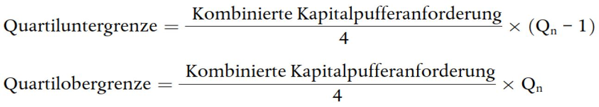

Gesetz vom 4. November 2016 über die Sanierung und Abwicklung von Banken und Wertpapierfirmen (Sanierungs- und Abwicklungsgesetz; SAG) Dem nachstehenden vom Landtag gefassten Beschluss erteile Ich Meine Zustimmung: I. Allgemeine Bestimmungen Art. 1 Gegenstand und Zweck 1) Dieses Gesetz regelt die Sanierung und Abwicklung von Banken und Wertpapierfirmen sowie weiteren Unternehmen nach Art. 2. 2) Es dient der Umsetzung der Richtlinie 2014/59/EU des Europäischen Parlaments und des Rates vom 15. Mai 2014 zur Festlegung eines Rahmens für die Sanierung und Abwicklung von Kreditinstituten und Wertpapierfirmen und zur Änderung der Richtlinie 82/891/EWG des Rates, der Richtlinien 2001/24/EG, 2002/47/EG, 2004/25/EG, 2005/56/EG, 2007/36/EG, 2011/35/EU, 2012/30/EU und 2013/36/EU sowie der Verordnungen (EU) Nr. 1093/2010 und (EU) Nr. 648/2012 des Europäischen Parlaments und des Rates (ABl. L 173 vom 12.6.2014, S. 190) . 3) Die gültige Fassung der EWR-Rechtsvorschriften, auf die in diesem Gesetz Bezug genommen wird, ergibt sich aus der Kundmachung der Beschlüsse des Gemeinsamen EWR-Ausschusses im Liechtensteinischen Landesgesetzblatt nach Art. 3 Bst. k des Kundmachungsgesetzes. Art. 2 Anwendungsbereich 1) Dieses Gesetz findet Anwendung auf: a) Institute; b) Finanzinstitute, die Tochterunternehmen einer Bank oder einer Wertpapierfirma oder einer Gesellschaft im Sinne von Bst. c oder d sind und in die Beaufsichtigung des Mutterunternehmens auf konsolidierter Basis nach den Art. 6 bis 17 der Verordnung (EU) Nr. 575/2013 des Europäischen Parlaments und des Rates vom 26. Juni 2013 über Aufsichtsanforderungen an Kreditinstitute und Wertpapierfirmen und zur Änderung der Verordnung (EU) Nr. 646/2012 (ABl. L 176 vom 27.6.2013, S. 1) einbezogen sind; c) Finanzholdinggesellschaften, gemischte Finanzholdinggesellschaften und gemischte Holdinggesellschaften; d) Mutterfinanzholdinggesellschaften in einem EWR-Mitgliedstaat, EWR-Mutterfinanzholdinggesellschaften, gemischte Mutterfinanzholdinggesellschaften in einem EWR-Mitgliedstaat, gemischte EWR-Mutterfinanzholdinggesellschaften; e) Zweigstellen von Instituten, die ausserhalb des EWR niedergelassen sind, im Einklang mit den in diesem Gesetz festgelegten besonderen Bedingungen. 2) Bei der Festlegung und Anwendung der Anforderungen dieses Gesetzes und bei der Anwendung der einzelnen ihnen zur Verfügung stehenden Instrumente auf ein Unternehmen nach Abs. 1 haben die Abwicklungsbehörde und die FMA unter Beachtung besonderer Bestimmungen zu berücksichtigen: a) die Art seiner Geschäftstätigkeiten; b) seine Beteiligungsstruktur; c) seine Rechtsform; d) sein Risikoprofil; e) seine Grösse und seinen Rechtsstatus; f) seine Verflechtung mit anderen Instituten oder dem Finanzsystem im Allgemeinen; g) den Umfang und die Komplexität seiner Tätigkeiten; h) seine Mitgliedschaft in einem institutsbezogenen Sicherungssystem, das die Anforderungen von Art. 113 Abs. 7 der Verordnung (EU) Nr. 575/2013 erfüllt, oder in anderen gemeinsamen Systemen der wechselseitigen Solidarität nach Art. 113 Abs. 6 der genannten Verordnung; und i) ob es Wertpapierdienstleistungen oder Anlagetätigkeiten nach Art. 3 Abs. 1 Ziff. 1 des Wertpapierdienstleistungsgesetzes erbringt bzw. ausübt. Art. 3 Begriffsbestimmungen und Bezeichnungen 1) Im Sinne dieses Gesetzes gelten als: 1. "Abbaugesellschaft": eine juristische Person, die die Anforderungen nach Art. 54 Abs. 2 erfüllt; 2. "Abwicklung": die Anwendung eines Abwicklungsinstruments, um ein oder mehrere Abwicklungsziele nach Art. 37 Abs. 2 zu erreichen; 3. "in Abwicklung befindliches Institut": ein Institut, ein Finanzinstitut, eine Finanzholdinggesellschaft, eine gemischte Finanzholdinggesellschaft, eine gemischte Holdinggesellschaft, eine Mutterholdinggesellschaft in einem EWR-Mitgliedstaat, eine EWR-Mutterholdinggesellschaft, eine gemischte Mutterfinanzholdinggesellschaft in einem EWR-Mitgliedstaat oder eine gemischte EWR-Mutterfinanzholdinggesellschaft, in Bezug auf das oder die eine Abwicklungsmassnahme getroffen wird; 4. "Abwicklungsbefugnis": eine der in den Art. 82 bis 91 genannten Befugnisse; 5. "Abwicklungsbehörde": eine nach Art. 3 der Richtlinie 2014/59/EU von einem EWR-Mitgliedstaat benannte Behörde, in Liechtenstein die FMA nach Massgabe von Art. 4; 5a. "Abwicklungseinheit": a) eine im EWR niedergelassene juristische Person, die von der Abwicklungsbehörde nach Art. 15 als ein Unternehmen bestimmt wurde, für das im Abwicklungsplan Abwicklungsmassnahmen vorgesehen sind; oder b) ein Institut, das nicht Teil einer Gruppe ist, die einer Beaufsichtigung auf konsolidierter Basis nach Art. 161 und 162 des Bankengesetzes unterliegt, und für das in einem nach Art. 12 erstellten Abwicklungsplan eine Abwicklungsmassnahme vorgesehen ist; 5b. "Abwicklungsgruppe": a) eine Abwicklungseinheit und ihre Tochterunternehmen, die nicht: aa) selbst Abwicklungseinheiten sind; bb) Tochterunternehmen anderer Abwicklungseinheiten sind; oder cc) in einem Drittstaat niedergelassene Unternehmen sind, die nach dem Abwicklungsplan nicht der Abwicklungsgruppe angehören, und deren Tochterunternehmen; oder b) Banken, die einer Zentralorganisation ständig zugeordnet sind, und die Zentralorganisation selbst, wenn mindestens eine dieser Banken oder die Zentralorganisation eine Abwicklungseinheit ist, und ihre jeweiligen Tochterunternehmen; 6. "Abwicklungsinstrument": eines der in Art. 49 Abs. 3 genannten Abwicklungsinstrumente; 7. "Abwicklungskollegium": ein nach Art. 107 eingerichtetes Kollegium, das die in Art. 107 Abs. 1 genannten Aufgaben wahrnimmt; 8. "Abwicklungsmassnahme": die Entscheidung über die Abwicklung eines Instituts oder eines Unternehmens im Sinne von Art. 2 Abs. 1 Bst. b, c oder d nach Art. 38 oder 41, die Anwendung eines Abwicklungsinstruments oder die Ausübung einer oder mehrerer Abwicklungsbefugnisse; 9. "Abwicklungsplan": ein nach Art. 12 erstellter Abwicklungsplan für ein Institut; 10. "Abwicklungsziele": die in Art. 37 Abs. 2 genannten Abwicklungsziele; 11. "aggregierter Betrag": der aggregierte Betrag, den die Abwicklungsbehörde bei der Entscheidung zugrunde legt, dass bail-in-fähige Verbindlichkeiten nach Art. 63 Abs. 1 abzuschreiben oder umzuwandeln sind; 12. "Anleger": ein Anleger im Sinne von Art. 1 Abs. 4 der Richtlinie 97/9/EG des Europäischen Parlaments und des Rates vom 3. März 1997 über Systeme für die Entschädigung der Anleger (ABl. L 84 vom 26.3.1997, S. 22) ; 13. "Anteilseigner": Anteilseigner oder Inhaber anderer Eigentumstitel; 14. "Aufrechnungsvereinbarung": eine Vereinbarung, der zufolge zwei oder mehrere Forderungen oder Verpflichtungen zwischen dem in Abwicklung befindlichen Institut und einer Gegenpartei aufgerechnet werden können; 15. "Aufsichtskollegium": ein Aufsichtskollegium nach Art. 164 des Bankengesetzes; 16. "ausserordentliche finanzielle Unterstützung aus öffentlichen Mitteln": eine staatliche Beihilfe im Sinne von Art. 107 Abs. 1 des Vertrages über die Arbeitsweise der Europäischen Union (AEUV) - oder eine sonstige öffentliche finanzielle Unterstützung auf supranationaler Ebene, die, wenn sie auf nationaler Ebene geleistet würde, als staatliche Beihilfe gälte -, die zur Erhaltung oder Wiederherstellung der Existenzfähigkeit, Liquidität oder Solvenz eines Instituts oder eines Unternehmens nach Art. 2 Abs. 1 Bst. b, c oder d oder einer Gruppe, der das Institut oder das Unternehmen angehört, gewährt wird; 17. "Back-to-back-Transaktion": eine Transaktion zwischen zwei Unternehmen einer Gruppe zum Zweck der vollständigen oder teilweisen Übertragung der Risiken, die sich aus einer anderen Transaktion zwischen einem dieser Unternehmen und einem Dritten ergeben; 18. "Bail-in-Instrument": der Mechanismus für die Ausübung der Herabschreibungs- und Umwandlungsbefugnisse nach Art. 55 durch die Abwicklungsbehörde in Bezug auf Verbindlichkeiten eines in Abwicklung befindlichen Instituts; 19. "Bank": ein Unternehmen, dessen Tätigkeit darin besteht, Einlagen oder andere rückzahlbare Gelder des Publikums entgegenzunehmen und Kredite für eigene Rechnung zu gewähren, mit Ausnahme der Unternehmen im Sinne von Art. 2 Abs. 5 der Richtlinie 2013/36/EU; 20. "bedeutende Zweigstelle": eine Zweigstelle, die nach Art. 51 Abs. 1 der Richtlinie 2013/36/EU in einem Aufnahmemitgliedstaat als bedeutend angesehen würde; 21. "benannte nationale makroprudenzielle Behörde": die Behörde, die mit der Durchführung der makroprudenziellen Politik nach Empfehlung B Nr. 1 der Empfehlung des Europäischen Ausschusses für Systemrisiken vom 22. Dezember 2011 zu dem makroprudenziellen Mandat der nationalen Behörden (ESRB/2011/3) betraut ist; 22. "erstattungsfähige Einlagen": Einlagen im Sinne von Art. 2 Abs. 1 Ziff. 8 des Einlagensicherungs- und Anlegerentschädigungsgesetzes; 23. "bail-in-fähige Verbindlichkeiten": Verbindlichkeiten und andere Kapitalinstrumente als solche des harten Kernkapitals, des zusätzlichen Kernkapitals oder des Ergänzungskapitals eines Instituts oder eines Unternehmens nach Art. 2 Abs. 1 Bst. b, c oder d, die nicht aufgrund von Art. 56 Abs. 2 vom Anwendungsbereich des Bail-in-Instruments ausgenommen sind; 23a. "berücksichtigungsfähige Verbindlichkeiten": bail-in-fähige Verbindlichkeiten, die je nach Fall die in Art. 58a oder 59 Abs. 8 Bst. a genannten Voraussetzungen erfüllen, sowie Instrumente des Ergänzungskapitals, die die in Art. 72a Abs. 1 Bst. b der Verordnung (EU) Nr. 575/2013 genannten Voraussetzungen erfüllen; 24. "besicherte Verbindlichkeit": eine Verbindlichkeit, bei der der Anspruch des Gläubigers auf Zahlung oder auf eine andere Form der Leistung durch ein Pfand oder pfandrechtsähnliches Zurückbehaltungsrecht oder durch eine Sicherungsvereinbarung abgesichert ist, einschliesslich Verbindlichkeiten aus Pensionsgeschäften und anderen Sicherungsvereinbarungen in Form einer Vollrechtsübertragung; 25. "betroffener Gläubiger": ein Gläubiger, dessen Forderung sich auf eine Verbindlichkeit bezieht, die durch die Ausübung der Herabschreibungs- oder Umwandlungsbefugnisse im Zuge der Verwendung des Bail-in-Instruments gekürzt oder in Anteile oder andere Eigentumstitel umgewandelt wird; 26. "betroffener Inhaber": ein Inhaber von Eigentumstiteln, dessen Eigentumstitel durch Ausübung der in Art. 82 Abs. 1 Bst. h genannten Befugnis gelöscht wurden; 27. "Brückeninstitut": eine juristische Person, die die Anforderungen nach Art. 52 Abs. 3 erfüllt; 28. "Derivat": ein Derivat im Sinne von Art. 2 Ziff. 5 der Verordnung (EU) Nr. 648/2012 des Europäischen Parlaments und des Rates vom 4. Juli 2012 über OTC-Derivate, zentrale Gegenparteien und Transaktionsregister (ABl. L 201 vom 7.2.2012, S. 1) ; 29. "Drittstaatsabwicklungsverfahren": eine nach dem Recht eines Staates, der nicht EWR-Mitgliedstaat ist (Drittstaat), vorgesehene Massnahme zur Handhabung des Ausfalls eines Drittstaatsinstituts oder eines Drittstaatsmutterunternehmens, die in ihren Zielen und zu erwartenden Ergebnissen mit den in diesem Gesetz vorgesehenen Abwicklungsmassnahmen vergleichbar ist; 30. "Drittstaatsinstitut": ein Unternehmen, dessen Hauptsitz sich in einem Drittstaat befindet und von der Begriffsbestimmung des "Instituts" erfasst würde, wenn es im EWR niedergelassen wäre; 31. "Drittstaatsmutterunternehmen": ein Mutterunternehmen, eine Mutterfinanzholdinggesellschaft oder eine gemischte Mutterfinanzholdinggesellschaft, die in einem Drittstaat niedergelassen ist; 32. "EBA": die Europäische Bankaufsichtsbehörde im Sinne der Verordnung (EU) Nr. 1093/2010 des Europäischen Parlaments und des Rates vom 24. November 2010 zur Errichtung einer Europäischen Aufsichtsbehörde (Europäische Bankenaufsichtsbehörde), zur Änderung des Beschlusses Nr. 716/2009/EG und zur Aufhebung des Beschlusses 2009/78/EG der Kommission (ABl. L 331 vom 15.12.2010, S. 12) ; 33. "Eigenmittel": die Eigenmittel im Sinne von Art. 4 Abs. 1 Ziff. 118 der Verordnung (EU) Nr. 575/2013; 34. "Eigenmittelanforderungen": die Anforderungen nach den Art. 92 bis 98 der Verordnung (EU) Nr. 575/2013; 35. "Eigentumstitel": Anteile, andere Instrumente zur Übertragung von Eigentumsrechten, Instrumente, die in Anteile oder Eigentumstitel umgewandelt werden können oder ein Recht auf den Erwerb von Anteilen oder anderen Eigentumstiteln begründen, und Instrumente, die einen Rechtsanspruch auf Anteile oder andere Eigentumstitel darstellen; 36. "Einlagensicherungssystem": ein Einlagensicherungssystem im Sinne von Art. 4 Abs. 1 oder 2 des Einlagensicherungs- und Anlegerentschädigungsgesetzes; 37. "Einleger": ein Einleger im Sinne von Art. 2 Abs. 1 Ziff. 9 des Einlagensicherungs- und Anlegerentschädigungsgesetzes; 38. "ESA": die EFTA-Überwachungsbehörde; 39. "EWR-Mutterfinanzholdinggesellschaft": eine Mutterfinanzholdinggesellschaft im Sinne von Art. 4 Abs. 1 Ziff. 31 der Verordnung (EU) Nr. 575/2013; 40. "EWR-Mutterinstitut": ein Mutterinstitut im Sinne von Art. 4 Abs. 1 Ziff. 29 der Verordnung (EU) Nr. 575/2013; 41. "EWR-Mutterinstitut in einem EWR-Mitgliedstaat": ein Mutterinstitut im Sinne von Art. 4 Abs. 1 Ziff. 28 der Verordnung (EU) Nr. 575/2013; 42. "EWR-Mutterunternehmen": ein EWR-Mutterinstitut, eine EWR-Mutterfinanzholdinggesellschaft oder eine gemischte EWR-Mutterfinanzholdinggesellschaft; 43. "EWR-Tochterunternehmen": ein Institut, das in einem EWR-Mitgliedstaat niedergelassen ist und Tochterunternehmen eines Drittstaatsinstituts oder eines Drittstaatsmutterunternehmens ist; 44. "EWR-Zweigstelle": eine in einem EWR-Mitgliedstaat befindliche Zweigstelle eines Drittstaatsinstituts; 45. "Finanzholdinggesellschaft": eine Finanzholdinggesellschaft im Sinne von Art. 4 Abs. 1 Ziff. 20 der Verordnung (EU) Nr. 575/2013; 46. "Finanzinstitut": ein Finanzinstitut im Sinne von Art. 4 Abs. 1 Ziff. 26 der Verordnung (EU) Nr. 575/2013; 47. "Finanzkontrakte": folgende Verträge und Vereinbarungen: a) Wertpapierkontrakte, einschliesslich: aa) Kontrakten über den Kauf, den Verkauf oder die Leihe eines Wertpapiers (security lending), einer Gruppe von Wertpapieren oder eines Wertpapierindexes; bb) Optionen auf ein Wertpapier, eine Gruppe von Wertpapieren oder einen Wertpapierindex; cc) eines Pensionsgeschäfts oder eines umgekehrten Pensionsgeschäfts mit einem solchen Wertpapier, einer solchen Gruppe von Wertpapieren oder einem solchen Wertpapierindex; b) Warenkontrakte, einschliesslich: aa) Kontrakten über den Kauf, den Verkauf oder die Leihe einer Ware, einer Gruppe von Waren oder eines Warenindexes zwecks künftiger Lieferung; bb) Optionen auf eine Ware, eine Gruppe von Waren oder einen Warenindex; cc) eines Pensionsgeschäfts oder eines umgekehrten Pensionsgeschäfts mit einer solchen Ware, einer solchen Gruppe von Waren oder einem solchen Warenindex; c) Terminkontrakte (Futures und Forwards), einschliesslich Kontrakten (ausser Warenkontrakten) über den Kauf, den Verkauf oder die Übertragung einer Ware oder eines anderen Gutes, einer Dienstleistung, eines Rechts oder eines Anteils zu einem festgelegten Preis zu einem künftigen Zeitpunkt; d) Swap-Vereinbarungen, die unter anderem Folgendes umfassen: aa) Zinsswaps und -optionen, Kassa- oder sonstige Devisenvereinbarungen, Währungen, einen Aktienindex oder eine Aktie, einen Schuldtitelindex oder einen Schuldtitel, Warenindizes oder Waren, Wetter, Emissionen oder Inflation; bb) Gesamtertrags-, Credit-Spread- oder Credit-Swaps; cc) Vereinbarungen oder Geschäfte, die einer der unter Unterbst. aa oder bb genannten Vereinbarungen ähneln und an den Swap- oder Derivatemärkten weit verbreitet sind; e) Kreditvereinbarungen zwischen Banken mit einer Laufzeit von drei Monaten oder weniger; f) Rahmenvereinbarungen für die unter den Bst. a bis e genannten Kontrakte oder Vereinbarungen; 48. "Finanzsicherheiten in Form der Vollrechtsübertragung": Finanzsicherheiten in Form der Vollrechtsübertragung im Sinne von Art. 392 Abs. 2 des Sachenrechts; 49. "gedeckte Einlagen": erstattungsfähige Guthaben, die sich aus auf einem Konto verbliebenen Beträgen oder aus Zwischenpositionen im Rahmen von normalen Bankgeschäften ergeben und von der Bank nach den geltenden gesetzlichen und vertraglichen Bestimmungen zurückzuzahlen sind, einschliesslich Festgeldanlagen und Spareinlagen sowie Forderungen, die von der Bank durch Ausstellung einer Urkunde verbrieft sind, bis zu einer Höhe von 100 000 Franken oder Gegenwert in fremder Währung pro Einleger; 50. "gedeckte Schuldverschreibung": eine gedeckte Schuldverschreibung im Sinne von Art. 3 Abs. 1 Bst. a des Gesetzes über Europäische gedeckte Schuldverschreibungen oder, wenn das Instrument vor dem 8. Januar 2023 emittiert wurde, eine gedeckte Schuldverschreibung im Sinne von Art. 52 Abs. 4 der Richtlinie 2009/65/EG in der am Emissionstag gültigen Fassung; 51. "geeignete Behörde": die nach Art. 80 benannte Behörde eines EWR-Mitgliedstaats, die nach dem nationalen Recht dieses Staates für die Feststellungen nach Art. 78 Abs. 3 zuständig ist, in Liechtenstein die Abwicklungsbehörde; 52. "gemischte EWR-Mutterfinanzholdinggesellschaft": eine gemischte Mutterfinanzholdinggesellschaft im Sinne von Art. 4 Abs. 1 Ziff. 33 der Verordnung (EU) Nr. 575/2013; 53. "gemischte Finanzholdinggesellschaft": eine gemischte Finanzholdinggesellschaft im Sinne von Art. 4 Abs. 1 Ziff. 21 der Verordnung (EU) Nr. 575/2013; 54. "gemischte Holdinggesellschaft": eine gemischte Holdinggesellschaft im Sinne von Art. 4 Abs. 1 Ziff. 22 der Verordnung (EU) Nr. 575/2013; 55. "gemischte Mutterfinanzholdinggesellschaft in einem EWR-Mitgliedstaat": eine gemischte Mutterfinanzholdinggesellschaft in einem EWR-Mitgliedstaat im Sinne von Art. 4 Abs. 1 Ziff. 32 der Verordnung (EU) Nr. 575/2013; 56. "geregelter Markt": ein geregelter Markt im Sinne von Art. 4 Abs. 1 Ziff. 21 der Richtlinie 2014/65/EU; 57. "Geschäftsleitung": die Geschäftsleitung im Sinne von Art. 3 Abs. 1 Ziff. 7 des Bankengesetzes bzw. Art. 4 Abs. 1 Ziff. 27 des Wertpapierfirmengesetzes; 58. "Geschäftstag": jeder Tag ausser Samstag, Sonntag und den gesetzlichen Feiertagen in dem betroffenen EWR-Mitgliedstaat; 58a. "global systemrelevantes Institut (G-SRI)": ein G-SRI nach Art. 4 Abs. 1 Ziff. 133 der Verordnung (EU) Nr. 575/2013; 59. "grenzüberschreitende Gruppe": eine Gruppe, deren einzelne Unternehmen in mehr als einem EWR-Mitgliedstaat niedergelassen sind; 60. "Gruppe": ein Mutterunternehmen und seine Tochterunternehmen; 61. "Gruppenabwicklung": a) Abwicklungsmassnahmen auf der Ebene eines Mutterunternehmens oder eines einer Beaufsichtigung auf konsolidierter Basis unterliegenden Instituts; oder b) die Koordinierung der Anwendung von Abwicklungsinstrumenten und der Ausübung von Abwicklungsbefugnissen durch Abwicklungsbehörden in Bezug auf Unternehmen einer Gruppe, die die Voraussetzungen für eine Abwicklung erfüllen; 62. "für die Gruppenabwicklung zuständige Behörde": die Abwicklungsbehörde in dem EWR-Mitgliedstaat, in dem sich die konsolidierende Aufsichtsbehörde befindet; 63. "Gruppenabwicklungskonzept": ein nach Art. 114 für die Zwecke einer Gruppenabwicklung ausgearbeitetes Konzept; 64. "Gruppenabwicklungsplan": ein nach den Art. 15 und 16 erstellter Plan für eine Gruppenabwicklung; 65. "Gruppenfinanzierungsmechanismus": der Abwicklungsfinanzierungsmechanismus des EWR-Mitgliedstaats, in dem sich die für die Gruppenabwicklung zuständige Behörde befindet; 66. "gruppeninterne Garantie": ein Vertrag, durch den ein Unternehmen einer Gruppe eine Garantie für die Erfüllung der Verpflichtungen eines anderen Unternehmens der Gruppe gegenüber einem Dritten übernimmt; 67. "Gruppensanierungsplan": ein nach Art. 9 erstellter und fortgeschriebener Gruppensanierungsplan; 67a. "hartes Kernkapital": hartes Kernkapital, das nach Art. 50 der Verordnung (EU) Nr. 575/2013 berechnet wurde; 68. "Herabschreibungs- und Umwandlungsbefugnisse": die in Art. 78 Abs. 2 und Art. 82 Abs. 1 Bst. e bis k genannten Befugnisse; 69. "Institut": eine Bank nach Art. 4 Abs. 1 des Bankengesetzes oder eine Wertpapierfirma nach Art. 4 Abs. 1 Ziff. 1 des Wertpapierfirmengesetzes; 70. "institutsbezogenes Sicherungssystem": eine Regelung, die den Anforderungen nach Art. 113 Abs. 7 der Verordnung (EU) Nr. 575/2013 genügt; 71. "Instrument der Ausgliederung von Vermögenswerten": der Mechanismus für die Durchführung einer Übertragung von Vermögenswerten, Rechten oder Verbindlichkeiten eines in Abwicklung befindlichen Instituts nach Art. 54 durch eine Abwicklungsbehörde auf eine für die Vermögensverwaltung gegründete Abbaugesellschaft; 72. "Instrument des Brückeninstituts": der Mechanismus für die Übertragung von Anteilen oder anderen Eigentumstiteln, die von einem in Abwicklung befindlichen Institut ausgegeben wurden, oder von Vermögenswerten, Rechten oder Verbindlichkeiten eines in Abwicklung befindlichen Instituts nach Art. 52 auf ein Brückeninstitut; 73. "Instrument der Unternehmensveräusserung": der Mechanismus für die Durchführung einer Übertragung der von einem in Abwicklung befindlichen Institut ausgegebenen Anteile oder anderen Eigentumstitel oder der Vermögenswerte, Rechte oder Verbindlichkeiten eines in Abwicklung befindlichen Instituts auf einen Erwerber, bei dem es sich nicht um ein Brückeninstitut handelt, nach Art. 50 durch eine Abwicklungsbehörde; 74. "Instrumente des Ergänzungskapitals": Kapitalinstrumente oder nachrangige Darlehen, die die Bedingungen nach Art. 63 der Verordnung (EU) Nr. 575/2013 erfüllen; 75. "Instrumente des harten Kernkapitals": Kapitalinstrumente, die die Bedingungen nach Art. 28 Abs. 1 bis 4, Art. 29 Abs. 1 bis 5 oder Art. 31 Abs. 1 der Verordnung (EU) Nr. 575/2013 erfüllen; 76. "Instrumente des zusätzlichen Kernkapitals": Kapitalinstrumente, die die Bedingungen nach Art. 52 Abs. 1 der Verordnung (EU) Nr. 575/2013 erfüllen; 77. "jeweilige Drittstaatsbehörde": eine Drittstaatsbehörde, die Funktionen wahrnimmt, die mit den von Abwicklungsbehörden oder zuständigen Behörden aufgrund dieses Gesetzes wahrgenommenen Funktionen vergleichbar sind; 78. "Kerngeschäftsbereiche": Geschäftsbereiche und damit verbundene Dienste, die für ein Institut oder eine Gruppe, der ein Institut angehört, wesentliche Einnahmequellen, der Gewinne oder des Franchise-Werts darstellen; 79. "Kleinstunternehmen sowie kleine und mittlere Unternehmen": Kleinstunternehmen sowie kleine und mittlere Unternehmen, die das Jahresumsatzkriterium nach Art. 1064 des Personen- und Gesellschaftsrechts erfüllen; 79a. "kombinierte Kapitalpufferanforderung": kombinierte Kapitalpufferanforderung nach Art. 94 Abs. 2 des Bankengesetzes; 80. "konsolidierende Aufsichtsbehörde": eine konsolidierende Aufsichtsbehörde im Sinne von Art. 4 Abs. 1 Ziff. 41 der Verordnung (EU) Nr. 575/2013; 81. "konsolidierte Basis": die Basis der konsolidierten Lage im Sinne von Art. 4 Abs. 1 Ziff. 47 der Verordnung (EU) Nr. 575/2013; 82. "Krisenmanagementmassnahme": eine Abwicklungsmassnahme oder die Bestellung eines Abwicklungsverwalters nach Art. 43 oder einer Person nach Art. 68 Abs. 2 oder Art. 91 Abs. 2; 83. "Krisenpräventionsmassnahme": die Ausübung von Befugnissen zur Anweisung der Beseitigung von Unzulänglichkeiten oder Hindernissen für die Sanierungsfähigkeit nach Art. 8 Abs. 2, die Ausübung von Befugnissen zum Abbau oder zur Beseitigung von Hindernissen für die Abwicklungsfähigkeit nach Art. 21 oder 22, die Anwendung von Frühinterventionsmassnahmen nach Art. 33, die Bestellung eines vorläufigen Verwalters nach Art. 35 oder die Ausübung der Herabschreibungs- oder Umwandlungsbefugnisse nach Art. 78; 84. "kritische Funktionen": Tätigkeiten, Dienstleistungen oder Geschäfte, deren Einstellung aufgrund der Grösse, des Marktanteils, der externen und internen Verflechtungen, der Komplexität oder der grenzüberschreitenden Tätigkeiten eines Instituts oder einer Gruppe wahrscheinlich in einem oder mehreren EWR-Mitgliedstaaten die Unterbrechung von für die Realwirtschaft wesentlichen Dienstleistungen oder eine Störung der Finanzstabilität zur Folge hat, besonders mit Blick auf die Substituierbarkeit dieser Tätigkeiten, Dienstleistungen oder Geschäfte; 85. "Kündigungsrecht": das Recht, einen Vertrag zu kündigen, das Recht auf vorzeitige Fälligstellung, Beendigung, Aufrechnung oder Saldierung von Verbindlichkeiten oder eine ähnliche Bestimmung, die gestattet oder bewirkt, dass eine Verpflichtung einer Vertragspartei ausgesetzt wird, geändert wird oder erlischt, oder eine Bestimmung, durch die eine normalerweise entstehende vertragliche Verpflichtung nicht mehr entstehen kann; 86. "Leitungsorgan": der Verwaltungsrat im Sinne von Art. 3 Abs. 1 Ziff. 6 des Bankengesetzes bzw. Art. 4 Abs. 1 Ziff. 26 des Wertpapierfirmengesetzes; 87. "Liquidation": die Veräusserung von Vermögenswerten eines Instituts oder eines Unternehmens im Sinne von Art. 2 Abs. 1 Bst. b, c oder d; 88. "Mutterfinanzholdinggesellschaft in einem EWR-Mitgliedstaat": eine Mutterfinanzholdinggesellschaft in einem EWR-Mitgliedstaat im Sinne von Art. 4 Abs. 1 Ziff. 30 der Verordnung (EU) Nr. 575/2013; 89. "Mutterunternehmen": ein Mutterunternehmen im Sinne von Art. 4 Abs. 1 Ziff. 15 Bst. a der Verordnung (EU) Nr. 575/2013; 89a. "nachrangige berücksichtigungsfähige Instrumente": Instrumente, die alle Bedingungen nach Art. 72a der Verordnung (EU) Nr. 575/2013 erfüllen, ausgenommen Art. 72b Abs. 3 bis 5 der genannten Verordnung; 90. "Notfallliquiditätshilfe": die Bereitstellung von Zentralbankgeld durch eine Zentralbank oder die Gewährung einer sonstigen Unterstützung, aus der sich eine Zunahme von Zentralbankgeld ergeben kann, für ein solventes Finanzinstitut oder eine Gruppe solventer Finanzinstitute mit vorübergehenden Liquiditätsproblemen, wobei diese Operation nicht im Zuge der Geldpolitik erfolgt; 91. "Rechtsrahmen des EWR für staatliche Beihilfen": der Rechtsrahmen, der durch die Art. 107, 108 und 109 AEUV sowie durch alle aufgrund von Art. 108 Abs. 4 oder Art. 109 AEUV erlassenen Unionsrechtsakte, einschliesslich Leitlinien, Mitteilungen und Bekanntmachungen, vorgegeben wird; 92. "reguläre Insolvenzverfahren": Gesamtverfahren, welche die Insolvenz des Schuldners voraussetzen und den vollständigen oder teilweisen Vermögensbeschlag gegen den Schuldner sowie die Bestellung eines Liquidators oder Verwalters zur Folge haben und auf Institute anzuwenden sind; 93. "relevante Kapitalinstrumente": für die Zwecke von Art. 54 bis 81 Instrumente des zusätzlichen Kernkapital sowie des Ergänzungskapitals; 94. "relevantes Mutterinstitut": ein EWR-Mutterinstitut in einem EWR-Mitgliedstaat, ein EWR-Mutterinstitut, eine Finanzholdinggesellschaft, eine gemischte Finanzholdinggesellschaft, eine gemischte Holdinggesellschaft, eine Mutterfinanzholdinggesellschaft in einem EWR-Mitgliedstaat, eine EWR-Mutterfinanzholdinggesellschaft, eine gemischte Mutterfinanzholdinggesellschaft in einem EWR-Mitgliedstaat oder eine gemischte EWR-Mutterfinanzholdinggesellschaft, auf die das Bail-in-Instrument angewandt wird; 95. "Saldierungsvereinbarung": eine Vereinbarung, der zufolge eine Reihe von Forderungen oder Verpflichtungen in eine einzige Nettoforderung umgewandelt werden kann, einschliesslich Close-Out-Saldierungsvereinbarungen, bei denen bei Eintreten eines (gleich wie und gleich wo definierten) Durchsetzungsereignisses die Verpflichtungen der Parteien vorzeitig fällig werden oder beendet werden, und in eine einzige Nettoforderung umgewandelt oder durch eine solche ersetzt werden; hierunter fallen auch die "Aufrechnung in Folge Beendigung" und die Aufrechnung im Sinne von Art. 392 Abs. 2 Ziff. 11 des Sachenrechts; 96. "Sanierungskapazität": die Fähigkeit eines Instituts, seine finanzielle Stabilität nach einer erheblichen Verschlechterung seiner Finanzlage wiederherzustellen; 97. "Sanierungsplan": ein nach Art. 6 von einem Institut erstellter und fortgeschriebener Sanierungsplan; 98. "Schuldtitel" im Sinne von Art. 82 Abs. 1 Bst. g und k: Anleihen und andere Formen übertragbarer Schuldtitel, Instrumente, mit denen eine Schuld begründet oder anerkannt wird, und Instrumente, die einen Anspruch auf den Erwerb von Schuldtiteln begründen; 99. "Systemkrise": eine Störung des Finanzsystems, die potenziell schwerwiegende Nachteile für den Binnenmarkt und die Realwirtschaft mit sich bringt, wobei alle Arten von Finanzintermediären, -märkten und -infrastrukturen potenziell in gewissem Mass von systemischer Bedeutung sein können; 100. "Tochterunternehmen": a) ein Tochterunternehmen nach Art. 4 Abs. 1 Ziff. 16 der Verordnung (EU) Nr. 575/2013; b) für die Zwecke der Anwendung der Art. 9, 15, 21, 22, 58 bis 61, 78 bis 81 und 112 bis 115 auf Abwicklungsgruppen nach Art. 3 Abs. 1 Ziff. 5b Bst. b schliesst die Bezugnahme auf Tochterunternehmen Banken, die einer Zentralorganisation ständig zugeordnet sind, die Zentralorganisation selbst und ihre jeweiligen Tochterunternehmen ein, wobei zu berücksichtigen ist, in welcher Weise diese Abwicklungsgruppen Art. 59 Abs. 3 erfüllen; 100a. "bedeutendes Tochterunternehmen": ein Tochterunternehmen nach Art. 4 Abs. 1 Ziff. 135 der Verordnung (EU) Nr. 575/2013; 101. "übernehmender Rechtsträger": der Rechtsträger, auf den Anteile, sonstige Eigentumstitel, Schuldtitel, Vermögenswerte, Rechte oder Verbindlichkeiten - auch in beliebiger Kombination - eines in Abwicklung befindlichen Instituts übertragen werden; 102. "Übertragungsbefugnisse": die in Art. 82 Abs. 1 Bst. c oder d genannten Befugnisse, Anteile, andere Eigentumstitel, Schuldtitel, Vermögenswerte, Rechte oder Verbindlichkeiten - auch in beliebiger Kombination - von einem in Abwicklung befindlichen Institut auf einen übernehmenden Rechtsträger zu übertragen; 103. "Umwandlungsquote": der Faktor, der die Zahl der Anteile oder anderen Eigentumstitel bestimmt, in die eine Verbindlichkeit einer spezifischen Kategorie unter Bezugnahme entweder auf ein einziges Instrument dieser Kategorie oder auf eine bestimmte Einheit des Werts einer Schuld umgewandelt wird; 104. "Unternehmen der Gruppe": eine juristische Person, die Teil einer Gruppe ist; 105. "Voraussetzungen für eine Abwicklung": die in Art. 38 Abs. 1 genannten Voraussetzungen; 106. "Wertpapierfirma": eine Wertpapierfirma im Sinne von Art. 4 Abs. 1 Ziff. 22 der Verordnung (EU) 2019/2033 , die den Anforderungen bezüglich des Anfangskapitals unterliegt, die nach Art. 16 Abs. 3 des Wertpapierfirmengesetzes für die Erbringung oder Ausübung einer der in Anhang 1 Abschnitt A Ziff. 3 und 6 des Wertpapierfirmengesetzes festgelegt sind; 107. "zentrale Gegenpartei": eine zentrale Gegenpartei im Sinne von Art. 2 Ziff. 1 der Verordnung (EU) Nr. 648/2012; 108. "zuständige Behörde": eine zuständige Behörde im Sinne von Art. 4 Abs. 1 Ziff. 40 der Verordnung (EU) Nr. 575/2013 und die Europäische Zentralbank bei der Wahrnehmung der ihr durch die Verordnung (EU) Nr. 1024/2013 des Rates vom 15. Oktober 2013 zur Übertragung besonderer Aufgaben im Zusammenhang mit der Aufsicht über Kreditinstitute auf die Europäische Zentralbank (ABl. L 287 vom 29.10.2013, S. 63) übertragenen besonderen Aufgaben, in Liechtenstein die FMA; 109. "Zweigstelle": eine Zweigstelle im Sinne von Art. 4 Abs. 1 Ziff. 17 der Verordnung (EU) Nr. 575/2013. 2) Die Regierung kann mit Verordnung die Begriffe nach Abs. 1 näher umschreiben sowie weitere in diesem Gesetz verwendete Begriffe definieren. 3) Die in diesem Gesetz verwendeten Personen- und Funktionsbezeichnungen gelten für Personen des weiblichen und männlichen Geschlechts. Art. 4 Abwicklungsbehörde 1) Die FMA hat für die Erfüllung ihrer Aufgaben als Abwicklungsbehörde eine eigene Organisationseinheit innerhalb ihrer Organisationsstruktur zu bilden. Dabei hat die FMA im Rahmen ihrer Aufbauorganisation sicherzustellen, dass diese Organisationseinheit operativ gänzlich unabhängig von allen anderen Organisationseinheiten der FMA handeln kann und keine Interessenkonflikte zwischen der Abwicklungstätigkeit und der sonstigen Tätigkeiten der FMA auftreten können. Der Leiter der mit der Abwicklungstätigkeit betrauten Organisationseinheit ist im Rahmen der Aufbauorganisation direkt der Geschäftsleitung der FMA zu unterstellen und nur dieser gegenüber berichtspflichtig. 2) Die Abwicklungsbehörde ist ermächtigt, die Abwicklungsinstrumente anzuwenden und die Abwicklungsbefugnisse auszuüben. Sie arbeitet bei der Vorbereitung, Planung und Anwendung von Abwicklungsentscheidungen mit der FMA eng zusammen. Die Abwicklungsbehörde kann Wirtschaftsprüfer, Wirtschaftsprüfungsgesellschaften und sonstige Sachverständige alle erforderlichen Prüfungen, Gutachten und Analysen vornehmen lassen; die Erteilung von Auskünften durch die Abwicklungsbehörde an die von ihr Beauftragten ist zulässig, soweit dies zur Erfüllung des Auftrags zweckdienlich ist. 3) Die Abwicklungsbehörde hat die Regierung von den Entscheidungen aufgrund dieses Gesetzes zu unterrichten und die Zustimmung der Regierung einzuholen, bevor sie Entscheidungen mit unmittelbaren finanziellen Auswirkungen oder mit systemischen Auswirkungen durchführt. 4) Bei den Entscheidungen, die die Abwicklungsbehörde oder die FMA aufgrund dieses Gesetzes trifft, müssen die potenziellen Auswirkungen der Entscheidung in allen EWR-Mitgliedstaaten, in denen das betroffene Institut oder die betroffene Gruppe tätig ist, in Betracht gezogen und die negativen Auswirkungen auf die finanzielle Stabilität und die negativen wirtschaftlichen und gesellschaftlichen Folgen in den EWR-Mitgliedstaaten minimiert werden. 5) Die Abwicklungsbehörde hat der EBA mitzuteilen, dass sie in Liechtenstein als Abwicklungsbehörde nach Art. 3 Abs. 1 der Richtlinie 2014/59/EU bestimmt wurde. Diese Mitteilung hat auch eine Beschreibung der Funktionen und Zuständigkeiten zu beinhalten, die durch die Abwicklungsbehörde ausgeübt werden. 6) Die Abwicklungsbehörde, die FMA und das jeweilige Personal haften für Handlungen und Unterlassungen im Zuge der Ausübung der ihnen mit diesem Gesetz übertragenen Funktionen nur dann, wenn die Handlungen und Unterlassungen vorsätzlich begangen wurden. 7) Die Regierung kann das Nähere über die Struktur und Organisation der Abwicklungsbehörde mit Verordnung regeln. II. Vorbereitung A. Sanierungs- und Abwicklungsplanung 1. Allgemeine Bestimmungen Art. 5 Vereinfachte Anforderungen für bestimmte Institute 1) Die FMA hat im Hinblick auf Sanierungspläne, die Abwicklungsbehörde im Hinblick auf Abwicklungspläne Folgendes festzulegen: a) den Inhalt und Detaillierungsgrad der zu erstellenden Sanierungs- und Abwicklungspläne; b) den Zeitpunkt, bis zu dem die ersten Sanierungs- und Abwicklungspläne zu erstellen sind, und die Häufigkeit der Aktualisierung dieser Pläne, die geringer sein kann als die in Art. 6 Abs. 2, Art. 9 Abs. 5, Art. 12 Abs. 7 und Art. 16 Abs. 5 vorgesehene Häufigkeit; c) den Inhalt und Detaillierungsgrad der nach Art. 6, 14 Abs. 1 und Art. 15 Abs. 2 sowie nach den Anhängen 1 und 2 von den Instituten vorzulegenden Informationen; d) den Detaillierungsgrad für die Bewertung der Abwicklungsfähigkeit nach Art. 19 und 20 sowie Anhang 3. 2) Bei der Festlegung nach Abs. 1 ist Folgendes zu berücksichtigen: a) die Auswirkungen, die der Ausfall eines Instituts aufgrund der Art seiner Geschäftstätigkeiten, seiner Beteiligungsstruktur, seiner Rechtsform, seines Risikoprofils, seiner Grösse und seines Rechtsstatus sowie seiner Verflechtungen mit anderen Instituten oder dem Finanzsystem generell, des Umfangs und der Komplexität seiner Tätigkeiten, seiner Mitgliedschaft in einem institutsbezogenen Sicherungssystem oder anderen gemeinsamen Systemen der wechselseitigen Solidarität nach Art. 113 Abs. 7 der Verordnung (EU) Nr. 575/2013 und der Erbringung von Wertpapierdienstleistungen oder der Ausübung von Anlagetätigkeiten im Sinne von Art. 4 Abs. 1 Ziff. 2 der Richtlinie 2014/65/EU haben könnte; b) die Frage, ob der Ausfall und die anschliessende Liquidation im Wege eines Konkursverfahrens wahrscheinlich erhebliche nachteilige Auswirkungen auf die Finanzmärkte, auf andere Institute, die Refinanzierungsbedingungen oder die Gesamtwirtschaft hätten. 3) Die FMA und die Abwicklungsbehörde haben vor der Bewertung nach Abs. 1 gegebenenfalls die nationale makroprudenzielle Behörde anzuhören. 4) Wenn vereinfachte Anforderungen gelten, können die FMA und die Abwicklungsbehörde jederzeit uneingeschränkte, nicht vereinfachte Anforderungen stellen. 5) Durch die Anwendung vereinfachter Anforderungen dürfen die Befugnisse der FMA und, soweit relevant, der Abwicklungsbehörde, eine Krisenpräventionsmassnahme oder eine Krisenmanagementmassnahme zu ergreifen, nicht beeinträchtigt werden. 6) Die FMA und die Abwicklungsbehörde haben die EBA darüber zu unterrichten, wie sie die Abs. 1 und 2 sowie 7 bis 11 auf die ihrer Zuständigkeit unterliegenden Institute anwenden. 7) Die FMA und, soweit relevant, die Abwicklungsbehörde können unter Beachtung der Abs. 8 bis 11 von der Anwendung folgender Anforderungen absehen: a) der Anforderungen der Sanierungs- und Abwicklungsplanung nach den Art. 5 bis 14 im Fall der Institute, die aufgrund von Art. 10 der Verordnung (EU) Nr. 575/2013 einer Zentralorganisation zugeordnet und vollständig oder teilweise von den Aufsichtsanforderungen des nationalen Rechts ausgenommen sind; b) der Anforderungen der Sanierungsplanung nach den Art. 6 bis 11 im Fall der Institute, die einem institutsbezogenen Sicherungssystem angehören. 8) Wird eine Ausnahme nach Abs. 7 gewährt, so sind: a) die Anforderungen der Sanierungsplanung nach den Art. 6 bis 11 und der Abwicklungsplanung nach den Art. 12 bis 18 auf konsolidierter Basis auf die Zentralorganisation und die ihr zugeordneten Institute im Sinne von Art. 10 der Verordnung (EU) Nr. 575/2013 anzuwenden; b) von dem institutsbezogenen Sicherungssystem die Anforderungen der Sanierungsplanung nach den Art. 6 bis 11 unter Beteiligung der einzelnen von den Ausnahmen betroffenen Instituten zu erfüllen. 9) Für die Zwecke nach Abs. 8 schliesst eine Bezugnahme auf eine Gruppe in den Bestimmungen über die Sanierungsplanung (Art. 6 bis 11) und die Abwicklungsplanung (Art. 12 bis 18) eine Zentralorganisation sowie die ihr zugeordneten Institute im Sinne von Art. 10 der Verordnung (EU) Nr. 575/2013 und deren Tochterunternehmen ein, und eine Bezugnahme auf Mutterunternehmen oder auf einer Beaufsichtigung auf konsolidierter Basis nach Art. 111 der Richtlinie 2013/36/EU unterliegende Institute schliesst die Zentralorganisation ein. 10) Institute, die einen beträchtlichen Anteil am Finanzsystem in Liechtenstein haben, haben nach Massgabe der Bestimmungen über die Sanierungsplanung (Art. 6 bis 11) eigene Sanierungspläne zu erstellen; sie unterliegen individuellen Abwicklungsplänen nach Massgabe der Bestimmungen über die Abwicklungsplanung (Art. 12 bis 18). 11) Für die Zwecke nach Abs. 10 haben die Aktivitäten eines Instituts einen beträchtlichen Anteil am Finanzsystem, wenn eine der folgenden Bedingungen erfüllt ist: a) der Gesamtwert seiner Vermögenswerte liegt über 10 000 000 000 Franken; oder b) das Verhältnis seiner gesamten Vermögenswerte zum Bruttoinlandsprodukt Liechtensteins übersteigt 20 %, sofern der Gesamtwert seiner Vermögenswerte nicht weniger als 5 000 000 000 Franken beträgt. 2. Sanierungsplanung Art. 6 Sanierungspläne 1) Jedes Institut mit Sitz in Liechtenstein, das nicht Teil einer Gruppe ist, die einer Beaufsichtigung auf konsolidierter Basis nach Art. 111 und 112 der Richtlinie 2013/36/EU unterliegt, hat einen Sanierungsplan zu erstellen und laufend zu aktualisieren. Im Sanierungsplan ist darzulegen, mit welchen von dem Institut zu treffenden Massnahmen im Fall einer erheblichen Verschlechterung der Finanzlage des Instituts dessen finanzielle Stabilität wiederhergestellt werden soll. Sanierungspläne sind als Instrument der Unternehmensführung- und kontrolle im Sinne von Art. 71 des Bankengesetzes anzusehen. 2) Die Institute haben ihre Sanierungspläne mindestens jährlich oder nach einer Änderung der Rechts- oder Organisationsstruktur des Instituts, seiner Geschäftstätigkeit oder seiner Finanzlage, die sich wesentlich auf den Sanierungsplan auswirken könnte oder dessen Änderung erforderlich macht, zu aktualisieren. Die FMA kann von den Instituten verlangen, dass sie ihre Sanierungspläne häufiger aktualisieren. 3) In den Sanierungsplänen darf nicht von der Möglichkeit des Zugangs zu einer ausserordentlichen finanziellen Unterstützung aus öffentlichen Mitteln oder vom Erhalt einer solchen Unterstützung ausgegangen werden. 4) In Sanierungsplänen werden die Vermögenswerte aufgezeigt, die voraussichtlich als Sicherheiten dienen können. 5) Sanierungspläne erstrecken sich auch auf Massnahmen, die das Institut treffen könnte, wenn die Voraussetzungen für ein frühzeitiges Eingreifen nach Art. 33 erfüllt sind. 6) Die Sanierungspläne haben geeignete Bedingungen und Verfahren zu enthalten, damit Sanierungsmassnahmen rechtzeitig durchgeführt werden können und ein breites Spektrum an Sanierungsoptionen zur Verfügung steht. In den Sanierungsplänen sind verschiedene Szenarien erheblicher makroökonomischer und finanzieller Belastung mit Bezug zu den spezifischen Bedingungen des Instituts in Betracht zu ziehen, einschliesslich systemweiter Ereignisse und auf bestimmte individuelle juristische Personen oder auf Gruppen beschränkter Belastungsszenarien. 7) Die FMA hat die Befugnis, von einem Institut die Führung detaillierter Aufzeichnungen über Finanzkontrakte zu verlangen, bei denen das Institut Vertragspartei ist. 8) Der Sanierungsplan, der vom Leitungsorgan des Instituts nach Abs. 1 geprüft und gebilligt wurde, ist der FMA zu übermitteln. 9) Die Regierung regelt den Inhalt und die Frist zur Einreichung des Sanierungsplans, der die Angaben nach Anhang 1 zu enthalten hat, mit Verordnung. Art. 7 Bewertung von Sanierungsplänen 1) Institute, die nach Art. 6 Abs. 1 und Art. 9 Abs. 1 verpflichtet sind, Sanierungspläne vorzulegen, haben diese der FMA zur Prüfung zu übermitteln. Die Institute haben gegenüber der FMA glaubhaft nachzuweisen, dass diese Pläne die Kriterien nach Abs. 2 erfüllen. 2) Die FMA hat den Sanierungsplan binnen sechs Monaten nach der Vorlage zu prüfen und nach Anhörung der zuständigen Behörden der anderen EWR-Mitgliedstaaten, in denen sich durch den Sanierungsplan betroffene bedeutende Zweigstellen befinden, zu bewerten, inwieweit er den Anforderungen nach Art. 6 sowie folgenden Kriterien genügt: a) Die Anwendung der in dem Plan vorgeschlagenen Regelungen ist - unter Berücksichtigung der von dem Institut getroffenen oder geplanten vorbereitenden Massnahmen - mit überwiegender Wahrscheinlichkeit geeignet, die Überlebensfähigkeit und die Finanzlage des Instituts oder der Gruppe von Instituten aufrechtzuerhalten oder wiederherzustellen. b) Der Plan und die spezifischen Optionen in dem Plan können mit überwiegender Wahrscheinlichkeit in finanziellen Stresssituationen zügig und effektiv umgesetzt werden, und zwar bei möglichst weitgehender Vermeidung von nennenswerten negativen Auswirkungen auf das Finanzsystem, auch in Szenarien, die anderen Instituten Anlass geben würden, im selben Zeitraum Sanierungspläne durchzuführen. 3) Die FMA hat bei der Prüfung der Angemessenheit der Sanierungspläne zu berücksichtigen, ob die Kapital- und Finanzierungsstruktur des Instituts in einem angemessenen Verhältnis zur Komplexität seiner Organisationsstruktur und seinem Risikoprofil steht. 4) Die FMA hat den Sanierungsplan der Abwicklungsbehörde vorzulegen. Die Abwicklungsbehörde kann den Sanierungsplan prüfen, um Massnahmen in dem Sanierungsplan zu ermitteln, die sich nachteilig auf die Abwicklungsfähigkeit des Instituts auswirken können, und der FMA diesbezüglich Empfehlungen geben. Art. 8 Überarbeitung des Sanierungsplans 1) Gelangt die FMA zu der Einschätzung, dass der Sanierungsplan wesentliche Unzulänglichkeiten aufweist oder seiner Durchführung wesentliche Hindernisse entgegenstehen, so hat sie dem Institut oder dem Mutterunternehmen der Gruppe ihre Bewertungsergebnisse mitzuteilen und das Institut aufzufordern, innerhalb einer Frist von zwei Monaten, die von der FMA um einen weiteren Monat verlängert werden kann, einen überarbeiteten Plan vorzulegen, in dem dargelegt wird, wie diese Unzulänglichkeiten oder Hindernisse beseitigt werden. Bevor ein Institut dazu aufgefordert wird, einen überarbeiteten Sanierungsplan vorzulegen, hat die FMA dem Institut die Möglichkeit einzuräumen, zu dieser Anforderung Stellung zu nehmen. Ist die FMA nicht der Auffassung, dass die Unzulänglichkeiten und Hindernisse mit dem überarbeiteten Plan angemessen beseitigt wurden, so kann sie das Institut anweisen, bestimmte Änderungen an dem Plan vorzunehmen. 2) Legt das Institut keinen überarbeiteten Sanierungsplan vor oder gelangt die FMA zu dem Schluss, dass die von ihr in ihrer ursprünglichen Bewertung aufgezeigten Unzulänglichkeiten oder potenziellen Hindernisse mit dem überarbeiteten Sanierungsplan nicht in angemessener Weise behoben werden, und können die Unzulänglichkeiten oder Hindernisse durch die Anweisung, bestimmte Änderungen an dem Plan vorzunehmen, nicht angemessen beseitigt werden, so fordert die FMA das Institut auf, innerhalb eines angemessenen Zeitrahmens Änderungen aufzuzeigen, die es an seiner Geschäftstätigkeit vornehmen kann, um die Unzulänglichkeiten oder Hindernisse bei der Durchführung des Sanierungsplans zu beheben. Zeigt das Institut solche Änderungen nicht innerhalb des von der FMA vorgegebenen Zeitrahmens auf oder gelangt diese zu der Einschätzung, dass die Unzulänglichkeiten oder Hindernisse mit den von dem Institut vorgeschlagenen Massnahmen nicht angemessen beseitigt würden, so kann die FMA das Institut anweisen, Massnahmen zu treffen, die sie - unter Berücksichtigung der Schwere der Unzulänglichkeiten und Hindernisse sowie der Auswirkungen der Massnahmen auf die Geschäftstätigkeit des Instituts - als erforderlich und verhältnismässig betrachtet. Unbeschadet der Art. 154 Abs. 3 und Art. 157 des Bankengesetzes kann die FMA das Institut anweisen, insbesondere: a) das Risikoprofil des Instituts zu verringern, einschliesslich des Liquiditätsrisikos; b) rechtzeitige Rekapitalisierungsmassnahmen zu ermöglichen; c) seine Strategie und seinen Organisationsaufbau zum Zeitpunkt der Sanierung zu überprüfen und gegebenenfalls anzupassen; d) die Refinanzierungsstrategie so zu ändern, dass die Widerstandsfähigkeit der Kerngeschäftsbereiche und kritischen Funktionen erhöht wird; e) die Statuten und Reglemente des Instituts zu ändern. 3) Verlangt die FMA von einem Institut, Massnahmen nach Abs. 2 zu treffen, so muss in der entsprechenden Verfügung die Anordnung der Massnahmen, die verhältnismässig sein müssen, begründet werden. Art. 9 Gruppensanierungspläne 1) EWR-Mutterunternehmen mit Sitz in Liechtenstein, für die die FMA konsolidierende Aufsichtsbehörde ist, haben einen Gruppensanierungsplan zu erstellen und der FMA vorzulegen. Gruppensanierungspläne müssen aus einem Sanierungsplan für die gesamte Gruppe unter der Führung des EWR-Mutterunternehmens bestehen. Im Gruppensanierungsplan sind Massnahmen aufzuzeigen, deren Durchführung auf der Ebene des EWR-Mutterunternehmens und jedes einzelnen Tochterunternehmens erforderlich sein können. 2) Nach Massgabe des Art. 10 kann die FMA von den Tochterunternehmen mit Sitz in Liechtenstein verlangen, dass sie Sanierungspläne auf Einzelbasis erstellen und übermitteln. 3) Unter der Voraussetzung, dass die in diesem Gesetz festgelegten Geheimhaltungspflichten angewandt werden, hat die FMA als konsolidierende Aufsichtsbehörde die Gruppensanierungspläne zu übermitteln an: a) die jeweils zuständigen Behörden nach Art. 115 und 116 der Richtlinie 2013/36/EU; b) die zuständigen Behörden der anderen EWR-Mitgliedstaaten, in denen sich bedeutende Zweigstellen befinden, soweit diese Zweigstellen vom Gruppensanierungsplan betroffen sind; c) die Abwicklungsbehörde als die für die Gruppenabwicklung zuständige Behörde; d) die Abwicklungsbehörden der Tochterunternehmen. 4) Zweck des Gruppensanierungsplans ist es, in einem Belastungsszenario die Stabilisierung der Gruppe als Ganzes oder eines Instituts der Gruppe zu erreichen, gegen die Ursachen anzugehen oder diese zu beseitigen und die Finanzlage der jeweiligen Gruppe oder des jeweiligen Instituts wiederherzustellen, wobei gleichzeitig der Finanzlage anderer Unternehmen der Gruppe Rechnung zu tragen ist. Der Gruppensanierungsplan hat Regelungen vorzusehen, die für die Koordinierung und Kohärenz der Massnahmen sorgen, die auf der Ebene des EWR-Mutterunternehmens, auf der Ebene der Unternehmen im Sinne von Art. 2 Abs. 1 Bst. c und d sowie auf der Ebene der Tochterunternehmen und - gegebenenfalls nach Massgabe der Richtlinie 2013/36/EU - auf der Ebene bedeutender Zweigstellen zu treffen sind. 5) Der Gruppensanierungsplan und Pläne, die für einzelne Tochterunternehmen erstellt werden, müssen die in Art. 6 angeführten Bestandteile umfassen. Sie enthalten gegebenenfalls Regelungen für eine gruppeninterne finanzielle Unterstützung, die aufgrund einer nach Massgabe der Art. 23 ff. getroffenen Vereinbarung über gruppeninterne finanzielle Unterstützung vorgesehen wird. 6) Gruppensanierungspläne müssen verschiedene Sanierungsoptionen mit geeigneten Massnahmen umfassen, die bei Eintritt eines der nach Art. 6 Abs. 7 vorgesehenen Szenarien zur Anwendung gelangen sollen. Der Gruppensanierungsplan enthält für jedes dieser Szenarien Angaben dazu, ob innerhalb der Gruppe, auch auf der Ebene der einzelnen von dem Plan erfassten Unternehmen, Hindernisse für die Durchführung von Sanierungsmassnahmen bestehen und ob es wesentliche Hindernisse praktischer oder rechtlicher Art gibt, die einer umgehenden Übertragung von Eigenmitteln, der Rückzahlung von Verbindlichkeiten oder der Rückerstattung von Vermögenswerten innerhalb der Gruppe entgegenstehen. 7) Das Leitungsorgan des Unternehmens, das den Gruppensanierungsplan nach Abs. 1 erstellt, hat den Gruppensanierungsplan zu bewerten und zu genehmigen, bevor es ihn der FMA als konsolidierende Aufsichtsbehörde vorlegt. Art. 10 Bewertung von Gruppensanierungsplänen 1) Sofern die FMA konsolidierende Aufsichtsbehörde ist, gilt Folgendes: a) Die FMA hat den Gruppensanierungsplan gemeinsam mit den zuständigen Behörden der Tochterunternehmen nach Anhörung der zuständigen Behörden nach Art. 116 der Richtlinie 2013/36/EU und der zuständigen Behörden der durch den Sanierungsplan betroffenen bedeutenden Zweigstellen zu prüfen und zu bewerten, inwieweit die in den Art. 7 bis 9 genannten Anforderungen und Kriterien erfüllt sind. Die Bewertung wird nach dem in Art. 7 und 8 festgelegten Verfahren und nach der vorliegenden Bestimmung vorgenommen, wobei die potenziellen Auswirkungen der Sanierungsmassnahmen auf die Finanzstabilität in allen EWR-Mitgliedstaaten, in denen die Gruppe operiert, zu berücksichtigen sind. b) Die FMA hat sich zu bemühen, innerhalb von vier Monaten nach Übermittlung des Gruppensanierungsplans nach Art. 9 Abs. 3 mit den zuständigen Behörden der Tochterunternehmen eine gemeinsame Entscheidung zu treffen über: 1. die Prüfung und Bewertung des Gruppensanierungsplans; 2. die Frage, ob ein Sanierungsplan auf Einzelbasis für Institute, die Teil der Gruppe sind, erstellt werden soll; 3. die Anwendung der in Art. 8 genannten Massnahmen. c) Die FMA kann die EBA ersuchen, sie nach Massgabe von Art. 31 Bst. c der Verordnung (EU) Nr. 1093/2010 dabei zu unterstützen, eine gemeinsame Entscheidung herbeizuführen. d) Liegt innerhalb von vier Monaten nach der Übermittlung keine gemeinsame Entscheidung über die Prüfung und die Bewertung des Gruppensanierungsplans oder über nach Art. 7 Abs. 4 und Art. 8 Abs. 2 vom EWR-Mutterunternehmen zu treffende Massnahmen vor, so hat die FMA allein über diese Angelegenheiten zu entscheiden. Sie hat bei ihrer Entscheidung den von den anderen zuständigen Behörden innerhalb der Viermonatsfrist geäusserten Standpunkten und Vorbehalten Rechnung zu tragen. Die FMA hat die Entscheidung dem EWR-Mutterunternehmen und den anderen zuständigen Behörden mitzuteilen. e) Hat eine der in Bst. b genannten zuständigen Behörden innerhalb der Viermonatsfrist die EBA nach Massgabe von Art. 19 der Verordnung (EU) Nr. 1093/2010 mit einer der in Abs. 2 Bst. k genannten Angelegenheiten befasst, so hat die FMA ihre Entscheidung in Erwartung eines etwaigen Beschlusses der von der EBA befassten ESA nach Art. 19 Abs. 3 der genannten Verordnung zurückzustellen; sie trifft anschliessend ihre Entscheidung im Einklang mit dem Beschluss der ESA. Die Viermonatsfrist ist als Schlichtungsphase im Sinne der genannten Verordnung zu betrachten. Nach Ablauf der Viermonatsfrist oder nachdem eine gemeinsame Entscheidung getroffen worden ist, kann die EBA nicht mehr mit der Angelegenheit befasst werden. Fasst die ESA innerhalb eines Monats keinen Beschluss, so hat die FMA als konsolidierende Aufsichtsbehörde allein zu entscheiden. 2) Sofern die FMA zuständige Behörde und nicht konsolidierende Aufsichtsbehörde ist, gilt Folgendes: a) Die FMA, die von der konsolidierenden Aufsichtsbehörde einen Gruppensanierungsplan erhalten hat, hat sich zu bemühen, innerhalb von vier Monaten nach Übermittlung des Gruppensanierungsplans nach Art. 9 Abs. 3 mit der konsolidierenden Aufsichtsbehörde und den zuständigen Behörden der Tochterunternehmen eine gemeinsame Entscheidung zu treffen über: 1. die Prüfung und Bewertung des Gruppensanierungsplans; 2. die Frage, ob ein Sanierungsplan auf Einzelbasis für Institute, die Teil der Gruppe sind, erstellt werden soll; 3. die Anwendung der in Art. 8 genannten Massnahmen. b) Die FMA kann die EBA ersuchen, sie nach Massgabe von Art. 31 Bst. c der Verordnung (EU) Nr. 1093/2010 dabei zu unterstützen, eine gemeinsame Entscheidung herbeizuführen. c) Liegt innerhalb von vier Monaten keine gemeinsame Entscheidung der zuständigen Behörden vor, so hat die FMA selbst zu entscheiden über: 1. die Frage, ob ein Sanierungsplan auf Einzelbasis für das Institut, das ihrer Zuständigkeit unterliegt, erstellt werden soll; oder 2. die Anwendung der Massnahmen nach Art. 8 auf das Tochterunternehmen. d) Hat innerhalb der Viermonatsfrist eine der betroffenen zuständigen Behörden die EBA nach Massgabe von Art. 19 der Verordnung (EU) Nr. 1093/2010 mit einer der in Abs. 3 genannten Angelegenheiten befasst, so hat die FMA ihre Entscheidung in Erwartung eines etwaigen Beschlusses der von der EBA befassten ESA nach Art. 19 Abs. 7 der genannten Verordnung zurückzustellen und anschliessend ihre Entscheidung im Einklang mit dem Beschluss der ESA zu treffen. Die Viermonatsfrist ist als Schlichtungsphase im Sinne der genannten Verordnung zu betrachten. Nach Ablauf der Viermonatsfrist oder nachdem eine gemeinsame Entscheidung getroffen worden ist, kann die EBA nicht mehr mit der Angelegenheit befasst werden. Liegt innerhalb eines Monats kein Beschluss der ESA vor, so hat die FMA als die für das in Liechtenstein niedergelassene Tochterunternehmen zuständige Behörde allein zu entscheiden. e) Die FMA kann mit anderen zuständigen Behörden, mit denen keine Uneinigkeit besteht, eine gemeinsame Entscheidung über einen Gruppensanierungsplan für die ihrer Zuständigkeit unterliegenden Unternehmen der Gruppe treffen. f) Die FMA kann die EBA ersuchen, sie nur dabei zu unterstützen, eine Einigung nach Art. 19 Abs. 3 der Verordnung (EU) Nr. 1093/2010 in Bezug auf die Bewertung der Sanierungspläne und die Durchführung der Massnahmen nach Art. 8 Abs. 2 Bst. a, b und d zu erzielen. 3) Die gemeinsame Entscheidung und die Entscheidungen, die die zuständigen Behörden bei Fehlen einer gemeinsamen Entscheidung treffen, sind in Liechtenstein als endgültig anzuerkennen und anzuwenden. Art. 11 Indikatoren des Sanierungsplans 1) Jeder Sanierungsplan hat ein von dem Institut erstelltes Rahmenwerk von Indikatoren zu enthalten, in dem festgelegt ist, ab welchen Schwellenwerten die im Plan genannten geeigneten Massnahmen ergriffen werden können. Von diesen Indikatoren hat das Institut so lange auszugehen, bis die FMA anderes entscheidet. 2) Die Indikatoren können qualitativer oder quantitativer Art sein; sie haben sich auf die Finanzlage eines Instituts zu beziehen und müssen leicht zu überwachen sein. Die FMA hat sicherzustellen, dass das Institut geeignete Regelungen für die regelmässige Überwachung der Indikatoren einführt. 3) Ein Institut kann Massnahmen im Rahmen seines Sanierungsplans auch dann ergreifen, wenn die Anforderungen des jeweiligen Indikators nicht erfüllt sind, das Leitungsorgan des Instituts es jedoch unter den gegebenen Umständen als angemessen betrachtet, oder davon absehen, diese Massnahmen zu ergreifen, wenn das Leitungsorgan des Instituts diese unter den gegebenen Umständen nicht als angemessen betrachtet. 4) Das Institut hat die Entscheidung, eine im Sanierungsplan genannte Massnahme zu treffen, oder die Entscheidung, von der Massnahme abzusehen, unverzüglich der FMA mitzuteilen. 3. Abwicklungsplanung Art. 12 Abwicklungspläne 1) Die Abwicklungsbehörde hat für jedes in Liechtenstein niedergelassene Institut, das nicht Teil einer Gruppe ist, die einer Beaufsichtigung auf konsolidierter Basis nach den Art. 111 und 112 der Richtlinie 2013/36/EU unterliegt, einen Abwicklungsplan zu erstellen. Der Abwicklungsplan sieht die Abwicklungsmassnahmen vor, die die Abwicklungsbehörde treffen kann, sofern das Institut die Abwicklungsvoraussetzungen erfüllt. Die in Art. 13 Abs. 1 Bst. a genannten Informationen sind dem betroffenen Institut offen zu legen. Vor der Erstellung des Abwicklungsplans hat die Abwicklungsbehörde die FMA und die Abwicklungsbehörden jener Staaten, in denen sich durch den Abwicklungsplan betroffene bedeutende Zweigstellen befinden, anzuhören. 2) Anlässlich der Erstellung des Abwicklungsplans hat die Abwicklungsbehörde alle wesentlichen Abwicklungshindernisse aufzuzeigen und, sofern dies erforderlich und verhältnismässig ist, die relevanten Massnahmen, mit denen diese Hindernisse nach Massgabe der Bestimmungen über die Abwicklungsfähigkeit (Art. 19 bis 22) beseitigt werden können, zu erläutern. 3) Im Abwicklungsplan sind relevante Szenarien zu berücksichtigen, unter anderem auch die Fälle, dass das Ausfallereignis idiosynkratischer Natur ist oder in Zeiten allgemeiner finanzieller Instabilität oder systemweiter Ereignisse eintritt. In dem Abwicklungsplan darf nicht von der Gewährung einer ausserordentlichen finanziellen Unterstützung aus öffentlichen Mitteln über die Anwendung der nach Art. 121 vorgesehenen Abwicklungsfinanzierungsmechanismen hinaus ausgegangen werden. 4) Im Abwicklungsplan sind die Vermögenswerte aufzuzeigen, die voraussichtlich als Sicherheiten in Betracht kommen. 5) Die Abwicklungsbehörde kann verlangen, dass das Institut sie bei der Erstellung und Aktualisierung der Abwicklungspläne unterstützt. 6) Die Abwicklungsbehörde kann für die Erstellung und Aktualisierung des Abwicklungsplanes Wirtschaftsprüfer, Wirtschaftsprüfungsgesellschaften und sonstige Sachverständige zur Unterstützung beiziehen. Sie kann vom Institut mit Verfügung den Ersatz der hierfür angefallenen Kosten verlangen, soweit diese dadurch entstanden sind, als das Institut die Abwicklungsbehörde bei der Erstellung und Aktualisierung der Abwicklungspläne nicht entgegen seiner Verpflichtung nach Abs. 5 unterstützt hat. 7) Der Abwicklungsplan ist mindestens jährlich zu überprüfen und gegebenenfalls zu aktualisieren; dasselbe gilt nach wesentlichen Änderungen der Rechts- oder Organisationsstruktur des Instituts, seiner Geschäftstätigkeit oder seiner Finanzlage, die sich wesentlich auf die Wirkungsweise des Plans auswirken oder in sonstiger Weise dessen Änderung erforderlich machen könnten; die Überprüfung erfolgt nach der Durchführung der Abwicklungsmassnahmen oder der Ausübung der Befugnisse nach Art. 78. 8) Im Hinblick auf die Überarbeitung oder Aktualisierung der Abwicklungspläne nach Abs. 7 haben die Institute und die FMA der Abwicklungsbehörde unverzüglich jede Änderung mitzuteilen, die eine Überarbeitung oder Aktualisierung erforderlich macht. Art. 13 Inhalt des Abwicklungsplans 1) Unbeschadet des Art. 5 sind in dem Abwicklungsplan Optionen für die Anwendung der in den Bestimmungen über die Abwicklung (Art. 37 bis 105) vorgesehenen Abwicklungsinstrumente und -befugnisse auf das jeweilige Institut darzulegen. Der Plan, dem gegebenenfalls Stellungnahmen des Instituts hierzu anzuschliessen sind, umfasst - soweit möglich und angezeigt mit quantifizierten Angaben: a) eine zusammenfassende Darstellung der Hauptbestandteile des Plans; b) eine zusammenfassende Darstellung der seit Vorlage des letzten Abwicklungsplans eingetretenen wesentlichen Veränderungen innerhalb des Instituts; c) Ausführungen dazu, wie kritische Funktionen und Kerngeschäftsbereiche im erforderlichen Umfang rechtlich und wirtschaftlich von anderen Funktionen getrennt werden könnten, um ihre Fortführung und die digitale operationale Resilienz nach einem Ausfall des Instituts sicherzustellen; d) eine Schätzung des Zeitrahmens für die Durchführung jedes der wesentlichen Aspekte des Plans; e) eine detaillierte Darstellung der nach Art. 12 Abs. 2 und Art. 19 vorgenommenen Bewertung der Abwicklungsfähigkeit; f) eine Beschreibung etwaiger nach Art. 21 verlangter Massnahmen zum Abbau oder zur Beseitigung von Hindernissen für die Abwicklungsfähigkeit, die im Rahmen der nach Art. 19 vorgenommenen Bewertung festgestellt wurden; g) eine Beschreibung der Verfahren zur Ermittlung des Werts und der Marktfähigkeit der kritischen Funktionen, der Kerngeschäftsbereiche und der Vermögenswerte des Instituts; h) eine detaillierte Beschreibung der Vorkehrungen, durch die gewährleistet wird, dass die nach Art. 14 beizubringenden Informationen auf dem aktuellen Stand sind und den Abwicklungsbehörden jederzeit zur Verfügung stehen; i) Erläuterungen der Abwicklungsbehörde dazu, wie die Abwicklungsoptionen finanziert werden könnten, wobei nicht von den Unterstützungen und Hilfen nach Art. 12 Abs. 3 Bst. a bis c ausgegangen werden darf; k) eine detaillierte Beschreibung der verschiedenen Abwicklungsstrategien, die im Kontext der unterschiedlichen möglichen Szenarien und der Zeithorizonte angewandt werden könnten; l) Erläuterungen zu kritischen gegenseitigen Abhängigkeiten; m) eine Beschreibung der Optionen für die Aufrechterhaltung des Zugangs zu Zahlungsverkehrs- und Clearingdiensten und anderen Infrastrukturen und eine Bewertung der Übertragbarkeit von Kundenpositionen; n) eine Analyse der Auswirkungen des Plans für die Mitarbeiter des Instituts einschliesslich einer Bewertung damit verbundener Kosten und eine Beschreibung der vorgesehenen Massnahmen zur Einführung von Verfahren zur Konsultation des Personals während des Abwicklungsprozesses, gegebenenfalls unter Berücksichtigung der nationalen Systeme zum Dialog mit Sozialpartnern; o) einen Plan für die Kommunikation mit den Medien und der Öffentlichkeit; p) die Anforderungen nach Art. 59 und 59a sowie einen Stichtag für das Erreichen dieses Niveaus nach Art. 136a; q) sofern die Abwicklungsbehörde Art. 58a Abs. 6 bis 12 anwendet, einen Zeitplan für die Einhaltung durch die Abwicklungseinheit nach Art. 136a; r) eine Beschreibung der wesentlichen Prozesse und Systeme zur Fortführung des Geschäftsbetriebs des Instituts, einschliesslich der Netzwerk- und Informationssysteme nach der Verordnung (EU) 2022/2554 ; 2) Die Abwicklungsbehörde ist befugt, von einem Institut die Führung detaillierter Aufzeichnungen über Finanzkontrakte zu verlangen, deren Partei es ist. Die Abwicklungsbehörde kann eine Frist setzen, innerhalb derer das Institut in der Lage sein muss, die Aufzeichnungen vorzulegen. Für alle Institute gilt dieselbe Frist. Die Abwicklungsbehörde kann beschliessen, verschiedene Fristen für verschiedene Arten von Finanzkontrakten im Sinne von Art. 3 Abs. 1 Ziff. 47 festzulegen. Dieser Absatz gilt auch für Unternehmen im Sinne von Art. 2 Abs. 1 Bst. b, c oder d; er berührt nicht die Informationsbeschaffungsbefugnisse der FMA. 3) Bei Festlegung der Stichtage nach Abs. 1 Bst. p und q unter den in Art. 12 Abs. 7 genannten Umständen berücksichtigt die Abwicklungsbehörde die Frist für die Erfüllung der Anforderung nach Art. 156 des Bankengesetzes. Art. 14 Für die Erstellung von Abwicklungsplänen und die Mitwirkung des Instituts erforderliche Informationen 1) Die Abwicklungsbehörde kann von den Instituten verlangen: a) in dem nötigen Umfang bei der Erstellung von Abwicklungsplänen mitzuwirken; b) ihr unmittelbar oder über die FMA alle zur Erstellung und Durchführung von Abwicklungsplänen erforderlichen Informationen zu übermitteln. 2) Die Abwicklungsbehörde ist insbesondere auch befugt, neben anderen Informationen die in Anhang 2 genannten Informationen und die dort genannte Analyse anzufordern. 3) Die Abwicklungsbehörde hat in Zusammenarbeit mit der FMA zu prüfen, ob einige oder alle der nach Abs. 1 und 2 bereitzustellenden Informationen bereits vorliegen. Liegen entsprechende Informationen vor, so hat die FMA diese der Abwicklungsbehörde zur Verfügung zu stellen. Art. 15 Gruppenabwicklungspläne 1) Ist die Abwicklungsbehörde die für die Gruppenabwicklung zuständige Behörde, so hat sie gemeinsam mit den Abwicklungsbehörden der Tochterunternehmen und nach Anhörung der Abwicklungsbehörden der durch den Abwicklungsplan betroffenen bedeutenden Zweigstellen Gruppenabwicklungspläne zu erstellen. In einem Gruppenabwicklungsplan sind Massnahmen aufzuzeigen, die zu ergreifen sind in Bezug auf: a) das EWR-Mutterunternehmen; b) die Tochterunternehmen, die der Gruppe angehören und im EWR niedergelassen sind; c) die Unternehmen nach Art. 2 Abs. 1 Bst. c und d; d) die Tochterunternehmen, die der Gruppe angehören und ausserhalb des EWR niedergelassen sind, vorbehaltlich Art. 116 bis 120. 2) Der Gruppenabwicklungsplan ist auf der Grundlage der nach Art. 14 vorgelegten Informationen zu erstellen. 3) Im Gruppenabwicklungsplan: a) sind die Abwicklungsmassnahmen darzulegen, die nach den in Art. 12 Abs. 3 genannten Szenarien in Bezug auf Abwicklungseinheiten zu treffen sind sowie die Auswirkungen dieser Abwicklungsmassnahmen auf die in Art. 2 Abs. 1 Bst. b bis d genannten anderen Unternehmen der Gruppe, das Mutterunternehmen und Tochterinstitute; a bis ) sind, sofern eine in Abs. 1 genannte Gruppe mehr als eine Abwicklungsgruppe umfasst, Abwicklungsmassnahmen für die Abwicklungseinheiten einer jeden Abwicklungsgruppe darzulegen, mitsamt den Auswirkungen dieser Massnahmen auf: 1. andere Unternehmen der Gruppe, die derselben Abwicklungsgruppe angehören; und 2. andere Abwicklungsgruppen; b) ist zu analysieren, inwieweit bei im EWR niedergelassenen Abwicklungseinheiten in koordinierter Weise die Abwicklungsinstrumente angewandt und die Abwicklungsbefugnisse ausgeübt werden könnten, unter anderem durch Massnahmen zur Erleichterung des Erwerbs der Gruppe als Ganzes, bestimmter abgegrenzter Geschäftsbereiche oder -tätigkeiten, die von mehreren Unternehmen der Gruppe erbracht werden, bestimmter Unternehmen der Gruppe oder bestimmter Abwicklungsgruppen durch einen Dritten, und sind etwaige Hindernisse für eine koordinierte Abwicklung aufzuzeigen; c) sind, sofern einer Gruppe Unternehmen angehören, die in Drittstaaten eingetragen sind, geeignete Regelungen für die Zusammenarbeit und Koordinierung mit den jeweiligen Behörden dieser Drittstaaten und die Auswirkungen für die Abwicklung innerhalb des EWR aufzuzeigen; d) sind Massnahmen, einschliesslich einer rechtlichen und wirtschaftlichen Trennung bestimmter Funktionen oder Geschäftsbereiche, aufzuzeigen, die erforderlich sind, um eine Abwicklung auf Gruppenebene zu erleichtern, sofern die Abwicklungsvoraussetzungen erfüllt sind; e) sind alle nicht in diesem Gesetz und der Richtlinie 2014/59/EU aufgeführten zusätzlichen Massnahmen darzulegen, die die Abwicklungsbehörde in Bezug auf die Unternehmen innerhalb einer jeden Abwicklungsgruppe ergreifen will; f) sind Angaben zur möglichen Finanzierung der Gruppenabwicklungsmassnahmen zu machen und - wenn der Abwicklungsfinanzierungsmechanismus erforderlich ist - Grundsätze für eine Aufteilung der Finanzierungsverantwortung zwischen Finanzierungsquellen in mehreren EWR-Mitgliedstaaten darzulegen. Im Plan darf nicht von den Unterstützungen nach Art. 12 Abs. 3 ausgegangen werden; g) sind für jede Gruppe die Abwicklungseinheiten und die Abwicklungsgruppen im Einklang mit den in Art. 13 Abs. 1 genannten Massnahmen zu bestimmen. 4) Diese Grundsätze müssen auf fairen und ausgewogenen Kriterien beruhen und insbesondere Art. 128 Abs. 5 und den Auswirkungen auf die Finanzstabilität in allen betroffenen EWR-Mitgliedstaaten Rechnung tragen. 5) Die Bewertung der Abwicklungsfähigkeit der Gruppe nach Art. 20 ist gleichzeitig mit der Erstellung und Aktualisierung des Gruppenabwicklungsplans nach Massgabe des vorliegenden Artikels durchzuführen. Dem Gruppenabwicklungsplan ist eine ausführliche Beschreibung der Bewertung der Abwicklungsfähigkeit nach Art. 20 beizufügen. 6) Der Gruppenabwicklungsplan darf keine unverhältnismässigen Auswirkungen auf einen EWR-Mitgliedstaat haben. Art. 16 Anforderungen und Verfahren für Gruppenabwicklungspläne 1) EWR-Mutterunternehmen, die ihren Sitz in Liechtenstein haben, haben die Informationen, die nach Art. 14 angefordert werden können, der für die Gruppenabwicklung zuständigen Behörde zu übermitteln. Diese Informationen betreffen das EWR-Mutterunternehmen und, soweit erforderlich, jedes Unternehmen der Gruppe, einschliesslich der Unternehmen nach Art. 2 Abs. 1 Bst. c und d. 2) Sofern die Abwicklungsbehörde die für die Gruppenabwicklung zuständige Behörde ist, hat sie die Informationen nach Abs. 1 an folgende Behörden zu übermitteln, sofern die in diesem Gesetz festgelegten Geheimhaltungspflichten angewandt werden: a) die EBA; b) die für Tochterunternehmen zuständigen Abwicklungsbehörden; c) die Abwicklungsbehörden der Hoheitsgebiete, in denen sich durch die Information betroffene bedeutende Zweigstellen befinden; d) die jeweils zuständigen Behörden nach den Art. 115 und 116 der Richtlinie 2013/36/EU; e) die Abwicklungsbehörden der EWR-Mitgliedstaaten, in denen die Unternehmen nach Art. 2 Abs. 1 Bst. c und d ansässig sind; und f) die FMA. 3) Die Informationen, die die Abwicklungsbehörde als die für die Gruppenabwicklung zuständige Behörde den Behörden nach Abs. 2 Bst. b bis d vorlegt, müssen mindestens alle Informationen enthalten, die für das Tochterunternehmen oder die bedeutende Zweigstelle von Belang sind. Die der EBA vorgelegten Informationen müssen alle Informationen enthalten, die für die Aufgaben der EBA in Bezug auf die Gruppenabwicklungspläne von Belang sind. Handelt es sich um Informationen über Drittstaatstochterunternehmen, so ist die Abwicklungsbehörde nicht verpflichtet, diese Informationen ohne Zustimmung der jeweiligen Aufsichtsbehörde oder Abwicklungsbehörde des Drittstaats zu übermitteln. 4) Sofern die Abwicklungsbehörde die für die Gruppenabwicklung zuständige Behörde ist, hat sie gemeinsam mit den in Abs. 2 genannten Abwicklungsbehörden im Rahmen von Abwicklungskollegien - und nach Anhörung der jeweils zuständigen Behörden, einschliesslich der zuständigen Behörden der Hoheitsgebiete der EWR-Mitgliedstaaten, in denen sich bedeutende Zweigniederlassungen befinden - Gruppenabwicklungspläne zu erstellen und zu aktualisieren. Die Abwicklungsbehörde kann bei der Ausarbeitung und Aktualisierung der Gruppenabwicklungspläne nach eigenem Ermessen und unter der Voraussetzung, dass sie die Geheimhaltungspflichten des Art. 98 der Richtlinie 2014/59/EU erfüllen, Drittstaatsabwicklungsbehörden in Hoheitsgebiete einbeziehen, in denen die Gruppe Tochterunternehmen oder Finanzholdinggesellschaften oder bedeutende Zweigstellen im Sinne von Art. 51 der Richtlinie 2013/36/EU gegründet hat. 5) Die Gruppenabwicklungspläne sind mindestens jährlich zu überprüfen und gegebenenfalls zu aktualisieren; dasselbe gilt nach jeder Änderung der Rechts- oder Organisationsstruktur, der Geschäftstätigkeit oder der Finanzlage der Gruppe - einschliesslich jedes Unternehmens der Gruppe -, die sich wesentlich auf den Plan auswirken oder dessen Änderung erforderlich machen könnte. Art. 17 Gemeinsame Entscheidung der Abwicklungsbehörden 1) Die Annahme des Gruppenabwicklungsplans ist Gegenstand einer gemeinsamen Entscheidung der für die Gruppenabwicklung zuständigen Behörde und der für die Tochterunternehmen zuständigen Abwicklungsbehörden. 1a) Besteht eine Gruppe aus mehr als einer Abwicklungsgruppe, so hat die Abwicklungsbehörde die in Art. 15 Abs. 3 Bst. abis vorgesehene Planung der Abwicklungsmassnahmen in die gemeinsame Entscheidung nach Abs. 1 aufzunehmen. 2) Sofern die Abwicklungsbehörde die für die Gruppenabwicklung zuständige Behörde ist, gilt Folgendes: a) Die Abwicklungsbehörde hat gemeinsam mit den für die Tochterunternehmen zuständigen Abwicklungsbehörden innerhalb von vier Monaten nach dem Zeitpunkt der Übermittlung der in Art. 16 Abs. 3 genannten Informationen eine gemeinsame Entscheidung zu treffen. Die Abwicklungsbehörde kann die EBA ersuchen, sie nach Massgabe des Art. 31 Bst. c der Verordnung (EU) Nr. 1093/2010 dabei zu unterstützen, zu einer gemeinsamen Entscheidung zu gelangen. b) Liegt innerhalb von vier Monaten keine gemeinsame Entscheidung der Abwicklungsbehörden vor, so hat die Abwicklungsbehörde allein über den Gruppenabwicklungsplan zu entscheiden. Die Entscheidung ist vollständig zu begründen und muss den Standpunkten und Vorbehalten der anderen Abwicklungsbehörden Rechnung tragen. Die Abwicklungsbehörde hat diese Entscheidung dem EWR-Mutterunternehmen zu übermitteln. c) Hat eine der Abwicklungsbehörden innerhalb der Viermonatsfrist die EBA nach Art. 19 der Verordnung (EU) Nr. 1093/2010 mit der Angelegenheit befasst, so hat die Abwicklungsbehörde vorbehaltlich des Abs. 5 ihre Entscheidung in Erwartung eines etwaigen Beschlusses der von der EBA befassten ESA nach Art. 19 Abs. 3 der genannten Verordnung zurückzustellen und anschliessend ihre Entscheidung im Einklang mit dem Beschluss der ESA zu treffen. Die Viermonatsfrist ist als Schlichtungsphase im Sinne der genannten Verordnung zu betrachten. Nach Ablauf der Viermonatsfrist oder nachdem eine gemeinsame Entscheidung getroffen worden ist, kann die EBA nicht mehr mit der Angelegenheit befasst werden. Fasst die ESA innerhalb eines Monats keinen Beschluss, so hat die Abwicklungsbehörde als die für die Gruppenabwicklung zuständige Behörde allein zu entscheiden. 3) Sofern die Abwicklungsbehörde nicht die für die Gruppenabwicklung zuständige Behörde ist, gilt Folgendes: a) Liegt innert vier Monaten nach dem Zeitpunkt der Übermittlung der in Art. 16 Abs. 3 genannten Informationen an die Abwicklungsbehörde keine gemeinsame Entscheidung nach Abs. 2 vor und stimmt die Abwicklungsbehörde dem Gruppenabwicklungsplan nicht zu, hat die Abwicklungsbehörde vorbehaltlich des Abs. 5 allein zu entscheiden, gegebenenfalls die Abwicklungseinheit zu bestimmen, für die Abwicklungsgruppe, die sich aus den in ihren Zuständigkeitsbereich fallenden Unternehmen zusammensetzt, einen Abwicklungsplan zu erstellen und diesen auf aktuellem Stand zu halten. In diesem Fall hat die Entscheidung der Abwicklungsbehörde eine Auflistung der Gründe, die gegen den vorgeschlagenen Gruppenabwicklungsplan gesprochen haben, zu enthalten und den durch die zuständigen Behörden und Abwicklungsbehörden geäusserten Standpunkten und Vorbehalten Rechnung zu tragen. Die Abwicklungsbehörde hat ihre Entscheidung den anderen Mitgliedern des Abwicklungskollegiums mitzuteilen. b) Hat eine der Abwicklungsbehörden innerhalb der Viermonatsfrist die EBA nach Art. 19 der Verordnung (EU) Nr. 1093/2010 mit der Angelegenheit befasst, so hat die Abwicklungsbehörde vorbehaltlich des Abs. 5 ihre Entscheidung in Erwartung eines etwaigen Beschlusses der von der EBA befassten ESA nach Art. 19 Abs. 3 der genannten Verordnung zurückzustellen; sie hat anschliessend ihre Entscheidung im Einklang mit dem Beschluss der ESA zu treffen. Die Viermonatsfrist ist als Schlichtungsphase im Sinne der genannten Verordnung zu betrachten. Nach Ablauf der Viermonatsfrist oder nachdem eine gemeinsame Entscheidung getroffen worden ist, kann die EBA nicht mehr mit der Angelegenheit befasst werden. Fasst die ESA innerhalb eines Monats keinen Beschluss, so hat die Abwicklungsbehörde allein zu entscheiden. c) Die Abwicklungsbehörde kann mit anderen betroffenen Abwicklungsbehörden, mit denen keine Uneinigkeit besteht, eine gemeinsame Entscheidung über einen Gruppenabwicklungsplan für die ihrer Zuständigkeit unterliegenden Unternehmen der Gruppe treffen. 4) Die Abwicklungsbehörde hat die gemeinsamen Entscheidungen und die Entscheidungen, die die Abwicklungsbehörden bei Fehlen einer gemeinsamen Entscheidung treffen, als endgültig anzuerkennen und anzuwenden. 5) Nach den Abs. 2 Bst. c und Abs. 3 Bst. b kann die Abwicklungsbehörde die EBA ersuchen, sie nach Art. 19 Abs. 3 der Verordnung (EU) Nr. 1093/2010 dabei zu unterstützen, eine Einigung zu erzielen, es sei denn, eine der betroffenen Abwicklungsbehörden gelangt zu der Einschätzung, dass sich der Gegenstand der Uneinigkeit in irgendeiner Weise auf die haushaltspolitischen Zuständigkeiten des eigenen EWR-Mitgliedstaats auswirken könnte. 6) Werden gemeinsame Entscheidungen getroffen und gelangt eine Abwicklungsbehörde nach Abs. 5 zu der Einschätzung, dass sich der Gegenstand der Uneinigkeit bezüglich des Gruppenabwicklungsplans auf die haushaltspolitischen Zuständigkeiten des eigenen EWR-Mitgliedstaats auswirkt, so hat die Abwicklungsbehörde als die für die Gruppenabwicklung zuständige Behörde eine Neubewertung des Gruppenabwicklungsplans einschliesslich der Mindestanforderung für Eigenmittel und berücksichtigungsfähige Verbindlichkeiten einzuleiten. Art. 18 Übermittlung von Abwicklungsplänen an die zuständigen Behörden 1) Die Abwicklungsbehörde hat die Abwicklungspläne mit allen Änderungen an die jeweils zuständigen Behörden zu übermitteln. 2) Die Abwicklungsbehörde als die für die Gruppenabwicklung zuständige Behörde hat die Gruppenabwicklungspläne mit allen Änderungen an die jeweils zuständigen Behörden zu übermitteln. B. Abwicklungsfähigkeit Art. 19 Bewertung der Abwicklungsfähigkeit von Instituten 1) Die Abwicklungsbehörde hat nach Anhörung der FMA und der Abwicklungsbehörden der Hoheitsgebiete, in denen sich vom Abwicklungsplan betroffene bedeutende Zweigstellen befinden, zu bewerten, inwieweit ein Institut, das keiner Gruppe angehört, abwicklungsfähig ist. Bei der Bewertung darf nicht von der Gewährung von Unterstützungen nach Art. 12 Abs. 3 ausgegangen werden. 2) Ein Institut ist abwicklungsfähig, wenn es aus Sicht der Abwicklungsbehörde durchführbar und glaubwürdig ist, das Institut im Rahmen eines Konkursverfahrens zu liquidieren oder es durch Anwendung verschiedener Abwicklungsinstrumente und -befugnisse abzuwickeln. Von den Abwicklungsinstrumenten ist das zu wählen, das möglichst weitgehend erhebliche negative Auswirkungen - auch im Kontext allgemeiner finanzieller Instabilität oder systemweiter Ereignisse - auf die Finanzsysteme Liechtensteins und der anderen EWR-Mitgliedstaaten vermeidet und die Fortführung bestimmter von dem Institut ausgeübter kritischer Funktionen sicherstellt. Die Abwicklungsbehörde hat die EBA rechtzeitig zu informieren, wenn sie zu der Einschätzung gelangt, dass ein Institut nicht abwicklungsfähig ist. 3) Für die Zwecke der Bewertung der Abwicklungsfähigkeit nach Abs. 1 hat die Abwicklungsbehörde mindestens die in Anhang 3 genannten Aspekte zu prüfen. 4) Die Bewertung der Abwicklungsfähigkeit nach diesem Artikel wird von der Abwicklungsbehörde gleichzeitig mit der Erstellung und Aktualisierung des Abwicklungsplans nach Art. 12 und für deren Zwecke durchgeführt. 5) Institute oder Unternehmen nach Art. 2 Abs. 1 Bst. b, c oder d haben die internen Verfahren zur Sicherstellung der Abwicklungsfähigkeit durch eine von ihnen unabhängige und von der FMA anerkannte Wirtschaftsprüfungsgesellschaft prüfen zu lassen. Art. 124 bis 134 des Bankengesetzes gelten sinngemäss. Die Regierung regelt das Nähere über die Prüfung mit Verordnung. Die Abwicklungsbehörde legt die Einzelheiten in einer Richtlinie fest. Art. 20 Bewertung der Abwicklungsfähigkeit von Gruppen 1) Sofern die Abwicklungsbehörde die für die Gruppenabwicklung zuständige Behörde ist, hat sie gemeinsam mit den Abwicklungsbehörden von Tochterunternehmen, die der Beaufsichtigung auf konsolidierter Basis unterliegen, nach Anhörung der FMA und der zuständigen Behörden solcher Tochterunternehmen und der Abwicklungsbehörden der Hoheitsgebiete, in denen sich davon betroffene bedeutende Zweigstellen befinden, zu bewerten, inwieweit Gruppen abwicklungsfähig sind. Bei der Bewertung darf nicht von der Gewährung von Unterstützungen nach Art. 12 Abs. 3 ausgegangen werden. 2) Eine Gruppe gilt als abwicklungsfähig, wenn es aus Sicht der Abwicklungsbehörde durchführbar und glaubwürdig ist, die Unternehmen der Gruppe entweder im Rahmen eines regulären Konkursverfahrens zu liquidieren oder diese Gruppe durch Anwendung der Abwicklungsinstrumente und Ausübung der Abwicklungsbefugnisse auf Abwicklungseinheiten dieser Gruppe abzuwickeln, und zwar unter möglichst weitgehender Vermeidung erheblicher negativer Auswirkungen auf die Finanzsysteme der EWR-Mitgliedstaaten, in denen sich die Unternehmen der Gruppe oder Zweigstellen befinden, oder der anderen EWR-Mitgliedstaaten oder des EWR, einschliesslich allgemeiner finanzieller Instabilität oder systemweiter Ereignisse, und in dem Bestreben, die Fortführung der von diesen Unternehmen der Gruppe ausgeübten kritischen Funktionen sicherzustellen, wenn diese leicht rechtzeitig ausgegliedert werden können, oder durch andere Massnahmen. Die Abwicklungsbehörde als die für die Gruppenabwicklung zuständige Behörde hat die EBA rechtzeitig zu informieren, wenn sie zu der Einschätzung gelangt, dass eine Gruppe nicht abwicklungsfähig ist. 2a) Besteht eine Gruppe nach Abs. 2 aus mehr als einer Abwicklungsgruppe, hat die Abwicklungsbehörde die Abwicklungsfähigkeit einer jeden Abwicklungsgruppe zu bewerten. Die Bewertung ist zusätzlich zu der Bewertung der Abwicklungsfähigkeit der gesamten Gruppe durchzuführen und findet im Rahmen des Entscheidungsprozesses nach Art. 16 und 17 statt. 3) Die Bewertung der Abwicklungsfähigkeit der Gruppe ist von den Abwicklungskollegien zu berücksichtigen. 4) Für die Zwecke der Bewertung der Abwicklungsfähigkeit von Gruppen hat die Abwicklungsbehörde mindestens die in Anhang 3 genannten Aspekte zu prüfen. 5) Die Bewertung der Abwicklungsfähigkeit von Gruppen nach diesem Artikel findet gleichzeitig mit der Erstellung und Aktualisierung der Gruppenabwicklungspläne nach Art. 15 und für deren Zwecke statt. Die Bewertung findet im Rahmen des Entscheidungsprozesses nach Art. 16 und 17 statt. Art. 19 Abs. 5 gilt sinngemäss. Art. 20a Ausschüttungsbeschränkungen 1) Einem Unternehmen, das die kombinierte Kapitalpufferanforderung zwar erfüllt, wenn sie zusätzlich zu jeder der Anforderungen nach Art. 111 des Bankengesetzes betrachtet wird, die kombinierte Kapitalpufferanforderung jedoch nicht erfüllt, wenn sie zusätzlich zu den Anforderungen nach Art. 58b und 58c, sofern nach Art. 58 Abs. 2 Bst. a berechnet, betrachtet wird, kann die Abwicklungsbehörde nach den Bedingungen der Abs. 2 und 3 untersagen, einen höheren Betrag als den maximalen ausschüttungsfähigen Betrag in Bezug auf den nach Anhang 4 berechneten Mindestbetrag an Eigenmitteln und berücksichtigungsfähigen Verbindlichkeiten durch eine der folgenden Massnahmen auszuschütten: a) Vornahme einer mit hartem Kernkapital verbundenen Ausschüttung; b) Eingehen einer Verpflichtung zur Zahlung einer variablen Vergütung oder freiwilliger Altersversorgungsleistungen oder Zahlung einer variablen Vergütung, wenn die entsprechende Verpflichtung in einem Zeitraum eingeführt worden ist, in dem das Unternehmen die Anforderung an die kombinierte Kapitalpufferanforderung nicht erfüllt hat; oder c) Vornahme von Zahlungen in Zusammenhang mit zusätzlichen Kernkapitalinstrumenten. 2) Ein Unternehmen hat eine Nichterfüllung der Anforderung nach Abs. 1 der Abwicklungsbehörde unverzüglich anzuzeigen. 3) Die Abwicklungsbehörde hat nach Anhörung der FMA und unter Berücksichtigung folgender Aspekte unverzüglich zu beurteilen, ob die Befugnis nach Abs. 1 auszuüben ist: a) Ursache, Dauer und Ausmass der Nichterfüllung und deren Auswirkungen auf die Abwicklungsfähigkeit; b) Entwicklung der Finanzlage des Unternehmens und Wahrscheinlichkeit, dass es in absehbarer Zukunft die Voraussetzung nach Art. 38 Abs. 1 Bst. a erfüllt; c) Aussicht, dass das Unternehmen in der Lage sein wird, sicherzustellen, dass die Anforderungen nach Abs. 1 innert angemessener Frist erfüllt werden; d) wenn das Unternehmen nicht in der Lage ist, Verbindlichkeiten zu ersetzen, die die in den Art. 72b und 72c der Verordnung (EU) Nr. 575/2013, in Art. 58a oder 59a Abs. 8 festgelegten Kriterien für die Berücksichtigungsfähigkeit oder Laufzeit nicht mehr erfüllen, die Frage, ob dieses Unvermögen idiosynkratischer Natur oder auf generelle Marktstörungen zurückzuführen ist; e) die Frage, ob die Ausübung der Befugnis nach Abs. 1 das geeignetste und angemessenste Mittel zur Bewältigung der Lage des Unternehmens ist, wobei die möglichen Auswirkungen sowohl auf die Finanzierungsbedingungen als auch auf die Abwicklungsfähigkeit des betreffenden Unternehmens zu berücksichtigen sind. 4) Die Abwicklungsbehörde hat während der Dauer der Nichterfüllung und solange sich das Unternehmen weiterhin in der in Abs. 1 beschriebenen Situation befindet, mindestens einmal monatlich ihre Beurteilung zu wiederholen, ob die Befugnis nach Abs. 1 auszuüben ist. 5) Stellt die Abwicklungsbehörde fest, dass das Unternehmen neun Monate nach dessen Mitteilung über die Nichterfüllung der in Abs. 1 beschriebenen Anforderung ebendiese Anforderung immer noch nicht erfüllt, hat sie nach Anhörung der FMA die Befugnis nach Abs. 1 auszuüben, es sei denn, sie stellt fest, dass mindestens zwei der folgenden Voraussetzungen vorliegen: a) die Nichterfüllung ist auf eine schwerwiegende Störung des Funktionierens der Finanzmärkte zurückzuführen, die auf breiter Basis zu Spannungen in verschiedenen Finanzmarktsegmenten führt; b) die Störung nach Bst. a führt nicht nur zu erhöhter Preisvolatilität bei Eigenmittelinstrumenten und Instrumenten berücksichtigungsfähiger Verbindlichkeiten des Unternehmens oder zu erhöhten Kosten für das Unternehmen, sondern auch zu einer vollständigen oder teilweisen Marktschliessung, was das Unternehmen daran hindert, Eigenmittelinstrumente und Instrumente berücksichtigungsfähiger Verbindlichkeiten an jenen Märkten zu begeben; c) die Marktschliessung nach Bst. b ist nicht nur für das betreffende Unternehmen, sondern auch für mehrere andere Unternehmen zu beobachten; d) die Störung nach Bst. a hindert das betreffende Unternehmen daran, Eigenmittelinstrumente und Instrumente berücksichtigungsfähiger Verbindlichkeiten zu begeben, um die Nichterfüllung abzustellen; oder e) eine Ausübung der Befugnis nach Abs. 1 führt zu negativen Ausstrahlungseffekten auf Teile des Bankensektors, wodurch die Finanzmarktstabilität untergraben werden könnte. 6) Findet die Ausnahme nach Abs. 5 Anwendung, hat die Abwicklungsbehörde der FMA ihren Beschluss mitzuteilen und diesen schriftlich zu erläutern. Die Abwicklungsbehörde hat die Beurteilung, ob die Ausnahme anwendbar ist, monatlich zu wiederholen. Befugnisse zum Abbau und zur Beseitigung von Hindernissen für die Abwicklungsfähigkeit Art. 21 a) Grundsatz 1) Stellt die Abwicklungsbehörde aufgrund einer nach Art. 19 und 20 durchgeführten Bewertung der Abwicklungsfähigkeit eines Unternehmens nach Anhörung der FMA fest, dass wesentliche Hindernisse der Abwicklungsfähigkeit des Unternehmens entgegenstehen, so hat sie dies dem betreffenden Unternehmen, der FMA und den Abwicklungsbehörden jener Staaten, in denen sich bedeutende Zweigstellen befinden, schriftlich mitzuteilen. 2) Die Anforderung an die Abwicklungsbehörden zur Erstellung von Abwicklungsplänen und an die jeweiligen Abwicklungsbehörden, nach Massgabe von Art. 12 Abs. 1 oder Art. 17 eine gemeinsame Entscheidung über die Gruppenabwicklungspläne zu treffen, wird im Anschluss an die Mitteilung nach Abs. 1 ausgesetzt, bis die Massnahmen zur Beseitigung der wesentlichen Hindernisse, die der Abwicklungsfähigkeit entgegenstehen, von der Abwicklungsbehörde nach Abs. 3 akzeptiert oder nach Abs. 4 beschlossen worden sind. 3) Das Unternehmen hat nach Eingang der Mitteilung nach Abs. 1 zu den in der Mitteilung aufgezeigten Hindernissen gegenüber der für das Unternehmen zuständigen Abwicklungsbehörde Stellung zu nehmen und Folgendes vorzuschlagen: a) innert vier Monaten geeignete Massnahmen, mit denen die in der Mitteilung nach Abs. 1 genannten wesentlichen Hindernisse beseitigt oder zumindest abgebaut werden sollen; b) innert zwei Wochen geeignete Massnahmen und einen Zeitplan für deren Durchführung, die sicherstellen, dass den Gründen für das wesentliche Hindernis Rechnung getragen wird und dass das Unternehmen den Art. 59 und 59a sowie der kombinierten Kapitalpufferanforderung nachkommt, sofern ein wesentliches Hindernis für die Abwicklungsfähigkeit auf eine der folgenden Situationen zurückzuführen ist: 1. das Unternehmen erfüllt die kombinierte Kapitalpufferanforderung zwar, wenn sie zusätzlich zu jeder der Anforderungen nach Art. 111 des Bankengesetzes betrachtet wird, erfüllt die kombinierte Kapitalpufferanforderung jedoch nicht, wenn sie zusätzlich zu den Anforderungen nach Art. 58b und 58c, sofern nach Art. 58 Abs. 3 Bst a berechnet, betrachtet wird; oder 2. das Unternehmen erfüllt die Anforderungen von Art. 92a und 494 der Verordnung (EU) Nr. 575/2013 oder der Art. 58b und 58c nicht. 3a) Die Abwicklungsbehörde hat nach Anhörung der FMA zu bewerten, ob die vom Unternehmen vorgeschlagenen Massnahmen geeignet sind, um die wesentlichen Hindernisse effektiv abzubauen oder zu beseitigen. 4) Stellt die Abwicklungsbehörde in ihrer Bewertung nach Abs. 3a fest, dass die vom Unternehmen vorgeschlagenen Massnahmen geeignet sind, die wesentlichen Hindernisse effektiv abzubauen oder zu beseitigen, hat die Abwicklungsbehörde dem Unternehmen anzuordnen, diese Massnahmen unverzüglich umzusetzen. Kommt die Abwicklungsbehörde in ihrer Bewertung nach Abs. 3a zum Ergebnis, dass die vorgeschlagenen Massnahmen nicht geeignet sind, die wesentlichen Hindernisse effektiv abzubauen oder zu beseitigen, hat die Abwicklungsbehörde nach Anhörung der FMA eine oder mehrere alternative Massnahmen zum Abbau oder zur Beseitigung der wesentlichen Hindernisse unter Berücksichtigung der Abs. 5 und 6 festzulegen und dies dem Unternehmen schriftlich mitzuteilen. Das Unternehmen hat innert eines Monats nach Eingang dieser Mitteilung der Abwicklungsbehörde einen Plan vorzulegen, in dem dargelegt wird, wie die von der Abwicklungsbehörde festgelegten Massnahmen umgesetzt werden. 5) Die alternativen Massnahmen müssen verhältnismässig und geeignet sein, um die wesentlichen Hindernisse effektiv abzubauen oder zu beseitigen, wobei die Abwicklungsbehörde die möglichen Bedrohungen, welche die wesentlichen Hindernisse für die Finanzmarktstabilität darstellen als auch die Auswirkungen der alternativen Massnahmen auf die Geschäftstätigkeit des Unternehmens, insbesondere dessen Stabilität und Fähigkeit, einen positiven Beitrag zur Wirtschaft zu leisten, zu berücksichtigen hat. 6) Als alternative Massnahmen nach Abs. 5 gelten: a) die Aufforderung an ein Unternehmen, innerhalb der Gruppe bestehende Finanzierungsvereinbarungen zu ändern oder deren Fehlen zu überdenken oder Dienstleistungsvereinbarungen, innerhalb der Gruppe oder mit Dritten, über die Bereitstellung kritischer Funktionen zu schliessen; b) die Aufforderung an ein Unternehmen, seine maximalen individuellen und aggregierten Risikopositionen zu begrenzen; dies gilt, unbeschadet der Regelungen über Grosskredite, auch für bail-in-fähige Verbindlichkeiten nach Art. 56 Abs. 1, die gegenüber anderen Unternehmen bestehen, es sei denn, es handelt sich um Verbindlichkeiten gegenüber Unternehmen, die derselben Gruppe angehören; c) die Auferlegung besonderer oder regelmässiger zusätzlicher Informationspflichten, die für Abwicklungszwecke relevant sind; d) die Aufforderung an ein Unternehmen, bestimmte Vermögenswerte zu veräussern; e) die Aufforderung an ein Unternehmen, bestimmte bestehende oder geplante Tätigkeiten einzuschränken oder einzustellen; f) die Einschränkung oder Unterbindung der Entwicklung neuer oder bestehender Geschäftsbereiche oder die Einschränkung oder Unterbindung der Veräusserung neuer oder bestehender Produkte; g) die Aufforderung an ein Unternehmen, Änderungen der rechtlichen oder operativen Strukturen des Unternehmens oder eines unmittelbar oder mittelbar seiner Kontrolle unterstehenden Unternehmens der Gruppe vorzunehmen, um die Komplexität zu reduzieren und dadurch sicherzustellen, dass kritische Funktionen durch Anwendung der Abwicklungsinstrumente rechtlich und operativ von anderen Funktionen getrennt werden können; h) die Aufforderung an ein Unternehmen oder Mutterunternehmen, eine Mutterfinanzholdinggesellschaft in einem EWR-Mitgliedstaat oder eine EWR-Mutterfinanzholdinggesellschaft zu gründen; i) die Aufforderung an ein Institut oder Unternehmen nach Art. 2 Abs. 1 Bst. b, c oder d, berücksichtigungsfähige Verbindlichkeiten zu begeben, um die Anforderungen nach Art. 59 und 59a zu erfüllen; k) die Aufforderung an ein Institut oder Unternehmen nach Art. 2 Abs. 1 Bst. b, c oder d, andere Schritte zu unternehmen, um den Mindestbetrag an Eigenmitteln und berücksichtigungsfähigen Verbindlichkeiten nach Art. 59 und 59a zu erfüllen, und in diesem Zuge insbesondere eine Neuaushandlung von berücksichtigungsfähigen Verbindlichkeiten, von Instrumenten des zusätzlichen Kernkapitals oder von Instrumenten des Ergänzungskapitals, die es ausgegeben hat, anzustreben, um dafür zu sorgen, dass Entscheidungen der Abwicklungsbehörde, die jeweilige Verbindlichkeit oder das jeweilige Instrument abzuschreiben oder umzuwandeln, nach dem Recht des Rechtsgebiets durchgeführt werden, das für die Verbindlichkeit oder das Instrument massgeblich ist; l) wenn es sich bei einem Unternehmen um ein Tochterunternehmen einer gemischten Holdinggesellschaft handelt, die Aufforderung, dass die gemischte Holdinggesellschaft zur Kontrolle des Unternehmens eine getrennte Finanzholdinggesellschaft zu errichten hat, wenn dies erforderlich ist, um die Abwicklung des Unternehmens zu erleichtern und zu verhindern, dass die Anwendung der in Art. 49 bis 77 sowie 82 bis 91 genannten Abwicklungsinstrumente und -befugnisse sich negativ auf die nicht im Finanzsektor operierenden Teile der Gruppe auswirken; m) die Aufforderung an ein Institut oder Unternehmen nach Art. 2 Abs. 1 Bst. b, c oder d zur Vorlage eines Plans, mit dem die Einhaltung der in Art. 59 und 59a genannten Anforderungen, ausgedrückt als ein Prozentsatz des nach Art. 92 Abs. 3 der Verordnung (EU) Nr. 575/2013 berechneten Gesamtrisikobetrags, sowie gegebenenfalls der kombinierten Kapitalpufferanforderung und der in Art. 59 und 59a genannten Anforderungen, ausgedrückt als Prozentsatz der Gesamtrisikopositionsmessgrösse nach Art. 429 und 429a der genannten Verordnung, wiederhergestellt werden soll; n) die Aufforderung an ein Institut oder Unternehmen nach Art. 2 Abs. 1 Bst. b, c oder d zur Änderung des Fälligkeitsprofils der folgenden Instrumente zur Sicherstellung der fortlaufenden Einhaltung der Art. 59 und 59a: 1. der Eigenmittelinstrumente, nach Einholung der Zustimmung der FMA; 2. der berücksichtigungsfähigen Verbindlichkeiten nach Art. 58a und 59a Abs. 8 Bst. a. 7) Eine Entscheidung nach Abs. 1 oder 4 muss Gründe für die jeweilige Bewertung und Feststellung enthalten. Es muss dargelegt werden, dass die Bewertung und Feststellung dem Gebot der Verhältnismässigkeit entsprechen. 8) Bevor die Abwicklungsbehörde eine Massnahme nach Abs. 4 oder 5 festlegt, hat sie die FMA anzuhören und die potenziellen Auswirkungen der Massnahme auf das jeweilige Unternehmen, auf den Binnenmarkt für Finanzdienstleistungen und auf die Finanzstabilität in anderen EWR-Mitgliedstaaten und den gesamten EWR sorgfältig zu prüfen. Im Fall wesentlicher Auswirkungen auf die Finanzstabilität hat die Abwicklungsbehörde den Ausschuss für Finanzmarktstabilität unverzüglich zu unterrichten. Art. 22 Abbau oder Beseitigung von Abwicklungshindernissen bei Gruppen 1) Ist die Abwicklungsbehörde die für die Gruppenabwicklung zuständige Behörde, hat sie in Kooperation mit den für die Tochterunternehmen zuständigen Abwicklungsbehörden sowie nach Anhörung des zuständigen Aufsichtskollegiums und gegebenenfalls der für bedeutende Zweigstellen zuständigen Abwicklungsbehörden die Einschätzung der Abwicklungsfähigkeit einer Gruppe nach Art. 20 zu prüfen und alle geeigneten Schritte zu unternehmen, um eine gemeinsame Entscheidung über alternative Massnahmen nach Art. 21 Abs. 4, die für Abwicklungseinheiten und deren Tochterunternehmen, die Unternehmen und Teil der Gruppe sind, ergriffen werden sollen, zu erzielen. 2) Die Abwicklungsbehörde als die für die Gruppenabwicklung zuständige Behörde hat dabei in Kooperation mit der FMA als konsolidierende Aufsichtsbehörde nach Art. 161 des Bankengesetzes und der EBA nach Art. 25 Abs. 1 der Verordnung (EU) Nr. 1093/2010 sowie nach Konsultation der zuständigen Aufsichtsbehörden einen Bericht zu erstellen. Diesen Bericht hat die Abwicklungsbehörde an das EWR-Mutterunternehmen, die für die Tochterunternehmen zuständigen Abwicklungsbehörden und die für bedeutende Zweigstellen zuständigen Abwicklungsbehörden zu übermitteln. Im Bericht sind: a) wesentliche Hindernisse für eine effektive Anwendung der Abwicklungsinstrumente und Ausübung der Abwicklungsbefugnisse in Bezug auf die Gruppe und in Fällen, in denen die Gruppe aus mehr als einer Abwicklungsgruppe besteht, auch in Bezug auf die Abwicklungsgruppen, zu analysieren; b) die Auswirkungen auf das Geschäftsmodell der Gruppe zu beurteilen; und c) Empfehlungen für angemessene und zielgerichtete Massnahmen für Abwicklungseinheiten und deren Tochterunternehmen, die Unternehmen und Teile der Gruppe sind, zu formulieren, die nach Auffassung der Abwicklungsbehörde erforderlich oder geeignet sind, um Hindernisse nach Bst. a zu beseitigen. 3) Ist ein Hindernis für die Abwicklungsfähigkeit der Gruppe auf eine in Art. 21 Abs. 3 Bst. b beschriebene Situation eines Unternehmens der Gruppe zurückzuführen, so teilt die Abwicklungsbehörde dem EWR-Mutterunternehmen nach Anhörung der für die Abwicklungseinheit zuständigen Abwicklungsbehörde und der für deren Tochterunternehmen zuständigen Abwicklungsbehörden ihre Einschätzung des Abwicklungshindernisses mit. 4) Das EWR-Mutterunternehmen kann innert vier Monaten nach Eingang des Berichts nach Abs. 2 gegenüber der für die Gruppenabwicklung zuständigen Abwicklungsbehörde Stellung nehmen und gegebenenfalls andere als die in Abs. 2 Bst. c genannten Massnahmen, die zur Überwindung der im Bericht aufgezeigten Abwicklungshindernisse geeignet sind, vorschlagen. Sind die im Bericht aufgezeigten Hindernisse auf eine nach Art. 21 Abs. 3 Bst. b beschriebene Situation eines Unternehmens der Gruppe zurückzuführen, hat das EWR-Mutterunternehmen der Abwicklungsbehörde als der für die Gruppenabwicklung zuständigen Behörde innert zwei Wochen nach Eingang der Mitteilung nach Abs. 3 Massnahmen und einen Zeitplan zu deren Umsetzung vorzulegen, die geeignet sind, sicherzustellen, dass das Unternehmen der Gruppe den Anforderungen nach Art. 59 und 59a, ausgedrückt als ein nach Art. 92 Abs. 3 der Verordnung (EU) Nr. 575/2013 berechneter Gesamtrisikobetrag und gegebenenfalls der kombinierten Kapitalpufferanforderung sowie den Anforderungen nach Art. 59 und 59a, ausgedrückt als Prozentsatz der Gesamtrisikopositionsmessgrösse nach Art. 429 und 429a der genannten Verordnung, wieder nachkommt. Der Zeitplan für die Durchführung dieser Massnahmen trägt den Gründen für das jeweilige wesentliche Hindernis Rechnung. Die Abwicklungsbehörde hat nach Anhörung der FMA zu bewerten, ob die vom EWR-Mutterunternehmen vorgeschlagenen Massnahmen geeignet sind, die im Bericht aufgezeigten wesentlichen Hindernisse effektiv abzubauen oder zu beseitigen. 5) Die Abwicklungsbehörde als für die Gruppenabwicklung zuständige Behörde unterrichtet die FMA als konsolidierende Aufsichtsbehörde nach Art. 161 des Bankengesetzes, die EBA, die für die Tochterunternehmen zuständigen Abwicklungsbehörden und die für bedeutende Zweigstellen zuständigen Abwicklungsbehörden über die von einem EWR-Mutterunternehmen nach Abs. 4 vorgeschlagenen Massnahmen oder darüber, dass das EWR-Mutterunternehmen innerhalb der jeweils vorgesehenen Fristen keine Massnahmen vorgeschlagen hat. Die Abwicklungsbehörde als für die Gruppenabwicklung zuständige Behörde hat sich zu bemühen, gemeinsam mit den für die Tochterunternehmen zuständigen Abwicklungsbehörden und nach Anhörung der für die Gruppe zuständigen Aufsichtsbehörden und der für bedeutende Zweigstellen zuständigen Abwicklungsbehörden eine gemeinsame Entscheidung im Abwicklungskollegium nach Art. 107 zu treffen, betreffend: a) die Identifizierung der wesentlichen Hindernisse; b) die Bewertung der von dem EWR-Mutterunternehmen nach Abs. 4 vorgeschlagenen Massnahmen; und c) die von den Behörden verlangten alternativen Massnahmen, um die identifizierten Abwicklungshindernisse abzubauen oder zu beseitigen. 6) Auf die möglichen Auswirkungen der Massnahmen nach Abs. 5 in den EWR-Mitgliedstaaten, in denen die Gruppe tätig ist, ist bei einer gemeinsamen Entscheidung entsprechend Bedacht zu nehmen. 7) Die gemeinsame Entscheidung nach Abs. 4 ist spätestens vier Monate nach Eingang einer Stellungnahme des EWR-Mutterunternehmens zu treffen. Ist im jeweils massgeblichen Zeitraum keine Stellungnahme des EWR-Mutterunternehmens eingegangen, ist die gemeinsame Entscheidung innert eines Monats nach Ablauf der viermonatigen Frist nach Abs. 4 erster Satz zu treffen. Ist bei Feststellung eines Abwicklungshindernisses nach Art. 21 Abs. 3 Bst. b keine Stellungnahme des EWR-Mutterunternehmens eingegangen, ist die gemeinsame Entscheidung innert zwei Wochen nach Ablauf der zweiwöchigen Frist nach Abs. 4 zweiter Satz zu treffen. Die Abwicklungsbehörde als für die Gruppenabwicklung zuständige Behörde hat die gemeinsame Entscheidung dem EWR-Mutterunternehmen zu übermitteln. Die Abwicklungsbehörde als für die Gruppenabwicklung zuständige Behörde kann die EBA oder gegebenenfalls die EFTA-Überwachungsbehörde nach Art. 31 Abs. 2 Bst. c der Verordnung (EU) Nr. 1093/2010 um Unterstützung bei der Erzielung einer Einigung ersuchen. 8) Liegt innerhalb der in Abs. 7 jeweils vorgesehenen Fristen keine gemeinsame Entscheidung nach Abs. 5 vor, hat die Abwicklungsbehörde als für die Gruppenabwicklung zuständige Behörde, vorbehaltlich des Verfahrens nach Abs. 9, allein über alternative Massnahmen nach Art. 21 Abs. 4 zu entscheiden. Die Entscheidung ist zu begründen und hat den Standpunkten und Vorbehalten anderer zuständiger Abwicklungsbehörden Rechnung zu tragen. Die Abwicklungsbehörde als für die Gruppenabwicklung zuständige Behörde hat diese Entscheidung dem EWR-Mutterunternehmen zu übermitteln. 9) Hat eine der anderen zuständigen Abwicklungsbehörden vor Ablauf der in Abs. 7 vorgesehenen Fristen die EBA oder gegebenenfalls die EFTA-Überwachungsbehörde nach Art. 19 der Verordnung (EU) Nr. 1093/2010 mit einer der in Art. 21 Abs. 6 Bst. g, h oder l genannten Angelegenheiten befasst und wurde keine gemeinsame Entscheidung getroffen, hat die Abwicklungsbehörde als für die Gruppenabwicklung zuständige Behörde ihre Entscheidung nach Abs. 8 bis zur Fällung einer möglichen Entscheidung durch die EBA oder gegebenenfalls der EFTA-Überwachungsbehörde zurückzustellen. Sobald eine Entscheidung der EBA oder gegebenenfalls der EFTA-Überwachungsbehörde ergangen ist, hat die Abwicklungsbehörde als für die Gruppenabwicklung zuständige Behörde ihre Entscheidung nach Abs. 8 im Einklang mit der Entscheidung der EBA oder gegebenenfalls der EFTA-Überwachungsbehörde zu treffen. Die in Abs. 7 vorgesehenen Fristen gelten in diesem Verfahren als Schlichtungsphase nach Art. 19 Abs. 2 der Verordnung (EU) Nr. 1093/2010. Fasst die EBA oder gegebenenfalls die EFTA-Überwachungsbehörde innerhalb eines Monats nach Ablauf dieser Schlichtungsphase keine Entscheidung, erlangt die Entscheidung der Abwicklungsbehörde als für die Gruppenabwicklung zuständige Behörde Wirkung. 10) Die Abwicklungsbehörde als für die Gruppenabwicklung zuständige Behörde hat Entscheidungen nach Art. 18 Abs. 7 der Richtlinie 2014/59/EU als endgültig anzuerkennen und anzuwenden. Art. 22a Abbau oder Beseitigung von Abwicklungshindernissen bei Abwicklungseinheiten und Tochterunternehmen 1) Ist die Abwicklungsbehörde die für eine Abwicklungseinheit oder ein Tochterunternehmen, das keine Abwicklungseinheit ist, einer Gruppe zuständige Abwicklungsbehörde, hat sie sich zu bemühen, innerhalb der in Art. 22 Abs. 7 festgelegten Fristen gemeinsam mit der für die Gruppenabwicklung zuständigen Behörde und den anderen zuständigen Abwicklungsbehörden und nach Anhörung der sonstigen befassten Behörden eine gemeinsame Entscheidung betreffend die in Art. 22 Abs. 5 genannten Punkte zu treffen. Die Abwicklungsbehörde hat den Abwicklungseinheiten und Tochterunternehmen, die keine Abwicklungseinheiten sind und in ihre Zuständigkeit fallen, die gemeinsame Entscheidung mitzuteilen. 2) Die Abwicklungsbehörde kann innert des jeweils massgeblichen Zeitraums gemäss Art. 22 Abs. 7 nach Massgabe von Art. 19 der Verordnung (EU) Nr. 1093/2010 die EBA oder gegebenenfalls die EFTA-Überwachungsbehörde mit einer der in Art. 21 Abs. 6 Bst. g, h oder l genannten Angelegenheiten befassen. 3) Kommt es innert der Fristen nach Art. 22 Abs. 7 zu keiner gemeinsamen Entscheidung, hat die Abwicklungsbehörde als die für eine Abwicklungseinheit zuständige Behörde vorbehaltlich des Verfahrens nach Abs. 4 alleine über alternative Massnahmen nach Art. 21 Abs. 4 zu entscheiden, die von dieser Abwicklungseinheit auf Abwicklungsgruppenebene anzuwenden sind. Diese Entscheidung ist zu begründen und hat den Standpunkten und Vorbehalten der anderen Abwicklungsbehörden anderer Einheiten dieser Abwicklungsgruppe und der für die Gruppe zuständigen Abwicklungsbehörde Rechnung zu tragen. Die Abwicklungsbehörde hat ihre Entscheidung den in Liechtenstein niedergelassenen Abwicklungseinheiten und Tochterunternehmen der Gruppe, die keine Abwicklungseinheiten sind, der für die übergeordnete Abwicklungseinheit zuständigen Abwicklungsbehörde und gegebenenfalls der für die Gruppenabwicklung zuständigen Behörde zu übermitteln. Nach Ablauf der Fristen nach Art. 22 Abs. 7 oder wenn eine gemeinsame Entscheidung getroffen wurde, kann die EBA oder gegebenenfalls die EFTA-Überwachungsbehörde nicht mehr nach Art. 19 der Verordnung (EU) Nr. 1093/2010 befasst werden. 4) Hat eine der Abwicklungsbehörden nach Ablauf des jeweils massgeblichen Zeitraums gemäss Art. 22 Abs. 7 nach Massgabe von Art. 19 der Verordnung (EU) Nr. 1093/2010 die EBA oder gegebenenfalls die EFTA-Überwachungsbehörde mit einer der in Art. 21 Abs. 6 Bst. g, h oder l genannten Angelegenheiten befasst, hat die Abwicklungsbehörde als für die Abwicklungseinheit zuständige Behörde ihre Entscheidung nach Abs. 3 bis zur Fällung einer Entscheidung durch die EBA oder gegebenenfalls die EFTA-Überwachungsbehörde zurückzustellen. Sobald eine Entscheidung der EBA oder gegebenenfalls der EFTA-Überwachungsbehörde ergangen ist, hat die Abwicklungsbehörde als für die Abwicklungseinheit zuständige Behörde ihre Entscheidung im Einklang mit der Entscheidung der EBA oder gegebenenfalls der EFTA-Überwachungsbehörde zu treffen. Die Fristen nach Art. 22 Abs. 7 gelten in diesem Verfahren als Schlichtungsphase nach Art. 19 Abs. 2 der Verordnung (EU) Nr. 1093/2010. Fasst die EBA innert eines Monats nach Ablauf dieser Schlichtungsphase keine Entscheidung, hat die Abwicklungsbehörde als für die Abwicklungseinheit zuständige Behörde ihre Entscheidung zu treffen und erlangt diese Wirkung. 5) Kommt es innert der Fristen nach Art. 22 Abs. 7 zu keiner gemeinsamen Entscheidung, hat die Abwicklungsbehörde als die für Tochterunternehmen, die keine Abwicklungseinheiten sind, zuständige Behörde vorbehaltlich des Verfahrens nach Abs. 6 alleine über alternative Massnahmen nach Art. 21 Abs. 4 zu entscheiden, die von in Liechtenstein niedergelassenen Tochterunternehmen, die keine Abwicklungseinheiten sind, auf Einzelebene anzuwenden sind. Die Entscheidung ist zu begründen und hat den Standpunkten und Vorbehalten der anderen Abwicklungsbehörden Rechnung zu tragen. Die Abwicklungsbehörde hat ihre Entscheidung den in Liechtenstein niedergelassenen Tochterunternehmen, die keine Abwicklungseinheiten sind, gegebenenfalls in Liechtenstein niedergelassenen anderen Abwicklungseinheiten derselben Abwicklungsgruppe, der gegebenenfalls für eine übergeordnete Abwicklungseinheit zuständigen Abwicklungsbehörde und der für die Gruppenabwicklung zuständige Behörde zu übermitteln. Nach Ablauf der Fristen nach Art. 22 Abs. 7 oder wenn eine gemeinsame Entscheidung getroffen wurde, kann die EBA oder gegebenenfalls die EFTA-Überwachungsbehörde nicht mehr nach Art. 19 der Verordnung (EU) Nr. 1093/2010 befasst werden. 6) Hat eine der Abwicklungsbehörden nach Ablauf des jeweils massgeblichen Zeitraums gemäss Art. 22 Abs. 7 nach Massgabe von Art. 19 der Verordnung (EU) Nr. 1093/2010 die EBA oder gegebenenfalls die EFTA-Überwachungsbehörde mit einer der in Art. 21 Abs. 6 Bst. h, i oder l genannten Angelegenheiten befasst, hat die Abwicklungsbehörde als die für Tochterunternehmen, die keine Abwicklungseinheiten sind, zuständige Behörde ihre Entscheidung nach Abs. 5 bis zur Fällung einer Entscheidung durch die EBA oder gegebenenfalls der EFTA-Überwachungsbehörde zurückzustellen. Sobald eine Entscheidung der EBA oder gegebenenfalls der EFTA-Überwachungsbehörde ergangen ist, hat die Abwicklungsbehörde ihre Entscheidung im Einklang mit der Entscheidung der EBA oder gegebenenfalls der EFTA-Überwachungsbehörde zu treffen. Die Fristen nach Art. 22 Abs. 7 gelten in diesem Verfahren als Schlichtungsphase nach Art. 19 Abs. 2 der Verordnung (EU) Nr. 1093/2010. Fasst die EBA oder gegebenenfalls die EFTA-Überwachungsbehörde innert eines Monats nach Ablauf dieser Schlichtungsphase keine Entscheidung, hat die Abwicklungsbehörde allein zu entscheiden. 7) Die Abwicklungsbehörde hat gemeinsame Entscheidungen nach Abs. 1 und Entscheidungen nach Art. 22 Abs. 8 und 9 als endgültig anzuerkennen und anzuwenden. C. Gruppeninterne finanzielle Unterstützung Art. 23 Vereinbarung über gruppeninterne finanzielle Unterstützung 1) In Liechtenstein niedergelassene Mutterinstitute, ein EWR-Mutterinstitut oder ein Unternehmen im Sinne von Art. 2 Abs. 1 Bst. c oder d können mit ihren Tochterunternehmen in anderen EWR-Mitgliedstaaten oder Drittstaaten, bei denen es sich um Institute oder Finanzinstitute handelt, die in die Beaufsichtigung auf konsolidierter Basis des Mutterunternehmens einbezogen sind, eine Vereinbarung über die Gewährung einer finanziellen Unterstützung an andere Vertragsparteien, die die Bedingungen für ein frühzeitiges Eingreifen nach Art. 33 erfüllen, schliessen, sofern die in den Art. 23 bis 32 festgelegten Voraussetzungen erfüllt sind. 2) Die Art. 23 bis 32 sind nicht auf Vereinbarungen zur gruppeninternen Finanzierung einschliesslich Abwicklungsfinanzierungsmechanismen oder Vereinbarungen über die zentrale Bereitstellung von Mitteln anzuwenden, sofern keine der Parteien solcher Vereinbarungen die Voraussetzungen für ein frühzeitiges Eingreifen erfüllt. 3) Eine Vereinbarung über gruppeninterne finanzielle Unterstützung ist keine Voraussetzung dafür: a) einem Unternehmen einer Gruppe, das sich in finanziellen Schwierigkeiten befindet, eine gruppeninterne finanzielle Unterstützung zu gewähren, wenn das Institut dies auf Grundlage einer Einzelfallentscheidung und nach den gruppeninternen Leitlinien beschliesst, sofern diese keine Gefahr für die Gruppe als Ganzes darstellt; oder b) in Liechtenstein tätig zu sein. 4) Die Einschränkungen für gruppeninterne Transaktionen im Zusammenhang mit der Verordnung (EU) Nr. 575/2013 oder der Richtlinie 2013/36/EU bleiben unberührt. Art. 24 Zulässigkeit und Inhalt einer Vereinbarung über gruppeninterne finanzielle Unterstützung 1) Die Vereinbarung über gruppeninterne finanzielle Unterstützung kann: a) ein oder mehrere Tochterunternehmen der Gruppe betreffen und eine finanzielle Unterstützung der Tochterunternehmen durch das Mutterunternehmen, des Mutterunternehmens durch die Tochterunternehmen oder zwischen Tochterunternehmen der Gruppe, die Partei der Vereinbarung sind, untereinander oder jede andere Kombination dieser Unternehmen vorsehen; b) eine finanzielle Unterstützung in Form eines Darlehens, einer Garantie, der Bereitstellung von Vermögenswerten zur Verwendung als Sicherheit oder jede Kombination dieser Formen der finanziellen Unterstützung in einer oder mehreren Transaktionen, einschliesslich solcher zwischen dem Empfänger der Unterstützung und einem Dritten, vorsehen. 2) Erklärt sich ein Unternehmen einer Gruppe nach den Bedingungen der Vereinbarung über gruppeninterne finanzielle Unterstützung dazu bereit, einem anderen Unternehmen dieser Gruppe finanzielle Unterstützung zu gewähren, so kann die Vereinbarung im Gegenzug eine Verpflichtung des empfangenden Unternehmens der Gruppe enthalten, dass es seinerseits bereit ist, dem die finanzielle Unterstützung gewährenden Unternehmen der Gruppe ebenfalls finanzielle Unterstützung zu gewähren. 3) In der Vereinbarung über gruppeninterne finanzielle Unterstützung ist für alle auf ihrer Grundlage durchgeführten Transaktionen festzulegen, welche Grundsätze bei der Berechnung der Gegenleistung zugrunde zu legen sind. Zu diesen Grundsätzen gehört das Erfordernis, dass die Gegenleistung in dem Zeitpunkt der Gewährung der finanziellen Unterstützung zu bestimmen ist. Die Vereinbarung, einschliesslich der Grundsätze für die Berechnung der Gegenleistung für die Gewährung der finanziellen Unterstützung und der übrigen Bestimmungen der Vereinbarung, muss folgenden Grundsätzen entsprechen: a) Jede Partei muss die Vereinbarung aus freiem Willen abschliessen. b) Beim Abschluss der Vereinbarung und bei der Bestimmung der Gegenleistung für die Gewährung der finanziellen Unterstützung müssen die Parteien in ihrem eigenen Interesse handeln, wobei direkte oder indirekte Vorteile berücksichtigt werden können, die einer Partei infolge der Gewährung der finanziellen Unterstützung erwachsen könnten. c) Jede Partei, die eine finanzielle Unterstützung gewährt, muss, bevor sie die Gegenleistung festlegt und die Entscheidung über die Gewährung der finanziellen Unterstützung trifft, vollständigen Zugang zu allen einschlägigen Informationen aller eine finanzielle Unterstützung empfangenden Parteien haben. d) Bei der Festlegung der Gegenleistung für die Gewährung einer finanziellen Unterstützung können auch solche Informationen berücksichtigt werden, die sich aufgrund ihrer Zugehörigkeit zu derselben Gruppe im Besitz der die finanzielle Unterstützung gewährenden Partei befinden und die auf dem Markt nicht verfügbar sind. e) In den Grundsätzen für die Berechnung der Gegenleistung für die Gewährung der finanziellen Unterstützung müssen die voraussichtlichen vorübergehenden Auswirkungen auf die Marktpreise, die sich aufgrund von Ereignissen ausserhalb der Gruppe ergeben, nicht berücksichtigt werden. 4) Die Vereinbarung über gruppeninterne finanzielle Unterstützung kann nur geschlossen werden, wenn nach Auffassung der FMA und der sonstigen jeweils zuständigen Behörden zum betreffenden Zeitpunkt keine der beteiligten Parteien die Voraussetzungen für ein frühzeitiges Eingreifen erfüllt. 5) Die sich aus der Vereinbarung über gruppeninterne finanzielle Unterstützung ergebenden Forderungen und Ansprüche dürfen nicht abgetreten werden; sie dürfen nur von den Parteien der Vereinbarung eingeklagt werden. Dritte dürfen diese Forderungen und Ansprüche nicht geltend machen und können keine Rechte aus einer solchen Vereinbarung ableiten. Art. 25 Prüfung der vorgeschlagenen Vereinbarung durch die FMA und Vermittlung 1) Hat das EWR-Mutterinstitut seinen Sitz in Liechtenstein, so hat es bei der FMA einen Antrag auf Genehmigung einer geplanten Vereinbarung über gruppeninterne finanzielle Unterstützung nach Art. 23 zu stellen. Der Antrag hat den Wortlaut der geplanten Vereinbarung zu enthalten und die Unternehmen der Gruppe zu benennen, die beabsichtigen, Parteien der Vereinbarung zu werden. 2) Die FMA hat den Antrag unverzüglich an die für die einzelnen Tochterunternehmen, welche beabsichtigen, Parteien der Vereinbarung zu werden, jeweils zuständigen Behörden mit dem Ziel weiterzuleiten, zu einer gemeinsamen Entscheidung zu gelangen. 3) Die FMA erteilt nach Durchführung des Verfahrens nach Abs. 5 bis 7 die Genehmigung, sofern die Regelung der geplanten Vereinbarung den in Art. 28 genannten Voraussetzungen für die Gewährung finanzieller Unterstützung entspricht. 4) Die FMA kann nach dem Verfahren nach Abs. 5 bis 7 den Abschluss der vorgeschlagenen Vereinbarung verbieten, wenn diese als unvereinbar mit den in Art. 28 festgelegten Voraussetzungen für eine finanzielle Unterstützung angesehen wird. 5) Die FMA und die anderen zuständigen Behörden unternehmen alles in ihrer Macht Stehende, um innerhalb von vier Monaten nach Eingang des Antrags bei der FMA unter Berücksichtigung der potenziellen Auswirkungen der Ausführung der Vereinbarung in allen EWR-Mitgliedstaaten, in denen die Gruppe tätig ist, einschliesslich finanzieller und steuerlicher Auswirkungen, zu einer gemeinsamen Entscheidung darüber zu gelangen, ob die Regelungen der geplanten Vereinbarung den in Art. 28 festgelegten Voraussetzungen für die Gewährung finanzieller Unterstützung entsprechen. Die gemeinsame Entscheidung ist umfassend zu begründen. Die FMA hat dem Antragsteller eine Ausfertigung zu übermitteln. 6) Die FMA kann die EBA im Einklang mit Art. 31 der Verordnung (EU) Nr. 1093/2010 ersuchen, sie dabei zu unterstützen, eine Einigung zu erzielen. 7) Liegt innerhalb von vier Monaten keine gemeinsame Entscheidung der FMA und der anderen zuständigen Behörden vor, so hat die FMA allein über den Antrag zu entscheiden. Die Entscheidung muss umfassend begründet werden; die von den anderen zuständigen Behörden innerhalb der Viermonatsfrist geäusserten Auffassungen und Vorbehalte sind zu berücksichtigen. Die FMA hat eine Ausfertigung der Entscheidung dem Antragsteller und den anderen zuständigen Behörden zu übermitteln. 8) Hat eine der betroffenen anderen zuständigen Behörden bis zum Ablauf der Viermonatsfrist nach Art. 19 der Verordnung (EU) Nr. 1093/2010 die EBA mit der Angelegenheit befasst, so hat die FMA ihre Entscheidung in Erwartung eines Beschlusses der von der EBA befassten ESA nach Art. 19 Abs. 3 der genannten Verordnung zurückzustellen und anschliessend ihre Entscheidung im Einklang mit dem Beschluss der ESA zu treffen. Die Viermonatsfrist ist als Schlichtungsphase im Sinne der genannten Verordnung zu betrachten. Die ESA hat ihren Beschluss innerhalb eines Monats zu fassen. Nach Ablauf der Viermonatsfrist oder nachdem eine gemeinsame Entscheidung getroffen worden ist, kann die EBA nicht mehr mit der Angelegenheit befasst werden. Art. 26 Zustimmung der Anteilseigner zur geplanten Vereinbarung 1) Eine geplante Vereinbarung, die von der FMA und den zuständigen Behörden anderer EWR-Mitgliedstaaten genehmigt wurde, ist allen Anteilseignern eines jeden Unternehmens der Gruppe, das beabsichtigt, die Vereinbarung abzuschliessen, zur Zustimmung vorzulegen. Die Vereinbarung gilt nur für diejenigen Parteien, deren Anteilseigner dem Beschluss des Leitungsorgans zugestimmt haben, dass eine finanzielle Unterstützung im Einklang mit der Vereinbarung und den in den Art. 23 bis 32 festgelegten Voraussetzungen gewährt oder empfangen wird, und diese Zustimmung der Anteilseigner nicht zwischenzeitlich widerrufen wurde. 2) Falls die Anteilseigner ihre Entscheidungen aufgrund der Rechtsform des Instituts oder des Finanzinstituts in einer Versammlung treffen, tritt die Zustimmung der Versammlung an die Stelle der Zustimmung der Anteilseigner. 3) Das Leitungsorgan jedes Unternehmens, das Partei einer Vereinbarung ist, hat den Anteilseignern jährlich über die Durchführung der Vereinbarung und die Durchführung aller auf der Grundlage der Vereinbarung getroffenen Entscheidungen zu berichten. Art. 27 Weiterleitung der Vereinbarung zur Gewährung gruppeninterner finanzieller Unterstützung an die Abwicklungsbehörden Die FMA hat die von ihr genehmigten Vereinbarungen über gruppeninterne finanzielle Unterstützung sowie Änderungen derselben an jene Abwicklungsbehörden weiterzuleiten, die für die Parteien der Vereinbarung zuständig sind. Art. 28 Voraussetzungen für die Gewährung gruppeninterner finanzieller Unterstützung Eine finanzielle Unterstützung durch ein Unternehmen einer Gruppe nach Art. 23 darf nur gewährt werden, wenn alle der folgenden Voraussetzungen erfüllt sind: a) Es bestehen begründete Aussichten, dass die finanziellen Schwierigkeiten des Unternehmens der Gruppe, das Empfänger der Unterstützung ist, durch die gewährte Unterstützung in wesentlichem Umfang behoben werden. b) Mit der Gewährung der finanziellen Unterstützung wird bezweckt, die finanzielle Stabilität der Gruppe als Ganzes oder eines Unternehmens der Gruppe zu erhalten oder wiederherzustellen, und sie liegt im Interesse des die finanzielle Unterstützung gewährenden Unternehmens der Gruppe. c) Die finanzielle Unterstützung wird zu bestimmten Bedingungen, einschliesslich einer Gegenleistung nach Art. 24 Abs. 3 gewährt. d) Aufgrund der dem Leitungsorgan des die finanzielle Unterstützung gewährenden Unternehmens der Gruppe zum Zeitpunkt des Beschlusses über die Gewährung einer finanziellen Unterstützung vorliegenden Informationen besteht die begründete Erwartung, dass das die Unterstützung empfangende Unternehmen der Gruppe die Gegenleistung für die gewährte Unterstützung entrichten wird und dass es - für den Fall, dass die Unterstützung in Form eines Darlehens gewährt wurde - dieses Darlehen zurückzahlen wird. Wird die Unterstützung in Form einer Garantie oder sonstigen Sicherheit gewährt, gelten für die Verbindlichkeiten, die dem Empfänger entstehen, dieselben Bedingungen, die entstehen würden, wenn die Garantie oder die Sicherheit in Anspruch genommen wird. e) Durch die Gewährung der finanziellen Unterstützung wird die Liquidität oder Zahlungsfähigkeit des die Unterstützung gewährenden Unternehmens der Gruppe nicht gefährdet. f) Durch die Gewährung der finanziellen Unterstützung wird keine Bedrohung für die Finanzstabilität in dem EWR-Mitgliedstaat des die finanzielle Unterstützung gewährenden Unternehmens der Gruppe entstehen. g) Das die finanzielle Unterstützung gewährende Unternehmen der Gruppe erfüllt zum Zeitpunkt der Bereitstellung der Unterstützung die Anforderungen der Richtlinie 2013/36/EU in Bezug auf Eigenmittel oder Liquidität sowie sonstige nach Art. 104 Abs. 2 der Richtlinie 2013/36/EU gestellte Anforderungen, und die Gewährung der finanziellen Unterstützung führt nicht dazu, dass das Unternehmen der Gruppe gegen diese Anforderungen verstösst, es sei denn, es wurde von der für die Beaufsichtigung - auf Einzelbasis - des Unternehmens, das die Unterstützung gewährt, verantwortlichen zuständigen Behörde dazu ermächtigt. h) Das die finanzielle Unterstützung gewährende Unternehmen der Gruppe erfüllt zum Zeitpunkt der Bereitstellung der Unterstützung die Anforderungen der Verordnung (EU) Nr. 575/2013 und der Richtlinie 2013/36/EU in Bezug auf Grosskredite, einschliesslich nationaler Rechtsvorschriften über die Ausübung der darin vorgesehenen Optionen, und die Gewährung der finanziellen Unterstützung führt nicht dazu, dass das Unternehmen der Gruppe gegen diese Anforderungen verstösst, es sei denn, es wurde von der für die Beaufsichtigung - auf Einzelbasis - des Unternehmens der Gruppe, das die Unterstützung gewährt, verantwortlichen zuständigen Behörde dazu ermächtigt. i) Durch die Gewährung der finanziellen Unterstützung wird die Abwicklungsfähigkeit des die Unterstützung gewährenden Unternehmens der Gruppe nicht beeinträchtigt. Art. 29 Beschluss über die Gewährung einer finanziellen Unterstützung 1) Der Beschluss über die Gewährung einer gruppeninternen finanziellen Unterstützung nach der Vereinbarung wird vom Leitungsorgan des die finanzielle Unterstützung gewährenden Unternehmens der Gruppe gefasst. Der Beschluss ist zu begründen; der Zweck der vorgeschlagenen finanziellen Unterstützung ist zu nennen. Insbesondere ist im Beschluss darzulegen, inwieweit die Gewährung der finanziellen Unterstützung den Bedingungen des Art. 28 entspricht. 2) Der Beschluss über die Annahme einer gruppeninternen finanziellen Unterstützung ist im Einklang mit der Vereinbarung vom Leitungsorgan des die finanzielle Unterstützung empfangenden Unternehmens der Gruppe zu fassen. Art. 30 Benachrichtigung von einer beabsichtigten finanziellen Unterstützung 1) Das Leitungsorgan des Unternehmens mit Sitz in Liechtenstein, das eine finanzielle Unterstützung zu gewähren beabsichtigt, hat vor Gewährung einer Unterstützung aufgrund einer Vereinbarung über eine gruppeninterne finanzielle Unterstützung folgende Behörden zu benachrichtigen: a) die FMA; b) gegebenenfalls die konsolidierende Aufsichtsbehörde, sofern sie nicht die unter Bst. a oder c genannte Behörde ist; c) die für das die finanzielle Unterstützung empfangende Unternehmen der Gruppe zuständige Behörde, sofern sie nicht die unter Bst. a oder b genannte Behörde ist; d) die EBA. 2) Die Benachrichtigung muss den begründeten Beschluss des Leitungsorgans nach Art. 29 und nähere Angaben zu der geplanten finanziellen Unterstützung, einschliesslich einer Kopie der Vereinbarung über gruppeninterne finanzielle Unterstützung, enthalten. 3) Innerhalb von fünf Geschäftstagen nach Eingang einer vollständigen Benachrichtigung kann die FMA als die für das Unternehmen der Gruppe, das die finanzielle Unterstützung gewährt, zuständige Behörde der Gewährung einer finanziellen Unterstützung zustimmen oder diese untersagen oder beschränken, falls sie zu der Einschätzung gelangt, dass die Voraussetzungen für die Gewährung einer gruppeninternen finanziellen Unterstützung nach Art. 28 nicht erfüllt sind. Die FMA hat die Entscheidung über eine Untersagung oder eine Beschränkung der finanziellen Unterstützung zu begründen. 4) Von der Entscheidung der FMA über die Zustimmung, die Untersagung oder die Beschränkung der finanziellen Unterstützung sind folgende Behörden umgehend zu benachrichtigen: a) die konsolidierende Aufsichtsbehörde; b) die für das die Unterstützung empfangende Unternehmen der Gruppe zuständige Behörde; c) die EBA. 5) Die konsolidierende Aufsichtsbehörde hat die anderen Mitglieder des Aufsichtskollegiums und die Mitglieder des Abwicklungskollegiums umgehend davon zu benachrichtigen. 6) Erhebt die konsolidierende Aufsichtsbehörde oder eine Aufsichtsbehörde mit Sitz in einem anderen EWR-Mitgliedstaat Einwände gegen die Entscheidung, die finanzielle Unterstützung an ein Unternehmen der Gruppe mit dem Sitz in Liechtenstein zu untersagen oder zu beschränken, so kann die FMA innerhalb von zwei Tagen die EBA mit der Angelegenheit befassen und um Unterstützung nach Art. 31 der Verordnung (EU) Nr. 1093/2010 ersuchen. 7) Wird die finanzielle Unterstützung von der FMA nicht innerhalb der in Abs. 3 angegebenen Frist untersagt oder beschränkt oder stimmt sie dieser bis zum Fristablauf zu, so kann die finanzielle Unterstützung im Einklang mit den von der FMA mitgeteilten Voraussetzungen gewährt werden. 8) Der Beschluss des Leitungsorgans des Instituts über die Gewährung finanzieller Unterstützung ist folgenden Stellen weiterzuleiten: a) der FMA; b) gegebenenfalls der konsolidierenden Aufsichtsbehörde, sofern sie nicht die unter Bst. a oder c genannte Behörde ist; c) der für das die finanzielle Unterstützung empfangende Unternehmen der Gruppe zuständigen Behörde, sofern sie nicht die unter Bst. a oder b genannte Behörde ist; d) der EBA. 9) Die konsolidierende Aufsichtsbehörde hat die anderen Mitglieder des Aufsichtskollegiums und die Mitglieder des Abwicklungskollegiums umgehend davon zu benachrichtigen. Art. 31 Neubewertung des Gruppensanierungsplans Beschränkt oder untersagt die zuständige Behörde mit Sitz in einem anderen EWR-Mitgliedstaat die Gewährung finanzieller Unterstützung innerhalb der Gruppe an ein gruppenangehöriges Unternehmen mit Sitz in Liechtenstein, das von der Aufsichtsbehörde beaufsichtigt wird und dessen Gruppensanierungsplan eine gruppeninterne finanzielle Unterstützung nach Art. 9 Abs. 5 vorsieht, so kann die FMA bei der konsolidierenden Aufsichtsbehörde eine Neubewertung des Gruppensanierungsplans nach Art. 10 beantragen oder, wenn der Plan auf Ebene des Einzelunternehmens erstellt wurde, das Unternehmen der Gruppe auffordern, einen überarbeiteten Sanierungsplan vorzulegen. Art. 32 Offenlegungspflichten Die Unternehmen einer Gruppe haben offenzulegen, ob sie Partei einer nach Art. 23 geschlossenen Vereinbarung über gruppeninterne finanzielle Unterstützung sind, und die allgemeinen Bedingungen der Vereinbarung und die Namen der beteiligten Unternehmen der Gruppe auf ihrer Webseite zu veröffentlichen sowie die entsprechenden Informationen mindestens jährlich zu aktualisieren. Es gelten die Art. 431 und 434 der Verordnung (EU) Nr. 575/2013. III. Frühzeitiges Eingreifen Art. 33 Frühinterventionsmassnahmen 1) Besteht für ein Institut Frühinterventionsbedarf nach Abs. 2, so kann die FMA, unbeschadet der in Art. 104 der Richtlinie 2013/36/EU vorgesehenen Massnahmen, im Bedarfsfall zumindest eine oder mehrere Frühinterventionsmassnahmen anordnen. Die FMA kann insbesondere Folgendes anordnen: a) Sie kann von dem Leitungsorgan des Instituts verlangen, dass es eine oder mehrere der im Sanierungsplan genannten Regelungen oder Massnahmen durchführt oder den Sanierungsplan nach Art. 6 Abs. 2 aktualisiert, wenn sich die Umstände, die zu einem frühzeitigen Eingreifen geführt haben, von den Annahmen im ursprünglichen Sanierungsplan unterscheiden, und eine oder mehrere der im aktualisierten Plan dargelegten Regelungen oder Massnahmen in einem bestimmten Zeitrahmen durchführt, damit die im einleitenden Teil aufgeführten Verhältnisse nicht länger gegeben sind. b) Sie kann von dem Leitungsorgan des Instituts verlangen, dass es eine Analyse der Situation vornimmt, Massnahmen zur Überwindung etwaiger ermittelter Probleme festlegt und ein Aktionsprogramm zur Überwindung dieser Probleme sowie einen Zeitplan für die Durchführung aufstellt. c) Sie kann von dem Leitungsorgan des Instituts verlangen, eine Versammlung der Anteilseigner des Instituts einzuberufen, oder - falls das Leitungsorgan dieser Aufforderung nicht nachkommt - die Versammlung selbst einberufen und in beiden Fällen die Tagesordnung festlegen und verlangen, dass den Anteilseignern bestimmte Vorlagen zur Beschlussfassung unterbreitet werden. d) Sie kann verlangen, dass nach Art. 34 ein oder mehrere der Mitglieder des Leitungsorgans oder der Geschäftsleitung aus ihrer Funktion abberufen und ersetzt werden, sofern man aufgrund von Art. 13 der Richtlinie 2013/36/EU oder Art. 9 der Richtlinie 2014/65/EU zu der Einschätzung gelangt ist, dass die betreffenden Personen nicht oder nicht mehr zur Ausübung ihrer Funktionen geeignet sind. e) Sie kann von dem Leitungsorgan des Instituts verlangen, dass - gegebenenfalls gemäss dem Sanierungsplan - ein Plan für Verhandlungen mit einigen oder allen Gläubigern des Instituts über eine Umschuldung erstellt wird. f) Sie kann eine Änderung der Geschäftsstrategie des Instituts verlangen. g) Sie kann eine Änderung der rechtlichen oder operativen Strukturen des Instituts verlangen. h) Sie kann sich unter anderem im Rahmen von Vor-Ort-Kontrollen alle Informationen beschaffen, die sie benötigt, um den Abwicklungsplan zu aktualisieren, gegebenenfalls die Abwicklung des Instituts vorzubereiten und eine Bewertung der Vermögenswerte und Verbindlichkeiten des Instituts nach Art. 45 vorzunehmen, und um diese Informationen der Abwicklungsbehörde zur Verfügung stellen zu können. 2) Frühinterventionsbedarf liegt insbesondere vor, wenn ein Institut: a) gegen eine der Anforderungen der Verordnung (EU) Nr. 575/2013, der Richtlinie 2013/36/EU oder des Titels II der Richtlinie 2014/65/EU oder einen der Art. 3 bis 7, 14 bis 17 sowie 24 bis 26 der Verordnung (EU) Nr. 600/2014 verstösst; oder b) einer Bewertung mehrerer massgeblicher Faktoren zufolge in naher Zukunft gegen die Anforderungen nach Bst. a zu verstossen droht, weil sich beispielsweise seine Finanzlage, einschliesslich Liquiditätssituation, Fremdkapitalquote, Kreditausfällen oder Klumpenrisiken, dramatisch verschlechtert oder Frühwarnindikatoren des Sanierungsplans verletzt. 3) Die FMA hat der Abwicklungsbehörde unverzüglich mitzuteilen, wenn festgestellt wird, dass die in Abs. 2 genannten Bedingungen bezüglich eines Instituts erfüllt wurden, und dass die Befugnisse der Abwicklungsbehörde das Recht einschliessen, das Institut zu verpflichten, unter Beachtung der in Art. 50 Abs. 2 festgelegten Bedingungen und der Geheimhaltungspflichten nach Art. 103 an potenzielle Käufer heranzutreten, um eine Abwicklung des Instituts vorzubereiten. 4) Für jede der in Abs. 1 genannten Massnahmen hat die FMA eine angemessene Durchführungsfrist festzulegen, die ihr ermöglicht, die Wirksamkeit der Massnahme zu bewerten. Art. 34 Abberufung der Geschäftsleitung und des Leitungsorgans 1) Die FMA kann die Abberufung einzelner oder aller Mitglieder der Geschäftsleitung oder des Leitungsorgans des Instituts verlangen, wenn: a) sich die Finanzlage eines Instituts bedeutend verschlechtert; oder b) schwerwiegende Verstösse gegen Rechtsvorschriften oder die Statuten oder gravierende administrative Unregelmässigkeiten vorliegen, in denen andere Massnahmen nach Art. 33 nicht ausreichen, um Abhilfe zu schaffen. 2) Die Bestellung der neuen Geschäftsleitung oder des neuen Leitungsorgans unterliegt der Genehmigung der FMA. Art. 35 Vorläufiger Verwalter 1) Reicht die Neubesetzung der Geschäftsleitung oder des Leitungsorgans nach Art. 34 nicht aus, um Abhilfe zu schaffen, so kann die FMA einen oder mehrere vorläufige Verwalter für das Institut bestellen. Der vorläufige Verwalter hat über die für die Ausübung seiner Funktionen erforderlichen Qualifikationen, Fähigkeiten und Kenntnisse zu verfügen. Es dürfen bei ihm keine Interessenkonflikte gegeben sein. 2) Die FMA kann - auf der Grundlage dessen, was unter den jeweiligen Umständen verhältnismässig ist - vorläufige Verwalter bestellen, die das Leitungsorgan des Instituts vorübergehend ablösen oder mit ihm zusammenarbeiten; sie hat die Aufgaben des Verwalters bei dessen Bestellung festzulegen. Bestellt die FMA einen vorläufigen Verwalter, der mit dem Leitungsorgan des Instituts zusammenarbeiten soll, so hat sie bei der Bestellung ausserdem die Funktion, die Aufgaben und die Befugnisse dieses Verwalters festzulegen sowie etwaige Verpflichtungen des Leitungsorgans des Instituts, ihn anzuhören oder seine Einwilligung einzuholen, bevor es bestimmte Beschlüsse fasst oder Massnahmen ergreift. Die FMA hat die Bestellung eines vorläufigen Verwalters auf ihrer Webseite öffentlich bekanntzumachen und im Handelsregister einzutragen, es sei denn, dieser ist nicht befugt, das Institut zu vertreten. 3) Die FMA hat die Befugnisse des vorläufigen Verwalters bei dessen Bestellung auf der Grundlage dessen, was den jeweiligen Umständen angemessen ist, festzulegen. Diese Befugnisse können einige oder sämtliche Befugnisse umfassen, über die das Leitungsorgan und die Geschäftsleitung des Instituts nach dessen Statuten und aufgrund der nationalen Rechtsvorschriften verfügt, unter anderem die Befugnis, einige oder sämtliche Verwaltungsfunktionen des Leitungsorgans des Instituts auszuüben. Die Befugnisse des vorläufigen Verwalters in Bezug auf das Institut müssen dem geltenden Gesellschaftsrecht entsprechen. 4) Die FMA hat die Rolle und Funktionen des vorläufigen Verwalters bei dessen Bestellung festzulegen, wozu gehören kann, dass er die Finanzlage des Instituts ermittelt, die Geschäfte oder einen Teil der Geschäfte des Instituts mit dem Ziel führt, die finanzielle Stabilität des Instituts zu erhalten oder wiederherzustellen, und Massnahmen ergreift, mit denen eine solide, umsichtige Leitung der Geschäfte des Instituts wiederhergestellt werden soll. Die FMA hat bei der Bestellung etwaige Beschränkungen der Rolle und Funktionen des vorläufigen Verwalters festzulegen. 5) Die FMA hat das ausschliessliche Recht zur Bestellung und Abberufung aller vorläufigen Verwalter. Die FMA kann einen vorläufigen Verwalter jederzeit aus beliebigen Gründen abberufen. Die FMA kann den Umfang der Befugnisse und die sonstigen Bedingungen für die Bestellung eines vorläufigen Verwalters jederzeit nach Massgabe dieses Artikels ändern. 6) Die FMA kann verlangen, dass bestimmte Handlungen eines vorläufigen Verwalters ihrer vorherigen Zustimmung bedürfen. Die FMA hat diese Anforderungen bei der Bestellung eines vorläufigen Verwalters oder bei einer Änderung des Umfangs der Befugnisse und der sonstigen Bedingungen festzulegen. In jedem Fall kann der vorläufige Verwalter die Befugnis, eine Versammlung der Anteilseigner des Instituts einzuberufen und die Tagesordnung dafür festzulegen, nur mit vorheriger Zustimmung der FMA ausüben. Für die Übertragung von Aufgaben und Befugnissen, einschliesslich der Vertretungsmacht, auf einen vorläufigen Verwalter sowie die Aufhebung der Übertragung sind die erforderlichen Eintragungen beim Handelsregister von der FMA zu beantragen. Die Eintragung ist für die Wirksamkeit der Bestellung deklaratorisch. 7) Die FMA kann verlangen, dass ein vorläufiger Verwalter in von ihr festzulegenden Abständen sowie zum Ende seines Mandats über die Finanzlage des Instituts sowie über die im Zuge seiner Bestellung unternommenen Handlungen berichtet. 8) Die Bestellung eines vorläufigen Verwalters erstreckt sich über einen Zeitraum von höchstens einem Jahr. Dieser Zeitraum kann ausnahmsweise verlängert werden, wenn die Voraussetzungen für die Bestellung des vorläufigen Verwalters nach wie vor gegeben sind. Es obliegt der FMA festzustellen, ob die Umstände den Einsatz eines vorläufigen Verwalters nach wie vor angezeigt erscheinen lassen, und eine entsprechende Entscheidung den Anteilseignern gegenüber zu vertreten. 9) Vorbehaltlich dieses Artikels lässt die Bestellung eines vorläufigen Verwalters die bestehenden Rechte der Anteilseigner nach dem Personen- und Gesellschaftsrecht unberührt. 10) Ein nach diesem Artikel bestellter vorläufiger Verwalter ist kein faktisches Organ. 11) Der vorläufige Verwalter hat einen Anspruch auf Entlohnung gegenüber dem Institut. Wird die Höhe der Entlohnung vom Institut nicht anerkannt, so hat die FMA die Entlohnung festzulegen und dem Institut deren Auszahlung an den vorläufigen Verwalter aufzutragen. Art. 36 Koordinierung der Frühinterventionsbefugnisse und Bestellung eines vorläufigen Verwalters bei Gruppen 1) Sind in Bezug auf ein EWR-Mutterunternehmen, für das die FMA die konsolidierende Aufsichtsbehörde ist, die Voraussetzungen für die Verhängung von Auflagen nach Art. 33 oder für die Bestellung eines vorläufigen Verwalters nach Art. 35 erfüllt, so hat die FMA die EBA und die anderen zuständigen Behörden innerhalb des Aufsichtskollegiums zu unterrichten und anzuhören. Anschliessend hat die FMA als konsolidierende Aufsichtsbehörde zu entscheiden, ob auch in Bezug auf das betreffende EWR-Mutterunternehmen Massnahmen nach Art. 33 zu treffen sind oder ein vorläufiger Verwalter nach Art. 35 zu bestellen ist. Bei der Entscheidung sind die Auswirkungen dieser Massnahmen auf die Unternehmen der Gruppe in anderen EWR-Mitgliedstaaten zu berücksichtigen. Die FMA als konsolidierende Aufsichtsbehörde hat die anderen zuständigen Behörden innerhalb des Aufsichtskollegiums und die EBA über diese Entscheidung zu unterrichten. 2) Sind in Bezug auf ein Tochterunternehmen eines EWR-Mutterunternehmens die Voraussetzungen für die Verhängung von Auflagen nach Art. 33 oder für die Bestellung eines vorläufigen Verwalters nach Art. 35 erfüllt, so hat die FMA als für die Beaufsichtigung auf Einzelbasis zuständige Behörde, die eine Massnahme aufgrund der genannten Artikel plant, die EBA zu unterrichten und die konsolidierende Aufsichtsbehörde zur Bewertung der Auswirkungen anzuhören, die die Verhängung von Auflagen nach Art. 33 oder die Bestellung eines vorläufigen Verwalters nach Art. 35 für das betreffende Institut auf die Gruppe oder auf Unternehmen der Gruppe in anderen EWR-Mitgliedstaaten voraussichtlich hätte. Im Anschluss an die innerhalb von drei Tagen zu übermittelnde Mitteilung und diese Anhörung hat die FMA als auf Einzelbasis zuständige Behörde zu entscheiden, ob Massnahmen nach Art. 33 anzuwenden sind oder ein vorläufiger Verwalter nach Art. 35 zu bestellen ist. Dabei ist eine etwaige Bewertung durch die konsolidierende Aufsichtsbehörde gebührend zu berücksichtigen. Die FMA als auf Einzelbasis zuständige Behörde hat die konsolidierende Aufsichtsbehörde, die anderen zuständigen Behörden innerhalb des Aufsichtskollegiums und die EBA über diese Entscheidung zu unterrichten. 3) Beabsichtigt nicht nur die FMA als zuständige Behörde, sondern auch zumindest eine weitere zuständige Behörde vorläufige Verwalter für mehr als ein Institut derselben Gruppe zu bestellen oder eine der Massnahmen nach Art. 33 auf mehr als ein Institut derselben Gruppe anzuwenden, so haben die FMA und die anderen zuständigen Behörden zu prüfen, ob es für die Wiederherstellung der finanziellen Stabilität des betroffenen Instituts sinnvoller ist, für alle betroffenen Unternehmen ein und denselben vorläufigen Verwalter einzusetzen oder die Anwendung von Massnahmen nach Art. 33 auf mehrere Institute zu koordinieren. Die Bewertung ist Gegenstand einer gemeinsamen Entscheidung der FMA und der anderen jeweils zuständigen Behörden. Die gemeinsame Entscheidung ist innerhalb von fünf Tagen nach Übermittlung einer Mitteilung nach Abs. 1 zu treffen. Die gemeinsame Entscheidung ist zu begründen. Eine Ausfertigung der Entscheidung hat die FMA, wenn sie konsolidierende Aufsichtsbehörde ist, dem EWR-Mutterunternehmen zu übermitteln. Die FMA kann die EBA nach Art. 31 der Verordnung (EU) Nr. 1093/2010 ersuchen, sie dabei zu unterstützen, eine Einigung zu erzielen. Liegt innerhalb von fünf Tagen keine gemeinsame Entscheidung vor, so kann die FMA selbst im Rahmen ihrer Zuständigkeit über die Bestellung eines vorläufigen Verwalters und über die Anwendung einer Massnahme nach Art. 33 entscheiden. 4) Sofern die FMA mit der ihr nach Abs. 1 oder 2 mitgeteilten Entscheidung nicht einverstanden ist oder keine gemeinsame Entscheidung nach Abs. 3 vorliegt, kann sie die EBA nach Abs. 5 mit der Angelegenheit befassen. 5) Die FMA kann, wenn sie beabsichtigt, eine oder mehrere Massnahmen nach Art. 33 Abs. 1 Bst. a in Bezug auf Anhang 1 Ziff. 4, 10, 11 und 19 oder nach Art. 33 Abs. 1 Bst. e oder g anzuwenden, nach Art. 19 Abs. 3 der Verordnung (EU) Nr. 1093/2010 die EBA ersuchen, sie dabei zu unterstützen, eine Einigung zu erzielen. 6) Die FMA hat ihre Entscheidung zu begründen. Sie hat den von den anderen zuständigen Behörden während der Anhörungsphase nach Abs. 1 oder 2 oder vor Ablauf der Fünftagesfrist nach Abs. 3 geäusserten Standpunkten und Vorbehalten sowie den potenziellen Auswirkungen der Entscheidung auf die Finanzstabilität in den betroffenen EWR-Mitgliedstaaten Rechnung zu tragen. Die FMA hat die Entscheidungen dem EWR-Mutterunternehmen und, wenn sie konsolidierende Aufsichtsbehörde ist, dem Tochterunternehmen zu übermitteln. 7) Hat in den Fällen nach Abs. 5 eine der betroffenen zuständigen Behörden vor Ende der Anhörungsphase nach den Abs. 1 und 2 oder nach Ablauf der Fünftagesfrist nach Abs. 3 die EBA nach Art. 19 Abs. 3 der Verordnung (EU) Nr. 1093/2010 mit der Angelegenheit befasst, so hat die FMA als konsolidierende Aufsichtsbehörde ihre Entscheidung zurückzustellen, bis ein Beschluss der von der EBA befassten ESA nach Art. 19 Abs. 3 der genannten Verordnung ergangen ist; sie hat ihre Entscheidung im Einklang mit dem Beschluss der EBA zu treffen. Die Fünftagesfrist ist als Schlichtungsphase im Sinne der genannten Verordnung zu betrachten. Nach Ablauf der Fünftagesfrist oder nachdem eine gemeinsame Entscheidung getroffen wurde, kann die EBA nicht mehr mit der Angelegenheit befasst werden. 8) Liegt innerhalb von drei Tagen kein Beschluss der ESA vor, finden die einzelnen Entscheidungen nach Abs. 1, 2 oder 3 Anwendung. Art. 36a Befugnis zur Aussetzung von Zahlungs- oder Lieferverpflichtungen 1) Die Abwicklungsbehörde kann nach Anhörung der FMA, die zeitnah zu antworten hat, anordnen, Zahlungs- oder Lieferverpflichtungen aus Verträgen, zu deren Vertragsparteien Institute oder Unternehmen nach Art. 2 Abs. 1 Bst. b, c oder d gehören, aussetzen, wenn folgende Bedingungen erfüllt sind: a) die FMA hat festgestellt, dass das Institut oder Unternehmen nach Art. 2 Abs. 1 Bst. b, c oder d im Sinne des Art. 38 Abs. 1 Bst. a ausfällt oder wahrscheinlich ausfällt; b) es steht keine alternative Massnahme der Privatwirtschaft nach Art. 38 Abs. 1 Bst. b sofort zur Verfügung, mit der sich der Ausfall des Instituts oder Unternehmens nach Art. 2 Abs. 1 Bst. b, c oder d abwenden liesse; c) die Ausübung der Befugnis zur Aussetzung ist erforderlich, um die weitere Verschlechterung der Finanzlage des Instituts oder Unternehmens nach Art. 2 Abs. 1 Bst. b, c oder d zu verhindern; und d) die Ausübung der Befugnis zur Aussetzung ist erforderlich: 1. um entweder zu der in Art. 38 Abs. 1 Bst. c vorgesehenen Feststellung zu gelangen; oder 2. um zu entscheiden, welche Abwicklungsmassnahmen geeignet sind, oder um die wirksame Anwendung eines oder mehrerer Abwicklungsinstrumente sicherzustellen. 2) Von der Befugnis nach Abs. 1 ausgenommen sind Zahlungs- und Lieferverpflichtungen gegenüber: a) Systemen oder Betreibern von Systemen, die nach dem Finalitätsgesetz benannt wurden; b) zentralen Gegenparteien, die im EWR nach Art. 14 der Verordnung (EU) Nr. 648/2012 zugelassen sind und zentralen Gegenparteien aus Drittländern, die von der ESMA nach Art. 25 der genannten Verordnung anerkannt wurden; c) eine Zentralbank eines EWR-Mitgliedstaats oder der Schweizerischen Nationalbank. 3) Die Abwicklungsbehörde hat den Umfang der Anordnung nach Abs. 1 unter Berücksichtigung der Umstände des Einzelfalls festzusetzen. Insbesondere hat die Abwicklungsbehörde sorgfältig zu bewerten, ob die Ausweitung der Aussetzung auf erstattungsfähige Einlagen nach Art. 2 Abs. 1 Ziff. 8 des Einlagensicherungs- und Anlegerentschädigungsgesetzes, insbesondere auf gedeckte Einlagen nach Art. 2 Abs. 1 Ziff. 13 des genannten Gesetzes, die von natürlichen Personen sowie kleinen und mittleren Unternehmen gehalten werden, angemessen ist. Wird die Befugnis zur Aussetzung von Zahlungs- oder Lieferverpflichtungen im Hinblick auf erstattungsfähige Einlagen nach Art. 2 Abs. 1 Ziff. 8 des genannten Gesetzes ausgeübt, so hat die Abwicklungsbehörde sicherzustellen, dass Einleger täglich Zugang zu einem angemessenen Betrag dieser Einlagen haben. 4) Die Dauer der in Abs. 1 genannten Aussetzung muss so kurz wie möglich sein und darf nicht über den Zeitraum hinausgehen, den die Abwicklungsbehörde für die Zwecke des Abs. 1 Bst. c und d für mindestens erforderlich hält, aber keinesfalls den Zeitraum zwischen der öffentlichen Bekanntgabe der Aussetzung nach Abs. 8 und dem Ende (Mitternacht) des auf den Tag der Bekanntgabe folgenden Geschäftstags der Abwicklungsbehörde überschreiten (Aussetzungszeitraum). Nach Ablauf des Aussetzungszeitraums entfaltet die Aussetzung keine Wirkung mehr. 5) Die Abwicklungsbehörde hat bei der Ausübung der Befugnis nach Abs. 1 die möglichen Auswirkungen der Ausübung dieser Befugnis auf das ordnungsgemässe Funktionieren der Finanzmärkte zu berücksichtigen und hat den geltenden Rechtsvorschriften sowie aufsichtlichen und justiziellen Befugnissen Rechnung zu tragen, um die Rechte von Gläubigern und deren Gleichbehandlung in regulären Insolvenzverfahren zu gewährleisten. Die Abwicklungsbehörde hat insbesondere zu berücksichtigen, ob möglicherweise infolge der Feststellung nach Art. 38 Abs. 1 Bst. c nationale Insolvenzverfahren auf das Unternehmen angewandt werden, und hat die Vorkehrungen zu treffen, die sie für zweckmässig hält, um eine angemessene Abstimmung mit den nationalen Justiz- und Verwaltungsbehörden sicherzustellen. 6) Werden im Rahmen eines Vertrags bestehende Zahlungs- oder Lieferverpflichtungen nach Abs. 1 ausgesetzt, so werden die Zahlungs- oder Lieferverpflichtungen jeder Gegenpartei dieses Vertrags für den gleichen Zeitraum ausgesetzt. 7) Eine Zahlungs- oder Lieferverpflichtung, die während des Aussetzungszeitraums fällig geworden wäre, wird unmittelbar nach Ablauf dieses Zeitraums fällig. 8) Die Abwicklungsbehörde hat das Unternehmen und die Behörden nach Art. 100 Abs. 3 Bst. a bis i unverzüglich zu benachrichtigen, wenn sie die Befugnis nach Abs. 1 ausübt. Diese Benachrichtigung hat nach der Feststellung nach Art. 38 Abs. 1 Bst. a (Ausfallsentscheidung) und vor dem Abwicklungsbeschluss zu erfolgen. Die Abwicklungsbehörde hat die Anordnung oder das Instrument, durch die Verpflichtungen ausgesetzt werden, sowie die Bedingungen und Dauer der Aussetzung auf dem in Art. 102 Abs. 4 genannten Weg zu veröffentlichen oder deren Veröffentlichung zu veranlassen. 9) Sonstige gesetzliche Bestimmungen, mit denen Befugnisse zur Aussetzung von Zahlungs- oder Lieferverpflichtungen der Institute und Unternehmen nach Abs. 1 übertragen werden, bevor eine Feststellung nach Art. 38 Abs. 1 Bst. a getroffen wurde, dass diese Institute oder Unternehmen ausfallen oder wahrscheinlich ausfallen, oder die für Institute oder Unternehmen gelten, die nach dem regulären Insolvenzverfahren liquidiert werden sollen, und die den Umfang und die Dauer nach Abs. 3 und 4 überschreiten, bleiben durch diese Bestimmung unberührt. Solche Befugnisse werden entsprechend dem Umfang, der Dauer und den Voraussetzungen der betreffenden gesetzlichen Bestimmungen ausgeübt. Die Voraussetzungen in Bezug auf solche Befugnisse zur Aussetzung von Zahlungs- oder Lieferverpflichtungen bleiben durch die in diesem Artikel vorgesehenen Voraussetzungen unberührt. 10) Übt die Abwicklungsbehörde die Befugnis zur Aussetzung von Zahlungs- oder Lieferverpflichtungen in Bezug auf ein Institut oder Unternehmen nach Abs. 1 aus, so darf sie für die Dauer dieser Aussetzung auch die Befugnis ausüben: a) die Rechte abgesicherter Gläubiger des Instituts oder Unternehmens, die Durchsetzung von Sicherungsrechten in Bezug auf beliebige Vermögenswerte dieses Instituts oder Unternehmens für denselben Zeitraum zu beschränken, in welchem Fall die Bestimmungen nach Art. 89 anzuwenden sind; und b) Kündigungsrechte einer Partei eines Vertrags mit diesem Institut oder Unternehmen für denselben Zeitraum auszusetzen, in welchem Fall die Bestimmungen nach Art. 90 anzuwenden sind. 11) Hat die Abwicklungsbehörde die Befugnis zur Aussetzung von Zahlungs- oder Lieferverpflichtungen unter den in Abs. 1 oder 10 festgelegten Umständen ausgeübt, nachdem eine Feststellung nach Art. 38 Abs. 1 Bst. a getroffen wurde, und wird daraufhin eine Abwicklungsmassnahme in Bezug auf dieses Institut oder Unternehmen getroffen, so darf die Abwicklungsbehörde ihre Befugnisse nach Art. 88 Abs. 1, Art. 89 Abs. 1 und Art. 90 Abs. 1 in Bezug auf dieses Institut oder Unternehmen nicht ausüben. IV. Abwicklung A. Ziele, Voraussetzungen und allgemeine Grundsätze Art. 37 Abwicklungsziele 1) Die Abwicklungsbehörde hat bei der Anwendung der Abwicklungsinstrumente und der Ausübung der Abwicklungsbefugnisse den Abwicklungszielen Rechnung zu tragen. Sie hat diejenigen Instrumente anzuwenden und Befugnisse auszuüben, mit denen sich die unter den Umständen des Einzelfalls - und unter Berücksichtigung der vorliegenden Daten und Unterlagen - relevanten Ziele am besten erreichen lassen. 2) Abwicklungsziele im Sinne von Abs. 1 sind: a) die Sicherstellung der Kontinuität kritischer Funktionen; b) die Vermeidung erheblicher negativer Auswirkungen auf die Finanzstabilität, vor allem durch die Verhinderung einer Ansteckung, beispielsweise von Marktinfrastrukturen, und durch die Erhaltung der Marktdisziplin; c) der Schutz öffentlicher Mittel durch geringere Inanspruchnahme ausserordentlicher finanzieller Unterstützung aus öffentlichen Mitteln; d) der Schutz der unter Art. 2 Abs. 1 Ziff. 9 und 2 des Einlagensicherungs- und Anlegerentschädigungsgesetzes fallenden Einleger und Anleger; e) der Schutz der Gelder und Vermögenswerte der Kunden. 3) Die Abwicklungsbehörde hat sich bei der Verfolgung der in Abs. 2 genannten Ziele zu bemühen, die Kosten der Abwicklung möglichst gering zu halten und die Vernichtung von Werten zu vermeiden, ausser dies ist zur Verwirklichung der Abwicklungsziele erforderlich. 4) Vorbehaltlich anderweitiger Bestimmungen dieses Gesetzes sind die Abwicklungsziele gleichrangig; die Abwicklungsbehörde hat entsprechend der Art und den Umständen des jeweiligen Falls eine angemessene Abwägung vorzunehmen. Art. 38 Voraussetzungen für eine Abwicklung 1) Die Abwicklungsbehörde hat nur dann eine Abwicklungsmassnahme in Bezug auf ein Institut anzuordnen, wenn folgende Voraussetzungen erfüllt sind: a) Die FMA hat nach Anhörung der Abwicklungsbehörde festgestellt, dass das Institut ausfällt oder wahrscheinlich ausfällt. b) Bei Berücksichtigung zeitlicher Zwänge und anderer relevanter Umstände besteht nach vernünftigem Ermessen keine Aussicht, dass der Ausfall des Instituts innerhalb eines angemessenen Zeitrahmens durch alternative Massnahmen der Privatwirtschaft, darunter Massnahmen im Rahmen von institutsbezogenen Sicherungssystemen, oder der Aufsichtsmassnahmen, darunter Frühinterventionsmassnahmen oder die Herabschreibung oder Umwandlung relevanter Kapitalinstrumente und berücksichtigungsfähiger Verbindlichkeiten nach Art. 78 Abs. 2, die in Bezug auf das Institut getroffen werden, abgewendet werden kann. c) Eine Abwicklungsmassnahme nach Art. 40 im öffentlichen Interesse erforderlich ist. 2) Es ist nicht erforderlich, dass Frühinterventionsmassnahmen nach Art. 33 vor einer Abwicklungsmassnahme ergriffen werden. 3) Werden die Abwicklungsvoraussetzungen nach Abs. 1 durch eine Abwicklungsgruppe erfüllt, deren Banken nach Art. 10 der Verordnung (EU) Nr. 575/2013 ständig einer Zentralorganisation zugordnet sind, darf die Abwicklungsbehörde Abwicklungsmassnahmen sowohl in Bezug auf die Zentralorganisation als auch auf die ihr ständig zugeordneten Institute ergreifen. 4) Liegen bei einem Institut oder Unternehmen nach Art. 2 Abs. 1 Bst. b, c oder d die Voraussetzungen nach Abs. 1 Bst. a und b, nicht aber nach Bst. c vor, hat die FMA dem zuständigen Organ des Instituts oder Unternehmens aufzutragen, innerhalb einer von der FMA festgelegten Frist die Auflösung und Liquidation des Instituts oder Unternehmens zu beschliessen. Wird der Beschluss über die Auflösung und Liquidation des Instituts oder Unternehmens nicht rechtzeitig gefasst, informiert die FMA das Amt für Justiz. Das Amt für Justiz hat die Auflösung und Liquidation des Instituts oder Unternehmens nach Art. 971 des Personen- und Gesellschaftsrechts zu verfügen. Es bestellt auf Vorschlag der FMA einen Liquidator nach Massgabe von Art. 133 des genannten Gesetzes. Art. 146 des genannten Gesetzes findet bei einer Auflösung und Liquidation nach diesem Absatz keine Anwendung. Art. 39 Ausfall eines Instituts 1) Ein Institut gilt als ausfallend oder wahrscheinlich ausfallend, wenn mindestens eine der folgenden Voraussetzungen erfüllt ist: a) Das Institut verstösst gegen die an eine dauerhafte Bewilligung geknüpften Anforderungen in einer Weise, die den Entzug der Bewilligung durch die FMA rechtfertigen würde, oder es liegen objektive Anhaltspunkte dafür vor, dass dies in naher Zukunft der Fall sein wird, beispielsweise aufgrund der Tatsache, dass das Institut Verluste erlitten hat oder voraussichtlich erleiden wird, durch die seine gesamten Eigenmittel oder ein wesentlicher Teil seiner Eigenmittel aufgebraucht wird. b) Die Vermögenswerte des Instituts unterschreiten die Höhe seiner Verbindlichkeiten, oder es liegen objektive Anhaltspunkte dafür vor, dass dies in naher Zukunft der Fall sein wird. c) Das Institut ist nicht in der Lage, seine Schulden oder sonstigen Verbindlichkeiten bei Fälligkeit zu begleichen, oder es liegen objektive Anhaltspunkte dafür vor, dass dies in naher Zukunft der Fall sein wird. d) Eine ausserordentliche finanzielle Unterstützung aus öffentlichen Mitteln wird benötigt, es sei denn, die ausserordentliche finanzielle Unterstützung aus öffentlichen Mitteln erfolgt zur Abwendung einer schweren Störung der Volkswirtschaft eines EWR-Mitgliedstaats und zur Wahrung der Finanzstabilität in Form: 1. einer staatlichen Garantie für neu emittierte Verbindlichkeiten; oder 2. einer Zuführung von Eigenmitteln oder des Kaufs von Kapitalinstrumenten zu Preisen und Bedingungen, die das Institut nicht begünstigen, wenn weder die Voraussetzungen nach Bst. a, b oder c noch die Voraussetzungen nach Art. 78 Abs. 3 zu dem Zeitpunkt gegeben sind, in dem die Unterstützung aus öffentlichen Mitteln gewährt wird. 2) In jedem der in Abs. 1 Bst. d genannten Fälle sind die dort genannten Garantie- oder gleichwertigen Massnahmen solventen Instituten vorbehalten und nach dem Rechtsrahmen des EWR für staatliche Beihilfen genehmigungspflichtig. Diese Massnahmen müssen vorbeugend, vorübergehend und geeignet sein, den Folgen schwerer Störungen abzuhelfen; sie dienen nicht dem Ausgleich von Verlusten, die das Institut erlitten hat oder in naher Zukunft voraussichtlich erleiden wird. 3) Die Unterstützungsmassnahmen nach Abs. 1 Bst. d Ziff. 2 beschränken sich auf Kapitalzuführungen zum Schliessen von Kapitallücken, die in Stresstests auf der Ebene der EWR-Mitgliedstaaten oder des einheitlichen Aufsichtsmechanismus, bei der Bewertung der Qualität der Vermögenswerte oder vergleichbaren Prüfungen durch die Europäische Zentralbank, die EBA oder einzelstaatliche Behörden, festgestellt und gegebenenfalls durch die FMA bestätigt wurden. Art. 40 Öffentliches Interesse Eine Abwicklungsmassnahme liegt im öffentlichen Interesse, wenn: a) sie für die Erreichung eines oder mehrerer der in Art. 37 genannten Abwicklungsziele erforderlich und mit Blick auf diese Ziele verhältnismässig ist; und b) dies bei einer Liquidation des Instituts in einem Konkursverfahren nicht im selben Umfang der Fall wäre. Art. 41 Abwicklungsvoraussetzungen in Bezug auf Finanzinstitute und Holdinggesellschaften 1) Die Abwicklungsvoraussetzungen in Bezug auf ein Finanzinstitut im Sinne von Art. 2 Abs. 1 Bst. b liegen vor, wenn die in Art. 38 Abs. 1 genannten Voraussetzungen sowohl in Bezug auf das Finanzinstitut als auch auf das einer Beaufsichtigung auf konsolidierter Basis unterliegende EWR-Mutterunternehmen erfüllt sind. 2) Die Abwicklungsvoraussetzungen in Bezug auf eine Holdinggesellschaft nach Art. 2 Abs. 1 Bst. c oder d liegen vor, wenn die nach Art. 38 Abs. 1 genannten Voraussetzungen für die Holdinggesellschaft erfüllt sind. 3) Werden die Tochterinstitute einer gemischten Holdinggesellschaft direkt oder indirekt von einer Zwischenfinanzholdinggesellschaft gehalten, hat die Abwicklungsbehörde die Zwischenfinanzholdinggesellschaft im Abwicklungsplan als Abwicklungseinheit zu identifizieren und Abwicklungsmassnahmen zum Zweck einer Gruppenabwicklung auf die Zwischenfinanzholdinggesellschaft zu ergreifen, nicht jedoch in Bezug auf die gemischte Holdinggesellschaft. 4) Vorbehaltlich Abs. 3 darf die Abwicklungsbehörde auch dann Abwicklungsmassnahmen in Bezug auf eine Holdinggesellschaft nach Art. 2 Abs. 1 Bst. c oder d ergreifen, wenn diese Holdinggesellschaft die nach Art. 38 Abs. 1 genannten Voraussetzungen nicht erfüllt, sofern folgende Voraussetzungen erfüllt sind: a) die Holdinggesellschaft ist eine Abwicklungseinheit; b) ein oder mehrere Tochterunternehmen, bei denen es sich um Institute, aber nicht um Abwicklungseinheiten handelt, erfüllen die Voraussetzungen nach Art. 38 Abs. 1; und c) die Vermögenswerte und Verbindlichkeiten dieser Tochterunternehmen nach Bst. b sind so beschaffen, dass deren Ausfall die gesamte Abwicklungsgruppe schwerwiegend negativ beeinträchtigt, und Abwicklungsmassnahmen in Bezug auf die Holdinggesellschaft entweder für die Abwicklung dieser Tochterunternehmen, bei denen es sich um Institute handelt, oder für die Abwicklung der betreffenden Abwicklungsgruppe erforderlich sind. 5) Die Abwicklungsbehörde des Instituts und die Abwicklungsbehörde des Unternehmens nach Art. 2 Abs. 1 Bst. c oder d können bei der Bewertung der Frage, ob die Voraussetzungen nach Art. 38 Abs. 1 in Bezug auf ein oder mehrere Tochterunternehmen, bei denen es sich um Institute handelt, erfüllt sind, für die Zwecke der Abs. 2 und 4 vereinbaren, dass gruppeninterne Kapital- oder Verlustübertragungen zwischen den Unternehmen einschliesslich der Ausübung von Herabschreibungs- oder Umwandlungsbefugnissen nicht berücksichtigt werden. Art. 42 Allgemeine Grundsätze für eine Abwicklung 1) Bei der Anwendung der Abwicklungsinstrumente und der Ausübung der Abwicklungsbefugnisse hat die Abwicklungsbehörde alle geeigneten Massnahmen zu treffen, damit die Abwicklung im Einklang mit nachstehenden Grundsätzen erfolgt: a) Verluste werden zuerst von den Anteilseignern des in Abwicklung befindlichen Instituts getragen. b) Nach den Anteilseignern tragen die Gläubiger des in Abwicklung befindlichen Instituts die Verluste in der Rangfolge der Forderungen im Konkursverfahren, sofern in diesem Gesetz nicht ausdrücklich etwas anderes vorgesehen ist. c) Das Leitungsorgan und die Geschäftsleitung des in Abwicklung befindlichen Instituts werden ersetzt, ausser in den Fällen, in denen die vollständige oder teilweise Beibehaltung des Leitungsorgans und der Geschäftsleitung unter den gegebenen Umständen als für die Erreichung der Abwicklungsziele erforderlich ist. d) Das Leitungsorgan und die Geschäftsleitung des in Abwicklung befindlichen Instituts haben die erforderliche Unterstützung für die Erreichung der Abwicklungsziele zu leisten. e) Natürliche und juristische Personen haften nach dem Recht des jeweiligen EWR-Mitgliedstaats zivil- und strafrechtlich im Rahmen ihrer Verantwortung für den Ausfall des Instituts. f) Gläubiger derselben Klasse werden - vorbehaltlich anders lautender Bestimmungen dieses Gesetzes - in gleicher Weise behandelt. g) Kein Gläubiger hat grössere Verluste zu tragen, als er im Fall einer Liquidation des Instituts oder des Unternehmens im Sinne des Art. 2 Abs. 1 Bst. b, c oder d im Wege eines Konkursverfahrens nach Massgabe der Schutzbestimmungen der Art. 92 bis 94 zu tragen gehabt hätte. Die Herabsetzung einer Forderung eines Gläubigers ändert die Haftung des Bürgen nicht. h) Gedeckte Einlagen sind vollständig abgesichert. i) Die Abwicklungsmassnahmen werden nach Massgabe der in diesem Gesetz vorgesehenen Schutzbestimmungen getroffen. 2) Handelt es sich bei einem Institut um ein Unternehmen einer Gruppe, so hat die Abwicklungsbehörde bei der Anwendung der Abwicklungsinstrumente und der Ausübung der Abwicklungsbefugnisse unbeschadet des Art. 37 darauf zu achten, dass die Auswirkungen auf andere Unternehmen der Gruppe und die Gruppe als Ganzes ebenso wie die negativen Auswirkungen auf die Finanzstabilität in den EWR-Mitgliedstaaten, insbesondere in Staaten, in denen die Gruppe tätig ist, so gering wie möglich gehalten werden. 3) Die Anwendung der Abwicklungsinstrumente und die Ausübung der Abwicklungsbefugnisse haben, soweit anwendbar, mit dem Rechtsrahmen des EWR für staatliche Beihilfen in Einklang zu stehen. 4) Wird das Instrument der Unternehmensveräusserung, das Instrument des Brückeninstituts oder das Instrument der Ausgliederung von Vermögenswerten auf ein Institut oder ein Unternehmen im Sinne von Art. 2 Abs. 1 Bst. b, c oder d angewandt, so gilt dieses Institut oder Unternehmen als Gegenstand eines Konkursverfahrens oder eines entsprechenden Insolvenzverfahrens im Sinne von Art. 5 Abs. 1 der Richtlinie 2001/23/EG des Rates vom 12. März 2001 zur Angleichung der Rechtsvorschriften der Mitgliedstaaten über die Wahrung von Ansprüchen der Arbeitnehmer beim Übergang von Unternehmen, Betrieben oder Unternehmens- oder Betriebsteilen (ABl. L 82 vom 22.3.2001, S. 16) . 5) Bei der Anwendung der Abwicklungsinstrumente oder der Ausübung der Abwicklungsbefugnisse hat die Abwicklungsbehörde die Arbeitnehmervertreter des Instituts, soweit angemessen, zu informieren und anzuhören. 6) Die Anwendung von Abwicklungsinstrumenten und die Ausübung von Abwicklungsbefugnissen durch die Abwicklungsbehörde erfolgt unbeschadet der Bestimmungen über die Vertretung der Arbeitnehmer in Leitungsorganen. 7) Bei der Anwendung von Abwicklungsinstrumenten, -befugnissen und -mechanismen gehen die Bestimmungen dieses Gesetzes entgegenstehenden gesellschaftsrechtlichen Bestimmungen vor. Die Abwicklungsbehörde hat gesellschaftsrechtliche Vorschriften nur insoweit einzuhalten, als dies mit diesem Gesetz vereinbar ist. 8) Art. 394 bis 398 des Sachenrechts gelten nicht für Beschränkungen der Durchsetzung von Sicherheitsvereinbarungen oder für Beschränkungen der Wirksamkeit von Finanzsicherheitsvereinbarungen in Form eines beschränkten dinglichen Rechts, Glattstellungs-Saldierungsvereinbarungen oder Aufrechnungsvereinbarungen oder für vergleichbare Beschränkungen, die auferlegt werden, damit Versicherungsunternehmen sowie zentrale Vertragsparteien, Verrechnungsstellen und Clearingstellen und vergleichbare Einrichtungen, die einer Aufsicht nach dem Recht eines EWR-Mitgliedstaats unterliegen und für Terminkontrakt-, Options- und Derivatemärkte fungieren, und juristische Personen, die als Treuhänder oder Vertreter für eine oder mehrere Personen tätig sind, für die mindestens den in Art. 82 bis 91 genannten Garantien gleichwertige Sicherheiten vorgesehen sind, ordentlich aufgelöst werden können. 9) Die Regelungen über die Einberufung der Generalversammlung bei im EWR börsennotierten Aktiengesellschaften nach Art. 339a ff. des Personen- und Gesellschaftsrechts sind mit der Massgabe anzuwenden, dass die Generalversammlung mit der Mehrheit von zwei Dritteln der abgegebenen gültigen Stimmen beschliessen oder die Geschäftsordnung dahingehend ändern kann, dass eine Einberufung der Generalversammlung zur Beschlussfassung über eine Kapitalerhöhung kurzfristiger als spätestens am 21. Tag vor dem Tag der Versammlung nach Art. 339a des Personen- und Gesellschaftsrechts erfolgt, sofern die betreffende Versammlung nicht bereits innerhalb von zehn Kalendertagen nach ihrer Einberufung stattfindet, wenn die in den Art. 33 oder 35 vorgesehenen Bedingungen erfüllt sind und die Kapitalerhöhung erforderlich ist, um zu verhindern, dass die in den Art. 38 bis 41 angeführten Voraussetzungen für eine Abwicklung eintreten. Weder bedarf es eines einheitlichen Stichtags noch einer einheitlichen Nachweisstichtagsregelung; eine geänderte Tagesordnung muss auch nicht rechtzeitig verfügbar gemacht werden. B. Abwicklungsverwaltung Art. 43 Allgemeine Bestimmungen 1) Die Abwicklungsbehörde kann einen Abwicklungsverwalter bestellen, der das Leitungsorgan des in Abwicklung befindlichen Instituts und die Geschäftsleitung ablöst; sie hat die Bestellung eines Abwicklungsverwalters öffentlich bekannt zu geben. 2) Der Abwicklungsverwalter hat über die für die Ausübung seiner Funktionen erforderlichen Qualifikationen, Fähigkeiten und Kenntnisse zu verfügen. 3) Ein Abwicklungsverwalter wird für höchstens ein Jahr bestellt. Dieser Zeitraum kann ausnahmsweise verlängert werden, wenn die Abwicklungsbehörde feststellt, dass die Voraussetzungen für die Bestellung eines Abwicklungsverwalters weiterhin gegeben sind. 4) Beabsichtigen auch Abwicklungsbehörden anderer EWR-Mitgliedstaaten, einen Abwicklungsverwalter für Unternehmen derselben Gruppe zu bestellen, so hat die Abwicklungsbehörde mit diesen zu prüfen, ob nicht die Bestellung eines gemeinsamen Abwicklungsverwalters für alle betroffenen Unternehmen sinnvoller ist, um Lösungen zu finden, mit denen die finanzielle Solidität der betroffenen Unternehmen wiederhergestellt wird. 5) Die Funktion des Abwicklungsverwalters kann vom Insolvenzverwalter nach Art. 4 der Insolvenzordnung ausgeübt werden. Art. 44 Befugnisse des Abwicklungsverwalters 1) Der Abwicklungsverwalter verfügt über alle Befugnisse der Anteilseigner sowie des Leitungsorgans und der Geschäftsleitung des Instituts. Er darf diese Befugnisse jedoch nur unter der Kontrolle der Abwicklungsbehörde ausüben. 2) Der Abwicklungsverwalter ist verpflichtet, die zur Verwirklichung der in Art. 37 genannten Abwicklungsziele erforderlichen Schritte zu ergreifen und Abwicklungsmassnahmen nach dem Beschluss der Abwicklungsbehörde umzusetzen. Soweit erforderlich, hat diese Pflicht Vorrang vor allen anderen Geschäftsleitungspflichten, die nach den Statuten des Instituts oder dem nationalen Recht bestehen und hiervon abweichen. Solche Massnahmen können in Übereinstimmung mit den Abwicklungsinstrumenten nach Art. 49 bis 77 eine Kapitalerhöhung, eine Änderung der Eigentümerstruktur des Instituts oder eine Übernahme durch finanziell und organisatorisch gesunde Institute umfassen. 3) Die Abwicklungsbehörde kann die Befugnisse eines Abwicklungsverwalters beschränken oder vorschreiben, dass bestimmte Handlungen des Abwicklungsverwalters einer vorherigen Zustimmung der Abwicklungsbehörde bedürfen. Die Abwicklungsbehörde kann den Abwicklungsverwalter jederzeit abberufen. 4) Der Abwicklungsverwalter hat der Abwicklungsbehörde, die ihn bestellt hat, in regelmässigen, von der Abwicklungsbehörde festzulegenden Abständen sowie zu Beginn und zum Ende seines Mandats über die wirtschaftliche und finanzielle Lage des Instituts sowie über die vom Abwicklungsverwalter in Wahrnehmung seiner Pflichten unternommenen Schritte zu berichten. C. Bewertung Art. 45 Bewertung für Abwicklungszwecke 1) Bevor die Abwicklungsbehörde Abwicklungsmassnahmen ergreift oder die Befugnis zur Herabschreibung oder Umwandlung von relevanten Kapitalinstrumenten und berücksichtigungsfähigen Verbindlichkeiten nach Art. 78 ausübt, hat sie sicherzustellen, dass eine faire, vorsichtige und realistische Bewertung der Vermögenswerte und Verbindlichkeiten des Instituts oder Unternehmens nach Art. 2 Abs. 1 Bst. b, c oder d vorgenommen wird. Hierzu hat sie eine von staatlichen Stellen - einschliesslich der Abwicklungsbehörde - und dem Institut oder Unternehmen nach Art. 2 Abs. 1 Bst. b, c oder d unabhängige Person zu bestellen. Vorbehaltlich Art. 48 Abs. 8 und Art. 104 gilt die Bewertung als endgültig, wenn alle in diesem Artikel festgelegten Anforderungen erfüllt sind. 2) Ist eine unabhängige Bewertung nach Abs. 1 nicht möglich, so kann die Abwicklungsbehörde eine vorläufige Bewertung der Vermögenswerte und Verbindlichkeiten des Instituts oder des Unternehmens im Sinne von Art. 2 Abs. 1 Bst. b, c oder d nach Massgabe von Art. 48 Abs. 1 vornehmen. 3) Das Ziel der Bewertung ist, den Wert der Vermögenswerte und Verbindlichkeiten des Instituts oder des Unternehmens im Sinne von Art. 2 Abs. 1 Bst. b, c oder d zu ermitteln, das die Abwicklungsvoraussetzungen nach Art. 38 bis 41 erfüllt. Art. 46 Zweck der Bewertung Die Bewertung dient folgenden Zwecken: a) der fundierten Feststellung, ob die Voraussetzungen für eine Abwicklung oder die Voraussetzungen für die Herabschreibung oder Umwandlung von Kapitalinstrumenten und berücksichtigungsfähigen Verbindlichkeiten nach Art. 78 erfüllt sind; b) wenn die Voraussetzungen für eine Abwicklung erfüllt sind, der fundierten Entscheidung über die in Bezug auf das Institut oder das Unternehmen im Sinne von Art. 2 Abs. 1 Bst. b, c oder d zu treffenden angemessenen Abwicklungsmassnahmen; c) wenn die Befugnis, relevante Kapitalinstrumente und berücksichtigungsfähigen Verbindlichkeiten nach Art. 78 herabzuschreiben oder umzuwandeln, ausgeübt wird, der fundierten Entscheidung über den Umfang der Löschung oder der Verwässerung von Anteilen oder anderen Eigentumstiteln und über den Umfang der Herabschreibung oder Umwandlung der relevanten Kapitalinstrumente und berücksichtigungsfähigen Verbindlichkeiten nach Art. 78; d) wenn das Bail-in-Instrument angewandt wird, der fundierten Entscheidung über den Umfang der Herabschreibung oder Umwandlung von bail‑in-fähigen Verbindlichkeiten; e) wenn das Instrument des Brückeninstituts oder das Instrument der Ausgliederung von Vermögenswerten angewandt wird, der fundierten Entscheidung über die zu übertragenden Vermögenswerte, Rechte, Verbindlichkeiten oder Anteile oder anderen Eigentumstitel und der fundierten Entscheidung über den Wert von Gegenleistungen, die an das in Abwicklung befindliche Institut oder gegebenenfalls an die Eigentümer der Anteile oder anderen Eigentumstitel zu entrichten sind; f) wenn das Instrument der Unternehmensveräusserung angewandt wird, der fundierten Entscheidung über die zu übertragenden Vermögenswerte, Rechte, Verbindlichkeiten oder Anteile oder anderen Eigentumstitel und dem Verständnis der Abwicklungsbehörde dafür, was unter kommerziellen Bedingungen für die Zwecke des Art. 50 zu verstehen ist; g) in jedem Fall der Sicherstellung, dass sämtliche Verluste in Bezug auf Vermögenswerte des Instituts oder Unternehmens nach Art. 2 Abs. 1 Bst. b, c oder d zum Zeitpunkt der Anwendung der Abwicklungsinstrumente oder der Ausübung der Befugnis zur Herabschreibung oder Umwandlung von relevanten Kapitalinstrumenten und berücksichtigungsfähigen Verbindlichkeiten nach Art. 78 vollständig erfasst werden. Art. 47 Bewertungskriterien und Unterlagen 1) Die Bewertung beruht unbeschadet des Rechtsrahmens des EWR für staatliche Beihilfen gegebenenfalls auf vorsichtigen Annahmen, unter anderem für die Ausfallquoten und den Umfang der Verluste. Bei der Bewertung darf nicht von einer potenziellen künftigen Gewährung einer ausserordentlichen finanziellen Unterstützung aus öffentlichen Mitteln in Bezug auf Besicherung, Laufzeit und Zinssätze für das Institut oder Unternehmen nach Art. 2 Abs. 1 Bst. b, c oder d, die dem Zeitpunkt, zu dem eine Abwicklungsmassnahme ergriffen oder die Befugnis zur Herabschreibung oder Umwandlung von relevanten Kapitalinstrumenten und berücksichtigungsfähigen Verbindlichkeiten nach Art. 78 ausgeübt wird, nachfolgt, ausgegangen werden. 2) Bei der Bewertung muss überdies berücksichtigt werden, dass bei der Anwendung eines Abwicklungsinstruments: a) die Abwicklungsbehörde und der Abwicklungsfinanzierungsmechanismus nach Art. 122 sich nach Art. 49 Abs. 7 alle angemessenen Ausgaben, die ordnungsgemäss getätigt wurden, von dem in Abwicklung befindlichen Institut erstatten lassen können; b) im Rahmen des Abwicklungsfinanzierungsmechanismus Zinsen und Gebühren für Darlehen oder Garantien, die dem in Abwicklung befindlichen Institut nach Art. 122 gewährt werden, erhoben werden können. 3) Die Bewertung ist durch folgende in den Büchern und Aufzeichnungen des Instituts oder des Unternehmens im Sinne von Art. 2 Abs. 1 Bst. b, c oder d enthaltenen Unterlagen zu ergänzen: a) eine aktualisierte Bilanz und einen Bericht über die Finanzlage des Instituts oder des Unternehmens im Sinne von Art. 2 Abs. 1 Bst. b, c oder d; b) eine Analyse und eine Schätzung des Buchwerts der Vermögenswerte; c) eine Aufstellung der in den Büchern und Aufzeichnungen ausgewiesenen bilanziellen und ausserbilanziellen offenen Verbindlichkeiten des Instituts oder des Unternehmens im Sinne von Art. 2 Abs. 1 Bst. b, c oder d mit Angaben zu den jeweiligen Krediten und zu ihrem Rang nach dem Insolvenzrecht. 4) Soweit zweckmässig, können die Unterlagen nach Abs. 3 Bst. b durch Analysen und Schätzungen der Vermögenswerte und Verbindlichkeiten des Instituts oder des Unternehmens im Sinne von Art. 2 Abs. 1 Bst. b, c oder d auf der Grundlage des Marktwerts ergänzt werden, damit fundierte Entscheidungen nach Art. 46 Bst. e und f getroffen werden können. 5) Die Bewertung enthält Angaben zur Unterteilung der Gläubiger in Klassen entsprechend ihrem Rang nach dem Insolvenzrecht sowie eine Einschätzung der Behandlung der Anteilseigner und der einzelnen Klassen von Gläubigern, die zu erwarten wäre, wenn das Institut oder das Unternehmen im Sinne von Art. 2 Abs. 1 Bst. b, c oder d im Wege eines Konkursverfahrens liquidiert würde. 6) Die Anwendung der Regel, dass kein Gläubiger schlechter zu stellen ist als bei einer Eröffnung eines Konkursverfahrens wird von dieser Einschätzung nicht berührt. Art. 48 Vorläufige und endgültige Bewertung 1) Ist es aufgrund der gebotenen Dringlichkeit entweder nicht möglich, die Anforderungen des Art. 47 Abs. 3, 5 und 6 zu erfüllen, oder gilt Art. 45 Abs. 2, so ist eine vorläufige Bewertung vorzunehmen. Bei der vorläufigen Bewertung müssen die Anforderungen des Art. 45 Abs. 3 und - insoweit dies unter den gegebenen Umständen angemessen und durchführbar ist - die Anforderungen der Art. 45 Abs. 1 sowie Art. 47 Abs. 3, 5 und 6 erfüllt werden. Die vorläufige Bewertung hat einen Puffer für zusätzliche Verluste mit einer angemessenen Begründung zu enthalten. 2) Eine Bewertung, die nicht sämtliche in Art. 45 bis 48 festgelegten Anforderungen erfüllt, ist als vorläufig zu betrachten, bis eine unabhängige Person eine Bewertung vornimmt, die sämtlichen in Art. 85 festgelegten Anforderungen uneingeschränkt genügt. 3) Die endgültige Ex-post-Bewertung ist so bald wie möglich vorzunehmen. Sie wird entweder unabhängig von der Bewertung nach Art. 93 oder gleichzeitig mit ihr und von derselben unabhängigen Person wie die Bewertung nach Art. 85 durchgeführt, muss aber davon getrennt werden. 4) Die endgültige Ex-post-Bewertung dient folgenden Zwecken: a) der Sicherstellung, dass sämtliche Verluste in Bezug auf Vermögenswerte des Instituts oder des Unternehmens im Sinne von Art. 2 Abs. 1 Bst. b, c oder d in den Büchern des Instituts oder Unternehmens vollständig erfasst werden; b) der fundierten Entscheidung über die Wiederheraufschreibung der Forderungen von Gläubigern oder die Erhöhung des Werts der zu entrichtenden Gegenleistung nach Abs. 5. 5) Fällt die Schätzung des Nettovermögenswerts des Instituts oder des Unternehmens im Sinne von Art. 2 Abs. 1 Bst. b, c oder d bei der endgültigen Ex-post-Bewertung höher aus als bei der vorläufigen Bewertung, so kann die Abwicklungsbehörde: a) ihre Befugnis zur Erhöhung des Werts der Forderungen von Gläubigern oder Eigentümern relevanter Kapitalinstrumente, die im Rahmen des Bail-in-Instruments herabgeschrieben wurden, ausüben; b) ein Brückeninstitut oder eine Abbaugesellschaft anweisen, eine weitere Gegenleistung in Bezug auf die Vermögenswerte, Rechte oder Verbindlichkeiten an das in Abwicklung befindliche Institut oder gegebenenfalls in Bezug auf Anteile oder Eigentumstitel an die Inhaber der Anteile oder anderen Eigentumstitel zu entrichten. 6) Unbeschadet des Art. 45 Abs. 1 stellt eine nach Abs. 1 und 2 durchgeführte vorläufige Bewertung eine zulässige Grundlage für die Abwicklungsbehörden dar, um: a) Abwicklungsmassnahmen zu ergreifen, unter anderem indem sie die Kontrolle über ein ausfallendes Institut oder ein Unternehmen nach Art. 2 Abs. 1 Bst. b, c oder d übernehmen; oder b) die Befugnis zur Herabschreibung oder Umwandlung von Kapitalinstrumenten auszuüben. 7) Die Bewertung ist integraler Bestandteil der Entscheidung über die Anwendung eines Abwicklungsinstruments oder die Ausübung einer Abwicklungsbefugnis oder der Entscheidung über die Ausübung der Befugnis zur Herabschreibung oder Umwandlung von Kapitalinstrumenten und berücksichtigungsfähigen Verbindlichkeiten nach Art. 78. Gegen die Bewertung selbst kann kein gesondertes Rechtsmittel eingelegt werden. 8) Die Abwicklungsbehörde haftet nicht für die Richtigkeit und Vollständigkeit der vorläufigen Bewertung. D. Abwicklungsinstrumente 1. Allgemeine Grundsätze Art. 49 Die Abwicklungsinstrumente betreffende allgemeine Grundsätze 1) Die Abwicklungsbehörde hat über die erforderlichen Befugnisse zu verfügen, um die Abwicklungsinstrumente auf Institute oder Unternehmen im Sinne von Art. 2 Abs. 1 Bst. b, c oder d anzuwenden, die die Voraussetzungen für eine Abwicklung erfüllen. 2) Beschliesst die Abwicklungsbehörde, ein Abwicklungsinstrument auf ein Institut oder Unternehmen nach Art. 2 Abs. 1 Bst. b, c oder d anzuwenden, und würde die Abwicklungsmassnahme zu Verlusten für die Gläubiger oder zu einer Umwandlung ihrer Forderungen führen, so hat die Abwicklungsbehörde die Befugnis zur Herabschreibung und Umwandlung von Kapitalinstrumenten und berücksichtigungsfähigen Verbindlichkeiten nach Art. 78 unmittelbar vor oder zeitgleich mit der Anwendung des Abwicklungsinstruments auszuüben. 3) Abwicklungsinstrumente im Sinne von Abs. 1 sind: a) das Instrument der Unternehmensveräusserung; b) das Instrument des Brückeninstituts; c) das Instrument der Ausgliederung von Vermögenswerten; d) das Bail-in-Instrument. 4) Vorbehaltlich des Abs. 5 können die Abwicklungsinstrumente einzeln oder in einer beliebigen Kombination angewandt werden. 5) Das Instrument der Ausgliederung von Vermögenswerten darf die Abwicklungsbehörde nur zusammen mit einem anderen Abwicklungsinstrument anwenden. 6) Werden nur die in Abs. 3 Bst. a, b oder c genannten Abwicklungsinstrumente zur Übertragung lediglich eines Teils der Vermögenswerte, Rechte oder Verbindlichkeiten des in Abwicklung befindlichen Institut angewandt, so ist der verbleibende Teil des Instituts oder Unternehmens im Sinne von Art. 2 Abs. 1 Bst. b, c oder d, dessen Vermögenswerte, Rechte oder Verbindlichkeiten übertragen wurden, im Wege eines Konkursverfahrens zu liquidieren. Diese Liquidation hat innerhalb eines angemessenen Zeitrahmens zu erfolgen. Hierbei sind zu berücksichtigen: a) das etwaige Erfordernis, dass das Institut oder Unternehmen im Sinne von Art. 2 Abs. 1 Bst. b, c oder d nach Art. 84 Dienstleistungen erbringt oder Unterstützung leistet, um es dem übernehmenden Rechtsträger zu ermöglichen, die aufgrund der Übertragung auf ihn übergegangenen Tätigkeiten und Dienstleistungen durchzuführen; sowie b) alle anderen Gründe dafür, dass die Fortführung des Restinstituts oder Restunternehmens im Sinne von Art. 2 Abs. 1 Bst. b, c oder d erforderlich ist, um die Abwicklungsziele zu erreichen oder die in Art. 42 dargelegten Grundsätze zu befolgen. 7) Die Abwicklungsbehörde und der Abwicklungsfinanzierungsmechanismus nach Art. 122 können sich alle angemessenen Ausgaben, die in Verbindung mit der Anwendung eines Abwicklungsinstruments oder der Ausübung einer Abwicklungsbefugnis oder staatlichen Stabilisierungsinstruments ordnungsgemäss getätigt wurden, auf eine oder mehrere der folgenden Weisen erstatten lassen: a) als Abzug von einer vom Empfänger an das in Abwicklung befindliche Institut oder gegebenenfalls an die Inhaber der Anteile oder anderen Eigentumstitel entrichteten Gegenleistung; b) von dem in Abwicklung befindlichen Institut als bevorrechtigter Gläubiger; oder c) als bevorrechtigter Gläubiger aus Erlösen, die im Zusammenhang mit der Einstellung des Betriebs des Brückeninstituts oder der Abbaugesellschaft erzielt wurden. 8) Eine in Anwendung eines Abwicklungsinstruments oder in Ausübung einer Abwicklungsbefugnis oder zur Nutzung eines staatlichen Stabilisierungsinstruments vorgenommene Übertragung von Vermögenswerten, Rechten oder Verbindlichkeiten von einem in Abwicklung befindlichen Institut auf einen anderen Rechtsträger kann nicht nach Art. 64 bis 75 der Rechtssicherungs-Ordnung angefochten werden. 9) In der sehr aussergewöhnlichen Situation einer Systemkrise kann die Abwicklungsbehörde die Finanzierung aus alternativen Quellen durch den Einsatz staatlicher Stabilisierungsinstrumente nach Art. 75 bis 77 anstreben, wenn folgende Bedingungen erfüllt sind: a) Anteilseigner und Inhaber anderer Eigentumstitel oder Inhaber relevanter Kapitalinstrumente und anderer bail‑in-fähigen Verbindlichkeiten haben durch Herabschreibung, Umwandlung oder auf andere Weise Verluste getragen und zur Rekapitalisierung in Höhe von mindestens 8 % der gesamten Verbindlichkeiten beigetragen, einschliesslich Eigenmitteln des in Abwicklung befindlichen Instituts, berechnet zum Zeitpunkt der Abwicklungsmassnahme nach der in Art. 45 bis 48 vorgesehenen Bewertung. b) Die Finanzierung bedarf der vorherigen und abschliessenden Genehmigung nach dem Rechtsrahmen des EWR für staatliche Beihilfen. 2. Instrument der Unternehmensveräusserung Art. 50 Instrument der Unternehmensveräusserung 1) Die Abwicklungsbehörde ist befugt, Folgendes auf einen Erwerber, bei dem es sich nicht um ein Brückeninstitut handelt, zu übertragen: a) von einem in Abwicklung befindlichen Institut ausgegebene Anteile oder andere Eigentumstitel; b) alle oder einzelne Vermögenswerte, Rechte oder Verbindlichkeiten eines in Abwicklung befindlichen Instituts. 2) Vorbehaltlich der Abs. 9 und 10 sowie des Art. 104 erfolgt die Übertragung nach Abs. 1, ohne dass die Zustimmung der Anteilseigner des in Abwicklung befindlichen Instituts oder eines Dritten - ausser dem Erwerber - erforderlich ist und ohne dass andere als die in Art. 51 genannten Verfahrensvorschriften nach dem Gesellschaftsrecht oder Wertpapierrecht einzuhalten sind. 3) Eine Übertragung nach Abs. 1 erfolgt auf kommerzieller Grundlage unter Berücksichtigung der Umstände und im Einklang mit dem Rechtsrahmen des EWR für staatliche Beihilfen. 4) Nach Abs. 2 unternimmt die Abwicklungsbehörde alle geeigneten Schritte, um die Übertragung zu kommerziellen Bedingungen vornehmen zu können, die der nach Art. 45 bis 48 durchgeführten Bewertung unter Berücksichtigung der Umstände des Einzelfalls entsprechen. 5) Vorbehaltlich des Art. 49 Abs. 7 werden Gegenleistungen des Erwerbers: a) den Eigentümern der Anteile oder Eigentumstitel zugeführt, wenn die Unternehmensveräusserung durch Übertragung von Anteilen oder Eigentumstiteln, die von dem in Abwicklung befindlichen Institut ausgegeben werden, von den Inhabern dieser Anteile oder Titel an den Erwerber erfolgte; b) dem in Abwicklung befindlichen Institut zugeführt, wenn die Unternehmensveräusserung durch Übertragung bestimmter oder aller Vermögenswerte oder Verbindlichkeiten des in Abwicklung befindlichen Instituts auf den Erwerber erfolgte. 6) Bei Anwendung des Instruments der Unternehmensveräusserung kann die Abwicklungsbehörde die Übertragungsbefugnis mehr als einmal ausüben, um ergänzende Übertragungen von Anteilen oder anderen Eigentumstiteln, die von einem in Abwicklung befindlichen Institut ausgegeben wurden, oder gegebenenfalls von Vermögenswerten, Rechten oder Verbindlichkeiten des in Abwicklung befindlichen Instituts vorzunehmen. 7) Nach Anwendung des Instruments der Unternehmensveräusserung kann die Abwicklungsbehörde mit Zustimmung des Erwerbers die Übertragungsbefugnisse in Bezug auf Vermögenswerte, Rechte oder Verbindlichkeiten, die auf den Erwerber übertragen wurden, ausüben, um eine Rückübertragung der Vermögenswerte, Rechte oder Verbindlichkeiten auf das in Abwicklung befindliche Institut oder der Anteile oder anderen Eigentumstitel auf ihre ursprünglichen Eigentümer vorzunehmen. Das in Abwicklung befindliche Institut oder die ursprünglichen Eigentümer sind verpflichtet, diese Vermögenswerte, Rechte oder Verbindlichkeiten oder Anteile oder anderen Eigentumstitel zurückzunehmen. 8) Ein Erwerber muss über die erforderliche Bewilligung verfügen, um das erworbene Unternehmen fortführen zu können, wenn die Übertragung nach Abs. 1 erfolgt. Die FMA hat sicherzustellen, dass ein Antrag auf Bewilligung im Zusammenhang mit der Übertragung rechtzeitig geprüft wird. 9) Wenn eine Übertragung von Anteilen oder anderen Eigentumstiteln durch Anwendung des Instruments der Unternehmensveräusserung zum Erwerb oder zur Erhöhung einer qualifizierten Beteiligung an einem Institut im Sinne von Art. 22 Abs. 1 der Richtlinie 2013/36/EU oder Art. 11 Abs. 1 der Richtlinie 2014/65/EU führen würde, hat die FMA die Bewertung so rechtzeitig vorzunehmen, dass die Anwendung des Instruments der Unternehmensveräusserung nicht verzögert und die Erreichung der mit der Abwicklungsmassnahme jeweils angestrebten Abwicklungsziele nicht verhindert wird. Diese Regelung geht den Art. 22 bis 25 der Richtlinie 2013/36/EU, von der Anforderung zur Unterrichtung der zuständigen Behörden nach Art. 26 der Richtlinie 2013/36/EU, den Art. 10 Abs. 3, Art. 11 Abs. 1 und 2 sowie Art. 12 und 13 der Richtlinie 2014/65/EU und von der Anforderung der Erteilung einer Benachrichtigung nach Art. 11 Abs. 3 der letztgenannten Richtlinie vor. 10) Wenn die für das Institut zuständige Behörde bis zur Übertragung der Anteile oder anderen Eigentumstitel in Anwendung des Instruments der Unternehmensveräusserung durch die Abwicklungsbehörde die Bewertung nach Abs. 9 nicht abgeschlossen hat, gilt Folgendes: a) Die Übertragung der Anteile oder anderen Eigentumstitel an den Erwerber hat unmittelbare Rechtswirkung. b) Während des Bewertungszeitraums und während einer Veräusserungsfrist nach Bst. f wird das mit solchen Anteilen oder Eigentumstiteln verbundene Stimmrecht des Erwerbers ausgesetzt und ausschliesslich der Abwicklungsbehörde übertragen, die nicht verpflichtet ist, die Stimmrechte auszuüben, und die in keiner Weise für die Ausübung oder den Verzicht auf die Ausübung der Stimmrechte haftet. c) Im Bewertungszeitraum und während einer Veräusserungsfrist nach Bst. f sind die in den Art. 66, 67 und 68 der Richtlinie 2013/36/EU geregelten Strafbestimmungen und anderen Massnahmen bei Verstössen gegen Anforderungen bezüglich des Erwerbs oder der Veräusserung qualifizierter Beteiligungen für eine solche Übertragung von Anteilen oder anderen Eigentumstiteln nicht anzuwenden. d) Sobald die FMA die Bewertung abgeschlossen hat, hat sie der Abwicklungsbehörde und dem Erwerber schriftlich mitzuteilen, ob sie dieser Übertragung von Anteilen oder anderen Eigentumstiteln auf den Erwerber zustimmt oder nach Art. 22 Abs. 5 der Richtlinie 2013/36/EU Einspruch dagegen erhebt. e) Stimmt die FMA einer Übertragung von Anteilen oder anderen Eigentumstiteln an den Erwerber zu, so gilt das mit diesen Anteilen oder Eigentumstiteln verbundene Stimmrecht als vollständig auf den Erwerber übertragen, unmittelbar nachdem die Abwicklungsbehörde und der Erwerber von der FMA eine Mitteilung über die Zustimmung erhalten haben. f) Lehnt die FMA eine Übertragung von Anteilen oder anderen Eigentumstitel an den Erwerber ab, so: 1. bleibt das mit diesen Anteilen oder Eigentumstiteln verbundene Stimmrecht nach Bst. b uneingeschränkt gültig; 2. kann die Abwicklungsbehörde von dem Erwerber verlangen, diese Anteile oder Eigentumstitel innerhalb einer von ihr festgelegten Veräusserungsfrist unter Berücksichtigung der herrschenden Marktbedingungen zu veräussern; 3. kann - wenn der Erwerber eine solche Veräusserung nicht innerhalb der von der Abwicklungsbehörde festgelegten Veräusserungsfrist abschliesst - die FMA mit Zustimmung der Abwicklungsbehörde gegen den Erwerber die in den Art. 66, 67 und 68 der Richtlinie 2013/36/EU geregelten Strafbestimmungen und anderen Massnahmen bei Verstössen gegen die Anforderungen bezüglich des Erwerbs und der Veräusserung qualifizierter Beteiligungen anwenden. 11) Bei Übertragungen in Anwendung des Instruments der Unternehmensveräusserung gelten die Schutzbestimmungen nach Art. 92 ff. 12) Im Hinblick auf die Ausübung des Rechts, im Einklang mit der Richtlinie 2013/36/EU und der Richtlinie 2014/65/EU Dienstleistungen in einem anderen EWR-Mitgliedstaat zu erbringen oder sich in einem anderen EWR-Mitgliedstaat niederzulassen, ist der Erwerber als Fortführung des in Abwicklung befindlichen Instituts anzusehen und kann alle Rechte, die zuvor von dem in Abwicklung befindlichen Institut in Bezug auf die übertragenen Vermögenswerte, Rechte oder Verbindlichkeiten ausgeübt wurden, weiter ausüben. 13) Der Erwerber nach Abs. 1 darf die Mitglieds- und Zugangsrechte des in Abwicklung befindlichen Instituts in Bezug auf Zahlungs-, Clearing- und Abrechnungssysteme, Wertpapierbörsen sowie Systeme für die Anlegerentschädigung und Einlagensicherung weiter ausüben, wenn er die Mitglieds- und Teilnahmebedingungen dieser Systeme erfüllt. Dies gilt unter folgenden Bedingungen: a) Der Zugang darf nicht aus dem Grund verweigert werden, dass der Erwerber kein von einer Ratingagentur erteiltes Rating besitzt oder dass dieses Rating nicht den Ratingniveaus entspricht, die für die Gewährung des Zugangs zu den genannten Systemen erforderlich sind. b) Erfüllt der Erwerber nicht die Mitgliedschafts- oder Beteiligungsbedingungen eines Zahlungs-, Clearing- oder Abrechnungssystems, einer Wertpapierbörse, eines Anlegerentschädigungs- oder Einlagensicherungssystems, so darf er die genannten Rechte nur mehr innerhalb einer von der Abwicklungsbehörde festgelegten Frist ausüben. Diese Frist beträgt höchstens 24 Monate; die Abwicklungsbehörde kann sie auf Antrag des Erwerbers verlängern. 14) Unbeschadet der Art. 92 ff. haben Anteilseigner und Gläubiger des in Abwicklung befindlichen Instituts und sonstige Dritte, deren Vermögenswerte, Rechte oder Verbindlichkeiten nicht übertragen werden, keinerlei Rechte in Bezug auf die übertragenen Vermögenswerte, Rechte oder Verbindlichkeiten. Art. 51 Verfahrensvorschriften für das Instrument der Unternehmensveräusserung 1) Bei der Anwendung des Instruments der Unternehmensveräusserung auf ein Institut oder ein Unternehmen im Sinne von Art. 2 Abs. 1 Bst. b, c oder d hat die Abwicklungsbehörde - vorbehaltlich Abs. 4 - die Vermögenswerte, Rechte und Verbindlichkeiten, Anteile oder anderen Eigentumstitel des Instituts, die sie zu übertragen beabsichtigt, zu vermarkten oder die erforderlichen Schritte für eine Vermarktung einzuleiten. Bei Sammelrechten, -vermögen und -verbindlichkeiten kann die Vermarktung getrennt erfolgen. 2) Die Vermarktung nach Abs. 1 hat unbeschadet des Rechtsrahmens des EWR für staatliche Beihilfen, soweit anwendbar, im Einklang mit folgenden Kriterien zu erfolgen: a) Sie muss unter Berücksichtigung der Umstände und insbesondere der erforderlichen Wahrung der Finanzstabilität so transparent wie möglich sein und darf die Vermögenswerte, Rechte, Verbindlichkeiten, Anteile oder anderen Eigentumstitel des Instituts, die die Behörde zu übertragen beabsichtigt, nicht sachlich falsch darstellen. b) Es darf weder eine unzulässige Begünstigung noch eine Benachteiligung potenzieller Erwerber stattfinden. c) Interessenkonflikte müssen ausgeschlossen sein. d) Keinem potenziellen Erwerber darf ein unlauterer Vorteil gewährt werden. e) Dem Erfordernis einer raschen Durchführung der Abwicklungsmassnahme ist Rechnung zu tragen. f) Soweit möglich ist anzustreben, einen möglichst hohen Verkaufspreis für die betroffenen Anteile oder anderen Eigentumstitel, Vermögenswerte, Rechte oder Verbindlichkeiten zu erzielen. 3) Vorbehaltlich des Abs. 2 Bst. b hindern die in Abs. 2 genannten Grundsätze die Abwicklungsbehörde nicht daran, gezielt an bestimmte potenzielle Erwerber heranzutreten. Eine öffentliche Bekanntgabe der Vermarktung des Instituts oder des Unternehmens im Sinne von Art. 2 Abs. 1 Bst. b, c oder d, wie sie anderenfalls nach Art. 17 Abs. 1 der Verordnung (EU) Nr. 596/2014 erforderlich wäre, kann im Einklang mit Art. 17 Abs. 4 oder 5 der genannten Verordnung aufgeschoben werden. 4) Die Abwicklungsbehörde kann das Instrument der Unternehmensveräusserung anwenden, ohne die in Abs. 1 genannte Anforderung der Vermarktung einzuhalten, wenn sie zu der Feststellung gelangt, dass die Einhaltung dieser Anforderungen wahrscheinlich die Erreichung eines oder mehrerer Abwicklungsziele beeinträchtigen würde, und insbesondere, wenn folgende Bedingungen erfüllt sind: a) Ein Ausfall oder wahrscheinlicher Ausfall des in Abwicklung befindlichen Instituts ist eine schwerwiegende Bedrohung für die Finanzstabilität oder erhöht eine bereits bestehende derartige Bedrohung. b) Die Einhaltung dieser Anforderungen beeinträchtigt wahrscheinlich die Effektivität des Instruments der Unternehmensveräusserung mit Blick auf die Abwendung der Bedrohung oder die Erreichung des in Art. 37 Abs. 2 Bst. b genannten Abwicklungsziels. 3. Instrument des Brückeninstituts Art. 52 Instrument des Brückeninstituts 1) Die Abwicklungsbehörde hat bei Anwendung des Instruments des Brückeninstituts das Erfordernis, kritische Funktionen im Brückeninstitut zu erhalten, zu berücksichtigen. Sie ist befugt, Folgendes auf ein Brückeninstitut zu übertragen: a) Anteile oder andere Eigentumstitel, die von einem oder mehreren in Abwicklung befindlichen Instituten ausgegeben wurden; und b) alle oder einzelne Vermögenswerte, Rechte oder Verbindlichkeiten eines oder mehrerer in Abwicklung befindlicher Institute. 2) Vorbehaltlich des Art. 124 kann die Übertragung nach Abs. 1 erfolgen, ohne dass die Zustimmung der Anteilseigner des in Abwicklung befindlichen Instituts oder eines Dritten - ausser dem Brückeninstitut - erforderlich ist und ohne dass Verfahrensvorschriften nach dem Gesellschaftsrecht oder dem Wertpapierrecht einzuhalten sind. 3) Das Brückeninstitut muss eine juristische Person sein, die folgende Anforderungen erfüllt: a) Sie steht ganz oder teilweise im Eigentum einer oder mehrerer öffentlicher Stellen, bei denen es sich auch um die Abwicklungsbehörde oder den Abwicklungsfinanzierungsmechanismus handeln kann, und wird von der Abwicklungsbehörde kontrolliert. b) Sie wird eigens für die Entgegennahme und den Besitz bestimmter oder aller Anteile oder anderer Eigentumstitel, die von einem in Abwicklung befindlichen Institut ausgegeben wurden, oder bestimmter oder aller Vermögenswerte, Rechte oder Verbindlichkeiten eines oder mehrerer in Abwicklung befindlicher Institute im Hinblick auf die Aufrechterhaltung kritischer Funktionen und der Veräusserung des Instituts oder Unternehmens nach Art. 2 Abs. 1 Bst. b, c oder d gegründet. 4) Die Anwendung des Bail-in-Instruments für die in Art. 55 Abs. 2 Bst. b genannten Zwecke hindert die Abwicklungsbehörde nicht daran, das Brückeninstitut zu kontrollieren. 5) Bei der Anwendung des Instruments des Brückeninstituts hat die Abwicklungsbehörde sicherzustellen, dass der Gesamtwert der auf das Brückeninstitut übertragenen Verbindlichkeiten nicht den Gesamtwert der Rechte und Vermögenswerte übersteigt, die von dem in Abwicklung befindlichen Institut übertragen werden oder aus anderen Quellen bereitgestellt werden. 6) Vorbehaltlich des Art. 49 Abs. 7 wird jede Gegenleistung des Brückeninstituts: a) den Eigentümern der Anteile oder Eigentumstitel zugeführt, wenn die Übertragung auf das Brückeninstitut durch Übertragung von Anteilen oder Eigentumstiteln, die von dem in Abwicklung befindlichen Institut ausgegeben wurden, von den Inhabern dieser Anteile oder Titel an das Brückeninstitut erfolgt ist; b) dem in Abwicklung befindlichen Institut zugeführt, wenn die Übertragung auf das Brückeninstitut durch Übertragung bestimmter oder aller Vermögenswerte oder Verbindlichkeiten des in Abwicklung befindlichen Instituts auf das Brückeninstitut erfolgt ist. 7) Bei Anwendung des Instruments des Brückeninstituts kann die Abwicklungsbehörde die Übertragungsbefugnis mehr als einmal ausüben, um ergänzende Übertragungen von Anteilen oder anderen Eigentumstiteln, die von einem in Abwicklung befindlichen Institut ausgegeben wurden, oder gegebenenfalls von Vermögenswerten, Rechten oder Verbindlichkeiten des in Abwicklung befindlichen Instituts vorzunehmen. 8) Nach einer Anwendung des Instruments des Brückeninstituts kann die Abwicklungsbehörde: a) Rechte, Vermögenswerte oder Verbindlichkeiten vom Brückeninstitut zurück auf das in Abwicklung befindliche Institut übertragen oder die Anteile oder anderen Eigentumstitel auf ihre ursprünglichen Eigentümer zurückübertragen, und das in Abwicklung befindliche Institut oder die ursprünglichen Eigentümer verpflichten, diese Vermögenswerte, Rechte oder Verbindlichkeiten oder Anteile oder anderen Eigentumstitel zurückzunehmen, sofern die in Abs. 9 genannten Bedingungen erfüllt sind; b) Anteile oder andere Eigentumstitel oder Vermögenswerte, Rechte oder Verbindlichkeiten von dem Brückeninstitut auf einen Dritten übertragen. 9) Die Abwicklungsbehörde kann Anteile oder andere Eigentumstitel oder Vermögenswerte, Rechte oder Verbindlichkeiten nur dann vom Brückeninstitut zurückübertragen, wenn: a) die Möglichkeit einer Rückübertragung der jeweiligen Anteile oder anderen Eigentumstitel, Vermögenswerte, Rechte oder Verbindlichkeiten ausdrücklich in der Urkunde dargelegt ist, mit der die Übertragung erfolgt ist; oder b) die jeweiligen Anteile oder anderen Eigentumstitel, Vermögenswerte, Rechte oder Verbindlichkeiten de facto nicht den Klassen von Anteilen oder anderen Eigentumstiteln, Vermögenswerten, Rechten oder Verbindlichkeiten zuzurechnen sind, die in der Urkunde angegeben sind, mit der die Übertragung erfolgt ist, oder wenn sie die darin genannten Übertragungsvoraussetzungen nicht erfüllen. 10) Die Rückübertragung nach Abs. 9 kann innerhalb eines Zeitraums und zu den sonstigen Bedingungen stattfinden, die in der betreffenden Urkunde für den entsprechenden Zweck festgelegt sind. 11) Finden zwischen dem in Abwicklung befindlichen Institut oder den ursprünglichen Eigentümern von Anteilen oder anderen Eigentumstiteln einerseits und dem Brückeninstitut andererseits Übertragungen statt, gelten die Schutzbestimmungen nach Art. 92 ff. 12) Im Hinblick auf die Ausübung des Rechts, im Einklang mit der Richtlinie 2013/36/EU und der Richtlinie 2014/65/EU Dienstleistungen in einem anderen EWR-Mitgliedstaat zu erbringen oder sich in einem anderen EWR-Mitgliedstaat niederzulassen, ist ein Brückeninstitut als Fortführung des in Abwicklung befindlichen Instituts anzusehen und kann alle Rechte, die zuvor von dem in Abwicklung befindlichen Institut in Bezug auf die übertragenen Vermögenswerte, Rechte oder Verbindlichkeiten ausgeübt wurden, weiter ausüben. 13) In anderen Zusammenhängen kann die Abwicklungsbehörde verlangen, dass ein Brückeninstitut als Fortführung des in Abwicklung befindlichen Instituts anzusehen ist und die Rechte dieses Instituts in Bezug auf die übertragenen Vermögenswerte, Rechte oder Verbindlichkeiten weiter ausüben darf. 14) Das Brückeninstitut darf die Mitglieds- und Zugangsrechte des in Abwicklung befindlichen Instituts für Zahlungs-, Clearing- und Abrechnungssysteme, Wertpapierbörsen sowie Systeme für die Anlegerentschädigung und Einlagensicherung weiter ausüben, wenn es die Mitglieds- und Teilnahmebedingungen dieser Systeme erfüllt. 15) Ungeachtet des Abs. 14 gilt Folgendes: a) Der Zugang darf nicht aus dem Grund verweigert werden, dass das Brückeninstitut kein von einer Ratingagentur erteiltes Rating besitzt oder dass dieses Rating nicht den Ratingniveaus entspricht, die für die Gewährung des Zugangs zu den in Abs. 14 genannten Systemen erforderlich sind. b) Erfüllt das Brückeninstitut nicht die Mitgliedschafts- oder Teilnahmebedingungen des Zahlungs-, Clearing- oder Abrechnungssystems, der Wertpapierbörse und des Anlegerentschädigungs- oder Einlagensicherungssystems, so werden die in Abs. 14 genannten Rechte in einem von der Abwicklungsbehörde festgelegten Zeitraum von höchstens 24 Monaten ausgeübt, die auf Antrag des Brückeninstituts bei der Abwicklungsbehörde verlängert werden kann. 16) Unbeschadet der Art. 92 ff. haben Anteilseigner oder Gläubiger des in Abwicklung befindlichen Instituts sowie sonstige Dritte, deren Vermögenswerte, Rechte oder Verbindlichkeiten nicht auf das Brückeninstitut übertragen werden, keinerlei Rechte in Bezug auf die dem Brückeninstitut oder dessen Leitungsorgan oder Geschäftsleitung übertragenen Vermögenswerte, Rechte oder Verbindlichkeiten. 17) Die Aufgabenstellung des Brückeninstituts bringt keinerlei Verpflichtungen oder Verantwortung gegenüber den Anteilseignern oder Gläubigern des in Abwicklung befindlichen Instituts mit sich. Das Leitungsorgan oder die Geschäftsleitung haftet den Anteilseignern oder Gläubigern gegenüber nicht für Handlungen und Unterlassungen im Rahmen der Ausübung ihrer Pflichten, es sei denn, die betreffenden Handlungen oder Unterlassungen stellen zumindest eine grobe Fahrlässigkeit dar, die die Rechte dieser Anteilseigner oder Gläubiger unmittelbar beeinträchtigt. Art. 53 Betrieb eines Brückeninstituts 1) Beim Betrieb eines Brückeninstituts sind folgende Anforderungen einzuhalten: a) Der Inhalt der Gründungsdokumente des Brückeninstituts bedarf der Genehmigung der Abwicklungsbehörde. b) Entsprechend der Eigentumsstruktur des Brückeninstituts ernennt die Abwicklungsbehörde das Leitungsorgan des Brückeninstituts oder die Ernennung bedarf der Genehmigung der Abwicklungsbehörde. c) Die Vergütung der Mitglieder des Leitungsorgans bedarf der Genehmigung der Abwicklungsbehörde; diese legt die jeweiligen Verantwortlichkeiten fest. d) Die Strategie und das Risikoprofil des Brückeninstituts bedürfen der Genehmigung durch die Abwicklungsbehörde. e) Dem Brückeninstitut ist im Einklang mit der Richtlinie 2013/36/EU und der Richtlinie 2014/65/EU die Bewilligung zu erteilen. Ab dem Zeitpunkt der Bewilligungserteilung ist es zur Fortführung der Tätigkeiten und Erbringung der Dienstleistungen, die es aufgrund einer Übertragung nach Art. 82 übernimmt, berechtigt. f) Das Brückeninstitut hat den Anforderungen der Richtlinien 2013/575/EU, 2013/36/EU und 2014/65/EU zu genügen; es unterliegt einer Beaufsichtigung im Einklang mit diesen Vorschriften. g) Der Betrieb des Brückeninstituts muss mit dem Rechtsrahmen des EWR für staatliche Beihilfen in Einklang stehen, und die Abwicklungsbehörde kann entsprechend Einschränkungen ihres Betriebs festlegen. 2) Ungeachtet des Abs. 1 Bst. e und f kann das Brückeninstitut, falls dies zur Verwirklichung der Abwicklungsgrundsätze erforderlich ist, eingerichtet und zugelassen werden und braucht kurzfristig zum Zeitpunkt der Aufnahme seines Betriebs nicht den Richtlinien 2013/36/EU und 2014/65/EU zu genügen. Hierzu unterbreitet die Abwicklungsbehörde der zuständigen Behörde einen diesbezüglichen Antrag. Beschliesst die FMA, diese Bewilligung zu erteilen, gibt sie den Zeitraum der Freistellung des Brückeninstituts von der Erfüllung der Anforderungen der genannten Richtlinien an. 3) Vorbehaltlich etwaiger Beschränkungen aufgrund von Wettbewerbsvorschriften betreibt das Leitungsorgan des Brückeninstituts das Brückeninstitut in dem Bestreben, den Zugang zu kritischen Funktionen zu erhalten und das Institut oder das Unternehmen im Sinne von Art. 2 Abs. 1 Bst. b, c oder d, seine Vermögenswerte, Rechte oder Verbindlichkeiten unter angemessenen Bedingungen und innerhalb des in Abs. 5 oder gegebenenfalls in Abs. 7 genannten Zeitraums an einen oder mehrere private Erwerber zu veräussern. 4) Die Abwicklungsbehörde muss eine Entscheidung darüber treffen, dass es sich bei dem Brückeninstitut nicht länger um ein solches im Sinne von Art. 52 Abs. 3 handelt, sobald einer der folgenden Fälle eintritt: a) Verschmelzung des Brückeninstituts mit einem anderen Unternehmen; b) Nichterfüllung der Anforderungen des Art. 52 Abs. 3 durch das Brückeninstitut; c) Veräusserung aller oder weitgehend aller Vermögenswerte, Rechte oder Verbindlichkeiten des Brückeninstituts an einen Dritten; d) Ablauf der in Abs. 6 und, soweit anwendbar, Abs. 7 genannten Frist; e) vollständige Verwertung der Vermögenswerte des Brückeninstituts und vollständige Begleichung seiner Verbindlichkeiten. 5) Wenn die Abwicklungsbehörde eine Veräusserung des Brückeninstituts oder seine Vermögenswerte, Rechte oder Verbindlichkeiten anstrebt, hat sie das Brückeninstitut, die jeweiligen Vermögenswerte und Verbindlichkeiten offen und transparent zu vermarkten. Es darf beim Verkauf keine sachlich falsche Darstellung erfolgen. Die potenziellen Erwerber dürfen nicht in unzulässiger Weise begünstigt oder diskriminiert werden. Der Verkauf hat zu kommerziellen Bedingungen unter Berücksichtigung der Umstände des Einzelfalls und im Einklang mit dem Rechtsrahmen des EWR für staatliche Beihilfen zu erfolgen. 6) Tritt keiner der in Abs. 4 Bst. a, b, c und e genannten Fälle ein, so stellt die Abwicklungsbehörde den Betrieb des Brückeninstituts so bald wie möglich und spätestens zwei Jahre nach dem Zeitpunkt, zu dem die letzte Übertragung von einem in Abwicklung befindlichen Institut im Rahmen des Instruments des Brückeninstituts erfolgt ist, ein. 7) Die Abwicklungsbehörde kann den in Abs. 6 genannten Zeitraum um einen oder mehrere weitere Zeiträume von einem Jahr verlängern, wenn: a) durch die Verlängerung die in Abs. 4 Bst. a, b, c oder e genannten Ergebnisse unterstützt werden; oder b) eine Verlängerung erforderlich ist, um die Fortführung grundlegender Bank- oder Finanzdienstleistungen sicherzustellen. 8) Die Abwicklungsbehörde hat die Verlängerung des in Abs. 6 genannten Zeitraums zu begründen. Die Entscheidung muss eine detaillierte Beurteilung der Lage, einschliesslich der Marktkonditionen und -aussichten, enthalten, welche die Verlängerung rechtfertigt. 9) Wird die Tätigkeit eines Brückeninstituts bei Eintritt einer der in Abs. 4 Bst. c oder d genannten Situationen eingestellt, so ist das Brückeninstitut im Konkursverfahren zu liquidieren. Vorbehaltlich des Art. 49 Abs. 7 fliessen die im Zusammenhang mit der Einstellung des Betriebs des Brückeninstituts erzielten Erlöse den Anteilseignern des Brückeninstituts zu. 10) Wird ein Brückeninstitut zum Zweck der Übertragung von Vermögenswerten und Verbindlichkeiten von mehr als einem in Abwicklung befindlichen Institut genutzt, bezieht sich die Verpflichtung nach Abs. 9 auf die Vermögenswerte und Verbindlichkeiten, die jeweils von den einzelnen in Abwicklung befindlichen Instituten übertragen wurden, und nicht auf das Brückeninstitut selbst. 4. Instrument der Ausgliederung von Vermögenswerten Art. 54 Instrument der Ausgliederung von Vermögenswerten 1) Beim Instrument der Ausgliederung von Vermögenswerten ist die Abwicklungsbehörde befugt, Vermögenswerte, Rechte und Verbindlichkeiten eines in Abwicklung befindlichen Instituts oder eines Brückeninstituts auf eine oder mehrere eigens für die Vermögensverwaltung errichtete Abbaugesellschaften zu übertragen. Die Übertragung kann vorbehaltlich des Art. 104 erfolgen, ohne dass die Zustimmung der Anteilseigner der in Abwicklung befindlichen Institute oder eines Dritten mit Ausnahme des Brückeninstituts erforderlich ist und ohne dass die Verfahrensvorschriften nach dem Gesellschaftsrecht oder Wertpapierrecht einzuhalten sind. 2) Für die Zwecke des Instruments der Ausgliederung von Vermögenswerten ist eine Abbaugesellschaft eine juristische Person, die alle nachstehend aufgeführten Anforderungen erfüllt: a) Sie steht ganz oder teilweise im Eigentum einer oder mehrerer öffentlicher Stellen, bei denen es sich auch um die Abwicklungsbehörde oder den Abwicklungsfinanzierungsmechanismus handeln kann, und wird von der Abwicklungsbehörde kontrolliert. b) Sie wurde eigens für die Übernahme bestimmter oder aller Vermögenswerte, Rechte und Verbindlichkeiten eines oder mehrerer in Abwicklung befindlicher Institute oder eines Brückeninstituts errichtet. 3) Die für die Vermögensverwaltung errichtete Abbaugesellschaft hat die auf sie übertragenen Vermögenswerte mit dem Ziel, deren Wert bis zur späteren Veräusserung oder geordneten Verwertung zu maximieren, zu verwalten. 4) Beim Betrieb einer Abbaugesellschaft gilt Folgendes: a) Der Inhalt der Statuten und Reglemente der Abbaugesellschaft wird von der Abwicklungsbehörde genehmigt. b) Entsprechend der Eigentumsstruktur der Abbaugesellschaft ernennt oder genehmigt die Abwicklungsbehörde das Leitungsorgan der Abbaugesellschaft. c) Die Abwicklungsbehörde genehmigt die Vergütung der Mitglieder des Leitungsorgans und legt die jeweiligen Verantwortlichkeiten fest. d) Die Abwicklungsbehörde genehmigt die Strategie und das Risikoprofil der Abbaugesellschaft. 5) Die Abwicklungsbehörde kann die in Abs. 1 genannte Befugnis zur Übertragung von Vermögenswerten, Rechten oder Verbindlichkeiten nur dann ausüben, wenn: a) die Lage auf dem spezifischen Markt für diese Vermögenswerte derart ist, dass eine Liquidation dieser Vermögenswerte im Rahmen des Konkursverfahrens negative Auswirkungen auf einen oder mehrere Finanzmärkte haben könnte; b) eine solche Übertragung erforderlich ist, um das ordnungsgemässe Funktionieren des in Abwicklung befindlichen Instituts oder des Brückeninstituts sicherzustellen; oder c) eine solche Übertragung erforderlich ist, um höchstmögliche Verwertungserlöse zu erzielen. 6) Bei der Anwendung des Instruments der Ausgliederung von Vermögenswerten hat die Abwicklungsbehörde - im Einklang mit den in Art. 45 bis 48 festgelegten Grundsätzen und dem Rechtsrahmen des EWR für staatliche Beihilfen - die Gegenleistung für die auf die Abbaugesellschaft übertragenen Vermögenswerte, Rechte und Verbindlichkeiten festzulegen. Die Gegenleistung kann auch einen Nominalwert oder negativen Wert annehmen. 7) Vorbehaltlich des Art. 49 Abs. 7 muss jede Gegenleistung der Abbaugesellschaft in Bezug auf die Vermögenswerte, Rechte oder Verbindlichkeiten, die direkt vom in Abwicklung befindlichen Institut erworben wurden, diesem zugutekommen. Die Gegenleistung kann in Form von Schuldtiteln erbracht werden, die von dieser Abbaugesellschaft ausgegeben werden. 8) Wurde das Instrument des Brückeninstituts angewandt, so kann eine Abbaugesellschaft nach der Anwendung des Instruments des Brückeninstituts Vermögenswerte, Rechte oder Verbindlichkeiten vom Brückeninstitut erwerben. 9) Die Abwicklungsbehörde kann mehr als einmal Vermögenswerte, Rechte oder Verbindlichkeiten von dem in Abwicklung befindlichen Institut auf eine oder mehrere Abbaugesellschaften übertragen und Vermögenswerte, Rechte oder Verbindlichkeiten von einer oder mehreren Abbaugesellschaften auf das in Abwicklung befindliche Institut zurückübertragen, sofern die in Abs. 10 genannten Bedingungen erfüllt sind. Das in Abwicklung befindliche Institut ist verpflichtet, diese Vermögenswerte, Rechte oder Verbindlichkeiten zurückzunehmen. 10) Die Abwicklungsbehörde darf Rechte, Vermögenswerte oder Verbindlichkeiten nur dann von der für die Vermögensverwaltung gegründeten Abbaugesellschaft auf das in Abwicklung befindliche Institut zurückübertragen, wenn eine der folgenden Bedingungen erfüllt ist: a) Die Möglichkeit einer Rückübertragung der spezifischen Rechte, Vermögenswerte oder Verbindlichkeiten wird ausdrücklich in der Urkunde dargelegt, mit der die Übertragung erfolgt ist. b) Die spezifischen Rechte, Vermögenswerte oder Verbindlichkeiten sind de facto nicht den Klassen von Rechten, Vermögenswerten oder Verbindlichkeiten zuzurechnen, die in der Urkunde angegeben sind, oder sie erfüllen die dort genannten Übertragungsvoraussetzungen nicht. 11) In den unter Abs. 10 Bst. a und b genannten Fällen kann die Rückübertragung innerhalb eines Zeitraums und unter etwaigen sonstigen Bedingungen stattfinden, die in der betreffenden Urkunde für den entsprechenden Zweck festgelegt sind. 12) Übertragungen zwischen dem in Abwicklung befindlichen Institut und der Abbaugesellschaft unterliegen den Schutzbestimmungen für partielle Vermögensübertragungen nach Art. 92 ff. 13) Unbeschadet der Art. 92 ff. haben Anteilseigner und Gläubiger des in Abwicklung befindlichen Instituts sowie sonstige Dritte, deren Vermögenswerte, Rechte oder Verbindlichkeiten nicht auf die Abbaugesellschaft übertragen werden, keinerlei Rechte in Bezug auf die Vermögenswerte, Rechte oder Verbindlichkeiten, die auf diese Abbaugesellschaft oder ihr Leitungsorgan oder ihre Geschäftsleitung übertragen werden. 14) Die Aufgabenstellung einer Abbaugesellschaft bringt keinerlei Verpflichtungen oder Verantwortung gegenüber den Anteilseignern oder Gläubigern des in Abwicklung befindlichen Instituts mit sich. Das Leitungsorgan oder die Geschäftsleitung haftet den Anteilseignern oder Gläubigern gegenüber nicht für Handlungen und Unterlassungen im Rahmen der Ausübung ihrer Pflichten, es sei denn, die Handlungen oder Unterlassungen stellen zumindest eine grobe Fahrlässigkeit dar, die sich unmittelbar auf die Rechte dieser Anteilseigner oder Gläubiger auswirkt. 5. Bail-in-Instrument a) Zielsetzung und Anwendungsbereich Art. 55 Bail-in-Instrument 1) Bei Anwendung des Bail-in-Instruments verfügt die Abwicklungsbehörde über die in Art. 82 Abs. 1 genannten Abwicklungsbefugnisse. 2) Die Abwicklungsbehörde kann zur Verwirklichung der in Art. 37 festgelegten Abwicklungsziele im Einklang mit den Abwicklungsgrundsätzen nach Art. 42 für jeden der folgenden Zwecke das Bail-in-Instrument anwenden: a) zur Rekapitalisierung eines die Voraussetzungen für eine Abwicklung erfüllenden Instituts oder Unternehmens im Sinne des Art. 2 Abs. 1 Bst. b, c oder d in einem Umfang, der ausreichend ist, um es wieder in die Lage zu versetzen, den Bedingungen für eine Bewilligung zu genügen (soweit diese Bedingungen für das Unternehmen gelten) und die Tätigkeiten auszuüben, für die es nach der Richtlinie 2013/36/EU oder der Richtlinie 2014/65/EU zugelassen ist (sofern das Unternehmen nach diesen Richtlinien zugelassen ist), sowie genügend Vertrauen des Marktes in das Institut oder Unternehmen aufrechtzuerhalten; oder b) zur Umwandlung in Eigenkapital - oder Herabsetzung des Nennwerts - der Forderungen oder Schuldtitel, die übertragen werden: 1. auf ein Brückeninstitut mit dem Ziel, Kapital für das Brückeninstitut bereitzustellen; oder 2. im Rahmen des Instruments der Unternehmensveräusserung oder des Instruments der Ausgliederung von Vermögenswerten. 3) Die Abwicklungsbehörde darf für den in Abs. 2 Bst. a genannten Zweck das Bail-in-Instrument nur dann anwenden, wenn die begründete Aussicht besteht, dass die Anwendung dieses Instruments - zusammen mit anderen einschlägigen Massnahmen einschliesslich der Massnahmen, die im Einklang mit dem nach Art. 69 vorzulegenden Reorganisationsplans umgesetzt werden - über die Verwirklichung relevanter Abwicklungsziele hinaus die finanzielle Solidität und langfristige Überlebensfähigkeit des jeweiligen Instituts oder Unternehmens im Sinne des Art. 2 Abs. 1 Bst. b, c oder d wiederherstellt. 4) Die Abwicklungsbehörde kann eines der in Art. 49 Abs. 3 Bst. a, b und c genannten Abwicklungsinstrumente und das Bail-in-Instrument nach Abs. 2 Bst. b auch dann anwenden, sofern die in Abs. 3 genannten Bedingungen nicht erfüllt sind. 5) Die Abwicklungsbehörde kann das Bail-in-Instrument unter Beachtung der jeweiligen Rechtsform auf alle Institute oder Unternehmen im Sinne von Art. 2 Abs. 1 Bst. b, c oder d anwenden oder die Rechtsform ändern. Art. 56 Anwendungsbereich des Bail-in-Instruments 1) Das Bail-in-Instrument kann auf alle Verbindlichkeiten eines Instituts oder Unternehmens im Sinne von Art. 2 Abs. 1 Bst. b, c oder d angewandt werden, die nicht nach den Abs. 2 bis 6 oder Art. 57 Abs. 1 vom Anwendungsbereich dieses Instruments ausgeschlossen sind. 2) Die Abwicklungsbehörde darf ihre Herabschreibungs- oder Umwandlungsbefugnisse nicht in Bezug auf folgende Verbindlichkeiten ausüben, unabhängig davon, ob diese dem Recht eines EWR-Mitgliedstaats oder eines Drittstaats unterliegen: a) gedeckte Einlagen; b) besicherte Verbindlichkeiten einschliesslich gedeckter Schuldverschreibungen und Verbindlichkeiten in Form von Finanzinstrumenten, die zu Absicherungszwecken verwendet werden, die einen festen Bestandteil des Deckungsstocks bilden und die nach einzelstaatlichem Recht ähnlich wie gedeckte Schuldverschreibungen besichert sind; c) etwaige Verbindlichkeiten aus der von dem Institut oder dem Unternehmen im Sinne von Art. 2 Abs. 1 Bst. b, c oder d wahrgenommenen Verwaltung von Kundenvermögen oder Kundengeldern, darunter Kundenvermögen oder Kundengelder, die im Namen von OGAW nach Art. 1 Abs. 2 der Richtlinie 2009/65/EG oder von AIF nach Art. 4 Abs. 1 Bst. a der Richtlinie 2011/61/EU hinterlegt wurden, sofern der jeweilige Kunde durch das anwendbare Insolvenzrecht geschützt ist; d) etwaige Verbindlichkeiten aus einem Treuhandverhältnis zwischen dem Institut oder dem Unternehmen im Sinne von Art. 2 Abs. 1 Bst. b, c oder d (als Treuhänder) und einer anderen Person (als Begünstigtem), sofern der Begünstigte durch das anwendbare Insolvenz- oder Zivilrecht geschützt ist; e) Verbindlichkeiten gegenüber Instituten - ausgenommen Unternehmen, die Teil derselben Gruppe sind - mit einer Ursprungslaufzeit von weniger als sieben Tagen; f) Verbindlichkeiten mit einer Restlaufzeit von weniger als sieben Tagen gegenüber: 1. Systemen oder Betreibern von Systemen, die nach dem Finalitätsgesetz benannt wurden; 2. anderen Teilnehmern an solchen Systemen, wenn diese Verbindlichkeiten aus einer Teilnahme an dem System resultieren; 3. zentralen Gegenparteien, die nach Art. 14 der Verordnung (EU) Nr. 648/2012 im EWR zugelassen sind; oder 4. von der ESMA nach Art. 25 der Verordnung (EU) Nr. 648/2012 anerkannten zentralen Gegenparteien aus Drittländern; g) Verbindlichkeiten gegenüber: 1. Beschäftigten aufgrund ausstehender Lohnforderungen, Rentenleistungen oder anderer fester Vergütungen, ausgenommen variable Vergütungsbestandteile, die nicht tarifvertraglich geregelt sind; 2. Geschäfts- oder Handelsgläubigern aufgrund von Lieferungen und Dienstleistungen, die für den alltäglichen Geschäftsbetrieb des Instituts oder Unternehmens im Sinne von Art. 2 Abs. 1 Bst. b, c oder d von wesentlicher Bedeutung sind, einschliesslich IT-Diensten, Versorgungsdiensten sowie Anmietung, Bewirtschaftung und Instandhaltung von Gebäuden; 3. Steuer- und Sozialversicherungsbehörden, sofern es sich nach dem anwendbaren Recht um vorrangige Verbindlichkeiten handelt; 4. Einlagensicherungssystemen aus fälligen Beiträgen nach Art. 18 des Einlagensicherungs- und Anlegerentschädigungsgesetzes; h) Verbindlichkeiten gegenüber Instituten oder Unternehmen nach Art. 2 Abs. 1 Bst. b, c oder d, die Teil derselben Abwicklungsgruppe, aber selbst keine Abwicklungseinheiten sind, unabhängig von ihrer Laufzeit, ausser wenn diese Verbindlichkeiten im regulären Insolvenzverfahren einen niedrigeren Rang einnehmen als gewöhnliche unbesicherte Verbindlichkeiten. Bei Anwendung dieser Ausnahme hat die Abwicklungsbehörde als die für das betreffende Tochterunternehmen, das keine Abwicklungseinheit ist, zuständige Abwicklungsbehörde, zu bewerten, ob der Betrag der anrechenbaren Positionen ausreicht, um die Durchführung der bevorzugten Abwicklungsstrategie zu unterstützen. 3) Abs. 2 Bst. g Ziff. 1 ist auf den variablen Bestandteil von Vergütungen von Trägern eines erheblichen Risikos nach Art. 82 Abs. 1 des Bankengesetzes nicht anzuwenden. 4) Sämtliche besicherte Vermögenswerte im Zusammenhang mit einem Deckungsstock für gedeckte Schuldverschreibungen bleiben weiterhin unberührt, sind getrennt zu behandeln und mit ausreichenden Mitteln auszustatten. Weder diese Anforderung noch Abs. 2 Bst. b hindern die Abwicklungsbehörde daran, soweit dies angezeigt ist, die betreffenden Befugnisse, in Bezug auf einen beliebigen Teil einer besicherten Verbindlichkeit oder einer Verbindlichkeit anzuwenden, für die eine Pfandsicherheit gestellt wurde, die den Wert der Vermögenswerte, des als Sicherheit gestellten Pfands, des Zurückbehaltungsrechts oder der Sicherheit, gegen die sie besichert ist, übersteigt. 5) Abs. 2 Bst. a hindert die Abwicklungsbehörde nicht daran, die betreffenden Befugnisse, soweit angezeigt, in Bezug auf einen Einlagenbetrag, der die in Art. 9 und 12 Abs. 1 des Einlagensicherungs- und Anlegerentschädigungsgesetzes vorgesehene Deckung übersteigt, auszuüben. 6) Unbeschadet der Vorschriften über Grosskredite in der Verordnung (EU) Nr. 575/2013 und des Bankgesetzes hat die Abwicklungsbehörde mit Blick auf die Abwicklungsfähigkeit von Instituten und Gruppen im Einklang mit Art. 21 Abs. 6 Bst. b den Umfang zu beschränken, in dem andere Institute bail-in-fähige Verbindlichkeiten halten; hiervon ausgenommen sind Verbindlichkeiten, die von Unternehmen gehalten werden, die derselben Gruppe angehören. Art. 57 Ausschluss von Verbindlichkeiten 1) In Ausnahmefällen kann die Abwicklungsbehörde bei der Anwendung des Bail-in-Instruments bestimmte Verbindlichkeiten aus dem Anwendungsbereich der Herabschreibungs- oder Umwandlungsbefugnisse vollständig oder teilweise ausschliessen, sofern: a) für diese Verbindlichkeiten trotz redlicher Bemühungen der Abwicklungsbehörde ein Bail-in innerhalb einer angemessenen Frist nicht möglich ist; b) der Ausschluss zwingend erforderlich und angemessen ist, um die Kontinuität der kritischen Funktionen und Kerngeschäftsbereiche sicherzustellen, sodass die Fähigkeit des in Abwicklung befindlichen Instituts, die wichtigsten Geschäfte, Dienstleistungen und Transaktionen fortzusetzen, aufrechterhalten wird; c) der Ausschluss zwingend erforderlich und angemessen ist, um die Gefahr einer ausgedehnten Ansteckung - vor allem in Bezug auf erstattungsfähige Einlagen von natürlichen Personen, Kleinstunternehmen und kleinen und mittleren Unternehmen - abzuwenden, die das Funktionieren der Finanzmärkte, einschliesslich der Finanzmarktinfrastrukturen, derart stören würde, dass dies die Wirtschaft eines EWR-Mitgliedstaats oder des EWR erheblich beeinträchtigen könnte; oder d) die Anwendung des Bail-in-Instruments auf diese Verbindlichkeiten zu einer Wertvernichtung führen würde, bei der die von anderen Gläubigern zu tragenden Verluste höher wären, als wenn diese Verbindlichkeiten vom Bail-in ausgeschlossen würden. 1a) Die Abwicklungsbehörde hat bei der Vollziehung von Abs. 1 sorgfältig zu bewerten, ob Verbindlichkeiten gegenüber Instituten oder Unternehmen nach Art. 2 Abs. 1 Bst. b, c oder d, die Teil derselben Abwicklungsgruppe, selbst aber keine Abwicklungseinheiten sind und nicht von der Anwendung der Herabschreibung- und Umwandlungsbefugnisse nach Art. 56 Abs. 2 Bst. h ausgenommen sind, ganz oder teilweise ausgeschlossen werden sollten, um die wirksame Durchführung der Abwicklungsstrategie sicherzustellen. Beschliesst die Abwicklungsbehörde, eine bail-in-fähige Verbindlichkeit oder eine Kategorie bail-in-fähiger Verbindlichkeiten ganz oder teilweise auszuschliessen, kann der Umfang der auf andere bail-in-fähige Verbindlichkeiten angewandten Herabschreibung oder Umwandlung erweitert werden, um diesem Ausschluss Rechnung zu tragen, sofern beim Umfang der auf die anderen bail-in-fähigen Verbindlichkeiten angewandten Herabschreibung oder Umwandlung der Grundsatz nach Art. 42 Abs. 1 Bst. g eingehalten wird. 2) Beschliesst die Abwicklungsbehörde, eine berücksichtigungsfähige Verbindlichkeit oder eine Kategorie berücksichtigungsfähiger Verbindlichkeiten nach Abs. 1 ganz oder teilweise auszuschliessen, so kann der Umfang der auf andere berücksichtigungsfähige Verbindlichkeiten angewandten Herabschreibung oder Umwandlung erweitert werden, um diesem Ausschluss Rechnung zu tragen, sofern beim Umfang der auf die anderen berücksichtigungsfähigen Verbindlichkeiten angewandten Herabschreibung oder Umwandlung der Grundsatz nach Art. 53 Abs. 1 Bst. g eingehalten wird. 3) Beschliesst die Abwicklungsbehörde, eine bail-in-fähige Verbindlichkeit oder eine Kategorie bail-in-fähiger Verbindlichkeiten ganz oder teilweise von der Gläubigerbeteiligung auszuschliessen, und wurden die Verluste, die von diesen Verbindlichkeiten absorbiert worden wären, nicht vollständig an andere Gläubiger weitergegeben, so darf der Abwicklungsfinanzierungsmechanismus einen Beitrag an das sich in Abwicklung befindliche Institut oder Unternehmen nach Art. 2 Abs. 1 Bst. b, c oder d leisten, um: a) alle Verluste, die nicht von bail-in-fähigen Verbindlichkeiten absorbiert wurden, abzudecken und den Nettovermögenswert des in Abwicklung befindlichen Instituts oder Unternehmens nach Art. 2 Abs. 1 Bst. b, c oder d nach Art. 63 Abs. 1 Bst. a wieder auf null zu bringen; und/oder b) Anteile oder andere Eigentumstitel oder Kapitalinstrumente des in Abwicklung befindlichen Instituts oder Unternehmens nach Art. 2 Abs. 1 Bst. b, c oder d zu erwerben, um das Institut oder Unternehmen nach Art. 2 Abs. 1 Bst. b, c oder d nach Art. 63 Abs. 1 Bst. b zu rekapitalisieren. 4) Der Abwicklungsfinanzierungsmechanismus kann den in Abs. 3 genannten Beitrag nur leisten, sofern: a) von den Inhabern von Anteilen und anderen Eigentumstiteln oder den Inhabern relevanter Kapitalinstrumente und anderer bail-in-fähiger Verbindlichkeiten durch Herabschreibung, Umwandlung oder auf andere Weise ein Beitrag zum Verlustausgleich und zur Rekapitalisierung in Höhe von mindestens 8 % der gesamten Verbindlichkeiten einschliesslich Eigenmittel des in Abwicklung befindlichen Instituts, berechnet zum Zeitpunkt der Abwicklungsmassnahme nach der in Art. 45 bis 48 vorgesehenen Bewertung, geleistet worden ist; und b) der Beitrag des Abwicklungsfinanzierungsmechanismus 5 % der gesamten Verbindlichkeiten einschliesslich Eigenmittel des in Abwicklung befindlichen Instituts - berechnet zum Zeitpunkt der Abwicklungsmassnahme nach der in Art. 45 bis 48 vorgesehenen Bewertung - nicht übersteigt. 5) Der Beitrag des Abwicklungsfinanzierungsmechanismus nach Abs. 3 kann wie folgt finanziert werden: a) durch den dem Abwicklungsfinanzierungsmechanismus zur Verfügung stehenden Betrag, der durch Beiträge der Institute und EWR-Zweigstellen nach Art. 121 Abs. 6 und Art. 124 aufgebracht wurde; b) durch den Betrag, der innerhalb von drei Jahren durch nachträglich erhobene Beiträge nach Art. 125 aufgebracht werden kann; und c) wenn die Beträge nach den Bst. a und b nicht ausreichen, durch Beträge, die aus alternativen Finanzierungsquellen nach Art. 126 aufgebracht werden. 6) Unter aussergewöhnlichen Umständen kann die Abwicklungsbehörde eine weitere Finanzierung aus alternativen Finanzierungsquellen anstreben, nachdem: a) die in Abs. 4 festgelegte Obergrenze von 5 % erreicht worden ist; und b) alle nicht besicherten und nicht bevorrechtigten Verbindlichkeiten, die keine berücksichtigungsfähigen Einlagen sind, vollständig herabgeschrieben oder umgewandelt worden sind. 7) Alternativ oder zusätzlich kann der Abwicklungsfinanzierungsmechanismus - sofern die Voraussetzungen des Abs. 6 erfüllt sind - einen Beitrag aus den Mitteln leisten, die durch im Voraus erhobene Beiträge nach Art. 121 Abs. 6 und Art. 124 aufgebracht wurden und noch nicht in Anspruch genommen worden sind. 8) Abweichend von Abs. 4 kann der Abwicklungsfinanzierungsmechanismus auch einen Beitrag nach Abs. 3 leisten, sofern: a) der in Abs. 4 Bst. a genannte Beitrag zum Verlustausgleich und zur Rekapitalisierung mindestens 20 % der risikogewichteten Vermögenswerte des betroffenen Instituts entspricht; b) der Abwicklungsfinanzierungsmechanismus des betroffenen EWR-Mitgliedstaats über einen durch im Voraus erhobene Beiträge (ausschliesslich der Beiträge zu einem Einlagensicherungssystem) nach Art. 121 Abs. 6 und Art. 124 aufgebrachten Betrag in Höhe von mindestens 3 % der gedeckten Einlagen aller im Hoheitsgebiet dieses Mitgliedstaats zugelassenen Banken verfügt; und c) das betroffene Institut auf konsolidierter Basis über Vermögenswerte von unter 1 Billion Franken verfügt. 9) Bei der Ausübung des Ermessens nach Abs. 1 hat die Abwicklungsbehörde Folgendes gebührend zu berücksichtigen: a) den Grundsatz, dass Verluste in erster Linie von den Anteilseignern und dann grundsätzlich von den Gläubigern des sich in Abwicklung befindlichen Instituts entsprechend ihrer Rangfolge zu tragen sind; b) das Niveau der Verlustabsorptionskapazität, über die das in Abwicklung befindliche Institut noch verfügen würde, wenn die Verbindlichkeit oder Kategorie von Verbindlichkeiten ausgeschlossen würde; und c) die Erforderlichkeit der Beibehaltung ausreichender Mittel zur Abwicklungsfinanzierung. 10) Die Ausschlussmöglichkeiten nach Abs. 1 können entweder angewandt werden, um eine Verbindlichkeit vollständig von der Herabschreibung auszuschliessen oder um den Umfang der auf diese Verbindlichkeit angewandten Herabschreibung zu begrenzen. 11) Vor Ausübung des Ermessens zum Ausschluss einer Verbindlichkeit nach Abs. 1 hat die Abwicklungsbehörde die ESA zu unterrichten. Würde der Ausschluss einen Beitrag aus dem Abwicklungsfinanzierungsmechanismus oder aus einer alternativen Finanzierungsquelle nach den Abs. 3 bis 8 erfordern, so kann die ESA binnen 24 Stunden - oder mit Einverständnis der Abwicklungsbehörde in einer längeren Frist - nach Eingang einer derartigen Meldung den vorgeschlagenen Ausschluss untersagen oder Änderungen daran verlangen, wenn die Anforderungen des Art. 56 und dieser Bestimmung sowie der delegierten Rechtsakte im Hinblick auf die Wahrung der Integrität des Binnenmarkts nicht erfüllt sind. Dies gilt unbeschadet der Anwendung des Rechtsrahmens des EWR für staatliche Beihilfen durch die ESA. Art. 57a Veräusserung nachrangiger berücksichtigungsfähiger Verbindlichkeiten an nichtprofessionelle Kunden 1) Ein Verkäufer nachrangiger berücksichtigungsfähiger Verbindlichkeiten, die alle Bedingungen nach Art. 72a der Verordnung (EU) Nr. 575/2013 mit Ausnahme von Art. 72a Abs. 1 Bst. b und Art. 72b Abs. 3 bis 5 der genannten Verordnung erfüllen, darf diese Verbindlichkeiten an einen nichtprofessionellen Kunden nach Art. 4 Abs. 1 Ziff. 11 des Wertpapierfirmengesetzes nur dann verkaufen, wenn folgende Voraussetzungen erfüllt sind: a) der Verkäufer hat einen Eignungstest nach Art. 13 des Wertpapierdienstleistungsgesetzes durchgeführt; b) der Verkäufer hat sich auf Grundlage des Tests nach Bst. a davon überzeugt, dass diese berücksichtigungsfähigen Verbindlichkeiten für den Kunden geeignet sind; c) der Verkäufer dokumentiert die Eignung nach Art. 17 des Wertpapierdienstleistungsgesetzes. 2) Ungeachtet Abs. 1 sind die in Abs. 1 festgelegten Voraussetzungen auch auf Verkäufer anderer Instrumente, die als Eigenmittel oder bail-in-fähige Verbindlichkeiten eingestuft sind, anzuwenden. 3) Sind die in Abs. 1 genannten Voraussetzungen erfüllt und übersteigt das Finanzinstrument-Portfolio dieses Kunden zum Zeitpunkt des Erwerbs nicht 500 000 Franken, so hat der Verkäufer auf Grundlage der von dem Kunden zur Verfügung gestellten Informationen nach Abs. 4 sicherzustellen, dass folgende Voraussetzungen zum Zeitpunkt des Erwerbs erfüllt sind: a) der aggregierte Betrag, den der Kunde in Verbindlichkeiten nach Abs. 1 anlegt, übersteigt nicht 10 % seines Finanzinstrument-Portfolios; und b) dieser anfängliche Investitionsbetrag, der in eine oder mehrere Verbindlichkeiten nach Abs. 1 angelegt wird, beträgt mindestens 10 000 Franken. 4) Der Verkäufer stellt sicher, dass der Kunde ihm präzise Informationen über sein Finanzinstrument-Portfolio, einschliesslich sämtlicher Anlagen in Verbindlichkeiten nach Abs. 1, liefert. 5) Für die Zwecke der Abs. 3 und 4 umfasst das Finanzinstrument-Portfolio des Kunden alle Vermögenswerte, einschliesslich Bareinlagen, Kundengelder und Finanzinstrumente, mit Ausnahme von als Sicherheit hinterlegten Finanzinstrumenten. 6) Unbeschadet der Art. 12 bis 18 des Wertpapierdienstleistungsgesetzes dürfen Verbindlichkeiten nach Abs. 1 nur mit einer Mindeststückelung von mindestens 50 000 Franken veräussert werden. b) Mindestanforderung an Eigenmitteln und berücksichtigungsfähigen Verbindlichkeiten Art. 58 Anwendung und Berechnung des Mindestbetrags an Eigenmitteln und berücksichtigungsfähigen Verbindlichkeiten 1) Jedes Institut oder Unternehmen nach Art. 2 Abs. 1 Bst. b, c oder d hat die Anforderungen an Eigenmitteln und berücksichtigungsfähigen Verbindlichkeiten, soweit in dieser Bestimmung und den Art. 58a bis 61 vorgeschrieben, jederzeit einzuhalten. 2) Die Bestimmungen nach Abs. 1 gelten nicht für Banken, die sich ausschliesslich durch gedeckte Schuldverschreibungen finanzieren und nicht zur Annahme von Einlagen nach Art. 6 Abs. 1 Bst. a des Bankengesetzes berechtigt sind, sofern diese Banken im Anlassfall nach insolvenzrechtlichen Bestimmungen liquidiert werden und dabei sichergestellt wird, dass die von den Gläubigern und von den Inhabern der gedeckten Schuldverschreibungen getragenen Verluste den Abwicklungszielen entsprechen. 3) Die in Abs. 1 genannte Anforderung wird als Betrag der Eigenmittel und berücksichtigungsfähigen Verbindlichkeiten nach Art. 58b Abs. 4 bis 12 oder 16 bis 22 berechnet und ausgedrückt als prozentualer Anteil: a) des nach Art. 92 Abs. 3 der Verordnung (EU) Nr. 575/2013 berechneten Gesamtrisikobetrags des betreffenden, in Abs. 1 genannten Instituts oder Unternehmens; und b) der nach den Art. 429 und 429a der Verordnung (EU) Nr. 575/2013 berechneten Gesamtrisikopositionsmessgrösse des betreffenden, in Abs. 1 genannten Instituts oder Unternehmens. 4) Institute nach Abs. 2 werden nicht in die in Art. 59 Abs. 3 genannte Konsolidierung einbezogen. Art. 58a Berücksichtigung von Verbindlichkeiten bei Abwicklungseinheiten 1) Verbindlichkeiten dürfen im Betrag der Eigenmittel und berücksichtigungsfähigen Verbindlichkeiten von Abwicklungseinheiten nur dann enthalten sein, wenn sie die in Art. 72a, 72b, mit Ausnahme von Abs. 2 Bst. d, und Art. 72c der Verordnung (EU) Nr. 575/2013 genannten Voraussetzungen erfüllen. 2) Wird in diesem Gesetz auf die Anforderungen des Art. 92a oder 92b der Verordnung (EU) Nr. 575/2013 Bezug genommen, so bestehen die berücksichtigungsfähigen Verbindlichkeiten für die Zwecke dieser Bestimmung abweichend von Abs. 1 aus berücksichtigungsfähigen Verbindlichkeiten wie in Art. 72k der genannten Verordnung definiert und nach Teil 2 Titel I Kapitel 5a der genannten Verordnung bestimmt. 3) Verbindlichkeiten aus Schuldtiteln mit eingebetteten Derivaten, wie etwa strukturierten Schuldtiteln, die die in Abs. 1 genannten Voraussetzungen erfüllen, mit Ausnahme jener des Art. 72a Abs. 2 Bst. l der Verordnung (EU) Nr. 575/2013, dürfen nur dann im Betrag der Eigenmittel und berücksichtigungsfähigen Verbindlichkeiten enthalten sein, wenn eine der folgenden Voraussetzungen erfüllt ist: a) der Nennwert der aus dem Schuldtitel erwachsenden Verbindlichkeit ist zum Zeitpunkt der Emission bereits bekannt, fixiert oder steigt an und ist von keiner eingebetteten Derivatkomponente betroffen, und der Gesamtbetrag der aus dem Schuldtitel erwachsenden Verbindlichkeit einschliesslich der eingebetteten Derivatkomponente kann täglich mit Bezug auf einen aktiven und aus Käufer- und Verkäufersicht liquiden Markt für ein gleichwertiges Instrument ohne Kreditrisiko im Einklang mit Art. 104 und 105 der Verordnung (EU) Nr. 575/2013 bewertet werden; oder b) der Schuldtitel enthält eine vertragliche Klausel, in der festgelegt ist, dass der Wert der Forderung im Falle einer Insolvenz und einer Abwicklung des Emittenten fixiert ist oder ansteigt und nicht höher ist als der ursprünglich eingezahlte Betrag der Verbindlichkeit. 4) Schuldtitel nach Abs. 3, einschliesslich ihrer eingebetteten Derivate, dürfen keiner Saldierungsvereinbarung unterliegen und werden nicht nach Art. 66 Abs. 3 bewertet. Verbindlichkeiten nach Abs. 3 dürfen nur für den Teil, der dem in Abs. 3 Bst. a genannten Nennwert oder dem in Abs. 3 Bst. b genannten fixierten oder ansteigenden Betrag entspricht, im Betrag der Eigenmittel und berücksichtigungsfähigen Verbindlichkeiten enthalten sein. 5) Werden Verbindlichkeiten von einem im EWR niedergelassenen Tochterunternehmen, das Teil derselben Abwicklungsgruppe ist wie die Abwicklungseinheit, an einen seiner bestehenden Anteilseigner, der nicht Teil derselben Abwicklungsgruppe ist, begeben, so dürfen diese Verbindlichkeiten im Betrag der Eigenmittel und berücksichtigungsfähigen Verbindlichkeiten dieser Abwicklungseinheit enthalten sein, wenn folgende Voraussetzungen erfüllt sind: a) sie werden in Übereinstimmung mit Art. 59a Abs. 8 Bst. a begeben; b) die Kontrolle der Abwicklungseinheit über das Tochterunternehmen wird durch die Ausübung der Befugnis zur Herabschreibung oder Umwandlung in Bezug auf diese Verbindlichkeiten nicht beeinträchtigt; und c) sie übersteigen nicht einen Betrag, der sich nach Abzug der Summe der Verbindlichkeiten, die an die Abwicklungseinheit begeben und von dieser erworben werden, entweder direkt oder indirekt über andere Unternehmen derselben Abwicklungsgruppe, und des Betrags der nach Art. 59a Abs. 8 Bst. b begebenen Eigenmittel, von dem Betrag, der nach Art. 59a Abs. 8 Bst. a erforderlich ist, ergibt. 6) Unbeschadet des Mindestbetrags nach Art. 58b Abs. 11 und 12 oder Art. 58c Abs. 1 Bst. a hat die Abwicklungsbehörde sicherzustellen, dass ein Teil der in Art. 59 genannten Anforderung in Höhe von 8 % der gesamten Verbindlichkeiten, einschliesslich Eigenmitteln, durch Abwicklungseinheiten, die G-SRI sind, oder durch Abwicklungseinheiten, die Art. 58b Abs. 11 und 12 oder Art. 58b Abs. 13 und 14 unterliegen, mit Eigenmitteln und mit nachrangigen berücksichtigungsfähigen Instrumenten, oder mit Verbindlichkeiten nach Abs. 5 erfüllt wird. Die Abwicklungsbehörde darf zulassen, dass ein Niveau, das unter 8 % der gesamten Verbindlichkeiten, einschliesslich Eigenmitteln, aber über dem Betrag liegt, der sich aus der Anwendung der Formel (1 - X1 / X2) x 8 % der gesamten Verbindlichkeiten, einschliesslich Eigenmitteln, ergibt, durch Abwicklungseinheiten, die G-SRI sind, oder durch Abwicklungseinheiten, die Art. 58b Abs. 11 und 12 oder Art. 58b Abs. 13 bis 15 unterliegen, mit Eigenmitteln und mit nachrangigen berücksichtigungsfähigen Instrumenten, oder mit Verbindlichkeiten nach Abs. 9 und 10 erfüllt wird, sofern alle Voraussetzungen nach Art. 72b Abs. 3 der Verordnung (EU) Nr. 575/2013 erfüllt sind, wobei hinsichtlich der nach Art. 72b Abs. 3 der genannten Verordnung möglichen Reduzierung gilt: a) X1 = 3,5 % des nach Art. 92 Abs. 3 der Verordnung (EU) Nr. 575/2013 berechneten Gesamtrisikobetrags; und b) X2 = die Summe aus 18 % des nach Art. 92 Abs. 3 der Verordnung (EU) Nr. 575/2013 berechneten Gesamtrisikobetrags und dem Betrag der kombinierten Kapitalpufferanforderung. 7) Ergibt sich durch die Anwendung von Abs. 6 für Abwicklungseinheiten, die Art. 58b Abs. 11 und 12 unterliegen, eine Anforderung von mehr als 27 % des Gesamtrisikobetrags, so hat die Abwicklungsbehörde für die betreffende Abwicklungseinheit den Teil der Anforderung nach Art. 59, der durch den Einsatz von Eigenmitteln, von nachrangigen berücksichtigungsfähigen Instrumenten oder von Verbindlichkeiten nach Abs. 5 zu erfüllen ist, auf einen Betrag in Höhe von 27 % des Gesamtrisikobetrags zu begrenzen, wenn die Abwicklungsbehörde zu der Einschätzung gelangt ist, dass: a) der Zugang zum Abwicklungsfinanzierungsmechanismus im Abwicklungsplan nicht als Option zur Abwicklung dieser Abwicklungseinheit betrachtet wird; und b) wenn Bst. a nicht zutrifft, die Abwicklungseinheit die Anforderungen nach Art. 57 Abs. 4 oder 8, je nach Anwendbarkeit, durch die Anforderung nach Art. 59 erfüllen kann. 8) Bei der Durchführung dieser Einschätzung nach Abs. 7 hat die Abwicklungsbehörde auch das Risiko unverhältnismässiger Auswirkungen auf das Geschäftsmodell der betreffenden Abwicklungseinheit zu berücksichtigen. Abs. 7 ist auf Abwicklungseinheiten, die Art. 58b Abs. 13 bis 15 unterliegen, nicht anzuwenden. 9) Im Fall von Abwicklungseinheiten, die weder G-SRI noch Abwicklungseinheiten, die Art. 58b Abs. 11 und 12 oder Art. 58b Abs. 13 bis 15 unterliegen, sind, kann die Abwicklungsbehörde beschliessen, dass ein Teil der nach Art. 59 genannten Anforderung bis zu einer Höhe von 8 % der gesamten Verbindlichkeiten, einschliesslich Eigenmitteln, des Unternehmens und dem Betrag, der sich anhand der Formel nach Abs. 12 errechnet, je nachdem, welcher Wert höher ist, mit Eigenmitteln, mit nachrangigen berücksichtigungsfähigen Instrumenten oder mit Verbindlichkeiten nach Abs. 5 zu erfüllen ist, sofern folgende Voraussetzungen erfüllt sind: a) die in Abs. 1 bis 3 genannten, nicht nachrangigen Verbindlichkeiten nehmen in der Insolvenzrangfolge denselben Rang ein wie die Verbindlichkeiten, die von den Herabschreibungs- und Umwandlungsbefugnissen ausgenommen sind; b) es besteht ein Risiko, dass aufgrund des geplanten Gebrauchs von Herabschreibungs- und Umwandlungsbefugnissen bei nicht nachrangigen Verbindlichkeiten, die nicht nach Art. 56 oder 57 von der Anwendung dieser Befugnisse ausgenommen sind, Gläubiger von aus diesen Verbindlichkeiten erwachsenden Forderungen grössere Verluste zu tragen haben als bei einer Liquidation nach dem regulären Insolvenzverfahren; und c) die Höhe der Eigenmittel und anderen nachrangigen Verbindlichkeiten übersteigt nicht den Betrag, der erforderlich ist, um zu gewährleisten, dass die unter Bst. b genannten Gläubiger keine grösseren Verluste erleiden, als es bei einer Liquidation nach dem regulären Insolvenzverfahren der Fall gewesen wäre. 10) Stellt die Abwicklungsbehörde fest, dass innerhalb einer Kategorie von Verbindlichkeiten, die berücksichtigungsfähige Verbindlichkeiten einschliesst, der Betrag der Verbindlichkeiten, die von der Anwendung der Herabschreibungs- und Umwandlungsbefugnisse ausgeschlossen sind oder mit hinreichender Wahrscheinlichkeit ausgeschlossen werden könnten, insgesamt über 10 % dieser Kategorie ausmacht, so hat die Abwicklungsbehörde das in Abs. 9 Bst. b genannte Risiko zu bewerten. 11) Für die Zwecke der Abs. 6 bis 10 und 12 umfassen die gesamten Verbindlichkeiten auch Derivatverbindlichkeiten auf der Grundlage, dass die Saldierungsrechte der Gegenpartei uneingeschränkt anerkannt werden. Die Eigenmittel einer Abwicklungseinheit, die zur Erfüllung der kombinierten Kapitalpufferanforderung verwendet werden, sind für die Zwecke der Erfüllung der Anforderungen nach den Abs. 6 bis 10 und 12 berücksichtigungsfähig. 12) Abweichend von Abs. 6 bis 8 darf die Abwicklungsbehörde beschliessen, dass die Anforderung nach Art. 59 von Abwicklungseinheiten, die G-SRI sind, oder von Abwicklungseinheiten, die Art. 58b Abs. 11 bis 15 unterliegen, mit Eigenmitteln, mit nachrangigen berücksichtigungsfähigen Instrumenten oder mit Verbindlichkeiten nach Abs. 5 zu erfüllen ist, soweit die Summe dieser Eigenmittel, Instrumente und Verbindlichkeiten aufgrund der Verpflichtung der Abwicklungseinheit, den kombinierten Kapitalpufferanforderungen sowie den Anforderungen nach Art. 92a der Verordnung (EU) Nr. 575/2013, Art. 58b Abs. 11 und 12 sowie Art. 59a nachzukommen, den höheren der folgenden Werte nicht übersteigt: a) 8 % der gesamten Verbindlichkeiten, einschliesslich Eigenmitteln, des Unternehmens; oder b) den Betrag, der sich anhand der Formel A x 2 + B x 2 + C errechnet, wobei A, B und C die folgenden Beträge sind: 1. A ist der Betrag, der sich aufgrund der Anforderung nach Art. 92 Abs. 1 Bst. c der Verordnung (EU) Nr. 575/2013 ergibt; 2. B ist der Betrag, der sich aufgrund der Anforderung nach Art. 155 des Bankengesetzes ergibt; 3. C ist der Betrag, der sich aufgrund der kombinierten Kapitalpufferanforderung ergibt. 13) Die Abwicklungsbehörde kann die in Abs. 12 genannte Befugnis in Bezug auf Abwicklungseinheiten ausüben, die G-SRI sind oder die Art. 58b Abs. 11 und 12 oder Art. 58b Abs. 13 bis 15 unterliegen. Die folgenden Voraussetzungen werden von der Abwicklungsbehörde berücksichtigt: a) in der vorangegangenen Bewertung der Abwicklungsfähigkeit wurden wesentliche Hindernisse für die Abwicklungsfähigkeit ermittelt und: 1. nach Ergreifung der Massnahmen nach Art. 21 Abs. 6 wurden innerhalb des von der Abwicklungsbehörde vorgeschriebenen Zeitplans keine Abhilfemassnahmen ergriffen; oder 2. das ermittelte wesentliche Hindernis lässt sich durch keine der Massnahmen nach Art. 21 Abs. 6 beseitigen und die Ausübung der Befugnis nach Abs. 12 würde die negativen Auswirkungen des wesentlichen Hindernisses für die Abwicklungsfähigkeit teilweise oder vollständig aufwiegen; b) die Abwicklungsbehörde ist der Auffassung, dass die Durchführbarkeit und Glaubwürdigkeit der bevorzugten Abwicklungsstrategie der Abwicklungseinheit angesichts seiner Grösse, seiner Verflechtungen, der Art, des Umfangs, des Risikos und der Komplexität seiner Tätigkeiten, seiner Rechtsform sowie seiner Beteiligungsstruktur beschränkt sind; oder c) in der Anforderung nach Art. 155 des Bankengesetzes wird berücksichtigt, dass die Abwicklungseinheit, die ein G-SRI ist oder Art. 58b Abs. 11 und 12 oder Art. 58b Abs. 13 bis 15 unterliegt, zu den 20 % der Institute mit dem höchsten Risiko gehört, für die die Abwicklungsbehörde die Anforderung nach Art. 58 Abs. 1 festlegt. 14) Die Abwicklungsbehörde hat die Beschlüsse nach Abs. 9 oder 12 nach Anhörung der FMA zu fassen. Bei diesen Beschlüssen hat die Abwicklungsbehörde zudem zu berücksichtigen: a) die Markttiefe für die Eigenmittelinstrumente der Abwicklungseinheit und die nachrangigen berücksichtigungsfähigen Instrumente, die Bepreisung solcher Instrumente, sofern vorhanden, und die Zeit, die für die Ausführung jeglicher zum Zweck der Einhaltung des Beschlusses erforderlicher Transaktionen benötigt wird; b) den Betrag der Instrumente berücksichtigungsfähiger Verbindlichkeiten, die allen in Art. 72a der Verordnung (EU) Nr. 575/2013 genannten Voraussetzungen genügen, mit einer Restlaufzeit von weniger als einem Jahr ab dem Zeitpunkt, zu dem der Beschluss gefasst wird, um quantitative Anpassungen an den Anforderungen nach Abs. 9, 10 und 12 vorzunehmen; c) die Verfügbarkeit und den Betrag der Instrumente, die allen in Art. 72a der Verordnung (EU) Nr. 575/2013 genannten Voraussetzungen, mit Ausnahme der in Art. 72b Abs. 2 Bst. d der Verordnung (EU) Nr. 575/2013 genannten Voraussetzungen, genügen; d) die Frage, ob der Betrag der von der Anwendung der Herabschreibungs- und Umwandlungsbefugnisse ausgeschlossenen Verbindlichkeiten, die in regulären Insolvenzverfahren denselben Rang oder einen niedrigeren Rang einnehmen als die höchstrangigen berücksichtigungsfähigen Verbindlichkeiten, erheblich ist, wenn er mit den Eigenmitteln und berücksichtigungsfähigen Verbindlichkeiten der Abwicklungseinheit verglichen wird; übersteigt der Betrag der ausgeschlossenen Verbindlichkeiten 5 % des Betrags der Eigenmittel und berücksichtigungsfähigen Verbindlichkeiten der Abwicklungseinheit nicht, so gilt der ausgeschlossene Betrag als nicht erheblich; oberhalb dieses Schwellenwerts wird die Erheblichkeit der ausgeschlossenen Verbindlichkeiten von der Abwicklungsbehörde bewertet; e) das Geschäftsmodell, das Refinanzierungsmodell und das Risikoprofil der Abwicklungseinheit sowie seine Stabilität und seine Fähigkeit, einen Beitrag zur Wirtschaft zu leisten; und f) die Auswirkungen etwaiger Umstrukturierungskosten auf die Rekapitalisierung der Abwicklungseinheit. Art. 58b Festlegung des Mindestbetrags an Eigenmitteln und berücksichtigungsfähigen Verbindlichkeiten 1) Die in Art. 58 Abs. 1 genannte Anforderung ist von der Abwicklungsbehörde nach Anhörung der FMA anhand folgender Kriterien zu bestimmen: a) der Notwendigkeit, sicherzustellen, dass die Abwicklungsgruppe durch Anwendung der Abwicklungsinstrumente, gegebenenfalls auch des Bail-in-Instruments, auf die Abwicklungseinheit den Abwicklungszielen entsprechend abgewickelt werden kann; b) der Notwendigkeit, gegebenenfalls sicherzustellen, dass die Abwicklungseinheit und ihre Tochterunternehmen, bei denen es sich um Institute oder Unternehmen nach Art. 2 Abs. 1 Bst. b, c oder d, aber nicht um Abwicklungseinheiten handelt, über ausreichende Eigenmittel und berücksichtigungsfähige Verbindlichkeiten verfügen, damit für den Fall, dass bei ihnen von dem Bail-in-Instrument oder den Herabschreibungs- und Umwandlungsbefugnissen Gebrauch gemacht wird, Verluste absorbiert werden können und dass es möglich ist, zu einer Gesamtkapitalquote und gegebenenfalls Verschuldungsquote der betreffenden Unternehmen auf ein Niveau zurückzukehren, das erforderlich ist, damit sie auch weiterhin den Bewilligungsvoraussetzungen genügen und die Tätigkeiten, für die sie nach den finanzmarktrechtlichen Vorschriften bewilligt sind, weiter ausüben können; c) der Notwendigkeit, sicherzustellen, dass in Fällen, in denen der Abwicklungsplan bereits die Möglichkeit vorsieht, bestimmte Kategorien berücksichtigungsfähiger Verbindlichkeiten vom Bail-in auszunehmen oder im Rahmen einer partiellen Übertragung vollständig auf einen übernehmenden Rechtsträger zu übertragen, die Abwicklungseinheit über ausreichende Eigenmittel und andere berücksichtigungsfähige Verbindlichkeiten verfügt, damit Verluste absorbiert werden können und die Gesamtkapitalquote und gegebenenfalls die Verschuldungsquote der Abwicklungseinheit wieder auf ein Niveau angehoben werden können, das erforderlich ist, damit sie auch weiterhin den Bewilligungsvoraussetzungen genügt und die Tätigkeiten, für die sie nach den finanzmarktrechtlichen Vorschriften bewilligt ist, weiter ausüben kann; d) Grösse, Geschäftsmodell, Refinanzierungsmodell und Risikoprofil des Unternehmens; e) des Umfangs, in dem der Ausfall des Unternehmens die Finanzmarktstabilität beeinträchtigen würde, unter anderem durch Ansteckung anderer Institute oder Unternehmen aufgrund seiner Verflechtungen mit jenen anderen Instituten oder Unternehmen oder mit dem übrigen Finanzsystem. 2) Ist im Abwicklungsplan vorgesehen, dass nach einem bestimmten Szenario Abwicklungsmassnahmen zu treffen sind oder dass von den Befugnissen, relevante Kapitalinstrumente und berücksichtigungsfähige Verbindlichkeiten herabzuschreiben oder umzuwandeln, Gebrauch zu machen ist, so muss die in Art. 58 Abs. 1 genannte Anforderung hoch genug sein, um Folgendes zu gewährleisten: a) die erwarteten Verluste, die das Unternehmen zu tragen hat, werden vollständig absorbiert (Verlustabsorption); b) die Abwicklungseinheit und ihre Tochterunternehmen, bei denen es sich um Institute oder Unternehmen nach Art. 2 Abs. 1 Bst. b, c oder d, aber nicht um Abwicklungseinheiten handelt, werden auf ein Niveau rekapitalisiert, das ihnen ermöglicht, weiterhin den Bewilligungsvoraussetzungen zu genügen und die Tätigkeiten, für die sie nach den finanzmarktrechtlichen Vorschriften oder vergleichbaren Rechtsvorschriften bewilligt sind, für einen angemessenen Zeitraum, der nicht länger als ein Jahr ist, weiter auszuüben (Rekapitalisierung). 3) Sieht der Abwicklungsplan für das Unternehmen eine Liquidation im Rahmen des normalen Insolvenzverfahrens oder anderer gleichwertiger nationaler Verfahren vor, so bewertet die Abwicklungsbehörde, ob es gerechtfertigt ist, die in Art. 58 Abs. 1 genannte Anforderung für dieses Unternehmen zu beschränken, sodass sie nicht über den zur Absorption der Verluste nach Abs. 2 Bst. a ausreichenden Betrag hinausgeht. In der Bewertung der Abwicklungsbehörde wird insbesondere die im ersten Satz genannte Beschränkung hinsichtlich etwaiger Auswirkungen auf die Finanzmarktstabilität und auf die Ansteckungsgefahr für das Finanzsystem evaluiert. Kommt die Abwicklungsbehörde in ihrer Bewertung zum Schluss, dass eine Beschränkung der in Art. 58 Abs. 1 genannten Anforderung gerechtfertigt ist und nicht über den zur Absorption der Verluste nach Abs. 2 Bst. a ausreichenden Betrag hinausgeht, teilt sie dies dem Unternehmen mit. 4) Für Abwicklungseinheiten entspricht der in Abs. 2 genannte Betrag: a) für die Zwecke der Berechnung der Anforderung gemäss Art. 58 Abs. 1 nach Massgabe von Art. 58 Abs. 3 Bst. a der Summe aus: 1. den bei der Abwicklung zu absorbierenden Verlusten, die den Anforderungen des Art. 92 Abs. 1 Bst. c der Verordnung (EU) Nr. 575/2013 und des Art. 155 des Bankengesetzes an die Abwicklungseinheit auf konsolidierter Basis auf Ebene der Abwicklungsgruppe entsprechen; und 2. einem Rekapitalisierungsbetrag, der es der aus der Abwicklung hervorgehenden Abwicklungsgruppe ermöglicht, die für sie geltende Anforderung an die Gesamtkapitalquote nach Art. 92 Abs. 1 Bst. c der Verordnung (EU) Nr. 575/2013 und die für sie geltende Anforderung nach Art. 155 des Bankengesetzes auf konsolidierter Basis auf Ebene der Abwicklungsgruppe nach Durchführung der bevorzugten Abwicklungsstrategie wieder zu erfüllen; und b) für die Zwecke der Berechnung der Anforderung gemäss Art. 58 Abs. 1 nach Massgabe von Art. 58 Abs. 3 Bst. b der Summe aus: 1. den bei der Abwicklung zu absorbierenden Verlusten, die der Anforderung an die Verschuldungsquote der Abwicklungseinheit nach Art. 92 Abs. 1 Bst. d der Verordnung (EU) Nr. 575/2013 auf konsolidierter Basis auf Ebene der Abwicklungsgruppe entsprechen; und 2. einem Rekapitalisierungsbetrag, der es der aus der Abwicklung hervorgehenden Abwicklungsgruppe ermöglicht, die Anforderung an die Verschuldungsquote nach Art. 92 Abs. 1 Bst. d der Verordnung (EU) Nr. 575/2013 auf konsolidierter Basis auf Ebene der Abwicklungsgruppe nach Durchführung der bevorzugten Abwicklungsstrategie wieder zu erfüllen. 5) Für die Zwecke des Art. 58 Abs. 3 Bst. a wird die in Art. 58 Abs. 1 genannte Anforderung als der nach Abs. 4 Bst. a berechnete Betrag dividiert durch den Gesamtrisikobetrag als Prozentwert ausgedrückt. Für die Zwecke des Art. 58 Abs. 3 Bst. b wird die in Art. 58 Abs. 1 genannte Anforderung als der nach Abs. 4 Bst. b berechnete Betrag dividiert durch die Gesamtrisikopositionsmessgrösse als Prozentwert ausgedrückt. 6) Bei der Festlegung der individuellen Anforderung nach Abs. 4 Bst. b hat die Abwicklungsbehörde die Anforderungen nach Art. 49 Abs. 9 sowie nach Art. 57 Abs. 4 und 8 zu berücksichtigen. 7) Bei der Festlegung des Rekapitalisierungsbetrages hat die Abwicklungsbehörde wie folgt zu verfahren: a) sie verwendet die jüngsten gemeldeten Werte für den relevanten Gesamtrisikobetrag oder die relevanten Gesamtrisikopositionsmessgrössen für die Verschuldungsquote nach Anpassung an jegliche Änderungen infolge der im Abwicklungsplan vorgesehenen Abwicklungsmassnahmen; und b) sie passt nach Anhörung der FMA den Betrag, der der geltenden Anforderung nach Art. 155 des Bankengesetzes entspricht, nach unten oder oben an, um die nach Durchführung der bevorzugten Abwicklungsstrategie für die Abwicklungseinheit anzuwendende Anforderung zu bestimmen. 8) Die Abwicklungsbehörde kann die Anforderung nach Abs. 4 Bst. a Ziff. 2 um einen angemessenen Betrag erhöhen, der notwendig ist, um sicherzustellen, dass das Unternehmen nach der Abwicklung für einen angemessenen Zeitraum, der nicht länger als ein Jahr ist, in der Lage ist, ausreichendes Marktvertrauen in das Unternehmen aufrechtzuerhalten. 9) Kommt Abs. 8 zur Anwendung, so wird der Betrag nach Abs. 8 der nach Anwendung der Abwicklungsinstrumente anzuwendenden kombinierten Kapitalpufferanforderung abzüglich des nach Art. 96 des Bankengesetzes berechneten Betrags gleichgesetzt. 10) Wenn die Abwicklungsbehörde nach Anhörung der FMA feststellt, dass es durchführbar und glaubwürdig ist, dass ein geringerer Betrag ausreicht, um das Marktvertrauen aufrechtzuerhalten und sowohl die Fortführung kritischer Funktionen des Instituts oder Unternehmens nach Art. 2 Abs. 1 Bst. b, c oder d, als auch seinen Zugang zu Finanzmitteln sicherzustellen, ohne dass nach Durchführung der Abwicklungsstrategie eine ausserordentliche finanzielle Unterstützung aus öffentlichen Mitteln erforderlich wäre, die über die Beiträge aus den Abwicklungsfinanzierungsmechanismen nach Art. 57 Abs. 4 und 8 sowie Art. 122 Abs. 3 hinausgeht, hat die Abwicklungsbehörde den Betrag nach Abs. 8 nach unten zu korrigieren. Wenn die Abwicklungsbehörde nach Anhörung der FMA feststellt, dass ein höherer Betrag notwendig ist, um für einen angemessenen Zeitraum, der nicht länger als ein Jahr ist, ein ausreichendes Marktvertrauen aufrechtzuerhalten und sowohl die Fortführung kritischer Funktionen des Instituts oder Unternehmens nach Art. 2 Abs. 1 Bst. b, c oder d, als auch seinen Zugang zu Finanzmitteln sicherzustellen, ohne dass über die Beiträge aus den Abwicklungsfinanzierungsmechanismen nach Art. 57 Abs. 4 und 8 sowie Art. 122 Abs. 3 hinaus eine ausserordentliche finanzielle Unterstützung aus öffentlichen Mitteln erforderlich wäre, hat die Abwicklungsbehörde den Betrag nach Abs. 8 nach oben zu korrigieren. 11) Für Abwicklungseinheiten, die Art. 92a der Verordnung (EU) Nr. 575/2013 nicht unterliegen und die Teil einer Abwicklungsgruppe sind, bei der der Gesamtwert der Vermögenswerte über 100 Milliarden Franken liegt, entspricht die Höhe der in Abs. 4 genannten Anforderung mindestens: a) 13,5 %, sofern nach Art. 58 Abs. 3 Bst. a berechnet; und b) 5 %, sofern nach Art. 58 Abs. 3 Bst. b berechnet. 12) Abweichend von Art. 58a haben Abwicklungseinheiten nach Abs. 11 die Höhe der in Abs. 11 genannten Anforderung von 13,5 %, sofern nach Art. 58 Abs. 3 Bst. a berechnet, oder von 5 %, sofern nach Art. 58 Abs. 3 Bst. b berechnet, mit Eigenmitteln, nachrangigen berücksichtigungsfähigen Instrumenten oder mit Verbindlichkeiten nach Art. 58a Abs. 5 zu erfüllen. 13) Die Abwicklungsbehörde darf nach Anhörung der FMA beschliessen, die Anforderungen nach Abs. 11 und 12 auf eine Abwicklungseinheit anzuwenden, die Art. 92a der Verordnung (EU) Nr. 575/2013 nicht unterliegt und die Teil einer Abwicklungsgruppe ist, bei der der Gesamtwert der Vermögenswerte unter 100 Milliarden Franken liegt, und bei der die Abwicklungsbehörde zu dem Ergebnis kommt, dass sie im Falle eines Ausfalls mit hinreichender Wahrscheinlichkeit ein Systemrisiko darstellt. 14) Bei der Entscheidung nach Abs. 13 hat die Abwicklungsbehörde die folgenden Kriterien zu berücksichtigen: a) das Überwiegen von Einlagen und das Fehlen von Schuldtiteln in dem Refinanzierungsmodell; b) inwieweit der Zugang zu den Kapitalmärkten für berücksichtigungsfähige Verbindlichkeiten beschränkt ist; c) inwieweit die Abwicklungseinheit auf den Rückgriff auf hartes Kernkapital angewiesen ist, um die Anforderung nach Art. 59 einzuhalten. 15) Liegt keine Entscheidung nach Abs. 13 vor, so haben jegliche Entscheidungen nach Art. 58a Abs. 9 und 10 hiervon unberührt zu bleiben. 16) Für Unternehmen, die selbst keine Abwicklungseinheiten sind, entspricht der in Abs. 2 genannte Betrag: a) für die Zwecke der Berechnung der Anforderung gemäss Art. 58 Abs. 1 nach Massgabe von Art. 58 Abs. 3 Bst. a der Summe aus: 1. den zu absorbierenden Verlusten, die den Anforderungen an das Unternehmen nach Art. 92 Abs. 1 Bst. c der Verordnung (EU) Nr. 575/2013 und Art. 155 des Bankengesetzes entsprechen; und 2. einem Rekapitalisierungsbetrag, der es dem Unternehmen ermöglicht, die für das Unternehmen geltende Anforderung an die Gesamtkapitalquote nach Art. 92 Abs. 1 Bst. c der Verordnung (EU) Nr. 575/2013 und die Anforderung nach Art. 155 des Bankengesetzes nach Ausübung der Befugnis zur Herabschreibung oder Umwandlung von relevanten Kapitalinstrumenten und berücksichtigungsfähigen Verbindlichkeiten oder nach Abwicklung der Abwicklungsgruppe wieder zu erfüllen; und b) für die Zwecke der Berechnung der Anforderung gemäss Art. 58 Abs. 1 nach Massgabe von Art. 58 Abs. 3 Bst. b der Summe aus: 1. den zu absorbierenden Verlusten, die der Anforderung an die Verschuldungsquote des Unternehmens nach Art. 92 Abs. 1 Bst. d der Verordnung (EU) Nr. 575/2013 entsprechen; und 2. einem Rekapitalisierungsbetrag, der es dem Unternehmen ermöglicht, die für es geltende Anforderung an die Verschuldungsquote nach Art. 92 Abs. 1 Bst. d der Verordnung (EU) Nr. 575/2013 nach Ausübung der Befugnis zur Herabschreibung oder Umwandlung von relevanten Kapitalinstrumenten und berücksichtigungsfähigen Verbindlichkeiten oder nach Abwicklung der Abwicklungsgruppe wieder zu erfüllen. 17) Für die Zwecke des Art. 58 Abs. 3 Bst. a wird die in Art. 58 Abs. 1 genannte Anforderung als der nach Abs. 16 Bst. a berechnete Betrag dividiert durch den Gesamtrisikobetrag als Prozentwert ausgedrückt. Für die Zwecke des Art. 58 Abs. 3 Bst. b wird die in Art. 58 Abs. 1 genannte Anforderung als der nach Abs. 16 Bst. b berechnete Betrag dividiert durch die Gesamtrisikopositionsmessgrösse als Prozentwert ausgedrückt. 18) Bei der Festlegung der individuellen Anforderung nach Abs. 16 Bst. b hat die Abwicklungsbehörde die Anforderungen nach Art. 49 Abs. 9 sowie nach Art. 57 Abs. 4 und 8 zu berücksichtigen. 19) Bei der Festlegung des Rekapitalisierungsbetrages hat die Abwicklungsbehörde wie folgt zu verfahren: a) sie verwendet die jüngsten gemeldeten Werte für den relevanten Gesamtrisikobetrag oder die relevante Gesamtrisikomessgrösse nach Anpassung an jegliche Änderungen infolge der im Abwicklungsplan vorgesehenen Massnahmen; und b) sie passt nach Anhörung der FMA den Betrag, der der geltenden Anforderung nach Art. 155 des Bankengesetzes entspricht, nach unten oder oben an, um die Anforderung zu bestimmen, die nach Ausübung der Befugnis zur Herabschreibung oder Umwandlung von relevanten Kapitalinstrumenten und berücksichtigungsfähigen Verbindlichkeiten oder nach Abwicklung der Abwicklungsgruppe für das entsprechende Unternehmen anzuwenden ist. 20) Die Abwicklungsbehörde kann die Anforderung nach Abs. 16 Bst. a Ziff. 2 um einen angemessenen Betrag erhöhen, der notwendig ist, um sicherzustellen, dass das Unternehmen nach Ausübung der Befugnis zur Herabschreibung oder Umwandlung von relevanten Kapitalinstrumenten und berücksichtigungsfähigen Verbindlichkeiten für einen angemessenen Zeitraum, der nicht länger als ein Jahr ist, in der Lage ist, ausreichendes Marktvertrauen aufrechtzuerhalten. 21) Kommt Abs. 20 zur Anwendung, so wird der Betrag nach Abs. 20 nach Ausübung der Befugnis nach Art. 78 bis 81 oder nach Abwicklung der Abwicklungsgruppe anzuwendenden kombinierten Kapitalpufferanforderung abzüglich des nach Art. 96 des Bankengesetzes berechneten Betrages gleichgesetzt. 22) Wenn die Abwicklungsbehörde nach Anhörung der FMA feststellt, dass es durchführbar und glaubwürdig ist, dass ein geringerer Betrag ausreicht, um das Marktvertrauen sicherzustellen und sowohl die Fortführung kritischer Funktionen des Instituts oder Unternehmens nach Art. 2 Abs. 1 Bst. b, c oder d, als auch seinen Zugang zu Finanzmitteln sicherzustellen, ohne dass eine ausserordentliche finanzielle Unterstützung aus öffentlichen Mitteln erforderlich wäre, die über die Beiträge aus den Abwicklungsfinanzierungsmechanismen nach Art. 57 Abs. 4 oder 8 sowie Art. 122 Abs. 3 hinausgeht, nachdem die Ausübung der Befugnisse nach Art. 78 ff. oder nachdem die Abwicklung der Abwicklungsgruppe erfolgt ist, hat die Abwicklungsbehörde den Betrag nach Abs. 20 nach unten zu korrigieren. Wenn die Abwicklungsbehörde nach Anhörung der FMA feststellt, dass ein höherer Betrag notwendig ist, um für einen angemessenen Zeitraum, der nicht länger als ein Jahr ist, ein ausreichendes Marktvertrauen aufrechtzuerhalten und sowohl die Fortführung kritischer Funktionen des Instituts oder Unternehmens nach Art. 2 Abs. 1 Bst. b, c oder d, als auch seinen Zugang zu Finanzmitteln sicherzustellen, ohne dass über die Beiträge aus den Abwicklungsfinanzierungsmechanismen nach Art. 57 Abs. 4 oder 8 sowie Art. 122 Abs. 3 hinaus eine ausserordentliche finanzielle Unterstützung aus öffentlichen Mitteln erforderlich wäre, hat die Abwicklungsbehörde den Betrag nach Abs. 20 nach oben zu korrigieren. 23) Geht die Abwicklungsbehörde davon aus, dass bestimmte Kategorien berücksichtigungsfähiger Verbindlichkeiten mit hinreichender Wahrscheinlichkeit nach Art. 57 vollständig oder teilweise vom Bail-in ausgeschlossen werden oder im Rahmen einer partiellen Übertragung vollständig auf einen übernehmenden Rechtsträger übertragen werden könnten, so hat die in Art. 58 Abs. 1 genannte Anforderung mit Eigenmitteln oder anderen berücksichtigungsfähigen Verbindlichkeiten erfüllt zu werden, die ausreichen, um: a) die nach Art. 57 ausgeschlossenen Verbindlichkeiten zu decken; b) die Erfüllung der in Abs. 2 genannten Voraussetzungen zu gewährleisten. 24) Der Beschluss der Abwicklungsbehörde, im Rahmen dieses Artikels einen Mindestbetrag an Eigenmitteln und berücksichtigungsfähigen Verbindlichkeiten vorzuschreiben, hat eine entsprechende Begründung samt einer Bewertung der in Abs. 2 bis 23 genannten Elemente zu umfassen und hat durch die Abwicklungsbehörde überprüft zu werden, um jeglichen Änderungen der Höhe der Anforderung nach Art. 155 des Bankengesetzes Rechnung zu tragen. 25) Für die Zwecke der Abs. 4 bis 10 und 16 bis 22 sind die Kapitalanforderungen so auszulegen, wie es die zuständigen Behörden bei der Anwendung der Übergangsbestimmungen tun, die in Teil 10 Titel I Kapitel 1, 2 und 4 der Verordnung (EU) Nr. 575/2013 und in den nationalen Rechtsvorschriften zur Ausübung der Optionen, die den zuständigen Behörden im Rahmen der genannten Verordnung zur Verfügung stehen, festgelegt sind. Art. 58c Mindestbetrag an Eigenmitteln und berücksichtigungsfähigen Verbindlichkeiten für Abwicklungseinheiten von G-SRI und bedeutenden EWR-Tochterunternehmen von G-SRI aus Drittstaaten 1) Abwicklungseinheiten, bei denen es sich um ein G-SRI oder ein Tochterunternehmen eines G-SRI handelt, haben einen Mindestbetrag an Eigenmitteln und berücksichtigungsfähigen Verbindlichkeiten zu halten, der aus folgenden Bestandteilen besteht: a) den in Art. 92a und 494 der Verordnung (EU) Nr. 575/2013 genannten Anforderungen; und b) jeglicher zusätzlichen Anforderung an Eigenmitteln und berücksichtigungsfähigen Verbindlichkeiten, die von der Abwicklungsbehörde nach Abs. 3 im Zusammenhang mit diesem Unternehmen festgelegt wurde. 2) Ein bedeutendes EWR-Tochterunternehmen eines G-SRI aus einem Drittstaat hat einen Mindestbetrag an Eigenmitteln und berücksichtigungsfähigen Verbindlichkeiten zu halten, der aus folgenden Bestandteilen besteht: a) den in den Art. 92b und 494 der Verordnung (EU) Nr. 575/2013 genannten Anforderungen; und b) jeglicher zusätzlichen Anforderung an Eigenmitteln und berücksichtigungsfähigen Verbindlichkeiten, die von der Abwicklungsbehörde im Zusammenhang mit diesem bedeutenden Tochterunternehmen nach Abs. 3 festgelegt wurde und mit Eigenmitteln und Verbindlichkeiten zu erfüllen ist, die den in Art. 59a und 137 Abs. 4 genannten Bedingungen genügen. 3) Ist die Abwicklungsbehörde die für eine Abwicklungseinheit, bei der es sich um ein G-SRI, einen Teil eines G-SRI oder ein bedeutendes EWR-Tochterunternehmen eines G-SRI aus einem Drittstaat handelt, zuständige Abwicklungsbehörde, legt sie eine zusätzliche Anforderung an Eigenmitteln und berücksichtigungsfähigen Verbindlichkeiten nach Abs. 1 Bst. b und Abs. 2 Bst. b fest, wenn die in Abs. 1 Bst. a oder Abs. 2 Bst. a genannte Anforderung nicht ausreicht, um die Bedingungen nach Art. 58b zu erfüllen, in einer Höhe, die die Erfüllung der Bedingungen nach Art. 58b sicherstellt. 4) Handelt es sich bei mehr als einem Tochterunternehmen desselben G-SRI um Abwicklungseinheiten und ist die Abwicklungsbehörde die für diese Tochterunternehmen zuständige Abwicklungsbehörde, hat die Abwicklungsbehörde die zusätzliche Anforderung an Eigenmitteln und berücksichtigungsfähigen Verbindlichkeiten nach Abs. 1 Bst. b und Abs. 2 Bst. b für die Zwecke des Art. 60 Abs. 4 festzulegen für: a) jede Abwicklungseinheit; b) das EWR-Mutterunternehmen unter der Annahme, dass es sich um die einzige Abwicklungseinheit des G-SRI handelt. 5) Die Abwicklungsbehörde hat die Entscheidung zur Vorschreibung einer zusätzlichen Anforderung an Eigenmitteln und berücksichtigungsfähigen Verbindlichkeiten nach Abs. 1 Bst. b und Abs. 2 Bst. b unter Berücksichtigung der Bedingungen des Abs. 3 zu treffen. 6) Die FMA hat der Abwicklungsbehörde unverzüglich jegliche Änderung des zusätzlichen Eigenmittelerfordernisses nach Art. 155 des Bankengesetzes anzuzeigen. Daraufhin hat die Abwicklungsbehörde die Angemessenheit der Höhe der zusätzlichen Anforderung an Eigenmitteln und berücksichtigungsfähigen Verbindlichkeiten nach Abs. 1 Bst. b und Abs. 2 Bst. b zu überprüfen und, unter Berücksichtigung der Bedingungen des Abs. 3, gegebenenfalls eine neue Verfügung zu erlassen. Art. 59 Mindestbetrag an Eigenmitteln und berücksichtigungsfähigen Verbindlichkeiten bei Abwicklungseinheiten 1) Abwicklungseinheiten haben die in Art. 58a bis 58c festgelegten Anforderungen auf konsolidierter Basis auf Ebene der Abwicklungsgruppe zu erfüllen. 2) Ist die Abwicklungsbehörde die für eine Abwicklungseinheit zuständige Abwicklungsbehörde, hat sie den Mindestbetrag an Eigenmitteln und berücksichtigungsfähigen Verbindlichkeiten auf konsolidierter Basis auf Ebene der Abwicklungsgruppe nach Art. 60 und auf der Grundlage der Anforderungen nach Art. 58a bis 58c festzulegen. Dabei hat sie zu berücksichtigen, ob Tochterunternehmen der Gruppe in Drittstaaten dem Abwicklungsplan zufolge getrennt abzuwickeln sind. 3) Ist die Abwicklungsbehörde die für eine Abwicklungsgruppe, deren Banken ständig einer Zentralorganisation nach Art. 10 der Verordnung (EU) Nr. 575/2013 zugeordnet sind, zuständige Abwicklungsbehörde, hat sie unter Berücksichtigung der von ihr bevorzugten Abwicklungsstrategie festzulegen, welche Unternehmen dieser Abwicklungsgruppe in welcher Höhe und Weise Art. 58b Abs. 4 bis 12 und Art. 58c Abs. 1 zu erfüllen haben, um zu gewährleisten, dass die Abwicklungsgruppe gesamthaft die Anforderungen nach Abs. 1 und 2 erfüllt. Art. 59a Mindestbetrag an Eigenmitteln und berücksichtigungsfähigen Verbindlichkeiten bei Unternehmen, die selbst keine Abwicklungseinheiten sind 1) Institute, die Tochterunternehmen einer Abwicklungseinheit oder eines Drittstaatsunternehmens aber selbst keine Abwicklungseinheiten sind, haben den in Art. 58b festgelegten Anforderungen auf Einzelbasis nachzukommen. 2) Nach Anhörung der FMA kann die Abwicklungsbehörde einem Institut oder Unternehmen nach Art. 2 Abs. 1 Bst. b, c oder d, das ein Tochterunternehmen einer Abwicklungseinheit, aber selbst keine Abwicklungseinheit ist, einen Mindestbetrag an Eigenmitteln und berücksichtigungsfähigen Verbindlichkeiten vorschreiben. 3) Abweichend von Abs. 1 haben EWR-Mutterunternehmen, die selbst keine Abwicklungseinheiten, aber Tochterunternehmen von Drittstaatsunternehmen sind, den in Art. 58b und 58c festgelegten Anforderungen auf konsolidierter Basis nachzukommen. 4) Abwicklungsgruppen sowie Banken, die einer Zentralorganisation ständig zugeordnet, selbst aber keine Abwicklungseinheiten sind, eine Zentralorganisation, die keine Abwicklungseinheit ist, sowie alle Abwicklungseinheiten, die nicht den Anforderungen des Art. 59 Abs. 3 unterliegen, haben Art. 58b Abs. 16 bis 22 auf Einzelbasis nachzukommen. 5) Für ein Unternehmen nach Abs. 1 bis 4 wird der Mindestbetrag an Eigenmitteln und berücksichtigungsfähigen Verbindlichkeiten nach Art. 59a und 110, je nach Anwendbarkeit, und anhand der in Art. 58a festgelegten Anforderungen bestimmt. 6) Ist die Abwicklungsbehörde die für ein Tochterunternehmen, bei dem es sich nicht um eine Abwicklungseinheit handelt, zuständige Abwicklungsbehörde, kann sie dieses von der Anwendung dieses Artikels ausnehmen, wenn: a) sowohl das Tochterunternehmen als auch die Abwicklungseinheit ihren Sitz im Inland haben und Teil derselben Abwicklungsgruppe sind; b) die Abwicklungseinheit den Mindestbetrag an Eigenmitteln und berücksichtigungsfähigen Verbindlichkeiten nach Art. 59 hält; c) kein wesentliches praktisches oder rechtliches Hindernis für die unverzügliche Übertragung von Eigenmitteln oder die Rückzahlung von Verbindlichkeiten durch die Abwicklungseinheit an das Tochterunternehmen vorhanden oder abzusehen ist, insbesondere wenn in Bezug auf die Abwicklungseinheit Abwicklungsmassnahmen getroffen werden; d) die Abwicklungseinheit mit Zustimmung der FMA schriftlich erklärt hat, dass sie: 1. in Bezug auf die umsichtige Führung des Tochterunternehmens die Anforderungen der FMA erfüllt; und 2. für die von seinem Tochterunternehmen eingegangenen Verpflichtungen vollständig und unbeschränkt bürgt, oder die durch das Tochterunternehmen verursachten Risiken unerheblich sind; e) die Risikobewertungs-, Risikomess- und -kontrollverfahren der Abwicklungseinheit sich auch auf das Tochterunternehmen erstrecken; und f) die Abwicklungseinheit mehr als 50 % der mit den Anteilen oder Aktien des Tochterunternehmens verbundenen Stimmrechte hält oder zur Bestellung oder Abberufung der Mehrheit der Mitglieder des Leitungsorgans des Tochterunternehmens berechtigt ist. 7) Die Abwicklungsbehörde kann ein Tochterunternehmen, bei dem es sich nicht um eine Abwicklungseinheit handelt, von der Anwendung dieser Bestimmung ausnehmen, wenn: a) sowohl das Tochterunternehmen als auch sein Mutterunternehmen im Inland niedergelassen und Teil derselben Abwicklungsgruppe sind; b) sein Mutterunternehmen den Mindestbetrag an Eigenmitteln und berücksichtigungsfähigen Verbindlichkeiten auf konsolidierter Basis hält; c) kein wesentliches praktisches oder rechtliches Hindernis für die unverzügliche Übertragung von Eigenmitteln oder die Rückzahlung von Verbindlichkeiten durch das Mutterunternehmen an das Tochterunternehmen vorhanden oder abzusehen ist, insbesondere wenn in Bezug auf das Mutterunternehmen Abwicklungsmassnahmen getroffen oder Befugnisse nach Art. 78 bis 81 ausgeübt werden; d) das Mutterunternehmen mit der Zustimmung der FMA schriftlich erklärt hat, dass sie: 1. in Bezug auf die umsichtige Führung des Tochterunternehmens die Anforderungen der FMA erfüllt; und 2. für die von seinem Tochterunternehmen eingegangenen Verpflichtungen vollständig und unbeschränkt bürgt, oder die durch das Tochterunternehmen verursachten Risiken unerheblich sind; e) die Risikobewertungs-, Risikomess- und Risikokontrollverfahren des Mutterunternehmens sich auch auf das Tochterunternehmen erstrecken; und f) das Mutterunternehmen mehr als 50 % der mit den Anteilen oder Aktien des Tochterunternehmens verbundenen Stimmrechte hält oder zur Bestellung oder Abberufung der Mehrheit der Mitglieder des Leitungsorgans des Tochterunternehmens berechtigt ist. 8) Der Mindestbetrag an Eigenmitteln und berücksichtigungsfähigen Verbindlichkeiten der diesem Artikel unterliegenden Unternehmen hat sich aus einem oder mehreren der folgenden Bestandteile zusammenzusetzen: a) Verbindlichkeiten: 1. die an die Abwicklungseinheit begeben und von dieser erworben werden, entweder direkt oder indirekt über andere Unternehmen derselben Abwicklungsgruppe, die die Verbindlichkeiten von diesem Artikel unterliegenden Unternehmen erworben haben, oder an einen vorhandenen Anteilseigner, der nicht Teil derselben Abwicklungsgruppe ist, begeben und von diesem erworben werden, sofern die Kontrolle der Abwicklungseinheit über das Tochterunternehmen durch die Ausübung der Befugnis zur Herabschreibung oder Umwandlung nicht beeinträchtigt wird; 2. die die in Art. 72a der Verordnung (EU) Nr. 575/2013 genannten Kriterien für die Berücksichtigungsfähigkeit erfüllen, mit Ausnahme jener des Art. 72b Abs. 2 Bst. b, c, k, l und m sowie des Art. 72b Abs. 3 bis 5 der genannten Verordnung; 3. die in Insolvenzverfahren einen niedrigeren Rang einnehmen als Verbindlichkeiten, die die Bedingung nach Ziff. 1 nicht erfüllen und für die Eigenmittelanforderungen nicht berücksichtigt werden können; 4. die der Befugnis zur Herabschreibung oder Umwandlung unterliegen, die mit der Abwicklungsstrategie der Abwicklungsgruppe im Einklang stehen und insbesondere die Kontrolle der Abwicklungseinheit über das Tochterunternehmen nicht beeinträchtigen; 5. deren Erwerb weder direkt noch indirekt durch das diesem Artikel unterliegende Unternehmen finanziert wird; 6. für die Bestimmungen gelten, die weder explizit noch implizit erkennen lassen, dass das diesem Artikel unterliegende Unternehmen die Verbindlichkeiten, ausser im Falle der Insolvenz oder Liquidation des Unternehmens, vorzeitig kündigen, tilgen, zurückzahlen oder zurückkaufen würde, und das Unternehmen auch anderweitig keinen dahingehenden Hinweis gibt; 7. für die Bestimmungen gelten, die dem Inhaber nicht das Recht verleihen, die planmässige künftige Auszahlung von Zinsen oder des Kapitalbetrags zu beschleunigen, ausser im Falle der Insolvenz oder Liquidation des diesem Artikel unterliegenden Unternehmens; 8. für die gilt, dass die Höhe der auf die Verbindlichkeiten gegebenenfalls fälligen Zins- oder Dividendenzahlungen nicht aufgrund der Bonität des diesem Artikel unterliegenden Unternehmens oder seines Mutterunternehmens angepasst wird; b) folgenden Eigenmitteln: 1. hartem Kernkapital; und 2. sonstigen Eigenmitteln, die an Unternehmen derselben Abwicklungsgruppe begeben und von diesen erworben werden oder an Unternehmen begeben und von diesen erworben werden, die nicht derselben Abwicklungsgruppe angehören, sofern die Kontrolle der Abwicklungseinheit über das Tochterunternehmen durch die Ausübung der Befugnis zur Herabschreibung oder Umwandlung nicht beeinträchtigt wird. 9) Wenn die in Abs. 6 Bst. a und b festgelegten Voraussetzungen erfüllt sind, darf die Abwicklungsbehörde eines Tochterunternehmens zulassen, dass der Mindestbetrag an Eigenmitteln und berücksichtigungsfähigen Verbindlichkeiten ganz oder teilweise mittels einer Garantie erfüllt wird, die von der Abwicklungseinheit gestellt wird und folgende Voraussetzungen erfüllt: a) die gestellte Garantie entspricht in ihrer Höhe zumindest der zu deckenden Anforderung; b) die Garantie wird unverzüglich fällig, wenn das Tochterunternehmen seine Schulden oder andere Verbindlichkeiten bei Fälligkeit nicht bedienen kann oder wenn in Bezug auf das Tochterunternehmen eine Feststellung nach Art. 78 Abs. 3 Bst. b getroffen wurde, je nachdem, welcher Fall zuerst eintritt; c) die Garantie wird zu mindestens 50 % ihres Betrags über eine Finanzsicherheit nach Art. 2 Abs. 1 Bst. a der Richtlinie 2002/47/EG besichert; d) die Sicherheit, mit der die Garantie unterlegt ist, erfüllt die Anforderungen des Art. 197 der Verordnung (EU) Nr. 575/2013 und reicht nach angemessen konservativen Sicherheitsabschlägen aus, um den nach Bst. c besicherten Garantiebetrag zu decken; e) die Sicherheit, mit der die Garantie unterlegt ist, ist vollständig unbelastet und dient insbesondere nicht als Sicherheit für andere Garantien; f) die Sicherheit verfügt über eine effektive Laufzeit, die dieselbe Anforderung an die Laufzeit erfüllt wie jene, die in Art. 72c Abs. 1 der Verordnung (EU) Nr. 575/2013 genannt ist; und g) es bestehen keinerlei rechtliche, regulatorische oder operative Hürden für die Übertragung der Sicherheit von der Abwicklungseinheit an das betreffende Tochterunternehmen, auch dann nicht, wenn in Bezug auf die Abwicklungseinheit Abwicklungsmassnahmen getroffen werden. 10) Für die Zwecke des Abs. 9 Bst. g hat die Abwicklungseinheit auf Verlangen der Abwicklungsbehörde ein unabhängiges, schriftliches und mit Begründung versehenes Rechtsgutachten bereitzustellen oder auf andere gleichwertige Weise glaubhaft nachzuweisen, dass keinerlei rechtliche, regulatorische oder operative Hürden für die Übertragung der Sicherheit von der Abwicklungseinheit an das betreffende Tochterunternehmen bestehen. Art. 59b Ausnahmen für Banken, die einer Zentralorganisation ständig zugeordnet sind Ist die Abwicklungsbehörde die für Banken, die einer Zentralorganisation nach Art. 10 der Verordnung (EU) Nr. 575/2013 ständig zugeordnet sind, zuständige Abwicklungsbehörde, kann sie die Zentralorganisation oder eine Bank, die einer Zentralorganisation ständig zugeordnet ist, von der Anwendung des Art. 59a teilweise oder ganz ausnehmen, wenn alle der folgenden Bedingungen erfüllt sind: a) es handelt sich um ständig zugeordnete Banken und ihre Zentralorganisation nach Art. 10 der Verordnung (EU) Nr. 575/2013, die Teil derselben Abwicklungsgruppe sind; b) die Verbindlichkeiten der Zentralorganisation und der ihr ständig zugeordneten Banken sind gemeinsame Verbindlichkeiten oder die Verbindlichkeiten der ständig zugeordneten Banken werden von der Zentralorganisation in vollem Umfang garantiert; c) der Mindestbetrag an Eigenmitteln und berücksichtigungsfähigen Verbindlichkeiten sowie an Solvenz und Liquidität der Zentralorganisation sowie aller ihr ständig zugeordneten Banken werden insgesamt auf der Grundlage konsolidierter Abschlüsse dieser Institute überwacht; d) im Fall von Ausnahmen für eine einer Zentralorganisation ständig zugeordnete Bank ist die Leitung der Zentralorganisation befugt, der Leitung der ihr ständig zugeordneten Banken Weisungen zu erteilen; e) die betreffende Abwicklungsgruppe erfüllt die Anforderung nach Art. 59 Abs. 3; und f) es ist kein wesentliches tatsächliches oder rechtliches Hindernis für die unverzügliche Übertragung von Eigenmitteln oder die Rückzahlung von Verbindlichkeiten zwischen der Zentralorganisation und den ihr ständig zugeordneten Banken im Fall der Abwicklung vorhanden oder abzusehen. Art. 60 Verfahren zur Bestimmung des Mindestbetrages an Eigenmitteln und berücksichtigungsfähigen Verbindlichkeiten 1) Ist die Abwicklungsbehörde die für die Abwicklungseinheit zuständige Abwicklungsbehörde, die für die Gruppenabwicklung zuständige Behörde oder die für ein Tochterunternehmen einer Abwicklungsgruppe, das der Anforderung nach Art. 59a auf Einzelbasis unterliegt, zuständige Abwicklungsbehörde, hat sie sich zu bemühen, mit den anderen zuständigen Abwicklungsbehörden binnen vier Monaten zu einer gemeinsamen Entscheidung in Bezug auf Folgendes zu gelangen: a) den Betrag der an jede Abwicklungseinheit auf konsolidierter Basis auf Ebene der Abwicklungsgruppe gestellten Anforderung nach Art. 59 Abs. 1; und b) den Betrag der an jedes Unternehmen einer Abwicklungsgruppe, bei dem es sich nicht um eine Abwicklungseinheit handelt, auf Einzelbasis gestellten Anforderung nach Art. 59a Abs. 1. 2) Die gemeinsame Entscheidung nach Abs. 1 hat im Einklang mit Art. 59 und 59a zu stehen. 3) Die Abwicklungsbehörde hat die in Abs. 1 genannte gemeinsame Entscheidung zu übermitteln: a) als die für die Abwicklungseinheit zuständige Abwicklungsbehörde an die Abwicklungseinheit; b) als die für ein Unternehmen einer Abwicklungsgruppe, bei dem es sich nicht um eine Abwicklungseinheit handelt, zuständige Abwicklungsbehörde an das Unternehmen; c) als die für die Abwicklungseinheit zuständige Abwicklungsbehörde an das EWR-Mutterunternehmen, falls dieses EWR-Mutterunternehmen nicht selbst eine Abwicklungseinheit derselben Abwicklungsgruppe ist. 4) In der gemeinsamen Entscheidung nach Abs. 1 kann vorgesehen werden, dass die Anforderungen nach Art. 58b Abs. 16 bis 22 von dem betreffenden Tochterunternehmen im Einklang mit Art. 59a Abs. 8 teilweise mit Instrumenten erfüllt werden können, die an Unternehmen, die nicht der Abwicklungsgruppe angehören, begeben und von diesen erworben werden, sofern dies im Einklang mit der Abwicklungsstrategie steht und die Abwicklungseinheit weder direkt noch indirekt ausreichende Instrumente erworben hat, die den Anforderungen des Art. 59a Abs. 8 genügen. 5) Handelt es sich bei mehr als einem Tochterunternehmen desselben G-SRI um Abwicklungseinheiten, so ist die Anwendung von Art. 72e der Verordnung (EU) Nr. 575/2013 sowie eine eventuelle Anpassung zur weitest möglichen Verringerung oder Beseitigung der Differenz zwischen der Summe der in Art. 58c Abs. 4 Bst. a und der in Art. 12a der Verordnung (EU) Nr. 575/2013 genannten Beträge für einzelne Abwicklungseinheiten und der Summe der in Art. 58c Abs. 4 Bst. b und der in Art. 12a der Verordnung (EU) Nr. 575/2013 genannten Beträge für das EWR-Mutterunternehmen zu erörtern und zu vereinbaren durch: a) die Abwicklungsbehörde als die für das G-SRI zuständige Abwicklungsbehörde mit den in Abs. 1 genannten Abwicklungsbehörden, soweit angemessen und mit der Abwicklungsstrategie des G-SRI vereinbar; oder b) die Abwicklungsbehörde als die für ein Tochterunternehmen eines G-SRI zuständige Abwicklungsbehörde mit den in Abs. 1 genannten Abwicklungsbehörden und der für das G-SRI zuständigen Abwicklungsbehörde. 6) Die Anpassung nach Abs. 5 kann mit Rücksicht auf Unterschiede bei der Berechnung der Gesamtrisikobeträge in den betreffenden EWR-Mitgliedstaaten erfolgen, indem die Höhe der Anforderung nach Art. 58c angepasst wird. Sie darf jedoch nicht erfolgen, um Unterschiede auszugleichen, die sich aus Risikopositionen zwischen Abwicklungsgruppen ergeben. Die Summe der in Art. 58c Abs. 4 Bst. a und der in Art. 12a der Verordnung (EU) Nr. 575/2013 für einzelne Abwicklungseinheiten genannten Beträge darf nicht geringer sein als die Summe der in Art. 58c Abs. 4 Bst. b und der in Art. 12a der Verordnung (EU) Nr. 575/2013 genannten Beträge für das EWR-Mutterunternehmen. 7) Ist die Abwicklungsbehörde die für die Abwicklungseinheit zuständige Abwicklungsbehörde und liegt binnen vier Monaten in Bezug auf die konsolidierte Anforderung für die Abwicklungsgruppe nach Art. 59 keine gemeinsame Entscheidung vor, so hat die Abwicklungsbehörde vorbehaltlich der Bestimmungen nach Abs. 8 allein zu entscheiden. Sie hat hierbei folgenden Punkten Rechnung zu tragen: a) der von den anderen zuständigen Abwicklungsbehörden vorgenommenen Bewertung der Unternehmen der Abwicklungsgruppe, bei denen es sich nicht um eine Abwicklungseinheit handelt; b) der Stellungnahme der für die Gruppenabwicklung zuständigen Behörde. 8) Hat eine der betroffenen Abwicklungsbehörden innerhalb von vier Monaten die EBA oder gegebenenfalls die EFTA-Überwachungsbehörde nach Massgabe von Art. 19 der Verordnung (EU) Nr. 1093/2010 mit der in Abs. 7 genannten Angelegenheit befasst, hat die Abwicklungsbehörde als die für die Abwicklungseinheit zuständige Abwicklungsbehörde ihre Entscheidung nach Abs. 7 bis zur Fällung eines Beschlusses der EBA oder gegebenenfalls der EFTA-Überwachungsbehörde nach Art. 19 Abs. 3 der genannten Verordnung zurückzustellen. Sobald eine Entscheidung der EBA oder gegebenenfalls der EFTA-Überwachungsbehörde ergangen ist, hat die Abwicklungsbehörde als die für die Abwicklungseinheit zuständige Abwicklungsbehörde ihre Entscheidung nach Abs. 7 im Einklang mit der Entscheidung der EBA oder gegebenenfalls der EFTA-Überwachungsbehörde zu treffen. Die viermonatige Frist gilt in diesem Verfahren als Schlichtungsphase im Sinne der Verordnung (EU) Nr. 1093/2010. Nach Ablauf der viermonatigen Frist oder nachdem eine gemeinsame Entscheidung nach Abs. 1 getroffen wurde, kann die EBA oder gegebenenfalls die EFTA-Überwachungsbehörde nicht mehr nach Art. 19 der genannten Verordnung befasst werden. Fasst die EBA oder gegebenenfalls die EFTA-Überwachungsbehörde innert eines Monats, nachdem sie mit der Angelegenheit befasst wurde, keinen Beschluss, so entscheidet die Abwicklungsbehörde als für die Abwicklungseinheit zuständige Abwicklungsbehörde. 9) Ist die Abwicklungsbehörde die für ein Unternehmen einer Abwicklungsgruppe zuständige Abwicklungsbehörde: a) kann sie im Sinne des Abs. 8 innert vier Monaten die EBA oder gegebenenfalls die EFTA-Überwachungsbehörde nach Massgabe von Art. 19 der Verordnung (EU) Nr. 1093/2010 mit der in Abs. 7 genannten Angelegenheit befassen; b) hat sie ihre Bewertung nach Abs. 7 Bst. a der für die Abwicklungseinheit zuständigen Abwicklungsbehörde zur Verfügung zu stellen. 10) Ist die Abwicklungsbehörde die für die Gruppenabwicklung zuständige Abwicklungsbehörde: a) kann sie nach Abs. 8 innert vier Monaten die EBA oder gegebenenfalls die EFTA-Überwachungsbehörde nach Massgabe von Art. 19 der Verordnung (EU) Nr. 1093/2010 mit der in Abs. 7 genannten Angelegenheit befassen; b) hat sie ihre Stellungnahme nach Abs. 7 Bst. b der für die Abwicklungseinheit zuständigen Abwicklungsbehörde zur Verfügung zu stellen. 11) Ist die Abwicklungsbehörde die für ein Unternehmen einer Abwicklungsgruppe zuständige Abwicklungsbehörde und liegt binnen vier Monaten in Bezug auf die auf Einzelbasis geltende Anforderung nach Art. 59a keine gemeinsame Entscheidung vor, so hat die Abwicklungsbehörde vorbehaltlich der Bestimmungen nach Abs. 12 allein zu entscheiden und hat dabei die von der für die Abwicklungseinheit zuständigen Abwicklungsbehörde und der für die Gruppenabwicklung zuständigen Abwicklungsbehörde schriftlich geäusserten Standpunkte und Vorbehalte zu berücksichtigen. 12) Hat die für die Abwicklungseinheit zuständige Abwicklungsbehörde oder die für die Gruppenabwicklung zuständige Abwicklungsbehörde innert vier Monaten die EBA oder gegebenenfalls die EFTA-Überwachungsbehörde nach Massgabe von Art. 19 der Verordnung (EU) Nr. 1093/2010 mit der in Abs. 11 genannten Angelegenheit befasst, so hat die Abwicklungsbehörde als für das Tochterunternehmen zuständige Abwicklungsbehörde ihre Entscheidung nach Abs. 11 bis zur Fällung eines Beschlusses der EBA oder gegebenenfalls der EFTA-Überwachungsbehörde nach Art. 19 Abs. 3 der genannten Verordnung zurückzustellen. Sobald eine Entscheidung der EBA oder gegebenenfalls der EFTA-Überwachungsbehörde ergangen ist, hat die Abwicklungsbehörde als die für das Tochterunternehmen zuständige Abwicklungsbehörde ihre Entscheidung nach Abs. 11 im Einklang mit der Entscheidung der EBA oder gegebenenfalls der EFTA-Überwachungsbehörde zu treffen. Die viermonatige Frist gilt in diesem Verfahren als Schlichtungsphase im Sinne der genannten Verordnung. Nach Ablauf der viermonatigen Frist oder nachdem eine gemeinsame Entscheidung nach Abs. 1 getroffen wurde, kann die EBA oder gegebenenfalls die EFTA-Überwachungsbehörde nicht mehr nach Art. 19 der genannten Verordnung befasst werden. Fasst die EBA oder gegebenenfalls die EFTA-Überwachungsbehörde innert eines Monats, nachdem sie mit der Angelegenheit befasst wurde, keinen Beschluss, so entscheidet die Abwicklungsbehörde als für das Tochterunternehmen zuständige Abwicklungsbehörde. 13) Ist die Abwicklungsbehörde die für die Gruppenabwicklung oder die für die Abwicklungseinheit zuständige Behörde, kann sie die EBA oder gegebenenfalls die EFTA-Überwachungsbehörde nicht mit einer bindenden Vermittlertätigkeit nach Massgabe des Art. 19 der Verordnung (EU) Nr. 1093/2010 befassen, wenn der von der für das Tochterunternehmen zuständigen Abwicklungsbehörde festgelegte Schwellenwert: a) in Bezug auf die Anforderung nach Art. 59 bei maximal 2 % des Gesamtrisikobetrags nach Art. 92 Abs. 3 der Verordnung (EU) Nr. 575/2013 liegt; und b) im Einklang mit Art. 58b Abs. 16 bis 22 steht. 14) Ist die Abwicklungsbehörde die für die Abwicklungseinheit zuständige Abwicklungsbehörde oder die für die Gruppenabwicklung zuständige Abwicklungsbehörde: a) kann sie nach Abs. 12 innert vier Monaten die EBA oder gegebenenfalls die EFTA-Überwachungsbehörde nach Massgabe von Art. 19 der Verordnung (EU) Nr. 1093/2010 mit der in Abs. 11 genannten Angelegenheit befassen; b) hat sie ihre Standpunkte und Vorbehalte nach Abs. 11 schriftlich der für das Unternehmen einer Abwicklungsgruppe zuständigen Abwicklungsbehörde zur Verfügung zu stellen. 15) Liegt binnen vier Monaten in Bezug auf die konsolidierte Anforderung der Abwicklungsgruppe und in Bezug auf die Anforderung der Unternehmen der Abwicklungsgruppe auf Einzelbasis keine gemeinsame Entscheidung vor, so gilt Folgendes: a) die Entscheidung über die konsolidierte Anforderung der Abwicklungsgruppe ist nach Abs. 7 und 8 zu treffen; b) die Entscheidung über die Anforderung der Tochterunternehmen der Abwicklungsgruppe auf Einzelbasis ist nach Abs. 11 und 12 zu treffen. 16) Die Abwicklungsbehörde hat die gemeinsamen Entscheidungen sowie die in Ermangelung einer gemeinsamen Entscheidung getroffenen Entscheidungen nach Abs. 7 bis 15 als endgültig anzuerkennen und anzuwenden. Die Abwicklungsbehörde hat in ihrer entsprechenden Zuständigkeit die in Abs. 1 bis 15 genannten Entscheidungen regelmässig zu überprüfen und gegebenenfalls zu aktualisieren. 17) Die Abwicklungsbehörde hat in Abstimmung mit den anderen zuständigen Abwicklungsbehörden die Einhaltung der Anforderung nach Art. 58 Abs. 1 zu überprüfen und trifft gegebenenfalls notwendige Entscheidungen nach Abs. 1 bis 16 parallel zur Ausarbeitung und Fortschreibung der Abwicklungspläne. Art. 61 Meldung und Offenlegung des Mindestbetrages an Eigenmitteln und berücksichtigungsfähigen Verbindlichkeiten 1) Unternehmen, die der Anforderung nach Art. 58 Abs. 1 unterliegen, haben der FMA und der Abwicklungsbehörde unter Berücksichtigung der Vorgaben nach Abs. 2 folgende Angaben zu melden: a) die anzuwendenden Anforderungen nach Art. 59 und 59a, ausgedrückt nach Art. 58 Abs. 3 und die Beträge an Eigenmitteln, die gegebenenfalls die Bedingungen des Art. 59a Abs. 8 Bst. b erfüllen, und die Beträge der berücksichtigungsfähigen Verbindlichkeiten, einschliesslich der Angabe dieser Beträge als prozentuale Anteile nach Art. 58 Abs. 3, nach allen berechneten Abzügen nach den Art. 72e bis 72j der Verordnung (EU) Nr. 575/2013; b) die Beträge der übrigen bail-in-fähigen Verbindlichkeiten; c) in Bezug auf die in Bst. a und b genannten Posten Folgendes: 1. ihre Zusammensetzung einschliesslich ihres Fälligkeitsprofils; 2. ihren Rang im regulären Insolvenzverfahren; 3. ob sie den gesetzlichen Vorschriften eines Drittstaats unterliegen und gegebenenfalls, um welchen Drittstaat es sich handelt und ob sie die vertraglichen Klauseln nach Art. 74 Abs. 1, Art. 52 Abs. 1 Bst. p und q sowie Art. 63 Bst. n und o der Verordnung (EU) Nr. 575/2013 enthalten. 2) Die Meldepflicht für Beträge der übrigen bail-in-fähigen Verbindlichkeiten nach Abs. 1 Bst. b findet keine Anwendung auf Unternehmen, die zum Zeitpunkt der Meldung der Angaben Beträge an Eigenmitteln und berücksichtigungsfähigen Verbindlichkeiten in Höhe von mindestens 150 % der Anforderung nach Art. 58 Abs. 1, berechnet nach Abs. 1 Bst. a, halten. 3) Die in Abs. 1 genannten Unternehmen haben zu melden: a) die Angaben nach Abs. 1 Bst. a zumindest halbjährlich; und b) die Angaben nach Abs. 1 Bst. b und c zumindest jährlich. 4) Die FMA oder die Abwicklungsbehörde kann von den in Abs. 1 genannten Unternehmen die Meldung der Angaben nach Abs. 1 jedoch häufiger verlangen. 5) Die in Abs. 1 genannten Unternehmen haben folgende Angaben zumindest jährlich offenzulegen: a) die Beträge an Eigenmitteln, die gegebenenfalls die Bedingungen nach Art. 59a Abs. 8 Bst. b erfüllen sowie an berücksichtigungsfähigen Verbindlichkeiten; b) die Zusammensetzung der unter Bst. a genannten Posten, einschliesslich ihres Fälligkeitsprofils und ihres Rangs im regulären Insolvenzverfahren; c) die anzuwendenden Anforderungen nach Art. 59 und 59a, ausgedrückt nach Art. 58 Abs. 3. 6) Abs. 1 und 5 sind für Unternehmen, deren Abwicklungsplan vorsieht, dass das Unternehmen im Wege eines regulären Insolvenzverfahrens zu liquidieren ist, nicht anzuwenden. 7) Die Abwicklungsbehörde hat der den Mindestbetrag an Eigenmitteln und berücksichtigungsfähigen Verbindlichkeiten, den sie für jedes Unternehmen in ihrer Zuständigkeit im Einklang mit Art. 59 und 59a festgelegt hat, mitzuteilen. Art. 62 Verstösse gegen den Mindestbetrag an Eigenmitteln und berücksichtigungsfähigen Verbindlichkeiten 1) Die Abwicklungsbehörde oder die FMA hat im Rahmen ihrer jeweiligen Zuständigkeit jedem Verstoss gegen den Mindestbetrag an Eigenmitteln und berücksichtigungsfähigen Verbindlichkeiten nach Art. 59 oder 59a auf der Grundlage von mindestens einem der folgenden Punkte nachzugehen: a) Befugnissen zum Abbau und zur Beseitigung von Hindernissen für die Abwicklungsfähigkeit nach Art. 21 bis 22a; b) den Befugnissen nach Art. 20a; c) den Massnahmen nach Art. 154 oder 155 des Bankengesetzes; d) Frühinterventionsmassnahmen nach Art. 33; e) Strafen und sonstige Massnahmen nach Art. 130 bis 132. 2) Die Abwicklungsbehörde und die FMA haben einander bei der Ausübung ihrer jeweiligen Befugnisse nach Abs. 1 zu konsultieren. c) Anwendung des Bail-in-Instruments Art. 63 Bewertung des Bail-in-Betrags 1) Die Abwicklungsbehörde hat bei Anwendung des Bail-in-Instruments den Anforderungen der Art. 45 bis 48 entsprechend folgenden aggregierten Betrag zu bewerten: a) gegebenenfalls den Betrag, um den die bail-in-fähigen Verbindlichkeiten herabzuschreiben sind, damit der Nettovermögenswert des in Abwicklung befindlichen Instituts gleich null ist; und b) gegebenenfalls den Betrag, in dessen Höhe die bail-in-fähigen Verbindlichkeiten in Anteile oder andere Arten von Kapitalinstrumenten umzuwandeln sind, um die Quote für das harte Kernkapital eines der folgenden Institute wiederherzustellen: 1. entweder des in Abwicklung befindlichen Instituts; oder 2. des Brückeninstituts. 2) Bei der Bewertung nach Abs. 1 ist der Betrag festzulegen, um den die bail-in-fähigen Verbindlichkeiten herabgeschrieben oder umgewandelt werden müssen, um bei dem in Abwicklung befindlichen Institut die Quote für das harte Kernkapital wiederherzustellen oder gegebenenfalls die Quote für das Brückeninstitut festzulegen, wobei etwaige Kapitalzuführungen durch den Abwicklungsfinanzierungsmechanismus nach Art. 122 Abs. 1 Bst. d zu berücksichtigen sind, und um ausreichendes Vertrauen des Markts in das in Abwicklung befindliche Institut oder das Brückeninstitut sicherzustellen und es in die Lage zu versetzen, für mindestens ein Jahr die Bewilligungsvoraussetzungen weiterhin zu erfüllen und die Tätigkeiten, für die es nach dem Bankengesetz bewilligt ist, fortzuführen. 3) Beabsichtigt die Abwicklungsbehörde, das Instrument der Ausgliederung von Vermögenswerten nach Art. 54 anzuwenden, so wird bei der Bestimmung des Betrags, um den die bail-in-fähigen Verbindlichkeiten gesenkt werden müssen, gegebenenfalls eine vorsichtige Schätzung des Kapitalbedarfs der Abbaugesellschaft berücksichtigt. 4) Wurde Kapital nach den Art. 78 bis 81 herabgeschrieben und das Bail-in-Instrument nach Art. 55 Abs. 2 angewandt und wird festgestellt, dass die Höhe der Herabschreibungen auf der Grundlage der vorläufigen Bewertung nach Art. 45 bis 48 im Vergleich mit der endgültigen Bewertung nach Art. 48 Abs. 3 und 4 über die Anforderungen hinausgeht, so können Aufwertungsmechanismen angewandt werden, um die Ansprüche der Gläubiger und anschliessend der Anteilseigner im erforderlichen Umfang zu befriedigen. 5) Die Abwicklungsbehörde hat Regelungen festzulegen und beizubehalten, damit die Angaben über die Vermögenswerte und Verbindlichkeiten des in Abwicklung befindlichen Instituts, auf die sich die Bewertung stützt, so aktuell und umfassend wie möglich sind. Art. 64 Behandlung der Anteilseigner bei Anwendung des Bail-in-Instruments oder bei Herabschreibung oder Umwandlung von Kapitalinstrumenten 1) Die Abwicklungsbehörde hat bei Anwendung des Bail-in-Instruments nach Art. 55 Abs. 2 oder bei Herabschreibung oder Umwandlung von Kapitalinstrumenten nach Art. 78 in Bezug auf die Anteilseigner und Inhaber anderer Eigentumstitel eine oder beide der folgenden Massnahmen zu treffen: a) Löschung der bestehenden Anteile oder anderer Eigentumstitel oder Übertragung auf am Bail-in beteiligte Gläubiger; b) sofern das in Abwicklung befindliche Institut nach der Bewertung nach Art. 45 bis 48 einen positiven Nettowert aufweist, Verwässerung bei bestehenden Anteilseignern und Inhabern anderer Eigentumstitel infolge der Umwandlung: 1. der relevanten Kapitalinstrumente, die vom Institut aufgrund der Befugnis nach Art. 78 Abs. 2 ausgegeben wurden; oder 2. bail-in-fähiger Verbindlichkeiten, die vom in Abwicklung befindlichen Institut nach der Befugnis nach Art. 82 Abs. 1 Bst. f ausgegeben werden, in Anteile oder andere Eigentumstitel. 2) Hinsichtlich Abs. 1 Bst. b ist die Umwandlung zu einer Umwandlungsquote durchzuführen, die die bestehenden Bestände an Anteilen und anderen Eigentumstiteln erheblich verwässert. 3) Die in Abs. 1 vorgesehenen Massnahmen sind ebenfalls in Bezug auf Anteilseigner und Inhaber anderer Eigentumstitel anzuwenden, wenn die betreffenden Anteile oder anderen Eigentumstitel unter folgenden Umständen ausgegeben oder übertragen wurden: a) im Rahmen einer Umwandlung von Schuldtiteln in Anteile oder andere Eigentumstitel nach den Vertragsbedingungen der ursprünglichen Schuldtitel bei Eintritt eines Ereignisses, das der Bewertung der Abwicklungsbehörde, wonach das Institut oder Unternehmen im Sinne von Art. 2 Abs. 1 Bst. b, c oder d die Voraussetzungen für eine Abwicklung erfüllt, vorangegangen oder zum gleichen Zeitpunkt eingetreten ist; b) im Rahmen der Umwandlung relevanter Kapitalinstrumente in Instrumente des harten Kernkapitals nach Art. 79. 4) Bei der Überlegung, welche Massnahme nach Abs. 1 zu treffen ist, berücksichtigt die Abwicklungsbehörde: a) die nach Art. 45 bis 48 durchgeführte Bewertung; b) den Betrag, um den nach Feststellung der Abwicklungsbehörde Posten des harten Kernkapitals reduziert und die relevanten Kapitalinstrumente nach Art. 79 Abs. 1 herabgeschrieben oder umgewandelt werden müssen; und c) den von der Abwicklungsbehörde nach Art. 63 bewerteten aggregierten Betrag. 5) Abweichend von den Art. 22 bis 25 der Richtlinie 2013/36/EU, von der Anforderung der Erteilung einer Benachrichtigung nach Art. 26 der Richtlinie 2013/36/EU, den Art. 10 Abs. 3, 11 Abs. 1 und 2 sowie 12 und 13 der Richtlinie 2014/65/EU und von der Anforderung der Erteilung einer Benachrichtigung nach Art. 11 Abs. 3 der Richtlinie 2014/65/EU hat die FMA, wenn die Anwendung des Bail-in-Instruments oder die Umwandlung von Kapitalinstrumenten zum Erwerb oder zur Erhöhung einer qualifizierten Beteiligung an dem Institut im Sinne des Art. 22 Abs. 1 der Richtlinie 2013/36/EU oder des Art. 11 Abs. 1 der Richtlinie 2014/65/EU führen würde, die nach den genannten Artikeln erforderliche Bewertung so frühzeitig vorzunehmen, dass die Anwendung des Bail-in-Instruments oder die Umwandlung der Kapitalinstrumente nicht verzögert und die Erreichung der mit der Abwicklungsmassnahme jeweils angestrebten Abwicklungsziele nicht verhindert wird. 6) Hat die FMA die Bewertung nach Massgabe des Abs. 5 zum Zeitpunkt der Anwendung des Bail-in-Instruments oder der Umwandlung der Kapitalinstrumente nicht abgeschlossen, so ist Art. 50 Abs. 10 auf jeglichen Erwerb und jegliche Erhöhung einer qualifizierten Beteiligung durch einen Erwerber, die sich aufgrund der Anwendung des Bail-in-Instruments oder der Umwandlung der Kapitalinstrumente ergeben, anzuwenden. Art. 65 Abfolge der Herabschreibung und Umwandlung 1) Die Abwicklungsbehörde hat bei Anwendung des Bail-in-Instruments unter Einhaltung der folgenden Anforderungen vorbehaltlich der Ausnahmen nach Art. 56 Abs. 2 bis 6 und Art. 57 von ihren Herabschreibungs- und Umwandlungsbefugnissen Gebrauch zu machen: a) Die Posten des harten Kernkapitals werden im Einklang mit Art. 79 Abs. 1 Bst. a verringert. b) Wenn die Herabsetzung nach Bst. a insgesamt die Summe der Beträge nach Art. 64 Abs. 4 Bst. b und c unterschreitet, ist hierauf der Nennwert der Instrumente des zusätzlichen Kernkapitals in dem erforderlichen Umfang und in den Grenzen ihrer Kapazität herabzusetzen. c) Wenn die Wertminderung nach den Bst. a und b insgesamt die Summe der Beträge nach Art. 64 Abs. 4 Bst. b und c unterschreitet, ist hierauf der Nennwert der Instrumente des Ergänzungskapitals in dem erforderlichen Umfang und in den Grenzen ihrer Kapazität herabzusetzen. d) Wenn die Wertminderung von Anteilen oder anderen Eigentumstiteln und relevanten Kapitalinstrumenten nach den Bst. a bis c insgesamt die Summe der Beträge nach Art. 64 Abs. 4 Bst. b und c unterschreitet, ist hierauf der Nennwert nachrangiger Verbindlichkeiten, bei denen es sich nicht um zusätzliches Kernkapital oder Ergänzungskapital handelt, im Einklang mit der Rangfolge der Forderungen im Rahmen eines Konkursverfahrens im erforderlichen Umfang herabzusetzen, sodass sich zusammen mit der Herabschreibung nach den Bst. a bis c die Summe der in Art. 64 Abs. 4 Bst. b und c genannten Beträge ergibt. e) Wenn die nach Bst. a bis d erfolgte Wertminderung von Anteilen oder anderen Eigentumstiteln, relevanten Kapitalinstrumenten und bail-in-fähigen Verbindlichkeiten nach Bst. a bis d insgesamt die Summe der Beträge nach Art. 64 Abs. 4 Bst. b und d unterschreitet, ist hierauf der Nennwert der restlichen nach Art. 56 bail-in-fähigen Verbindlichkeiten oder der bei diesen noch ausstehende Restbetrag entsprechend der Rangfolge der Forderungen im Rahmen eines Konkursverfahrens, einschliesslich der Rangfolge nach Art. 204 und 205 des Bankengesetzes, im erforderlichen Umfang herabzusetzen, sodass sich zusammen mit der Herabschreibung nach Bst. a bis d die Summe der Beträge nach Art. 64 Abs. 4 Bst. b und c ergibt. 2) Wenn die Abwicklungsbehörde von ihren Herabschreibungs- oder Umwandlungsbefugnissen Gebrauch macht, hat sie die in der Summe der in Art. 64 Abs. 4 Bst. b und c genannten Beträge ausgedrückten Verluste nach Art. 53 Abs. 1 gleichmässig den Anteilen oder anderen Eigentumstiteln und bail-in-fähigen Verbindlichkeiten gleichen Ranges zuzuweisen, indem sie den Nennwert dieser Anteile oder anderen Eigentumstitel und bail-in-fähigen Verbindlichkeiten oder den in Bezug auf diese noch ausstehenden Restbetrag im gleichen Umfang proportional zu ihrem Wert herabsetzt, es sei denn, eine unterschiedliche Zuweisung von Verlusten auf Verbindlichkeiten gleichen Rangs ist aufgrund der unter den in Art. 57 Abs. 1 genannten Umstände zulässig. Dies gilt unbeschadet der Möglichkeit, dass Verbindlichkeiten, die nach Art. 56 Abs. 2 und Art. 57 Abs. 1 vom Bail-in ausgeschlossen wurden, eine günstigere Behandlung als berücksichtigungsfähige Verbindlichkeiten erfahren, die im Rahmen eines Konkursverfahrens den gleichen Rang haben. 3) Bevor die Abwicklungsbehörde von der Herabschreibung oder Umwandlung nach Abs. 1 Bst. e Gebrauch macht, hat sie den Nennwert der Instrumente nach Abs. 1 Bst. b, c und d umzuwandeln oder herabzusetzen, wenn diese Instrumente die folgenden Bedingungen enthalten und noch nicht umgewandelt wurden: a) bei Eintritt eines Ereignisses, das die Finanzlage, die Solvenz oder die Höhe der Eigenmittel des Instituts oder des Unternehmens im Sinne von Art. 2 Abs. 1 Bst. b, c oder d betrifft, ist der Nennwert des Instruments herabzusetzen; b) bei Eintritt eines solchen Ereignisses sind die Instrumente in Anteile oder andere Eigentumstitel umzuwandeln. 4) Wurde der Nennwert eines Instruments vor Anwendung des Bail-in nach Abs. 1 nach den Bedingungen der in Abs. 3 Bst. a genannten Art gemindert, aber nicht auf null herabgesetzt, so hat die Abwicklungsbehörde die Herabschreibungs- und Umwandlungsbefugnisse nach Abs. 1 auf den verbleibenden Nennwert anzuwenden. 5) Bei der Entscheidung darüber, ob Verbindlichkeiten abzuschreiben oder in Eigenkapital umzuwandeln sind, darf die Abwicklungsbehörde nicht nur eine Kategorie von Verbindlichkeiten umwandeln und gleichzeitig eine nachrangige Kategorie von Verbindlichkeiten im Wesentlichen nicht herabschreiben oder nicht umwandeln, es sein denn, dies ist nach Art. 56 Abs. 2 und Art. 57 Abs. 1 zulässig. Art. 66 Derivate 1) Wenn die Abwicklungsbehörde von ihren Herabschreibungs- und Umwandlungsbefugnissen bei Verbindlichkeiten aus Derivaten Gebrauch macht, darf sie die Herabschreibungs- und Umwandlungsbefugnisse in Bezug auf eine Verbindlichkeit aus einem Derivat nur bei oder nach der Glattstellung der Derivate ausüben. Bei Inkrafttreten der Abwicklung ist die Abwicklungsbehörde befugt, alle Derivatekontrakte zu diesem Zweck zu kündigen und glattzustellen. 2) Wurde eine Verbindlichkeit aus Derivaten von der Anwendung des Bail-in-Instruments nach Art. 57 Abs. 1 ausgeschlossen, so ist die Abwicklungsbehörden nicht verpflichtet, den Derivatekontrakt zu kündigen oder glattzustellen. 3) Unterliegen Transaktionen mit Derivaten einer Saldierungsvereinbarung, so hat die Abwicklungsbehörde oder ein unabhängiger Sachverständiger als Teil der Bewertung nach Art. 45 bis 48 den Nettowert der aus diesen Transaktionen resultierenden Verbindlichkeit nach den Bedingungen dieser Vereinbarung zu bestimmen. 4) Der Wert von Verbindlichkeiten aus Derivaten ist zu bestimmen anhand von: a) angemessenen Methoden zur Bestimmung des Werts von Derivatekategorien, einschliesslich Transaktionen, die Saldierungsvereinbarungen unterliegen; b) Grundsätzen für die Festlegung des Zeitpunkts, zu dem der Wert einer Derivateposition festgestellt werden sollte; c) geeigneten Methoden für den Vergleich der Wertvernichtung, die aus der Glattstellung und dem Bail-in der Derivate resultieren würde, mit der Höhe der Verluste, die für die Derivate bei einem Bail-in entstehen würden. Art. 67 Satz für die Umwandlung von Verbindlichkeiten in Eigenkapital 1) Die Abwicklungsbehörde kann, wenn sie die Befugnisse nach Art. 78 Abs. 3 und Art. 82 Abs. 1 Bst. h ausübt, nach einem oder beiden der in den Abs. 2 und 3 genannten Grundsätze auf unterschiedliche Kategorien von Kapitalinstrumenten und Verbindlichkeiten unterschiedliche Umwandlungsquoten anwenden. 2) Die Umwandlungsquote muss den betroffenen Gläubiger angemessen für jegliche Verluste entschädigen, die ihm durch die Anwendung der Herabschreibungs- und Umwandlungsbefugnisse entstanden sind. 3) Wenn unterschiedliche Umwandlungsquoten nach Abs. 1 angewandt werden, ist auf Verbindlichkeiten, die nach dem Insolvenzrecht als vorrangig eingestuft werden, eine höhere Umwandlungsquote anzuwenden als auf nachrangige Verbindlichkeiten. d) Begleitende Massnahmen für das Bail-in-Instrument Art. 68 Bail-in-begleitende Sanierungs- und Reorganisationsmassnahmen 1) Bei Anwendung des Bail-in-Instruments zur Rekapitalisierung eines Instituts oder eines Unternehmens im Sinne von Art. 2 Abs. 1 Bst. b, c oder d ist im Einklang mit Art. 55 Abs. 2 Bst. a ein Reorganisationsplan nach Art. 69 aufzustellen und umzusetzen. 2) Hierbei kann zur Erstellung und Durchführung des Reorganisationsplans auch eine Person nach Art. 91 Abs. 2 bestellt werden. Art. 69 Erstellung eines Reorganisationsplans 1) Das Leitungsorgan oder die nach Art. 91 Abs. 2 bestellte Person hat innerhalb eines Monats, nachdem das Bail-in-Instrument nach Art. 55 Abs. 2 Bst. a auf ein Institut oder ein Unternehmen im Sinne von Art. 2 Abs. 1 Bst. b, c oder d angewandt worden ist, einen Reorganisationsplan zu erstellen, der die in den Art. 70 festgelegten Anforderungen erfüllt, und ihn der Abwicklungsbehörde vorzulegen. Sind die EWR-Vorschriften über staatliche Beihilfen anwendbar, muss dieser Plan mit dem Umstrukturierungsplan, den das Institut oder das Unternehmen im Sinne von Art. 2 Abs. 1 Bst. b, c oder d der ESA nach den Beihilfevorschriften vorlegen muss, vereinbar sein. 2) Wird das Bail-in-Instrument nach Art. 55 Abs. 2 Bst. a auf zwei oder mehr Unternehmen einer Gruppe angewandt, so muss der Reorganisationsplan vom EWR-Mutterinstitut erstellt werden, im Einklang mit den Verfahren nach Art. 9 und 10 sämtliche Institute der Gruppe abdecken und der für die Gruppenabwicklung zuständigen Behörde übermittelt werden. Ist die Abwicklungsbehörde die für die Gruppenabwicklung zuständige Behörde, so hat sie den Plan an die anderen zuständigen Abwicklungsbehörden und die EBA weiterzuleiten. 3) Unter besonderen Umständen und wenn dies für die Erreichung der Abwicklungsziele erforderlich ist, kann die Abwicklungsbehörde die Frist nach Abs. 1 um bis zu zwei Monate nach Anwendung des Bail-in-Instruments verlängern. Sofern der Reorganisationsplan nach dem Rechtsrahmen des EWR für staatliche Beihilfen anzuzeigen ist, kann die Abwicklungsbehörde die in Abs. 1 festgelegte Frist um bis zu zwei Monate ab Beginn der Anwendung des Bail-in- Instruments oder auf die in dem Rechtsrahmen des EWR für staatliche Beihilfen festgelegte Frist verlängern, je nachdem, welche Frist zuerst abläuft. Art. 70 Inhalt des Reorganisationsplans 1) Im Reorganisationsplan sind Massnahmen festzulegen, die darauf abzielen, innerhalb eines angemessenen Zeitrahmens die langfristige Existenzfähigkeit des Instituts oder des Unternehmens im Sinne von Art. 2 Abs. 1 Bst. b, c oder d oder von Teilen seiner Geschäftstätigkeit wiederherzustellen. Diese Massnahmen müssen sich auf realistische Annahmen hinsichtlich der Wirtschafts- und Finanzmarktbedingungen stützen, unter denen das Institut oder das Unternehmen im Sinne von Art. 2 Abs. 1 Bst. b, c oder d tätig sein wird. 2) Der Reorganisationsplan hat unter anderem dem aktuellen Zustand und den künftigen Aussichten der Finanzmärkte Rechnung zu tragen. Es sind darin Annahmen für den besten sowie den schlechtesten Fall aufzuzeigen, einschliesslich einer Kombination aus Situationen, anhand deren die grössten Anfälligkeiten des Instituts ausgemacht werden können. Die Annahmen sind mit angemessenen sektorweiten Referenzwerten zu vergleichen. 3) Ein Reorganisationsplan hat mindestens zu umfassen: a) eine eingehende Analyse der Faktoren und Probleme, aufgrund deren das Institut oder das Unternehmen im Sinne von Art. 2 Abs. 1 Bst. b, c oder d ausgefallen ist oder wahrscheinlich ausfallen wird, und die Umstände, die zu seinen Schwierigkeiten geführt haben; b) eine Beschreibung der zu treffenden Massnahmen, die die langfristige Existenzfähigkeit des Instituts oder des Unternehmens im Sinne von Art. 2 Abs. 1 Bst. b, c oder d wiederherstellen sollen; c) einen Zeitplan für die Durchführung dieser Massnahmen. 4) Zu den Massnahmen, die die langfristige Existenzfähigkeit eines Instituts oder eines Unternehmens im Sinne von Art. 2 Abs. 1 Bst. b, c oder d wiederherstellen sollen, kann Folgendes gehören: a) die Reorganisation der Tätigkeiten des Instituts oder des Unternehmens im Sinne des Art. 2 Abs. 1 Bst. b, c oder d; b) die Änderung der operativen Systeme und der Infrastruktur des Instituts; c) die Aufgabe von Verlustgeschäften; d) die Umstrukturierung bestehender Tätigkeiten, die wettbewerbsfähig gemacht werden können; e) die Veräusserung von Vermögenswerten oder Geschäftsbereichen. Art. 71 Bewertung des Reorganisationsplans 1) Die Abwicklungsbehörde hat möglichst im Einvernehmen mit der FMA innerhalb eines Monats nach Vorlage des Reorganisationsplans die Wahrscheinlichkeit, dass die langfristige Existenzfähigkeit des Instituts oder des Unternehmens im Sinne von Art. 2 Abs. 1 Bst. b, c oder d bei Durchführung des Plans wiederhergestellt wird, zu bewerten. 2) Die Abwicklungsbehörde hat den Plan zu genehmigen, wenn sie und die FMA sich davon überzeugt haben, dass der Plan das Ziel nach Abs. 1 erreichen kann. 3) Sofern die Abwicklungsbehörde nach Anhörung der FMA nicht davon überzeugt ist, dass der Plan das Ziel nach Abs. 1 erreichen kann, so hat sie ihre Bedenken dem Leitungsorgan oder der nach Art. 91 Abs. 2 bestellten Person mit der Aufforderung mitzuteilen, den Plan so zu ändern, dass ihre Bedenken berücksichtigt werden. 4) Das Leitungsorgan oder die nach Art. 91 Abs. 2 bestellte Person hat der Abwicklungsbehörde innerhalb von zwei Wochen nach Erhalt einer Mitteilung nach Abs. 3 einen geänderten Plan zur Genehmigung vorzulegen. Die Abwicklungsbehörde hat den geänderten Plan zu bewerten und dem Leitungsorgan oder der nach Art. 91 Abs. 2 bestellten Person innerhalb einer Woche mitzuteilen, ob der geänderte Plan ihrer Überzeugung nach den geäusserten Bedenken Rechnung trägt oder ob er weiterer Änderungen bedarf. 5) Das Leitungsorgan oder die nach Art. 91 Abs. 2 bestellte Person hat den von der Abwicklungsbehörde genehmigten Reorganisationsplan umzusetzen und der Abwicklungsbehörde mindestens alle sechs Monate über die Fortschritte bei der Durchführung zu berichten. 6) Das Leitungsorgan oder die nach Art. 91 Abs. 2 bestellte Person hat den Plan zu überarbeiten, falls dies nach Ansicht der Abwicklungsbehörde im Einvernehmen mit der FMA zur Erreichung des in Art. 70 Abs. 1 und 2 genannten Ziels erforderlich ist; jede überarbeitete Fassung ist der Abwicklungsbehörde zur Genehmigung vorzulegen. e) Zusätzliche Bestimmungen für das Bail-in-Instrument Art. 72 Wirksamwerden des Bail-in-Instruments 1) Macht die Abwicklungsbehörde von einer der in Art. 78 Abs. 2 und Art. 82 Abs. 1 Bst. e bis i genannten Befugnisse Gebrauch, so ist die Herabsetzung des Nennwerts oder des ausstehenden Restbetrags, die Umwandlung oder die Löschung wirksam und für das in Abwicklung befindliche Institut sowie für die betroffenen Gläubiger und Anteilseigner unmittelbar bindend. 2) Die Abwicklungsbehörde ist befugt, alle Verwaltungs- und Verfahrensschritte, die für die Wahrnehmung der in Art. 78 Abs. 2 und Art. 82 Abs. 1 Bst. e bis i genannten Befugnisse erforderlich sind, durchzuführen oder ihre Durchführung zu verlangen, insbesondere: a) die Änderung aller einschlägigen Register; b) Delisting oder Entfernung aus dem Handel von Anteilen oder anderen Eigentumstiteln oder Schuldtiteln; c) Listing oder Zulassung zum Handel von neu ausgegebenen Anteilen oder anderen Eigentumstiteln; d) erneutes Listing oder erneute Zulassung aller herabgeschriebenen Schuldtitel, ohne dass ein Prospekt nach der Richtlinie 2003/71/EG veröffentlicht werden muss. 3) Kürzt die Abwicklungsbehörde den Nennwert oder den geschuldeten Restbetrag einer Verbindlichkeit unter Wahrnehmung der in Art. 82 Abs. 1 Bst. e genannten Befugnis auf null, so gelten die betreffende Verbindlichkeit und etwaige daraus resultierende Verpflichtungen oder Ansprüche, die zum Zeitpunkt der Ausübung der Befugnis noch nicht angefallen sind, als erfüllt und können in einem späteren, das in Abwicklung befindliche Institut oder ein etwaiges Nachfolgeunternehmen betreffenden Liquidationsverfahren nicht geltend gemacht werden. 4) Kürzt eine Abwicklungsbehörde den Nennwert oder ausstehenden Restbetrag einer Verbindlichkeit unter Wahrnehmung der in Art. 82 Abs. 1 Bst. e genannten Befugnis nur teilweise, so: a) gilt die Schuld als in Höhe des gekürzten Betrags beglichen; b) ist die Urkunde oder die Vereinbarung, durch die die ursprüngliche Verbindlichkeit begründet wurde, weiterhin auf den verbleibenden Nennwert oder den noch ausstehenden Restbetrag der Verbindlichkeit anwendbar, vorbehaltlich einer der Kürzung des Nennwerts entsprechenden Änderung des zahlbaren Zinsbetrags und etwaiger weiterer Änderungen der Bedingungen, die die Abwicklungsbehörde in Ausübung der in Art. 82 Abs. 1 Bst. k genannten Befugnis vorsehen könnte. Art. 73 Beseitigung der verfahrenstechnischen Hindernisse für ein Bail-in 1) Unbeschadet des Art. 82 Abs. 1 Bst. i haben die Institute und die Unternehmen im Sinne von Art. 2 Abs. 1 Bst. b, c und d jederzeit in ausreichendem Umfang autorisiertes Stammkapital oder andere Instrumente des harten Kernkapitals vorzuhalten, sodass in dem Fall, dass die Abwicklungsbehörde die in Art. 82 Abs. 1 Bst. e und f genannten Befugnisse in Bezug auf ein Institut oder ein Unternehmen im Sinne von Art. 2 Abs. 1 Bst. b, c oder d oder eines seiner Tochterunternehmen ausübt, das Institut oder das Unternehmen im Sinne von Art. 2 Abs. 1 Bst. b, c oder d nicht daran gehindert würde, genügend neue Anteile oder andere Eigentumstitel auszugeben, um sicherzustellen, dass die Umwandlung von Verbindlichkeiten in Anteile oder andere Eigentumstitel praktisch durchführbar wäre. 2) Ob es im Fall eines bestimmten Instituts oder Unternehmens im Sinne von Art. 2 Abs. 1 Bst. b, c oder d angezeigt ist, die in Abs. 1 vorgesehene Anforderung zu verhängen, hat die Abwicklungsbehörde im Zuge der Ausarbeitung und Fortschreibung des Abwicklungsplans für das jeweilige Institut oder die jeweilige Gruppe, insbesondere unter Berücksichtigung der in dem Plan in Betracht gezogenen Abwicklungsmassnahmen, zu bewerten. Sieht der Abwicklungsplan die Möglichkeit der Anwendung des Bail-in-Instruments vor, so überprüft die Behörde, ob das autorisierte Stammkapital oder andere Instrumente des harten Kernkapitals zur Deckung der Summe der Beträge nach Art. 64 Abs. 4 Bst. b und c ausreicht. 3) Einer Umwandlung von Verbindlichkeiten in Anteile oder andere Eigentumstitel dürfen keine verfahrenstechnischen Hindernisse entgegenstehen, die sich aus ihren Gründungsdokumenten oder ihren Statuten ergeben könnten, einschliesslich Vorkaufsrechten für Anteilseigner oder des Erfordernisses einer Zustimmung der Anteilseigner bei einer Kapitalerhöhung. 4) Die in Titel X der Richtlinie 2014/59/EU dargelegten Änderungen an den Richtlinien 82/891/EWG, 2004/25/EG, 2005/56/EG, 2007/36/EG, 2011/35/EU und 2012/30/EU bleiben von diesem Artikel unberührt. Art. 74 Vertragliche Anerkennung des Bail-in in Drittstaaten 1) Institute und Unternehmen nach Art. 2 Abs. 1 Bst. b, c oder d sind verpflichtet, eine vertragliche Klausel aufzunehmen, durch die der Gläubiger oder die Partei der Vereinbarung oder des Instruments, die oder das die Verbindlichkeit begründet, anerkennt, dass diese unter die Herabschreibungs- und Umwandlungsbefugnisse fallen kann, und sich damit einverstanden erklärt, eine Herabsetzung des Nennwerts oder des ausstehenden Restbetrags, eine Umwandlung oder eine Löschung, die eine Abwicklungsbehörde unter Wahrnehmung dieser Befugnisse vornimmt, zu akzeptieren, wenn die Verbindlichkeit folgende Voraussetzungen erfüllt: a) die Verbindlichkeit ist nicht nach Art. 56 Abs. 2 ausgenommen; b) die Verbindlichkeit stellt keine Einlage nach Art. 204 Abs. 1 Bst. a des Bankengesetzes dar; c) die Verbindlichkeit unterliegt dem Recht eines Drittstaats; und d) die Verbindlichkeit wurde nach dem 1. Januar 2017 ausgegeben oder eingegangen. 2) Die Regierung kann durch Verordnung vorsehen, dass die Verpflichtung nach Abs. 1 keine Anwendung auf Institute oder Unternehmen nach Art. 2 Abs. 1 Bst. b, c oder d findet, in deren Fall der Mindestbetrag nach Art. 58 dem Verlustabsorptionsbetrag nach Art. 58b Abs. 2 Bst. a entspricht, vorausgesetzt, dass die Verbindlichkeiten, die die Bedingungen nach Abs. 1 Bst a bis d erfüllen und die vertragliche Klausel nach Abs. 1 nicht enthalten, nicht auf die Anforderung angerechnet werden. 3) Die Abwicklungsbehörde kann auf Antrag vom Erfordernis nach Abs. 1 absehen, wenn das Institut oder Unternehmen nach Art. 2 Abs. 1 Bst. b, c oder d nachweisen kann, dass die betreffenden Verbindlichkeiten oder Instrumente aufgrund des Rechts des betreffenden Drittstaats oder aufgrund eines rechtlich bindenden Abkommens mit dem betreffenden Drittstaat zwingend den Herabschreibungs- und Umwandlungsbefugnissen der Abwicklungsbehörde unterliegen. Die Abwicklungsbehörde kann diese Ausnahme befristen und jederzeit aufheben. 4) Für den Fall, dass ein Institut oder Unternehmen nach Art. 2 Abs. 1 Bst. b, c oder d feststellt, dass es rechtlich oder in sonstiger Weise undurchführbar ist, eine nach Abs. 1 erforderliche vertragliche Klausel in die vertraglichen Bestimmungen einer entsprechenden Verbindlichkeit aufzunehmen, hat dieses Unternehmen der Abwicklungsbehörde seine Feststellung mitzuteilen, einschliesslich der Benennung der Kategorie der Verbindlichkeit sowie einer Begründung dieser Feststellung. Das Institut oder Unternehmen nach Art. 2 Abs. 1 Bst. b, c oder d hat der Abwicklungsbehörde alle Informationen, die diese innerhalb eines angemessenen Zeitraums nach Erhalt der Mitteilung verlangt, zu übermitteln, damit die Abwicklungsbehörde die Auswirkung der Mitteilung auf die Abwicklungsfähigkeit dieses Instituts oder Unternehmens nach Art. 2 Abs. 1 Bst. b, c oder d prüfen kann. 5) Die Verpflichtung, in die vertraglichen Bestimmungen eine nach Abs. 1 erforderliche Klausel aufzunehmen, ist im Fall einer Mitteilung nach Abs. 4 ausgesetzt, sobald die Mitteilung bei der Abwicklungsbehörde eingeht. 6) Kommt die Abwicklungsbehörde zu dem Schluss, dass es unter Berücksichtigung der Notwendigkeit, die Abwicklungsfähigkeit des Instituts oder Unternehmens nach Art. 2 Abs. 1 Bst. b, c oder d sicherzustellen, weder rechtlich noch in sonstiger Weise undurchführbar ist, in die vertraglichen Bestimmungen eine nach Abs. 1 erforderliche Klausel aufzunehmen, so verlangt sie innerhalb eines angemessenen Zeitraums nach Erhalt der Mitteilung nach Abs. 4 die Aufnahme einer solchen vertraglichen Klausel. Die Abwicklungsbehörde kann darüber hinaus das Institut oder Unternehmen nach Art. 2 Abs. 1 Bst. b, c oder d auffordern, seine Vorgehensweise in Bezug auf die Anwendung der Befreiung von der vertraglichen Anerkennung des Bail-in zu ändern. 7) Die Verbindlichkeiten nach Abs. 4 dürfen weder Instrumente des zusätzlichen Kernkapitals noch Instrumente des Ergänzungskapitals noch Schuldtitel nach Art. 3 Abs. 1 Ziff. 98 umfassen, sofern es sich bei diesen Instrumenten um unbesicherte Verbindlichkeiten handelt. Zudem sind die Verbindlichkeiten nach Abs. 4 vorrangig gegenüber Verbindlichkeiten nach Art. 205 des Bankengesetzes. 8) Stellt die Abwicklungsbehörde im Zusammenhang mit der nach Art. 19 und 20 durchgeführten Bewertung der Abwicklungsfähigkeit eines Instituts oder Unternehmens nach Art. 2 Abs. 1 Bst. b, c oder d, oder zu irgendeinem anderen Zeitpunkt fest, dass innerhalb einer Kategorie von Verbindlichkeiten, die auch berücksichtigungsfähige Verbindlichkeiten einschliesst, der Betrag der Verbindlichkeiten, die im Einklang mit Abs. 4 die vertragliche Klausel nach Abs. 1 nicht enthalten, zusammen mit den Verbindlichkeiten, die von der Anwendung des Bail-in-Instruments ausgeschlossen sind oder voraussichtlich ausgeschlossen werden, über 10 % dieser Kategorie von Verbindlichkeiten ausmachen, so hat die Abwicklungsbehörde umgehend die Auswirkungen dieses speziellen Umstands auf die Abwicklungsfähigkeit dieses Instituts oder Unternehmens nach Art. 2 Abs. 1 Bst. b, c oder d, einschliesslich der Auswirkungen auf die Abwicklungsfähigkeit, die sich aufgrund des Risikos ergibt, bei Ausübung der Befugnis, berücksichtigungsfähige Verbindlichkeiten herabzuschreiben und umzuwandeln, gegen die Gläubigerschutzbestimmungen nach Art. 92 zu verstossen, zu bewerten. 9) Kommt die Abwicklungsbehörde aufgrund der Bewertung nach Abs. 8 zu dem Schluss, dass durch die Verbindlichkeiten, die im Einklang mit Abs. 4 die vertragliche Klausel nach Abs. 1 nicht enthalten, ein wesentliches Hindernis für die Abwicklungsfähigkeit entsteht, so hat sie gegebenenfalls ihre Befugnisse nach Art. 21 auszuüben, um dieses Hindernis für die Abwicklungsfähigkeit zu beseitigen. 10) Verbindlichkeiten, für die es das Institut oder Unternehmen nach Art. 2 Abs. 1 Bst. b, c oder d verabsäumt, die nach Abs. 1 erforderliche Klausel in die vertraglichen Bestimmungen aufzunehmen, oder für die nach Abs. 4 ff. diese Anforderung nicht gilt, sind nicht auf den Mindestbetrag an Eigenmitteln und berücksichtigungsfähigen Verbindlichkeiten anzurechnen. 11) Auf Verlangen der Abwicklungsbehörde hat das Institut oder Unternehmen nach Art. 2 Abs. 1 Bst. b, c oder d ein unabhängiges Rechtsgutachten in Bezug auf die rechtliche Durchsetzbarkeit und Rechtswirksamkeit der vertraglichen Klausel nach Abs. 1 vorzulegen. 12) Verabsäumt es ein Institut oder Unternehmen nach Art. 2 Abs. 1 Bst. b, c oder d, eine nach Abs. 1 geforderte Klausel in die vertraglichen Bestimmungen einer Verbindlichkeit aufzunehmen, hindert dieses Versäumnis die Abwicklungsbehörde nicht daran, bei dieser Verbindlichkeit von den Herabschreibungs- oder Umwandlungsbefugnissen Gebrauch zu machen. 13) Wenn die Abwicklungsbehörde dies für erforderlich hält, kann sie die Kategorien der Verbindlichkeiten festlegen, bei denen ein Institut oder Unternehmen nach Art. 2 Abs. 1 Bst. b, c oder d, zu der Feststellung gelangen kann, dass es rechtlich oder in sonstiger Weise undurchführbar ist, die in Abs. 1 genannte vertragliche Klausel aufzunehmen. Art. 75 Staatliche Stabilisierungsinstrumente 1) Im Einklang mit Abs. 3, Art. 49 Abs. 10 und dem Rechtsrahmen des EWR für staatliche Beihilfen kann durch zusätzliche Stabilisierungsinstrumente eine ausserordentliche finanzielle Unterstützung aus öffentlichen Mitteln gewährt werden, um sich an der Abwicklung eines Instituts oder eines Unternehmens im Sinne von Art. 2 Abs. 1 Bst. b, c oder d zu beteiligen. Dies kann auch ein direktes Eingreifen zur Verhinderung von dessen Abwicklung umfassen, damit die Abwicklungsziele nach Art. 37 Abs. 2 in Bezug auf den EWR-Mitgliedstaat oder den gesamten EWR verwirklicht werden. Diese Massnahme ist unter der Leitung der Regierung und in enger Zusammenarbeit mit der Abwicklungsbehörde durchzuführen. Die Regierung verfügt über die erforderlichen Abwicklungsbefugnisse nach den Art. 82 bis 91; die Art. 85, 87 und 102 sind anzuwenden. 2) Staatliche Stabilisierungsinstrumente sind unter Wahrung der Finanzstabilität nur als letztes Mittel zulässig, nachdem die übrigen Abwicklungsinstrumente so umfassend wie möglich erwogen und eingesetzt wurden. Die Anwendung staatlicher Stabilisierungsinstrumente obliegt der Regierung; vorbehalten bleibt die Zuständigkeit des Landtags nach Massgabe des Finanzhaushaltsgesetzes. 3) Die Anwendung staatlichen Stabilisierungsinstrumente ist nur zulässig, wenn alle Voraussetzungen nach Art. 38 Abs. 1 erfüllt sind und zusätzlich eine der folgenden Voraussetzungen erfüllt ist: a) Die Regierung stellt nach Anhörung der FMA fest, dass die Anwendung der Abwicklungsinstrumente nicht genügen würde, um erhebliche nachteilige Auswirkungen auf die Finanzstabilität zu verhindern. b) Die Regierung stellt fest, dass die Anwendung der Abwicklungsinstrumente nicht genügen würde, um das öffentliche Interesse zu schützen. c) In Bezug auf das Instrument der vorübergehenden staatlichen Übernahme stellt die Regierung nach Anhörung der FMA und der Abwicklungsbehörde fest, dass die Anwendung der Abwicklungsinstrumente nicht genügen würden, um das öffentliche Interesse zu schützen, nachdem dem Institut zuvor bereits eine staatliche Eigenkapitalunterstützung durch das Instrument der Eigenkapitalunterstützung gewährt wurde. 4) Die staatlichen Stabilisierungsinstrumente umfassen: a) ein Instrument der staatlichen Eigenkapitalunterstützung nach Art. 76; b) ein Instrument der vorübergehenden staatlichen Übernahme nach Art. 77. Art. 76 Instrument der staatlichen Eigenkapitalunterstützung 1) Das Land kann sich an der Rekapitalisierung eines Instituts oder Unternehmens im Sinne von Art. 2 Abs. 1 Bst. b, c oder d beteiligen, indem es diesem vorbehaltlich der Anforderungen der Verordnung (EU) Nr. 575/2013 Kapital im Austausch für folgende Instrumente zur Verfügung stellt: a) Instrumente des harten Kernkapitals; b) Instrumente des zusätzlichen Kernkapitals oder des Ergänzungskapitals. 2) Soweit es die Beteiligung des Landes an einem Institut oder einem Unternehmen im Sinne von Art. 2 Abs. 1 Bst. b, c oder d zulässt, hat die Regierung dafür Sorge zu tragen, dass Institute oder Unternehmen, die nach diesem Artikel unter das Instrument der staatlichen Eigenkapitalunterstützung fallen, wirtschaftlich und professionell verwaltet werden. 3) Bei einer Beteiligung nach Abs. 1 hat die Regierung dafür zu sorgen, dass die Beteiligung des Landes an dem Institut oder dem Unternehmen im Sinne von Art. 2 Abs. 1 Bst. b, c oder d auf den Privatsektor übertragen wird, sobald die wirtschaftlichen und finanziellen Umstände dies erlauben. Art. 77 Instrument der vorübergehenden staatlichen Übernahme 1) Das Land kann vorübergehend ein Institut oder ein Unternehmen im Sinne von Art. 2 Abs. 1 Bst. b, c oder d übernehmen. 2) Zu diesem Zweck kann die Regierung einen oder mehrere Übertragungsaufträge erteilen, in denen der Begünstigte: a) ein Beauftragter der Regierung ist; oder b) ein Unternehmen ist, das sich vollständig im Eigentum des Landes befindet. 3) Die Regierung hat dafür zu sorgen, dass Institute oder Unternehmen im Sinne von Art. 2 Abs. 1 Bst. b, c oder d, auf die das Instrument der vorübergehenden staatlichen Übernahme nach diesem Artikel angewandt wird, auf einer wirtschaftlichen und professionellen Grundlage verwaltet wird und in den Privatsektor überführt wird, sobald die wirtschaftlichen und finanziellen Umstände dies erlauben. E. Herabschreibung oder Umwandlung von Kapitalinstrumenten und berücksichtigungsfähigen Verbindlichkeiten Art. 78 Verpflichtung zur Herabschreibung oder Umwandlung von relevanten Kapitalinstrumenten und berücksichtigungsfähigen Verbindlichkeiten 1) Die Befugnis, relevante Kapitalinstrumente und berücksichtigungsfähige Verbindlichkeiten herabzuschreiben oder umzuwandeln, wird weder durch vertragliche Verpflichtungen noch durch andere gesetzliche Bestimmungen eingeschränkt und kann wie folgt ausgeübt werden: a) unabhängig von einer Abwicklungsmassnahme; oder b) in Kombination mit einer Abwicklungsmassnahme, wenn die in Art. 38 bis 41 genannten Voraussetzungen für eine Abwicklung erfüllt sind. 1a) Wurden relevante Kapitalinstrumente und berücksichtigungsfähige Verbindlichkeiten von der Abwicklungseinheit indirekt über andere Unternehmen in derselben Abwicklungsgruppe erworben, so wird die Befugnis zur Herabschreibung oder Umwandlung dieser relevanten Kapitalinstrumente und berücksichtigungsfähigen Verbindlichkeiten zusammen mit derselben Befugnis auf Ebene des Mutterunternehmens des betreffenden Unternehmens oder auf der Ebene anderer Mutterunternehmen, die keine Abwicklungseinheiten sind, ausgeübt, sodass die Verluste tatsächlich auf das betreffende Unternehmen übertragen werden und dieses durch die Abwicklungseinheit rekapitalisiert wird. 1b) Nach der Ausübung der Befugnis, relevante Kapitalinstrumente und berücksichtigungsfähige Verbindlichkeiten unabhängig von Abwicklungsmassnahmen herabzuschreiben oder umzuwandeln, wird die Bewertung nach Art. 93 vorgenommen und Art. 94 findet keine Anwendung. 1c) Von der Befugnis, berücksichtigungsfähige Verbindlichkeiten unabhängig von Abwicklungsmassnahmen herabzuschreiben oder umzuwandeln, darf die Abwicklungsbehörde nur bei berücksichtigungsfähigen Verbindlichkeiten Gebrauch machen, die den in Art. 59a Abs. 2 Bst. a genannten Voraussetzungen, mit Ausnahme der Voraussetzung in Bezug auf die Restlaufzeit der Verbindlichkeiten nach Massgabe des Art. 72c Abs. 1 der Verordnung (EU) Nr. 575/2013, genügen. 1d) Übt die Abwicklungsbehörde die Befugnis nach Abs. 1 aus, so stellt sie sicher, dass die Herabschreibung oder Umwandlung in Einklang mit Art. 42 Abs. 1 Bst. g erfolgt. 1e) Trifft die Abwicklungsbehörde eine Abwicklungsmassnahme in Bezug auf eine Abwicklungseinheit oder in Ausnahmefällen und abweichend vom Abwicklungsplan in Bezug auf ein Unternehmen, das keine Abwicklungseinheit ist, so wird der Betrag, der auf Ebene eines solchen Unternehmens nach Art. 79 Abs. 1 verringert, herabgeschrieben oder umgewandelt wird, auf die Schwellenwerte angerechnet, die nach Art. 49 Abs. 9 und Art. 57 Abs. 4 Bst. a oder Art. 57 Abs. 8 Bst. a für das betreffende Unternehmen gelten. 2) Die Abwicklungsbehörde hat die Befugnis, die relevanten Kapitalinstrumente und berücksichtigungsfähigen Verbindlichkeiten herabzuschreiben oder in Anteile oder andere Eigentumstitel der Institute oder Unternehmen nach Art. 2 Abs. 1 Bst. b, c oder d umzuwandeln. 3) Die Abwicklungsbehörde hat umgehend und nach Art. 79 bei den von einem Institut oder Unternehmen nach Art. 2 Abs. 1 Bst. b, c oder d ausgegebenen relevanten Kapitalinstrumenten und berücksichtigungsfähigen Verbindlichkeiten von ihrer Herabschreibungs- oder Umwandlungsbefugnis Gebrauch zu machen, wenn zumindest einer der nachstehend genannten Umstände vorliegt: a) Die Voraussetzungen für eine Abwicklung nach den Art. 38 bis 41 wurden erfüllt, bevor eine Abwicklungsmassnahme eingeleitet wurde. b) Es steht fest, dass das Institut oder Unternehmen nach Art. 2 Abs. 1 Bst. b, c oder d nur dann weiter existenzfähig ist, wenn bei den relevanten Kapitalinstrumenten und berücksichtigungsfähigen Verbindlichkeiten von dieser Befugnis Gebrauch gemacht wird. c) Bei relevanten Kapitalinstrumenten, die von einem Tochterunternehmen ausgegeben werden und die auf Einzelbasis und auf konsolidierter Basis für die Zwecke der Erfüllung der Eigenmittelanforderungen anerkannt sind, stellen die Abwicklungsbehörde und die Abwicklungsbehörde des EWR-Mitgliedstaats der konsolidierenden Aufsichtsbehörde oder des Tochterunternehmens in Form einer gemeinsamen Entscheidung nach Art. 115 Abs. 1 Bst. d und Abs. 2 Bst. a fest, dass die Gruppe nur dann weiter existenzfähig ist, wenn bei diesen Instrumenten von der Herabschreibungs- oder Umwandlungsbefugnis Gebrauch gemacht wird. d) Bei relevanten Kapitalinstrumenten, die auf der Ebene des Mutterunternehmens ausgegeben werden und die auf Einzelbasis auf der Ebene des Mutterunternehmens oder auf konsolidierter Basis für die Zwecke der Erfüllung der Eigenmittelanforderungen anerkannt sind, stellt die Abwicklungsbehörde fest, dass die Gruppe nicht länger existenzfähig ist, es sei denn, dass bei diesen Instrumenten von der Herabschreibungs- oder Umwandlungsbefugnis Gebrauch gemacht wird. e) Von dem Institut oder dem Unternehmen im Sinne von Art. 2 Abs. 1 Bst. b, c oder d wird eine ausserordentliche finanzielle Unterstützung aus öffentlichen Mitteln benötigt, ausser in den Situationen nach Art. 39 Abs. 1 Bst. d Ziff. 2. 4) Für die Zwecke von Abs. 3 wird ein Institut oder ein Unternehmen im Sinne von Art. 2 Abs. 1 Bst. b, c oder d oder eine Gruppe nur dann als nicht länger existenzfähig erachtet, wenn beide nachstehend angeführten Voraussetzungen erfüllt sind: a) Das Institut oder das Unternehmen im Sinne von Art. 2 Abs. 1 Bst. b, c oder d oder die Gruppe fällt aus oder fällt wahrscheinlich aus. b) Bei Berücksichtigung zeitlicher Zwänge und anderer relevanter Umstände besteht nach vernünftigem Ermessen keine Aussicht darauf, dass der Ausfall des Instituts oder Unternehmens nach Art. 2 Abs. 1 Bst. b, c oder d oder der Gruppe innerhalb eines angemessenen Zeitrahmens durch andere Massnahmen, einschliesslich alternativer Massnahmen des privaten Sektors oder der Aufsichtsbehörde (auch Frühinterventionsmassnahmen), als durch eine einzeln oder zusammen mit einer Abwicklungsmassnahme durchgeführte Herabschreibung oder Umwandlung von Kapitalinstrumenten oder berücksichtigungsfähigen Verbindlichkeiten abgewendet werden kann. 5) Für die Zwecke von Abs. 4 Bst. a wird ein Institut oder ein Unternehmen im Sinne von Art. 2 Abs. 1 Bst. b, c oder d als ausfallend oder wahrscheinlich ausfallend erachtet, wenn eine oder mehrere der in Art. 39 Abs. 1 genannten Situationen eintreten. 6) Für die Zwecke von Abs. 4 Bst. a wird eine Gruppe als ausfallend oder wahrscheinlich ausfallend erachtet, wenn: a) sie gegen ihre konsolidierten Aufsichtsanforderungen in einer Weise verstösst, die ein Eingreifen der FMA rechtfertigen würde; oder b) objektive Anhaltspunkte dafür vorliegen, dass dies in naher Zukunft der Fall sein wird, was unter anderem dadurch bedingt ist, dass die Gruppe Verluste erlitten hat oder wahrscheinlich erleiden wird, durch die die Gesamtheit oder ein wesentlicher Teil ihrer Eigenmittel aufgebraucht wird. 7) Ein von einem Tochterunternehmen ausgegebenes relevantes Kapitalinstrument darf höchstens in dem Umfang nach Abs. 3 Bst. c herabgeschrieben werden - oder zu schlechteren Bedingungen umgewandelt werden -, wie gleichrangige Kapitalinstrumente auf der Ebene des Mutterunternehmens herabgeschrieben oder umgewandelt wurden. 8) Bevor die Abwicklungsbehörde in Bezug auf ein Tochterunternehmen, das relevante, auf Einzel- und konsolidierter Basis für Eigenkapitalzwecke anerkannte Kapitalinstrumente ausgibt, eine Feststellung nach Abs. 3 Bst. c trifft, hat sie den in Art. 81 festgelegten Mitteilungs- und Anhörungspflichten nachzukommen. 9) Vor Ausübung der Befugnis zur Herabschreibung oder Umwandlung von Kapitalinstrumenten oder berücksichtigungsfähigen Verbindlichkeiten hat die Abwicklungsbehörde sicherzustellen, dass nach Art. 45 bis 48 eine Bewertung der Vermögenswerte und Verbindlichkeiten des Instituts oder Unternehmens nach Art. 2 Abs. 1 Bst. b, c oder d durchgeführt wird. Diese Bewertung bildet die Grundlage für die Berechnung der Herabschreibung, die bei den relevanten Kapitalinstrumenten oder berücksichtigungsfähigen Verbindlichkeiten anzuwenden ist, um Verluste auszugleichen, und für die Berechnung des Umfangs der Umwandlung, die bei den relevanten Kapitalinstrumenten oder berücksichtigungsfähigen Verbindlichkeiten anzuwenden ist, um das Institut oder Unternehmen nach Art. 2 Abs. 1 Bst. b, c oder d zu rekapitalisieren. Art. 79 Bestimmungen zur Herabschreibung oder Umwandlung von relevanten Kapitalinstrumenten und berücksichtigungsfähigen Verbindlichkeiten 1) Bei der Erfüllung der in Art. 78 festgelegten Anforderung hat die Abwicklungsbehörde im Einklang mit der Rangfolge der Forderungen im Rahmen eines Konkursverfahrens so von der Herabschreibungs- oder Umwandlungsbefugnis Gebrauch zu machen, dass folgende Ergebnisse erzielt werden: a) Die Posten des harten Kernkapitals werden als Erstes proportional zu den Verlusten bis zu ihrer Kapazitätsgrenze herabgesetzt und die Abwicklungsbehörde ergreift eine oder beide der in Art. 64 Abs. 1 hinsichtlich der Inhaber der Instrumente des harten Kernkapitals angegebenen Massnahmen. b) Der Nennwert der Instrumente des zusätzlichen Kernkapitals wird in dem zur Verwirklichung der Abwicklungsziele nach Art. 37 erforderlichen Mass oder bis zur Kapazitätsgrenze der relevanten Kapitalinstrumente herabgeschrieben oder in Instrumente des harten Kernkapitals umgewandelt oder beides, je nachdem, welcher Wert niedriger ist. c) Der Nennwert der Instrumente des Ergänzungskapitals wird in dem zur Verwirklichung der Abwicklungsziele nach Art. 37 erforderlichen Mass oder bis zur Kapazitätsgrenze der relevanten Kapitalinstrumente herabgeschrieben oder in Instrumente des harten Kernkapitals umgewandelt oder beides, je nachdem, welcher Wert niedriger ist. d) Der Nennwert der berücksichtigungsfähigen Verbindlichkeiten wird in dem zur Verwirklichung der Abwicklungsziele nach Art. 37 erforderlichen Mass oder bis zur Kapazitätsgrenze der relevanten berücksichtigungsfähigen Verbindlichkeiten herabgeschrieben oder in Instrumente des harten Kernkapitals umgewandelt oder beides, je nachdem, welcher Wert niedriger ist. 2) Wird der Nennwert eines relevanten Kapitalinstruments oder einer berücksichtigungsfähigen Verbindlichkeit herabgeschrieben, so: a) ist die Herabsetzung dieses Nennwerts von Dauer, vorbehaltlich einer Aufwertung nach dem Erstattungsmechanismus nach Art. 63 Abs. 4; b) besteht abgesehen von etwaigen bereits angefallenen berücksichtigungsfähigen Verbindlichkeiten hinsichtlich des Betrags jenes Instruments, der herabgeschrieben wurde, gegenüber dem Inhaber des relevanten Kapitalinstruments oder der berücksichtigungsfähigen Verbindlichkeit keine Verbindlichkeit mehr; und c) erhält kein Inhaber der relevanten Kapitalinstrumente oder der berücksichtigungsfähigen Verbindlichkeiten eine andere Entschädigung als die in Abs. 4 vorgesehene. 3) Abs. 2 Bst. b verhindert nicht, dass ein Inhaber relevanter Kapitalinstrumente nach Abs. 4 Instrumente des harten Kernkapitals erhält. 4) Um eine Umwandlung der relevanten Kapitalinstrumente und der berücksichtigungsfähigen Verbindlichkeiten nach Abs. 1 Bst. b durchzuführen, kann die Abwicklungsbehörde ein Institut oder Unternehmen nach Art. 2 Abs. 1 Bst. b, c oder d dazu verpflichten, an die Inhaber der relevanten Kapitalinstrumente und solcher berücksichtigungsfähigen Verbindlichkeiten Instrumente des harten Kernkapitals auszugeben. Relevante Kapitalinstrumente und solche Verbindlichkeiten können nur umgewandelt werden, wenn folgende Bedingungen erfüllt sind: a) Die Instrumente des harten Kernkapitals werden vom Institut oder Unternehmen nach Art. 2 Abs. 1 Bst. b, c oder d oder von einem Mutterunternehmen des Instituts oder Unternehmens mit Zustimmung der Abwicklungsbehörde des Instituts oder Unternehmens oder gegebenenfalls der Abwicklungsbehörde des Mutterunternehmens ausgegeben. b) Die Instrumente des harten Kernkapitals werden vor einer etwaigen Emission von Anteilen oder Eigentumstiteln ausgegeben, die das Institut oder Unternehmen nach Art. 2 Abs. 1 Bst. b, c oder d für die Bereitstellung von Eigenmitteln durch das Land oder eine staatliche Stelle vornimmt. c) Die Instrumente des harten Kernkapitals werden nach Wahrnehmung der Umwandlungsbefugnis unverzüglich zugeteilt und übertragen. d) Die Umwandlungsquote, die die Anzahl der für jedes relevante Kapitalinstrument oder jede berücksichtigungsfähige Verbindlichkeit bereitgestellten Instrumente des harten Kernkapitals bestimmt, steht mit den in Art. 67 festgelegten Grundsätzen und allen etwaigen von der EBA nach Art. 50 Abs. 4 der Richtlinie 2014/59/EU ausgearbeiteten Leitlinien in Einklang. 5) Damit die Instrumente des harten Kernkapitals nach Abs. 4 bereitgestellt werden können, darf die Abwicklungsbehörde den Instituten und Unternehmen nach Art. 2 Abs. 1 Bst. b, c oder d jederzeit auftragen, dass sie über die erforderliche vorherige Genehmigung zur Ausgabe der relevanten Anzahl von Instrumenten des harten Kernkapitals verfügen. 6) Erfüllt ein Institut die Voraussetzungen für die Abwicklung und beschliesst die Abwicklungsbehörde, bei diesem Institut ein Abwicklungsinstrument zum Einsatz zu bringen, erfüllt die Abwicklungsbehörde die in Art. 78 Abs. 3 festgelegte Anforderung, bevor sie das Abwicklungsinstrument zum Einsatz bringt. Art. 80 Für die Feststellung nach Art. 78 Abs. 3 zuständige Behörde 1) Für die in Art. 78 Abs. 3 genannten Feststellungen ist die Abwicklungsbehörde zuständig. Die Feststellung ist nach Anhörung der FMA zu treffen. 2) Sind die relevanten Kapitalinstrumente oder die berücksichtigungsfähigen Verbindlichkeiten auf Einzelbasis für Zwecke des Art. 59a anerkannt, so liegt die Zuständigkeit für die in Art. 78 Abs. 3 genannte Feststellung bei der Abwicklungsbehörde des EWR-Mitgliedstaats, in dem das Institut oder Unternehmen nach Art. 2 Abs. 1 Bst. b, c oder d nach Titel III der Richtlinie 2013/36/EU zugelassen wurde. 3) Werden die relevanten Kapitalinstrumente von einem Institut oder Unternehmen nach Art. 2 Abs. 1 Bst. b, c oder d ausgegeben, das ein Tochterunternehmen ist, und sind sie auf Einzel- und auf konsolidierter Basis für Zwecke des Art. 59a anerkannt, so liegt die Zuständigkeit für die in Art. 78 Abs. 3 genannte Feststellung bei folgender Behörde: a) für die in Art. 78 Abs. 3 Bst. b genannte Feststellung bei der Abwicklungsbehörde des EWR-Mitgliedstaats, in dem das Institut oder Unternehmen nach Art. 2 Abs. 1 Bst. b, c oder d, das diese Instrumente ausgegeben hat, nach Titel III der Richtlinie 2013/36/EU errichtet wurde; b) für die in Art. 78 Abs. 3 Bst. d genannte Feststellung in Form einer gemeinsamen Entscheidung bei der Abwicklungsbehörde des EWR-Mitgliedstaats der konsolidierenden Aufsichtsbehörde und bei der Abwicklungsbehörde des EWR-Mitgliedstaats, in dem das Institut oder Unternehmen nach Art. 2 Abs. 1 Bst. b, c oder d, das diese Instrumente ausgegeben hat, nach Titel III der Richtlinie 2013/36/EU errichtet wurde. Art. 81 Feststellungsverfahren bei konsolidierter Anwendung 1) Die Abwicklungsbehörde hat, bevor sie in Bezug auf ein Tochterunternehmen, das relevante Kapitalinstrumente oder die berücksichtigungsfähigen Verbindlichkeiten ausgibt, die auf Einzelbasis und auf konsolidierter Basis für Zwecke des Art. 59a anerkannt sind, eine in Art. 78 Abs. 3 genannte Feststellung trifft, folgende Anforderungen zu erfüllen: a) Die Abwicklungsbehörde hat ihre Absicht nach Anhörung der für die betreffende Abwicklungseinheit zuständigen Abwicklungsbehörde innerhalb von 24 Stunden nach der Anhörung dieser Abwicklungsbehörde der konsolidierenden Aufsichtsbehörde und, sofern es sich um eine andere Behörde handelt, der entsprechenden Behörde des EWR-Mitgliedstaats, in dem sich die konsolidierende Aufsichtsbehörde befindet sowie den Abwicklungsbehörden, die für andere Unternehmen innerhalb derselben Abwicklungsgruppe zuständig sind, die direkt oder indirekt in Art. 59a genannte Verbindlichkeiten von dem Unternehmen, das Art. 59a unterliegt, erworben haben, mitzuteilen. b) Die Abwicklungsbehörde hat ihre Absicht, eine Feststellung nach Art. 80 Abs. 3 zu treffen, umgehend der Behörde mitzuteilen, die für Institute oder Unternehmen nach Art. 2 Abs. 1 Bst. b, c oder d zuständig ist, die die relevanten Kapitalinstrumente, bei denen für den Fall einer solchen Feststellung von der Herabschreibungsbefugnis Gebrauch gemacht werden muss, ausgegeben haben und, sofern es sich um eine andere Behörde handelt, den entsprechenden Behörden des EWR-Mitgliedstaats, in dem sich die zuständigen Behörden und die konsolidierende Aufsichtsbehörde befinden. 2) Wird im Fall der Abwicklung eines Instituts oder einer grenzüberschreitend tätigen Gruppe eine in Art. 78 Abs. 3 Bst. b, c oder d genannte Feststellung getroffen, so haben die Abwicklungsbehörde und die anderen geeigneten Behörden die möglichen Auswirkungen der Abwicklung in allen EWR-Mitgliedstaaten, in denen das Institut oder die Gruppe tätig ist, zu berücksichtigen. 3) Die Abwicklungsbehörde hat einer Mitteilung nach Abs. 1 eine Begründung beizufügen, warum sie die betreffende Feststellung in Betracht zieht. 4) Wurde nach Abs. 1 eine Mitteilung gemacht, so hat die Abwicklungsbehörde nach Anhörung der benachrichtigten Behörden zu bewerten: a) ob es zur Wahrnehmung der Herabschreibungs- oder Umwandlungsbefugnis nach Art. 78 Abs. 3 eine Alternative gibt; b) wenn es eine Alternative gibt, ob diese durchführbar ist; c) wenn diese Alternative durchführbar ist, ob realistische Aussichten bestehen, dass sie die Umstände, die sonst eine Feststellung nach Art. 78 Abs. 1 erfordern würden, in einem angemessenen zeitlichen Rahmen beeinflussen würde. 5) Für die Zwecke des Abs. 4 bezeichnet "Alternative" das in Art. 33 genannte frühzeitige Eingreifen, die in Art. 104 Abs. 1 der Richtlinie 2013/36/EU genannten Massnahmen oder einen Liquiditäts- oder Kapitaltransfer des Mutterunternehmens. 6) Gelangt die Abwicklungsbehörde nach Anhörung der benachrichtigten Behörden nach Abs. 4 zur Einschätzung, dass es eine oder mehrere Alternativen gibt, diese durchführbar sind und zu dem in Abs. 4 Bst. c genannten Ergebnis führen würden, sorgt sie dafür, dass diese Alternativen zur Anwendung gelangen. 7) Gelangt die Abwicklungsbehörde im Fall des Abs. 1 Bst. a nach Anhörung der benachrichtigten Behörden und nach Abs. 4 zur Einschätzung, dass es keine Alternative gibt, die zu dem in Abs. 4 Bst. c genannten Ergebnis führen würde, so hat sie zu entscheiden, ob die in Art. 78 Abs. 1 genannte, in Betracht gezogene Feststellung angemessen ist. 8) Wenn die Abwicklungsbehörde entscheidet, eine Feststellung nach Art. 78 Abs. 3 Bst. d zu treffen, hat sie darüber umgehend die geeigneten Behörden der EWR-Mitgliedstaaten, in denen sich die betroffenen Tochterunternehmen befinden, zu benachrichtigen. Die Feststellung erfolgt in Form einer gemeinsamen Entscheidung nach Art. 115 Abs. 1 Bst. d und Abs. 2 Bst. a. In Ermangelung einer gemeinsamen Entscheidung ist keine Feststellung nach Art. 78 Abs. 1 Bst. d zu treffen. 9) Die Abwicklungsbehörde hat eine nach diesem Artikel getroffene Entscheidung zur Herabschreibung oder Umwandlung von Kapitalinstrumenten von Tochterunternehmen unter gebührender Berücksichtigung der Dringlichkeit der Umstände umgehend umzusetzen. F. Abwicklungsbefugnisse Art. 82 Allgemeine Befugnisse 1) Die Abwicklungsbehörde hat sämtliche Befugnisse, um die Abwicklungsinstrumente auf Institute und auf Unternehmen im Sinne von Art. 2 Abs. 1 Bst. b, c und d anzuwenden, die die geltenden Voraussetzungen für eine Abwicklung erfüllen. Insbesondere verfügt die Abwicklungsbehörde über folgende Abwicklungsbefugnisse, die sie einzeln oder in Kombination anwenden kann: a) die Befugnis, von jeder Person sämtliche Informationen zu verlangen, die benötigt werden, um eine Abwicklungsmassnahme zu beschliessen und vorzubereiten, einschliesslich Aktualisierungen und Nachträgen zu den in den Abwicklungsplänen gelieferten Angaben sowie die Anforderung von Informationen, die durch Vor-Ort-Prüfungen beschafft werden; b) die Befugnis, die Kontrolle über ein in Abwicklung befindliches Institut zu übernehmen und sämtliche den Anteilseignern, anderen Eigentümern und der Geschäftsleitung des in Abwicklung befindlichen Instituts übertragenen Rechte und Befugnisse auszuüben; c) die Befugnis, Anteile und andere von einem in Abwicklung befindlichen Institut ausgegebene Eigentumstitel zu übertragen; d) die Befugnis, Rechte, Vermögenswerte und Verbindlichkeiten eines in Abwicklung befindlichen Instituts auf ein anderes Unternehmen zu übertragen, soweit das andere Unternehmen dem zustimmt; e) die Befugnis, den Nennwert oder ausstehenden Restbetrag bail-in-fähiger Verbindlichkeiten eines in Abwicklung befindlichen Instituts herabzusetzen, einschliesslich ihn auf null herabzusetzen; f) die Befugnis, bail-in-fähige Verbindlichkeiten eines in Abwicklung befindlichen Unternehmens in Stammanteile oder andere Eigentumstitel dieses Instituts oder Unternehmens nach Art. 2 Abs. 1 Bst. b, c oder d, eines relevanten Mutterinstituts oder eines Brückeninstituts, auf das Vermögenswerte, Rechte oder Verbindlichkeiten des Instituts oder Unternehmens nach Art. 2 Abs. 1 Bst. b, c oder d übertragen werden, umzuwandeln; g) die Befugnis, die von einem in Abwicklung befindlichen Institut ausgegebenen Schuldtitel zu löschen, ausser im Fall von besicherten Verbindlichkeiten im Sinne des Art. 56 Abs. 2; h) die Befugnis, den Nennwert der Anteile oder anderen Eigentumstitel eines in Abwicklung befindlichen Instituts herabzusetzen, einschliesslich ihn auf null herabzusetzen, und diese Anteile oder anderen Eigentumstitel zu löschen; i) die Befugnis, von einem in Abwicklung befindlichen Institut oder einem relevanten Mutterinstitut die Ausgabe neuer Anteile, anderer Eigentumstitel oder anderer Kapitalinstrumente, einschliesslich Vorzugsaktien und anderer bedingt wandelbarer Instrumente zu verlangen; k) die Befugnis, die Fälligkeit der von einem in Abwicklung befindlichen Institut ausgegebenen Schuldtitel und anderen bail-in-fähigen Verbindlichkeiten oder den aufgrund der entsprechenden Schuldtitel und anderen bail-in-fähigen Verbindlichkeiten zahlbaren Zinsbetrag oder den Zeitpunkt, an dem die Zinsen zu zahlen sind, zu ändern, und zwar auch durch eine zeitlich befristete Aussetzung der Zahlungen, ausser im Fall von besicherten Verbindlichkeiten nach Art. 56 Abs. 2; l) die Befugnis, Finanzkontrakte oder Derivatkontrakte für die Zwecke von Art. 66 glattzustellen oder zu kündigen; m) die Befugnis, die Leitungsorgane und die Geschäftsleitung eines in Abwicklung befindlichen Instituts zu entlassen oder zu ersetzen; n) die Befugnis, die FMA zu ersuchen, den Käufer einer qualifizierten Beteiligung in Abweichung von den in Art. 59 des Bankengesetzes oder Art. 19 Abs. 3 bis 9 des Wertpapierfirmengesetzes genannten Fristen zügig zu bewerten. 2) Sofern dieses Gesetz nichts anderes bestimmt, gelten bei der Anwendung der Abwicklungsinstrumente und Ausübung der Abwicklungsbefugnisse durch die Abwicklungsbehörde keine der folgenden Anforderungen, die sich sonst aus Gesetz oder Vertrag oder anderen Bestimmungen ergeben: a) die Auflage, die Genehmigung oder Zustimmung bestimmter öffentlicher oder privater Personen, unter anderem der Anteilseigner oder Gläubiger des in Abwicklung befindlichen Instituts, einzuholen; und b) Verfahrensvorschriften, die vor der Ausübung der Befugnisse die Unterrichtung bestimmter Personen vorsehen, einschliesslich von Vorschriften zur Veröffentlichung von Bekanntmachungen oder Prospekten oder zur Hinterlegung oder Registrierung von Dokumenten bei einer anderen Behörde. Unberührt bleiben die Anforderungen der Art. 100 und 102 sowie alle etwaigen Meldepflichten, die im Rechtsrahmen des EWR für staatliche Beihilfen bestehen. 3) Die Abwicklungsbehörde kann bei einer Übertragung der in Frage stehenden Finanzinstrumente, Rechte, Vermögenswerte oder Verbindlichkeiten die in diesem Artikel vorgesehenen Befugnisse ohne jede Beschränkung, die anderenfalls anwendbar sein könnte, und ohne ein Zustimmungserfordernis ausüben. Art. 83 Zusätzliche Befugnisse 1) Die Abwicklungsbehörde ist bei der Wahrnehmung einer Abwicklungsbefugnis weiters dazu befugt: a) vorbehaltlich des Art. 97 Massnahmen zu ergreifen, um übertragene Finanzinstrumente, Rechte, Vermögenswerte oder Verbindlichkeiten von jeglicher Verpflichtung oder Belastung zu befreien. Entschädigungsansprüche nach diesem Gesetz gelten in diesem Zusammenhang nicht als Verpflichtung oder Belastung; b) Rechte zum Erwerb weiterer Anteile oder anderer Eigentumstitel aufzuheben; c) der jeweiligen Behörde vorzuschreiben, die Zulassung zum Handel an einem geregelten Markt oder die amtliche Notierung von Finanzinstrumenten nach der Richtlinie 2001/34/EG aufzuheben oder auszusetzen; d) Massnahmen zu ergreifen, damit der übernehmende Rechtsträger so behandelt wird, als wäre er das in Abwicklung befindliche Institut, wenn es um die Rechte oder Verpflichtungen des in Abwicklung befindlichen Instituts oder um von ihm ergriffene Massnahmen geht, vorbehaltlich der Art. 50 und 52 einschliesslich von Rechten oder Verpflichtungen im Zusammenhang mit der Beteiligung an einer Marktinfrastruktur; e) dem in Abwicklung befindlichen Institut oder dem übernehmenden Rechtsträger vorzuschreiben, der anderen Seite Informationen zuzuleiten und Unterstützung zu gewähren; und f) die Bedingungen eines Vertrags, bei dem das in Abwicklung befindliche Institut Vertragspartei ist, aufzuheben oder zu ändern oder einen übernehmenden Rechtsträger an dessen Stelle als Vertragspartei einzusetzen. 2) Die Abwicklungsbehörde darf von den in Abs. 1 genannten Befugnissen nur Gebrauch machen, wenn dies zur Wirksamkeit einer Abwicklungsmassnahme oder zur Erreichung eines oder mehrerer Abwicklungsziele beiträgt. 3) Die Abwicklungsbehörde ist bei der Wahrnehmung einer Abwicklungsbefugnis auch zur Ergreifung von Kontinuitätsmassnahmen befugt, wenn diese erforderlich sind, um sicherzustellen, dass die Abwicklungsmassnahme wirksam ist und die übertragene Tätigkeit gegebenenfalls vom übernehmenden Rechtsträger betrieben werden kann. Diese Kontinuitätsmassnahmen umfassen insbesondere: a) die Fortführung der vom in Abwicklung befindlichen Institut eingegangenen Verträge, wobei der übernehmende Rechtsträger in die Rechte und Pflichten des in Abwicklung befindlichen Instituts in Bezug auf alle übertragenen Finanzinstrumente, Rechte, Vermögenswerte oder Verbindlichkeiten eintritt und in allen einschlägigen Vertragsunterlagen anstelle des in Abwicklung befindlichen Instituts ausdrücklich oder implizit genannt wird; und b) im Hinblick auf alle übertragenen Finanzinstrumente, Rechte, Vermögenswerte oder Verbindlichkeiten die Ersetzung des in Abwicklung befindlichen Instituts durch den übernehmenden Rechtsträger in sämtlichen Gerichtsverfahren. 4) Folgende Rechte bleiben von den in Abs. 1 Bst. d und in Abs. 3 Bst. b genannten Befugnissen unberührt: a) das Recht eines Mitarbeiters des in Abwicklung befindlichen Instituts, seinen Arbeitsvertrag zu kündigen; b) vorbehaltlich der Art. 88 bis 90 alle etwaigen Rechte einer Vertragspartei, von den in diesem Vertrag vorgesehenen Rechten Gebrauch zu machen, einschliesslich des Rechts auf Kündigung, wenn der Vertrag dies bei einer Handlung oder Unterlassung des in Abwicklung befindlichen Instituts vor der entsprechenden Übertragung oder des übernehmenden Rechtsträgers nach der Übertragung vorsieht. Art. 84 Bereitstellung von Diensten und Einrichtungen 1) Die Abwicklungsbehörde ist befugt, von einem in Abwicklung befindlichen Institut oder einem Unternehmen, das derselben Gruppe angehört, die Bereitstellung von Diensten und Einrichtungen zu verlangen, die ein übernehmender Rechtsträger für den effizienten Betrieb des auf ihn übertragenen Geschäfts benötigt. Dies gilt auch, wenn über das Vermögen des in Abwicklung befindlichen Instituts oder des betroffenen Unternehmens der Gruppe ein reguläres Insolvenzverfahren eröffnet worden ist. 2) Die Abwicklungsbehörde ist zur Durchsetzung der Verpflichtungen befugt, die Unternehmen einer Gruppe mit Sitz in Liechtenstein nach Art. 65 Abs. 1 der Richtlinie 2014/59/EU von Abwicklungsbehörden anderer EWR-Mitgliedstaaten auferlegt werden. 3) Die in Abs. 1 und 2 genannten Befugnisse sind auf operationelle Dienste und Einrichtungen beschränkt und schliessen keine wie auch immer geartete finanzielle Unterstützung ein. 4) Die in Abs. 1 und 2 genannten Dienste und Einrichtungen werden zu folgenden Bedingungen bereitgestellt: a) Wurden die Dienste und Einrichtungen unmittelbar vor Einleitung der Abwicklungsmassnahme im Rahmen einer Vereinbarung für das in Abwicklung befindliche Institut bereitgestellt, so hat sich die Gegenleistung nach dieser Vereinbarung zu richten. b) Liegt keine Vereinbarung vor oder ist die Vereinbarung abgelaufen, so hat die Abwicklungsbehörde eine angemessene Gegenleistung zu bestimmen. Art. 85 Befugnis zur Durchsetzung von Krisenmanagementmassnahmen oder Krisenpräventionsmassnahmen anderer EWR-Mitgliedstaaten 1) Bei einer Übertragung von Anteilen, anderen Eigentumstiteln oder Vermögenswerten, Rechten oder Verbindlichkeiten, bei der Vermögenswerte in einem anderen EWR-Mitgliedstaat belegen sind oder Rechte oder Verbindlichkeiten unter das Recht eines anderen EWR-Mitgliedstaats fallen, ist die Übertragung nach dem Recht dieses anderen EWR-Mitgliedstaats wirksam. 2) Die Abwicklungsbehörde hat der Abwicklungsbehörde eines anderen EWR-Mitgliedstaats, die die Übertragung vorgenommen hat oder vornehmen will, jede angemessene Unterstützung zur Verfügung zu stellen, um sicherzustellen, dass die Anteile oder anderen Eigentumstitel oder die Vermögenswerte, Rechte oder Verbindlichkeiten in Einklang mit allen geltenden nationalen Bestimmungen auf den übernehmenden Rechtsträger übertragen werden. 3) Anteilseigner, Gläubiger und Dritte, die von der in Abs. 1 genannten Übertragung von Anteilen, anderen Eigentumstiteln, Vermögenswerten, Rechten oder Verbindlichkeiten betroffen sind, sind nicht dazu berechtigt, die Übertragung zu verhindern, anzufechten oder ausser Kraft zu setzen, wenn die Vermögenswerte in Liechtenstein belegen sind und auf die Anteile, anderen Eigentumstitel, Rechte oder Verbindlichkeiten liechtensteinisches Recht anzuwenden ist. 4) Wenn die Abwicklungsbehörde eines anderen EWR-Mitgliedstaats von den Herabschreibungs- oder Umwandlungsbefugnissen Gebrauch macht, und diese nach Art. 78 auch bei Kapitalinstrumenten einsetzt, und die bail-in-fähige Verbindlichkeiten des in Abwicklung befindlichen Instituts Instrumente oder Verbindlichkeiten, die liechtensteinischem Recht unterliegen, Verbindlichkeiten gegenüber Gläubigern mit Sitz oder Wohnsitz in Liechtenstein umfassen, hat die Abwicklungsbehörde den Nennwert dieser Verbindlichkeiten oder Instrumente herabzusetzen oder die Verbindlichkeiten bzw. Instrumente umzuwandeln, und zwar in Einklang mit der Wahrnehmung der Herabschreibungs- oder Umwandlungsbefugnisse durch die Abwicklungsbehörde des anderen EWR-Mitgliedstaats. 5) Die Gläubiger, die von der Wahrnehmung der in Abs. 4 genannten Herabschreibungs- oder Umwandlungsbefugnisse betroffen sind, sind nicht dazu berechtigt, die Herabsetzung des Nennwerts des Instruments oder der Verbindlichkeit bzw. deren Umwandlung anzufechten. Art. 86 Befugnis in Bezug auf in Drittstaaten belegene Vermögenswerte, Rechte, Verbindlichkeiten, Anteile oder andere Eigentumstitel 1) Wenn sich die Abwicklungsmassnahme auch auf Vermögenswerte erstreckt, die in einem Drittstaat belegen sind, oder auf Anteile, andere Eigentumstitel, Rechte oder Verbindlichkeiten, die dem Recht eines Drittstaates unterliegen, kann die Abwicklungsbehörde verlangen, dass: a) der Verwalter, der vorläufig bestellte Verwalter oder eine andere Person, die die Kontrolle über das in Abwicklung befindliche Institut ausübt, und der übernehmende Rechtsträger alle erforderlichen Massnahmen ergreifen müssen, um sicherzustellen, dass die Übertragung, die Herabschreibung, die Umwandlung oder die Massnahme wirksam wird; b) der Verwalter, der vorläufig bestellte Verwalter oder eine andere Person, die das in Abwicklung befindliche Institut kontrolliert, die Anteile, andere Eigentumstitel, Vermögenswerte oder Rechte halten oder die Verbindlichkeiten im Namen des übernehmenden Rechtsträgers begleichen muss, bis die Übertragung, die Herabschreibung, die Umwandlung oder die Massnahme wirksam wird; c) die angemessenen Ausgaben, die dem übernehmenden Rechtsträger bei der Durchführung einer der unter den Bst. a und b vorgeschriebenen Massnahmen ordnungsgemäss entstehen, auf eine in Art. 49 Abs. 7 angegebene Weise bestritten werden. 2) Wenn die Abwicklungsbehörde zur Einschätzung gelangt, dass es unabhängig davon, dass der Verwalter, der vorläufig bestellte Verwalter oder eine andere Person nach Abs. 1 Bst. a die nötigen Schritte unternommen hat, sehr unwahrscheinlich ist, dass die Übertragung, die Umwandlung oder die Massnahme in Bezug auf bestimmte in einem Drittstaat belegene Vermögenswerte oder bestimmte Anteile, andere Eigentumstitel, Rechte oder Verbindlichkeiten, die dem Recht eines Drittstaates unterliegen, greift, verzichtet die Abwicklungsbehörde auf die Übertragung, Herabschreibung, Umwandlung oder Massnahme. Wenn sie die Übertragung, die Herabschreibung, die Umwandlung oder die Massnahme bereits angeordnet hat, ist sie in Bezug auf die betreffenden Vermögenswerte, Anteile, anderen Eigentumstitel, Rechte oder Verbindlichkeiten unwirksam. Art. 87 Ausschluss bestimmter vertraglicher Bedingungen bei frühzeitigem Eingreifen und bei der Abwicklung 1) Eine in Bezug auf ein Unternehmen im Sinne dieses Gesetzes getroffene Krisenpräventionsmassnahme oder Krisenmanagementmassnahme, einschliesslich des Eintretens eines unmittelbar mit der Anwendung einer solcher Massnahme verbundenen Ereignisses, gilt nach einem von dem Unternehmen eingegangenen Vertrag an sich nicht als Durchsetzungsereignis im Sinne der Richtlinie 2002/47/EG oder als Insolvenzverfahren im Sinne der Richtlinie 98/26/EG, sofern die wesentlichen Verpflichtungen nach dem Vertrag, einschliesslich Zahlungs- und Leistungsverpflichtungen, und die Stellung von Sicherheiten weiterhin erfüllt werden. 2) Eine solche Krisenpräventionsmassnahme oder Krisenmanagementmassnahme sowie eine Massnahme nach Art. 36a an sich gilt, sofern die wesentlichen Verpflichtungen nach dem Vertrag, einschliesslich Zahlungs- und Lieferverpflichtungen sowie der Stellung von Sicherheiten, weiterhin erfüllt werden, ausserdem im Rahmen eines Vertrags nicht als Durchsetzungsereignis oder Insolvenzverfahren, sofern der Vertrag: a) von einem Tochterunternehmen eingegangen wurde und Verpflichtungen enthält, die vom Mutterunternehmen oder einem anderen Unternehmen der Gruppe garantiert oder auf andere Art und Weise unterstützt werden; oder b) von einem Unternehmen der Gruppe eingegangen wurde und der Vertrag Cross-Default-Klauseln enthält. 3) Wenn ein Abwicklungsverfahren aus einem Drittstaat nach Art. 116 anerkannt wird, so gilt dieses Verfahren für die Zwecke dieses Artikels als Krisenmanagementmassnahme. 4) Eine Krisenpräventionsmassnahme oder eine Krisenmanagementmassnahme, einschliesslich des Eintretens eines unmittelbar mit der Anwendung einer solchen Massnahme verbundenen Ereignisses, an sich berechtigt nicht dazu: a) Kündigungs-, Aussetzungs-, Änderungs-, Verrechnungs- oder Aufrechnungsrechte auszuüben, auch wenn der Vertrag: 1. von einem Tochterunternehmen eingegangen wurde und Verpflichtungen enthält, die von einem Unternehmen der Gruppe garantiert oder auf andere Art und Weise unterstützt werden; 2. von einem Unternehmen der Gruppe eingegangen wurde und der Vertrag Cross-Default-Klauseln enthält; b) in den Besitz von Eigentum des betreffenden Instituts oder des betreffenden Unternehmens im Sinne des Art. 2 Abs. 1 Bst. b, c oder d zu gelangen, Kontrolle darüber auszuüben oder Ansprüche aus einer Sicherheit geltend zu machen oder ein Unternehmen der Gruppe in Bezug auf einen Vertrag, der Cross-Default-Klauseln enthält; c) etwaige vertragliche Rechte des betreffenden Instituts oder des betreffenden Unternehmens im Sinne des Art. 2 Abs. 1 Bst. b, c oder d zu beeinträchtigen oder ein Unternehmen der Gruppe in Bezug auf einen Vertrag, der Cross-Default-Klauseln enthält, sofern die wesentlichen Verpflichtungen nach dem Vertrag, einschliesslich Zahlungs- und Leistungsverpflichtungen, und die Stellung von Sicherheiten weiterhin erfüllt werden. 5) Das Recht einer Person, eine in Abs. 4 genannte Handlung vorzunehmen, bleibt von diesem Artikel unberührt, wenn das Recht aus einem anderen Ereignis als der Krisenpräventionsmassnahme, der Krisenmanagementmassnahme oder dem Eintreten eines unmittelbar mit der Anwendung einer solchen Massnahme verbundenen Ereignisses entsteht. 6) Eine Aussetzung oder Beschränkung nach Art. 36a oder 88 bis 90 ist keine Nichterfüllung einer vertraglichen Verpflichtung im Sinne der Abs. 1 bis 3. 7) Die Bestimmungen dieses Artikels gelten als Eingriffsnormen im Sinne des Art. 9 der Verordnung (EG) Nr. 593/2008. Art. 88 Befugnis zur Aussetzung bestimmter Pflichten 1) Die Abwicklungsbehörde ist befugt, Zahlungs- oder Lieferverpflichtungen aus Verträgen, bei denen ein in Abwicklung befindliches Institut Vertragspartei ist, auszusetzen. Hierbei hat sie die möglichen Auswirkungen auf das ordnungsgemässe Funktionieren der Finanzmärkte zu berücksichtigen. Die Anordnung der Aussetzung ist ab der öffentlichen Bekanntgabe der Aussetzung nach Art. 102 Abs. 4 bis Mitternacht des auf diese Bekanntgabe folgenden Geschäftstages wirksam. 2) Eine Zahlungs- oder Lieferverpflichtung, deren Fälligkeit in den Aussetzungszeitraum fällt, wird unmittelbar nach Ablauf des Aussetzungszeitraums fällig. 3) Werden die Zahlungs- oder Lieferverpflichtungen eines in Abwicklung befindlichen Instituts aus einem Vertrag nach Abs. 1 ausgesetzt, so werden die sich aus diesem Vertrag ergebenden Zahlungs- oder Lieferverpflichtungen der Gegenparteien des in Abwicklung befindlichen Instituts für den gleichen Zeitraum ausgesetzt. 4) Von einer Aussetzung nach Abs. 1 ausgenommen sind Zahlungs- und Lieferverpflichtungen gegenüber: a) Systemen und Betreibern von Systemen, die nach der Richtlinie 98/26/EG benannt wurden; b) zentralen Gegenparteien, die nach Art. 14 der Verordnung (EU) Nr. 648/2012 im EWR zugelassen sind; c) von der ESMA nach Art. 25 der Verordnung (EU) Nr. 648/2012 anerkannten zentralen Gegenparteien aus Drittstaaten; und d) einer Zentralbank eines EWR-Mitgliedstaats oder der Schweizerischen Nationalbank. 5) Die Abwicklungsbehörde hat den Umfang dieser Befugnis unter Berücksichtigung der Umstände des Einzelfalls festzusetzen. Sie hat dabei die möglichen Auswirkungen auf das ordnungsgemässe Funktionieren der Finanzmärkte zu berücksichtigen. Insbesondere bewertet die Abwicklungsbehörde sorgfältig, ob die Ausweitung der Aussetzung auf erstattungsfähige Einlagen, insbesondere auf gedeckte Einlagen, die von natürlichen Personen sowie Kleinstunternehmen und kleinen und mittleren Unternehmen gehalten werden, angemessen ist. Beschliesst die Abwicklungsbehörde die Aussetzung auf erstattungsfähige Einlagen auszuweiten, so hat diese dabei zuzulassen, dass Einleger täglich Zugang zumindest zu einem angemessenen Betrag dieser Einlagen haben. Art. 89 Befugnis zur Beschränkung von Sicherungsrechten 1) Die Abwicklungsbehörde ist befugt, den gesicherten Gläubigern eines in Abwicklung befindlichen Instituts in Bezug auf beliebige Vermögenswerte des in Abwicklung befindlichen Instituts die Durchsetzung von Sicherungsrechten zu untersagen. Hierbei hat sie die möglichen Auswirkungen der Ausübung dieser Befugnis auf das ordnungsgemässe Funktionieren der Finanzmärkte zu berücksichtigen. Die Anordnung ist ab der öffentlichen Bekanntgabe nach Art. 102 Abs. 4 bis Mitternacht des auf diese Bekanntgabe folgenden Geschäftstages wirksam. 2) Die Abwicklungsbehörde macht in folgenden Fällen nicht von ihrer in Abs. 1 festgelegten Befugnis Gebrauch: a) bei etwaigen Sicherungsrechten von Systemen oder Betreibern von Systemen, die nach dem Finalitätsgesetz benannt wurden; b) bei zentralen Gegenparteien, die nach Art. 14 der Verordnung (EU) Nr. 648/2012 im EWR zugelassen sind; c) bei von der ESMA nach Art. 25 der Verordnung (EU) Nr. 648/2012 anerkannten zentralen Gegenparteien aus Drittstaaten; und d) bei einer Zentralbank eines EWR-Mitgliedstaats oder der Schweizerischen Nationalbank in Bezug auf Vermögenswerte, die von dem in Abwicklung befindlichen Institut mittels einer Sicherheitsleistung oder Sicherheit verpfändet oder übereignet wurden. 3) Ist Art. 99 anzuwenden, so müssen alle Beschränkungen, die im Rahmen der in Abs. 1 festgelegten Befugnis verhängt werden, für alle Unternehmen der Gruppe, in Bezug auf die eine Abwicklungsmassnahme eingeleitet wird, konsistent sein. Art. 90 Befugnis zur vorübergehenden Aussetzung von Kündigungsrechten 1) Die Abwicklungsbehörde ist befugt, die Kündigungsrechte einer Partei eines Vertrags mit einem in Abwicklung befindlichen Institut ab der öffentlichen Bekanntgabe der Aussetzung nach Art. 102 Abs. 4 bis Mitternacht des auf die Bekanntgabe folgenden Geschäftstages auszusetzen, sofern die Zahlungs- und Leistungsverpflichtungen und die Stellung von Sicherheiten weiterhin erfüllt werden. 2) Die Abwicklungsbehörde ist auch befugt, die Kündigungsrechte einer Partei eines Vertrags mit dem Tochterunternehmen eines in Abwicklung befindlichen Instituts auszusetzen, wenn: a) die Wahrnehmung der sich aus dem Vertrag ergebenden Verpflichtungen von dem in Abwicklung befindlichen Institut garantiert oder auf andere Art und Weise unterstützt wird; b) die Kündigungsrechte nach diesem Vertrag ausschliesslich auf der Insolvenz oder der Finanzlage des in Abwicklung befindlichen Instituts beruhen; und c) für den Fall, dass eine Übertragungsbefugnis in Bezug auf das in Abwicklung befindliche Institut ausgeübt wurde oder ausgeübt werden kann: 1. alle mit diesem Vertrag verbundenen Vermögenswerte und Verbindlichkeiten auf den übernehmenden Rechtsträger übertragen und von ihm übernommen wurden oder werden können; oder 2. die Abwicklungsbehörde auf eine andere Weise für einen angemessenen Schutz dieser Verpflichtungen sorgt. 3) Die Abwicklungsbehörde hat bei den Anordnungen nach Abs. 1 und 2 die möglichen Auswirkungen der Ausübung dieser Befugnis auf das ordnungsgemässe Funktionieren der Finanzmärkte zu berücksichtigen. Die Anordnungen sind ab der öffentlichen Bekanntgabe nach Art. 102 Abs. 4 bis Mitternacht des auf diese Bekanntgabe folgenden Geschäftstages wirksam. 4) Eine Aussetzung nach Abs. 1 oder 2 gilt nicht für: a) Systeme oder Betreiber von Systemen, die nach der Richtlinie 98/26/EG benannt wurden; b) zentrale Gegenparteien, die nach Art. 14 der Verordnung (EU) Nr. 648/2012 im EWR zugelassen sind; c) von der ESMA nach Art. 25 der Verordnung (EU) Nr. 648/2012 anerkannte zentrale Gegenparteien aus Drittstaaten; und d) eine Zentralbank eines EWR-Mitgliedstaats oder die Schweizerische Nationalbank. 5) Eine Person kann vor Ablauf des in Abs. 1 oder 3 genannten Zeitraums von einem im Rahmen eines Vertrags bestehenden Kündigungsrecht Gebrauch machen, wenn sie von der Abwicklungsbehörde die Mitteilung erhält, dass die unter den Vertrag fallenden Rechte und Verbindlichkeiten nicht: a) auf ein anderes Unternehmen übertragen werden; oder b) Gegenstand einer Herabschreibung oder Umwandlung bei der Anwendung des Bail-in-Instruments nach Art. 55 Abs. 2 Bst. a sind. 6) Hat die Abwicklungsbehörde die Kündigungsrechte ausgesetzt und ist keine Mitteilung nach Abs. 5 ergangen, so können diese Rechte bei Ablauf des Aussetzungszeitraums vorbehaltlich des Art. 87 wie folgt wahrgenommen werden: a) In Fällen, in denen die unter den Vertrag fallenden Rechte und Verbindlichkeiten auf ein anderes Unternehmen übertragen wurden, darf eine Gegenpartei nur bei einem etwaigen andauernden oder nachfolgenden Durchsetzungsereignis des übernehmenden Rechtsträgers den Bedingungen dieses Vertrags entsprechend von Kündigungsrechten Gebrauch machen. b) Wenn die unter den Vertrag fallenden Rechte und Verbindlichkeiten bei dem in Abwicklung befindlichen Institut verbleiben und die Abwicklungsbehörde das Bail-in-Instrument nicht nach Art. 55 Abs. 2 Bst. a auf diesen Vertrag angewendet hat, kann eine Gegenpartei bei Ablauf des Aussetzungszeitraums nach Abs. 1 den Bedingungen dieses Vertrags entsprechend von Kündigungsrechten Gebrauch machen. 7) Die FMA oder die Abwicklungsbehörde kann vom Institut oder dem Unternehmen im Sinne von Art. 2 Abs. 1 Bst. b, c oder d die Führung detaillierter Aufzeichnungen über Verträge verlangen. Auf Ersuchen dieser Behörden erstellt dieses ein Transaktionsregister nach Art. 81 der Verordnung (EU) Nr. 648/2012 und macht der FMA und der Abwicklungsbehörde die für die Wahrnehmung ihrer jeweiligen Aufgaben und Mandate erforderlichen Informationen zugänglich. Art. 90a Vertragliche Anerkennung von Befugnissen zur Aussetzung bei der Abwicklung in Drittstaaten 1) Institute oder Unternehmen nach Art. 2 Abs. 1 Bst. b, c oder d sind verpflichtet, in jeden Finanzkontrakt, den sie eingehen und der dem Recht eines Drittstaats unterliegt, eine vertragliche Klausel aufzunehmen, mit der die Vertragsparteien anerkennen, dass der Finanzkontrakt Gegenstand der Ausübung von Befugnissen durch die Abwicklungsbehörde sein kann, um Rechte und Pflichten nach Art. 36a oder 88 bis 90 auszusetzen oder zu beschränken, und dass sie durch die Anforderungen des Art. 87 gebunden sind. 2) EWR-Mutterunternehmen haben sicherzustellen, dass ihre Tochterunternehmen in einem Drittstaat in die in Abs. 1 genannten Finanzkontrakte, sofern diese Finanzkontrakte Verpflichtungen enthalten, deren Erfüllung durch das EWR-Mutterunternehmen garantiert oder auf andere Art und Weise sichergestellt wird, vertragliche Klauseln aufnehmen, um auszuschliessen, dass die Ausübung der Befugnis nach Abs. 1, Rechte und Pflichten des EWR-Mutterunternehmens auszusetzen oder zu beschränken, durch die Abwicklungsbehörde eine frühzeitige Kündigung, Aussetzung, Änderung, Verrechnung, Ausübung von Aufrechnungsrechten oder Durchsetzung von Sicherungsrechten in Bezug auf diese Verträge rechtfertigt. 3) Die Anforderung nach Abs. 2 ist auf Tochterunternehmen in einem Drittstaat anzuwenden, die Folgendes sind: a) Banken; b) Wertpapierfirmen oder Unternehmen, die Wertpapierfirmen wären, wenn sie ihren Sitz im Inland hätten; oder c) sonstige Finanzinstitute. 4) Abs. 1 gilt für jegliche Finanzkontrakte, die: a) nach dem 1. Januar 2023 eine neue Verpflichtung schaffen oder eine bestehende Verpflichtung wesentlich ändern; oder b) die Ausübung eines oder mehrerer Kündigungsrechte oder Rechte zur Durchsetzung von Sicherungsrechten vorsehen, für die Art. 36a oder 88 bis 90 gelten würden, falls der Finanzkontrakt liechtensteinischem Recht unterläge. 5) Nimmt ein Institut oder Unternehmen nach Art. 2 Abs. 1 Bst. b, c oder d die nach Abs. 1 erforderliche Vertragsklausel nicht auf, so hindert dies die Abwicklungsbehörde nicht daran, auf diesen Finanzkontrakt ihre Befugnisse nach Art. 36a oder 88 bis 90 anzuwenden. Art. 91 Wahrnehmung der Abwicklungsbefugnisse 1) Die Abwicklungsbehörde kann zur Einleitung einer Abwicklungsmassnahme die Kontrolle über das in Abwicklung befindliche Institut übernehmen, um: a) das in Abwicklung befindliche Institut mit allen Befugnissen seiner Anteilseigner und seines Leitungsorgans betreiben und die Tätigkeiten und Dienstleistungen des Instituts erbringen zu können; b) Vermögenswerte und Eigentum des in Abwicklung befindlichen Instituts verwalten und darüber verfügen zu können. 2) Die Abwicklungsbehörde kann die Kontrolle nach Abs. 1 direkt oder indirekt durch eine von ihr bestellte Person oder von ihr bestellte Personen (Abwicklungsverwalter) ausüben. Stimmrechte aufgrund von Anteilen oder anderen Eigentumstiteln des in Abwicklung befindlichen Instituts können während der Abwicklung nicht ausgeübt werden. 3) Die Abwicklungsbehörde kann eine Abwicklungsmassnahme auch durchführen, ohne Kontrolle über das in Abwicklung befindliche Institut auszuüben. 4) Die Abwicklungsbehörde hat im Einzelfall zu entscheiden, ob es angezeigt ist, die Abwicklungsmassnahme mit den in Abs. 1 oder 2 genannten Mitteln durchzuführen. Sie hat dabei den Abwicklungszielen und allgemeinen Abwicklungsgrundsätzen, der spezifischen Situation des betreffenden in Abwicklung befindlichen Instituts und der Erforderlichkeit, die effektive Abwicklung grenzübergreifend tätiger Gruppen zu erleichtern, Rechnung zu tragen. 5) Die Abwicklungsbehörde und der Abwicklungsverwalter gelten nicht als faktische Organe. G. Schutzbestimmungen Art. 92 Behandlung der Anteilseigner und Gläubiger bei partiellen Übertragungen und Anwendung des Bail-in-Instruments Bei Anwendung eines oder mehrerer Abwicklungsinstrumente, insbesondere für die Zwecke von Art. 94, gilt Folgendes: a) Ausser bei Anwendung des Bail-in-Instruments nach Bst. b haben bei lediglich partieller Übertragung der Rechte, Vermögenswerte und Verbindlichkeiten des in Abwicklung befindlichen Instituts durch die Abwicklungsbehörde die Anteilseigner und jene Gläubiger, deren Forderungen nicht übertragen wurden, zur Begleichung ihrer Forderungen eine Zahlung in mindestens der Höhe zu erhalten, die sie erhalten hätten, wenn das in Abwicklung befindliche Institut zu dem Zeitpunkt, als die Entscheidung im Sinne des Art. 101 getroffen wurde, im Rahmen des Konkursverfahrens liquidiert worden wäre. b) Bei Anwendung des Bail-in-Instruments durch die Abwicklungsbehörde dürfen Anteilseignern und Gläubigern, deren Forderungen herabgeschrieben oder in Eigenkapital umgewandelt wurden, keine grösseren Verluste entstehen, als sie ihnen entstanden wären, wenn das in Abwicklung befindliche Institut zu dem Zeitpunkt, als die Entscheidung im Sinne des Art. 101 getroffen wurde, im Rahmen des Konkursverfahrens liquidiert worden wäre. Art. 93 Bewertung einer unterschiedlichen Behandlung 1) Die Abwicklungsbehörde hat zur Bewertung, ob Anteilseigner und Gläubiger besser behandelt worden wären, wenn für das in Abwicklung befindliche Institut ein Konkursverfahren eröffnet worden wäre, sowie einschliesslich der Beurteilung der Zwecke des Art. 92, aber nicht beschränkt auf diese Zwecke, möglichst bald nach der Durchführung der Abwicklungsmassnahme oder Abwicklungsmassnahmen eine Bewertung durch eine unabhängige Person vorzunehmen. Diese Bewertung hat getrennt von der Bewertung nach Art. 45 bis 48 zu erfolgen. 2) Bei der Bewertung nach Abs. 1 wird festgestellt: a) wie Anteilseigner und Gläubiger oder die einschlägigen Einlagensicherungssysteme behandelt worden wären, wenn für das in Abwicklung befindliche Institut, für das die Abwicklungsmassnahme oder die Abwicklungsmassnahmen durchgeführt wurden, zu dem Zeitpunkt, als die Entscheidung im Sinne des Art. 101 getroffen wurde, das Konkursverfahren eröffnet worden wäre; b) wie Anteilseigner und Gläubiger im Rahmen der Abwicklung des in Abwicklung befindlichen Instituts behandelt wurden; und c) ob Unterschiede zwischen der Behandlung nach Bst. a und der Behandlung nach Bst. b bestehen. 3) Die Bewertung der unterschiedlichen Behandlung hat unter der Annahme zu erfolgen, dass: a) für das in Abwicklung befindliche Institut, für das die Abwicklungsmassnahme oder die Abwicklungsmassnahmen durchgeführt wurden, zu dem Zeitpunkt, als die Entscheidung im Sinne des Art. 101 getroffen wurde, das Konkursverfahren eröffnet worden wäre; b) die Abwicklungsmassnahme oder die Abwicklungsmassnahmen nicht durchgeführt worden wären; und c) eine ausserordentliche finanzielle Unterstützung des in Abwicklung befindlichen Instituts aus öffentlichen Mitteln nicht erfolgt. Art. 94 Schutzbestimmungen für Anteilseigner und Gläubiger Wenn die Bewertung nach Art. 93 zu dem Ergebnis führt, dass einem in Art. 92 genannten Anteilseigner oder Gläubiger oder dem Einlagensicherungssystem nach Art. 129 Abs. 1 grössere Verluste entstanden sind, als sie bei einer Liquidation im Rahmen des Konkursverfahrens entstanden wären, hat der betreffende Anteilseigner oder Gläubiger oder das betreffende Einlagensicherungssystem das Recht auf Auszahlung des Differenzbetrags aus dem Abwicklungsfinanzierungsmechanismus für die Abwicklung. Art. 95 Schutzbestimmungen für Gegenparteien bei partiellen Vermögensübertragungen 1) Die in Abs. 2 genannten Schutzmassnahmen sind in folgenden Fällen anzuwenden: a) die Abwicklungsbehörde überträgt einen Teil, nicht aber die Gesamtheit der Vermögenswerte, Rechte oder Verbindlichkeiten eines in Abwicklung befindlichen Instituts an ein anderes Unternehmen oder, im Zuge der Anwendung eines Abwicklungsinstruments, von einem Brückeninstitut oder einer Abbaugesellschaft auf eine andere Person; b) eine Abwicklungsbehörde übt die in Art. 83 Abs. 1 Bst. f genannten Befugnisse aus. 2) Folgende Vereinbarungen und die Gegenparteien folgender Vereinbarungen werden nach den Art. 96 bis 99 bei Anwendung der Beschränkungen der Art. 87 bis 90 angemessen geschützt: a) Sicherungsvereinbarungen, denen zufolge eine Person im Wege der Sicherheit eine tatsächliche oder mögliche Beteiligung an den Vermögenswerten oder Rechten, die Gegenstand einer Übertragung sind, hält, und zwar unabhängig davon, ob diese Beteiligung durch spezifische Vermögenswerte oder Rechte oder mittels einer "Floating Charge" oder einer ähnlichen Vereinbarung besichert ist; b) finanzielle Sicherungsvereinbarungen in Form der Vollrechtsübertragung, bei denen eine Sicherheit zur Besicherung oder Unterlegung der Leistung spezifischer Verpflichtungen mittels einer Übertragung des vollständigen Eigentums an den Vermögenswerten vom Sicherungsgeber auf den Sicherungsnehmer unter der Bedingung gestellt wird, dass der Sicherungsnehmer die Vermögenswerte rücküberträgt, wenn die genannten Verpflichtungen erfüllt werden; c) Aufrechnungsvereinbarungen, denen zufolge zwei oder mehrere Forderungen oder Verpflichtungen zwischen dem in Abwicklung befindlichen Institut und einer Gegenpartei gegeneinander aufgerechnet werden können; d) Saldierungsvereinbarungen; e) gedeckte Schuldverschreibungen; f) strukturierte Finanzierungsvereinbarungen, einschliesslich Verbriefungen und zu Absicherungszwecken verwendeter Instrumente, die einen festen Bestandteil des Deckungspools bilden und die nach liechtensteinischem Recht ähnlich wie gedeckte Schuldverschreibungen besichert sind, die die Gewährung und das Halten einer Sicherheit durch eine Partei der Vereinbarung oder einen Treuhänder, Bevollmächtigten oder Beauftragten enthalten. 3) Abs. 2 gilt unabhängig von der Zahl der an den Vereinbarungen beteiligten Parteien und unabhängig davon, ob die Vereinbarungen: a) mittels eines Vertrags, durch Trusts oder auf andere Weise zustande kamen oder sich durch Ausübung des Rechts automatisch ergeben; b) sich aufgrund des Rechts eines anderen EWR-Mitgliedstaats oder eines Drittstaates ergeben oder insgesamt oder teilweise durch dieses geregelt sind. Art. 96 Schutz von Vereinbarungen über Finanzsicherheiten, Aufrechnungs- und Saldierungsvereinbarungen 1) Für Finanzsicherheiten in Form der Vollrechtsübertragung, Aufrechnungsvereinbarungen und Saldierungsvereinbarungen hat ein angemessener Schutz zu bestehen, sodass Folgendes vermieden wird: a) eine Übertragung eines Teils, nicht aber der Gesamtheit der Rechte und Verbindlichkeiten, die nach Finanzsicherheiten in Form der Vollrechtsübertragung, Aufrechnungsvereinbarungen und Saldierungsvereinbarungen zwischen dem in Abwicklung befindlichen Institut und einer anderen Person geschützt sind; sowie b) eine durch Rückgriff auf zusätzliche Befugnisse erfolgende Änderung oder Beendigung von Rechten und Verbindlichkeiten, die nach solcher Finanzsicherheiten in Form der Vollrechtsübertragung, Aufrechnungsvereinbarungen und Saldierungsvereinbarungen geschützt sind. 2) Rechte und Verbindlichkeiten gelten als nach einer Vereinbarung im Sinne von Abs. 1 geschützt, wenn die Parteien der Vereinbarung zur Aufrechnung oder zur Saldierung dieser Rechte und Verbindlichkeiten befugt sind. 3) Ungeachtet von Abs. 1 und 2 und soweit es erforderlich ist, um die Verfügbarkeit der gedeckten Einlagen sicherzustellen, darf die Abwicklungsbehörde: a) gedeckten Einlagen, die Teil einer Vereinbarung im Sinne von Abs. 1 sind, übertragen, ohne dass auch andere Vermögenswerte, Rechte oder Verpflichtungen, die Teil derselben Vereinbarung sind, übertragen werden; und b) diese Vermögenswerte, Rechte oder Verpflichtungen übertragen, ändern oder beenden, ohne dass auch die gedeckten Einlagen übertragen werden. Art. 97 Schutz von Sicherungsvereinbarungen 1) Für unter eine Sicherungsvereinbarung fallende Verbindlichkeiten hat ein angemessener Schutz zu bestehen, durch den Folgendes vermieden wird: a) Übertragung von Vermögenswerten, durch die die Verbindlichkeit besichert ist, es sei denn, die Verbindlichkeit und der Gewinn aus der Sicherheit werden ebenfalls übertragen; b) Übertragung einer besicherten Verbindlichkeit, es sei denn, der Gewinn aus der Verbindlichkeit wird ebenfalls übertragen; c) Übertragung des Gewinns aus der Sicherheit, es sei denn, die besicherte Verbindlichkeit wird ebenfalls übertragen; oder d) Änderung oder Beendigung einer Sicherungsvereinbarung durch Rückgriff auf zusätzliche Befugnisse, wenn diese Änderung oder Beendigung ein Ende der Besicherung der Verbindlichkeit bewirkt. 2) Ungeachtet von Abs. 1 und soweit es erforderlich ist, um die Verfügbarkeit der gedeckten Einlagen sicherzustellen, darf die Abwicklungsbehörde: a) gedeckte Einlagen, die Teil einer Vereinbarung im Sinne von Abs. 1 sind, übertragen, ohne dass auch andere Vermögenswerte, Rechte oder Verpflichtungen, die Teil derselben Vereinbarung sind, übertragen werden; und b) diese Vermögenswerte, Rechte oder Verpflichtungen übertragen, ändern oder beenden, ohne dass auch die gedeckten Einlagen übertragen werden. Art. 98 Schutz strukturierter Abwicklungsfinanzierungsmechanismen und gedeckter Schuldverschreibungen 1) Für strukturierte Abwicklungsfinanzierungsmechanismen, einschliesslich Vereinbarungen im Sinne des Art. 95 Abs. 2 Bst. e und f, hat ein angemessener Schutz zu bestehen, durch den Folgendes vermieden wird: a) Übertragung eines Teils, nicht aber der Gesamtheit der Vermögenswerte, Rechte und Verbindlichkeiten, die einen strukturierten Abwicklungsfinanzierungsmechanismus - zu dem auch Vereinbarungen im Sinne des Art. 95 Abs. 2 Bst. e und f gehören können -, an dem das in Abwicklung befindliche Institut beteiligt ist, ausmachen oder die Teil davon sind; b) Beendigung oder Änderung durch Rückgriff auf zusätzliche Befugnisse der Vermögenswerte, Rechte und Verbindlichkeiten, die einen strukturierten Abwicklungsfinanzierungsmechanismus - zu dem auch Vereinbarungen im Sinne des Art. 95 Abs. 2 Bst. e und f gehören können -, an dem das in Abwicklung befindliche Institut beteiligt ist, ausmachen oder die Teil davon sind. 2) Ungeachtet von Abs. 1 und soweit es erforderlich ist, um die Verfügbarkeit der gedeckten Einlagen sicherzustellen, darf die Abwicklungsbehörde: a) gedeckte Einlagen, die Teil einer Vereinbarung im Sinne von Abs. 1 sind, übertragen, ohne dass auch andere Vermögenswerte, Rechte oder Verpflichtungen, die Teil derselben Vereinbarung sind, übertragen werden; und b) diese Vermögenswerte, Rechte oder Verpflichtungen übertragen, ändern oder beenden, ohne dass auch die gedeckten Einlagen übertragen werden. Art. 99 Schutz von Handels-, Clearing- und Abwicklungssystemen bei partiellen Übertragungen 1) Die Anwendung eines Abwicklungsinstruments darf nicht die Funktionsweise von unter die Richtlinie 98/26/EG fallenden Systemen oder Bestimmungen berühren, wenn die Abwicklungsbehörde: a) einen Teil, nicht aber die Gesamtheit der Vermögenswerte, Rechte oder Verbindlichkeiten eines in Abwicklung befindlichen Instituts auf ein anderes Unternehmen überträgt; oder b) Befugnisse nach Art. 83 nutzt, um die Bedingungen eines Vertrags, bei dem das in Abwicklung befindliche Institut Vertragspartei ist, aufzuheben oder zu ändern oder einen Begünstigten zur Vertragspartei zu machen. 2) Eine in Abs. 1 genannte Übertragung, Aufhebung oder Änderung darf insbesondere keinen Übertragungsauftrag entgegen Art. 5 der Richtlinie 98/26/EG widerrufen und darf nicht die in Art. 3 und 5 der Richtlinie 98/26/EG geforderte rechtliche Verbindlichkeit von Übertragungsaufträgen und Aufrechnungen, die Verwendung von Guthaben, Wertpapieren oder Kreditfazilitäten nach Art. 4 der Richtlinie 98/26/EG oder den Schutz dinglicher Sicherheiten nach Art. 9 der Richtlinie 98/26/EG ändern oder in Frage stellen. H. Verfahrenspflichten Art. 100 Mitteilungspflichten 1) Das Leitungsorgan eines Instituts oder eines Unternehmens im Sinne des Art. 2 Abs. 1 Bst. b, c oder d ist verpflichtet, die FMA unverzüglich, jedoch spätestens am nächsten Tag, zu unterrichten, wenn das Institut oder das Unternehmen im Sinne von Art. 39 ausfällt oder auszufallen droht. 2) Die FMA hat die Abwicklungsbehörde über alle nach Abs. 1 eingegangenen Mitteilungen und über Krisenpräventionsmassnahmen oder Massnahmen im Sinne des Art. 104 der Richtlinie 2013/36/EU, die sie einem Institut oder einem Unternehmen im Sinne von Art. 2 Abs. 1 Bst. b, c oder d auferlegen, unverzüglich zu unterrichten. 3) Wenn die FMA oder die Abwicklungsbehörde feststellt, dass die in Art. 38 Abs. 1 Bst. a und b genannten Voraussetzungen in Bezug auf ein bestimmtes Institut oder ein bestimmtes Unternehmen im Sinne von Art. 2 Abs. 1 Bst. b, c oder d gegeben sind, hat sie diese Feststellung den folgenden Stellen, sofern diese nicht identisch sind, unverzüglich mitzuteilen: a) der Abwicklungsbehörde; b) der FMA; c) der für Zweigstellen des betreffenden Instituts oder des betreffenden Unternehmens im Sinne des Art. 2 Abs. 1 Bst. b, c oder d zuständigen Behörde; d) der für Zweigstellen des betreffenden Instituts oder des betreffenden Unternehmens im Sinne des Art. 2 Abs. 1 Bst. b, c oder d zuständigen Abwicklungsbehörde; e) dem Einlagensicherungssystem, dem die Bank angehört, wenn dies erforderlich ist, damit das Einlagensicherungssystem seinen Zweck erfüllen kann; f) der für den Abwicklungsfinanzierungsmechanismus für die Abwicklung zuständigen Stelle, wenn dies erforderlich ist, damit der Abwicklungsfinanzierungsmechanismus für die Abwicklung seinen Zweck erfüllen kann; g) gegebenenfalls der für die Abwicklung auf Gruppenebene zuständigen Behörde; h) der Regierung; i) sofern das Institut oder das Unternehmen im Sinne von Art. 2 Abs. 1 Bst. b, c oder d einer Beaufsichtigung auf konsolidierter Basis nach Titel VII Kapitel 3 der Richtlinie 2013/36/EU unterliegt, der konsolidierenden Aufsichtsbehörde; k) dem Europäischen Ausschuss für Systemrisiken (ESRB) und der nationalen makroprudenziellen Behörde; sowie l) der ESA. 4) Bei der Übermittlung der Informationen in den Fällen nach Abs. 3 Bst. f und g ist darauf zu achten, dass das gebotene Mass an Verschwiegenheit eingehalten wird. Wenn dies nicht garantiert ist, hat die FMA oder die Abwicklungsbehörde alternative Übermittlungsverfahren einzurichten, mit denen dasselbe erreicht wird, aber auch das gebotene Mass an Verschwiegenheit sichergestellt ist. Art. 101 Entscheidung der Abwicklungsbehörde 1) Bei Eingang einer Mitteilung der FMA nach Art. 100 Abs. 3 oder auf eigene Initiative hat die Abwicklungsbehörde zu prüfen, ob die in Art. 38 Abs. 1 und Art. 41 festgelegten Voraussetzungen in Bezug auf das betreffende Institut oder das betreffende Unternehmen im Sinne von Art. 2 Abs. 1 Bst. b, c oder d gegeben sind. 2) Die Entscheidung darüber, ob Abwicklungsmassnahmen hinsichtlich eines Instituts oder eines Unternehmens im Sinne von Art. 2 Abs. 1 Bst. b, c oder d eingeleitet werden sollen, hat unverzüglich, möglichst binnen 14 Tagen zu erfolgen; sie hat folgende Informationen zu enthalten: a) die Gründe für diese Entscheidung, einschliesslich der Feststellung, ob bei dem Institut die Voraussetzungen für eine Abwicklung gegeben sind; b) die Massnahme, die die Abwicklungsbehörde zu treffen beabsichtigt, sowie gegebenenfalls die Festlegung, dass ein Antrag auf Eröffnung eines Konkursverfahrens zu stellen, ein Verwalter zu bestellen oder im Rahmen des Konkursverfahrens eine andere Massnahme zu treffen ist. Art. 102 Verfahrenspflichten der Abwicklungsbehörde 1) Die Abwicklungsbehörde hat, sobald dies nach dem Ergreifen einer Abwicklungsmassnahme praktisch möglich ist, den Anforderungen nach Abs. 2 bis 4 nachzukommen. Art. 220 Abs. 1 und Art. 223 des Bankengesetzes sind nicht anzuwenden. 2) Die Abwicklungsbehörde hat das in Abwicklung befindliche Institut und die folgenden Behörden, sofern diese nicht identisch sind, über die Abwicklungsmassnahme zu unterrichten: a) die FMA; b) die für Zweigstellen des betreffenden in Abwicklung befindlichen Instituts zuständige Behörde; c) das Einlagensicherungssystem, dem die in Abwicklung befindliche Bank angehört; d) die für den Abwicklungsfinanzierungsmechanismus zuständige Stelle; e) gegebenenfalls die für die Abwicklung auf Gruppenebene zuständige Behörde; f) die Regierung; g) sofern das in Abwicklung befindliche Institut einer Beaufsichtigung auf konsolidierter Basis nach Titel VII Kapitel 3 der Richtlinie 2013/36/EU unterliegt, die konsolidierende Aufsichtsbehörde; h) die nationale makroprudenzielle Behörde und den ESRB; i) die ESA, die Europäische Zentralbank (EZB), die Europäische Wertpapier- und Marktaufsichtsbehörde (ESMA), die Europäische Aufsichtsbehörde für das Versicherungswesen und die betriebliche Altersversorgung (EIOPA) und die EBA; k) sofern es sich bei dem in Abwicklung befindlichen Institut um ein Institut im Sinne des Art. 2 Bst. b der Richtlinie 98/26/EG handelt, die Betreiber des Systems, an dem es beteiligt ist. 3) Die in Abs. 2 genannte Mitteilung hat eine Abschrift einer etwaigen Anordnung oder des Instruments, durch die bzw. das die entsprechenden Befugnisse ausgeübt werden, und das Datum, ab dem die Abwicklungsmassnahme bzw. die Abwicklungsmassnahmen wirksam werden, zu enthalten. 4) Die Abwicklungsbehörde hat eine Abschrift der Anordnung bzw. des Instruments zur Durchführung der Abwicklungsmassnahme oder eine Bekanntmachung, in der die Auswirkungen der Abwicklungsmassnahme, insbesondere die Auswirkungen auf die Kleinanleger sowie gegebenenfalls die Bedingungen und die Dauer der Aussetzung oder Beschränkung im Sinne der Art. 88 bis 90, zusammengefasst werden, zu veröffentlichen oder deren Veröffentlichung zu veranlassen, und zwar: a) auf ihrer offiziellen Webseite; b) auf der Webseite der EBA; c) auf der Webseite des in Abwicklung befindlichen Instituts; d) wenn die Anteile oder andere Eigentumstitel oder Schuldtitel des in Abwicklung befindlichen Instituts zum Handel an einem geregelten Markt zugelassen sind, unter Nutzung der Mittel für die Bekanntgabe der vorgeschriebenen Informationen über das in Abwicklung befindliche Institut im Einklang mit Art. 21 Abs. 1 der Richtlinie 2004/109/EG. 5) Wenn die Anteile, Eigentumstitel oder Schuldtitel nicht für den Handel auf einem geregelten Markt zugelassen sind, hat die Abwicklungsbehörde dafür zu sorgen, dass die Unterlagen zum Nachweis der in Abs. 4 genannten Instrumente den Anteilseignern und Gläubigern des in Abwicklung befindlichen Instituts übermittelt werden, die aufgrund der Register oder Datenbanken des in Abwicklung befindlichen Instituts, auf die die Abwicklungsbehörde Zugriff hat, bekannt sind. Art. 103 Geheimhaltung 1) Folgende Personen und Stellen unterliegen der Geheimhaltungspflicht: a) die Abwicklungsbehörde; b) die FMA; c) die Regierung; d) das Ministerium für Präsidiales und Finanzen; e) nach diesem Gesetz bestellte Abwicklungsverwalter oder vorläufige Verwalter; f) potenzielle Erwerber, die von der FMA kontaktiert oder von der Abwicklungsbehörde angesprochen wurden, unabhängig davon, ob die Kontaktaufnahme in Vorbereitung der Anwendung des Instruments der Unternehmensveräusserung erfolgt ist, und unabhängig davon, ob die Kontaktaufnahme zu einem Erwerb geführt hat; g) Wirtschaftsprüfer, Wirtschaftsprüfungsgesellschaften, Rechtsberater, sonstige professionelle Berater und andere von der Abwicklungsbehörde, der FMA, der Regierung oder den unter Bst. f genannten potenziellen Erwerbern unmittelbar oder mittelbar hinzugezogene Experten; h) Stellen, die Einlagensicherungssysteme verwalten; i) Stellen, die Anlegerentschädigungssysteme verwalten; k) die für den Abwicklungsfinanzierungsmechanismus im Rahmen der Abwicklung zuständige Stelle; l) andere am Abwicklungsprozess beteiligte Behörden; m) ein Brückeninstitut oder eine Abbaugesellschaft; n) sonstige Personen, die für Personen und Stellen nach Bst. a bis m unmittelbar oder mittelbar, dauerhaft oder zeitweise Dienstleistungen erbringen oder erbracht haben; o) vor, während oder nach ihrer Amtszeit die Geschäftsleitung, die Mitglieder des Leitungsorgans und die Mitarbeiter der Stellen oder Unternehmen nach Bst. a bis m. 2) Damit die nach den Abs. 1 und 3 geltenden Geheimhaltungspflichten eingehalten werden, sorgen die Personen und Stellen nach Abs. 1 Bst. a, b, c, d, h, k, l und m dafür, dass es entsprechende interne Vorschriften gibt, einschliesslich Vorschriften, wonach die Vertraulichkeit der Informationen zwischen den an der Abwicklung direkt beteiligten Personen und Stellen sichergestellt ist. 3) Den in Abs. 1 genannten Personen und Stellen ist es untersagt, vertrauliche Informationen, die sie in Ausübung ihrer beruflichen Tätigkeiten oder von der FMA oder Abwicklungsbehörde im Rahmen ihrer Funktionen nach diesem Gesetz erhalten, an andere Personen oder Stellen offenzulegen, es sei denn: a) dies erfolgt im Rahmen ihrer Funktionen nach diesem Gesetz oder in zusammengefasster oder allgemeiner Form, die keine Rückschlüsse auf einzelne Institute oder Unternehmen im Sinne von Art. 2 Abs. 1 Bst. b, c oder d zulässt; und b) die Behörde oder das Institut oder das Unternehmen im Sinne von Art. 2 Abs. 1 Bst. b, c oder d, von der bzw. dem die Information stammt, hat im Voraus ausdrücklich ihre bzw. seine Zustimmung erteilt. 4) Eine Offenlegung nach Abs. 3 darf nur dann erfolgen, wenn zuvor eine Bewertung der möglichen Folgen einer Offenlegung der vertraulichen Daten für öffentliche Interessen der Finanz-, Währungs- oder Wirtschaftspolitik, für Geschäftsinteressen natürlicher und juristischer Personen, für die Zwecke von Inspektionstätigkeiten, für Untersuchungstätigkeiten und für Prüfungstätigkeiten durch die in Abs. 1 genannten Personen stattgefunden hat. 5) Die Überprüfung der Folgen einer Offenlegung von Informationen hat eine besondere Bewertung der Folgen einer Offenlegung der Inhalte und Einzelheiten von Sanierungs- und Abwicklungsplänen im Sinne der Art. 6, 9, 12 bis 15 und der Ergebnisse aller nach den Art. 7, 8, 10 und 19 durchgeführten Bewertungen zu umfassen. 6) Die in Abs. 1 genannten Personen oder Stellen sind im Fall eines Verstosses gegen die Bestimmungen dieses Artikels zivilrechtlich haftbar. 7) Ungeachtet der Geheimhaltungspflicht nach diesem Artikel dürfen: a) Bedienstete und Experten der in Abs. 1 Bst. a bis l genannten Stellen oder Unternehmen Informationen innerhalb der Stelle oder des Unternehmens untereinander austauschen; b) die Abwicklungsbehörde und die FMA, einschliesslich ihrer Bediensteten und Experten, Informationen untereinander und mit folgenden Stellen und Personen austauschen: 1. Abwicklungsbehörden im EWR; 2. anderen zuständigen Behörden im EWR; 3. zuständigen Ministerien; 4. Zentralbanken; 5. Einlagensicherungssystemen; 6. Anlegerentschädigungssystemen; 7. den für das reguläre Insolvenzverfahren zuständigen Behörden; 8. den Behörden, die durch die Anwendung von makroprudenziellen Bestimmungen für die Erhaltung der Stabilität des Finanzsystems in EWR-Mitgliedstaaten zu sorgen haben; 9. den mit der Durchführung von Abschlussprüfungen betrauten Personen; 10. der EBA; 11. vorbehaltlich Art. 120 mit Drittstaatsbehörden, die ähnliche Aufgaben wie Abwicklungsbehörden wahrnehmen; oder 12. vorbehaltlich der strengen Geheimhaltungspflichten, einem potenziellen Erwerber zum Zweck der Planung oder Durchführung einer Abwicklungsmassnahme. 8) Der Austausch von Informationen ist ferner zulässig: a) unter sämtlichen Bereichen der FMA; b) mit der Regierung; c) mit der Geschäftsprüfungskommission des Landtags; d) parlamentarischen Untersuchungskommissionen gegenüber; e) mit den beigezogenen Experten; und f) mit dem Landgericht als dem für das Konkursverfahren zuständigen Gericht. 9) Es ist dem Landgericht untersagt, vertrauliche Informationen, die sie im Zuge von Abwicklungsmassnahmen erhalten haben, anderen Personen oder Stellen offenzulegen. 10) Sonstige gesetzliche Bestimmungen über die Offenlegung von Informationen für die Zwecke strafrechtlicher oder zivilrechtlicher Verfahren bleiben durch diesen Artikel unberührt. Art. 142 des Bankengesetzes ist nicht anzuwenden. Art. 103a Verarbeitung personenbezogener Daten Die mit dem Vollzug dieses Gesetzes nach Art. 103 Abs. 1 Bst. a bis l zuständigen Personen und Stellen dürfen personenbezogene Daten, einschliesslich personenbezogener Daten über strafrechtliche Verurteilungen und Straftaten verarbeiten oder verarbeiten lassen, soweit dies zur Erfüllung ihrer Aufgaben nach diesem Gesetz erforderlich ist. I. Rechtsmittel und Ausschluss anderer Massnahmen Art. 104 Anfechtungsrechte 1) Die Entscheidungen der Abwicklungsbehörde und der FMA können bei der FMA-Beschwerdekommission angefochten werden. 2) Die Prüfung hat beschleunigt zu erfolgen. Die FMA-Beschwerdekommission kann sich bei der eigenen Bewertung auf die komplexen wirtschaftlichen Tatsachenbewertungen der Abwicklungsbehörde stützen. 3) Beschwerden nach Abs. 1 haben keine aufschiebende Wirkung. 4) Die die Rechtslage gestaltenden Wirkungen der Anordnungen in Entscheidungen nach Abs. 1 bleiben von der Aufhebung einer Abwicklungsmassnahme unberührt. Die Beseitigung der Vollzugsfolgen kann insoweit nicht verlangt werden. Satz 2 gilt nicht, wenn die Folgenbeseitigung: a) die Abwicklungsziele nicht gefährdet; b) keine schutzwürdigen Interessen Dritter bedrohen würde; und c) nicht unmöglich ist. 5) Soweit die Beseitigung der Vollzugsfolgen ausgeschlossen ist, steht den Betroffenen ein Anspruch auf Ausgleich der durch die Abwicklungsmassnahme entstandenen Nachteile zu. Über den Anspruch wird im zivilrechtlichen Verfahren entschieden. Art. 105 Beschränkungen sonstiger Verfahren Das Landgericht kann auf Antrag der Abwicklungsbehörde ein gerichtliches Verfahren, an dem ein in Abwicklung befindliches Institut beteiligt ist oder beteiligt wird, während eines dem verfolgten Ziel angemessenen Zeitraums unterbrechen, wenn dies für die wirksame Anwendung der Abwicklungsinstrumente und -befugnisse erforderlich ist; dies gilt sinngemäss für die Aussetzung einer gerichtlichen Massnahme. Vorbehalten bleibt die Beschränkung der Durchsetzung von Sicherungsrechten nach Art. 89. V. Grenzüberschreitende Gruppenabwicklung A. Grenzüberschreitende Entscheidungsfindung und Information; Abwicklungskollegien Art. 106 Allgemeine Grundsätze für die Entscheidung unter Beteiligung von mehr als einem EWR-Mitgliedstaat Wenn die Abwicklungsbehörde oder andere nach diesem Gesetz dazu befugte Behörden Massnahmen nach diesem Gesetz einleiten und durchführen, die sich auf einen oder mehrere andere EWR-Mitgliedstaaten auswirken können, haben sie die folgenden Grundsätze zu berücksichtigen: a) Wenn eine Abwicklungsmassnahme eingeleitet wird, gilt das Gebot der wirksamen Entscheidungsfindung bei geringstmöglichen Abwicklungskosten. b) Entscheidungen und Massnahmen sind erforderlichenfalls zügig und mit der gebotenen Dringlichkeit zu treffen. c) Die Abwicklungsbehörde und die anderen nach diesem Gesetz dazu befugten Behörden haben untereinander und mit den zuständigen Behörden der anderen EWR-Mitgliedstaaten zusammenzuarbeiten, damit Entscheidungen und Massnahmen in koordinierter und effizienter Weise getroffen werden. d) Den Interessen der EWR-Mitgliedstaaten, in denen EWR-Mutterunternehmen oder Tochterunternehmen niedergelassen sind, ist gebührend Rechnung zu tragen, insbesondere was die Auswirkungen einer Entscheidung oder Massnahme oder eines Nichttätigwerdens auf die finanzielle Stabilität, die Finanzmittel, den Abwicklungsfonds, das Einlagensicherungs- oder das Anlegerentschädigungssystem dieser EWR-Mitgliedstaaten betrifft. e) Den Interessen der einzelnen EWR-Mitgliedstaaten, in denen sich bedeutende Zweigstellen befinden, ist gebührend Rechnung zu tragen, insbesondere was die Auswirkungen einer Entscheidung oder Massnahme oder eines Nichttätigwerdens auf die finanzielle Stabilität dieser EWR-Mitgliedstaaten betrifft. f) Den Zielen eines Interessenausgleichs zwischen den verschiedenen beteiligten EWR-Mitgliedstaaten und der Vermeidung einer unfairen Bevorzugung oder Benachteiligung der Interessen bestimmter EWR-Mitgliedstaaten, einschliesslich der Vermeidung einer unfairen Verteilung der Lasten auf die EWR-Mitgliedstaaten, ist gebührend Rechnung zu tragen. g) Die nach diesem Gesetz bestehende Verpflichtung, eine Behörde anzuhören, bevor eine Entscheidung oder Massnahme getroffen wird, enthält zumindest die Verpflichtung, diese Behörde zu denjenigen Aspekten der vorgeschlagenen Entscheidung oder Massnahme anzuhören, die: 1. entweder Auswirkungen auf das EWR-Mutterunternehmen, das Tochterunternehmen oder gegebenenfalls die Zweigstelle haben oder wahrscheinlich haben werden; und 2. Auswirkungen auf die Stabilität des EWR-Mitgliedstaats, in dem das EWR-Mutterunternehmen, das Tochterunternehmen oder gegebenenfalls die Zweigstelle niedergelassen ist oder sich befindet, haben oder wahrscheinlich haben werden. h) Wenn Abwicklungsmassnahmen getroffen werden, hat die Abwicklungsbehörde den Abwicklungsplänen im Sinne der Art. 16 und 17 Rechnung zu tragen und diese zu befolgen, es sei denn, die Abwicklungsbehörde gelangt unter Berücksichtigung der Sachlage zu der Einschätzung, dass die Ziele der Abwicklung mit Massnahmen, die in den Abwicklungsplänen nicht enthalten sind, besser zu erreichen sind. i) Für den Fall, dass eine vorgeschlagene Entscheidung oder Massnahme sich wahrscheinlich auf die finanzielle Stabilität, die Finanzmittel, den Abwicklungsfonds, das Einlagensicherungs- oder das Anlegerentschädigungssystem eines betreffenden EWR-Mitgliedstaats auswirkt, gilt das Transparenzgebot. k) Das Ziel der Koordinierung und Zusammenarbeit ist eine Senkung der Gesamtkosten der Abwicklung. Art. 107 Abwicklungskollegium 1) Die Abwicklungsbehörde als die für die Gruppenabwicklung zuständige Behörde hat ein Abwicklungskollegium einzurichten, das die in Art. 15 bis 17, 20, 22, 58 bis 60 und 112 bis 115 genannten Aufgaben wahrzunehmen und gegebenenfalls die Zusammenarbeit und Koordinierung mit Abwicklungsbehörden in Drittstaaten durchzuführen hat. 2) Das Abwicklungskollegium hat insbesondere einen Rahmen für die Wahrnehmung folgender Aufgaben vorzugeben: a) Austausch von Informationen, die relevant sind für die Ausarbeitung von Gruppenabwicklungsplänen, für die Ausübung vorbereitender und präventiver Befugnisse in Bezug auf Gruppen und für die Gruppenabwicklung; b) Ausarbeitung von Gruppenabwicklungsplänen nach den Art. 15 bis 17; c) Bewertung der Abwicklungsfähigkeit von Gruppen nach Art. 20; d) Ausübung von Befugnissen zum Abbau und zur Beseitigung von Hindernissen für die Abwicklungsfähigkeit von Gruppen nach Art. 22 und 22a; e) Entscheidung über die Erforderlichkeit der Ausarbeitung eines Gruppenabwicklungskonzepts nach Art. 112 bis 115; f) Abschluss der Vereinbarung über ein Gruppenabwicklungskonzept, das nach Art. 112 bis 115 vorgeschlagen wird; g) Koordinierung der öffentlichen Kommunikation von Gruppenabwicklungsstrategien und -konzepten; h) Koordinierung der Inanspruchnahme der nach Titel VII der Richtlinie 2014/59/EU geschaffenen Abwicklungsfinanzierungsmechanismen; i) Festlegung der Mindestanforderungen, die für Gruppen auf konsolidierter Ebene und auf der Ebene der Tochterunternehmen nach Art. 58 bis 60 gelten. 3) Das Abwicklungskollegium kann auch als Diskussionsforum für alle Fragen im Zusammenhang mit der grenzüberschreitenden Gruppenabwicklung genutzt werden. 4) Die Abwicklungsbehörde als die für die Gruppenabwicklung zuständige Behörde kann von der Einrichtung eines Abwicklungskollegiums absehen, wenn bereits andere Gruppen oder Kollegien die in den Abs. 1 bis 3 genannten Funktionen und Aufgaben wahrnehmen und sämtliche in den Abs. 1 bis 3 und in Art. 111 festgelegten Bedingungen und Verfahren, einschliesslich der für die Mitgliedschaft und die Teilnahme an Abwicklungskollegien geltenden Bedingungen und Verfahren, erfüllen bzw. einhalten. In einem solchen Fall sind sämtliche in diesem Gesetz enthaltenen Bezugnahmen auf Abwicklungskollegien als Bezugnahmen auf diese anderen Gruppen oder Kollegien zu verstehen. Art. 108 Mitglieder des Abwicklungskollegiums 1) Mitglieder des Abwicklungskollegiums sind: a) die Abwicklungsbehörde als die für die Gruppenabwicklung zuständige Behörde; b) die Abwicklungsbehörden der einzelnen EWR-Mitgliedstaaten, in denen ein der Beaufsichtigung auf konsolidierter Basis unterliegendes Tochterunternehmen niedergelassen ist; c) die Abwicklungsbehörden der EWR-Mitgliedstaaten, in denen ein Mutterunternehmen eines oder mehrerer Institute der Gruppe, das heisst ein Unternehmen im Sinne des Art. 2 Abs. 1 Bst. d, niedergelassen ist; d) die Abwicklungsbehörden der EWR-Mitgliedstaaten, in denen sich bedeutende Zweigstellen befinden; e) die FMA als konsolidierende Aufsichtsbehörde; f) die zuständigen Behörden der EWR-Mitgliedstaaten, in denen die Abwicklungsbehörde Mitglied des Abwicklungskollegiums ist. Wenn es sich bei der zuständigen Behörde eines EWR-Mitgliedstaats nicht um die Zentralbank des EWR-Mitgliedstaats handelt, kann die zuständige Behörde entscheiden, sich von einem Vertreter der Zentralbank des EWR-Mitgliedstaats begleiten zu lassen; g) das Ministerium für Präsidiales und Finanzen; h) die Behörde, die für das Einlagensicherungssystem eines EWR-Mitgliedstaats zuständig ist, wenn die Abwicklungsbehörde dieses Mitgliedstaats Mitglied eines Abwicklungskollegiums ist; i) die EBA vorbehaltlich des Abs. 3. 2) Wenn ein im EWR niedergelassenes Mutterunternehmen oder Institut ein Tochterinstitut oder eine Zweigstelle in einem Drittstaat hat, die als bedeutend angesehen würde, wenn sie im EWR niedergelassen wäre, kann die Abwicklungsbehörde als die für die Gruppenabwicklung zuständige Behörde die Abwicklungsbehörden der betreffenden Drittstaaten auf ihr Ersuchen einladen, als Beobachter am Abwicklungskollegium teilzunehmen, sofern diese Abwicklungsbehörden Geheimhaltungspflichten unterliegen, die nach Auffassung der Abwicklungsbehörde den in Art. 120 festgelegten Anforderungen gleichwertig sind. 3) Die Abwicklungsbehörde kann die EBA zu den Sitzungen des Abwicklungskollegiums einladen, damit sie eine effiziente, effektive und kohärente Arbeitsweise des Abwicklungskollegiums nach den internationalen Standards sicherstellt. Die EBA verfügt über keine Stimmrechte für etwaige Abstimmungen im Abwicklungskollegium. Art. 109 Organisation des Abwicklungskollegiums 1) Die Abwicklungsbehörde als die für die Gruppenabwicklung zuständige Behörde führt den Vorsitz im Abwicklungskollegium und hat in dieser Funktion: a) nach Anhörung der anderen Mitglieder des Abwicklungskollegiums die Modalitäten und Verfahren für die Arbeitsweise des Abwicklungskollegiums schriftlich festzulegen; b) sämtliche Tätigkeiten des Abwicklungskollegiums zu koordinieren; c) dessen Sitzungen einzuberufen und in diesen Sitzungen den Vorsitz zu führen sowie die Mitglieder des Abwicklungskollegiums vorab umfassend über die Anberaumung der Sitzungen des Abwicklungskollegiums, die wichtigsten Tagesordnungspunkte und die zu erörternden Fragen zu informieren; d) den Mitgliedern des Abwicklungskollegiums mitzuteilen, welche Sitzungen geplant sind, damit diese um Teilnahme ersuchen können; e) ausgehend vom konkreten Bedarf zu entscheiden, welche Mitglieder und Beobachter zur Teilnahme an bestimmten Sitzungen des Abwicklungskollegiums eingeladen werden, wobei sie der Bedeutung der zu erörternden Frage für die betreffenden Mitglieder und Beobachter, insbesondere den möglichen Auswirkungen auf die finanzielle Stabilität der betreffenden EWR-Mitgliedstaaten, Rechnung zu tragen hat; f) alle Mitglieder des Kollegiums rechtzeitig über die Entscheidungen und Ergebnisse im Rahmen der betreffenden Sitzungen zu informieren. 2) Die Abwicklungsbehörden anderer EWR-Mitgliedstaaten sind immer dann zur Teilnahme an Sitzungen des Abwicklungskollegiums einzuladen, wenn Angelegenheiten auf der Tagesordnung stehen, die der gemeinsamen Beschlussfassung unterliegen oder die im Zusammenhang mit dem Unternehmen einer Gruppe stehen, das sich in ihrem EWR-Mitgliedstaat befindet. 3) Die Mitglieder des Abwicklungskollegiums haben eng zusammenzuarbeiten. Art. 110 Europäische Abwicklungskollegien 1) Hat ein Drittstaatsinstitut oder ein Drittstaatsmutterunternehmen in Liechtenstein und mindestens einem weiteren EWR-Mitgliedstaat ein EWR-Tochterunternehmen, ein EWR-Mutterunternehmen oder EWR-Zweigstellen, die von wenigstens zwei EWR-Mitgliedstaaten als bedeutend eingestuft werden, so hat die Abwicklungsbehörde gemeinsam mit den Abwicklungsbehörden der anderen EWR-Mitgliedstaaten, in denen diese Unternehmen niedergelassen sind oder in denen sich diese bedeutenden Zweigstellen befinden, ein einziges europäisches Abwicklungskollegium einzurichten. 2) Das in Abs. 1 genannte europäische Abwicklungskollegium hat die in Art. 88 der Richtlinie 2014/59/EU genannten Funktionen und Aufgaben in Bezug auf die in Abs. 1 genannten Unternehmen und, soweit diese Aufgaben von Bedeutung sind, auch in Bezug auf die EWR-Zweigstellen wahrzunehmen. 3) Zu den Aufgaben des europäischen Abwicklungskollegiums zählt auch die Festlegung der Anforderungen nach Art. 59a bis 69. Bei der Festlegung der Anforderungen nach Art. 59a bis 69 haben die Mitglieder des europäischen Abwicklungskollegiums gegebenenfalls die von den Drittstaatsbehörden festgelegte globale Abwicklungsstrategie zu berücksichtigen. 4) Sind EWR-Tochterunternehmen oder ein EWR-Mutterunternehmen und seine Tochterinstitute nach der globalen Abwicklungsstrategie keine Abwicklungseinheiten und stimmen die Mitglieder des europäischen Abwicklungskollegiums dieser Strategie zu, so haben die EWR-Tochterunternehmen oder das EWR-Mutterunternehmen auf konsolidierter Basis den Anforderungen nach Art. 59a Abs. 1 bis 5 zu entsprechen, indem sie die in Art. 59a Abs. 8 Bst. a und b genannten Instrumente an das Drittstaatsmutterunternehmen an der Spitze oder ihre im selben Drittstaat wie das Drittstaatsmutterunternehmen an der Spitze niedergelassenen Tochterunternehmen oder andere Unternehmen unter den Bedingungen nach Art. 59a Abs. 8 Bst. a Ziff. 1 und Bst. b Ziff. 2 ausgeben. 5) Die Abwicklungsbehörde hat den Vorsitz im europäischen Abwicklungskollegium zu übernehmen, wenn: a) alle EWR-Tochterunternehmen eines Drittstaatsinstituts oder Drittstaatsmutterunternehmens einem einzigen EWR-Mutterunternehmen unterstehen und dieses EWR-Mutterunternehmen in Liechtenstein niedergelassen ist; oder b) das in Liechtenstein niedergelassene EWR-Mutterunternehmen oder EWR-Tochterunternehmen über die höchste Bilanzsumme verfügt. 6) Die Abwicklungsbehörde kann im gegenseitigen Einverständnis aller betroffenen Behörden auf die Einrichtung eines europäischen Abwicklungskollegiums verzichten, wenn bereits andere Gruppen oder andere Kollegien die in Abs. 1 bis 5 und 7 genannten Funktionen und Aufgaben wahrnehmen und alle in Abs. 1 bis 5, 7 und Art. 112 festgelegten Bedingungen und Verfahren, einschliesslich derjenigen betreffend die Mitgliedschaft in und die Beteiligung an Abwicklungskollegien, einhalten. In einem solchen Fall sind sämtliche in diesem Gesetz enthaltenen Bezugnahmen auf europäische Abwicklungskollegien als Bezugnahmen auf diese anderen Gruppen oder Kollegien zu verstehen. 7) Vorbehaltlich Abs. 5 und 6 hat das europäische Abwicklungsgremium nach Art. 107 Abs. 1 und 2 sowie Art. 108 und 109 tätig zu werden. Art. 111 Informationsaustausch 1) Vorbehaltlich des Art. 103 haben die Abwicklungsbehörde und die FMA den Abwicklungsbehörden und zuständigen Behörden in anderen EWR-Mitgliedstaaten auf deren Antrag alle Informationen zu übermitteln, die für die Wahrnehmung der ihnen durch die Richtlinie 2014/59/EU übertragenen Funktionen relevant sind. 2) Die Abwicklungsbehörde als die für die Gruppenabwicklung zuständige Behörde hat den Austausch aller einschlägigen Auskünfte zwischen den Abwicklungsbehörden zu koordinieren. Insbesondere stellt die Abwicklungsbehörde als die für die Gruppenabwicklung zuständige Behörde den Abwicklungsbehörden in anderen EWR-Mitgliedstaaten alle einschlägigen Informationen rechtzeitig zur Verfügung, um ihnen die Ausübung der in Art. 88 Abs. 1 Unterabs. 2 Bst. b bis i der Richtlinie 2014/59/EU genannten Aufgaben zu erleichtern. 3) Im Fall eines Antrags auf Zugang zu den Informationen der Abwicklungsbehörde eines Drittstaates hat die Abwicklungsbehörde die Zustimmung der Abwicklungsbehörde des Drittstaates zur Weitergabe dieser Informationen einzuholen, wenn nicht die Abwicklungsbehörde des Drittstaates der Weitergabe solcher Informationen bereits zugestimmt hat. Die Abwicklungsbehörde ist nicht verpflichtet, Informationen der Abwicklungsbehörde eines Drittstaates weiterzugeben, wenn die Abwicklungsbehörde des Drittstaates der Weitergabe dieser Information nicht zugestimmt hat. 4) Die Abwicklungsbehörde hat Informationen mit der Regierung auszutauschen, wenn: a) die Informationen sich auf eine Entscheidung oder Angelegenheit beziehen, in deren Fall eine Mitteilung an die Regierung oder die Anhörung oder Zustimmung der Regierung vorgeschrieben ist; oder b) die Entscheidung oder Angelegenheit Auswirkungen auf die öffentlichen Finanzen haben kann. B. Gruppenabwicklung im Zusammenhang mit einem Tochterunternehmen der Gruppe Art. 112 Übermittlung von Informationen Entscheidet die Abwicklungsbehörde, dass ein Institut oder ein Unternehmen im Sinne von Art. 2 Abs. 1 Bst. b, c oder d, das Tochterunternehmen einer Gruppe ist, die Voraussetzungen nach Art. 38 bis 41 erfüllt, so hat sie unverzüglich folgende Informationen an die für die Gruppenabwicklung zuständige Behörde, sofern es sich nicht um dieselbe Behörde handelt, an die konsolidierende Aufsichtsbehörde sowie an die Mitglieder des für die betreffende Gruppe zuständigen Abwicklungskollegiums zu übermitteln: a) die Entscheidung, dass das Institut oder das Unternehmen im Sinne von Art. 2 Abs. 1 Bst. b, c oder d die Voraussetzungen nach Art. 38 bis 41 erfüllt; b) Angaben zu den Abwicklungsmassnahmen oder Insolvenzmassnahmen, die die Abwicklungsbehörde im Fall des betreffenden Instituts oder des betreffenden Unternehmens im Sinne des Art. 2 Abs. 1 Bst. b, c oder d für zweckmässig erachtet. Art. 113 Gruppenabwicklung 1) Ist die Abwicklungsbehörde die für die Gruppenabwicklung zuständige Behörde, so gilt Folgendes: a) Erhält die Abwicklungsbehörde eine Mitteilung einer Abwicklungsbehörde eines anderen EWR-Mitgliedstaats nach Art. 91 Abs. 1 der Richtlinie 2014/59/EU, so hat sie nach Anhörung der übrigen Mitglieder des jeweiligen Abwicklungskollegiums die voraussichtlichen Folgen, die die Abwicklungsmassnahmen oder andere nach Art. 112 Bst. b mitgeteilte Massnahmen voraussichtlich auf die Gruppe und auf Unternehmen der Gruppe in anderen EWR-Mitgliedstaaten haben werden, sowie insbesondere, ob die Abwicklungsmassnahmen oder die anderen Massnahmen erwarten lassen, dass die Bedingungen bzw. die Voraussetzungen für die Abwicklung in Bezug auf ein Unternehmen der Gruppe in einem anderen EWR-Mitgliedstaat erfüllt werden, zu bewerten. b) Gelangt die Abwicklungsbehörde nach Anhörung der übrigen Mitglieder des Abwicklungskollegiums zur Einschätzung, dass die Abwicklungsmassnahmen oder andere nach Art. 112 Bst. b mitgeteilte Massnahmen nicht erwarten lassen, dass die Voraussetzungen nach Art. 38 bis 41 in Bezug auf ein Unternehmen der Gruppe in einem anderen EWR-Mitgliedstaat erfüllt werden, so hat sie dies der mitteilenden Abwicklungsbehörde mitzuteilen. c) Gelangt die Abwicklungsbehörde nach Anhörung der übrigen Mitglieder des Abwicklungskollegiums zur Einschätzung, dass die Abwicklungsmassnahmen oder andere nach Art. 112 Bst. b mitgeteilte Massnahmen erwarten lassen, dass die Voraussetzungen nach Art. 38 bis 41 in Bezug auf ein Unternehmen der Gruppe in einem anderen EWR-Mitgliedstaat erfüllt werden, so hat sie dem Abwicklungskollegium binnen 24 Stunden nach Erhalt der Mitteilung nach Art. 112 einen Vorschlag für ein Gruppenabwicklungskonzept zu unterbreiten. Die 24-Stunden-Frist kann mit Zustimmung der Abwicklungsbehörde, auf die die Mitteilung nach Art. 112 zurückgeht, verlängert werden. 2) Sofern die Abwicklungsbehörde nicht die für die Gruppenabwicklung zuständige Behörde ist, so kann sie für das betreffende Institut oder das betreffende Unternehmen im Sinne von Art. 2 Abs. 1 Bst. b, c oder d die Abwicklungsmassnahmen oder sonstigen nach Art. 112 Bst. b mitgeteilten Massnahmen treffen. Gleiches gilt, wenn die Einschätzung der für die Gruppenabwicklung zuständigen Behörde nach Ablauf der 24-Stunden-Frist oder einer vereinbarten längeren Frist ab Eingang der Mitteilung nach Art. 112 nicht vorliegt. 3) Die Abwicklungsbehörde hat alle Massnahmen nach diesem Artikel sowie Art. 114 unverzüglich und unter gebührender Berücksichtigung der gebotenen Dringlichkeit durchzuführen. Art. 114 Gruppenabwicklungskonzept 1) Im Gruppenabwicklungskonzept: a) ist den Abwicklungsplänen nach Art. 16 Rechnung zu tragen; diese Pläne sind zu befolgen, es sei denn, die Abwicklungsbehörden gelangen unter Berücksichtigung der Sachlage zur Einschätzung, dass die Ziele der Abwicklung mit Massnahmen, die in den Abwicklungsplänen nicht vorgesehen sind, besser zu erreichen sind; b) sind die Abwicklungsmassnahmen darzustellen, die die jeweiligen Abwicklungsbehörden in Bezug auf das EWR-Mutterunternehmen oder auf bestimmte Unternehmen der Gruppe ergreifen sollten mit dem Ziel, die Abwicklungsziele nach Art. 37 zu erreichen und die Abwicklungsgrundsätze nach Art. 42 einzuhalten; c) ist darzulegen, wie diese Abwicklungsmassnahmen koordiniert werden sollten; d) ist ein Finanzierungsplan festzulegen, der dem Gruppenabwicklungsplan, den Grundsätzen für die Aufteilung der Finanzierungsverantwortung im Einklang mit Art. 15 Abs. 3 Bst. f und der gegenseitigen Unterstützung nach Art. 128 Rechnung trägt. 2) Vorbehaltlich des Abs. 4 ist das Gruppenabwicklungskonzept Gegenstand einer gemeinsamen Entscheidung der Abwicklungsbehörde als der für die Gruppenabwicklung zuständigen Behörde und der Abwicklungsbehörden der anderen EWR-Mitgliedstaaten, die für die Tochterunternehmen zuständig sind, für die das Gruppenabwicklungskonzept gilt. 3) Die Abwicklungsbehörde kann, unabhängig davon, ob sie die für die Gruppenabwicklung zuständige Behörde ist, die EBA ersuchen, sie im Einklang mit Art. 31 Bst. c der Verordnung (EU) Nr. 1093/2010 dabei zu unterstützen, zu einer gemeinsamen Entscheidung zu gelangen. 4) Sofern die Abwicklungsbehörde mit dem Gruppenabwicklungskonzept, das von der für die Gruppenabwicklung zuständigen Behörde vorgeschlagen wurde, nicht einverstanden ist oder davon abweicht, oder der Auffassung ist, dass sie aus Gründen der Finanzstabilität davon unabhängig andere Abwicklungsmassnahmen oder Massnahmen als die in dem Konzept vorgeschlagenen in Bezug auf ein Institut oder ein Unternehmen im Sinne des Art. 2 Abs. 1 Bst. b, c oder d ergreifen muss, hat sie detailliert zu begründen, warum sie nicht damit einverstanden ist oder davon abweichen will. Sie hat die für die Gruppenabwicklung zuständige Behörde und die anderen Abwicklungsbehörden, die das Gruppenabwicklungskonzept betrifft, über die Gründe zu unterrichten und ihnen mitzuteilen, welche Massnahmen sie zu ergreifen beabsichtigt. Bei der Darlegung der Gründe, warum sie nicht einverstanden ist, hat die Abwicklungsbehörde den Abwicklungsplänen nach Art. 16 und 17, den möglichen Auswirkungen auf die finanzielle Stabilität der betreffenden EWR-Mitgliedstaaten sowie möglichen Folgen der Massnahmen für andere Teile der Gruppe gebührend Rechnung zu tragen. 5) Stimmen nicht alle Abwicklungsbehörden der anderen EWR-Mitgliedstaaten dem Gruppenabwicklungskonzept zu, so kann die Abwicklungsbehörde mit den übrigen Abwicklungsbehörden in anderen EWR-Mitgliedstaaten eine gemeinsame Entscheidung über ein Gruppenabwicklungskonzept für die in ihren Mitgliedstaaten liegenden Unternehmen der Gruppe treffen. 6) Die Abwicklungsbehörde hat gemeinsame Entscheidungen nach Abs. 2 und die von anderen Abwicklungsbehörden nach Art. 91 Abs. 8 der Richtlinie 2014/59/EU getroffenen Entscheidungen als endgültig anzuerkennen und anzuwenden. 7) Wird ein Gruppenabwicklungskonzept nicht umgesetzt und trifft die Abwicklungsbehörde Abwicklungsmassnahmen in Bezug auf ein Unternehmen der Gruppe, so hat sie eng mit jenen Abwicklungsbehörden des Abwicklungskollegiums zusammenzuarbeiten, die ebenfalls Abwicklungsmassnahmen treffen, um eine koordinierte Abwicklungsstrategie für alle ausfallenden oder wahrscheinlich ausfallenden Unternehmen der Gruppe zu entwickeln. 8) Trifft die Abwicklungsbehörde eine Abwicklungsmassnahme in Bezug auf ein Unternehmen der Gruppe, so hat sie die Mitglieder des Abwicklungskollegiums regelmässig und umfassend über die betreffenden Massnahmen und die laufenden Fortschritte zu unterrichten. C. Gruppenabwicklung im Zusammenhang mit einem EWR-Mutterunternehmen Art. 115 Gruppenabwicklung 1) Sofern die Abwicklungsbehörde die für die Gruppenabwicklung zuständige Behörde ist, gilt Folgendes: a) Gelangt die Abwicklungsbehörde zur Einschätzung, dass ein in ihren Zuständigkeitsbereich fallendes EWR-Mutterunternehmen die Voraussetzungen nach Art. 38 bis 41 erfüllt, so hat sie unverzüglich die in Art. 112 genannten Informationen an die FMA als konsolidierende Aufsichtsbehörde und an die anderen Mitglieder des für die betreffende Gruppe zuständigen Abwicklungskollegiums zu übermitteln. b) Zu den Abwicklungsmassnahmen oder Insolvenzmassnahmen für die Zwecke von Art. 112 Bst. b kann die Durchführung eines nach Art. 114 Abs. 1 ausgearbeiteten Gruppenabwicklungskonzepts gehören, wenn einer der folgenden Umstände vorliegt: 1. aufgrund von nach Art. 112 Bst. b notifizierten Abwicklungsmassnahmen oder sonstigen Massnahmen auf der Ebene des Mutterunternehmens ist es wahrscheinlich, dass die Voraussetzungen nach Art. 38 bis 41 in Bezug auf ein Unternehmen der Gruppe in einem anderen EWR-Mitgliedstaat erfüllt würden; 2. Abwicklungsmassnahmen oder sonstige Massnahmen auf der Ebene des Mutterunternehmens reichen nicht aus, um die Lage zu stabilisieren, oder bieten wahrscheinlich keine optimale Lösung; 3. nach einer Feststellung der für sie zuständigen Abwicklungsbehörden erfüllen ein oder mehrere Tochterunternehmen die Voraussetzungen nach Art. 38 bis 41; oder 4. Abwicklungsmassnahmen oder sonstige Massnahmen auf der Ebene der Gruppe werden den Tochterunternehmen der Gruppe in einer Weise zugutekommen, aufgrund deren ein Gruppenabwicklungskonzept als angemessene Lösung gerechtfertigt ist. c) Umfassen die von der Abwicklungsbehörde nach Bst. b vorgeschlagenen Massnahmen kein Gruppenabwicklungskonzept, so hat sie ihre Entscheidung nach Anhörung mit den Mitgliedern des Abwicklungskollegiums zu treffen. Die Abwicklungsbehörde hat bei ihrer Entscheidung zu berücksichtigen: 1. die Abwicklungspläne nach Art. 16 und 17; sie hat diese zu befolgen, es sei denn, die Abwicklungsbehörden gelangen unter Berücksichtigung der Sachlage zur Einschätzung, dass die Ziele der Abwicklung sich mit Massnahmen, die in den Abwicklungsplänen nicht vorgesehen sind, besser erreichen lassen; 2. die Finanzstabilität der betreffenden EWR-Mitgliedstaaten. d) Umfassen die von der Abwicklungsbehörde nach Bst. b vorgeschlagenen Massnahmen ein Gruppenabwicklungskonzept, so ist das Gruppenabwicklungskonzept Gegenstand einer gemeinsamen Entscheidung der Abwicklungsbehörde und der für die Tochterunternehmen, die von dem Gruppenabwicklungskonzept erfasst sind, zuständigen Abwicklungsbehörden anderer EWR-Mitgliedstaaten. 2) Sofern die Abwicklungsbehörde nicht die für die Gruppenabwicklung zuständige Behörde ist, gilt Folgendes: a) Ist eine Abwicklungsbehörde mit dem Gruppenabwicklungskonzept, das von der für die Gruppenabwicklung zuständigen Behörde vorgeschlagen wurde, nicht einverstanden oder weicht sie davon ab, oder ist sie der Auffassung, dass sie aus Gründen der Finanzstabilität davon unabhängig andere Abwicklungsmassnahmen oder Massnahmen als die in dem Konzept vorgeschlagenen in Bezug auf ein Institut oder ein in Art. 2 Abs. 1 Bst. b, c oder d genanntes Unternehmen ergreifen muss, so hat sie detailliert zu begründen, warum sie nicht damit einverstanden ist oder davon abweicht. Sie hat die für die Gruppenabwicklung zuständige Behörde und die anderen Abwicklungsbehörden, die von dem Gruppenabwicklungskonzept erfasst sind, über die Gründe zu unterrichten und ihnen mitzuteilen, welche Massnahmen sie zu ergreifen beabsichtigt. Bei der Darlegung der Gründe, warum sie nicht einverstanden ist, trägt die Abwicklungsbehörde den Abwicklungsplänen nach Art. 16 und 17, den potenziellen Auswirkungen auf die Finanzstabilität der betreffenden EWR-Mitgliedstaaten sowie der potenziellen Wirkung der Massnahmen auf andere Teile der Gruppe gebührend Rechnung. b) Hat die Abwicklungsbehörde keine Einwände gegen das Gruppenabwicklungskonzept erhoben, so kann sie mit den anderen Abwicklungsbehörden, die keine Einwände erhoben haben, eine gemeinsame Entscheidung über ein Gruppenabwicklungskonzept für das in Liechtenstein liegende Unternehmen der Gruppe treffen. 3) Die Abwicklungsbehörde kann, unabhängig davon, ob sie die für die Gruppenabwicklung zuständige Behörde ist, die EBA ersuchen, sie im Einklang mit Art. 31 Bst. c der Verordnung (EU) Nr. 1093/2010 dabei zu unterstützen, zu einer gemeinsamen Entscheidung zu gelangen. 4) Die Abwicklungsbehörde hat gemeinsame Entscheidungen nach Art. 92 Abs. 3 und 5 der Richtlinie 2014/59/EU und die von anderen Abwicklungsbehörden nach Art. 92 Abs. 4 der Richtlinie 2014/59/EU getroffenen Entscheidungen als endgültig anzuerkennen und anzuwenden. 5) Wird ein Gruppenabwicklungskonzept nicht umgesetzt und trifft die Abwicklungsbehörde Abwicklungsmassnahmen in Bezug auf ein Unternehmen der Gruppe, so arbeitet die Abwicklungsbehörde mit den betreffenden anderen Abwicklungsbehörden innerhalb des Abwicklungskollegiums eng zusammen, um eine koordinierte Abwicklungsstrategie für alle betroffenen Unternehmen der Gruppe zu erreichen. 6) Trifft die Abwicklungsbehörde Abwicklungsmassnahmen in Bezug auf ein Unternehmen der Gruppe, so unterrichtet sie die Mitglieder des Abwicklungskollegiums regelmässig und umfassend über die betreffenden Massnahmen und ihre aktuellen Fortschritte. 7) Die Abwicklungsbehörde hat alle Massnahmen nach diesem Artikel unverzüglich und unter gebührender Berücksichtigung der gebotenen Dringlichkeit durchzuführen. VI. Beziehungen zu Drittstaaten Art. 116 Anerkennung und Durchsetzung der Abwicklungsverfahren von Drittstaaten 1) Die Bestimmungen der Abs. 2 bis 8 gelten, sofern und solange keine internationale Übereinkunft mit einem Drittstaat nach Art. 93 Abs. 1 der Richtlinie 2014/59/EU in Kraft getreten ist. Sie gelten ferner auch nach dem Inkrafttreten einer internationalen Übereinkunft nach Art. 93 Abs. 1 der Richtlinie 2014/59/EU mit dem betreffenden Drittstaat, sofern die Übereinkunft nicht die in Abs. 2 bis 8 geregelten Inhalte zum Gegenstand hat. 2) Wenn ein europäisches Abwicklungskollegium nach Art. 110 eingerichtet wurde, hat es - ausser in den in Art. 117 genannten Fällen - eine gemeinsame Entscheidung über die Anerkennung der Abwicklungsverfahren von Drittstaaten in Bezug auf Drittstaatsinstitute oder Mutterunternehmen zu treffen, die: a) in zwei oder mehr EWR-Mitgliedstaaten niedergelassene EWR-Tochterunternehmen oder in zwei oder mehr EWR-Mitgliedstaaten gelegene EWR-Zweigstellen unterhalten, die von zwei oder mehr EWR-Mitgliedstaaten als bedeutend erachtet werden; oder b) über Vermögenswerte, Rechte oder Verbindlichkeiten verfügen, die in zwei oder mehr EWR-Mitgliedstaaten belegen sind oder dem Recht dieser Mitgliedstaaten unterliegen. 3) Sofern gemeinsam entschieden wurde, dass die Drittstaatsabwicklungsverfahren anerkannt werden, hat sich die Abwicklungsbehörde um die Durchsetzung der anerkannten Drittstaatsabwicklungsverfahren zu bemühen, soweit dies mit dem liechtensteinischen Recht vereinbar ist. 4) Wenn die im europäischen Abwicklungskollegium vertretenen Abwicklungsbehörden zu keiner gemeinsamen Entscheidung gelangen oder kein europäisches Abwicklungskollegium besteht, entscheidet die Abwicklungsbehörde - ausser in den in Art. 117 genannten Fällen - selbst über die Anerkennung und Durchsetzung der Abwicklungsverfahren von Drittstaaten in Bezug auf Drittstaatsinstitute oder Mutterunternehmen, die: a) in Liechtenstein und mindestens einem anderen EWR-Mitgliedstaat EWR-Tochterunternehmen haben oder in Liechtenstein und mindestens einem anderen EWR-Mitgliedstaat EWR-Zweigstellen unterhalten, die von zwei oder mehr EWR-Mitgliedstaaten als bedeutend erachtet werden; oder b) über Vermögenswerte, Rechte oder Verbindlichkeiten verfügen, die in Liechtenstein und mindestens einem anderen EWR-Mitgliedstaat belegen sind oder liechtensteinischem Recht und mindestens dem Recht eines anderen EWR-Mitgliedstaats unterworfen sind. 5) Bei der Entscheidung ist den Interessen der einzelnen EWR-Mitgliedstaaten, in denen ein Drittstaatsinstitut oder Mutterunternehmen tätig ist, und vor allem den potenziellen Folgen der Anerkennung und Durchsetzung von Drittstaatsabwicklungsverfahren für die anderen Unternehmen der Gruppe und die Finanzstabilität in den betreffenden EWR-Mitgliedstaaten angemessen Rechnung zu tragen. 6) Die Abwicklungsbehörde ist berechtigt: a) zur Ausübung der Abwicklungsbefugnisse in Bezug auf: 1. Vermögenswerte eines Drittstaatsinstituts oder Drittstaatsmutterunternehmens, die sich in Liechtenstein befinden oder liechtensteinischem Recht unterliegen; 2. Rechte oder Verbindlichkeiten eines Drittstaatsinstituts, die der EWR-Zweigstelle in Liechtenstein obliegen oder liechtensteinischem Recht unterliegen oder die in Liechtenstein durchsetzbare Forderungen begründen; b) zum Vollzug bzw. zur Anordnung des Vollzugs einer Übertragung von Anteilen oder Eigentumstiteln an einem in Liechtenstein niedergelassenen EWR-Tochterunternehmen; c) zur Ausübung der Befugnisse nach den Art. 88 bis 90 in Bezug auf die Rechte der Parteien eines Vertrags mit einem in Abs. 2 genannten Unternehmen, wenn diese Befugnisse für die Durchsetzung der Drittstaatsabwicklungsverfahren erforderlich sind; und d) zur Aufhebung der Durchsetzbarkeit vertraglicher Rechte zur Kündigung, Auflösung oder Beschleunigung von Verträgen oder Beeinträchtigung der vertraglichen Rechte von in Abs. 2 genannten Unternehmen und anderen Unternehmen der Gruppe, wenn diese Rechte sich aus einer Abwicklungsmassnahme ergeben, die in Bezug auf das Drittstaatsinstitut, das Drittstaatsmutterunternehmen solcher Unternehmen oder andere Unternehmen der Gruppe - durch die Drittstaatsabwicklungsbehörde selbst oder anderweitig nach den für Abwicklungsregelungen in dem betreffenden Land geltenden Regulierungs- und Aufsichtsanforderungen - getroffen wird, vorausgesetzt, dass die wesentlichen Verpflichtungen nach dem Vertrag, einschliesslich Zahlungs- und Leistungsverpflichtungen, und die Stellung von Sicherheiten weiterhin erfüllt werden. 7) Wenn die jeweilige Drittstaatsbehörde feststellt, dass ein Institut mit Sitz in dem jeweiligen Drittstaat die nach dem Recht dieses Drittstaates geltenden Bedingungen für eine Abwicklung erfüllt, kann die Abwicklungsbehörde, soweit dies im öffentlichen Interesse erforderlich ist, in Bezug auf ein in Liechtenstein niedergelassenes Mutterunternehmen Abwicklungsmassnahmen treffen. Zu diesem Zweck ist die Abwicklungsbehörde berechtigt, etwaige Abwicklungsbefugnisse in Bezug auf das Mutterunternehmen wahrzunehmen; Art. 87 ist anzuwenden. 8) Die Anerkennung und Durchsetzung der Drittstaatsabwicklungsverfahren berührt nicht die Konkursverfahren, die gegebenenfalls im Einklang mit diesem Gesetz anwendbar sind. Art. 117 Verweigerung der Anerkennung oder Durchsetzung der Abwicklungsverfahren von Drittstaaten Die Abwicklungsbehörde kann - nach Anhörung anderer Abwicklungsbehörden, wenn ein europäisches Abwicklungskollegium nach Art. 110 besteht - die Anerkennung oder Durchsetzung der Abwicklungsverfahren eines Drittstaates nach Art. 116 Abs. 2 verweigern, wenn sie der Auffassung ist, dass: a) sich das betreffende Abwicklungsverfahren des Drittstaates negativ auf die Finanzstabilität in Liechtenstein auswirken würde, oder dass sich das Verfahren negativ auf die Finanzstabilität in einem anderen EWR-Mitgliedstaat auswirken kann; b) unabhängige Abwicklungsmassnahmen nach Art. 118 in Bezug auf eine EWR-Zweigstelle erforderlich sind, um eines oder mehrere der Abwicklungsziele zu erreichen; c) Gläubiger, insbesondere Einleger, die in einem EWR-Mitgliedstaat ansässig sind oder auszuzahlen sind, im Rahmen des Drittstaatsabwicklungsverfahrens nicht dieselbe Behandlung wie Drittstaatsgläubiger und Einleger mit vergleichbaren Rechten geniessen würden; d) die Anerkennung oder Durchsetzung des Drittstaatsabwicklungsverfahrens wesentliche haushaltspolitische Auswirkungen auf Liechtenstein haben würde; oder e) die Auswirkungen dieser Anerkennung oder Durchsetzung im Widerspruch zum liechtensteinischen Recht stehen würden. Art. 118 Abwicklung von EWR-Zweigstellen 1) Die Abwicklungsbehörde ist befugt, in Bezug auf eine in Liechtenstein gelegene EWR-Zweigstelle tätig zu werden, wenn diese entweder keinem Drittstaatsabwicklungsverfahren unterliegt oder einem Drittstaatsabwicklungsverfahren unterliegt und einer der Umstände nach Art. 117 zutrifft. Auf die Ausübung dieser Befugnisse ist Art. 87 anzuwenden. 2) Die nach Abs. 1 erforderlichen Befugnisse können ausgeübt werden, wenn die Abwicklungsbehörde der Auffassung ist, dass eine Massnahme im öffentlichen Interesse erforderlich ist und wenn eine oder mehrere der folgenden Voraussetzungen erfüllt sind: a) Die in Liechtenstein gelegene EWR-Zweigstelle erfüllt nicht mehr oder erfüllt wahrscheinlich nicht die Voraussetzungen für ihre Bewilligung und die Ausübung ihrer Geschäftstätigkeit in Liechtenstein, und es besteht keine Aussicht, dass eine Massnahme der Privatwirtschaft, der FMA oder des jeweiligen Drittstaates dafür sorgt, dass innerhalb eines angemessenen Zeitrahmens die Anforderungen wieder erfüllt werden oder ein Ausfall der Zweigstelle verhindert wird. b) Das Drittstaatsinstitut ist nach Auffassung der Abwicklungsbehörde nicht in der Lage, nicht Willens oder wahrscheinlich nicht in der Lage, seinen Verpflichtungen gegenüber Gläubigern im EWR oder den von der EWR-Zweigstelle eingegangenen oder verbuchten finanziellen Verpflichtungen bei Fälligkeit nachzukommen, und die Abwicklungsbehörde geht davon aus, dass innerhalb eines angemessenen Zeitrahmens kein Drittstaatsabwicklungs- oder Drittstaatsinsolvenzverfahren in Bezug auf das betreffende Drittstaatsinstitut eingeleitet wurde oder wird. c) Die zuständige Drittstaatsbehörde hat ein Drittstaatsabwicklungsverfahren in Bezug auf das Drittstaatsinstitut eingeleitet oder hat die Abwicklungsbehörde von ihrer Absicht in Kenntnis gesetzt, ein solches Verfahren einzuleiten. 3) Trifft die Abwicklungsbehörde eine unabhängige Massnahme in Bezug auf eine EWR-Zweigstelle, so hat sie dabei den Abwicklungszielen Rechnung zu tragen und die Massnahme im Einklang mit folgenden Grundsätzen und Anforderungen zu treffen, soweit diese einschlägig sind: a) den in Art. 42 festgelegten Grundsätzen; b) den Anforderungen hinsichtlich der Anwendung der Bestimmungen über die Bewertung nach den Art. 45 bis 48 vorgesehenen Abwicklungsinstrumente. Art. 119 Zusammenarbeit mit Drittstaatsbehörden 1) Die Bestimmungen der Abs. 2 und 3 gelten für die Zusammenarbeit mit einem Drittstaat, sofern und solange keine internationale Übereinkunft nach Art. 93 Abs. 1 der Richtlinie 2014/59/EU mit dem betreffenden Drittstaat in Kraft getreten ist. Sie gelten ferner nach dem Inkrafttreten einer internationalen Übereinkunft nach Art. 93 Abs. 1 der Richtlinie 2014/59/EU mit dem betreffenden Drittstaat, sofern der Gegenstand des Abs. 3 nicht durch eine solche Übereinkunft geregelt wird. 2) Die FMA und die Abwicklungsbehörde können rechtlich nicht bindende, mit einer nach Art. 97 der Richtlinie 2014/59/EU abgeschlossenen EBA-Rahmenvereinbarung in Einklang stehende Kooperationsvereinbarungen mit den in Art. 97 der Richtlinie 2014/59/EU genannten Drittstaatsbehörden abschliessen. 3) Die Kooperationsvereinbarungen können Bestimmungen zu folgenden Aspekten enthalten: a) zu dem für die Ausarbeitung und Fortschreibung von Abwicklungsplänen erforderlichen Informationsaustausch; b) zu Anhörungen und Zusammenarbeit bei der Ausarbeitung von Abwicklungsplänen, einschliesslich der Grundsätze für die Ausübung der Befugnisse nach den Art. 116 und 118 und vergleichbaren Befugnissen nach dem Recht der jeweiligen Drittstaaten; c) zum Informationsaustausch, der erforderlich ist für die Anwendung der Abwicklungsinstrumente und die Ausübung der Abwicklungsbefugnisse und vergleichbarer Befugnisse nach dem Recht der jeweiligen Drittstaaten; d) zur frühzeitigen Warnung oder Anhörung der Parteien der Kooperationsvereinbarung, bevor wesentliche Massnahmen nach diesem Gesetz oder nach dem Recht des jeweiligen Drittstaates ergriffen werden, die das Institut oder die Gruppe betreffen, die Gegenstand der Vereinbarung ist; e) zur Koordinierung der öffentlichen Kommunikation im Fall gemeinsamer Abwicklungsmassnahmen; f) zu Verfahren und Modalitäten für Informationsaustausch und Zusammenarbeit nach den Bst. a bis e, unter anderem - wenn angezeigt - durch Einsetzung und Tätigwerden von Krisenmanagementgruppen. 4) Die FMA und die Abwicklungsbehörde haben die EBA über etwaige Kooperationsvereinbarungen, die sie nach Abs. 2 und 3 geschlossen haben, zu informieren. Art. 120 Austausch von vertraulichen Informationen mit Drittstaatsbehörden 1) Die FMA, die Abwicklungsbehörde und die Regierung dürfen vertrauliche Informationen im Sinne des Art. 103, einschliesslich Sanierungspläne, nur dann mit den jeweiligen Drittstaatsbehörden austauschen, wenn folgende Voraussetzungen erfüllt sind: a) Für die betreffenden Drittstaatsbehörden gelten Anforderungen und Standards in Bezug auf die Wahrung der Geheimhaltungspflicht, die nach Einschätzung aller betroffenen Behörden den Anforderungen des Art. 84 der Richtlinie 2014/59/EU mindestens gleichwertig sind. b) Betrifft die Weitergabe von Informationen personenbezogene Daten, so ist für die Verarbeitung und Übertragung der personenbezogenen Daten an Drittstaatsbehörden die Datenschutzgesetzgebung anwendbar. c) Die Informationen sind für die jeweiligen Drittstaatsbehörden erforderlich, um die ihnen nach nationalem Recht obliegenden Abwicklungsaufgaben, die den in diesem Gesetz vorgesehenen Funktionen vergleichbar sind, auszuüben, und sie werden - vorbehaltlich des Bst. a - für keine anderen Zwecke verwendet. 2) Aus einem anderen EWR-Mitgliedstaat stammende vertrauliche Informationen dürfen die FMA, die Abwicklungsbehörde oder der Regierung nur dann den jeweiligen Drittstaatsbehörden offenlegen, wenn folgende Voraussetzungen erfüllt sind: a) Die zuständige Behörde des EWR-Mitgliedstaats, aus dem die Information stammt (Ursprungsbehörde), stimmt der Offenlegung zu. b) Die Information wird nur für die von der Ursprungsbehörde genehmigten Zwecke offengelegt. 3) Für die Zwecke der Abs. 1 und 2 ist eine Information dann als vertraulich zu betrachten, wenn sie Geheimhaltungspflichten nach dem EWR-Recht unterliegt. VII. Abwicklungsfinanzierungsmechanismus Art. 121 Allgemeines 1) Die effektive Anwendung der Abwicklungsinstrumente und -befugnisse wird durch die Anstalt zur Finanzierung finanzmarktstabilisierender Massnahmen (nachfolgend Anstalt) im Sinne des Gesetzes über die Anstalt zur Finanzierung finanzmarktstabilisierender Massnahmen sichergestellt. 2) Die Abwicklungsbehörde kann die Inanspruchnahme des Abwicklungsfinanzierungsmechanismus, der nur nach Massgabe der in den Art. 37 bis 42 genannten Abwicklungsziele und -grundsätze anzuwenden ist, auslösen. 3) Der Abwicklungsfinanzierungsmechanismus hat über eine angemessene Mittelausstattung zu verfügen. 4) Für die Zwecke einer angemessenen Mittelausstattung hat die Abwicklungsbehörde insbesondere die Befugnis: a) im Voraus Beiträge nach Art. 124 zu erheben, um die Zielausstattung nach Art. 123 zu erreichen; b) nachträglich ausserordentliche Beiträge nach Art. 125 zu erheben, wenn die unter Bst. a genannten Beiträge nicht ausreichen; und c) Kreditvereinbarungen zu schliessen und andere Formen der Unterstützung nach Art. 126 zu vereinbaren. 5) Die Abwicklungsbehörde hat sämtliche Beiträge jährlich mit Verfügung vorzuschreiben. 6) Die Beiträge sind jährlich nach Vorschreibung der Anstalt zu überweisen. 7) Die Anstalt hat der Regierung jährlich oder auf ihr Ersuchen Informationen über die eingehobenen Beiträge und den Stand der Mittelausstattung des Abwicklungsfinanzierungsmechanismus zu übermitteln; die Regierung hat die ESA hierüber zu informieren. 8) Die Regierung regelt das Nähere über die Anlage und Verwaltung der Beiträge mit Verordnung. Art. 122 Nutzung des Abwicklungsfinanzierungsmechanismus 1) Die Abwicklungsbehörde darf den Abwicklungsfinanzierungsmechanismus nur in dem für die wirksame Anwendung der Abwicklungsinstrumente erforderlichen Umfang für folgende Zwecke nutzen: a) für die Besicherung der Vermögenswerte oder Verbindlichkeiten des in Abwicklung befindlichen Instituts, seiner Tochterunternehmen, eines Brückeninstituts oder einer Abbaugesellschaft; b) für die Gewährung von Darlehen an das in Abwicklung befindliche Institut, seine Tochterunternehmen, ein Brückeninstitut oder eine Abbaugesellschaft; c) für den Erwerb von Vermögenswerten des in Abwicklung befindlichen Instituts; d) für die Bereitstellung von Kapital für ein Brückeninstitut oder eine Abbaugesellschaft; e) für Entschädigungszahlungen an Anteilseigner oder Gläubiger nach Art. 94; f) für Beitragsleistungen an das in Abwicklung befindliche Institut anstelle der Herabschreibung oder Umwandlung der Verbindlichkeiten bestimmter Gläubiger, wenn das Bail-in-Instrument angewandt wird und die Abwicklungsbehörde entscheidet, bestimmte Gläubiger vom Anwendungsbereich des Bail-in nach Art. 57 Abs. 1 bis 8 auszuschliessen; g) für die Kreditvergabe an andere Abwicklungsfinanzierungsmechanismen im EWR auf freiwilliger Basis nach Art. 127; h) für eine beliebige Kombination der in den Bst. a bis g genannten Massnahmen. 2) Der Abwicklungsfinanzierungsmechanismus kann im Kontext des Instruments der Unternehmensveräusserung auch für die in Abs. 1 genannten Massnahmen in Bezug auf den Erwerber angewandt werden. 3) Der Abwicklungsfinanzierungsmechanismus darf nicht direkt angewendet werden, um die Verluste eines Instituts oder eines Unternehmens im Sinne des Art. 2 Abs. 1 Bst. b, c oder d auszugleichen oder um ein solches Institut oder Unternehmen zu rekapitalisieren. Falls die Anwendung des Abwicklungsfinanzierungsmechanismus zum Zweck des Abs. 1 indirekt dazu führt, dass Teile der Verluste eines Instituts oder eines Unternehmens im Sinne des Art. 2 Abs. 1 Bst. b, c oder d auf den Abwicklungsfinanzierungsmechanismus abgewälzt werden, gelten die Grundsätze für die Inanspruchnahme des Abwicklungsfinanzierungsmechanismus nach Art. 57. Art. 123 Zielausstattung 1) Die Institute haben in dem Ausmass Beiträge zu leisten und die Abwicklungsbehörde hat dafür Sorge zu tragen, dass die verfügbaren Mittel bis zum 31. Dezember 2027 mindestens 1 % der gedeckten Einlagen aller in Liechtenstein zugelassenen Institute entsprechen. 2) In der Aufbauphase nach Abs. 1 hat die Abwicklungsbehörde die nach Art. 124 einzuhebenden Beiträge zeitlich so gleichmässig wie möglich, aber unter entsprechender Berücksichtigung der Konjunkturphase und etwaiger Auswirkungen prozyklischer Beiträge auf die Finanzlage der beitragenden Institute zu staffeln, bis die Zielausstattung erreicht ist. 3) Die Aufbauphase kann um höchstens vier Jahre verlängert werden, wenn der Abwicklungsfinanzierungsmechanismus insgesamt Auszahlungen von mehr als 0,5 % der nach Art. 2 Abs. 1 Ziff. 13 und Art. 9 des Einlagensicherungs- und Anlegerentschädigungsgesetzes gedeckten Einlagen aller in Liechtenstein zugelassenen Institute vorgenommen hat. 4) Liegt nach der Aufbauphase nach Abs. 1 der Betrag der verfügbaren Mittel unter der Zielausstattung, so hat die Abwicklungsbehörde im Einklang mit Art. 124 erneut reguläre Beiträge einzuheben, bis die Zielausstattung erreicht ist. Nachdem die Zielausstattung erstmals erreicht wurde und daraufhin die verfügbaren Finanzmittel auf weniger als zwei Drittel der Zielausstattung reduziert wurden, sind diese Beiträge in einer Höhe festzulegen, die es ermöglicht, die Zielausstattung binnen sechs Jahren zu erreichen. 5) Der reguläre Beitrag ist unter Berücksichtigung der Konjunkturphase und der Auswirkungen festzulegen, die prozyklische Beiträge im Zusammenhang mit der Festlegung von Jahresbeiträgen im Rahmen des Abs. 4 haben können. 6) Die von der Abwicklungsbehörde festgesetzten Beiträge werden gleichzeitig mit der erstmaligen Ermittlung und Festsetzung der Zielsumme überprüft. Die Festsetzung der Beiträge nach Erreichen der in Abs. 1 festgesetzten Zielsumme basiert auf der alle fünf Jahre stattfindenden Prüfung, die erstmals im Jahr 2027 beginnt. Art. 124 Im Voraus erhobene Beiträge 1) Um die in Art. 123 genannte Zielausstattung zu erreichen, hat die Abwicklungsbehörde die Beiträge jährlich den in Liechtenstein zugelassenen Instituten sowie EWR-Zweigstellen vorzuschreiben und einzuheben. 2) Die Beiträge sind von den einzelnen Instituten anteilig zur Höhe ihrer Verbindlichkeiten (ohne Eigenmittel) minus gedeckte Einlagen im Verhältnis zu den aggregierten Verbindlichkeiten (ohne Eigenmittel) minus gedeckte Einlagen aller in Liechtenstein zugelassenen Institute einzuheben. Diese Beiträge werden entsprechend dem Risikoprofil der Institute angepasst, wobei die in Abs. 6 festgelegten Kriterien zugrunde zu legen sind. 3) Die verfügbaren Finanzmittel, die mit Blick auf die Erreichung der Zielausstattung nach Art. 123 zu berücksichtigen sind, können unwiderrufliche Zahlungsverpflichtungen umfassen, die in vollem Umfang durch Sicherheiten mit niedrigem Risiko abgesichert sind, welche nicht durch Rechte Dritter belastet, frei verfügbar und ausschliesslich der Verwendung durch die Abwicklungsbehörde für die in Art. 122 Abs. 1 genannten Zwecke vorbehalten sind. Der Anteil unwiderruflicher Zahlungsverpflichtungen darf 30 % des Gesamtbetrags der nach diesem Artikel eingehobenen Beiträge nicht übersteigen. 4) Die nach diesem Artikel eingehobenen Beiträge werden ausschliesslich für die in Art. 122 Abs. 1 genannten Zwecke verwendet. 5) Vorbehaltlich der Art. 49, 50, 52, 53 und 54 können die von dem in Abwicklung befindlichen Institut oder dem Brückeninstitut erhaltenen Beträge, Zinsen und sonstigen Erträge aus Anlagen und etwaigen weiteren Einnahmen dem Abwicklungsfinanzierungsmechanismus zugeführt werden. 6) Die Bemessung der Beiträge hat nach folgenden Kriterien zu erfolgen: a) Risikoexponiertheit des Instituts, einschliesslich Umfang seiner Handelstätigkeiten, seiner ausserbilanziellen Positionen und seines Fremdfinanzierungsanteils; b) Stabilität und Diversifizierung der Finanzierungsquellen des Unternehmens sowie unbelastete hochliquide Vermögensgegenstände; c) Finanzlage des Instituts; d) Wahrscheinlichkeit einer Abwicklung des Instituts; e) Umfang der vom betreffenden Institut in der Vergangenheit empfangenen ausserordentlichen öffentlichen finanziellen Unterstützung; f) Komplexität der Struktur des Instituts und seine Abwicklungsfähigkeit; g) Bedeutung des Instituts für die Stabilität des Finanzsystems oder der Wirtschaft eines oder mehrerer EWR-Mitgliedstaaten oder des EWR; h) die Tatsache, dass das Institut Teil eines institutsbezogenen Sicherungssystems ist. Art. 125 Ausserordentliche nachträglich erhobene Beiträge 1) Reichen die verfügbaren Finanzmittel nicht aus, um Verluste, Kosten und sonstige Aufwendungen im Zusammenhang mit der Nutzung des Abwicklungsfinanzierungsmechanismus zu decken, so hat die Abwicklungsbehörde von den in Liechtenstein zugelassenen Instituten ausserordentliche nachträglich erhobene Beiträge einzuheben, um die zusätzlichen Aufwendungen zu decken. Die Berechnung der Höhe der auf die einzelnen Institute entfallenden ausserordentlichen nachträglich erhobenen Beiträge hat nach den in Art. 124 Abs. 2 festgelegten Regeln zu erfolgen. Die ausserordentlichen nachträglich erhobenen Beiträge dürfen den dreifachen Jahresbetrag der nach Art. 124 festgelegten Beiträge nicht überschreiten. 2) Für die nach diesem Artikel erhobenen Beiträge gilt Art. 124 Abs. 4 bis 6. 3) Die Abwicklungsbehörde kann die Pflicht eines Instituts zur Zahlung ausserordentlicher nachträglich erhobener Beiträge an den Abwicklungsfinanzierungsmechanismus ganz oder teilweise aufschieben, wenn durch die Entrichtung dieser Beiträge die Liquidität oder die Solvenz des Instituts gefährdet würde. Ein solcher Aufschub ist für maximal sechs Monate zu gewähren, kann jedoch auf Antrag des Instituts verlängert werden. Der aufgeschobene Beitrag ist zu entrichten, sobald die Liquidität oder die Solvenz des Instituts durch die Entrichtung des Betrags nicht länger gefährdet wird. 4) Die Regierung regelt das Nähere über die ausserordentlichen nachträglich erhobenen Beiträge mit Verordnung. Art. 126 Alternative Finanzierungsmöglichkeiten Die Abwicklungsbehörde kann Kredite aufnehmen oder andere Formen der Unterstützung durch Institute, Finanzinstitute oder sonstige Dritte in Anspruch nehmen, wenn: a) die nach Art. 124 erhobenen Beiträge nicht ausreichen, um die durch die Inanspruchnahme des Abwicklungsfinanzierungsmechanismus entstehenden Verluste, Kosten oder sonstigen Aufwendungen zu decken; und b) die in Art. 125 vorgesehenen ausserordentlichen nachträglich erhobenen Beiträge nicht unmittelbar verfügbar oder ausreichend sind. Art. 127 Kreditaufnahme unter Abwicklungsfinanzierungsmechanismen 1) Die Abwicklungsbehörde kann bei allen anderen Abwicklungsfinanzierungsmechanismen im EWR Kredite aufnehmen, wenn: a) die nach Art. 124 erhobenen Beiträge nicht ausreichen, um die durch Inanspruchnahme des Abwicklungsfinanzierungsmechanismus entstehenden Verluste, Kosten oder sonstigen Ausgaben zu decken; b) die in Art. 125 vorgesehenen ausserordentlichen nachträglich erhobenen Beiträge nicht unmittelbar verfügbar sind; und c) die in Art. 126 vorgesehenen alternativen Finanzierungsmöglichkeiten zu vertretbaren Bedingungen nicht unmittelbar verfügbar sind. 2) Die Abwicklungsbehörde ist befugt, in den in Abs. 1 genannten Fällen anderen Abwicklungsfinanzierungsmechanismen im EWR Kredite zu gewähren, wenn nach der Kreditgewährung der Abwicklungsfinanzierungsmechanismus weiterhin über ausreichende Finanzmittel verfügt. 3) Die Entscheidung der Abwicklungsbehörde über die Gewährung eines Kredits nach Abs. 1 bedarf der Zustimmung der Regierung. Die Entscheidung ist mit der gebotenen Dringlichkeit zu treffen. 4) Der Zinssatz, die Rückzahlungsfrist und andere Bedingungen für die Kreditaufnahme sind zwischen dem kreditnehmenden Abwicklungsfinanzierungsmechanismus und den anderen Abwicklungsfinanzierungsmechanismen, die ihre Teilnahme beschlossen haben, zu vereinbaren. Für die Kredite der einzelnen teilnehmenden Abwicklungsfinanzierungsmechanismen gelten derselbe Zinssatz, dieselbe Rückzahlungsfrist und dieselben sonstigen Bedingungen, es sei denn, die teilnehmenden Abwicklungsfinanzierungsmechanismen vereinbaren etwas anderes. Die Abwicklungsbehörde darf die Vereinbarung nur nach Anhörung der Regierung treffen. 5) Die Höhe des Kredits der einzelnen teilnehmenden Abwicklungsfinanzierungsmechanismen wird anteilig zur Höhe der gedeckten Einlagen in dem EWR-Mitgliedstaat des betreffenden Abwicklungsfinanzierungsmechanismus im Verhältnis zu der aggregierten Höhe der gedeckten Einlagen in den EWR-Mitgliedstaaten der teilnehmenden Abwicklungsfinanzierungsmechanismen berechnet. Im Wege einer Vereinbarung aller teilnehmenden Abwicklungsfinanzierungsmechanismen können andere Beitragsquoten vorgesehen werden. Die Abwicklungsbehörde darf abweichende Vereinbarungen nur nach Anhörung der Regierung treffen. 6) Der ausstehende Betrag eines Kredits ist als Vermögenswert des Abwicklungsfinanzierungsmechanismus zu behandeln und auf die Zielausstattung des betreffenden Abwicklungsfinanzierungsmechanismus anzurechnen. Art. 128 Gegenseitige Unterstützung der nationalen Abwicklungsfinanzierungsmechanismen bei einer Gruppenabwicklung 1) Im Fall einer Gruppenabwicklung im Sinne der Art. 112 oder 115 hat der Abwicklungsfinanzierungsmechanismus eines in Liechtenstein zugelassenen Instituts, das Teil der Gruppe ist, zur Finanzierung der Gruppenabwicklung nach Massgabe der folgenden Absätze beizutragen. 2) Sofern die Abwicklungsbehörde die für die Gruppenabwicklung zuständige Behörde ist, hat sie für die Zwecke des Abs. 1 nach Anhörung der Abwicklungsbehörden der Institute, die Teil der Gruppe sind, erforderlichenfalls vor Ergreifen einer Abwicklungsmassnahme als Teil des Gruppenabwicklungskonzepts nach Art. 112 bis 115 einen Finanzierungsplan vorzuschlagen. Der Finanzierungsplan ist nach dem Entscheidungsfindungsverfahren nach den Art. 112 bis 115 zu vereinbaren. 3) Der Finanzierungsplan hat Folgendes zu umfassen: a) eine Bewertung nach Art. 45 bis 48 in Bezug auf die betroffenen Unternehmen der Gruppe; b) die Verluste, die von jedem betroffenen Unternehmen der Gruppe zum Zeitpunkt der Anwendung der Abwicklungsinstrumente auszuweisen sind; c) für jedes betroffene Unternehmen der Gruppe die Verluste, die jede Kategorie von Anteilseignern und Gläubigern erleiden würde; d) den Beitrag, den Einlagensicherungssysteme nach Art. 129 Abs. 1 zu leisten hätten; e) den Gesamtbeitrag der Abwicklungsfinanzierungsmechanismen sowie Zweck und Form des Beitrags; f) die Grundlage für die Berechnung des Betrags, den jeder der nationalen Abwicklungsfinanzierungsmechanismen des EWR-Mitgliedstaats, in dem die betroffenen Unternehmen der Gruppe ansässig sind, zur Finanzierung der Gruppenabwicklung einbringen muss, damit der Gesamtbeitrag nach Bst. e aufgebracht werden kann; g) den Betrag, den der nationale Abwicklungsfinanzierungsmechanismus jedes betroffenen Unternehmens der Gruppe zur Finanzierung der Gruppenabwicklung einbringen muss, und die Form dieser Beiträge; h) den Betrag der Kredite, den die Abwicklungsfinanzierungsmechanismen der EWR-Mitgliedstaaten, in denen die betroffenen Unternehmen der Gruppe ansässig sind, durch Institute, Finanzinstitute oder sonstige Dritte nach Art. 126 in Anspruch nehmen können; i) einen Zeitrahmen für die Inanspruchnahme der Abwicklungsfinanzierungsmechanismen der EWR-Mitgliedstaaten, in denen die betroffenen Unternehmen der Gruppe ansässig sind, der gegebenenfalls verlängert werden kann. 4) Die Grundlage für den in Abs. 3 Bst. f genannten Beitrag hat im Einklang mit Abs. 5 sowie den Grundsätzen des Gruppenabwicklungsplans nach Art. 15 Abs. 3 Bst. f zu stehen, es sei denn, im Finanzierungsplan wurde etwas anderes vereinbart. 5) Sofern im Finanzierungsplan nichts anderes vereinbart wurde, ist bei der Grundlage für die Berechnung des Beitrags jedes nationalen Abwicklungsfinanzierungsmechanismus insbesondere Folgendes zu berücksichtigen: a) der Anteil der risikogewichteten Vermögenswerte der Gruppe, die bei Instituten und Unternehmen im Sinne von Art. 2 Abs. 1 Bst. b, c und d gehalten werden, die in dem EWR-Mitgliedstaat des betreffenden Abwicklungsfinanzierungsmechanismus ansässig sind; b) der Anteil der Vermögenswerte der Gruppe, die bei Instituten und Unternehmen im Sinne von Art. 2 Abs. 1 Bst. b, c und d gehalten werden, die in dem EWR-Mitgliedstaat des betreffenden Abwicklungsfinanzierungsmechanismus ansässig sind; c) der Anteil der Verluste, die die Gruppenabwicklung erforderlich machen, die in den Unternehmen der Gruppe entstanden sind, die unter der Aufsicht der zuständigen Behörden in dem EWR-Mitgliedstaat des betreffenden Abwicklungsfinanzierungsmechanismus stehen; und d) der Anteil der Mittel der Gruppenfinanzierungsmechanismen, die im Rahmen des Finanzierungsplans voraussichtlich so verwendet werden, dass sie unmittelbar den Unternehmen der Gruppe zugutekommen, die in dem EWR-Mitgliedstaat des betreffenden Abwicklungsfinanzierungsmechanismus ansässig sind. 6) Für die Zwecke dieses Artikels ist es den Gruppenfinanzierungsmechanismen unter den in Art. 126 festgelegten Voraussetzungen gestattet, bei Instituten, Finanzinstituten oder sonstigen Dritten Kredite aufzunehmen oder von ihnen sonstige Formen der Unterstützung anzunehmen. 7) Der Abwicklungsfinanzierungsmechanismus kann für die Kredite, die von den Gruppenfinanzierungsmechanismen im Einklang mit Abs. 5 aufgenommen wurden, Garantien stellen können. 8) Erträge oder sonstige Vorteile, die sich aus der Inanspruchnahme der Gruppenfinanzierungsmechanismen ergeben, sind von der Abwicklungsbehörde allen nationalen Abwicklungsfinanzierungsmechanismen entsprechend ihren nach Abs. 2 festgelegten Beiträgen zur Finanzierung der Abwicklung zuzuteilen. Art. 129 Inanspruchnahme von Einlagensicherungssystemen im Rahmen einer Abwicklung 1) Falls die Abwicklungsbehörde eine Abwicklungsmassnahme ergreift und vorausgesetzt, dass durch diese Massnahme sichergestellt ist, dass Einleger weiterhin auf ihre Einlagen zugreifen können, haftet das Einlagensicherungssystem, dem das Institut angehört, für Folgendes: a) für den Fall, dass das Bail-in-Instrument angewendet wird, für den Betrag, um den die gedeckten Einlagen herabgeschrieben worden wären, um die Verluste des Instituts nach Art. 63 Abs. 1 Bst. a auszugleichen, wenn gedeckte Einlagen in den Anwendungsbereich des Bail-in-Instruments einbezogen worden wären und in gleichem Umfang herabgeschrieben worden wären wie bei Gläubigern mit demselben Rang nach dem Insolvenzrecht; oder b) für den Fall, dass ein oder mehrere andere Abwicklungsinstrumente als das Bail-in-Instrument angewendet werden, für den Betrag der Verluste, den gedeckte Einleger erlitten hätten, wenn die gedeckten Einleger in dem Verhältnis Verluste erlitten hätten, in dem nach dem Insolvenzrecht gleichrangige Gläubiger Verluste erlitten haben. 2) Auf jeden Fall geht die Haftung des Einlagensicherungssystems nicht über den Betrag der Verluste hinaus, die es hätte erleiden müssen, wenn das Institut nach dem Konkursverfahren liquidiert worden wäre. 3) Wird das Bail-in-Instrument angewendet, so muss das Einlagensicherungssystem keinen Beitrag zu den Kosten der Rekapitalisierung des Instituts oder des Brückeninstituts nach Art. 63 Abs. 1 Bst. b leisten. 4) Wenn bei der Bewertung nach Art. 93 festgestellt wird, dass der Beitrag des Einlagensicherungssystems zu der Abwicklung grösser war als die Nettoverluste, die es im Falle einer Liquidation des Instituts nach dem Konkursverfahren erlitten hätte, hat das Einlagensicherungssystem Anspruch auf Auszahlung des Differenzbetrags durch den Abwicklungsfinanzierungsmechanismus nach Art. 94. Das Einlagensicherungssystem hat der Abwicklungsbehörde die für die Berechnung nach Abs. 1 erforderlichen Informationen zur Verfügung zu stellen. 5) Die Festlegung des Betrags, für den das Einlagensicherungssystem nach Abs. 1 haftet, hat den in Art. 45 Abs. 2 genannten Bedingungen zu entsprechen. 6) Der Beitrag aus dem Einlagensicherungssystem für den Zweck des Abs. 1 wird überwiesen. 7) Werden erstattungsfähige Einlagen bei einem in Abwicklung befindlichen Institut an einen anderen Rechtsträger anhand des Instruments für die Unternehmensveräusserung oder des Instruments des Brückeninstituts übertragen, so haben die Einleger keinen Anspruch gegenüber dem Einlagensicherungssystem nach dem Einlagensicherungs- und Anlegerentschädigungsgesetz in Bezug auf die Teile ihrer Einlagen bei dem in Abwicklung befindlichen Institut, die nicht übertragen werden, vorausgesetzt, dass die Höhe der übertragenen Mittel dem in Art. 2 Abs. 1 Ziff. 13 des Einlagensicherungs- und Anlegerentschädigungsgesetzes festgelegten Gesamtdeckungsniveau entspricht oder übersteigt. 8) Ungeachtet der Abs. 1 bis 4 wird der reguläre Beitrag zu einem Einlagensicherungssystem, wenn die verfügbaren finanziellen Mittel des Einlagensicherungssystems entsprechend eingesetzt und anschliessend auf weniger als zwei Drittel der Zielausstattung des Einlagensicherungssystems reduziert werden, in einer Höhe festgelegt, die es ermöglicht, die Zielausstattung binnen sechs Jahren zu erreichen. 9) Die Haftung eines Einlagensicherungssystems geht jedenfalls nicht über den Betrag hinaus, der 50 % seiner Zielausstattung nach Art. 17 bis 23 des Einlagensicherungs- und Anlegerentschädigungsgesetzes entspricht. 10) Die Beteiligung des Einlagensicherungssystems geht jedenfalls nicht über den Betrag der Verluste hinaus, die es hätte erleiden müssen, wenn es nach dem Konkursverfahren liquidiert worden wäre. VIII. Strafbestimmungen und sonstige Massnahmen Art. 130 Übertretungen 1) Von der FMA ist wegen Übertretung mit Busse bis zu 5 000 000 Franken oder bis zur zweifachen Höhe des aus dem Verstoss gezogenen Nutzens, soweit sich dieser beziffern lässt, zu bestrafen, wer: a) entgegen Art. 6 und 9 Sanierungspläne und Gruppensanierungspläne nicht rechtzeitig erstellt, übermittelt und aktualisiert; b) entgegen Art. 30 nicht mindestens einen Monat vor Gewährung einer finanziellen Gruppenunterstützung seine diesbezügliche Absicht der FMA meldet; c) entgegen Art. 14 nicht alle für die Entwicklung von Abwicklungsplänen erforderlichen Informationen bereitstellt; d) es als Mitglied der Geschäftsleitung eines Instituts oder eines Unternehmens im Sinne des Art. 2 Abs. 1 Bst. b, c oder d unter Missachtung des Art. 100 Abs. 1 versäumt, die FMA zu unterrichten, wenn das Institut oder das Unternehmen im Sinne von Art. 2 Abs. 1 Bst. b, c oder d ausfällt oder auszufallen droht. 2) Von der FMA wird wegen Übertretung mit Busse bis zu 70 000 Franken bestraft, wer: a) in einem Sanierungsplan nach Art. 6 unrichtige Angaben macht; b) es unterlässt, der FMA nach Art. 10 Abs. 4 unverzüglich die Entscheidung anzuzeigen, eine Massnahme des Sanierungsplans zu ergreifen oder von einer Massnahme des Sanierungsplans abzusehen; c) es unterlässt, der FMA nach Art. 12 Abs. 7 unverzüglich eine sich wesentlich auf die Wirkungsweise des Abwicklungsplans auswirkende Änderung anzuzeigen, die eine Überarbeitung oder Aktualisierung des Abwicklungsplans erforderlich macht; d) anderen als in Abs. 1 genannten Informationspflichten (Registrierungs-, Rechnungslegungs- und Berichtspflichten) oder der Pflicht zur Zahlung der Beiträge für den Abwicklungsfinanzierungsmechanismus nicht binnen drei Monaten nach deren Vorschreibung nachkommt; e) einer Aufforderung zur Herstellung des rechtmässigen Zustandes oder einer anderen Verfügung der FMA oder der Abwicklungsbehörde trotz Mahnung und Ablaufs einer Nachfrist von mindestens 10 Tagen nicht nachkommt. 3) Bei fahrlässiger Begehung werden die Strafobergrenzen nach Abs. 1 und 2 auf die Hälfte herabgesetzt. Art. 131 Strafbarkeit juristischer Personen 1) Die FMA hat Bussen nach Abs. 3 gegen juristische Personen zu verhängen, wenn Übertretungen nach Art. 130 Abs. 1 Bst. a oder c oder Art. 130 Abs. 2 durch Personen begangen werden, die entweder allein oder als Teil eines Organs der juristischen Person gehandelt haben und eine Führungsposition innerhalb der juristischen Person innehaben, aufgrund derer sie: a) befugt sind, die juristische Person nach aussen zu vertreten; b) befugt sind, Entscheidungen im Namen der juristischen Person zu treffen; oder c) Kontrollbefugnisse innerhalb der juristischen Person ausüben. 2) Juristische Personen können wegen Übertretungen nach Art. 130 Abs. 1 Bst. a oder c oder Art. 130 Abs. 2 auch verantwortlich gemacht werden, wenn mangelnde Überwachung oder Kontrolle durch eine in Abs. 1 genannte Person die Begehung dieser Verstösse durch eine für die juristische Person tätige Person ermöglicht hat. 3) Die Bussen nach Abs. 1 oder 2 betragen bis zu 10 % des höchsten in den letzten drei Geschäftsjahren erzielten jährlichen Gesamtnettoumsatzes bzw. Bruttoertrags oder bis zu dem Zweifachen des aus dem Verstoss gezogenen Nutzens, soweit sich dieser beziffern lässt und den Gesamtnettoumsatz (Bruttoertrag) übersteigt. 4) Handelt es sich bei der juristischen Person um das Tochterunternehmen eines Mutterunternehmens, so bezeichnet "Gesamtnettoumsatz" den Umsatz, der im vorangegangenen Geschäftsjahr im konsolidierten Abschluss des Mutterunternehmens an der Spitze ausgewiesen ist. 5) Die FMA kann von der Bestrafung nach Art. 130 absehen, wenn für denselben Verstoss bereits eine Busse gegen die juristische Person verhängt wird und keine besonderen Umstände vorliegen, die einem Absehen von der Bestrafung entgegenstehen. 6) Bei fahrlässiger Begehung wird die Strafobergrenze nach Abs. 1 auf die Hälfte herabgesetzt. Art. 132 Sonstige Massnahmen und besondere Befugnisse 1) Die FMA kann zusätzlich zur Verhängung von Bussen nach Art. 130 und 131 Folgendes anordnen: a) die Aufforderung an die verantwortliche natürliche oder juristische Person, die Verhaltensweise einzustellen und von einer Wiederholung abzusehen; b) ein vorübergehendes Verbot für das verantwortliche Mitglied des Leitungsorgans oder höheren Managements des Instituts oder des Unternehmens im Sinne des Art. 2 Abs. 1 Bst. b, c oder d oder eine andere verantwortliche natürliche Person, Aufgaben in Instituten oder Unternehmen im Sinne von Art. 2 Abs. 1 Bst. b, c oder d wahrzunehmen. 2) Die FMA verfügt über alle für die Wahrnehmung ihrer Aufgaben erforderlichen Informationsbeschaffungs- und Ermittlungsbefugnisse. Die Abwicklungsbehörde hat mit der FMA bei der Ausübung ihrer Sanktionsbefugnisse eng zusammen zu arbeiten; beide haben ihre Tätigkeit bei grenzübergreifenden Fällen zu koordinieren. Art. 133 Wirksame Anwendung von Sanktionen und Massnahmen Bei der Festsetzung der Art der Sanktion und der Massnahme wegen Verstössen gegen die Bestimmungen dieses Gesetzes sowie bei der Bemessung der Höhe einer Busse sind zu berücksichtigen: a) in Bezug auf den Verstoss insbesondere: 1. dessen Schwere und Dauer; 2. die erzielten Gewinne bzw. verhinderten Verluste, soweit bezifferbar; 3. Dritten entstandene Verluste, soweit bezifferbar; 4. mögliche systemrelevante Auswirkungen; b) in Bezug auf die für den Verstoss verantwortlichen natürlichen oder juristischen Personen insbesondere: 1. den Grad an Verantwortung; 2. die Finanzkraft; 3. die Kooperationsbereitschaft; 4. frühere Verstösse und eine Wiederholungsgefahr. Art. 134 Öffentliche Bekanntmachung von Sanktionen 1) Die FMA veröffentlicht auf ihrer Webseite alle rechtskräftig verhängten Strafen nach Art. 130 und 131 unverzüglich, nachdem der betroffenen Person die Strafe mitgeteilt wurde. Die Veröffentlichung enthält: a) Informationen zu Art und Charakter des Verstosses; und b) den Namen bzw. die Firma der natürlichen oder juristischen Person, gegen die die Sanktion verhängt wurde. 2) Die FMA macht rechtskräftig verhängte Strafen auf ihrer Webseite in anonymisierter Form bekannt, wenn die öffentliche Bekanntmachung der personenbezogenen Daten: a) für die betroffene natürliche Person unverhältnismässig wäre; b) die Stabilität der Finanzmärkte oder laufende strafrechtliche Ermittlungen gefährden würde; oder c) den Beteiligten einen unverhältnismässig hohen Schaden zufügen würde, sofern sich dieser ermitteln lässt. 3) Liegen Gründe für eine anonyme Veröffentlichung nach Abs. 2 vor, ist aber davon auszugehen, dass diese Gründe in absehbarer Zeit nicht mehr vorliegen werden, so kann die FMA auf die anonyme Veröffentlichung verzichten und die Strafe nach Wegfall der Gründe nach Abs. 1 veröffentlichen. 4) Die FMA stellt sicher, dass die Veröffentlichung mindestens fünf Jahre ab Rechtskraft der Strafe auf der Webseite abrufbar ist. Dabei ist die Veröffentlichung personenbezogener Daten nur aufrecht zu erhalten, so lange nicht eines der Kriterien des Abs. 2 erfüllt werden würde. 5) Die Veröffentlichung nach Abs. 1 ist von der FMA zu verfügen; dies gilt nicht für anonyme Veröffentlichungen. 6) Der von einer Bekanntmachung Betroffene kann eine Überprüfung der Rechtmässigkeit beantragen. Die FMA hat in diesem Falle die Einleitung eines solchen Verfahrens in gleicher Weise bekannt zu machen. Wird im Rahmen der Überprüfung die Rechtswidrigkeit der Bekanntmachung festgestellt, so hat die FMA die Bekanntmachung richtig zu stellen oder auf Antrag des Betroffenen entweder zu widerrufen oder aus der Webseite zu entfernen. Art. 135 Unterrichtung der EBA Die FMA hat die EBA unter Einhaltung der Geheimhaltungspflicht nach Art. 103 über alle rechtskräftig verhängten Strafen nach Art. 130 und 131 sowie über den Stand der jeweiligen Rechtsmittelverfahren und deren Ergebnisse zu unterrichten. IX. Übergangs- und Schlussbestimmungen Art. 136 Durchführungsverordnungen Die Regierung erlässt die zur Durchführung dieses Gesetzes notwendigen Verordnungen; dabei berücksichtigt sie die Vorgaben, Standards und Verfahren der Europäischen Aufsichtsbehörden. Art. 136a Übergangsbestimmungen zur Änderung vom 2. März 2023 1) Institute oder Unternehmen nach Art. 2 Abs. 1 Bst. b, c und d haben die Anforderungen nach Art. 58a Abs. 6, 7, 9 oder 12 sowie Art. 59 und 59a, jeweils soweit anwendbar, innerhalb von drei Jahren nach Inkrafttreten dieses Gesetzes zu erfüllen. Die Abwicklungsbehörde kann in Ausnahmefällen einen Übergangszeitraum festsetzen, der nach diesem Zeitraum endet, wenn dies auf der Grundlage der in Abs. 7 genannten Kriterien hinreichend begründet und angemessen ist, wobei Folgendes berücksichtigt wird: a) die Entwicklung der Finanzlage des Unternehmens; b) die Aussicht, dass das Unternehmen in der Lage sein wird, innerhalb eines angemessenen Zeitrahmens sicherzustellen, dass die Anforderungen nach Art. 59 bzw. 59a oder eine Anforderung, die sich aufgrund der Anwendung von Art. 58a Abs. 6, 7, 9 oder 12 ergibt, erfüllt werden; und c) ob das Unternehmen in der Lage ist, Verbindlichkeiten zu ersetzen, die die in den Art. 72b und 72c der Verordnung (EU) Nr. 575/2013 und in Art. 58a oder 59a Abs. 8 festgelegten Kriterien für die Berücksichtigungsfähigkeit oder Laufzeit nicht mehr erfüllen, und wenn nicht, ob dieses Unvermögen idiosynkratischer Natur ist oder auf marktweite Störungen zurückzuführen ist. 2) Die Frist für Abwicklungseinheiten zur Erfüllung der Mindesthöhe der Anforderungen nach Art. 58b Abs. 11 bis 15 endet ein Jahr nach Inkrafttreten dieses Gesetzes. 3) Die Mindesthöhe der Anforderungen nach Art. 58b Abs. 11 bis 15 gilt nicht für einen Zeitraum von zwei Jahren ab dem Tag: a) an dem die Abwicklungsbehörde das Bail-in-Instrument angewandt hat; b) an dem die Abwicklungseinheit eine alternative Massnahme der Privatwirtschaft nach Art. 38 Abs. 1 Bst. b eingeführt hat, durch die Kapitalinstrumente und andere Verbindlichkeiten herabgeschrieben oder in Instrumente des harten Kernkapitals umgewandelt wurden oder an dem Herabschreibungs- oder Umwandlungsbefugnisse in Bezug auf diese Abwicklungseinheit ausgeübt wurden, um die Abwicklungseinheit ohne Anwendung von Abwicklungsinstrumenten zu rekapitalisieren. 4) Die Anforderungen nach Art. 58a Abs. 6 und 12 sowie Art. 58b Abs. 11 bis 15, je nach Anwendbarkeit, gelten nicht für einen Zeitraum von drei Jahren ab dem Tag, an dem die Abwicklungseinheit oder die Gruppe, der die Abwicklungseinheit angehört, als ein G-SRI identifiziert wurde oder seitdem sich die Abwicklungseinheit in der in Art. 58b Abs. 11 oder 13 beschriebenen Situation befindet. 5) Abweichend von Art. 58 legt die Abwicklungsbehörde für ein Institut oder Unternehmen nach Art. 2 Abs. 1 Bst. b, c und d, auf die Abwicklungsinstrumente oder die Befugnis zur Herabschreibung oder Umwandlung angewandt wurden, einen angemessenen Übergangszeitraum fest, um die Anforderungen nach Art. 59 bzw. 59a oder eine Anforderung, die sich aufgrund der Anwendung von Art. 58a Abs. 6, 7, 9 oder 12, je nach Anwendbarkeit, ergibt, zu erfüllen. 6) Für die Zwecke der Abs. 1 bis 5 teilt die Abwicklungsbehörde dem Institut oder Unternehmen nach Art. 2 Abs. 1 Bst. b, c und d während des Übergangszeitraums nach Abs. 1 für jeden Zeitraum von zwölf Monaten eine geplante Mindestanforderung an Eigenmitteln und berücksichtigungsfähige Verbindlichkeiten mit, um ihm einen schrittweisen Aufbau seiner Verlustabsorptions- und Rekapitalisierungskapazität zu erleichtern. 7) Bei der Festlegung des Übergangszeitraums berücksichtigt die Abwicklungsbehörde Folgendes: a) das Überwiegen von Einlagen und das gänzliche Fehlen von Schuldtiteln in dem Refinanzierungsmodell; b) den Zugang zu den Kapitalmärkten für berücksichtigungsfähige Verbindlichkeiten; c) inwieweit die Abwicklungseinheit auf den Rückgriff auf hartes Kernkapital angewiesen ist, um die Anforderung nach Art. 59 einzuhalten. 8) Vorbehaltlich des Abs. 1 ist die Abwicklungsbehörde nicht daran gehindert, den Übergangszeitraum nach Abs. 5 oder die nach Abs. 6 mitgeteilte geplante Mindestanforderung an Eigenmitteln und berücksichtigungsfähigen Verbindlichkeiten jederzeit zu ändern. 9) Institute oder Unternehmen nach Art. 2 Abs. 1 Bst. b, c oder d haben die Anforderung zur Offenlegung nach Art. 61 Abs. 5, soweit anwendbar, spätestens drei Jahre nach Inkrafttreten dieses Gesetzes zu erfüllen. 10) Auf Verbindlichkeiten nach Art. 57a Abs. 1, die vor dem 28. Dezember 2020 durch einen in Abs. 1 genannten Verkäufer begeben wurden, ist Art. 57a nicht anzuwenden. Art. 137 Inkrafttreten Dieses Gesetz tritt unter Vorbehalt des ungenutzten Ablaufs der Referendumsfrist am 1. Januar 2017 in Kraft, andernfalls am Tag nach der Kundmachung. In Stellvertretung des Landesfürsten: gez. Alois Erbprinz gez. Adrian Hasler Fürstlicher Regierungschef Anhang 1 (Art. 5 Abs. 1, Art. 6 Abs. 9 und Art. 36 Abs. 5) Informationen, die im Sanierungsplan enthalten sein müssen Der Sanierungsplan enthält: 1. eine zusammenfassende Darstellung der Hauptpunkte des Plans und eine zusammenfassende Darstellung der Sanierungskapazität insgesamt; 2. eine zusammenfassende Darstellung der wesentlichen Veränderungen, die seit Vorlage des letzten Sanierungsplans bei dem Institut eingetreten sind; 3. einen Kommunikations- und Informationsplan, in dem dargelegt wird, wie die Firma mit etwaigen negativen Marktreaktionen umzugehen gedenkt; 4. ein Spektrum an Kapital- und Liquiditätsmassnahmen, die zur Aufrechterhaltung oder Wiederherstellung der Existenzfähigkeit und der Finanzlage des Instituts erforderlich sind; 5. eine Schätzung des Zeitrahmens für die Durchführung jedes einzelnen wesentlichen Aspekts des Plans; 6. eine detaillierte Beschreibung aller etwaigen wesentlichen Hindernisse für eine effektive und rechtzeitige Durchführung des Plans, die auch eine Betrachtung der Auswirkungen auf den Rest der Gruppe, die Kunden und die Gegenparteien einschliesst; 7. eine Aufstellung der kritischen Funktionen; 8. eine detaillierte Beschreibung der Verfahren zur Bestimmung des Werts und der Marktfähigkeit der Kerngeschäftsbereiche, Operationen und Vermögenswerte des Instituts; 9. detaillierte Angaben zur Integration der Sanierungsplanung in die Unternehmensverfassung des Instituts, zu den Strategien und Verfahren für die Genehmigung des Sanierungsplans sowie zu den Personen, die in der betreffenden Organisation für die Ausarbeitung und Durchführung des Plans verantwortlich sind; 10. eine Aufstellung der Regelungen und Massnahmen zur Erhaltung bzw. Wiederherstellung der Eigenmittel des Instituts; 11. eine Aufstellung der Regelungen und Massnahmen, die sicherstellen, dass das Institut im Notfall über einen angemessenen Zugang zu alternativen Finanzierungsquellen, einschliesslich potenzieller Liquiditätsquellen, verfügt, eine Bewertung der vorhandenen Sicherheiten und eine Bewertung der Möglichkeiten eines Liquiditätstransfers zwischen verschiedenen Unternehmen und Geschäftsbereichen der Gruppe, um sicherzustellen, dass das Institut seine Geschäftstätigkeit fortführen und seinen Verpflichtungen bei Fälligkeit nachkommen kann; 12. eine Aufstellung der Regelungen und Massnahmen zur Reduzierung der Risiken und des Fremdfinanzierungsanteils; 13. eine Aufstellung der Regelungen und Massnahmen zur Restrukturierung der Verbindlichkeiten; 14. eine Aufstellung der Regelungen und Massnahmen zur Restrukturierung von Geschäftsbereichen; 15. eine Aufstellung der Regelungen und Massnahmen, die zur Aufrechterhaltung des Zugangs zu den Finanzmarktinfrastrukturen erforderlich sind; 16. eine Aufstellung der Regelungen und Massnahmen, die zur Fortführung des Geschäftsbetriebs des Instituts, einschliesslich der gemäss der Verordnung (EU) 2022/2554 eingerichteten und verwalteten Netzwerk- und Informationssysteme, erforderlich sind; 17. eine Aufstellung der vorbereitenden Massnahmen zur Erleichterung der Veräusserung von Vermögenswerten oder Geschäftsbereichen innerhalb eines für die Wiederherstellung der finanziellen Solidität angemessenen Zeitrahmens; 18. eine Aufstellung sonstiger Managementmassnahmen oder -strategien zur Wiederherstellung der finanziellen Solidität und der voraussichtlichen finanziellen Auswirkungen dieser Massnahmen und Strategien; 19. eine Aufstellung der vorbereitenden Massnahmen, die das Institut getroffen hat oder zu treffen beabsichtigt, um die Durchführung des Sanierungsplans zu erleichtern, einschliesslich der für eine rechtzeitige Rekapitalisierung des Instituts erforderlichen Massnahmen; 20. eine Reihe von Indikatoren, mit deren Hilfe festgestellt wird, wann die im Plan genannten geeigneten Massnahmen getroffen werden können. Anhang 2 (Art. 5 Abs. 1 und Art. 14 Abs. 2) Informationen, die die Abwicklungsbehörde für die Erstellung und Fortschreibung von Abwicklungsplänen bei den Instituten anfordern können Für die Erstellung und Fortschreibung von Abwicklungsplänen kann die Abwicklungsbehörde bei den Instituten zumindest Folgendes anfordern: 1. eine detaillierte Beschreibung der Organisationsstruktur des Instituts einschliesslich einer Aufstellung sämtlicher juristischer Personen; 2. Angaben zu den direkten Eigentümern jeder juristischen Person und zum jeweiligen Prozentsatz der Stimmrechte und der stimmrechtslosen Anteile; 3. Angaben zu Standort, Gründungsstaat und Bewilligung jeder juristischen Person sowie zur Besetzung der Schlüsselpositionen; 4. Zuordnung der kritischen Operationen und der Kerngeschäftsbereiche des Instituts, einschliesslich wesentlicher Vermögenswerte und Verbindlichkeiten im Zusammenhang mit diesen Operationen und Geschäftsbereichen, zu den jeweiligen juristischen Personen; 5. detaillierte Angaben zur Zusammensetzung der Verbindlichkeiten des Instituts und sämtlicher seiner juristischen Personen, wobei mindestens eine Aufschlüsselung nach Art und Höhe von kurzfristigen und langfristigen Schulden, besicherten, unbesicherten und nachrangigen Verbindlichkeiten vorzunehmen ist; 6. Einzelheiten zu den berücksichtigungsfähigen Verbindlichkeiten des Instituts; 7. eine Aufstellung der Verfahren, die erforderlich sind, um festzustellen, wem das Institut Sicherheiten verpfändet hat, in wessen Besitz sich die verpfändeten Sicherheiten befinden und in welchem Rechtsgebiet die Sicherheiten belegen sind; 8. eine Beschreibung der ausserbilanziellen Positionen des Instituts und seiner juristischen Personen, einschliesslich Zuordnung zu den kritischen Operationen und Kerngeschäftsbereichen; 9. Angaben zu den wesentlichen Absicherungsgeschäften des Instituts, einschliesslich Zuordnung zur jeweiligen juristischen Person; 10. Angaben zu den wichtigsten bzw. kritischsten Gegenparteien des Instituts und Analyse der Auswirkungen eines Ausfalls wichtiger Gegenparteien auf die Finanzlage des Instituts; 11. Angaben zu allen Systemen, über die das Institut ein zahlen- oder wertmässig wesentliches Geschäftsvolumen abwickelt, einschliesslich Zuordnung zu den jeweiligen juristischen Personen, kritischen Operationen und Kerngeschäftsbereichen des Instituts; 12. Angaben zu allen Zahlungs-, Clearing- oder Settlement-Systemen, bei denen das Institut direkt oder indirekt Mitglied ist, einschliesslich Zuordnung zu den jeweiligen juristischen Personen, kritischen Operationen und Kerngeschäftsbereichen des Instituts; 13. eine detaillierte Aufstellung und Beschreibung der wichtigsten vom betreffenden Institut - unter anderem für das Risikomanagement und für die Berichterstattung in den Bereichen Rechnungslegung, Finanzen und Regulierung - genutzten Management-Informationssysteme, einschliesslich Zuordnung zu den jeweiligen juristischen Personen, kritischen Operationen und Kerngeschäftsbereichen des Instituts; 14. Angaben zu den Eigentümern der in Ziff. 13 genannten Systeme, zu entsprechenden Dienstgütevereinbarungen und zu Software, Systemen oder Lizenzen, einschliesslich Zuordnung zu den jeweiligen juristischen Personen, kritischen Operationen und Kerngeschäftsbereichen des Instituts, sowie Angaben zu kritischen IKT-Drittdienstleistern nach Art. 3 Ziff. 23 der Verordnung (EU) 2022/2554; 14a. Ergebnisse der von Instituten im Einklang mit der Verordnung (EU) 2022/2554 durchgeführten Tests der digitalen operationalen Resilienz; 15. eine Aufstellung und Zuordnung der verschiedenen juristischen Personen und ihrer Verbindungen und Abhängigkeiten untereinander, z. B.: a) gemeinsame oder gemeinsam eingesetzte Mitarbeiter, Einrichtungen und Systeme; b) Kapital-, Finanzierungs- oder Liquiditätsregelungen; c) bestehende oder eventuelle Kreditrisiken; d) wechselseitige Bürgschaftsvereinbarungen, Überkreuzbesicherungsvereinbarungen, Cross-Default-Klauseln und Cross-Affiliate-Saldierungsvereinbarungen; e) Risikotransfers und Vereinbarungen über Back-to-back-Transaktionen; Dienstgütevereinbarungen; 16. Angabe zur zuständigen Behörde und der Abwicklungsbehörde; 17. Angabe des Geschäftsleitungsmitglieds, das für die Bereitstellung der zur Ausarbeitung des Abwicklungsplan des Instituts erforderlichen Informationen verantwortlich ist, sowie - falls es sich nicht um dieselbe Person handelt - der für die verschiedenen juristischen Personen, kritischen Operationen und Kerngeschäftsbereiche verantwortlichen leitenden Mitarbeiter; 18. eine Darstellung der innerhalb des Instituts geltenden Regelungen, mit denen sichergestellt wird, dass die Abwicklungsbehörde im Fall einer Abwicklung über alle von ihr verlangten und für die Anwendung der Abwicklungsinstrumente und -befugnisse erforderlichen Informationen verfügt; 19. alle von den Instituten mit Dritten geschlossenen Vereinbarungen, deren Kündigung ausgelöst werden könnte, wenn die Behörden die Anwendung eines Abwicklungsinstruments beschliessen, und Angaben dazu, ob die Anwendung des Abwicklungsinstruments infolge einer Kündigung beeinträchtigt werden könnte; 20. eine Beschreibung potenzieller Liquiditätsquellen zur Unterstützung der Abwicklung; 21. Angaben zur Belastung von Vermögenswerten, zu flüssigen Mitteln, ausserbilanziellen Tätigkeiten, Absicherungsstrategien und Buchungspraktiken. Anhang 3 (Art. 5 Abs. 1, Art. 19 Abs. 3 und Art. 20 Abs. 4) Aspekte, die die Abwicklungsbehörde bei der Bewertung der Abwicklungsfähigkeit eines Instituts mit einzubeziehen hat Bei der Bewertung der Abwicklungsfähigkeit eines Instituts oder einer Gruppe berücksichtigt die Abwicklungsbehörde die nachstehend genannten Sachverhalte. Im Zusammenhang mit der Bewertung der Abwicklungsfähigkeit einer Gruppe wird bei der Bezugnahme auf ein Institut davon ausgegangen, dass diese sich auf jedes Institut oder jede Einheit im Sinne des Art. 2 Abs. 1 Bst. c oder d innerhalb der Gruppe bezieht: 1. inwieweit das Institut in der Lage ist, Kerngeschäftsbereiche und kritische Operationen juristischen Personen zuzuordnen; 2. inwieweit Rechts- und Unternehmensstrukturen auf Kerngeschäftsbereiche und kritische Operationen abgestimmt sind; 3. inwieweit Regelungen bestehen, mit denen sichergestellt wird, dass Personal, Infrastrukturen, Finanzierung, Liquidität und Kapital im erforderlichen Mass vorhanden sind, um die Kerngeschäftsbereiche und kritischen Operationen zu stützen und aufrechtzuerhalten; 4. inwieweit die vom Institut geschlossenen Dienstleistungsvereinbarungen, einschliesslich vertraglichen Vereinbarungen über die Nutzung von IKT-Dienstleistungen, solide und im Fall einer Abwicklung des Instituts in vollem Umfang durchsetzbar sind; 4a. die digitale operationale Resilienz derjenigen Netzwerk- und Informationssysteme, die die kritischen Funktionen und Kerngeschäftsbereiche des Instituts unterstützen, wobei Berichte über schwerwiegende IKT-bezogene Vorfälle und die Ergebnisse der entsprechend der Verordnung (EU) 2022/2554 durchgeführten Tests der digitalen operationalen Resilienz zu berücksichtigen sind; 5. inwieweit die Unternehmensverfassung des Instituts angemessen ist, um die internen Strategien des Instituts in Bezug auf getroffene Dienstgütevereinbarungen umzusetzen und deren Einhaltung sicherzustellen; 6. inwieweit das Institut für den Fall einer Ausgliederung kritischer Funktionen oder Kerngeschäftsbereiche über ein Verfahren für die Übertragung der im Rahmen von Dienstgütevereinbarungen erbrachten Dienste auf Dritte verfügt; 7. inwieweit Notfallpläne und -massnahmen bestehen, die einen dauerhaften Zugang zu Zahlungs- und Abrechnungssystemen sicherstellen; 8. ob die Management-Informationssysteme ausreichend sind, um sicherzustellen, dass die Abwicklungsbehörde in der Lage ist, korrekte und vollständige Informationen über die Kerngeschäftsbereiche und die kritischen Operationen zu erheben, sodass eine rasche Entscheidungsfindung erleichtert wird; 9. ob die Management-Informationssysteme in der Lage sind, jederzeit - auch unter sich rasch verändernden Bedingungen - die für eine effektive Abwicklung des Instituts wesentlichen Informationen bereitzustellen; 10. inwieweit das Institut seine Management-Informationssysteme einem Stresstest auf der Grundlage von durch die Abwicklungsbehörde vorgegebenen Szenarien unterzogen hat; 11. inwieweit das Institut die Kontinuität seiner Management-Informationssysteme sicherstellen kann, und zwar sowohl für das betroffene Institut als auch - im Fall einer Trennung der kritischen Operationen und Kerngeschäftsbereiche von den übrigen Operationen und Geschäftsbereichen - für das neue Institut; 12. inwieweit das Institut angemessene Verfahren implementiert hat, um sicherzustellen, dass die Abwicklungsbehörde die für die Identifizierung der Einleger und der von den Einlagensicherungssystemen gedeckten Beträge erforderlichen Informationen erhält; 13. falls gruppeninterne Garantievereinbarungen bestehen, inwieweit diese Garantien zu Marktkonditionen gewährt werden und inwieweit die Risikomanagementsysteme in Bezug auf diese Garantien robust sind; 14. falls die Gruppe an Back-to-back-Transaktionen beteiligt ist, inwieweit diese Transaktionen zu Marktkonditionen durchgeführt werden und inwieweit die Risikomanagementsysteme in Bezug auf diese Transaktionen solide sind; 15. inwieweit sich durch gruppeninterne Garantien oder Back-to-back-Transaktionen die Ansteckungsgefahr innerhalb der Gruppe erhöht; 16. inwieweit die Rechtsstruktur der Gruppe durch die Zahl der juristischen Personen, die Komplexität der Gruppenstruktur oder die Schwierigkeit, Geschäftsbereiche auf Unternehmenseinheiten auszurichten, ein Hindernis für die Anwendung der Abwicklungsinstrumente darstellt; 17. wie hoch und welcher Art die berücksichtigungsfähigen Verbindlichkeiten des Instituts sind; 18. falls sich die Bewertung auf eine gemischte Holdinggesellschaft bezieht, inwieweit sich die Abwicklung von Unternehmen der Gruppe, bei denen es sich um Banken, Wertpapierfirmen oder andere Finanzinstitute handelt, negativ auf die nicht im Finanzsektor operierenden Teile der Gruppe auswirken könnte; 19. ob Dienstgütevereinbarungen bestehen und wie solide diese sind; 20. ob Drittstaatsbehörden über die zur Unterstützung von Abwicklungsmassnahmen von Abwicklungsbehörden aus dem EWR erforderlichen Abwicklungsinstrumente verfügen und welche Möglichkeiten für koordinierte Massnahmen zwischen Behörden aus EWR-Mitgliedstaaten und Drittstaatsbehörden bestehen; 21. ob die Abwicklungsinstrumente angesichts ihrer Verfügbarkeit und der Struktur des Instituts den Abwicklungszielen entsprechend eingesetzt werden können; 22. inwieweit die Gruppenstruktur es der Abwicklungsbehörde ermöglicht, die gesamte Gruppe oder eine oder mehrere Einheiten der Gruppe ohne erhebliche direkte oder indirekte Beeinträchtigung des Finanzsystems, des Marktvertrauens oder der Wirtschaft mit dem Ziel abzuwickeln, den Wert der Gruppe insgesamt zu maximieren; 23. mit welchen Regelungen und Mitteln die Abwicklung bei Gruppen erleichtert werden könnte, deren Tochtergesellschaften in verschiedenen Rechtsgebieten niedergelassen sind; 24. wie glaubhaft ein den Abwicklungszielen entsprechender Einsatz der Abwicklungsinstrumente angesichts der möglichen Auswirkungen auf Gläubiger, Gegenparteien, Kunden und Mitarbeiter und möglicher Massnahmen von Drittstaatsbehörden ist; 25. inwieweit die Auswirkungen, die die Abwicklung des Instituts auf das Finanzsystem und das Vertrauen der Finanzmärkte hat, angemessen bewertet werden können; 26. inwieweit die Abwicklung des Instituts eine erhebliche unmittelbare oder mittelbare Beeinträchtigung des Finanzsystems, des Marktvertrauens oder der Wirtschaft nach sich ziehen könnte; 27. inwieweit die Ansteckung anderer Institute oder der Finanzmärkte durch Einsatz der Abwicklungsinstrumente und -befugnisse eingedämmt werden könnte; 28. inwieweit sich die Abwicklung des Instituts erheblich auf den Betrieb von Zahlungs- und Abrechnungssystemen auswirken könnte. Anhang 4 (Art. 20a) Berechnung des maximal ausschüttungsfähigen Betrags in Bezug auf den Mindestbetrag an Eigenmitteln und berücksichtigungsfähigen Verbindlichkeiten 1. Der maximal ausschüttungsfähige Betrag in Bezug auf den Mindestbetrag an Eigenmitteln und berücksichtigungsfähigen Verbindlichkeiten wird durch Multiplikation der nach Ziff. 2 ermittelten Summe mit dem nach Ziff. 3 festgelegten Faktor berechnet. Werden nach Berechnung des maximal ausschüttungsfähigen Betrags in Bezug auf den Mindestbetrag an Eigenmitteln und berücksichtigungsfähigen Verbindlichkeiten Massnahmen nach Art. 20a Abs. 1 Bst. a bis c gesetzt, so setzen diese den ausschüttungsfähigen Betrag in Bezug auf den Mindestbetrag an Eigenmitteln und berücksichtigungsfähigen Verbindlichkeiten herab. 2. Die zu multiplizierende Summe nach Ziff. 1 umfasst: a) sämtliche Zwischengewinne, die nach Art. 26 Abs. 2 der Verordnung (EU) Nr. 575/2013 nicht dem harten Kernkapital zugerechnet wurden, abzüglich etwaiger Gewinnausschüttungen oder Zahlungen infolge der Massnahmen nach Art. 20a Abs. 1 Bst. a bis c; zuzüglich b) sämtliche Gewinne zum Jahresende, die nach Art. 26 Abs. 2 der Verordnung (EU) Nr. 575/2013 nicht dem harten Kernkapital zugerechnet wurden, abzüglich etwaiger Gewinnausschüttungen oder Zahlungen infolge der Massnahmen nach Art. 20a Abs. 1 Bst. a bis c; abzüglich c) der Beträge, die in Form von Steuern zu zahlen wären, wenn Gewinne nach Bst. a und b einbehalten würden. 3. Der Faktor nach Ziff. 1 wird wie folgt bestimmt: a) Liegt das von dem Unternehmen vorgehaltene und nicht zur Unterlegung etwaiger Anforderungen nach Art. 92a der Verordnung (EU) Nr. 575/2013 und nach Art. 58b und 58c verwendete harte Kernkapital, ausgedrückt als Prozentsatz des nach Art. 92 Abs. 3 der genannten Verordnung berechneten Gesamtrisikobetrags, innerhalb des untersten Quartils der kombinierten Kapitalpufferanforderung, so ist der Faktor 0. b) Liegt das von dem Unternehmen vorgehaltene und nicht zur Unterlegung etwaiger Anforderungen nach Art. 92a der Verordnung (EU) Nr. 575/2013 und nach Art. 58b und 58c verwendete harte Kernkapital, ausgedrückt als Prozentsatz des nach Art. 92 Abs. 3 der genannten Verordnung berechneten Gesamtrisikobetrags, innerhalb des zweiten Quartils der Anforderung an den Puffer der Verschuldungsquote, so ist der Faktor 0,2. c) Liegt das von dem Unternehmen vorgehaltene und nicht zur Unterlegung etwaiger Anforderungen nach Art. 92a der Verordnung (EU) Nr. 575/2013 und nach den Art. 58b und 58c verwendete harte Kernkapital, ausgedrückt als Prozentsatz des nach Art. 92 Abs. 3 der genannten Verordnung berechneten Gesamtrisikobetrags, innerhalb des dritten Quartils der Anforderung an den Puffer der Verschuldungsquote, so ist der Faktor 0,4. d) Liegt das von dem Unternehmen vorgehaltene und nicht zur Unterlegung etwaiger Anforderungen nach Art. 92a der Verordnung (EU) Nr. 575/2013 und nach den Art. 58b und 58c verwendete harte Kernkapital, ausgedrückt als Prozentsatz des nach Art. 92 Abs. 3 der genannten Verordnung berechneten Gesamtrisikobetrags, so ist der Faktor 0,6. 4. Die Ober- und Untergrenzen für jedes Quartil der kombinierten Kapitalpufferanforderung werden wie folgt berechnet: 

 Wobei Q n die Ordinalzahl des betreffenden Quartils ist.
