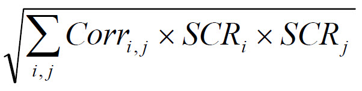

Gesetz vom 12. Juni 2015 betreffend die Aufsicht über Versicherungsunternehmen (Versicherungsaufsichtsgesetz; VersAG) Dem nachstehenden vom Landtag gefassten Beschluss erteile Ich Meine Zustimmung: I. Allgemeine Bestimmungen A. Gegenstand, Zweck und Geltungsbereich Art. 1 Gegenstand und Zweck 1) Dieses Gesetz regelt die Aufsicht über Versicherungsunternehmen. 2) Es bezweckt insbesondere den Schutz der Versicherten vor den Insolvenzrisiken der Versicherungsunternehmen und vor Missbräuchen sowie die Sicherung des Vertrauens in den liechtensteinischen Versicherungs- und Finanzplatz. 3) Es dient zudem der Umsetzung: a) der Richtlinie 2009/138/EG des Europäischen Parlaments und des Rates vom 25. November 2009 betreffend die Aufnahme und Ausübung der Versicherungs- und der Rückversicherungstätigkeit (Solvabilität II) (EWR-Rechtssammlung: Anh. IX - 1.01); b) der Richtlinie 2014/51/EU des Europäischen Parlaments und des Rates vom 16. April 2014 zur Änderung der Richtlinien 2003/71/EG und 2009/138/EG und der Verordnungen (EG) Nr. 1060/2009, (EU) Nr. 1094/2010 und (EU) Nr. 1095/2010 im Hinblick auf die Befugnisse der Europäischen Aufsichtsbehörde (Europäische Aufsichtsbehörde für das Versicherungswesen und die betriebliche Altersversorgung) und der Europäischen Aufsichtsbehörde (Europäische Wertpapier- und Marktaufsichtsbehörde) (ABl. L 153 vom 22. 5. 2014, S. 1) . Art. 2 Geltungsbereich und ergänzendes Recht 1) Diesem Gesetz unterstehen: a) Unternehmen, die im Fürstentum Liechtenstein oder vom Fürstentum Liechtenstein aus die Direktversicherung oder die Rückversicherung betreiben; und b) Zweckgesellschaften; für diese gelten sinngemäss die auf die Rückversicherungsunternehmen anwendbaren Bestimmungen. 2) Dieses Gesetz gilt auch für die als Direktversicherung oder Rückversicherung betriebene Eigenversicherung (Captive). 3) Auf Versicherungsunternehmen, welche die direkte Lebensversicherung betreiben und zugleich die betriebliche Altersversorgung durchführen, sind neben den Bestimmungen dieses Gesetzes auch die Bestimmungen der Pensionsfondsgesetzgebung anwendbar. 4) Versicherungsunternehmen, welche die Unfallversicherung (gegen Berufsunfälle, Nichtberufsunfälle, Berufskrankheiten) betreiben wollen, unterstehen überdies der Gesetzgebung über die obligatorische Unfallversicherung. 5) Für die Krankenversicherung und die obligatorische Unfallversicherung gilt zudem die einschlägige Spezialgesetzgebung. Kleine Direktversicherungsunternehmen Art. 3 a) Begriff 1) Als kleine Direktversicherungsunternehmen gelten Unternehmen, die folgende Voraussetzungen erfüllen: a) die jährlichen verbuchten Bruttoprämien übersteigen nicht 5.4 Millionen Euro oder den Gegenwert in Schweizer Franken; b) die gesamten versicherungstechnischen Rückstellungen des Unternehmens ohne Abzug der einforderbaren Beträge aus Rückversicherungsverträgen und von Zweckgesellschaften übersteigen nicht 26.6 Millionen Euro oder den Gegenwert in Schweizer Franken; c) falls das Unternehmen zu einer Gruppe gehört: die gesamten versicherungstechnischen Rückstellungen der Gruppe ohne Abzug der einforderbaren Beträge aus Rückversicherungsverträgen und von Zweckgesellschaften übersteigen nicht 26.6 Millionen Euro oder den Gegenwert in Schweizer Franken; d) das Unternehmen schliesst keine Versicherungs- oder Rückversicherungsverträge zur Abdeckung von Haftpflicht-, Kredit- und Kautionsversicherungsrisiken ab, es sei denn, es handelt sich um zusätzliche Risiken im Sinne von Art. 18; e) die Tätigkeit des Unternehmens schliesst keine Rückversicherungsverträge ein, die 600 000 Euro oder den Gegenwert in Schweizer Franken seiner verbuchten Bruttoprämien oder 2.7 Millionen Euro oder den Gegenwert in Schweizer Franken seiner versicherungstechnischen Rückstellungen ohne Abzug der einforderbaren Beträge aus Rückversicherungsverträgen und von Zweckgesellschaften oder 10 % seiner verbuchten Bruttoprämien oder 10 % seiner versicherungstechnischen Rückstellungen ohne Abzug der einforderbaren Beträge aus Rückversicherungsverträgen und von Zweckgesellschaften übersteigen. 2) Als kleine Direktversicherungsunternehmen gelten auch Unternehmen, bei denen die Finanzmarktaufsicht (FMA) feststellt, dass: a) in den letzten drei aufeinander folgenden Jahren keiner der in Abs. 1 festgelegten Beträge überschritten wurde; und b) in den nächsten fünf Jahren voraussichtlich keiner der in Abs. 1 festgelegten Beträge überschritten wird. Art. 4 b) Anwendbare Bestimmungen 1) Die FMA kann für kleine Direktversicherungsunternehmen Erleichterungen hinsichtlich der Art. 30 bis 35 und Art. 38 unter Beachtung von Art. 177 Abs. 3 Bst. c sowie im Hinblick auf die Wesensart, den Umfang und die Komplexität der Tätigkeit eines Unternehmens gewähren. 2) Kleine Direktversicherungsunternehmen haben hinsichtlich der finanziellen Ausstattung über anrechnungsfähige Eigenmittel zur Bedeckung der Solvenzkapitalanforderung zu verfügen. Einzelheiten betreffend die Höhe derselben regelt die Regierung mit Verordnung. 3) Die Art. 194 bis 256 sind nicht anwendbar, sofern eine Gruppe von der Versicherungsaufsicht unterliegenden Unternehmen ausschliesslich durch den Einbezug kleiner Direktversicherungsunternehmen entsteht. 4) Auf kleine Direktversicherungsunternehmen finden die Art. 36, 37, 39, 40, 42 bis 79, 100, 107 bis 110, 112 bis 122, 126 und 127, 129 bis 131, 135, 150 und 151, 262 bis 272 keine Anwendung. 5) Dieses Gesetz findet Anwendung auf alle Versicherungsunternehmen, die eine Bewilligung zur Ausübung einer Versicherungs- oder Rückversicherungstätigkeit beantragen oder beantragt haben und deren jährliche verbuchte Bruttoprämien oder deren versicherungstechnische Rückstellungen ohne Abzug der einforderbaren Beträge aus Rückversicherungsverträgen und von Zweckgesellschaften in den nächsten fünf Jahren voraussichtlich einen der in Art. 3 Abs. 1 festgelegten Beträge überschreiten werden. Wird unabhängig von einem Antrag auf Bewilligung zur Versicherungstätigkeit einer der in Art. 3 Abs. 1 genannten Beträge in drei aufeinander folgenden Jahren überschritten, findet dieses Gesetz ab dem vierten Jahr Anwendung. 6) Beabsichtigt ein Versicherungsunternehmen Tätigkeiten im freien Niederlassungs- oder Dienstleistungsverkehr auszuüben, gilt es nicht als kleines Direktversicherungsunternehmen. 7) In jedem Fall steht es einem Unternehmen zu, im Rahmen dieses Gesetzes eine ordentliche Bewilligung zu beantragen oder zu behalten. B. Ausnahmen vom Geltungsbereich Art. 5 Gesetzliche Systeme der sozialen Sicherheit Dieses Gesetz findet keine Anwendung auf die unter ein gesetzliches System der sozialen Sicherheit fallenden Versicherungen. Art. 6 Nichtlebensversicherung 1) In Bezug auf die Nichtlebensversicherung gilt dieses Gesetz nicht für die folgenden Geschäfte: a) Kapitalisationsgeschäfte, wie sie in den Rechtsvorschriften einzelner Vertragsstaaten des Abkommens über den Europäischen Wirtschaftsraum (EWRA-Vertragsstaaten) geregelt sind; b) die Geschäfte der für Versorgungs- und Unterstützungszwecke geschaffenen Institutionen, deren Leistungen sich nach den verfügbaren Mitteln richten, während die Höhe der Mitgliedsbeiträge pauschal festgesetzt wird; c) die Geschäfte eines Unternehmens ohne Rechtspersönlichkeit, dessen Zweck der gegenseitige Schutz der Mitglieder des Unternehmens ohne Prämienzahlung und ohne Bildung technischer Reserven ist; und d) die Ausfuhrkreditversicherungsgeschäfte für staatliche Rechnung oder mit staatlicher Garantie, oder wenn der Staat der Versicherer ist. 2) Dieses Gesetz gilt nicht für Versicherungsunternehmen auf Gegenseitigkeit, die das Nichtlebensversicherungsgeschäft betreiben und die mit anderen Versicherungsunternehmen auf Gegenseitigkeit eine Vereinbarung getroffen haben, wonach Letztere alle Versicherungsverträge rückversichern oder wonach das akzeptierende Unternehmen alle Verbindlichkeiten aus den Versicherungsverträgen anstelle des abgebenden Unternehmens zu erfüllen hat. In diesem Fall ist das akzeptierende Versicherungsunternehmen diesem Gesetz unterstellt. Art. 7 Lebensversicherung 1) In Bezug auf die Lebensversicherung gilt dieses Gesetz nicht für folgende Geschäfte und Tätigkeiten: a) die Geschäfte der für Versorgungs- und Unterstützungszwecke geschaffenen Institutionen, die unterschiedliche Leistungen nach Massgabe der verfügbaren Mittel erbringen und die die Höhe der Mitgliedsbeiträge pauschal festsetzen; b) die von anderen Einrichtungen als den diesem Gesetz unterstellten Unternehmen durchgeführten Geschäfte, deren Zweck darin besteht, den unselbständig oder selbständig tätigen Arbeitskräften eines Unternehmens oder einer Unternehmensgruppe, den Angehörigen eines Berufes oder einer Berufsgruppe im Todes- oder Erlebensfall, bei Arbeitseinstellung oder bei Minderung der Erwerbstätigkeit Leistungen zu gewähren, und zwar unabhängig davon, ob die sich aus diesen Geschäften ergebenden Verpflichtungen vollständig und zu jeder Zeit durch mathematische Rückstellungen gedeckt sind. 2) Es gilt zudem nicht für Einrichtungen, die nur Todesfallrisiken versichern, soweit der Betrag ihrer Leistungen den Durchschnittswert der Bestattungskosten bei einem Todesfall nicht übersteigt oder diese Leistungen in Sachwerten erbracht werden. Art. 8 Rückversicherung 1) In Bezug auf die Rückversicherung gilt dieses Gesetz nicht für Unternehmen mit Sitz ausserhalb des EWR (Drittland), die im Fürstentum Liechtenstein nur die Rückversicherung betreiben, sofern sie im Herkunftsstaat einer im Vergleich zum Inland gleichwertigen Aufsicht unterstehen und im Inland keine Niederlassung errichten. 2) Rückversicherungsverträge mit Unternehmen nach Abs. 1 werden so behandelt wie Rückversicherungsverträge mit Unternehmen, die nach diesem Gesetz eine Bewilligung erhalten haben. 3) Auf Rückversicherungsunternehmen nicht anwendbar sind die Art. 3, 4, 18, 21, 22, 25, 26, 28, 29, 52, 106, 107 bis 110, 112 Abs. 1, Art. 113, 114 Abs. 1, 2 und 4, Art. 115, 122, 125, 129, 136 bis 148, 152 bis 176 sowie 181. Art. 9 Touristischer Beistand 1) In Bezug auf den Versicherungszweig "Touristischer Beistand" gilt dieses Gesetz nicht, wenn: a) die Beistandsleistung anlässlich eines Unfalls oder einer Panne mit einem Motorfahrzeug erbracht wird, sofern sich der Unfall oder die Panne innerhalb des EWRA-Vertragsstaates des Gewährleistenden ereignet hat; und b) die Leistungspflicht auf folgende Leistungen beschränkt ist: 1. Pannenhilfe vor Ort, für die der Gewährleistende in der Mehrzahl der Fälle sein eigenes Personal und Material einsetzt; 2. Überführung des Fahrzeugs zum nächstgelegenen oder geeignetsten Ort der Reparatur, an dem diese vorgenommen werden kann, sowie etwaige Beförderungen des Fahrers und der Fahrzeuginsassen zum nächstgelegenen Ort, von dem aus sie ihre Reise mit anderen Mitteln fortsetzen können; und 3. wenn der EWRA-Vertragsstaat des Gewährleistenden es vorsieht, Beförderung des betroffenen Fahrzeugs und gegebenenfalls des Fahrers und der Fahrzeuginsassen bis zu deren Wohnort, Ausgangspunkt oder ursprünglichem Bestimmungsort innerhalb desselben EWRA-Vertragsstaates; und c) die Beistandsleistung nicht durch ein diesem Gesetz unterliegendes Versicherungsunternehmen erbracht wird. 2) In den in Abs. 1 Bst. b Ziff. 1 und 2 genannten Fällen gilt die Voraussetzung, dass sich der Unfall oder die Panne innerhalb des EWRA-Vertragsstaates des Gewährleistenden ereignet haben muss, nicht, wenn: a) der Anspruchsberechtigte ein Mitglied des Gewährleistenden ist; und b) die Pannenhilfe oder die Beförderung des Fahrzeugs allein auf Vorlage des Mitgliedsausweises hin ohne zusätzliche Zahlung durch eine ähnliche Einrichtung des betroffenen Landes auf der Grundlage einer Gegenseitigkeitsvereinbarung erfolgt oder, im Fall von Irland und des Vereinigten Königreichs, in denen diese Beistandsleistungen von ein und derselben Einrichtung erbracht werden und diese in diesen beiden Staaten tätig ist. C. Begriffsbestimmungen Art. 10 Begriffsbestimmungen und Bezeichnungen 1) Im Sinne dieses Gesetzes gelten als: 1. "Aufnahmestaat": ein Staat, in dem ein Versicherungsunternehmen eine Zweigniederlassung unterhält oder Dienstleistungen erbringt und bei dem es sich nicht um den Herkunftsstaat handelt; 2. "Aufsichtsbehörden": einzelstaatliche Behörden, die aufgrund von Rechts- oder Verwaltungsvorschriften für die Beaufsichtigung von Versicherungsunternehmen zuständig sind; 3. "beteiligtes Unternehmen": ein Mutterunternehmen oder ein anderes Unternehmen, das eine Beteiligung hält, oder ein Unternehmen, das mit einem anderen Unternehmen durch eine Beziehung verbunden ist, welche nach dem Personen- und Gesellschaftsrecht (PGR) zu konsolidierter Rechnungslegung verpflichtet; 4. "Beteiligung": das direkte Halten oder das Halten im Rahmen eines Kontrollverhältnisses von mindestens 20 % des Kapitals oder der Stimmrechte an einem Unternehmen; 5. "Direktversicherung": die selbständige Tätigkeit von Unternehmen bei der Übernahme von Risiken, die von einer natürlichen oder juristischen Person abgegeben werden, und welche keine Rückversicherung darstellt; 6. "Diversifikationseffekte": eine Reduzierung des Gefährdungspotenzials von Versicherungsunternehmen und -gruppen durch die Diversifizierung ihrer Geschäftstätigkeit, die sich aus der Tatsache ergibt, dass das negative Resultat eines Risikos durch das günstigere Resultat eines anderen Risikos ausgeglichen werden kann, wenn diese Risiken nicht voll korreliert sind; 7. "Drittland-Versicherungsunternehmen": ein Versicherungsunternehmen, das seinen Sitz in einem Drittland hat und eine Bewilligung als Versicherungsunternehmen benötigen würde, wenn sich sein Sitz in einem EWRA-Vertragsstaat befände; 8. "enge Verbindung": eine Situation, in der zwei oder mehr natürliche oder juristische Personen durch Kontrolle oder Beteiligung verbunden sind. Als enge Verbindung zwischen mindestens zwei natürlichen oder juristischen Personen gilt auch eine Situation, in der die betreffenden Personen mit derselben Person durch ein Kontrollverhältnis dauerhaft verbunden sind; 9. "externe Ratingagentur" ("external credit assessment institution"): eine Ratingagentur, die registriert oder zertifiziert ist gemäss der Verordnung (EG) Nr. 1060/2009 des Europäischen Parlaments und des Rates vom 16. September 2009 über Ratingagenturen (EWR-Rechtssammlung: Anh. IX - 31eb.01), oder eine Zentralbank, die Ratings abgibt und von der Anwendung dieser Verordnung ausgenommen ist; 10. "Finanzbranche": eine Branche im Sinne des Finanzkonglomeratsgesetzes; 11. "Finanzrückversicherung": eine Rückversicherung mit begrenzter Risikoübernahme, bei der das explizite Gesamtschadenrisiko, das heisst das übernommene wirtschaftliche Gesamtrisiko, das sich aus der Übernahme sowohl eines erheblichen versicherungstechnischen Risikos als auch des Risikos hinsichtlich der Abwicklungsdauer ergibt, die Prämiensumme über die Gesamtlaufzeit des Versicherungsvertrages um einen begrenzten, aber erheblichen Betrag übersteigt, wobei zumindest eines der folgenden Merkmale zusätzlich gegeben sein muss: a) ausdrückliche und materielle Berücksichtigung des Zeitwerts des Geldes; b) vertragliche Bestimmungen mit dem Ziel, die wirtschaftlichen Ergebnisse zwischen den Vertragsparteien über die Gesamtlaufzeit des Vertrages auszugleichen, um einen gezielten Risikotransfer zu ermöglichen; 12. "Finanzunternehmen": ein Unternehmen der Finanzbranche; 13. "firmeneigenes Versicherungsunternehmen": ein Versicherungsunternehmen, das entweder einem Finanzunternehmen, bei dem es sich weder um ein Versicherungsunternehmen noch um eine Gruppe von Versicherungsunternehmen handelt, oder einem nicht der Finanzbranche angehörenden Unternehmen gehört und das ausschliesslich Risiken des Unternehmens oder der Unternehmen, dem beziehungsweise denen es gehört, oder Risiken von Unternehmen der Gruppe, der es angehört, versichert; 14. "Funktionsausgliederung (Auslagerung, Outsourcing)": eine Vereinbarung, die zwischen einem Versicherungsunternehmen und einem Dienstleister getroffen wird, wobei es sich bei Letzterem um ein beaufsichtigtes oder nicht beaufsichtigtes Unternehmen handeln kann. Dieser Vereinbarung zufolge übernimmt der Dienstleister direkt oder durch weitere Funktionsausgliederung ein Verfahren, eine Dienstleistung oder eine Tätigkeit, die ansonsten vom Versicherungsunternehmen selbst erbracht würde; 15. "gemischte Versicherungs-Holdinggesellschaft": ein Mutterunternehmen, das weder ein Versicherungsunternehmen noch ein Drittland-Versicherungsunternehmen noch eine Versicherungs-Holdinggesellschaft oder eine gemischte Finanzholdinggesellschaft im Sinne des Finanzkonglomeratsgesetzes ist und unter seinen Tochterunternehmen mindestens ein Versicherungsunternehmen hat; 16. "geregelter Markt": ein von einem Marktbetreiber betriebenes und/oder verwaltetes multilaterales System, das: a) die Interessen einer Vielzahl Dritter am Kauf und Verkauf von Finanzinstrumenten innerhalb des Systems und nach seinen nicht diskretionären Regeln in einer Weise zusammenführt oder das Zusammenführen fördert, die zu einem Vertrag in Bezug auf Finanzinstrumente, die gemäss den Regeln und/oder den Systemen des Marktes zum Handel zugelassen wurden, führt; b) eine Zulassung erhalten hat; und c) ordnungsgemäss nach den anwendbaren Bestimmungen funktioniert; 17. "geregelter Markt eines Drittlandes": ein in einem Drittland belegener geregelter Markt (Finanzmarkt): a) der vom Herkunftsstaat des Versicherungsunternehmens anerkannt wird und den in diesem Staat geltenden Anforderungen genügt; und b) dessen gehandelte Finanzinstrumente eine Qualität aufweisen, die mit der Qualität der Instrumente vergleichbar ist, die auf dem geregelten Markt des Herkunftsstaates gehandelt werden; 18. "Grossrisiken": a) die unter den Zweigen 4, 5, 6, 7, 11 und 12 des Anhangs 1 Bst. A eingestuften Risiken; b) die unter den Zweigen 14 und 15 des Anhangs 1 Bst. A eingestuften Risiken, wenn der Versicherungsnehmer eine Erwerbstätigkeit im industriellen oder gewerblichen Sektor oder eine freiberufliche Tätigkeit ausübt und das Risiko damit im Zusammenhang steht; c) die unter den Zweigen 3, 8, 9, 10, 13 und 16 des Anhangs 1 Bst. A eingestuften Risiken, sofern der Versicherungsnehmer bei mindestens zwei der drei folgenden Kriterien die Obergrenzen überschreitet: aa) Bilanzsumme: 6.6 Millionen Euro oder der Gegenwert in Schweizer Franken; bb) Nettoumsatzerlöse im Geschäftsjahr: 13.6 Millionen Euro oder der Gegenwert in Schweizer Franken; cc) durchschnittliche Beschäftigtenzahl im Verlauf des Geschäftsjahres: 250 Beschäftigte. Gehört der Versicherungsnehmer zu einer Unternehmensgruppe, für die eine konsolidierte Jahresrechnung erstellt wird, so werden die genannten Kriterien auf die konsolidierte Jahresrechnung angewandt; 19. "Gruppe": eine Gruppe von Unternehmen, die: a) aus einem beteiligten Unternehmen, dessen Tochterunternehmen und den Unternehmen besteht, an denen das beteiligte Unternehmen oder dessen Tochterunternehmen eine Beteiligung halten, sowie Unternehmen, die untereinander durch eine Beziehung verbunden sind, welche zu konsolidierter Rechnungslegung verpflichtet; oder b) auf der Begründung von vertraglichen oder sonstigen starken und nachhaltigen finanziellen Beziehungen zwischen allen diesen Unternehmen beruht und zu der Versicherungsvereine auf Gegenseitigkeit oder diesen ähnliche Vereine gehören können, sofern: aa) eines dieser Unternehmen durch zentrale Koordination einen beherrschenden Einfluss auf die Entscheidungen aller der Gruppe angehörenden Unternehmen ausübt, darunter auch die Finanzentscheidungen; und bb) die Begründung sowie Auflösung dieser Beziehungen der vorherigen Genehmigung durch die für die Gruppenaufsicht zuständige Behörde unterliegen. Beim Unternehmen, das die zentrale Koordination ausübt, handelt es sich um das Mutterunternehmen; die weiteren Unternehmen werden als Tochterunternehmen betrachtet; 20. "gruppeninterne Transaktion": eine Transaktion, bei der sich ein Versicherungsunternehmen zur Erfüllung einer Verbindlichkeit direkt oder indirekt auf andere Unternehmen innerhalb derselben Gruppe oder auf mit den Unternehmen der Gruppe durch enge Verbindungen verbundene natürliche und juristische Personen stützt, unabhängig davon, ob dies auf vertraglicher oder nicht vertraglicher und auf entgeltlicher oder unentgeltlicher Basis geschieht; 21. "Herkunftsstaat": ein Staat, in dem sich der Sitz des Versicherungsunternehmens befindet, welches das Risiko deckt beziehungsweise die Verpflichtung eingeht; im Sinne von Art. 158 gilt der EWRA-Vertragsstaat, in dem der Zweigniederlassung eines Drittland-Versicherungsunternehmens die Bewilligung erteilt worden ist, als Herkunftsstaat; 22. "Holdinggesellschaft": ein Unternehmen, dessen einziger Zweck im Erwerb, in der Verwaltung und in der Verwertung von Beteiligungen an anderen Unternehmen besteht; 23. "Kapitalaufschlag": die aufsichtsbehördliche Anordnung einer Erhöhung der Solvenzkapitalanforderung in begründeten Einzelfällen; 24. "Kollegium der Aufsichtsbehörden": eine permanente, aber flexible Plattform für die Zusammenarbeit, die Koordinierung und die Erleichterung der Entscheidungsfindung betreffend die Gruppenaufsicht; 25. "Kontrollverhältnis": eine Verbindung zwischen einem Mutterunternehmen beziehungsweise einem übergeordneten Unternehmen und einem Tochterunternehmen beziehungsweise einem untergeordneten Unternehmen oder ein gleichartiges Verhältnis zwischen einer natürlichen oder juristischen Person und einem Unternehmen. Jedes untergeordnete Unternehmen eines untergeordneten Unternehmens wird auch als untergeordnetes Unternehmen des übergeordneten Unternehmens angesehen, das an der Spitze dieser Unternehmen steht; 26. "Konzentrationsrisiko": sämtliche mit Risiken behafteten Engagements mit einem Ausfallpotenzial, das umfangreich genug ist, um die Solvabilität oder die Finanzlage der Versicherungsunternehmen zu gefährden; 27. "Kreditrisiko": das Risiko eines Verlustes oder nachteiliger Veränderungen der Finanzlage, das sich aus Fluktuationen bei der Bonität von Wertpapieremittenten, Gegenparteien und anderen Schuldnern ergibt, gegenüber denen die Versicherungsunternehmen Forderungen haben, und das in Form von Gegenparteiausfallrisiken, Spread-Risiken oder Marktrisikokonzentrationen auftritt; 28. "Liquidationsverfahren": ein Gesamtverfahren, bei dem das Vermögen eines Direktversicherungsunternehmens verwertet und der Erlös in angemessener Weise unter den Gläubigern, Anteilseignern oder Mitgliedern verteilt wird, wozu in jedem Fall das Tätigwerden einer zuständigen Verwaltungs- oder Gerichtsbehörde erforderlich ist. Dazu zählen auch Verfahren, die durch einen Nachlassvertrag im Konkurs oder eine ähnliche Massnahme abgeschlossen werden; es ist unerheblich, ob die Verfahren infolge Zahlungsunfähigkeit eröffnet werden oder nicht oder ob sie freiwillig oder zwangsweise eingeleitet werden; 29. "Liquidator": eine Person oder eine Stelle, die von einer zuständigen Verwaltungs- oder Gerichtsbehörde oder von den Leitungsorganen beziehungsweise der Generalversammlung eines Direktversicherungsunternehmens zur Abwicklung eines Liquidationsverfahrens bestellt wird; 30. "Liquiditätsrisiko": das Risiko, dass Versicherungsunternehmen nicht in der Lage sind, Anlagen und andere Vermögenswerte zu realisieren, um ihren finanziellen Verpflichtungen bei Fälligkeit nachzukommen; 31. "Marktrisiko": das Risiko eines Verlustes oder nachteiliger Veränderungen der Finanzlage, das sich direkt oder indirekt aus Schwankungen in der Höhe und in der Volatilität der Marktpreise für die Vermögenswerte, Verbindlichkeiten und Finanzinstrumente ergibt; 32. "Mutterunternehmen": ein Mutterunternehmen im Sinne der Rechnungslegungsvorschriften des PGR sowie jedes Unternehmen, das einen beherrschenden Einfluss auf ein anderes Unternehmen ausübt; 33. "Niederlassung": der Sitz oder eine Zweigniederlassung eines Unternehmens; 34. "operationelles Risiko": das Verlustrisiko, das sich aus der Unangemessenheit oder dem Versagen von internen Prozessen, Mitarbeitern oder Systemen oder durch externe Ereignisse ergibt; 35. "qualifizierte zentrale Gegenpartei": eine zentrale Gegenpartei, die gestützt auf die Verordnung (EU) Nr. 648/2012 des Europäischen Parlaments und des Rates vom 4. Juli 2012 über OTC-Derivate, zentrale Gegenparteien und Transaktionsregister entweder zugelassen (Art. 14) oder anerkannt (Art. 25) worden ist; 36. "qualifizierte Beteiligung": das direkte oder indirekte Halten von mindestens 10 % des Kapitals oder der Stimmrechte an einem Unternehmen oder jede andere Möglichkeit der Wahrnehmung eines massgeblichen Einflusses auf die Geschäftsführung des Unternehmens, an dem die Beteiligung gehalten wird; 37. "Risikomass": eine mathematische Funktion, die unter einer bestimmten Wahrscheinlichkeitsverteilungsprognose einen monetären Betrag bestimmt und monoton mit dem Risikopotenzial steigt, das der Wahrscheinlichkeitsverteilungsprognose zugrunde liegt; 38. "Risikominderungstechniken": sämtliche Techniken, die die Versicherungsunternehmen in die Lage versetzen, einen Teil oder die Gesamtheit ihrer Risiken auf eine andere Partei zu übertragen; 39. "Rückversicherung": die selbständige Tätigkeit von Unternehmen bei der Übernahme von Risiken, die von einem Unternehmen, das die Direktversicherung betreibt, oder einem anderen Rückversicherungsunternehmen oder einem Drittland-Versicherungsunternehmen abgegeben werden; 40. "Sanierungsmassnahmen": alle Massnahmen, die das Tätigwerden einer zuständigen Verwaltungs- oder Gerichtsbehörde mit dem Ziel beinhalten, die finanzielle Lage eines Direktversicherungsunternehmens zu sichern oder wiederherzustellen und die die bestehenden Rechte anderer Beteiligter als des Versicherungsunternehmens selbst beeinträchtigen. Dazu zählen auch Massnahmen, die die Aussetzung der Zahlungen, die Aussetzung der Vollstreckungsmassnahmen oder eine Kürzung der Forderungen erlauben; 41. "Solvabilität": die Darstellung der Solvenzkapitalanforderung und der zu deren Bedeckung anrechnungsfähigen Eigenmittel; 42. "Solvenzkapitalanforderung": der Sollwert der Eigenmittel eines Unternehmens zur Bedeckung der unternehmenseigenen Risiken; 43. "Staat der Dienstleistung": der Staat der Verpflichtung oder der Staat, in dem das Risiko belegen ist, wenn die Verpflichtung oder das Risiko von einem in einem anderen Staat niedergelassenen Versicherungsunternehmen gedeckt wird; 44. "Staat der Niederlassung": der Staat, in dem das Versicherungsunternehmen niedergelassen ist, welches das Risiko deckt; 45. "Staat, in dem das Risiko belegen ist": a) bei der Versicherung entweder von Gebäuden oder von Gebäuden und den darin befindlichen Sachen, sofern diese durch denselben Versicherungsvertrag gedeckt sind, der Staat, in dem die Immobilien belegen sind; b) bei der Versicherung von zugelassenen Fahrzeugen aller Art der Staat, in dem das Fahrzeug zugelassen ist; c) bei einem höchstens vier Monate dauernden Vertrag zur Versicherung von Reise- und Ferienrisiken der Staat, in dem der Versicherungsnehmer den Vertrag abgeschlossen hat, ungeachtet des betreffenden Versicherungszweiges; d) in allen anderen Fällen der Staat, in dem der Versicherungsnehmer seinen gewöhnlichen Aufenthalt hat oder, wenn die Versicherungsnehmerin eine juristische Person ist, der Staat, in dem sich die Niederlassung dieser juristischen Person befindet, auf die sich der Vertrag bezieht; 46. "Staat der Verpflichtung": der Staat, in dem der Versicherungsnehmer seinen gewöhnlichen Aufenthalt hat oder, wenn die Versicherungsnehmerin eine juristische Person ist, der Staat, in dem sich die Niederlassung dieser juristischen Person befindet, auf die sich der Vertrag bezieht; 47. "ständige Präsenz": eine Präsenz, die einer Zweigniederlassung gleichzustellen ist, und zwar auch dann, wenn diese Präsenz nicht die Form einer Zweigniederlassung angenommen hat, sondern lediglich durch ein Büro wahrgenommen wird, das von dem eigenen Personal des Unternehmens oder einer Person geführt wird, die zwar unabhängig, aber beauftragt ist, auf Dauer für dieses Unternehmen wie eine Agentur zu handeln; 48. "Tochterunternehmen": ein Tochterunternehmen im Sinne der Rechnungslegungsvorschriften des PGR sowie jedes Unternehmen, auf das ein Unternehmen einen beherrschenden Einfluss ausübt. Jedes Tochterunternehmen eines Tochterunternehmens wird auch als Tochterunternehmen eines Mutterunternehmens, das an der Spitze dieser Unternehmen steht, betrachtet; 49. "übergeordnetes Unternehmen": ein Mutterunternehmen oder ein anderes Unternehmen, das einen beherrschenden Einfluss auf ein anderes Unternehmen ausübt; 50. "untergeordnetes Unternehmen": ein Tochterunternehmen oder ein anderes Unternehmen, auf das ein beherrschender Einfluss ausgeübt wird; 51. "verbundenes Unternehmen": ein Tochterunternehmen oder ein anderes Unternehmen, an dem eine Beteiligung gehalten wird, oder ein Unternehmen, das mit einem anderen Unternehmen durch eine Beziehung verbunden ist, welche nach dem PGR zu konsolidierter Rechnungslegung verpflichtet; 52. "Versicherungsforderung": jeder Betrag, den ein Direktversicherungsunternehmen Versicherungsnehmern, Versicherten, Begünstigten oder geschädigten Dritten, die ein direktes Klagerecht gegen das Versicherungsunternehmen haben, aufgrund eines Versicherungsvertrages oder einer anderen Tätigkeit, auf welche dieses Gesetz anwendbar ist, im Rahmen der Direktversicherung schuldet. Dazu gehören auch für diese Personen zurückgestellte Beträge, wenn einzelne Elemente der Forderung noch ungewiss sind, sowie Prämien, die ein Versicherungsunternehmen zurückzuzahlen hat, weil ein Rechtsgeschäft nach dem für dieses massgeblichen Recht vor Eröffnung des Konkurs- oder Liquidationsverfahrens nicht zustande gekommen ist oder aufgehoben wurde; 53. "Versicherungs-Holdinggesellschaft": ein Mutterunternehmen, bei dem es sich nicht um eine gemischte Finanzholdinggesellschaft im Sinne des Finanzkonglomeratsgesetzes handelt und dessen Haupttätigkeit im Erwerb und Halten von Beteiligungen an Tochterunternehmen besteht, wobei diese Tochterunternehmen ausschliesslich oder hauptsächlich Versicherungsunternehmen oder Drittland-Versicherungsunternehmen sind und mindestens eines dieser Tochterunternehmen ein Versicherungsunternehmen ist; 54. "versicherungstechnisches Risiko" ("underwriting risk"): das Risiko eines Verlustes oder einer nachteiligen Veränderung des Wertes der Versicherungsverbindlichkeiten, das sich aus einer unangemessenen Preisfestlegung und nicht angemessenen Rückstellungsannahmen ergibt; 55. "Versicherungsunternehmen": ein Unternehmen, das eine Bewilligung zur Ausübung der direkten Lebensversicherungs- oder Nichtlebensversicherungstätigkeit oder der Rückversicherungstätigkeit erhalten hat, wobei eine Differenzierung zwischen Direkt- und Rückversicherungsunternehmen erfolgt, sofern dies erforderlich ist; 56. "Verwalter": eine Person oder eine Stelle, die von einer zuständigen Verwaltungs- oder Gerichtsbehörde zur Durchführung von Sanierungsmassnahmen bestellt wird; 57. "Wahrscheinlichkeitsverteilungsprognose": eine mathematische Funktion, die einer ausreichenden Reihe von einander ausschliessenden zukünftigen Ereignissen eine Eintrittswahrscheinlichkeit zuweist; 58. "Zweckgesellschaft" ("special purpose vehicle"): ein Unternehmen, unabhängig davon, ob es sich um eine Kapitalgesellschaft handelt oder nicht, das kein bestehendes Versicherungsunternehmen ist und Risiken von Versicherungsunternehmen übernimmt, wobei es diese Risiken vollständig über die Emission von Schuldtiteln oder einen anderen Finanzierungsmechanismus absichert, bei denen die Rückzahlungsansprüche der Kapitalgeber über solche Schuldtitel oder einen Finanzierungsmechanismus gegenüber den Rückversicherungsverpflichtungen des Unternehmens nachrangig sind; 59. "Zweigniederlassung": eine Zweigniederlassung im Sinne von Art. 119 Abs. 1 PGR, eine Agentur oder jede andere ständige Präsenz eines Versicherungsunternehmens in einem EWRA-Vertragsstaat, der nicht Herkunftsstaat ist. 2) Unter den in diesem Gesetz verwendeten Personen- und Funktionsbezeichnungen sind Angehörige des weiblichen und des männlichen Geschlechts zu verstehen. II. Aufnahme der Versicherungstätigkeit A. Bewilligungspflicht und Bewilligungsgesuch Art. 11 Bewilligungspflicht 1) Unternehmen, die der Aufsicht unterstehen, benötigen zur Aufnahme der Versicherungstätigkeit eine Bewilligung der FMA. 2) Keiner Bewilligung bedürfen Versicherungsunternehmen mit Sitz in einem anderen EWRA-Vertragsstaat, sofern sie die besonderen Voraussetzungen nach Art. 112 ff. erfüllen; vorbehalten bleibt die Spezialgesetzgebung betreffend einzelne Zweige der obligatorischen Versicherung. Art. 12 Bewilligungsgesuch 1) Unternehmen, die eine Bewilligung zur Aufnahme der Versicherungstätigkeit erhalten wollen, haben der FMA ein Gesuch einzureichen. 2) Das Gesuch muss folgende Angaben und Unterlagen enthalten: a) die Statuten der Gesellschaft; b) die Organisation und den örtlichen Tätigkeitsbereich des Unternehmens, gegebenenfalls auch der Gruppe oder des Finanzkonglomerats, zu dem oder zu denen das Unternehmen gehört; c) die Eröffnungsbilanz; d) die Jahresrechnung der letzten drei Geschäftsjahre der Gesellschafter sowie gegebenenfalls den konsolidierten Geschäftsbericht; e) Nachweise darüber, dass anrechnungsfähige Basiseigenmittel vorhanden sind, um die absolute Untergrenze der Mindestkapitalanforderung abzudecken; f) Nachweise darüber, dass das Unternehmen in der Lage sein wird, die anrechnungsfähigen Eigenmittel zu halten, um die Solvenzkapitalanforderung zu erfüllen; g) Nachweise darüber, dass das Unternehmen in der Lage sein wird, die anrechnungsfähigen Basiseigenmittel zu halten, um die Mindestkapitalanforderung zu erfüllen; h) die Identität und die Beteiligungshöhe der direkten und indirekten Aktionäre, Genossenschafter oder Gesellschafter, die als natürliche oder juristische Personen eine qualifizierte Beteiligung an dem Unternehmen halten oder daran anderweitig wirtschaftlich berechtigt sind, sowie das Bestehen enger Verbindungen; i) die namentliche Bezeichnung der Leitungsorgane sowie aller weiteren Organe, einschliesslich der Personen, die für die Aufsicht und die Kontrolle zuständig sind oder andere Schlüsselfunktionen innehaben; k) Nachweise darüber, dass das Unternehmen in der Lage sein wird, die erforderliche Governance zu gewährleisten; l) die namentliche Bezeichnung der externen Revisionsstelle und der für das Mandat verantwortlichen Personen und, sofern das Unternehmen Teil einer Gruppe oder eines Finanzkonglomerats ist, die Organisation des Mandats der externen Revisionsstelle der Gruppe oder des Finanzkonglomerats; m) die Verträge oder sonstigen Absprachen, durch die Funktionen oder Tätigkeiten ausgegliedert werden sollen (Funktionsausgliederung); n) die Erklärung des Beitritts zum Nationalen Versicherungsbüro und zum Nationalen Garantiefonds unter gleichzeitiger Bekanntgabe des Schadenregulierungsbeauftragten sowie die Angabe von Namen und Anschrift der Schadenregulierungsbeauftragten in anderen EWRA-Vertragsstaaten, wenn die zu deckenden Risiken in den Versicherungszweig "Haftpflicht für Landfahrzeuge mit eigenem Antrieb", unter Ausschluss der Haftpflicht des Frachtführers, fallen; o) Angaben über die Mittel zur Erfüllung der Leistungen im Rahmen des Versicherungszweiges "Touristischer Beistand"; p) einen Tätigkeitsplan nach Art. 13; q) auf Verlangen der FMA weitere für die Beurteilung des Gesuchs erforderliche Angaben und Unterlagen. 3) Ersucht ein Versicherungsunternehmen, das bereits im Besitz einer Bewilligung für einen Versicherungszweig ist, um die Bewilligung für einen weiteren Versicherungszweig, so hat es die Unterlagen und Angaben nach Abs. 2 nur einzureichen, wenn sie gegenüber den bereits genehmigten geändert werden sollen. Art. 13 Tätigkeitsplan 1) Der Tätigkeitsplan muss Angaben und Nachweise enthalten über: a) die geplanten Versicherungszweige und die Art der Risiken oder Verpflichtungen, die das Unternehmen in der Direkt- und der Rückversicherung zu übernehmen gedenkt; b) die vorgesehene Rückversicherung sowie, für Rückversicherungsunternehmen, die Art der Rückversicherungsverträge, die das Unternehmen mit Zedenten zu schliessen gedenkt, und die Grundzüge der Retrozession (Retrozessionsplan); c) die Bestandteile der Basiseigenmittel, die die absolute Untergrenze der Mindestkapitalanforderung darstellen; d) die voraussichtlichen Kosten für den Aufbau der Verwaltung und des Vertriebsnetzes sowie die dafür vorgesehenen finanziellen Mittel. 2) Zudem muss der Tätigkeitsplan folgende Angaben und Unterlagen für die ersten drei Geschäftsjahre enthalten: a) eine Planbilanz und -erfolgsrechnung; b) Schätzungen der künftigen Solvenzkapitalanforderung, die auf der Grundlage der voraussichtlichen Liquiditätslage vorzunehmen sind, sowie zur Berechnungsmethode für die Ableitung dieser Schätzung; c) Schätzungen der Mindestkapitalanforderung, die auf der Grundlage der voraussichtlichen Liquiditätslage vorzunehmen sind, sowie zur Berechnungsmethode für die Ableitung dieser Schätzwerte; d) die finanziellen Mittel, die voraussichtlich zur Bedeckung der Solvenzkapitalanforderung, der Mindestkapitalanforderung sowie der versicherungstechnischen Rückstellungen zur Verfügung stehen; e) für Nichtlebensversicherungen und Rückversicherungen: 1. die voraussichtlichen Verwaltungskosten, insbesondere die laufenden Gemeinkosten und Provisionen, ohne Aufwendungen für den Aufbau der Verwaltung; und 2. die voraussichtlichen Prämien- beziehungsweise Beitragsaufkommen und die voraussichtliche Schadenbelastung; f) für Lebensversicherungen einen Plan, aus dem die Schätzungen der Einnahmen und der Ausgaben im Direktversicherungsgeschäft sowie im aktiven und passiven Rückversicherungsgeschäft im Einzelnen hervorgehen. Art. 14 Rechtsform, Sitz, Zweck und Organisation 1) Versicherungsunternehmen müssen die Rechtsform der Aktiengesellschaft, der Europäischen Gesellschaft (SE), der Genossenschaft oder der Europäischen Genossenschaft (SCE) haben. Zweckgesellschaften können überdies in der Rechtsform eines Treuunternehmens errichtet werden. 2) Sowohl der statutarische Sitz als auch die Hauptverwaltung des Unternehmens müssen sich im Fürstentum Liechtenstein befinden. Die FMA kann die Anforderungen an die Hauptverwaltung in einer Richtlinie näher umschrieben. 3) Zweck und Organisation des Unternehmens sind auf die Versicherungstätigkeit und auf solche Geschäfte zu beschränken, die unmittelbar damit in Zusammenhang stehen. Bei Rückversicherungsunternehmen können sich Zweck und Organisation auch auf die Funktion einer Holdinggesellschaft sowie Tätigkeiten in der Finanzbranche erstrecken, jedoch nicht auf die Ausübung nicht verbundener Bank- und Finanztätigkeiten. B. Erteilung und Umfang der Bewilligung Art. 15 Erteilung der Bewilligung 1) Die Bewilligung wird erteilt, wenn das Unternehmen die gesetzlichen Anforderungen erfüllt. Sie kann unter Auflagen erteilt werden. 2) Die FMA verweigert die Bewilligung mit Verfügung, wenn ein Unternehmen den gesetzlichen Anforderungen nicht genügt oder ihre Vorgaben nicht erfüllt, insbesondere wenn: a) zwischen einem Unternehmen und einer anderen natürlichen oder juristischen Person eine enge Verbindung besteht und diese enge Verbindung die FMA bei der ordnungsgemässen Erfüllung ihrer Aufgaben behindert; b) die FMA bei der ordnungsgemässen Erfüllung ihrer Aufgaben durch Rechts- oder Verwaltungsvorschriften eines Drittlandes, denen mindestens eine natürliche oder juristische Person untersteht, zu der das Unternehmen eine enge Verbindung aufweist, oder durch Schwierigkeiten bei der Anwendung solcher Vorschriften behindert würde. 3) Die FMA informiert das Amt für Justiz über die erteilte Bewilligung. Das Versicherungsunternehmen hat binnen sieben Tagen nach Zustellung der Bewilligung beim Amt für Justiz einen Antrag auf Eintragung ins Handelsregister zu stellen. Nach erfolgter Eintragung veröffentlicht die FMA die erteilte Bewilligung auf ihrer Website. 4) Entscheidet die FMA nicht innerhalb von sechs Monaten nach Eingang des Antrags und der vollständigen Unterlagen über die Bewilligung, so kann der Antragsteller Beschwerde bei der FMA-Beschwerdekommission erheben. 5) Die FMA hat der Europäischen Aufsichtsbehörde für das Versicherungswesen und die betriebliche Altersversorgung (EIOPA) jede Bewilligung mitzuteilen. Art. 16 Konsultation anderer Behörden 1) Bevor einem Unternehmen die Bewilligung erteilt wird, konsultiert die FMA die zuständigen Behörden anderer betroffener EWRA-Vertragsstaaten, wenn das Unternehmen: a) Tochterunternehmen eines in einem anderen EWRA-Vertragsstaat zugelassenen Versicherungsunternehmens ist; b) Tochterunternehmen des Mutterunternehmens eines in einem anderen EWRA-Vertragsstaat zugelassenen Versicherungsunternehmens ist; oder c) von derselben natürlichen oder juristischen Person kontrolliert wird wie ein in einem anderen EWRA-Vertragsstaat zugelassenes Versicherungsunternehmen. 2) Die für die Beaufsichtigung von Banken oder Wertpapierfirmen zuständige Behörde eines betroffenen EWRA-Vertragsstaates ist zu konsultieren, bevor einem Unternehmen die Bewilligung erteilt wird, das: a) Tochterunternehmen einer in einem EWRA-Vertragsstaat zugelassenen Bank oder Wertpapierfirma ist; b) Tochterunternehmen des Mutterunternehmens einer in einem EWRA-Vertragsstaat zugelassenen Bank oder Wertpapierfirma ist; oder c) von derselben natürlichen oder juristischen Person kontrolliert wird wie eine in einem EWRA-Vertragsstaat zugelassene Bank oder Wertpapierfirma. 3) Bei Überprüfung der Eignung der Aktionäre und anderer Anteilseigner sowie der fachlichen Qualifikation und der persönlichen Integrität von Leitungsorganen des Unternehmens, das um Bewilligung nachsucht, konsultiert die FMA die zuständigen Behörden der anderen EWRA-Vertragsstaaten, wenn diese Personen eine Leitungs- oder andere Schlüsselfunktion in einem anderen Unternehmen derselben Gruppe ausüben. Art. 17 Umfang der Bewilligung 1) In der Direktversicherung wird die Bewilligung für jeden Versicherungszweig gesondert oder für mehrere Versicherungszweige zusammen erteilt. Sie bezieht sich jeweils auf den ganzen Zweig, es sei denn, dass nur ein Teil der Risiken dieses Versicherungszweiges gedeckt werden soll. Vorbehaltlich der in Art. 18 genannten Fälle kann ein zu einem Zweig gehörendes Risiko nicht im Rahmen eines anderen Versicherungszweiges gedeckt werden. 2) In der Rückversicherung wird die Bewilligung für die Tätigkeit der Nichtlebensrückversicherung, der Lebensrückversicherung oder für alle Arten der Rückversicherung erteilt. 3) Die Bewilligung für die Direktversicherung berechtigt auch zur Ausübung der Tätigkeit der Rückversicherung in den bewilligten Versicherungszweigen; die Ausübung einer solchen Tätigkeit bedarf der vorgängigen Mitteilung an die FMA. 4) Versicherungsunternehmen dürfen Beistandsleistungen nach Art. 145 nur ausüben, wenn sie eine Bewilligung für den Versicherungszweig "Touristischer Beistand" besitzen. 5) Die Bewilligung erstreckt sich für Versicherungsunternehmen mit Sitz im Fürstentum Liechtenstein auf das Gebiet der EWRA-Vertragsstaaten, wobei sie sowohl die Niederlassungsfreiheit als auch die Dienstleistungsfreiheit abdeckt. Art. 18 Zusätzliche Risiken 1) Ein Versicherungsunternehmen, das für ein zu einem Zweig oder einer Gruppe von Zweigen nach Anhang 1 gehörendes Hauptrisiko eine Bewilligung erhalten hat, kann auch die zu einem anderen Versicherungszweig gehörenden Risiken decken, ohne für diese Risiken eine zusätzliche Bewilligung erhalten zu müssen, sofern diese Risiken sämtliche nachfolgend genannten Voraussetzungen erfüllen: a) sie stehen im Zusammenhang mit dem Hauptrisiko; b) sie betreffen den Gegenstand, der gegen das Hauptrisiko versichert ist; und c) sie werden durch denselben Vertrag gedeckt, der das Hauptrisiko deckt. 2) Abweichend von Abs. 1 können die den Zweigen 14, 15 und 17 nach Anhang 1 Bst. A zugerechneten Risiken nicht als zusätzliche Risiken anderer Zweige behandelt werden. Dennoch kann die Rechtsschutzversicherung nach Zweig 17 als zusätzliches Risiko des Zweiges 18 angesehen werden, wenn die Voraussetzungen von Abs. 1 und eine der folgenden Bedingungen erfüllt sind: a) das Hauptrisiko betrifft nur die Beistandsleistungen zu Gunsten von Personen, die auf Reisen oder während der Abwesenheit von ihrem Wohnsitz oder gewöhnlichen Aufenthaltsort in Schwierigkeiten geraten; oder b) die Versicherung betrifft Streitigkeiten oder Risiken, die aus dem Einsatz von Schiffen auf See entstehen oder mit diesem Einsatz verbunden sind. C. Änderung der Bewilligungsanforderungen Art. 19 Genehmigungspflicht 1) Von der FMA sind vorgängig zu genehmigen: a) Änderungen der Bewilligungsanforderungen nach Art. 12 Abs. 2 Bst. a, b, e, f, g, h, i, k, l und m sowie nach Art. 13 Abs. 1 Bst. a; b) Fusionen, Spaltungen, Umwandlungen und sonstige Strukturänderungen von Versicherungsunternehmen. 2) Eintragungen im Handelsregister, die aufgrund von Änderungen nach Abs. 1 erforderlich sind, dürfen erst nach Erteilung der Genehmigung vorgenommen werden. Art. 20 Meldepflicht Der FMA sind zu melden: a) Änderungen der Bewilligungsanforderungen nach Art. 12 Abs. 2 Bst. i und n, soweit es die Schlüsselfunktionen oder den Schadenregulierungsbeauftragten betrifft, und Art. 13 Abs. 1 Bst. b; das Versicherungsunternehmen darf die Änderung umsetzen, soweit es nicht von der FMA innerhalb einer Frist von vier Wochen nach der Meldung eine gegenteilige Mitteilung erhält; b) die Fälle, in denen ein Leitungsorgan ersetzt wurde, weil es die Anforderungen nach Art. 33 nicht mehr erfüllt. Art. 21 Anordnung der FMA Die FMA kann verlangen, dass die Änderung einer Bewilligungsanforderung vor Abschluss neuer Versicherungsverträge vorgenommen wird. Erscheint es zur Wahrung der Interessen der Versicherten erforderlich, kann die FMA die Änderung einer Bewilligungsanforderung mit Wirkung für bestehende oder noch nicht abgewickelte Versicherungsverhältnisse anordnen. Art. 22 Ausdehnung der Versicherungstätigkeit 1) Beabsichtigt ein Direktversicherungsunternehmen die Ausdehnung seiner Tätigkeit auf andere Versicherungszweige oder die Erweiterung einer Bewilligung, die nur einen Teil der Risiken eines Versicherungszweiges umfasst, so bedarf es einer Bewilligung der FMA. Das Gesuch um Erteilung einer Bewilligung hat einen Tätigkeitsplan nach Art. 13 sowie den Nachweis der anrechnungsfähigen Eigenmittel zur Bedeckung der Solvenzkapitalanforderung und der Mindestkapitalanforderung zu enthalten. 2) Ein Versicherungsunternehmen, das die Lebensversicherung nach Anhang 2 betreibt und eine Bewilligung zur Ausdehnung seiner Tätigkeit auf die Risiken beantragt, die in den Zweigen 1 oder 2 von Anhang 1 Bst. A (Nichtlebensversicherung) genannt werden, muss überdies nachweisen, dass es: a) über die anrechnungsfähigen Eigenmittel verfügt, um die absolute Untergrenze der Mindestkapitalanforderung für Lebensversicherungsunternehmen und die absolute Untergrenze der Mindestkapitalanforderung für Nichtlebensversicherungsunternehmen abzudecken; b) sich verpflichtet, die erforderlichen finanziellen Mindestverpflichtungen abzudecken. 3) Ein Versicherungsunternehmen, das die Nichtlebensversicherung für die in den Zweigen 1 oder 2 von Anhang 1 Bst. A genannten Risiken betreibt und eine Bewilligung zur Ausdehnung seiner Tätigkeit auf die Lebensversicherung beantragt, muss überdies nachweisen, dass es: a) über die anrechnungsfähigen Eigenmittel verfügt, um die absolute Untergrenze der Mindestkapitalanforderung für Lebensversicherungsunternehmen und die absolute Untergrenze der Mindestkapitalanforderung für Nichtlebensversicherungsunternehmen abzudecken; b) sich verpflichtet, die erforderlichen finanziellen Mindestverpflichtungen abzudecken. III. Ausübung der Versicherungstätigkeit A. Allgemeine Bestimmungen Art. 23 Firma und Bezeichnungsschutz 1) Die Bezeichnung "Versicherung", "Rückversicherung", "Versicherer", "Rückversicherer" oder "Assekuranz", allein oder in Wortverbindungen oder als Abkürzung, und entsprechende fremdsprachliche Bezeichnungen dürfen in der Firma, zur Bezeichnung des Geschäftszweckes oder zu Werbezwecken nur für Unternehmen verwendet werden, die eine Bewilligung zum Betrieb der Direkt- oder der Rückversicherung erhalten haben. Versicherungsvermittler, Rückversicherungsvermittler und Versicherungsvermittler in Nebentätigkeit dürfen solche Bezeichnungen nur führen, wenn sie mit einem die Vermittlereigenschaft klarstellenden Zusatz versehen sind. 2) Abs. 1 gilt entsprechend für Bezeichnungen und Umschreibungen, die auf eine Tätigkeit als Versicherung schliessen lassen. Art. 24 Versicherungsfremdes Geschäft 1) Versicherungsfremde Tätigkeiten sind unzulässig. 2) Qualifizierte Beteiligungen von Versicherungsunternehmen an versicherungsfremden Unternehmen, einschliesslich von Änderungen derselben, sind vorgängig der FMA zu melden. 3) Die FMA kann die Beteiligung untersagen sowie rückgängig machen lassen oder sie an Auflagen und Bedingungen knüpfen, wenn durch die Beteiligung das Versicherungsunternehmen oder die Interessen der Versicherten als gefährdet erscheinen. Art. 25 Gleichzeitiges Betreiben von Lebens- und Nichtlebensversicherung (Spartentrennung) 1) Versicherungsunternehmen dürfen vorbehaltlich Abs. 2 und 3 die Lebens- und die Nichtlebensversicherung nicht gleichzeitig betreiben. 2) Unternehmen, die für die Ausübung der Lebensversicherungstätigkeit zugelassen sind, können für die Ausübung der Nichtlebensversicherungstätigkeit für die unter den Zweigen 1 und 2 von Anhang 1 Bst. A aufgeführten Risiken eine Bewilligung erhalten. 3) Unternehmen, die für die Ausübung der Nichtlebensversicherungstätigkeit nur für die unter den Zweigen 1 und 2 von Anhang 1 Bst. A aufgeführten Risiken zugelassen sind, können für die Ausübung der Lebensversicherungstätigkeit eine Bewilligung erhalten. 4) Unternehmen die nach Abs. 2 oder 3 eine Bewilligung erhalten haben, können sich hinsichtlich ihres gesamten Tätigkeitsbereichs den Rechnungslegungsvorschriften für Lebensversicherungsunternehmen unterwerfen. Art. 26 Getrennte Verwaltung von Lebens- und Nichtlebensversicherung 1) Für jede der in Art. 25 Abs. 2 und 3 genannten Tätigkeiten ist eine getrennte Verwaltung der Lebensversicherungstätigkeiten und der Nichtlebensversicherungstätigkeiten einzurichten. 2) Die jeweiligen Interessen der Lebens- und der Nichtlebensversicherten dürfen nicht geschädigt werden. Insbesondere müssen die Gewinne aus der Lebensversicherung den Lebensversicherten so zukommen, als ob das Versicherungsunternehmen ausschliesslich die Lebensversicherung betreiben würde. 3) Das Rechnungsergebnis des betroffenen Unternehmens darf nicht durch gegenseitige Vereinbarungen verfälscht werden, die die Aufteilung der Kosten und der Einnahmen beeinflussen könnten. Art. 27 Versicherungsvermittler Versicherungsunternehmen dürfen nur Dienstleistungen von Versicherungsvermittlern, Rückversicherungsvermittlern und Versicherungsvermittlern in Nebentätigkeit in Anspruch nehmen, die über eine Bewilligung nach dem Versicherungsvertriebsgesetz oder den entsprechenden ausländischen Rechtsvorschriften verfügen. Art. 28 Beitritt zum Nationalen Versicherungsbüro und zum Nationalen Garantiefonds Sofern ein Versicherungsunternehmen den Versicherungszweig "Haftpflicht für Landfahrzeuge mit eigenem Antrieb" betreiben will, muss es dem Nationalen Versicherungsbüro und dem Nationalen Garantiefonds beitreten. Gleichzeitig hat es Namen und Adresse des in jedem anderen EWRA-Vertragsstaat nach Art. 75b des Strassenverkehrsgesetzes benannten Schadenregulierungsbeauftragten bekannt zu geben. Art. 29 Versicherungszweig "Touristischer Beistand" Sofern ein Versicherungsunternehmen den Versicherungszweig "Touristischer Beistand" betreiben will, hat das Unternehmen über die Mittel zu verfügen, die zur Erfüllung von Beistandsleistungen erforderlich sind. B. Governance Art. 30 Grundsatz 1) Versicherungsunternehmen haben über eine wirksame Governance zu verfügen. 2) Wirksame Governance ist die Sicherstellung einer soliden und umsichtigen Geschäftsführung, unter Berücksichtigung aller Risiken, denen ein Versicherungsunternehmen ausgesetzt ist. 3) Zu den Funktionen der Governance gehören namentlich: a) das Risikomanagement; b) die interne Kontrolle ("Compliance"); c) die interne Revision; d) die versicherungsmathematische Funktion. Art. 31 Allgemeine Anforderungen an die Governance 1) Die Governance muss im Hinblick auf die Wesensart, den Umfang und die Komplexität der Tätigkeit eines Versicherungsunternehmens angemessen sein. 2) Die Governance hat mindestens eine transparente Organisationsstruktur mit einer klaren Zuweisung und einer angemessenen Trennung der Zuständigkeiten und ein wirksames System zur Übermittlung von Informationen zu gewährleisten. 3) Versicherungsunternehmen haben schriftlich festgelegte Leitlinien zur Governance zu erlassen und umzusetzen. 4) Die Governance unterliegt einer regelmässigen internen Überprüfung. Die schriftlich festgelegten Leitlinien sind mindestens einmal jährlich zu überprüfen und, bei wesentlichen Änderungen der ihr zugrunde liegenden Sachverhalte, anzupassen. Die Governance bedarf der schriftlichen Zustimmung durch das zuständige Leitungsorgan. 5) Versicherungsunternehmen haben für die Ausarbeitung und die Umsetzung der Governance geeignete, erforderliche und verhältnismässige Systeme, Ressourcen und Verfahren zur Verfügung zu stellen; sie müssen angemessene Vorkehrungen treffen, um die Kontinuität und Ordnungsmässigkeit ihrer Tätigkeiten, einschliesslich der Entwicklung und Beachtung von Notfallplänen, zu gewährleisten und bei wesentlichen Änderungen im Geschäftsbereich oder bei den Systemen die erforderlichen Massnahmen treffen zu können. Sie richten insbesondere Netzwerk- und Informationssysteme ein und verwalten diese gemäss der Verordnung (EU) 2022/2554 . 6) Die Regierung regelt die Einzelheiten mit Verordnung. Art. 32 Prüfung der Governance Die FMA hat die Governance zu prüfen und potenzielle Risiken zu beurteilen, die von den Versicherungsunternehmen festgestellt werden und die deren Solidität gefährden könnten. Art. 33 Anforderungen an die Leitungsorgane und Personen mit Schlüsselfunktionen 1) Mitglieder der Leitungsorgane sowie alle anderen Personen, welche die Aufsicht, die Kontrolle oder andere Schlüsselfunktionen innehaben, müssen fachlich qualifiziert und persönlich integer sein. 2) Mindestens ein Mitglied des Aufsichts- beziehungsweise des Verwaltungsrates und der Geschäftsleitung müssen das liechtensteinische Landesbürgerrecht oder das Staatsbürgerrecht eines anderen EWRA-Vertragsstaates oder der Schweiz besitzen oder aufgrund staatsvertraglicher Vereinbarungen solchen Personen gleichgestellt sein. In Bezug auf das Mitglied der Geschäftsleitung kann die FMA in besonderen Fällen Ausnahmen zulassen. 3) Die in Abs. 1 genannten Personen müssen aufgrund ihres Wohnsitzes oder ihres gewöhnlichen Aufenthaltes in der Lage sein, ihre Funktion und ihre Aufgaben tatsächlich und einwandfrei zu erfüllen. 4) Die in Abs. 2 genannten Personen müssen mit ausreichender Vollmacht versehen sein, um das Versicherungsunternehmen bei Verwaltungsbehörden oder vor Gericht zu vertreten. 5) Bei einer Zweigniederlassung eines Drittland-Versicherungsunternehmens genügt es, wenn der Generalbevollmächtigte seinen Wohnsitz im Inland hat und über die in Abs. 4 verlangte Vollmacht verfügt. 6) Die Regierung regelt die Einzelheiten mit Verordnung. Art. 34 Anforderungen an die Gesellschafter mit qualifizierten Beteiligungen Aktionäre, Genossenschafter oder Gesellschafter, die über eine qualifizierte Beteiligung an dem Unternehmen verfügen, haben den im Interesse einer soliden und umsichtigen Führung eines Versicherungsunternehmens zu stellenden Ansprüchen zu genügen. Art. 35 Risikomanagement 1) Versicherungsunternehmen haben über ein wirksames Risikomanagement zu verfügen, das die Strategien, Prozesse und Meldeverfahren umfasst, die erforderlich sind, um die eingegangenen oder potenziellen Risiken kontinuierlich auf Einzelbasis und aggregierter Basis sowie ihre Interdependenzen zu erkennen, zu messen, zu überwachen und zu handhaben sowie darüber Bericht zu erstatten. 2) Das Risikomanagement muss gut in die Organisationsstruktur und die Entscheidungsprozesse des Versicherungsunternehmens integriert sein, unter gebührender Berücksichtigung der Personen, die das Unternehmen tatsächlich leiten oder andere Schlüsselfunktionen innehaben. 3) Stützen sich Versicherungsunternehmen bei der Berechnung der versicherungstechnischen Rückstellungen und der Solvenzkapitalanforderung auf externe Kreditratings ab, so haben sie diese Ratings im Rahmen des Risikomanagements einer selbständigen und angemessenen Prüfung zu unterziehen. 4) Das Risikomanagement deckt die Risiken ab, die in die Berechnung der Solvenzkapitalanforderung einzubeziehen sind, sowie die Risiken, die bei dieser Berechnung nicht vollständig erfasst werden. Abzudecken sind mindestens die folgenden Bereiche: a) Risikoübernahme und Bildung von Rückstellungen; b) Aktiv-Passiv-Management ("asset-liability management"); c) Anlagen, insbesondere in Derivate; d) Liquiditäts- und Konzentrationsrisiko; e) operationelle Risiken; f) Rückversicherung und andere Risikominderungstechniken. 5) In Bezug auf das Aktiv-Passiv-Management haben Versicherungsunternehmen regelmässig zu bewerten: a) die Sensitivität ihrer versicherungstechnischen Rückstellungen und anrechenbaren Eigenmittel in Bezug auf die Annahmen, die der Extrapolation der massgeblichen risikofreien Zinskurve nach Art. 77 zugrunde liegen; b) die Sensitivität ihrer versicherungstechnischen Rückstellungen und anrechenbaren Eigenmittel in Bezug auf die Annahmen, die der Berechnung der Matching-Anpassung nach Art. 77 zugrunde liegen; c) die Sensitivität ihrer versicherungstechnischen Rückstellungen und anrechenbaren Eigenmittel in Bezug auf Änderungen der Zusammensetzung des zugeordneten Vermögensportfolios bei Anwendung der Matching-Anpassung; d) die Auswirkung einer Verringerung der Matching-Anpassung auf Null; e) die Sensitivität ihrer versicherungstechnischen Rückstellungen und anrechenbaren Eigenmittel in Bezug auf die Annahmen, die der Berechnung der Volatilitätsanpassung nach Art. 77 zugrunde liegen und der potenziellen Auswirkungen einer erzwungenen Veräusserung von Vermögenswerten auf die anrechenbaren Eigenmittel; und f) die Auswirkung einer Verringerung der Volatilitätsanpassung auf Null. 6) In Bezug auf das Liquiditäts- und Konzentrationsrisiko haben Versicherungsunternehmen, welche die Matching-Anpassung oder die Volatilitätsanpassung anwenden, einen Liquiditätsplan zu erstellen, der die eingehenden und ausgehenden Cashflows betreffend die Vermögenswerte und Verbindlichkeiten projiziert, die diesen Anpassungen unterliegen. 7) Die Versicherungsunternehmen haben die Bewertungen nach Abs. 5 der FMA jährlich im Rahmen der Berichterstattung zu übermitteln. Falls eine Reduzierung der Matching-Anpassung oder der Volatilitätsanpassung auf Null zur Nichteinhaltung der Solvenzkapitalanforderung führen würde, legt das Versicherungsunternehmen darüber hinaus eine Bewertung der Massnahmen vor, die es in einer derartigen Situation anwenden könnte, um die anrechnungsfähigen Eigenmittel in der zur Bedeckung der Solvenzkapitalanforderung erforderlichen Höhe wieder aufzubringen oder das Risikoprofil zu senken, sodass die Bedeckung der Solvenzkapitalanforderung wieder sichergestellt ist. 8) Die schriftlich festgelegten Leitlinien zur Governance nach Art. 31 Abs. 3, welche auch das Risikomanagement umfassen muss, haben Regelungen festzulegen, die sich auf die in Abs. 4 genannten Risikobereiche beziehen. 9) Wird die Volatilitätsanpassung angewendet, haben die schriftlich festgelegten Leitlinien für das Risikomanagement eine Leitlinie für die Kriterien zur Anwendung der Volatilitätsanpassung zu umfassen. 10) Die Regierung kann mit Verordnung weitere Vorschriften über die Art der zu erfassenden Risiken und ihre Überwachung durch das Versicherungsunternehmen erlassen. Die FMA kann die Einzelheiten in einer Richtlinie festlegen. Art. 36 Risikomanagement bei Benutzung eines internen Modells Bei Versicherungsunternehmen, die ein internes Modell in Form eines Voll- oder eines Teilmodells für die Berechnung der Solvenzkapitalanforderung benutzen, muss das Risikomanagement auch die folgenden zusätzlichen Aufgaben abdecken: a) Konzeption und Umsetzung des internen Modells; b) Austesten und Validierung des internen Modells; c) Dokumentierung des internen Modells und etwaiger späterer Änderungen; d) Unterrichtung des Leitungsorgans über die Leistung des internen Modells unter Anregung von Verbesserungen für zu optimierende Bereiche und über die Anstrengungen, die zur Verbesserung vorher festgestellter Schwachstellen unternommen wurden; e) Analyse der Leistung des internen Modells und Erstellung zusammenfassender Berichte. Art. 37 Interne Beurteilung des Risikos und der Solvabilität 1) Als Teil seines Risikomanagements hat jedes Versicherungsunternehmen eine interne Risiko- und Solvabilitätsbeurteilung durchzuführen. Diese Beurteilung hat regelmässig sowie unverzüglich nach dem Eintreten einer wesentlichen Änderung im Risikoprofil des Unternehmens zu erfolgen. 2) Die Beurteilung nach Abs. 1 muss mindestens folgende Punkte umfassen: a) die Gesamtsolvenzkapitalanforderung unter Berücksichtigung des spezifischen Risikoprofils, der genehmigten Risikotoleranzschwellen und der Geschäftsstrategie des Unternehmens; b) die kontinuierliche Einhaltung der Eigenkapitalanforderungen und der Anforderungen an die versicherungstechnischen Rückstellungen; c) die Signifikanz der Abweichung des Risikoprofils des betreffenden Unternehmens von den Annahmen, die der Solvenzkapitalanforderung zugrunde liegen und gemäss der Standardformel oder gemäss dem internen Modell in der Form eines Voll- oder Teilmodells berechnet wurden. 3) Für Zwecke von Abs. 2 Bst. a muss das Unternehmen über Verfahren verfügen, die der Wesensart, dem Umfang und der Komplexität der Risiken angemessen sind, die mit seiner Tätigkeit einhergehen, und die es ihm gestatten, die kurz- und langfristig eingegangenen Risiken und die Risiken, denen es ausgesetzt ist oder ausgesetzt sein kann, angemessen zu erfassen und zu bewerten. Das Unternehmen muss die Methoden nachweisen, nach denen es diese Bewertung vornimmt. 4) In den in Abs. 2 Bst. c genannten Fällen, bei denen ein internes Modell verwendet wird, hat eine Rekalibrierung zu erfolgen, die zur Anpassung des internen Modells an das Risikomass führt. 5) Die interne Beurteilung des Risikos und der Solvabilität hat ein integraler Bestandteil der Geschäftsstrategie zu sein und muss kontinuierlich in die strategischen Entscheidungen des Unternehmens einfliessen. 6) Die interne Risiko- und Solvabilitätsbeurteilung dient nicht zur Berechnung einer Kapitalanforderung. Die Solvenzkapitalanforderung kann nur nach Massgabe von Art. 72 und 219 sowie Anhang 5 angepasst werden. 7) Versicherungsunternehmen haben die FMA im Rahmen ihrer Berichterstattung über jede interne Bewertung des Risikos und der Solvabilität zu informieren. 8) Die Regierung regelt die Einzelheiten über die Einhaltung der Kapitalanforderungen mit Verordnung. Art. 38 Interne Kontrolle ("Compliance") 1) Versicherungsunternehmen haben über ein wirksames internes Kontrollsystem zu verfügen. Dieses System muss mindestens Verwaltungs- und Rechnungslegungsverfahren, einen internen Kontrollrahmen, angemessene Melderegelungen auf allen Unternehmensebenen sowie eine Funktion der Überwachung der Einhaltung rechtlicher und unternehmerischer Anforderungen umfassen. 2) Zur Funktion nach Abs. 1 zählen auch die Information und Beratung der Leitungsorgane hinsichtlich der Einhaltung des Versicherungsrechts. Sie umfasst ebenfalls eine Beurteilung der möglichen Auswirkung von Änderungen des Rechtsumfelds auf die Tätigkeit des betreffenden Unternehmens sowie die Identifizierung und Beurteilung des Risikos der Nichteinhaltung rechtlicher Vorgaben. Art. 39 Interne Revision 1) Versicherungsunternehmen haben über eine wirksame interne Prüfungsfunktion (interne Revision) zu verfügen. 2) Die interne Revision hat zu bewerten, ob das interne Kontrollsystem ("Compliance") und andere Bestandteile der Governance angemessen und wirksam sind. 3) Die interne Revision muss objektiv und von anderen operativen Tätigkeiten unabhängig sein. 4) Alle Erkenntnisse und Empfehlungen der internen Revision sind den Leitungsorganen zur Kenntnis zu bringen. Die Leitungsorgane haben zu entscheiden, welche Massnahmen in Bezug auf die einzelnen Ergebnisse und Empfehlungen der internen Revision zu treffen sind, und die Durchführung dieser Massnahmen sicherzustellen. Art. 40 Versicherungsmathematische Funktion 1) Versicherungsunternehmen haben über eine wirksame Funktion auf dem Gebiet der Versicherungsmathematik zu verfügen, die mit den folgenden Aufgaben betraut sein muss: a) Koordinierung der Berechnung der versicherungstechnischen Rückstellungen; b) Gewährleistung der Angemessenheit der verwendeten Methoden und Modelle sowie der bei der Berechnung der versicherungstechnischen Rückstellungen getroffenen Annahmen; c) Bewertung der ausreichenden Quantität und der Qualität der Daten, die der Berechnung der versicherungstechnischen Rückstellungen zugrunde gelegt werden; d) Vergleich der besten Schätzwerte mit den Erfahrungswerten; e) Unterrichtung der Leitungsorgane über die Verlässlichkeit und Angemessenheit der Berechnung der versicherungstechnischen Rückstellungen; f) Überwachung der Berechnung der versicherungstechnischen Rückstellungen auch in Fällen, in denen für die Berechnung des besten Schätzwerts geeignete Näherungswerte einschliesslich Einzelfallanalysen verwendet werden; g) Formulierung einer Stellungnahme zur generellen Zeichnungs- und Annahmepolitik; h) Formulierung einer Stellungnahme zur Angemessenheit der Rückversicherungsvereinbarungen; i) Beitrag zur wirksamen Umsetzung des Risikomanagements, insbesondere im Hinblick auf die Schaffung von Risikomodellen, die der Berechnung der Kapitalanforderungen sowie deren Bewertung zugrunde liegen. 2) Die versicherungsmathematische Funktion ist von Personen wahrzunehmen, die fachlich qualifiziert und persönlich integer sind und namentlich über Kenntnisse der Versicherungs- und der Finanzmathematik verfügen. Sie müssen imstande sein, Wesensart, Umfang und Komplexität der Risiken zu erkennen und zu beurteilen, die mit der Tätigkeit des Versicherungsunternehmens einhergehen, und einschlägige Erfahrungen in der Anwendung fachlicher und sonstiger Standards aufweisen. 3) Die Regierung regelt die Einzelheiten mit Verordnung. Art. 41 Verantwortlicher Aktuar 1) Versicherungsunternehmen haben einen verantwortlichen Aktuar zu bestellen, der fachlich qualifiziert und persönlich integer sein muss, um den Anforderungen an seine Stellung zu genügen. 2) Der verantwortliche Aktuar hat: a) sicherzustellen, dass bei der Berechnung der Prämien und der Deckungsrückstellungen die dafür geltenden Vorschriften und versicherungsmathematischen Grundsätze beachtet werden. Dabei muss er die Finanzlage des Versicherungsunternehmens vor allem daraufhin überprüfen, ob die dauernde Erfüllbarkeit der sich aus den Versicherungs- und Rückversicherungsverträgen ergebenden Verpflichtungen jederzeit gewährleistet ist und das Unternehmen über ausreichende Mittel in Höhe mindestens der Solvenzkapitalanforderung verfügt; b) jährlich unter der Bilanz zu bestätigen, dass die vorschriftsgemässen Rückstellungen gebildet sind (versicherungsmathematische Bestätigung). In einem Bericht an die Geschäftsleitung des Unternehmens hat er zu erläutern, welche Kalkulationsansätze und weiteren Annahmen der Bestätigung zugrunde liegen; c) die Geschäftsleitung und, wenn diese der Beanstandung nicht unverzüglich Abhilfe leistet, sofort die FMA zu informieren, sobald er bei Erfüllung der ihm obliegenden Aufgaben erkennt, dass das Unternehmen den gesetzlichen Vorschriften oder den Vorgaben der FMA nicht nachkommt; d) für die Versicherungsverträge mit Anspruch auf Überschussbeteiligung der Geschäftsleitung Vorschläge für eine angemessene Beteiligung am Überschuss vorzulegen. In einem Bericht an die Geschäftsleitung hat er zu erläutern, aus welchen Tatsachen und Annahmen sich die Angemessenheit seiner Vorschläge ergibt. 3) Die Regierung regelt die Einzelheiten über die Voraussetzungen für die Bestellung des verantwortlichen Aktuars mit Verordnung. C. Finanzielle Ausstattung 1. Solvenzkapitalanforderung Art. 42 Grundsatz 1) Versicherungsunternehmen haben über anrechnungsfähige Eigenmittel zur Bedeckung der Solvenzkapitalanforderung zu verfügen. 2) Die Solvenzkapitalanforderung wird aufgrund der Annahme berechnet, dass ein Versicherungsunternehmen seine Geschäftstätigkeit nach dem Grundsatz der Unternehmensfortführung betreibt. 3) Bei Bestimmung der Solvenzkapitalanforderung hat eine Kalibrierung stattzufinden. Diese muss sicherstellen, dass alle quantifizierbaren Risiken, denen ein Versicherungsunternehmen ausgesetzt ist, berücksichtigt werden. Sie hat sowohl die laufende Geschäftstätigkeit als auch die in den nächsten zwölf Monaten erwarteten neuen Geschäfte abzudecken, wobei hinsichtlich der laufenden Geschäftstätigkeit nur unerwartete Verluste einzubeziehen sind. 4) Die Solvenzkapitalanforderung entspricht dem Value-at-Risk der Basiseigenmittel eines Versicherungsunternehmens zu einem Konfidenzniveau von 99.5 % über den Zeitraum eines Jahres. 5) Die Solvenzkapitalanforderung muss mindestens folgende Risiken bedecken: a) nichtlebensversicherungstechnisches Risiko; b) lebensversicherungstechnisches Risiko; c) krankenversicherungstechnisches Risiko; d) Marktrisiko; e) Kreditrisiko; f) operationelles Risiko, unter Einschluss von Rechtsrisiken, jedoch unter Ausschluss von Reputationsrisiken und Risiken, die sich aus strategischen Entscheidungen ergeben. 6) Bei der Berechnung der Solvenzkapitalanforderung haben Versicherungsunternehmen die Auswirkung der Risikominderungstechniken zu berücksichtigen, sofern das Kreditrisiko und andere Risiken, die sich aus der Verwendung derartiger Techniken ergeben, in der Solvenzkapitalanforderung angemessen widergespiegelt sind. Die Häufigkeit der Berechnung richtet sich nach Art. 71. 7) Die Solvenzkapitalanforderung ist entweder gestützt auf die Standardformel oder unter Verwendung eines internen Modells zu berechnen; vorbehalten bleibt Art. 61 Abs. 6. 2. Eigenmittel Art. 43 Eigenmittel und deren Anrechnungsfähigkeit 1) Die Eigenmittel eines Versicherungsunternehmens umfassen die Summe aus Basiseigenmitteln und ergänzenden Eigenmitteln. 2) Eigenmittel werden in drei Klassen ("Tiers") unterteilt. "Tier 1" entspricht dem Kernkapital, "Tier 2" dem Ergänzungskapital, "Tier 3" den Drittrangmitteln. 3) Die Einstufung der Eigenmittelbestandteile richtet sich danach, ob es sich um Basiseigenmittelbestandteile oder ergänzende Eigenmittelbestandteile handelt und inwieweit sie folgende Merkmale aufweisen: a) der Bestandteil ist verfügbar oder bei Bedarf einforderbar, um Verluste unter Beachtung der Prämisse einer Unternehmensfortführung sowie im Fall der Liquidation vollständig aufzufangen (ständige Verfügbarkeit); b) im Fall der Liquidation ist der Gesamtbetrag des Bestandteils verfügbar, um Verluste aufzufangen, und die Rückzahlung der Bestandteile an ihre Inhaber wird solange verweigert, bis alle anderen Verpflichtungen, einschliesslich jener der Versicherungsunternehmen gegenüber den Versicherungsnehmern und den Anspruchsberechtigten aus Versicherungs- und Rückversicherungsverträgen, erfüllt worden sind (Nachrangigkeit). 4) Der anrechnungsfähige Betrag der Eigenmittel, die der Bedeckung der Solvenzkapitalanforderung dienen, entspricht der Summe aus dem Betrag von "Tier 1", dem anrechnungsfähigen Betrag von "Tier 2" und dem anrechnungsfähigen Betrag von "Tier 3". 5) Der anrechnungsfähige Betrag der Basiseigenmittel, die der Bedeckung der Mindestkapitalanforderung dienen, entspricht der Summe aus dem Betrag von "Tier 1" und dem anrechnungsfähigen Betrag der Basiseigenmittelbestandteile von "Tier 2". 6) In Bezug auf die Einhaltung der Solvenzkapitalanforderung unterliegen die anrechnungsfähigen Beträge der Bestandteile von "Tier 2" und "Tier 3" quantitativen Begrenzungen. Diese Begrenzungen müssen sicherstellen, dass zumindest folgende Bedingungen erfüllt sind: a) der Anteil der Bestandteile von "Tier 1" an den anrechnungsfähigen Eigenmitteln liegt über einem Drittel des Gesamtbetrags der anrechnungsfähigen Eigenmittel; b) der anrechnungsfähige Betrag der Bestandteile von "Tier 3" macht weniger als ein Drittel des Gesamtbetrags der anrechnungsfähigen Eigenmittel aus. 7) In Bezug auf die Einhaltung der Mindestkapitalanforderung unterliegt der Betrag der Basiseigenmittelbestandteile, der zur Bedeckung der Mindestkapitalanforderung anrechnungsfähig ist und in "Tier 2" eingestuft ist, quantitativen Begrenzungen. Diese Begrenzungen müssen sicherstellen, dass der Anteil der Bestandteile von "Tier 1" an den anrechnungsfähigen Basiseigenmitteln über der Hälfte des Gesamtbetrags der anrechnungsfähigen Basiseigenmittel liegt. Art. 44 Basiseigenmittel 1) Die Basiseigenmittel setzen sich aus den folgenden Bestandteilen zusammen: a) dem Betrag, um welchen die Vermögenswerte die Verbindlichkeiten übersteigen; b) den nachrangigen Verbindlichkeiten. 2) Vom errechneten Betrag nach Abs. 1 wird der Betrag der von einem Versicherungsunternehmen gehaltenen eigenen Aktien abgezogen. 3) Die Bewertung von Vermögenswerten und Verbindlichkeiten richtet sich nach Art. 74. Art. 45 Ergänzende Eigenmittel 1) Die ergänzenden Eigenmittel setzen sich aus Bestandteilen zusammen, die nicht zu den Basiseigenmitteln zählen und die zum Ausgleich von Verlusten eingefordert werden können. 2) Die ergänzenden Eigenmittel können folgende Bestandteile umfassen, sofern diese nicht zu den Basiseigenmitteln zu zählen sind: a) Teil des nicht eingezahlten Grundkapitals, der nicht eingefordert wurde; b) Kreditbriefe und Garantien; c) alle sonstigen bestehenden Forderungen. 3) Sobald ein Bestandteil der ergänzenden Eigenmittel eingezahlt oder eingefordert wurde, ist er als Vermögenswert zu behandeln und nicht länger Bestandteil der ergänzenden Eigenmittel. Art. 46 Genehmigung der ergänzenden Eigenmittel 1) Die Beträge der ergänzenden Eigenmittelbestandteile, die bei der Bestimmung der Eigenmittel zu berücksichtigen sind, bedürfen der vorherigen Genehmigung durch die FMA. 2) Die FMA genehmigt: a) einen monetären Betrag für jeden ergänzenden Eigenmittelbestandteil; oder b) eine Methode zur Bestimmung des Betrags eines jeden ergänzenden Eigenmittelbestandteils; in diesem Fall wird die Genehmigung des gemäss dieser Methode bestimmten Betrags für einen spezifischen Zeitraum erteilt. Art. 47 Überschussfonds Überschussfonds bestehen aus akkumulierten Gewinnen, die noch nicht zur Ausschüttung an die Versicherungsnehmer und Anspruchsberechtigten bestimmt worden sind. Art. 48 Ausführungsbestimmungen zu den Eigenmitteln Die Regierung regelt die Einzelheiten über Eigenmittel, insbesondere über die Einstufung der Eigenmittelbestandteile, mit Verordnung. 3. Mindestkapitalanforderung Art. 49 Grundsatz 1) Versicherungsunternehmen haben über anrechnungsfähige Basiseigenmittel zur Bedeckung der Mindestkapitalanforderung zu verfügen. 2) Die Mindestkapitalanforderung ist auf klare und einfache Art zu berechnen, sodass gewährleistet ist, dass die Berechnung einer Prüfung unterzogen werden kann. 3) Die Mindestkapitalanforderung hat einem Betrag von anrechnungsfähigen Basiseigenmitteln zu entsprechen, der sicherstellt, dass die dauernde Erfüllbarkeit der Verpflichtungen eines Unternehmens gewährleistet ist und dass die Versicherungsnehmer und Anspruchsberechtigten bei einer zugelassenen Fortführung der Geschäftstätigkeit des Unternehmens keinem unangemessenen Risikoniveau ausgesetzt sind; die FMA bestimmt im Einzelfall diesen Betrag. Art. 50 Mindestkapitalanforderung als lineare Funktion 1) Die Mindestkapitalanforderung ist vorbehaltlich Art. 51 als lineare Funktion folgender Variablen oder einer Teilgruppe derselben zu berechnen, abzüglich des Anteils der Rückversicherung: a) versicherungstechnische Rückstellungen; b) gebuchte Prämien; c) Risikokapital; d) latente Steuern und Verwaltungsausgaben. 2) Die in Abs. 1 genannte lineare Funktion zur Berechnung der Mindestkapitalanforderung ist gemäss dem Value-at-Risk der Basiseigenmittel eines Versicherungsunternehmens mit einem Konfidenzniveau von 85 % für den Zeitraum eines Jahres zu kalibrieren. Art. 51 Grenzwerte für die Mindestkapitalanforderung 1) Die Mindestkapitalanforderung darf nicht weniger als 25 % und nicht mehr als 45 % der nach Art. 42 vorgeschriebenen Solvenzkapitalanforderung, einschliesslich angeordneter Kapitalaufschläge, betragen. Die FMA kann von einem Versicherungsunternehmen verlangen, die in Satz 1 genannten Prozentsätze bis zum 31. Dezember 2017 ausschliesslich auf seine gemäss Art. 53 ff. berechnete Solvenzkapitalanforderung anzuwenden. 2) Die Mindestkapitalanforderung darf folgende Beträge nicht unterschreiten: a) 2 700 000 Euro oder den Gegenwert in Schweizer Franken für Nichtlebensversicherungsunternehmen, unter Einschluss firmeneigener Direktversicherungsunternehmen; b) 4 000 000 Euro oder den Gegenwert in Schweizer Franken für Nichtlebensversicherungsunternehmen, unter Einschluss firmeneigener Versicherungsunternehmen, wenn alle oder mehrere der in einem der Zweige 10 bis 15 in Anhang 1 Bst. A aufgeführten Risiken gedeckt werden sollen; c) 4 000 000 Euro oder den Gegenwert in Schweizer Franken für Lebensversicherungsunternehmen, unter Einschluss firmeneigener Direktversicherungsunternehmen; d) 3 900 000 Euro oder den Gegenwert in Schweizer Franken für Rückversicherungsunternehmen; davon ausgenommen sind firmeneigene Rückversicherungsunternehmen, für die eine Mindestkapitalanforderung von mindestens 1 300 000 Euro oder den Gegenwert in Schweizer Franken gilt. 3) Bestimmt einer der in Abs. 1 genannten Grenzwerte die Mindestkapitalanforderung eines Unternehmens, so hat dieses der FMA Informationen zu übermitteln, aus denen die Gründe dafür ersichtlich sind. Art. 52 Fiktive Mindestkapitalanforderung bei gleichzeitigem Betreiben von Lebens- und Nichtlebensversicherung 1) Unbeschadet der Bestimmungen zur Kapitalanforderung müssen die in Art. 25 Abs. 2 und 3 genannten Versicherungsunternehmen Folgendes berechnen: a) eine fiktive Lebensversicherungs-Mindestkapitalanforderung in Bezug auf ihre Lebensversicherungs- oder Rückversicherungstätigkeit, und zwar dergestalt, als ob das betreffende Unternehmen lediglich diese Tätigkeit ausübt, und auf der Grundlage getrennter Buchungen; und b) eine fiktive Nichtlebensversicherungs-Mindestkapitalanforderung in Bezug auf ihre Nichtlebensversicherungs- oder Rückversicherungstätigkeit, und zwar dergestalt, als ob das betreffende Unternehmen lediglich diese Tätigkeit ausübt, und auf der Grundlage getrennter Buchungen. 2) Die Regierung regelt die Einzelheiten über die fiktive Mindestkapitalanforderung nach Abs. 1 mit Verordnung. 4. Standardformel und interne Modelle Art. 53 Standardformel Die anhand der Standardformel berechnete Solvenzkapitalanforderung hat sich aus folgenden Bestandteilen zusammenzusetzen: a) Basissolvenzkapitalanforderung; b) Kapitalanforderung für das operationelle Risiko; und c) Anpassung für die Verlustausgleichsfähigkeit der versicherungstechnischen Rückstellungen und latenten Steuern. Art. 54 Aufbau der Basissolvenzkapitalanforderung 1) Die Basissolvenzkapitalanforderung umfasst einzelne Risikomodule, die nach Anhang 3 Ziff. 1 zu aggregieren sind. Sie muss mindestens folgende Risikomodule umfassen: a) nichtlebensversicherungstechnisches Risiko; b) lebensversicherungstechnisches Risiko; c) krankenversicherungstechnisches Risiko; d) Marktrisiko; e) Gegenparteiausfallrisiko. 2) Für die Zwecke von Abs. 1 Bst. a, b und c sind Versicherungs- und Rückversicherungsgeschäfte dem versicherungstechnischen Risikomodul zuzuweisen, das der technischen Wesensart der zugrunde liegenden Risiken am besten Rechnung trägt. 3) Die Korrelationskoeffizienten für die Aggregation der in Abs. 1 genannten Risikomodule sowie die Kalibrierung der Solvenzkapitalanforderungen für jedes Risikomodul führen zu einer Gesamtsolvenzkapitalanforderung, die den in Art. 42 genannten Prinzipien genügen muss. 4) Jedes der in Abs. 1 genannten Risikomodule ist unter Verwendung des Value-at-Risk mit einem Konfidenzniveau von 99.5 % über den Zeitraum eines Jahres zu kalibrieren. Wo dies angemessen ist, sind Diversifizierungseffekte beim Aufbau jedes Risikomoduls zu berücksichtigen. 5) Der Aufbau und die Spezifikationen für die Risikomodule müssen für alle Versicherungsunternehmen sowohl im Hinblick auf die Basissolvenzkapitalanforderung als auch im Hinblick auf vereinfachte Berechnungen nach Art. 58 gleich sein. 6) Mit Bezug auf Risiken, die von Katastrophen herrühren, können, wo dies angemessen ist, geografische Spezifikationen für die Berechnung der lebensversicherungstechnischen, nichtlebensversicherungstechnischen und krankenversicherungstechnischen Module verwendet werden. 7) Vorbehaltlich der Genehmigung durch die FMA können Versicherungsunternehmen bei der Berechnung der lebensversicherungstechnischen, nichtlebensversicherungstechnischen und krankenversicherungstechnischen Module im Rahmen des Aufbaus der Standardformel eine Untergruppe von Parametern durch Parameter ersetzen, die für das betreffende Unternehmen spezifisch sind; solche Parameter sind auf der Grundlage der internen Daten des betreffenden Unternehmens oder auf der Grundlage von Daten zu kalibrieren, die direkt für die Geschäfte dieses Unternehmens relevant sind. Die FMA überprüft im Rahmen des Genehmigungsverfahrens die Vollständigkeit, die Exaktheit und die Angemessenheit der verwendeten Daten. Art. 55 Berechnung der Basissolvenzkapitalanforderung 1) Die Basissolvenzkapitalanforderung ist nach Massgabe von Abs. 2 bis 6 zu berechnen. 2) Das nichtlebensversicherungstechnische Risikomodul gibt das Risiko wieder, das sich aus Verpflichtungen in der Nichtlebensversicherung ergibt, und zwar in Bezug auf die abgedeckten Risiken und die verwendeten Prozesse bei der Ausübung des Geschäfts. Dabei ist die Ungewissheit der Ergebnisse im Hinblick auf die Versicherungs- und Rückversicherungsverpflichtungen der bestehenden Verträge sowie der in den folgenden zwölf Monaten erwarteten neuen Geschäfte zu berücksichtigen. 3) Das lebensversicherungstechnische Risikomodul gibt das Risiko wieder, das sich aus Verpflichtungen in der Lebensversicherung ergibt, und zwar in Bezug auf die abgedeckten Risiken und die verwendeten Prozesse bei der Ausübung des Geschäfts. 4) Das krankenversicherungstechnische Risikomodul gibt das Risiko wieder, das sich aus Verpflichtungen in der Krankenversicherung ergibt, und zwar in Bezug auf die abgedeckten Risiken und die verwendeten Prozesse bei der Ausübung des Geschäfts; das gilt unabhängig davon, ob die Krankenversicherung auf einer der Lebensversicherung vergleichbaren technischen Basis betrieben wird oder nicht. 5) Das Marktrisikomodul hat dem Risiko Rechnung zu tragen, das sich aus der Höhe oder der Volatilität der Marktpreise von Finanzinstrumenten ergibt, die den Wert der Vermögenswerte und Verbindlichkeiten des Unternehmens beeinflussen; es hat die strukturelle Inkongruenz zwischen Vermögenswerten und Verbindlichkeiten insbesondere im Hinblick auf deren Laufzeit angemessen widerzuspiegeln. 6) Das Modul Gegenparteiausfallrisiko hat möglichen Verlusten Rechnung zu tragen, die sich aus einem unerwarteten Ausfall oder der Verschlechterung der Bonität von Gegenparteien und Schuldnern von Versicherungsunternehmen während der folgenden zwölf Monate ergeben. Dieses Modul deckt risikomindernde Verträge wie Rückversicherungsvereinbarungen, Verbriefungen und Derivate sowie Forderungen gegenüber Vermittlern und alle sonstigen Kreditrisiken ab, die vom Untermodul für das Risiko einer Zinsdifferenz aus einer risikobehafteten und einer risikolosen Anlageform bei gleich bleibender Bonität nicht abgedeckt werden; es berücksichtigt angemessen die akzessorischen oder sonstigen Sicherheiten, die von dem oder für das Versicherungsunternehmen gehalten werden, und die damit verbundenen Risiken. Das Modul Gegenparteiausfallrisiko hat für jede Gegenpartei die gesamte Risikoexponierung zu berücksichtigen, und zwar unabhängig von der Rechtsform der vertraglichen Verpflichtungen. 7) Die Regierung legt die Einzelheiten der Berechnung der Basissolvenzkapitalanforderung, insbesondere mit Bezug auf Untermodule, mit Verordnung fest. Art. 56 Kapitalanforderung für das operationelle Risiko 1) Die Kapitalanforderung für das operationelle Risiko hat den operationellen Risiken in dem Ausmass Rechnung zu tragen, als diese nicht bereits im Rahmen der in Art. 54 Abs. 1 genannten Risikomodule berücksichtigt wurden; die Kapitalanforderung ist nach Massgabe von Art. 42 Abs. 3 zu kalibrieren. 2) In Bezug auf Lebensversicherungsverträge, bei denen das Anlagerisiko von den Versicherungsnehmern getragen wird, hat die Berechnung der Kapitalanforderung für das operationelle Risiko dem Betrag der jährlich in Bezug auf diese Versicherungsverpflichtungen angefallenen Kosten Rechnung zu tragen. 3) In Bezug auf Versicherungs- und Rückversicherungsgeschäfte, die nicht Gegenstand von Abs. 2 sind, hat die Berechnung der Kapitalanforderung für das operationelle Risiko dem Volumen dieser Geschäfte im Sinne der verdienten Prämien und der versicherungstechnischen Rückstellungen Rechnung zu tragen, die für diese Versicherungsverpflichtungen gehalten werden. In diesem Fall darf die Kapitalanforderung für die operationellen Risiken 30 % der Basissolvenzkapitalanforderung für diese Versicherungs- und Rückversicherungsgeschäfte nicht übersteigen. Art. 57 Anpassung für die Verlustausgleichsfähigkeit der versicherungstechnischen Rückstellungen und latenten Steuern 1) Die Anpassung für die Verlustausgleichsfähigkeit der versicherungstechnischen Rückstellungen und latenten Steuern hat dem potenziellen Ausgleich von unerwarteten Verlusten mittels einer gleichzeitigen Verringerung der versicherungstechnischen Rückstellungen oder latenten Steuern oder einer Kombination beider Faktoren Rechnung zu tragen. 2) Diese Anpassung berücksichtigt den risikomindernden Effekt, den künftige Überschussbeteiligungen aus Versicherungsverträgen erzeugen, und zwar in dem Mass, wie Versicherungsunternehmen nachweisen können, dass eine Reduzierung dieser Überschussbeteiligungen zur Deckung unerwarteter Verluste, wenn diese entstehen, verwendet werden kann. Der durch künftige Überschussbeteiligungen erzeugte risikomindernde Effekt darf nicht höher sein als die Summe aus versicherungstechnischen Rückstellungen und latenten Steuern, die mit diesen künftigen Überschussbeteiligungen in Verbindung stehen. 3) Für die Zwecke von Abs. 2 wird die Höhe der künftigen Überschussbeteiligungen unter ungünstigen Umständen mit der Höhe der Überschussbeteiligungen gemäss den Basisannahmen für die Berechnung des besten Schätzwerts verglichen. Art. 58 Vereinfachungen in der Standardformel Versicherungsunternehmen können eine vereinfachte Berechnung für ein spezifisches Risikomodul oder Untermodul verwenden, wenn die Wesensart, der Umfang und die Komplexität der Risiken dies rechtfertigen und es unangemessen wäre, von allen Versicherungsunternehmen die Anwendung einer Standardberechnung zu fordern. Die vereinfachte Berechnung ist nach Massgabe von Art. 42 Abs. 3 zu kalibrieren. Art. 59 Wesentliche Abweichungen von den der Berechnung mit der Standardformel zugrunde liegenden Annahmen Für den Fall, dass es nicht zweckmässig ist, die Solvenzkapitalanforderung nach der Standardformel zu berechnen, weil das Risikoprofil des betreffenden Versicherungsunternehmens wesentlich von den Annahmen abweicht, die die Basis für die Berechnung mit der Standardformel bilden, kann die FMA mit Verfügung das betreffende Unternehmen auffordern, bei der Berechnung der lebensversicherungstechnischen, nichtlebensversicherungstechnischen und krankenversicherungstechnischen Risikomodule nach Art. 54 Abs. 7 eine Untergruppe der für die Berechnung der Standardformel verwendeten Parameter durch für dieses Unternehmen spezifische Parameter zu ersetzen. Bei der Berechnung dieser spezifischen Parameter ist sicherzustellen, dass das Unternehmen Art. 42 Abs. 3 und 4 einhält. Art. 60 Interne Modelle für die Berechnung der Solvenzkapitalanforderung 1) Versicherungsunternehmen können die Solvenzkapitalanforderung unter Verwendung eines von der FMA zu genehmigenden internen Modells in Form eines Voll- oder eines Teilmodells berechnen. 2) Teilmodelle können für die Berechnung eines oder mehrerer der nachfolgend genannten Faktoren gewählt werden: a) ein oder mehrere Risikomodule oder Untermodule der Basissolvenzkapitalanforderung; b) die Kapitalanforderung für das operationelle Risiko; c) die Anpassung für die Verlustausgleichsfähigkeit. 3) Die Methode eines Teilmodells kann auf die gesamte Geschäftstätigkeit von Versicherungsunternehmen oder aber nur auf einen oder mehrere Hauptgeschäftsbereiche angewandt werden. Art. 61 Verfahren der Genehmigung eines internen Modells 1) Mit dem Antrag auf Genehmigung eines internen Modells sind die Unterlagen einzureichen, aus denen hervorgeht, dass das interne Modell den gesetzlichen Anforderungen genügt. 2) Bezieht sich der Antrag auf Genehmigung eines Teilmodells, so müssen die gesetzlichen Anforderungen in der Weise angepasst werden, dass dem begrenzten Anwendungsbereich des Modells Rechnung getragen wird. 3) Die FMA hat innerhalb von sechs Monaten nach Eingang des vollständigen Antrags über die Genehmigung zu entscheiden. Art. 14 Abs. 5 gilt sinngemäss. 4) Eine Genehmigung darf nur erteilt werden, wenn sich die FMA vergewissert hat, dass das interne Modell: a) den gesetzlichen Anforderungen genügt; und b) in Bezug auf die Risikoerkennung, die Risikomessung, die Risikoüberwachung, das Risikomanagement und die Risikoberichterstattung angemessen ist. 5) Die Ablehnung eines Antrags auf Verwendung eines internen Modells durch die FMA hat mit Verfügung zu erfolgen. 6) Die FMA kann nach Genehmigung des internen Modells von dem Versicherungsunternehmen verlangen, dass der FMA eine Berechnung der Solvenzkapitalanforderung übermittelt wird, die nach der Standardformel zu erfolgen hat. 7) Aus der Genehmigung oder der Ablehnung eines internen Modells durch die FMA können ihr und ihren Organen gegenüber keine Haftungsansprüche geltend gemacht werden. Art. 62 Besondere Voraussetzungen für die Genehmigung von Teilmodellen 1) Bei Verwendung eines internen Modells in Form eines Teilmodells wird die Genehmigung nur erteilt, wenn das Modell den gesetzlichen Anforderungen genügt und überdies die folgenden Voraussetzungen erfüllt: a) das Unternehmen rechtfertigt den Grund für den begrenzten Anwendungsbereich des Modells; b) die sich daraus ergebende Solvenzkapitalanforderung trägt dem Risikoprofil des Unternehmens besser Rechnung und entspricht insbesondere den in Art. 42 erwähnten Grundsätzen; c) die Beachtung der in Art. 42 genannten Grundsätze lässt eine vollständige Integration des Teilmodells in die Standardformel für die Solvenzkapitalanforderung zu. 2) Bei der Bewertung eines Antrags auf Verwendung eines internen Modells in Form eines Teilmodells, das nur bestimmte Untermodule eines spezifischen Risikomoduls oder einige Geschäftsbereiche eines Versicherungsunternehmens in Bezug auf ein spezifisches Risikomodul oder aber Teile von beiden abdeckt, kann die FMA von dem betreffenden Unternehmen die Vorlage eines realistischen Übergangsplans im Hinblick auf die Ausdehnung des Anwendungsbereichs des Modells verlangen. Im Übergangsplan ist die Art und Weise darzulegen, in der ein Versicherungsunternehmen die Ausdehnung des Anwendungsbereichs des Modells auf weitere Untermodule oder Geschäftsbereiche plant, um zu gewährleisten, dass das Unternehmen den überwiegenden Teil seiner Versicherungsgeschäfte in Bezug auf dieses spezifische Risikomodul abdeckt. Art. 63 Leitlinien für Änderungen eines internen Modells 1) Als Teil der Erstgenehmigung eines internen Modells in Form eines Voll- oder Teilmodells hat die FMA die vorzulegenden Leitlinien eines Versicherungsunternehmens zur Änderung des Modells zu genehmigen. 2) Die vorzulegenden Leitlinien müssen eine Spezifizierung der kleinen und grösseren Änderungen des internen Modells umfassen. 3) Grössere Änderungen des internen Modells sowie Änderungen der Leitlinien unterliegen einer vorherigen Genehmigung durch die FMA; kleine Änderungen bedürfen nicht der vorherigen Genehmigung, sofern sie in Einklang mit den Leitlinien erfolgen. Art. 64 Einhaltung des internen Modells 1) Die Leitungsorgane sind zuständig für: a) die Billigung des Antrags auf Genehmigung des internen Models nach Art. 61 sowie von späteren grösseren Änderungen des Modells; b) die Einführung von Systemen, die gewährleisten, dass ein internes Modell ordnungsgemäss und kontinuierlich funktioniert. 2) Genügt ein Versicherungsunternehmen nach Erhalt der Genehmigung eines internen Modells nicht mehr den gesetzlichen Anforderungen, hat es der FMA unverzüglich vorzulegen: a) einen Plan zur Wiederherstellung der Konformität innerhalb eines vernünftigen Zeitrahmens; oder b) den Nachweis, dass sich die Nichteinhaltung der Anforderungen nur unwesentlich auswirkt. 3) Für den Fall, dass ein Versicherungsunternehmen den in Abs. 2 genannten Plan nicht umsetzt, kann die FMA von dem Unternehmen die Rückkehr zur Berechnung der Solvenzkapitalanforderung gemäss der Standardformel verlangen. Im Übrigen ist nach Erhalt der Genehmigung eines internen Modells die Rückkehr zur Standardformel unzulässig, es sei denn unter hinreichend gerechtfertigten Umständen und vorbehaltlich der Genehmigung durch die FMA. Art. 65 Wesentliche Abweichungen von den Annahmen, die die Basis der Berechnung der Standardformel bilden Für den Fall, dass es unangemessen ist, die Solvenzkapitalanforderung gemäss der Standardformel zu berechnen, weil das Risikoprofil der betreffenden Versicherungsunternehmen wesentlich von den der Berechnung mit der Standardformel zugrunde liegenden Annahmen abweicht, kann die FMA mit Verfügung das Unternehmen auffordern, ein internes Modell zur Berechnung der Solvenzkapitalanforderung oder der relevanten Risikomodule dieser Anforderung zu verwenden. Art. 66 Verwendung des internen Modells (Verwendungstest) 1) Versicherungsunternehmen haben nachzuweisen, dass das interne Modell in grossem Umfang verwendet wird und in ihrer Governance eine wichtige Rolle spielt, insbesondere in: a) ihrem Risikomanagement und ihren Entscheidungsprozessen; b) ihrer Beurteilung der Solvabilität und der damit verbundenen Prozesse der Kapitalallokation, einschliesslich der Beurteilung nach Art. 37. 2) Darüber hinaus haben Versicherungsunternehmen nachzuweisen, dass die Häufigkeit der Berechnung der Solvenzkapitalanforderung unter Verwendung ihres internen Modells mit der Häufigkeit konsistent ist, mit der sie ihr internes Modell für die anderen in Abs. 1 genannten Zwecke nutzen. 3) Die Leitungsorgane sind dafür verantwortlich, dass: a) die kontinuierliche Angemessenheit des Aufbaus und der Funktionsweise des internen Modells gewährleistet ist; und b) das interne Modell auch weiterhin das Risikoprofil der betreffenden Versicherungsunternehmen in angemessenem Mass abbildet. Art. 67 Ausführungsbestimmungen zum internen Modell Die Regierung regelt mit Verordnung die Einzelheiten über die Genehmigung und die Anwendung interner Modelle, insbesondere in Bezug auf: a) statistische Qualitätsstandards, insbesondere hinsichtlich der Prognose für die Wahrscheinlichkeitsverteilung; b) Kalibrierungsstandards; c) Zuordnung von Gewinnen und Verlusten; d) Validierungsstandards; e) Dokumentationsstandards. Art. 68 Externe Modelle und Daten Die Verwendung eines Modells oder von Daten von Dritten stellt keine Rechtfertigung für eine Ausnahme von den Anforderungen an das interne Modell dar. 5. Überwachung der finanziellen Ausstattung Art. 69 Aufgaben der FMA Die FMA überwacht die Einhaltung der Anforderungen an die finanzielle Ausstattung durch die Versicherungsunternehmen. Sie prüft namentlich: a) die Beachtung der Vorschriften über die Eigenkapitalanforderungen; b) die Einhaltung der Anlagevorschriften; c) die Qualität und die Quantität der Eigenmittel; d) je nachdem, ob das Versicherungsunternehmen ein Voll- oder ein Teilmodell als internes Modell benutzt, die laufende Einhaltung der Vorschriften über ein vollständiges oder teilweises internes Modell; e) die Bildung der erforderlichen versicherungstechnischen Rückstellungen. Art. 70 Aufgaben der Versicherungsunternehmen 1) Versicherungsunternehmen haben die Solvenzkapitalanforderung und den Betrag der anrechnungsfähigen Eigenmittel kontinuierlich zu überwachen. 2) Versicherungsunternehmen müssen dafür sorgen, dass sie anrechnungsfähige Eigenmittel halten, die die zuletzt gemeldete Solvenzkapitalanforderung bedecken. 3) Weicht das Risikoprofil eines Versicherungsunternehmens erheblich von den Annahmen ab, die die Basis der zuletzt gemeldeten Solvenzkapitalanforderung darstellen, so hat das betreffende Unternehmen die Solvenzkapitalanforderung unverzüglich neu zu berechnen und der FMA zu melden. Art. 71 Häufigkeit von Berechnungen 1) Versicherungsunternehmen haben die Solvenzkapitalanforderung mindestens einmal jährlich zu berechnen und das Ergebnis der FMA zu melden. 2) Die Mindestkapitalanforderung ist, mit Ausnahme der im Rahmen von Art. 51 Abs. 1 erforderlichen Kalkulationen, mindestens vierteljährlich zu berechnen; das Ergebnis ist der FMA jeweils unmittelbar nach einer Berechnung zu melden. 3) Liegen Hinweise vor, dass sich das Risikoprofil eines Versicherungsunternehmens seit der Meldung der letzten Solvenzkapitalanforderung erheblich verändert hat, kann die FMA von dem betreffenden Unternehmen eine Neuberechnung der Solvenzkapitalanforderung verlangen. Art. 72 Kapitalaufschlag 1) Im Rahmen des aufsichtlichen Überprüfungsverfahrens kann die FMA in Ausnahmefällen einen Kapitalaufschlag für ein Versicherungsunternehmen festsetzen. 2) Die Befugnis nach Abs. 1 kommt der FMA jedoch nur zu, wenn sie zum Schluss gelangt, dass: a) das Risikoprofil des Versicherungsunternehmens erheblich von den Annahmen abweicht, die der Solvenzkapitalanforderung zugrunde liegen, welche unter Verwendung der Standardformel berechnet worden ist, dass aber andererseits die Forderung ein internes Modell zu verwenden, unangemessen wäre oder unwirksam war; gleiches gilt für die Zeitspanne, während welcher ein internes Voll- oder Teilmodell entwickelt wird; b) das Risikoprofil des Versicherungsunternehmens erheblich von den Annahmen abweicht, die der Solvenzkapitalanforderung zugrunde liegen, die gemäss dem als Voll- oder Teilmodell verwendeten internen Modell berechnet wurde, weil bestimmte quantifizierbare Risiken nur unzureichend erfasst wurden und die Anpassung des Modells zwecks einer besseren Wiedergabe des bestimmten Risikoprofils innerhalb eines angemessenen Zeitrahmens fehlgeschlagen ist; c) die Governance eines Versicherungsunternehmens erheblich von den geforderten Standards abweicht und dass diese Abweichungen es daran hindern, die Risiken, denen es ausgesetzt ist oder ausgesetzt sein könnte, angemessen zu erkennen und zu überwachen, sowie darüber Bericht zu erstatten, und dass die Anwendung anderer Massnahmen die Mängel wahrscheinlich nicht innerhalb eines angemessenen Zeitrahmens ausreichend beheben wird; oder d) das Risikoprofil eines Versicherungsunternehmens, welches eine Matching-Anpassung oder Volatilitätsanpassung nach Art. 77 oder eine Übergangsbestimmung nach Art. 262 oder 263 anwendet, erheblich von den Annahmen abweicht, die diesen Anpassungen und Übergangsmassnahmen zugrunde liegen. 3) In den in Abs. 2 Bst. a und b genannten Fällen ist ein Kapitalaufschlag so zu berechnen, dass sichergestellt ist, dass das Unternehmen die Anforderungen von Art. 42 Abs. 3 und 4 erfüllt. 4) In den in Abs. 2 Bst. c oder d genannten Fällen muss der Kapitalaufschlag proportional zu den wesentlichen Risiken sein, die mit den Mängeln beziehungsweise den Abweichungen einhergehen und die zur Entscheidung der FMA geführt haben, den Kapitalaufschlag festzusetzen. 5) In den in Abs. 2 Bst. b und c genannten Fällen hat die FMA dafür zu sorgen, dass das Versicherungsunternehmen alle Anstrengungen unternimmt, um die Mängel, die zum Kapitalaufschlag geführt haben, zu beheben. 6) Der in Abs. 1 genannte Kapitalaufschlag wird von der FMA mindestens einmal jährlich überprüft und aufgehoben, sobald das Unternehmen die ihm zugrunde liegenden Mängel beseitigt hat. 7) Die Solvenzkapitalanforderung, einschliesslich des vorgeschriebenen Kapitalaufschlags, ersetzt die inadäquate Solvenzkapitalanforderung. 8) Unbeschadet des Abs. 7 schliesst die Solvenzkapitalanforderung den nach Abs. 1 Bst. c vorgeschriebenen Kapitalaufschlag für die Zwecke der Berechnung der in Art. 77 Abs. 4 genannten Risikomarge nicht ein. Art. 73 Zusätzliche Überwachung der finanziellen Ausstattung Die FMA ist befugt, zusätzlich zur Aufsicht über die Berechnung der Solvenzkapitalanforderung bei Bedarf Instrumente zur Bewertung der Fähigkeit von Versicherungsunternehmen zu entwickeln, um möglichen Vorfällen oder zukünftigen Änderungen der Wirtschaftslage Rechnung zu tragen, die sich ungünstig auf die allgemeine Finanz- und Vermögenslage von Versicherungsunternehmen auswirken könnten. Die FMA kann anordnen, dass die Unternehmen entsprechende Tests durchführen. 6. Bewertung von Vermögenswerten und Verbindlichkeiten Art. 74 Bewertungsgrundsätze 1) Versicherungsunternehmen haben nach Massgabe dieses Gesetzes eine Gegenüberstellung von Vermögenswerten auf der einen Seite und Verbindlichkeiten sowie versicherungstechnischen Rückstellungen auf der anderen Seite zum Zweck der Bestimmung der vorhandenen Eigenmittel zu erstellen (Solvabilitätsbilanz). 2) In der Solvabilitätsbilanz haben Versicherungsunternehmen ihre Vermögenswerte und Verbindlichkeiten wie folgt zu bewerten: a) die Vermögenswerte werden mit dem Betrag bewertet, zu dem sie zwischen sachverständigen, vertragswilligen und voneinander unabhängigen Geschäftspartnern getauscht werden könnten; b) die Verbindlichkeiten werden mit dem Betrag bewertet, zu dem sie zwischen sachverständigen, vertragswilligen und voneinander unabhängigen Geschäftspartnern übertragen oder beglichen werden könnten. 3) Bei der Bewertung der Verbindlichkeiten nach Abs. 2 Bst. b darf die Bonität des Versicherungsunternehmens nicht berücksichtigt werden. 4) Für die Bewertung und Darstellung der Vermögenswerte und Verbindlichkeiten in der handelsrechtlichen Bilanz bleiben die Vorschriften des PGR und der zu diesem Gesetz erlassenen Verordnung vorbehalten. Wenn besondere Verhältnisse auf den Kapital- oder den Versicherungsmärkten es rechtfertigen und der Schutz von Versicherungsnehmern und Versicherten dadurch nicht beeinträchtigt wird, kann die Regierung, nach Konsultation der FMA, Versicherungsunternehmen im Einzelfall ermächtigen, von den in Satz 1 genannten Rechtsvorschriften abzuweichen. Eine solche Abweichung ist durch das Versicherungsunternehmen im Anhang zur Jahresrechnung transparent auszuweisen. 7. Versicherungstechnische Rückstellungen Art. 75 Grundsatz 1) Versicherungsunternehmen haben laufend versicherungstechnische Rückstellungen für ihre sämtlichen Versicherungs- und Rückversicherungsverpflichtungen gegenüber den Versicherungsnehmern und Anspruchsberechtigten von Versicherungs- und Rückversicherungsverträgen zu bilden. 2) Die versicherungstechnischen Rückstellungen müssen auf vorsichtige, verlässliche und objektive Art und Weise berechnet werden. 3) In der Solvabilitätsbilanz muss der Wert der versicherungstechnischen Rückstellungen dem aktuellen Betrag entsprechen, den Versicherungsunternehmen zahlen müssten, wenn sie ihre Versicherungs- und Rückversicherungsverpflichtungen unverzüglich an ein anderes Versicherungsunternehmen übertragen würden. 4) In der Solvabilitätsbilanz hat die Berechnung der versicherungstechnischen Rückstellungen unter Berücksichtigung der von den Finanzmärkten bereitgestellten Informationen sowie allgemein verfügbarer Daten über Versicherungsrisiken zu erfolgen; sie muss mit diesen konsistent sein (Marktkonsistenz). 5) Für die Bildung, Bewertung und Berechnung der versicherungstechnischen Rückstellungen in der handelsrechtlichen Bilanz bleiben die Vorschriften des PGR und der zu diesem Gesetz erlassenen Verordnung vorbehalten. Art. 76 Berechnung der versicherungstechnischen Rückstellungen 1) In der Solvabilitätsbilanz hat der Wert der versicherungstechnischen Rückstellungen der Summe aus einem besten Schätzwert und einer Risikomarge nach Art. 77 zu entsprechen. 2) In der Solvabilitätsbilanz sind bei der Berechnung der versicherungstechnischen Rückstellungen überdies folgende Faktoren zu berücksichtigen: a) sämtliche bei der Abwicklung der Versicherungs- und Rückversicherungsverpflichtungen anfallenden Aufwendungen; b) die Inflation, einschliesslich der Inflation der Aufwendungen und der Versicherungs- und Rückversicherungsansprüche; c) sämtliche Zahlungen an Versicherungsnehmer und Anspruchsberechtigte, einschliesslich künftiger Überschussbeteiligungen, die die Versicherungsunternehmen erwarten vorzunehmen, unabhängig davon, ob sie vertraglich garantiert sind oder nicht. Art. 77 Bester Schätzwert ("best estimate") und Risikomarge 1) Der beste Schätzwert in der Solvabilitätsbilanz entspricht dem wahrscheinlichkeitsgewichteten Durchschnitt künftiger Zahlungsströme ("Cashflows") unter Berücksichtigung des Zeitwerts des Geldes (erwarteter Barwert künftiger Zahlungsströme) und unter Verwendung der massgeblichen risikofreien Zinskurve. 2) Die Bestimmung der massgeblichen risikofreien Zinskurve im Sinne von Abs. 1 hat konsistent und gestützt auf Informationen zu erfolgen, die von relevanten Finanzinstrumenten abgeleitet werden. Die Regierung regelt mögliche Anpassungen der risikofreien Zinskurve in Form einer Matching-Anpassung für die Kalkulation des besten Schätzwerts bestimmter Verpflichtungen aus Versicherungsverträgen oder einer währungsspezifischen Volatilitätsanpassung im Zusammenhang mit der Kalkulation des besten Schätzwerts mit Verordnung. 3) Die Berechnung des besten Schätzwerts hat auf der Grundlage aktueller und glaubwürdiger Informationen sowie realistischer Annahmen zu erfolgen und stützt sich auf angemessene, anwendbare und einschlägige versicherungsmathematische und statistische Methoden. 4) Bei den für die Berechnung des besten Schätzwerts verwendeten Cashflow-Projektionen sind alle ein- und ausgehenden Zahlungsströme zu berücksichtigen, die zur Begleichung der Versicherungs- und Rückversicherungsverbindlichkeiten während ihrer Laufzeit benötigt werden. Der beste Schätzwert wird brutto berechnet, das heisst ohne Abzug der aus Rückversicherungsverträgen und von Zweckgesellschaften einforderbaren Beträge; diese sind gesondert zu berechnen. 5) Die Risikomarge in der Solvabilitätsbilanz entspricht den Kosten der Bereitstellung eines Betrags an anrechnungsfähigen Eigenmitteln, der der Solvenzkapitalanforderung zu entsprechen hat, die für die Bedeckung der Versicherungs- und Rückversicherungsverpflichtungen während deren Laufzeit erforderlich ist. 6) Die Regierung regelt die Einzelheiten über die Berechnung des besten Schätzwerts und der Risikomarge mit Verordnung. Art. 78 Getrennte Bewertung des besten Schätzwerts und der Risikomarge 1) Versicherungsunternehmen haben in der Solvabilitätsbilanz den besten Schätzwert und die Risikomarge getrennt zu bewerten. 2) Können künftige Zahlungsströme in Verbindung mit Versicherungs- oder Rückversicherungsverpflichtungen jedoch anhand von Finanzinstrumenten verlässlich nachgebildet werden, für die ein verlässlicher Marktwert zu ermitteln ist, so wird die Höhe der mit diesen künftigen Zahlungsströmen verbundenen versicherungstechnischen Rückstellungen auf der Grundlage des Marktwerts dieser Finanzinstrumente bestimmt. In diesem Fall sind gesonderte Berechnungen des besten Schätzwerts und der Risikomarge nicht erforderlich. 3) Die Regierung regelt weitere Einzelheiten mit Verordnung. Art. 79 Angemessenheit der versicherungstechnischen Rückstellungen 1) Versicherungsunternehmen haben auf Verlangen der FMA die Angemessenheit der Höhe ihrer versicherungstechnischen Rückstellungen sowie die Eignung und die Relevanz der verwendeten Methoden und die Adäquanz der verwendeten statistischen Basisdaten nachzuweisen. 2) Genügt die Berechnung der versicherungstechnischen Rückstellungen nicht den gesetzlichen Anforderungen, kann die FMA eine Erhöhung des Betrags der versicherungstechnischen Rückstellungen verlangen, sodass sie diesen Anforderungen entsprechen. 3) Die Regierung regelt die Einzelheiten der Berechnung der versicherungstechnischen Rückstellungen mit Verordnung. 8. Kapitalanlagen Art. 80 Anlage der Vermögenswerte 1) Versicherungsunternehmen sind verpflichtet, ihre gesamten Vermögenswerte nach dem Grundsatz unternehmerischer Vorsicht anzulegen. 2) Hinsichtlich des ganzen Vermögens dürfen Versicherungsunternehmen lediglich in Werte und Instrumente investieren, deren Risiken sie angemessen erkennen, messen, überwachen, managen, steuern und berichten sowie bei der Festlegung der Gesamtsolvenzkapitalanforderung nach Art. 37 Abs. 2 Bst. a angemessen berücksichtigen können. 3) Sämtliche Vermögenswerte, namentlich jene, die die Solvenzkapitalanforderung und die Mindestkapitalanforderung bedecken, sind auf eine Art und Weise anzulegen, die die Sicherheit, die Qualität, die Liquidität und die Rentabilität des gesamten Portfolios gewährleistet. Ausserdem hat die Belegenheit dieser Vermögenswerte ihre Verfügbarkeit sicherzustellen. 4) Vermögenswerte, die zur Bedeckung der versicherungstechnischen Rückstellungen gehalten werden, sind ebenfalls auf eine Art und Weise anzulegen, die der Wesensart und der Laufzeit der Versicherungs- und Rückversicherungsverbindlichkeiten angemessen ist. Diese Vermögenswerte sind im besten Interesse aller Versicherungsnehmer und Anspruchsberechtigten und unter Berücksichtigung aller offen gelegten strategischen Ziele anzulegen. 5) Im Fall eines Interessenkonflikts haben die Versicherungsunternehmen oder das für die Verwaltung ihres Vermögensportfolios zuständige Unternehmen dafür zu sorgen, dass die Anlage im besten Interesse der Versicherungsnehmer und der Anspruchsberechtigten erfolgt. 6) Die Regierung regelt die Einzelheiten über die Anlage der Vermögenswerte mit Verordnung. Art. 81 Anlagefreiheit und Belegenheit der Vermögenswerte 1) Versicherungsunternehmen sind bei Beachtung von Art. 80 in der Wahl von Anlagekategorien frei. Ihre Anlageentscheidungen bedürfen weder einer vorgängigen Genehmigung der FMA noch einer systematischen Mitteilung an die FMA. 2) In Bezug auf im EWR belegene Risiken sind Versicherungsunternehmen unter Wahrung der Versicherteninteressen nicht verpflichtet, die hinsichtlich dieser Risiken zur Bedeckung der versicherungstechnischen Rückstellungen gehaltenen Vermögenswerte in einem EWRA-Vertragsstaat zu halten. 3) Hinsichtlich der einforderbaren Beträge aus Rückversicherungsverträgen gegenüber zugelassenen Unternehmen beziehungsweise Unternehmen, die ihren Sitz in einem Drittland haben, dessen Solvabilitätssystem als gleichwertig angesehen wird, ist eine Belegenheit der Vermögenswerte, die diese Forderungen verkörpern, in einem EWRA-Vertragsstaat nicht erforderlich. 4) Ist der Versicherungsnehmer eine natürliche Person und trägt er das Anlagerisiko, so kann die FMA die Art der Vermögenswerte oder Referenzwerte, mit denen Versicherungsleistungen verbunden sind, in einer Richtlinie einschränken. 9. Verschlechterung der finanziellen Lage eines Versicherungsunternehmens Art. 82 Grundsatz Versicherungsunternehmen müssen über Verfahren zur Feststellung einer Verschlechterung ihrer finanziellen Lage verfügen; sie haben die FMA unverzüglich zu benachrichtigen, wenn eine solche Verschlechterung eintritt. Art. 83 Nichtbedeckung der Solvenzkapitalanforderung 1) Stellt ein Versicherungsunternehmen fest, dass die Solvenzkapitalanforderung nicht mehr bedeckt ist oder die Gefahr besteht, dass dieser Fall innerhalb der nächsten drei Monate eintritt, so hat es unverzüglich die FMA zu benachrichtigen. 2) Innerhalb von zwei Monaten nach Feststellung der Nichtbedeckung der Solvenzkapitalanforderung muss das betreffende Versicherungsunternehmen der FMA einen realistischen Plan zur Wiederherstellung gesunder Finanzverhältnisse (Sanierungsplan) zur Genehmigung vorlegen. 3) Die FMA verlangt vom betreffenden Versicherungsunternehmen angemessene Massnahmen, um innerhalb von sechs Monaten nach Feststellung der Nichtbedeckung der Solvenzkapitalanforderung die anrechnungsfähigen Eigenmittel entsprechend aufzustocken oder das Risikoprofil so zu senken, dass die Solvenzkapitalanforderung wieder erfüllt wird. Die FMA kann diese Frist um drei Monate, im Fall eines aussergewöhnlichen Einbruchs an den Finanzmärkten um einen weiteren angemessenen Zeitraum verlängern. Weitere Einzelheiten regelt die Regierung mit Verordnung. 4) Gebietet es die ausserordentliche Lage, so kann die FMA, wenn sie der Auffassung ist, dass sich die finanzielle Situation des betreffenden Versicherungsunternehmens weiter verschlechtern wird, die freie Verfügung über die Vermögenswerte des Unternehmens einschränken oder untersagen. Sie unterrichtet die zuständigen Aufsichtsbehörden jener EWRA-Vertragsstaaten, in denen ein Versicherungsunternehmen tätig ist, über alle getroffenen Massnahmen; soweit erforderlich, werden die ausländischen Behörden um Mithilfe bei der Durchsetzung der Massnahmen ersucht. Die FMA bezeichnet die Vermögenswerte, die Gegenstand solcher Massnahmen sein sollen. Art. 84 Nichtbedeckung der Mindestkapitalanforderung 1) Stellt ein Versicherungsunternehmen fest, dass die Mindestkapitalanforderung nicht mehr bedeckt ist oder die Gefahr besteht, dass dieser Fall innerhalb der nächsten drei Monate eintritt, so hat es unverzüglich die FMA zu benachrichtigen. 2) Innerhalb eines Monats nach Feststellung der Nichtbedeckung der Mindestkapitalanforderung muss das betreffende Versicherungsunternehmen der FMA einen kurzfristigen, realistischen Finanzierungsplan zur Genehmigung vorlegen, um innerhalb von drei Monaten nach Feststellung der Nichtbedeckung die anrechnungsfähigen Basiseigenmittel mindestens auf Höhe der Mindestkapitalanforderung aufzustocken oder das Risikoprofil so zu senken, dass die Mindestkapitalanforderung wieder bedeckt ist. 3) Die FMA kann die freie Verfügung über die Vermögenswerte des Versicherungsunternehmens einschränken oder untersagen. Sie unterrichtet die zuständigen Aufsichtsbehörden jener EWRA-Vertragsstaaten, in denen ein Versicherungsunternehmen tätig ist, über alle getroffenen Massnahmen; soweit erforderlich, werden die ausländischen Behörden um Mithilfe bei der Durchsetzung der Massnahmen ersucht. Die FMA bezeichnet die Vermögenswerte, die Gegenstand solcher Massnahmen sein sollen. Art. 85 Unzureichende Höhe der versicherungstechnischen Rückstellungen Kommt ein Versicherungsunternehmen den Bestimmungen über die versicherungstechnischen Rückstellungen nicht nach, kann die FMA die freie Verfügung über die Vermögenswerte des Unternehmens untersagen, nachdem sie die Aufsichtsbehörden jener EWRA-Vertragsstaaten, in denen ein Versicherungsunternehmen tätig ist, von ihrer Absicht unterrichtet hat. Sie bezeichnet die Vermögenswerte, die Gegenstand einer solchen Massnahme sein sollen. Art. 86 Weitere Verschlechterung der finanziellen Lage eines Versicherungsunternehmens 1) Drohen sich die Finanzverhältnisse eines Versicherungsunternehmens weiter zu verschlechtern, so kann die FMA unbeschadet ihrer übrigen Kompetenzen die freie Verfügung über Vermögenswerte des Unternehmens einschränken oder untersagen. Gleiches gilt entsprechend, wenn ein Versicherungsunternehmen keine ausreichenden versicherungstechnischen Rückstellungen bildet oder seine Rückstellungen unzureichend bedeckt oder auf andere Weise den gesetzlichen und behördlichen Vorschriften in Bezug auf Kapitalausstattung und Kapitalanlage nicht nachkommt. Anordnungen betreffend die freie Verfügung über Vermögenswerte eines Versicherungsunternehmens können auch gegenüber Drittpersonen getroffen werden. 2) Die FMA kann alle weiteren Massnahmen treffen, die erforderlich sind, um sicherzustellen, dass die sich aus den Versicherungsverträgen ergebenden Interessen der Versicherungsnehmer gewahrt bleiben und die sich aus den Rückversicherungsverträgen ergebenden Verpflichtungen erfüllt werden. Art. 87 Einschränkung der Verfügungsfreiheit mit Bezug auf im Inland belegene Vermögenswerte 1) Die FMA untersagt in den Fällen von Art. 83 bis 85 auf Ersuchen der zuständigen Aufsichtsbehörde eines im EWR befindlichen Herkunftsstaates die freie Verfügung durch ausländische Versicherungsunternehmen über im Fürstentum Liechtenstein belegene Vermögenswerte. 2) Die gänzliche oder teilweise Untersagung nach Abs. 1 setzt voraus, dass die ausländische Aufsichtsbehörde: a) die Vermögenswerte, die sich im Fürstentum Liechtenstein befinden, konkret bezeichnet; b) bestätigt, dass einer der in den Art. 83 bis 85 geregelten Fälle vorliegt. Art. 88 Inhalt des Sanierungsplans und des Finanzierungsplans 1) Der Sanierungsplan (Art. 83 Abs. 2) und der Finanzierungsplan (Art. 84 Abs. 2) haben mindestens folgende Angaben und Nachweise zu enthalten: a) eine Planbilanz und eine Planerfolgsrechnung, insbesondere eine genaue Aufstellung der geschätzten Einnahmen und Ausgaben für das selbst abgeschlossene, das in Rückdeckung übernommene und das in Rückdeckung gegebene Versicherungsgeschäft sowie Schätzungen der Aufwendungen für den Versicherungsbetrieb, insbesondere Provisionen und laufende allgemeine Verwaltungskosten; b) die Rückversicherungspolitik insgesamt sowie Nachweis und Angaben zur Retrozession bei Rückversicherungen; c) Schätzungen der Finanzmittel, mit denen die Solvenzkapitalanforderung, die Mindestkapitalanforderung und die versicherungstechnischen Rückstellungen bedeckt werden sollen. 2) Hat die FMA einen Sanierungsplan oder einen Finanzierungsplan gefordert, so stellt sie keine Bescheinigung aus, wonach das Versicherungsunternehmen über die erforderlichen anrechnungsfähigen Eigenmittel zur Bedeckung der Solvenzkapitalanforderung verfügt, solange sie der Auffassung ist, dass die Rechte der Versicherungsnehmer oder die vertraglichen Verpflichtungen des Versicherungsunternehmens gefährdet sind. D. Funktionsausgliederung Art. 89 Grundsatz 1) Versicherungsunternehmen, die einzelne Funktionen oder Tätigkeiten ausgliedern, bleiben für die Erfüllung ihrer Pflichten verantwortlich. 2) Die Ausgliederung kritischer oder wichtiger Funktionen oder Tätigkeiten darf nicht derart durchgeführt werden, dass einer der folgenden Fälle eintritt: a) wesentliche Beeinträchtigung der Qualität der Governance des betreffenden Unternehmens; b) übermässige Steigerung des operationellen Risikos; c) Beeinträchtigung der Möglichkeit der FMA, die Einhaltung der Verpflichtungen des Unternehmens durch dieses zu überwachen; d) Gefährdung der Qualität von Dienstleistungen für die Versicherungsnehmer. 3) Bei beabsichtigter Funktionsausgliederung muss die Hauptverwaltung des Unternehmens im Fürstentum Liechtenstein verbleiben. Art. 90 Aufsicht über die ausgelagerte Tätigkeit 1) Im Fall einer Funktionsausgliederung nach Art. 89 hat ein Versicherungsunternehmen sicherzustellen, dass folgende Bedingungen erfüllt werden: a) der Dienstleister muss mit der FMA in Bezug auf die ausgelagerte Funktion oder Tätigkeit zusammenarbeiten; b) das Versicherungsunternehmen, dessen Revisionsstelle, die FMA und andere zuständige Aufsichtsbehörden müssen einen effektiven Zugang zu den Daten in Bezug auf die ausgelagerten Funktionen oder Tätigkeiten haben; c) die FMA und andere zuständige Aufsichtsbehörden müssen einen effektiven Zugang zu den Geschäftsräumen des Dienstleisters haben und müssen in der Lage sein, diese Zugangsrechte auszuüben. 2) Befindet sich der Dienstleister im Fürstentum Liechtenstein, so gestattet die FMA auf Gesuch hin der für ein Versicherungsunternehmen zuständigen Aufsichtsbehörde eines anderen EWRA-Vertragsstaates, selbst oder durch zu diesem Zweck bestellte Personen örtliche Prüfungen in den Geschäftsräumen des Dienstleisters vorzunehmen. 3) Befindet sich der Dienstleister in einem anderen EWRA-Vertragsstaat, kann die FMA, nach Konsultation der in diesem Staat zuständigen Aufsichtsbehörde, Vor-Ort-Kontrollen im Sinne von Abs. 2 vornehmen. 4) Im Fall des Abs. 3 kann die FMA örtliche Prüfungen an die zuständige Aufsichtsbehörde des EWRA-Vertragsstaates delegieren, in dem sich der Dienstleister befindet. 5) Zum Schutz der Versicherten kann die FMA die Änderung oder die Auflösung von Verträgen oder anderen Absprachen betreffend die Funktionsausgliederung anordnen. 6) Ergeben sich in den Fällen von Abs. 2 oder 3 Probleme im Zusammenhang mit Prüfungen, so kann die EIOPA konsultiert und um Unterstützung bei der Ausräumung etwaiger Konflikte ersucht werden. Die EIOPA ist ermächtigt, an Prüfungen vor Ort teilzunehmen. Art. 91 Informationspflicht des Versicherungsunternehmens Versicherungsunternehmen haben die FMA rechtzeitig über die Ausgliederung kritischer oder wichtiger Funktionen oder Tätigkeiten sowie über alle damit in Zusammenhang stehenden späteren wichtigen Entwicklungen zu informieren. E. Beteiligungen Art. 92 Erwerb und Veräusserung von Beteiligungen 1) Jede natürliche oder juristische Person oder gemeinsam handelnde natürliche oder juristische Personen ("interessierter Erwerber"), die beabsichtigt oder beabsichtigen, an einem Versicherungsunternehmen eine qualifizierte Beteiligung direkt oder indirekt zu erwerben oder zu erhöhen, mit der Folge, dass ihr Anteil an den Stimmrechten oder am Kapital 20 %, 30 % oder 50 % erreichen oder überschreiten würde oder das Versicherungsunternehmen ihr Tochterunternehmen würde ("beabsichtigter Erwerb"), hat oder haben der FMA Meldung zu erstatten. 2) Die Meldung nach Abs. 1 hat schriftlich unter Angabe des Umfangs der beabsichtigten Beteiligung zu erfolgen. Sie muss die von der FMA verlangten Informationen enthalten. Diese veröffentlicht eine Liste mit den für die Beurteilung des Erwerbs erforderlichen Informationen. 3) Jede natürliche oder juristische Person, die beabsichtigt, ihre an einem Versicherungsunternehmen direkt oder indirekt gehaltene qualifizierte Beteiligung zu veräussern, hat der FMA Meldung zu erstatten. 4) Die Meldung nach Abs. 3 hat schriftlich unter Angabe des Umfangs der Beteiligung nach der beabsichtigten Veräusserung zu erfolgen. Gleichzeitig ist der FMA die Absicht anzuzeigen, die qualifizierte Beteiligung so zu verringern, dass der Anteil an den Stimmrechten oder am Kapital 20 %, 30 % oder 50 % unterschreiten würde oder das Versicherungsunternehmen nicht mehr das Tochterunternehmen der veräussernden natürlichen oder juristischen Person wäre. 5) Die Meldung nach Abs. 3 hat auch dann zu erfolgen, wenn die in Abs. 4 genannten Schwellenwerte nicht unterschritten werden oder das Versicherungsunternehmen weiterhin das Tochterunternehmen der veräussernden natürlichen oder juristischen Person ist. Art. 93 Beurteilungszeitraum 1) Die FMA bestätigt dem interessierten Erwerber innerhalb von höchstens zwei Arbeitstagen schriftlich den Eingang der Meldung. Sie teilt dem interessierten Erwerber gleichzeitig den Ablauf des Beurteilungszeitraums nach Abs. 2 mit. 2) Die FMA hat innerhalb von 60 Arbeitstagen ab dem Datum der Eingangsbestätigung nach Abs. 1 beziehungsweise nach Erhalt aller erforderlichen Unterlagen die Beurteilung des Erwerbs einer Beteiligung vorzunehmen (Beurteilungszeitraum). 3) Die FMA kann bis spätestens am 50. Arbeitstag des Beurteilungszeitraums weitere für die Beurteilung notwendige Informationen und Unterlagen schriftlich und unter expliziter Bezeichnung derselben anfordern. Der Beurteilungszeitraum wird für die Dauer vom Zeitpunkt der Anforderung von Informationen bis zum Eingang der entsprechenden Antwort des interessierten Erwerbers, längstens jedoch während 20 Arbeitstagen, unterbrochen. Es liegt im Ermessen der FMA, weitere Ergänzungen oder Klarstellungen zu den Informationen anzufordern, doch darf dies nicht zu einer Unterbrechung des Beurteilungszeitraums führen. 4) Die FMA kann die Unterbrechung des Beurteilungszeitraums nach Abs. 3 auf 30 Arbeitstage ausdehnen, wenn der interessierte Erwerber: a) in einem Drittland ansässig ist oder von einer zuständigen Behörde eines Drittlandes beaufsichtigt wird; oder b) eine natürliche oder juristische Person ist, die weder nach dem Bankengesetz, dem Investmentunternehmensgesetz, dem Vermögensverwaltungsgesetz, dem Gesetz über bestimmte Organismen für gemeinsame Anlagen in Wertpapieren, dem Gesetz über die Verwalter alternativer Investmentfonds noch nach diesem Gesetz einer Beaufsichtigung unterliegt. 5) Für den Fall, dass die FMA gegen den Erwerb Einspruch erhebt, teilt sie dies dem interessierten Erwerber innerhalb von zwei Tagen nach Abschluss der Beurteilung, in jedem Fall jedoch innerhalb des Beurteilungszeitraums, unter Angabe der Gründe schriftlich mit. Wird kein Einspruch innerhalb des Beurteilungszeitraums erhoben, gilt der Erwerb als genehmigt. Art. 94 Materielle Beurteilung von Beteiligungen 1) Die FMA prüft im Interesse einer soliden und umsichtigen Führung des Versicherungsunternehmens, an dem der Erwerb beabsichtigt wird, und unter Berücksichtigung des voraussichtlichen Einflusses des interessierten Erwerbers auf das Versicherungsunternehmen die Eignung des interessierten Erwerbers und die finanzielle Solidität des beabsichtigten Erwerbs auf folgende Kriterien: a) die persönliche Integrität des interessierten Erwerbers; b) die persönliche Integrität und die Erfahrung einer jeden Person, die infolge des beabsichtigten Erwerbs das Versicherungsunternehmen leiten wird; c) die finanzielle Solidität des interessierten Erwerbers, insbesondere hinsichtlich der Art der tatsächlichen und geplanten Geschäfte des Versicherungsunternehmens, an dem der Erwerb beabsichtigt wird; d) die Tatsache, ob: 1. das Versicherungsunternehmen in der Lage sein und bleiben wird, den relevanten Aufsichtsanforderungen zu genügen; und 2. die Gruppe, zu der das Versicherungsunternehmen aufgrund des Erwerbs gehören wird, derart strukturiert ist, dass eine wirksame Aufsicht, eine vernünftige Aufteilung der Zuständigkeit sowie ein wirksamer Austausch von Informationen zwischen der FMA und den sonst zuständigen Behörden möglich sind; e) die Tatsache, ob ein hinreichender Verdacht besteht, dass im Zusammenhang mit dem beabsichtigten Erwerb Geldwäscherei oder Terrorismusfinanzierung stattfinden oder stattgefunden haben oder ob diese Straftaten versucht wurden oder ob der beabsichtigte Erwerb das Risiko eines solchen Verhaltens erhöhen könnte. 2) Die FMA kann Einspruch gegen den beabsichtigten Erwerb erheben, wenn es auf der Grundlage der Kriterien nach Abs. 1 vernünftige Gründe dafür gibt oder die vorzulegenden Informationen oder Unterlagen unvollständig sind. 3) Werden der FMA zwei oder mehrere Vorhaben betreffend den Erwerb qualifizierter Beteiligungen an demselben Versicherungsunternehmen angezeigt, so hat die FMA alle interessierten Erwerber auf nicht diskriminierende Art und Weise zu behandeln. Art. 95 Erwerb durch beaufsichtigte Finanzunternehmen 1) Die FMA arbeitet bei der Beurteilung eines Erwerbs mit den zuständigen Aufsichtsbehörden der anderen EWRA-Vertragsstaaten eng zusammen, wenn es sich bei dem interessierten Erwerber um eine der nachfolgenden natürlichen oder juristischen Personen handelt: a) eine Bank, ein Versicherungsunternehmen, eine Wertpapierfirma, ein Investmentunternehmen oder ein Unternehmen für die Tätigkeit von Organismen für gemeinsame Anlagen, das beziehungsweise die in einem anderen EWRA-Vertragsstaat oder anderen Sektor als dem, in dem der Erwerb beabsichtigt wird, zugelassen ist; b) ein Mutterunternehmen einer Bank, eines Versicherungsunternehmens, einer Wertpapierfirma, eines Investmentunternehmens oder eines Unternehmens für die Tätigkeit von Organismen für gemeinsame Anlagen, das beziehungsweise die in einem anderen EWRA-Vertragsstaat oder anderen Sektor als dem, in dem der Erwerb beabsichtigt wird, zugelassen ist; oder c) eine natürliche oder juristische Person, die eine Bank, ein Versicherungsunternehmen, eine Wertpapierfirma, ein Investmentunternehmen oder ein Unternehmen für die Tätigkeit von Organismen für gemeinsame Anlagen kontrolliert, das beziehungsweise die in einem anderen EWRA-Vertragsstaat oder anderen Sektor als dem, in dem der Erwerb beabsichtigt wird, zugelassen ist. 2) Im Rahmen der Zusammenarbeit nach Abs. 1 teilt die FMA auf Anfrage alle einschlägigen Informationen mit und übermittelt von sich aus alle wesentlichen Informationen. In ihrer Entscheidung über einen beabsichtigten Erwerb hat die FMA alle Anmerkungen und Vorbehalte aufzunehmen, die von den für den interessierten Erwerber zuständigen Aufsichtsbehörden der anderen EWRA-Vertragsstaaten gemacht worden sind. Art. 96 Unterrichtung der FMA 1) Versicherungsunternehmen haben, sobald sie hiervon Kenntnis erhalten, die FMA über Erwerb oder Veräusserung von Beteiligungen an ihrem Kapital zu unterrichten, wenn dadurch die in Art. 92 genannten Schwellen über- beziehungsweise unterschritten würden. 2) Ferner haben sie die FMA mindestens einmal jährlich über die Identität der Aktionäre oder Gesellschafter zu unterrichten, die qualifizierte Beteiligungen halten, sowie über den Umfang dieser Beteiligungen, wie er sich insbesondere aus den anlässlich der jährlichen Generalversammlung der Aktionäre oder Gesellschafter getroffenen Feststellungen oder aus den im Rahmen der Verpflichtungen der börsennotierten Gesellschaften erhaltenen Informationen ergibt. Art. 97 Befugnisse der FMA 1) Soll an inländischen Unternehmen eine qualifizierte Beteiligung erworben werden, so trifft die FMA die erforderlichen Massnahmen, falls die in Art. 92 genannten Personen einen Einfluss ausüben, der sich zum Nachteil einer umsichtigen und soliden Geschäftsführung des Versicherungsunternehmens auswirken könnte. Diese Massnahmen können aus Anordnungen und Sanktionen gegen die Leitungsorgane oder der Aussetzung des Stimmrechts aufgrund der Aktien oder Anteile der betreffenden Aktionäre oder Gesellschafter bestehen. Solche Massnahmen können sich auch an natürliche oder juristische Personen richten, die der Meldepflicht nach Art. 92 nicht nachkommen. 2) Sollte eine Beteiligung trotz Einspruchs der FMA erworben werden, kann diese unabhängig von anderen zu verhängenden Sanktionen: a) das Ruhen der entsprechenden Stimmrechte anordnen; oder b) die Stimmrechtsausübung für ungültig oder für nichtig erklären. Art. 98 Stimmrechte Für die Feststellung der Stimmrechte in Zusammenhang mit Beteiligungen sind die Art. 25, 26, 26a, 27 und 31 des Offenlegungsgesetzes anzuwenden. F. Rechnungslegung, Berichterstattung und Revision Art. 99 Geschäftsbericht und Bericht an die FMA 1) Versicherungsunternehmen mit Sitz im Fürstentum Liechtenstein haben den Geschäftsbericht (Jahresrechnung, bestehend aus Bilanz, Erfolgsrechnung und Anhang, sowie Jahresbericht) und, soweit erforderlich, den konsolidierten Geschäftsbericht jährlich auf den 31. Dezember zu erstellen. Sie müssen diesen zusammen mit einem Bericht über das abgelaufene Geschäftsjahr, welcher insbesondere Angaben zur Solvabilität des Unternehmens enthalten muss, der FMA einreichen. Geschäftsbericht und Bericht an die FMA haben den von der Regierung und der FMA erlassenen Vorschriften sowie den einschlägigen Bestimmungen des PGR zu entsprechen. 2) Zusätzlich zum Bericht an die FMA kann die FMA eine vierteljährliche Berichterstattung anordnen; Abs. 1 dritter Satz gilt entsprechend. Die FMA kann Erleichterungen gewähren, wenn die Berichterstattung im Verhältnis zu Natur, Umfang und Komplexität der Risiken zu einer übermässigen Belastung der Versicherungsunternehmen führen würde. 3) Für Drittland-Versicherungsunternehmen, die nach Art. 117 Abs. 1 Bst. c zur gesonderten Rechnungslegung verpflichtet sind, gelten die Abs. 1 und 2 entsprechend. 4) Geschäftsbericht und Revisionsbericht sind von den Versicherungsunternehmen zu veröffentlichen. 5) Die Regierung regelt die Einzelheiten über den Geschäftsbericht und den Bericht an die FMA mit Verordnung. Art. 100 Bericht über Solvabilität und Finanzlage 1) Versicherungsunternehmen haben unter Beachtung von qualitativen und quantitativen Aspekten sowie unter Berücksichtigung historischer, aktueller und prospektiver Elemente, gestützt auf Daten aus internen und externen Quellen, jährlich einen Bericht über ihre Solvabilität und ihre Finanzlage zu veröffentlichen; dieser Bericht ist Bestandteil des Jahresberichts nach Art. 99 Abs. 1. 2) Der Bericht nach Abs. 1 muss folgende Angaben enthalten: a) Beschreibung der Geschäftstätigkeit und der Leistungen des Unternehmens; b) Beschreibung der Governance und eine Bewertung ihrer Angemessenheit für das Risikoprofil des Unternehmens; c) Beschreibung der Risikoexponierung, der Risikokonzentration, der Risikominderung und der Risikosensitivität; dabei ist die Beschreibung für jede Risikokategorie gesondert vorzunehmen; d) je eine gesonderte Beschreibung der für die Bewertung von Vermögenswerten, versicherungstechnischen Rückstellungen und sonstigen Verbindlichkeiten verwendeten Grundlagen und Methoden. Eine solche Beschreibung ist überdies mit einer Erläuterung zu versehen, welche die Hauptunterschiede in Bezug auf die Grundlagen und Methoden für die Bewertung in der Jahresrechnung darstellt; e) Beschreibung des Kapitalmanagements unter Angabe mindestens folgender Bestandteile: 1. Struktur und Betrag der Eigenmittel und ihre Qualität; 2. Betrag der Solvenzkapitalanforderung und der Mindestkapitalanforderung; 3. die für die Berechnung der Solvenzkapitalanforderung angewandte Option; 4. Informationen für das richtige Verständnis der Hauptunterschiede zwischen den Annahmen, die der Standardformel und jedem vom Unternehmen für die Berechnung der Solvenzkapitalanforderung verwendeten internen Modell zugrunde liegen; 5. Betrag der Nichteinhaltung der Mindestkapitalanforderung oder einer wesentlichen Nichteinhaltung der Solvenzkapitalanforderung während des Berichtszeitraums, auch wenn zwischenzeitlich behoben, mit Erläuterung ihrer Gründe und ihrer Konsequenzen sowie gegebenenfalls ergriffener Abhilfemassnahmen. 3) Die FMA gestattet Versicherungsunternehmen, mit Ausnahme der Beschreibung des Kapitalmanagements nach Abs. 2 Bst. e, keine Informationen zu veröffentlichen, wenn: a) die Wettbewerber des Unternehmens durch eine Veröffentlichung derartiger Informationen einen bedeutenden ungebührlichen Vorteil erlangen könnten; b) gegenüber den Versicherungsunternehmen oder aufgrund einer Beziehung zu anderen Gegenparteien eine Verpflichtung des Unternehmens zur Geheimhaltung oder Vertraulichkeit besteht. 4) Lässt die FMA eine solche Nichtveröffentlichung zu, so hat das Unternehmen dies im Bericht über seine Solvabilität und seine Finanzlage unter Nennung von Gründen anzugeben. 5) Die Regierung regelt die Einzelheiten über den Bericht zur Solvabilität und Finanzlage mit Verordnung. Art. 101 Externe Revision 1) Die Versicherungsunternehmen haben ihre Geschäftstätigkeit jedes Jahr durch eine von ihnen unabhängige und von der FMA anerkannte Revisionsstelle prüfen zu lassen. Im Hinblick auf diese Anerkennung und die Überprüfung der Aufgabenerfüllung durch die Revisionsstelle kann die FMA Qualitätskontrollen durchführen und die Revisionsstelle anlässlich ihrer Prüftätigkeit bei Versicherungsunternehmen begleiten. 1a) Eine Revisionsstelle wird von der FMA anerkannt, wenn: a) sie über eine Bewilligung nach dem Wirtschaftsprüfergesetz verfügt oder nach Art. 69 des Wirtschaftsprüfergesetzes registriert ist; und b) die leitenden Revisoren über eine Bewilligung nach dem Wirtschaftsprüfergesetz verfügen. 2) Die Versicherungsunternehmen müssen der Revisionsstelle alle Auskünfte erteilen und Unterlagen vorlegen, die für eine sachgemässe Revision notwendig sind; insbesondere haben sie der Revisionsstelle: a) die Unterlagen bereit zu halten, die für die Feststellung und Bewertung der Aktiven und Passiven erforderlich sind; b) Einsicht in ihre Bücher, Buchungsbelege, Geschäftskorrespondenz und die Protokolle des Verwaltungsrates und der Geschäftsleitung zu gewähren; c) die Berichte der internen Revision vorzulegen. 3) Bei Drittland-Versicherungsunternehmen, die im Fürstentum Liechtenstein über eine Zweigniederlassung verfügen, wird die Revision am Sitz der Hauptniederlassung anerkannt, wenn sie den in diesem Gesetz enthaltenen Anforderungen genügt und in die Revision auch die inländische Zweigniederlassung einbezieht. Art. 102 Abs. 3 gilt entsprechend. 4) Die Regierung regelt die Einzelheiten über die Anerkennung von Revisionsstellen und deren Beaufsichtigung mit Verordnung. Art. 102 Aufgaben der Revisionsstellen 1) Aufgehoben 2) Die Revisionsstellen prüfen, ob: a) die Geschäftstätigkeit des Versicherungsunternehmens den gesetzlichen Anforderungen und den Statuten entspricht; b) die Voraussetzungen für die Erteilung der Bewilligung, einschliesslich der versicherungstechnischen Anforderungen, dauernd erfüllt sind; c) der Geschäftsbericht und die Berichterstattung an die FMA den gesetzlichen Erfordernissen entsprechen; d) der konsolidierte Geschäftsbericht diesen Erfordernissen genügt. 3) Die Revisionsstellen haben einen Revisionsbericht zu verfassen. Dieser geht gleichzeitig an den Aufsichts- beziehungsweise Verwaltungsrat des Versicherungsunternehmens, an die Revisionsstelle nach den Bestimmungen des PGR sowie an die FMA. 4) Die Revisionsstellen sind verpflichtet, der FMA unverzüglich alle Tatsachen und Unternehmensentscheide schriftlich zu melden, von denen sie bei der Wahrnehmung ihrer Aufgaben Kenntnis erhalten und die: a) eine Verletzung von Rechts- oder Verwaltungsvorschriften darstellen können, welche die Aufnahme und die Ausübung der Geschäftstätigkeit der Versicherungsunternehmen regeln; b) die Fortsetzung der Geschäftstätigkeit eines Versicherungsunternehmens beeinträchtigen können; c) eine Ablehnung der Bestätigung ordnungsgemässer Rechnungslegung oder diesbezügliche Vorbehalte nach sich ziehen können; oder d) die Nichteinhaltung der Solvenzkapitalanforderung oder der Mindestkapitalanforderung nach sich ziehen. 5) Zugleich sind darüber der Aufsichts- beziehungsweise Verwaltungsrat und die Revisionsstelle nach den Bestimmungen des PGR zu informieren. Zur Meldung ist auch verpflichtet, wer von solchen Vorgängen im Rahmen von Prüfungen Kenntnis erhält, die er bei Unternehmen durchführt, die zu dem geprüften Versicherungsunternehmen eine sich aus einem Kontrollverhältnis ergebende enge Verbindung aufweisen. 6) Wer in gutem Glauben Meldung nach Abs. 4 und 5 erstattet, ist von einer damit in Zusammenhang stehenden Haftung befreit. 7) Die FMA kann der Revisionsstelle zusätzliche Aufträge erteilen und besondere Prüfungen anordnen. Die dadurch anfallenden Kosten hat das Versicherungsunternehmen zu tragen, sofern im Rahmen zusätzlicher Prüfungen eine Verletzung aufsichtsrechtlicher Bestimmungen festgestellt wird; in allen anderen Fällen sind die Kosten durch den Staat zu tragen. 8) Die Regierung regelt die weiteren Einzelheiten über die Aufgaben der Revisionsstelle mit Verordnung. Die FMA erlässt Richtlinien über die Aufgaben der Revisionsstelle und den Inhalt des Revisionsberichts. G. Informationspflichten und Geheimhaltung Art. 103 Auskunfts- und Vorlagepflicht 1) Die Versicherungsunternehmen haben der FMA alle erforderlichen Auskünfte zu erteilen sowie die Bücher und Geschäftsunterlagen zur Einsicht vorzulegen. 2) Revisionsstellen und andere Drittpersonen sind gegenüber der FMA auskunftspflichtig, soweit es für ihre Aufsichtstätigkeit erforderlich ist. Art. 104 Geschäftsgeheimnis 1) Die Mitglieder der Organe von Versicherungsunternehmen und ihre Mitarbeiter sowie sonst für solche Gesellschaften tätige Personen sind zur Geheimhaltung von nicht öffentlich bekannten Tatsachen verpflichtet, die ihnen aufgrund der Geschäftsverbindungen mit Kunden anvertraut oder zugänglich gemacht worden sind. Die Geheimhaltungspflicht gilt zeitlich unbegrenzt. 2) Vorbehalten bleiben internationale Abkommen, die gesetzlichen Vorschriften über die Zeugnis- oder Auskunftspflicht gegenüber den Gerichten, der Stabstelle FIU und den Aufsichtsorganen sowie die Bestimmungen über die Zusammenarbeit mit der Stabsstelle FIU oder mit anderen Aufsichtsbehörden. Art. 105 Entbindung von der Geheimhaltungspflicht Versicherungsnehmer können im Rahmen des Vertragsabschlusses oder zu einem späteren Zeitpunkt von der Geheimhaltungspflicht nach Art. 104 Abs. 1 entbinden; die diesbezügliche Erklärung muss schriftlich und in Kenntnis der Sachlage abgegeben werden. Insbesondere ist der Personenkreis, an welchen die Informationen übermittelt werden können, klar zu umschreiben. Art. 106 Mitteilungspflichten gegenüber Versicherungsnehmern Vor Abschluss und während der Laufzeit von Versicherungsverträgen sind den Versicherungsnehmern spezielle Informationen zukommen zu lassen. Inhalt und Umfang dieser Mitteilungspflichten sind in Anhang 4 geregelt. IV. Grenzüberschreitende Tätigkeit von Versicherungsunternehmen A. Auslandstätigkeit inländischer Versicherungsunternehmen 1. Errichtung einer Zweigniederlassung in einem anderen EWRA-Vertragsstaat Art. 107 Voraussetzungen 1) Beabsichtigt ein Direktversicherungsunternehmen mit Sitz im Fürstentum Liechtenstein in einem anderen EWRA-Vertragsstaat eine Zweigniederlassung zu errichten, so hat es dies der FMA anzuzeigen. 2) Die Anzeige nach Abs. 1 muss enthalten: a) die Bezeichnung des EWRA-Vertragsstaates, in dem die Zweigniederlassung errichtet werden soll; b) einen Tätigkeitsplan, in dem mindestens die Art der vorgesehenen Geschäfte und die Organisationsstruktur der Zweigniederlassung angegeben sind; c) den Namen des vorgesehenen Generalbevollmächtigten, der mit ausreichender Vollmacht versehen ist; d) den Namen und die Anschrift der Zweigniederlassung; und e) eine Erklärung, wonach das Unternehmen im anderen EWRA-Vertragsstaat Mitglied des Nationalen Versicherungsbüros und des Nationalen Garantiefonds geworden ist, sofern es den Versicherungszweig "Haftpflicht für Landfahrzeuge mit eigenem Antrieb" zu tätigen beabsichtigt. Art. 108 Verfahren 1) Die FMA prüft nach Eingang der in Art. 107 bezeichneten Angaben neben der rechtlichen Zulässigkeit des Vorhabens die Angemessenheit der Governance und der Finanzlage des Unternehmens sowie die Erfüllung der in Art. 33 genannten Voraussetzungen durch den Generalbevollmächtigten. 2) Bei Unbedenklichkeit übermittelt die FMA, unter gleichzeitiger Mitteilung an das Versicherungsunternehmen, der Aufsichtsbehörde des anderen EWRA-Vertragsstaates innerhalb von drei Monaten nach Eingang sämtlicher Angaben: a) die in Art. 107 bezeichneten Angaben; und b) eine Bescheinigung, wonach das Versicherungsunternehmen über Eigenmittel verfügt, die der Solvenzkapitalanforderung und der Mindestkapitalanforderung genügen. 3) Verweigert die FMA eine Übermittlung nach Abs. 2, eröffnet sie mit Verfügung gegenüber dem betroffenen Versicherungsunternehmen innerhalb von drei Monaten nach Eingang sämtlicher Angaben die Gründe dafür. Sie informiert die EIOPA über die Anzahl und Art der Fälle einer verweigerten Übermittlung. 4) Teilt die Aufsichtsbehörde des anderen EWRA-Vertragsstaates der FMA innerhalb von zwei Monaten nach Eingang der in Abs. 2 bezeichneten Mitteilung die Bedingungen mit, die für die Ausübung der Versicherungstätigkeit im Aufnahmestaat aus Gründen des Allgemeininteresses zu beachten sind, so leitet die FMA diese Mitteilung an das betreffende Versicherungsunternehmen weiter. 5) Das Versicherungsunternehmen kann ab dem Datum des Eingangs einer Mitteilung der ausländischen Aufsichtsbehörde nach Abs. 4 oder, bei Fehlen einer solchen Mitteilung, nach Ablauf von einem Zeitraum von zwei Monaten nach einer Übermittlung nach Abs. 2 die Zweigniederlassung errichten und die Tätigkeit aufnehmen. 6) Änderungen der nach Art. 107 Abs. 2 gemachten Angaben hat das Versicherungsunternehmen der FMA oder der Aufsichtsbehörde des EWRA-Vertragsstaates, in dem sich die betreffende Zweigniederlassung befindet, spätestens einen Monat vor deren beabsichtigter Durchführung mitzuteilen. 2. Grenzüberschreitender Dienstleistungsverkehr in einem anderen EWRA-Vertragsstaat Art. 109 Voraussetzungen 1) Beabsichtigt ein Direktversicherungsunternehmen im grenzüberschreitenden Dienstleistungsverkehr tätig zu werden, so hat es dies bei der erstmaligen Aufnahme der Tätigkeit in einem oder mehreren EWRA-Vertragsstaaten der FMA anzuzeigen. Gleichzeitig ist anzugeben, welche Versicherungszweige im Ausland betrieben und welche Risiken gedeckt werden sollen. 2) Sofern es den Versicherungszweig "Haftpflicht für Landfahrzeuge mit eigenem Antrieb" zu tätigen beabsichtigt, ist überdies eine Erklärung beizubringen, wonach das Unternehmen im anderen EWRA-Vertragsstaat Mitglied des Nationalen Versicherungsbüros und des Nationalen Garantiefonds geworden ist. Art. 110 Verfahren 1) Bei Unbedenklichkeit übermittelt die FMA, unter gleichzeitiger Mitteilung an das Versicherungsunternehmen, innerhalb eines Monats nach Eingang der Anzeige folgende Unterlagen an die Aufsichtsbehörde des anderen beziehungsweise der anderen EWRA-Vertragsstaaten: a) eine Bescheinigung, wonach das Versicherungsunternehmen über Eigenmittel verfügt, die der Solvenzkapitalanforderung und der Mindestkapitalanforderung genügen; b) eine Bescheinigung darüber, welche Versicherungszweige das Unternehmen betreiben darf und welche Risiken es im Aufnahmestaat decken will. 2) Verweigert die FMA eine Übermittlung nach Abs. 1, eröffnet sie mit Verfügung gegenüber dem betroffenen Versicherungsunternehmen innerhalb der vorgesehenen Frist die Gründe für eine solche Ablehnung. Sie informiert die EIOPA über die Anzahl und Art der Fälle einer verweigerten Übermittlung. 3) Das Versicherungsunternehmen kann seine Tätigkeit im grenzüberschreitenden Dienstleistungsverkehr aufnehmen, sobald es über die Mitteilung nach Abs. 1 in Kenntnis gesetzt worden ist. 4) Änderungen in Bezug auf den grenzüberschreitenden Dienstleistungsverkehr müssen der FMA mitgeteilt werden. Diese beachtet das Verfahren nach Abs. 1 bis 3. 3. Versicherungstätigkeit in Drittländern Art. 111 Voraussetzungen 1) Ein Versicherungsunternehmen mit Sitz im Fürstentum Liechtenstein, das die Geschäftstätigkeit in einem Drittland aufnimmt oder ausdehnt, muss der FMA vorab nachweisen, dass es im jeweiligen Tätigkeitsland zugelassen ist oder keiner Zulassung bedarf; ferner hat es anzugeben, welche Versicherungstätigkeit es in der Direkt- und in der Rückversicherung und welche Versicherungszweige es jeweils zu betreiben beabsichtigt. 2) Die in Abs. 1 verlangten Nachweise sind unabhängig davon zu erbringen, ob ein Versicherungsunternehmen in einem Drittland über eine Niederlassung oder eine andere Form der Vertretung tätig wird. 3) Die FMA kann die Einzelheiten durch besondere Vorschriften regeln. B. Inlandstätigkeit ausländischer Versicherungsunternehmen 1. Errichtung einer Zweigniederlassung durch Versicherungsunternehmen mit Sitz in einem anderen EWRA-Vertragsstaat Art. 112 Voraussetzungen 1) Direktversicherungsunternehmen mit Sitz in einem anderen EWRA-Vertragsstaat (Herkunftsstaat) dürfen im Fürstentum Liechtenstein eine Zweigniederlassung errichten, nachdem die Aufsichtsbehörde des Herkunftsstaates der FMA Folgendes übermittelt hat: a) eine Bestätigung, dass das Versicherungsunternehmen im Herkunftsstaat zur Versicherungstätigkeit zugelassen ist; b) eine Bestätigung, wonach die ausländische Aufsichtsbehörde Kenntnis davon hat, dass das Versicherungsunternehmen im Fürstentum Liechtenstein eine Zweigniederlassung zu errichten gedenkt; c) einen Tätigkeitsplan, in dem insbesondere die geplante Geschäftstätigkeit und die Organisation der Zweigniederlassung angegeben werden; d) den Namen und die Anschrift der Zweigniederlassung; e) den Namen des Generalbevollmächtigten der Zweigniederlassung, der mit ausreichender Vollmacht versehen ist; im Fall von Lloyd's den Nachweis der Ermächtigung des Generalbevollmächtigten, in dieser Eigenschaft für die beteiligten Einzelversicherer verklagt werden und Verpflichtungen eingehen zu können; f) eine Bescheinigung, wonach das Versicherungsunternehmen über Eigenmittel verfügt, die der Solvenzkapitalanforderung und der Mindestkapitalanforderung genügen; g) eine Erklärung, dass das Versicherungsunternehmen Mitglied des Nationalen Versicherungsbüros und des Nationalen Garantiefonds geworden ist, sofern es den Versicherungszweig "Haftpflicht für Landfahrzeuge mit eigenem Antrieb" zu tätigen beabsichtigt. 2) Rückversicherungsunternehmen mit Sitz in einem anderen EWRA-Vertragsstaat dürfen das Rückversicherungsgeschäft im Fürstentum Liechtenstein im Rahmen der Errichtung einer Zweigniederlassung ausüben, wenn sie im Herkunftsstaat eine Zulassung für die Rückversicherung erhalten haben. Art. 113 Verfahren 1) Nach Erhalt der in Art. 112 Abs. 1 bezeichneten Angaben der zuständigen Behörde des Herkunftsstaates verfügt die FMA über einen Zeitraum von zwei Monaten, um der zuständigen Behörde des Herkunftsstaates sowie dem Versicherungsunternehmen die Bedingungen bekannt zu geben, die für die Geschäftsaufnahme der Zweigniederlassung aus Gründen des Allgemeininteresses erfüllt sein müssen. 2) Die Zweigniederlassung kann ihre Tätigkeit im Inland aufnehmen, sobald die in Abs. 1 genannte Frist abgelaufen ist und die FMA keine weiteren Auflagen erteilt hat. 3) Änderungen der in Art. 112 Abs. 1 vorgeschriebenen Angaben sind mindestens einen Monat vor deren Durchführung der FMA und der zuständigen Behörde des Herkunftsstaates schriftlich mitzuteilen. 2. Grenzüberschreitender Dienstleistungsverkehr durch Versicherungsunternehmen mit Sitz in einem anderen EWRA-Vertragsstaat Art. 114 Voraussetzungen und Verfahren 1) Direktversicherungsunternehmen mit Sitz in einem anderen EWRA-Vertragsstaat dürfen im Fürstentum Liechtenstein ihre Geschäftstätigkeit im grenzüberschreitenden Dienstleistungsverkehr ausüben, wenn die Aufsichtsbehörde des Herkunftsstaates der FMA Folgendes übermittelt hat: a) eine Bescheinigung, wonach das Versicherungsunternehmen über Eigenmittel verfügt, die der Solvenzkapitalanforderung und der Mindestkapitalanforderung genügen; b) eine Bescheinigung über die Versicherungszweige, die das Unternehmen betreiben darf; c) die Art der Risiken oder Verpflichtungen, die das Unternehmen im Inland decken will. 2) Das Unternehmen kann seine Tätigkeit von dem Zeitpunkt an aufnehmen, da die FMA nachweislich im Besitz der in Abs. 1 erwähnten Unterlagen ist. 3) Rückversicherungsunternehmen mit Sitz in einem anderen EWRA-Vertragsstaat dürfen das Rückversicherungsgeschäft im Fürstentum Liechtenstein im Rahmen des grenzüberschreitenden Dienstleistungsverkehrs ausüben, wenn sie im Herkunftsstaat eine Zulassung für die Rückversicherung erhalten haben. 4) Änderungen der in Abs. 1 vorgeschriebenen Angaben sind mindestens einen Monat vor deren Durchführung der FMA und der zuständigen Behörde des Herkunftsstaates schriftlich mitzuteilen. Art. 115 Zusätzliche Voraussetzungen in der Motorfahrzeug-Haftpflichtversicherung 1) Beabsichtigt ein Versicherungsunternehmen im grenzüberschreitenden Dienstleistungsverkehr im Fürstentum Liechtenstein die Motorfahrzeug-Haftpflichtversicherung zu betreiben, so muss es: a) einen im Inland ansässigen Vertreter bestellen, dem die Abwicklung von Schadenfällen obliegt; und b) dem Nationalen Versicherungsbüro und dem Nationalen Garantiefonds beitreten und sich an der Finanzierung dieser Institutionen beteiligen. 2) Die Regierung regelt die Einzelheiten, insbesondere Stellung, Rechte und Pflichten des in Abs. 1 vorgesehenen Vertreters, mit Verordnung. 3. Versicherungsunternehmen mit Sitz in Drittländern Art. 116 Bewilligungspflicht Drittland-Versicherungsunternehmen bedürfen für die Aufnahme der Versicherungstätigkeit im Inland einer Bewilligung nach diesem Gesetz. Art. 117 Besondere Voraussetzungen 1) Einem Drittland-Versicherungsunternehmen kann die Bewilligung für die Aufnahme der Versicherungstätigkeit im Inland nur erteilt werden, wenn es folgende Voraussetzungen erfüllt: a) es muss nach dem Recht seines Sitzstaates zur Ausübung der Versicherungstätigkeit befugt sein; b) es muss im Fürstentum Liechtenstein eine Zweigniederlassung errichten und als deren Leiter einen Generalbevollmächtigten bestellen, dessen Ernennung der Zustimmung durch die FMA bedarf; c) es muss sich verpflichten, am Sitz der Zweigniederlassung über die inländische Geschäftstätigkeit gesondert Rechnung zu legen und alle betreffenden Geschäftsunterlagen zur Verfügung zu halten; d) es muss sich verpflichten, die Solvenzkapitalanforderung und die Mindestkapitalanforderung zu decken; e) es muss im Fürstentum Liechtenstein über Vermögenswerte in Höhe von mindestens der Hälfte des in Art. 51 Abs. 2 vorgesehenen Schwellenwerts der Mindestkapitalanforderung verfügen und hat hiervon ein Viertel als Kaution zu hinterlegen; f) es hat Name und Adresse des Schadenregulierungsbeauftragten mitzuteilen, der in jedem EWRA-Vertragsstaat (mit Ausnahme des Fürstentums Liechtenstein) benannt wird, wenn die zu deckenden Risiken unter Zweig 10 von Anhang 1 Bst. A, mit Ausnahme der Haftpflicht des Frachtführers, fallen; g) es hat einen Tätigkeitsplan vorzulegen, der den Vorschriften von Art. 118 genügt; h) es muss den Anforderungen an die Governance genügen. 2) Im Fall des Betriebs der Krankenversicherung sowie von Pflichtversicherungen sind der FMA überdies die Allgemeinen und die Besonderen Versicherungsbedingungen vor deren Verwendung einzureichen. Art. 118 Tätigkeitsplan 1) Der Tätigkeitsplan einer Zweigniederlassung nach Art. 117 Abs. 1 Bst. g muss folgende Angaben enthalten: a) die Art der Risiken oder Verpflichtungen, die das Versicherungsunternehmen in der Direkt- und der Rückversicherung decken beziehungsweise eingehen will; b) die Grundzüge der Rückversicherungspolitik; c) Schätzungen hinsichtlich der künftigen Solvenzkapitalanforderung auf der Grundlage einer Bilanzprognose und Beschreibung der Methode zur Ermittlung dieser Zahlen; d) Schätzungen hinsichtlich der künftigen Mindestkapitalanforderung auf der Grundlage einer Bilanzprognose und Beschreibung der Methode zur Ermittlung dieser Zahlen; e) die Zusammensetzung der zur Bedeckung der Solvenzkapitalanforderung und der Mindestkapitalanforderung anrechnungsfähigen Eigenmittel und Basiseigenmittel des Unternehmens; f) die voraussichtlichen Kosten für den Aufbau der Verwaltung und des Vertreternetzes, die hierfür vorgesehenen finanziellen Mittel und die für den Versicherungszweig "Touristischer Beistand" zur Verfügung stehenden Mittel; g) die Struktur der Governance. 2) Für die ersten drei Geschäftsjahre muss der Tätigkeitsplan zusätzlich zu den in Abs. 1 beschriebenen Anforderungen Folgendes enthalten: a) Planbilanz und -erfolgsrechnung; b) Schätzungen der Finanzmittel, mit denen die versicherungstechnischen Rückstellungen, die Mindestkapitalanforderung und die Solvenzkapitalanforderung gedeckt werden sollen; c) bei Nichtlebensversicherungsunternehmen ferner: 1. voraussichtliche Verwaltungskosten, insbesondere die laufenden Gemeinkosten und Provisionen, ohne die Aufwendungen für den Aufbau der Verwaltung; 2. die voraussichtlichen Prämien- beziehungsweise Beitragsaufkommen und die voraussichtliche Schadenbelastung; d) bei Lebensversicherungen ferner einen Plan mit detaillierten Angaben zu den voraussichtlichen Einnahmen und Ausgaben im Direktversicherungsgeschäft sowie die übernommenen und übertragenen Rückversicherungsgeschäfte. Art. 119 Versicherungstechnische Rückstellungen 1) Drittland-Versicherungsunternehmen haben ausreichende versicherungstechnische Rückstellungen zu bilden, die den im Fürstentum Liechtenstein eingegangenen Versicherungs- und Rückversicherungsverpflichtungen entsprechen. Die Berechnung erfolgt nach Art. 76 ff. 2) Drittland-Versicherungsunternehmen haben Vermögenswerte und Verbindlichkeiten nach Art. 74 zu bewerten und die erforderlichen Eigenmittel nach Art. 43 ff. zu bestimmen. Art. 120 Solvenzkapitalanforderung und Mindestkapitalanforderung 1) Im Fürstentum Liechtenstein errichtete Zweigniederlassungen haben über eine bestimmte Höhe anrechnungsfähiger Eigenmittel zu verfügen, die sich aus den in Art. 43 Abs. 4 aufgeführten Bestandteilen zusammensetzen. 2) Bei der Bestimmung der Solvenzkapitalanforderung und der Mindestkapitalanforderung sind sowohl für die Lebensversicherung als auch für die Nichtlebensversicherung lediglich die Tätigkeiten der betreffenden Zweigniederlassung zugrunde zu legen. 3) Die Höhe der Basiseigenmittel, die zur Bedeckung der Mindestkapitalanforderung anrechnungsfähig sind, wird nach Massgabe von Art. 43 Abs. 5 ermittelt. Die anrechnungsfähigen Basiseigenmittel müssen mindestens der Hälfte der in Art. 51 Abs. 2 festgelegten absoluten Untergrenze entsprechen. 4) Die gemäss Art. 117 Abs. 1 Bst. e hinterlegte Kaution wird auf die zur Bedeckung der Mindestkapitalanforderung anrechnungsfähigen Basiseigenmittel angerechnet. 5) Die Vermögenswerte, die den Gegenwert der Solvenzkapitalanforderung bilden, müssen bis zur Höhe der Mindestkapitalanforderung im Fürstentum Liechtenstein und der darüber hinausgehende Teil in den anderen EWRA-Vertragsstaaten belegen sein. Art. 121 Erteilung und Verweigerung der Bewilligung Die Bewilligung wird erteilt, wenn das Drittland-Versicherungsunternehmen den gesetzlichen Anforderungen genügt; Art. 14 gilt entsprechend, wobei sich die Bewilligung lediglich auf das Inland bezieht. Art. 122 Zulassung in mehreren EWRA-Vertragsstaaten 1) Drittland-Direktversicherungsunternehmen, die in mehreren EWRA-Vertragsstaaten eine Zulassung zur Versicherungstätigkeit beantragt oder erhalten haben, können die Gewährung folgender Erleichterungen beantragen, die nur zusammen gewährt werden: a) Berechnung der Solvenzkapitalanforderung auf der Grundlage der gesamten Geschäftstätigkeit im Gebiet der EWRA-Vertragsstaaten, wobei für diese Berechnung nur die Geschäfte der Niederlassungen zugrunde gelegt werden, die sich in diesem Gebiet befinden; b) Hinterlegung der Kaution nach Art. 117 Abs. 1 Bst. e nur in einem EWRA-Vertragsstaat; c) Belegenheit der Vermögenswerte, die den Gegenwert der Mindestkapitalanforderung bilden, in irgendeinem der EWRA-Vertragsstaaten, in denen die Versicherungstätigkeit ausgeübt wird. 2) In den in Abs. 1 Bst. a genannten Fällen wird zum Zweck dieser Berechnung lediglich auf die Tätigkeiten aller Zweigniederlassungen im Gebiet der EWRA-Vertragsstaaten abgestellt. 3) Der Antrag auf Gewährung der Erleichterungen nach Abs. 1 ist bei allen Aufsichtsbehörden dieser EWRA-Vertragsstaaten zu stellen, bei denen eine Zulassung beantragt oder erteilt wurde. Diese Behörden einigen sich über die schliesslich zuständige Aufsichtsbehörde, nachdem sich diese bereit erklärt hat, die Überwachung der Solvabilität für die gesamte Geschäftstätigkeit der in den EWRA-Vertragsstaaten ansässigen Niederlassungen zu übernehmen; dem Versicherungsunternehmen kommt das Recht zu, bezüglich der schliesslich zuständigen Aufsichtsbehörde einen Antrag, versehen mit einer Begründung, zu stellen. Die Erleichterungen werden zu dem Zeitpunkt wirksam, zu welchem die gewählte Aufsichtsbehörde gegenüber den anderen Aufsichtsbehörden erklärt hat, die Überwachung zu übernehmen. Die Erleichterungen nach Abs. 1 dürfen nur gewährt werden, wenn alle betroffenen Aufsichtsbehörden zustimmen. 4) Die in Art. 117 Abs. 1 Bst. e genannte Kaution ist bei dem betreffenden EWRA-Vertragsstaat zu hinterlegen. 5) Die nach diesem Artikel gewährten Erleichterungen sind auf Veranlassung eines oder mehrerer der betroffenen EWRA-Vertragsstaaten gleichzeitig von allen diesen Staaten zu widerrufen. V. Beendigung der Versicherungstätigkeit Art. 123 Grundsatz 1) Die FMA beaufsichtigt die Beendigung der Versicherungstätigkeit und die Abwicklung der bestehenden Versicherungsverträge, wenn die Versicherungstätigkeit untersagt, freiwillig eingestellt oder die Bewilligung entzogen wird. 2) Sind alle versicherungsrechtlichen Verpflichtungen erfüllt und wird die Versicherungstätigkeit beendet, so wird ein Versicherungsunternehmen von der FMA aus der Aufsicht entlassen. 3) Die FMA informiert die zuständigen Aufsichtsbehörden der Aufnahmestaaten über Beendigungsverfahren, namentlich im Zusammenhang mit einer freiwilligen Unternehmensliquidation. Übertragung des Versicherungsbestandes Art. 124 a) Grundsatz 1) Jeder Vertrag, durch den der Versicherungsbestand eines Versicherungsunternehmens ganz oder teilweise mit Rechten und Pflichten auf ein anderes der Aufsicht unterstelltes Versicherungsunternehmen übertragen werden soll, bedarf der Genehmigung der zuständigen Aufsichtsbehörden. 2) Das übernehmende Versicherungsunternehmen hat nachzuweisen, dass es unter Berücksichtigung der Übertragung über die erforderlichen anrechnungsfähigen Eigenmittel zur Bedeckung der Solvenzkapitalanforderung verfügt. Die Genehmigung ist zu verweigern, wenn die Interessen der Versicherten nicht gewahrt sind. 3) Eine genehmigte Bestandesübertragung wirkt unmittelbar gegenüber den betroffenen Versicherungsnehmern oder Versicherten sowie gegenüber allen anderen Personen, die Rechte oder Pflichten aus den übertragenen Verträgen haben. 4) Die Genehmigung der Bestandesübertragung ist auf Kosten der beteiligten Unternehmen zu veröffentlichen. Art. 125 b) Rechte der Versicherungsnehmer 1) Nach jeder Bestandesübertragung haben Versicherungsnehmer das Recht, den Versicherungsvertrag innerhalb von drei Monaten seit der Benachrichtigung nach Abs. 3 zu kündigen. 2) Bei Bestandesübertragungen im Zuge von Unternehmenszusammenschlüssen und unter Versicherungsunternehmen mit engen Verbindungen kann die FMA auf Antrag hin das Kündigungsrecht ausschliessen. 3) Das übernehmende Versicherungsunternehmen ist verpflichtet, die übernommenen Versicherungsnehmer individuell über die erfolgte Bestandesübertragung zu informieren. Art. 126 c) Bestandesübertragung durch eine ausländische Zweigniederlassung oder im grenzüberschreitenden Dienstleistungsverkehr 1) Überträgt ein Versicherungsunternehmen mit Sitz im Fürstentum Liechtenstein ganz oder teilweise einen Bestand an Versicherungsverträgen, die es in einem anderen EWRA-Vertragsstaat durch eine Zweigniederlassung oder im grenzüberschreitenden Dienstleistungsverkehr abgeschlossen hat, auf ein Unternehmen mit Sitz in einem solchen Staat, so ist die Genehmigung der FMA erforderlich. Diese wird, soweit kein Verweigerungsgrund nach Art. 124 vorliegt, erteilt, wenn: a) die Aufsichtsbehörde des Herkunftsstaates des übernehmenden Unternehmens bescheinigt, dass das übernehmende Unternehmen unter Berücksichtigung der Übertragung über die erforderlichen anrechnungsfähigen Eigenmittel zur Bedeckung der Solvenzkapitalanforderung verfügt; b) die Aufsichtsbehörden der EWRA-Vertragsstaaten, in denen die Verträge entweder nach dem Niederlassungsrecht oder im Rahmen des grenzüberschreitenden Dienstleistungsverkehrs abgeschlossen worden sind, zustimmen; und c) bei Übertragung des Versicherungsbestandes einer Zweigniederlassung die Aufsichtsbehörde dieses Staates konsultiert worden ist. 2) Teilt die nach Abs. 1 Bst. c konsultierte Behörde ihre Stellungnahme oder ihre Zustimmung nicht innerhalb von drei Monaten nach Erhalt der entsprechenden Konsultationsanfrage mit, so gilt dies als stillschweigende Zustimmung. 3) Erfolgt die Übertragung des Versicherungsbestandes durch ein Rückversicherungsunternehmen, so ist lediglich Abs. 1 Bst. a anwendbar. 4) Die Bestimmung gilt sinngemäss auch für die Übertragung eines Versicherungsbestandes auf ein anderes inländisches Unternehmen. Art. 127 d) Bestandesübertragung durch inländische Zweigniederlassungen von Drittland-Versicherungsunternehmen 1) Die Art. 123 bis 126 sind sinngemäss anwendbar, wenn inländische Zweigniederlassungen von Drittland-Versicherungsunternehmen ihren Versicherungsbestand ganz oder teilweise auf ein Unternehmen mit Sitz im Fürstentum Liechtenstein oder in einem anderen EWRA-Vertragsstaat übertragen wollen. 2) Soll der Bestand auf eine Zweigniederlassung übertragen werden, die in einem anderen EWRA-Vertragsstaat errichtet ist, so hat sich die FMA überdies zu vergewissern, dass die zuständige Aufsichtsbehörde des anderen EWRA-Vertragsstaates des übernehmenden Unternehmens bescheinigt, dass: a) das übernehmende Unternehmen unter Berücksichtigung der Übertragung über genügend anrechnungsfähige Eigenmittel zur Bedeckung der Solvenzkapitalanforderung verfügt; b) das Recht des EWRA-Vertragsstaates des übernehmenden Unternehmens die Möglichkeit einer solchen Übertragung vorsieht; und c) dieser EWRA-Vertragsstaat mit der Übertragung einverstanden ist. Art. 128 Entzug der Bewilligung 1) Die FMA kann einem Versicherungsunternehmen die Bewilligung für einzelne Versicherungszweige, einzelne Geschäftsbereiche oder die gesamte Tätigkeit entziehen, wenn: a) ein Versicherungsunternehmen die Voraussetzungen für die Erteilung der Bewilligung nicht mehr erfüllt; b) das Versicherungsunternehmen in schwerwiegender Weise Verpflichtungen verletzt, die ihm nach den Aufsichtsvorschriften oder nach behördlichen Anordnungen obliegen; c) sich so schwere Missstände ergeben, dass eine Fortsetzung des Geschäftsbetriebs die Interessen der Versicherten gefährdet; oder d) das Versicherungsunternehmen von der Bewilligung nicht binnen zwölf Monaten Gebrauch macht oder ausdrücklich auf sie verzichtet oder wenn es seit mehr als sechs Monaten den Geschäftsbetrieb eingestellt hat. 2) Die FMA entzieht die Bewilligung, wenn das Unternehmen die Mindestkapitalanforderung nicht erfüllt und die FMA der Auffassung ist, dass der vorgelegte Finanzierungsplan offensichtlich unzureichend ist, oder es dem betreffenden Unternehmen nicht gelingt, innerhalb von drei Monaten nach Feststellung der Nichtbedeckung der Mindestkapitalanforderung den vereinbarten Plan zu erfüllen. 3) Wird die Bewilligung entzogen, so trifft die FMA alle Massnahmen, die geeignet sind, die Belange der Versicherten zu wahren. Insbesondere kann sie die freie Verfügung über Vermögenswerte des Unternehmens einschränken oder untersagen, die Übertragung eines Versicherungsbestandes anordnen sowie die Vermögensverwaltung geeigneten Personen übertragen. Sie kann einen Abwicklungsplan im Sinne von Art. 133 verlangen. Die FMA unterrichtet auch die zuständigen Behörden der übrigen EWRA-Vertragsstaaten sowie die EIOPA über den Entzug einer Bewilligung. 4) Werden der FMA Tatsachen bekannt, die einen Entzug der Bewilligung rechtfertigen würden, kann sie stattdessen die Abberufung von Mitgliedern des Aufsichts- oder des Verwaltungsrates oder von anderen Leitungsorganen verlangen, auf deren Person sich die Tatsachen beziehen, und diesen Personen auch die Ausübung ihrer Tätigkeit untersagen. 5) Wird über ein Versicherungsunternehmen der Konkurs eröffnet, so entzieht die FMA die Bewilligung. In einem solchen Fall können mit Zustimmung der FMA Geschäfte des Versicherungsunternehmens weiterbetrieben werden, soweit dies für die Abwicklung der Geschäftstätigkeit erforderlich oder angezeigt erscheint. Art. 129 Massnahmen gegenüber Direktversicherungsunternehmen aus einem anderen EWRA-Vertragsstaat 1) Wird festgestellt, dass ein Direktversicherungsunternehmen aus einem EWRA-Vertragsstaat, das im Fürstentum Liechtenstein eine Zweigniederlassung hat oder im grenzüberschreitenden Dienstleistungsverkehr tätig ist, die inländischen Rechtsvorschriften nicht einhält, so fordert die FMA das Unternehmen auf, die Unregelmässigkeiten einzustellen. Gleichzeitig benachrichtigt die FMA die zuständigen Aufsichtsbehörden des Herkunftsstaates. 2) Trifft das Versicherungsunternehmen nicht die erforderlichen Massnahmen, werden die zuständigen Aufsichtsbehörden des Herkunftsstaates informiert und ersucht, gegen das Unternehmen vorzugehen. 3) Bei anhaltenden Verstössen gegen die inländische Aufsichtsgesetzgebung kann die FMA nach Unterrichtung der zuständigen Aufsichtsbehörde des Herkunftsstaates dem Versicherungsunternehmen eine weitere Versicherungstätigkeit im Inland untersagen sowie alle erforderlichen Massnahmen anordnen. Die FMA informiert die EIOPA über getroffene Massnahmen. Überdies kann die FMA die EIOPA konsultieren und um deren Mithilfe ersuchen. 4) Stellt die zuständige Aufsichtsbehörde des Aufnahmestaates fest, dass ein liechtensteinisches Versicherungsunternehmen die dortigen Rechtsvorschriften nicht einhält und wird die FMA entsprechend informiert, trifft sie nach eigener Überprüfung die erforderlichen Massnahmen, damit das liechtensteinische Versicherungsunternehmen diese Unregelmässigkeiten beseitigt. Art. 130 Massnahmen gegenüber Rückversicherungsunternehmen aus einem anderen EWRA-Vertragsstaat 1) Stellt die FMA fest, dass ein Rückversicherungsunternehmen, das im Inland eine Zweigniederlassung betreibt oder grenzüberschreitende Dienstleistungen erbringt, die für das Rückversicherungsunternehmen geltenden inländischen Vorschriften nicht einhält, so fordert sie das Unternehmen auf, diese Unregelmässigkeiten abzustellen; gleichzeitig teilt sie den zuständigen Aufsichtsbehörden des Herkunftsstaates ihre Erkenntnisse mit. 2) Verletzt das Rückversicherungsunternehmen trotz der Massnahmen des Herkunftsstaates oder weil sich die Massnahmen als unzureichend erweisen weiterhin die im Inland geltenden Rechtsvorschriften, so kann die FMA nach Unterrichtung der zuständigen Aufsichtsbehörden des Herkunftsstaates die geeigneten Massnahmen treffen, um weitere Unregelmässigkeiten zu verhindern oder zu ahnden, und, soweit unbedingt erforderlich, das Rückversicherungsunternehmen daran hindern, weitere Rückversicherungs- oder Retrozessionsverträge im Inland abzuschliessen. Die FMA kann die EIOPA konsultieren und um deren Eingreifen ersuchen. 3) Nach Abs. 1 und 2 ergriffene Massnahmen, die Sanktionen und Beschränkungen für die Ausübung der Rückversicherungstätigkeit umfassen, sind hinreichend zu begründen und dem betreffenden Rückversicherungsunternehmen bekannt zu geben. Art. 131 Massnahmen gegen Drittland-Versicherungsunternehmen 1) Überwacht die FMA die Solvabilität für die gesamte Geschäftstätigkeit eines Drittland-Versicherungsunternehmens nach Art. 122 Abs. 3, so unterrichtet die FMA bei Entzug der Bewilligung die Aufsichtsbehörden der anderen EWRA-Vertragsstaaten, in denen das Unternehmen tätig ist. 2) Wird die FMA durch die für die Überwachung der Solvabilität für die gesamte Geschäftstätigkeit zuständige ausländische Aufsichtsbehörde über einen Widerruf informiert, der damit begründet wird, dass die Solvabilität für die gesamte Geschäftstätigkeit nicht mehr die Anforderungen nach Art. 122 erfüllt, so hat die FMA die von ihr erteilte Bewilligung zu entziehen. Massnahmen bei Verzicht auf die Bewilligung Art. 132 a) Wiederherstellung des gesetzmässigen Zustands und Rückerstattung von Kautionen 1) Genügt ein Versicherungsunternehmen, das auf die Bewilligung verzichtet, den gesetzlichen Anforderungen nicht mehr, so kann die FMA verlangen, dass das Unternehmen trotz des Verzichts den gesetzmässigen Zustand wiederherstellt. 2) Von Drittland-Versicherungsunternehmen geleistete Kautionen werden zurückerstattet, sobald alle Verpflichtungen aus dem Aufsichtsrecht erfüllt sind. Art. 133 b) Abwicklungsplan 1) Ein Versicherungsunternehmen, das auf die Bewilligung verzichtet, hat der FMA einen genehmigungspflichtigen Abwicklungsplan sowie auf deren Verlangen weitere für die aufsichtliche Prüfung notwendige Unterlagen vorzulegen. 2) Der Abwicklungsplan muss Angaben enthalten über: a) die Abwicklung der finanziellen Verpflichtungen aus den Versicherungsverträgen und allfälligen Rückversicherungen; b) die dafür bereit gestellten Mittel; c) die für diese Aufgabe verantwortlichen Personen; und d) die geplante Liquidation des Unternehmens. 3) Das Versicherungsunternehmen, das auf die Bewilligung verzichtet hat, darf in den fraglichen Versicherungszweigen sowie in der Rückversicherung keine neuen Versicherungsverträge abschliessen; bestehende Versicherungsverträge dürfen weder verlängert noch in Bezug auf den Deckungsumfang erweitert werden. Art. 134 Veröffentlichung 1) Wird einem Versicherungsunternehmen die Bewilligung entzogen, verzichtet es auf die Bewilligung oder stellt es im Fall des Verzichts den gesetzmässigen Zustand nicht wieder her, so hat die FMA die Versicherten durch Veröffentlichung davon in Kenntnis zu setzen. 2) Die Kosten der Veröffentlichung hat das Versicherungsunternehmen zu tragen. Art. 135 Meldepflicht von Drittland-Versicherungsunternehmen Im Fürstentum Liechtenstein tätige Drittland-Versicherungsunternehmen haben der FMA unverzüglich Meldung zu erstatten, wenn ihnen in einem anderen Staat die Bewilligung zum Betrieb von Versicherungsgeschäften entzogen worden ist. VI. Besondere Bestimmungen für einzelne Branchen und Versicherungszweige A. Nichtlebensversicherung 1. Allgemeine Bestimmungen Art. 136 Versicherungszweige Die Nichtlebensversicherung umfasst die in Anhang 1 Bst. A genannten Versicherungszweige. Art. 137 Pflichtversicherungen 1) Nichtlebensversicherungsunternehmen können nach Massgabe der einschlägigen Spezialgesetze Pflichtversicherungsverträge anbieten und abschliessen. 2) Ein Pflichtversicherungsvertrag genügt der Versicherungspflicht nur, wenn er den für diese Versicherung vorgeschriebenen spezifischen Bestimmungen entspricht. 3) Der Fortfall des Versicherungsschutzes einer Pflichtversicherung kann gegenüber Dritten nur nach Massgabe der einschlägigen Spezialgesetzgebung geltend gemacht werden. 4) Die FMA hat der EIOPA mitzuteilen, für welche Risiken im Inland eine Versicherungspflicht besteht; dabei macht sie Angaben zu den besonderen gesetzlichen Bestimmungen und gegebenenfalls zu den Nachweisen über die Erfüllung der Versicherungspflicht. 2. Mitversicherung Art. 138 Anwendungsbereich 1) Die Art. 139 bis 141 gelten für Mitversicherungsgeschäfte im EWR, die eines oder mehrere der unter den Zweigen 3 bis 6 von Anhang 1 Bst. A aufgeführten Risiken zum Gegenstand haben und folgende Bedingungen erfüllen: a) das Risiko ist ein Grossrisiko; b) das Risiko wird im Rahmen eines einzelnen Vertrages gegen Zahlung einer Gesamtprämie für eine einheitliche Versicherungsdauer von mehreren Versicherungsunternehmen, von denen eines das führende Versicherungsunternehmen ist, und zwar von jedem einzeln als "Mitversicherer" übernommen, ohne dass zwischen diesen ein Gesamtschuldverhältnis besteht; c) das Risiko ist innerhalb des EWR belegen; d) zur Sicherstellung der Deckung dieses Risikos wird das führende, im EWR zugelassene, Versicherungsunternehmen wie ein Versicherungsunternehmen behandelt, das das gesamte Risiko abdeckt; e) zumindest ein Mitversicherer ist über eine Niederlassung in einem anderen EWRA-Vertragsstaat als dem des führenden Versicherungsunternehmens am Vertrag beteiligt; f) das führende Versicherungsunternehmen nimmt die mit einer Mitversicherung verbundenen Funktionen in vollem Umfang wahr und setzt insbesondere die Versicherungsbedingungen und Prämien fest. 2) Die Art. 109 und 110 sind nur auf das führende Versicherungsunternehmen anwendbar. Art. 139 Versicherungstechnische Rückstellungen 1) Die Höhe der versicherungstechnischen Rückstellungen wird von den einzelnen Mitversicherern nach den Vorschriften ihres jeweiligen Herkunftsstaates oder mangels derartiger Vorschriften nach der in diesem Staat angewandten Praxis festgelegt. 2) Die versicherungstechnischen Rückstellungen müssen jedoch mindestens jenen entsprechen, die vom führenden Versicherer nach den Vorschriften seines Herkunftsstaates festgelegt wurden. Art. 140 Statistische Daten Mitversicherer haben über statistische Daten zu verfügen, aus denen der Umfang der im EWR getätigten Mitversicherungsgeschäfte, an denen sie beteiligt sind, sowie die betreffenden EWRA-Vertragsstaaten hervorgehen. Art. 141 Behandlung von Mitversicherungsverträgen in Liquidationsverfahren Bei der Liquidation eines Versicherungsunternehmens sind die Verpflichtungen aus der Beteiligung an einem Mitversicherungsvertrag genauso zu erfüllen wie die aus anderen Versicherungsverträgen resultierenden Verpflichtungen dieses Unternehmens, insbesondere darf hinsichtlich der Staatsangehörigkeit der Versicherten und der Empfänger von Versicherungsleistungen kein Unterschied gemacht werden. 3. Rechtsschutzversicherung Art. 142 Anwendungsbereich 1) Die Art. 143 und 144 gelten für die unter Zweig 17 von Anhang 1 Bst. A genannte Rechtsschutzversicherung, bei der sich ein Versicherungsunternehmen verpflichtet, gegen Zahlung einer Prämie die Kosten eines Gerichtsverfahrens zu übernehmen und andere sich aus dem Versicherungsvertrag ergebende Leistungen zu erbringen, insbesondere um: a) dem Versicherten den Schaden auf aussergerichtlichem Weg oder durch ein Zivil- oder Strafverfahren zu ersetzen; b) den Versicherten in einem Zivil-, Straf-, Verwaltungs- oder anderen Verfahren oder im Fall einer gegen ihn gerichteten Forderung zu verteidigen oder zu vertreten. 2) Diese Bestimmungen finden keine Anwendung auf: a) die Rechtsschutzversicherung, wenn sich diese auf Streitigkeiten oder Ansprüche bezieht, die aus dem Einsatz von Schiffen auf See entstehen oder mit diesem Einsatz verbunden sind; b) die Tätigkeit, die ein Haftpflichtversicherungsunternehmen zur Verteidigung oder Vertretung seines Versicherten im Rahmen eines Gerichts- oder Verwaltungsverfahrens ausübt, wenn diese Tätigkeit aufgrund dieser Versicherung auch im eigenen Interesse dieses Versicherungsunternehmens liegt; c) die Tätigkeit der Rechtsschutzversicherung, die von einem Versicherungsunternehmen ausgeübt wird, welches im Versicherungszweig 18 (Touristischer Beistand) tätig ist und die folgenden Bedingungen erfüllt: 1. die Tätigkeit wird nicht in dem EWRA-Vertragsstaat ausgeübt, in dem sich der gewöhnliche Aufenthaltsort des Versicherten befindet; 2. die Tätigkeit ist Bestandteil eines Vertrages, der nur die Beistandsleistungen zugunsten von Personen betrifft, die auf Reisen oder während der Abwesenheit von ihrem Wohnsitz oder gewöhnlichen Aufenthaltsort in Schwierigkeiten geraten. 3) Im Fall nach Abs. 2 Bst. c hat der Vertrag den gesonderten Hinweis zu enthalten, dass die betreffende Garantie auf die dort genannten Umstände begrenzt ist und zusätzlich zum Beistand gewährt wird. Art. 143 Rechtsschutzversicherung und zusätzliche Risiken Vorbehaltlich Art. 18 muss die Rechtsschutzversicherung gesondert von anderen in Anhang 1 Bst. A genannten Versicherungszweigen betrieben werden. Art. 144 Verwaltung der Schadenfälle 1) Ein Versicherungsunternehmen, das die Rechtsschutzversicherung zusammen mit anderen Versicherungszweigen betreibt, hat die Leistungsbearbeitung in der Rechtsschutzversicherung einem anderen Unternehmen (Schadenabwicklungsunternehmen) zu übertragen. Die Übertragung gilt als Funktionsausgliederung. Das Schadenabwicklungsunternehmen darf ausser der Rechtsschutzversicherung keine anderen Versicherungsgeschäfte betreiben und in anderen Versicherungszweigen keine Leistungsbearbeitung durchführen. 2) Für die Geschäftsleitung des Schadenabwicklungsunternehmens nach Abs. 1 gilt Art. 33 entsprechend. Deren Mitglieder dürfen nicht zugleich für ein Versicherungsunternehmen tätig sein, das ausser der Rechtsschutzversicherung andere Versicherungsgeschäfte betreibt. 3) Ist das Schadenabwicklungsunternehmen mit einem Versicherungsunternehmen verbunden, das einen oder mehrere Versicherungszweige nach Anhang 1 Bst. A betreibt, dürfen die Mitarbeiter des Schadenabwicklungsunternehmens, die sich mit der Verwaltung der Versicherungsfälle oder der diese Verwaltung betreffenden Rechtsberatung befassen, nicht gleichzeitig in dem anderen Versicherungsunternehmen die gleiche oder eine ähnliche Tätigkeit ausüben. 4. Touristischer Beistand Art. 145 Gegenstand 1) Beim Versicherungszweig "Touristischer Beistand" besteht die Tätigkeit darin, dass aufgrund der vorherigen Zahlung einer Prämie die Verpflichtung eingegangen wird, dem Begünstigten eines Beistandsvertrages in den im Vertrag vorgesehenen Fällen und unter den dort aufgeführten Bedingungen unmittelbar eine Hilfe zukommen zu lassen, wenn er sich nach Eintritt eines zufälligen Ereignisses in Schwierigkeiten befindet. 2) Die materielle Hilfe kann in Geld- oder in Naturalleistungen bestehen. Die Naturalleistungen können auch durch Einsatz des eigenen Personals oder Materials des Erbringers der Leistung erbracht werden. Das Versicherungsunternehmen hat über Mittel zu verfügen, die zur Erfüllung der Beistandsleistungen erforderlich sind. 3) Wartungsleistungen und Kundendienst sowie einfache Hinweise auf Hilfe oder einfache Vermittlung einer Hilfe ohne deren Übernahme fallen nicht unter die Beistandsleistungen. B. Lebensversicherung Art. 146 Versicherungszweige Die Lebensversicherung umfasst die in Anhang 2 genannten Versicherungszweige. Diese umfassen insbesondere: a) Lebensversicherungstätigkeiten, falls sie sich aus einem Vertrag ergeben: 1. die Lebensversicherung, die die Versicherung auf den Erlebensfall, die Versicherung auf den Todesfall, die gemischte Versicherung, die Lebensversicherung mit Prämienrückgewähr sowie die Heirats- und Geburtenversicherung umfasst; 2. die Rentenversicherung; 3. die zusätzlich zur Lebensversicherung abgeschlossenen Zusatzversicherungen, d.h. insbesondere die Versicherung gegen Körperverletzung einschliesslich der Berufsunfähigkeit, die Versicherung gegen Tod infolge Unfalls, die Versicherung gegen Invalidität infolge Unfalls oder Krankheit; 4. die in Irland und im Vereinigten Königreich betriebene sogenannte "permanent health insurance" (unwiderrufliche langfristige Krankenversicherung); b) folgende Tätigkeiten, falls sie sich aus einem Vertrag ergeben und soweit sie von Versicherungsunternehmen betrieben werden, denen die Bewilligung für einen anderen Versicherungszweig der Lebensversicherung erteilt worden ist: 1. Geschäfte, die die Bildung von Gemeinschaften umfassen, in denen sich Teilhaber vereinigen, um ihre Beiträge gemeinsam zu kapitalisieren und das so gebildete Vermögen entweder auf die Überlebenden oder auf die Rechtsnachfolger der Verstorbenen zu verteilen ("Tontinengeschäfte"); 2. Kapitalisierungsgeschäfte, denen ein versicherungsmathematisches Verfahren zugrunde liegt, wobei gegen im Voraus festgesetzte einmalige oder regelmässig wiederkehrende Zahlungen bestimmte Verpflichtungen übernommen werden, deren Dauer und Höhe genau festgelegt sind; 3. Geschäfte der Verwaltung von Pensionsfonds von Gruppen, die auch die Verwaltung der Anlagen umfassen, und insbesondere der Vermögenswerte, die die Reserven der Einrichtungen darstellen, welche die Leistungen im Todes- oder Erlebensfall oder bei Arbeitseinstellung oder Minderung der Erwerbstätigkeit erbringen; 4. unter Ziff. 3 genannte Geschäfte, wenn sie mit einer Versicherungsgarantie für die Erhaltung des Kapitals oder einer Minimalverzinsung verbunden sind; 5. Geschäfte, die von Lebensversicherungsunternehmen im Sinne des Buches IV Titel 4 Kapitel 1 des französischen "Code des assurances" (Versicherungsordnung) durchgeführt werden; c) die im Sozialversicherungsrecht vorgesehenen Geschäfte, die von der Lebensdauer abhängen und von Lebensversicherungsunternehmen auf eigenes Risiko betrieben oder verwaltet werden, sofern sie nicht im Sinne von Art. 5 der besonderen Gesetzgebung unterstehen. Art. 147 Prämien für neue Geschäfte 1) Die Prämien für neue Geschäfte müssen, von angemessenen versicherungsmathematischen Hypothesen ausgehend, hoch genug sein, damit das Lebensversicherungsunternehmen allen seinen Verpflichtungen nachkommen und insbesondere angemessene versicherungstechnische Rückstellungen bilden kann. 2) Hierbei kann allen Aspekten der Finanzlage des Lebensversicherungsunternehmens Rechnung getragen werden, ohne dass Mittel, die keine Prämien sind und nicht von Prämien stammen, systematisch und auf Dauer in einer Weise eingebracht werden, die die Solvenz des betreffenden Unternehmens langfristig gefährden könnte. Art. 148 Zusätzlich zu erteilende Informationen 1) Versicherungsunternehmen müssen dem Versicherungsnehmer neben den Informationen nach Anhang 4 zusätzlich die Informationen nach Abs. 2 und 3 mitteilen. 2) Macht ein Versicherungsunternehmen im Zusammenhang mit einem Angebot oder einem Abschluss eines Lebensversicherungsvertrages bezifferte Angaben zur Höhe von möglichen Leistungen über den vertraglich garantierten Leistungen, hat es mit Ausnahme der Risikoversicherung dem Versicherungsnehmer eine Beispielrechnung zu übermitteln, bei der die mögliche Ablaufleistung unter Zugrundelegung der Rechnungsgrundlagen für die Prämienkalkulation mit drei verschiedenen Zinssätzen dargestellt wird. Das Versicherungsunternehmen hat den Versicherungsnehmer klar und verständlich darauf hinzuweisen, dass der Beispielrechnung ein Rechenmodell zugrunde liegt, das auf fiktiven Annahmen beruht, und dass der Versicherungsnehmer aus der Beispielrechnung keine vertraglichen Ansprüche gegen das Unternehmen ableiten kann. 3) Bei Versicherungen mit Überschussbeteiligung hat das Versicherungsunternehmen den Versicherungsnehmer jährlich in schriftlicher Form über die Entwicklung der Ansprüche des Versicherungsnehmers unter Einbezug der Überschussbeteiligung zu unterrichten. Ferner hat das Versicherungsunternehmen, wenn es bezifferte Angaben zur möglichen zukünftigen Entwicklung der Überschussbeteiligung gemacht hat, den Versicherungsnehmer auf Abweichungen der tatsächlichen Entwicklung von den anfänglichen Angaben hinzuweisen. 4) In den Fällen von Abs. 1 bis 3 sowie bei der Erteilung von anderen Angaben haben Versicherungsunternehmen spezifische Informationen vorzulegen, um ein richtiges Verständnis der vom Versicherungsnehmer übernommenen vertragsspezifischen Risiken zu ermöglichen. C. Rückversicherung Art. 149 Verbot einer Ablehnung von Rückversicherungsverträgen Die FMA darf einen Rückversicherungsvertrag, der mit einem Rückversicherungsunternehmen oder einem nach diesem Gesetz zugelassenen Direktversicherungsunternehmen abgeschlossen wurde, nicht aus Gründen ablehnen, die sich unmittelbar auf die finanzielle Solidität dieses Unternehmens beziehen. Art. 150 Finanzrückversicherung Versicherungsunternehmen, die Finanzrückversicherungsverträge abschliessen oder Finanzrückversicherungsgeschäfte tätigen, müssen die aus diesen Verträgen beziehungsweise Geschäften erwachsenden Risiken angemessen erkennen, messen, überwachen, managen, steuern und darüber Bericht erstatten. Im Übrigen gelten für diese Versicherungsunternehmen die auf die Rückversicherung anwendbaren Bestimmungen sinngemäss. D. Zweckgesellschaften Art. 151 Dauernde Erfüllbarkeit der Rückversicherungsverträge 1) Zweckgesellschaften müssen stets die dauernde Erfüllbarkeit der Rückversicherungsverträge sicherstellen. Zu diesem Zweck muss der Zeitwert der Kapitalanlagen einer Zweckgesellschaft jederzeit die Schadenrisiken aus Rückversicherungsverträgen übersteigen; dies kann auch durch geeignete Sicherungsinstrumente gewährleistet sein. 2) Die FMA entscheidet über die Erfüllung der Anforderungen nach Abs. 1 und darüber, ob ein Sicherungsinstrument als geeignet anzusehen ist. Ausserdem erlässt sie Vorschriften über die Mindestbestimmungen, die in jedem mit einem Versicherungsunternehmen abgeschlossenen Rückversicherungsvertrag enthalten sein müssen. VII. Sanierung und Liquidation A. Allgemeine Bestimmungen Art. 152 Anwendungsbereich 1) Dieses Kapitel ist auf Direktversicherungsunternehmen anwendbar, die in einem EWRA-Vertragsstaat ihren Sitz haben. 2) Auf Direktversicherungsunternehmen, die ihren Sitz nicht in einem EWRA-Vertragsstaat haben, sind diese Bestimmungen nur anzuwenden, wenn sie in einem EWRA-Vertragsstaat eine Zweigniederlassung haben. 3) Auf Direktversicherungsunternehmen, die ihren Sitz in der Schweiz haben, finden die Art. 164 bis 176 sinngemäss Anwendung. Art. 153 Zuständigkeiten Ist einem Direktversicherungsunternehmen im Fürstentum Liechtenstein die Bewilligung erteilt worden, so ist im Zusammenhang mit der Sanierung und Liquidation von Versicherungsunternehmen zuständig: a) die FMA für Massnahmen nach Art. 82 ff. bei Verschlechterung der finanziellen Lage eines Versicherungsunternehmens; b) das Landgericht für die Nachlassstundung und Konkurseröffnung. Art. 154 Informationspflicht und Bekanntmachungen im Ausland 1) Das Landgericht hat von der Entscheidung über die Nachlassstundung oder Konkurseröffnung und den konkreten Wirkungen dieser Massnahmen unverzüglich die FMA zu verständigen. Die FMA hat von dieser Entscheidung und deren konkreten Auswirkungen unverzüglich die Aufsichtsbehörden der anderen EWRA-Vertragsstaaten zu unterrichten. 2) Das Landgericht veranlasst des Weiteren unverzüglich die Bekanntmachung der Nachlassstundung oder der Konkurseröffnung im Amtsblatt der Europäischen Union durch Edikt. In der Bekanntmachung sind auch die zuständige Verwaltungs- oder Gerichtsbehörde sowie der bestellte Sachwalter oder Masseverwalter und die gegen eine Nachlassstundung oder Konkurseröffnung zur Verfügung stehenden Rechtsbehelfe anzugeben und darauf hinzuweisen, dass liechtensteinisches Recht anwendbar ist. Die für die Bekanntmachung erforderlichen Informationen sind unverzüglich an das EFTA-Sekretariat in Brüssel zu übermitteln. Art. 155 Zustellung des Beschlusses über die Nachlassstundung und die Konkurseröffnung 1) Eine Ausfertigung des Edikts über die Nachlassstundung und die Konkurseröffnung ist den Gläubigern, die ihren gewöhnlichen Aufenthalt, ihren Wohnsitz oder ihren Sitz in einem anderen EWRA-Vertragsstaat haben, zuzustellen, selbst wenn die Voraussetzungen des Art. 1 Abs. 5 der Insolvenzordnung vorliegen. Dem Edikt ist eine Belehrung anzuschliessen, die in sämtlichen Amtssprachen des Europäischen Wirtschaftsraums mit den Worten "Aufforderung zur Anmeldung einer Forderung. Frist beachten!" überschrieben sein muss und in der anzugeben ist, bei welchem Gericht die Forderung anzumelden ist und ob die bevorrechtigten oder dinglich gesicherten Gläubiger ihre Forderungen anmelden müssen. 2) Ist der Gläubiger Inhaber einer Versicherungsforderung, so hat die Belehrung in der Amtssprache des EWRA-Vertragsstaates zu erfolgen, in dem der Gläubiger seinen gewöhnlichen Aufenthalt, Wohnsitz oder Sitz hat. Die Belehrung hat auch Angaben zu den allgemeinen Wirkungen des Konkursverfahrens auf die Versicherungsverträge zu enthalten. Insbesondere hat sie den Zeitpunkt anzugeben, ab dem Versicherungsverträge oder -geschäfte keine Rechtswirkung mehr entfalten, und die Rechte und Pflichten des Versicherten in Bezug auf den betreffenden Vertrag beziehungsweise das betreffende Geschäft zu nennen. Art. 156 Geltendmachung der Forderungen 1) Jeder Gläubiger, der seinen gewöhnlichen Aufenthalt, Wohnsitz oder Sitz in einem anderen EWRA-Vertragsstaat hat, hat in der Anmeldung die Art, den Entstehungszeitpunkt und den Betrag der Forderung anzugeben, des Weiteren, ob er für die Forderung ein Vorrecht, eine dingliche Sicherheit oder einen Eigentumsvorbehalt geltend macht und welche Vermögenswerte Gegenstand seiner Sicherheit sind. Er hat der Anmeldung eine Kopie der etwaigen Belege beizulegen. 2) Jeder Gläubiger, der seinen gewöhnlichen Aufenthalt, Wohnsitz oder Sitz in einem anderen EWRA-Vertragsstaat hat, kann seine Forderung in der Amtssprache dieses Staates anmelden. In diesem Fall muss die Anmeldung die Überschrift "Anmeldung einer Forderung" in deutscher Sprache tragen. 3) Das den Versicherungsforderungen durch Art. 161 eingeräumte Vorrecht und der Rang dieser Forderung brauchen nicht angegeben zu werden. Art. 157 Tätigwerden im Ausland 1) Dem Verwalter ist auf dessen Verlangen die Bestellungsurkunde in einer oder mehreren Sprachen der EWRA-Vertragsstaaten auszustellen. 2) Der Verwalter kann Personen bestellen, die ihn bei seiner Tätigkeit im Ausland unterstützen. Art. 158 Zweigniederlassungen von Drittland-Versicherungsunternehmen Hat ein Drittland-Versicherungsunternehmen Zweigniederlassungen in mehr als einem EWRA-Vertragsstaat, so wird jede Zweigniederlassung bei der Anwendung dieses Kapitels als unabhängiges Unternehmen behandelt. Die zuständigen Verwaltungs- und Gerichtsbehörden sowie die Verwalter und Liquidatoren haben sich um ein abgestimmtes Vorgehen zu bemühen. B. Nachlassstundung Art. 159 Grundsatz 1) Als Sanierungsmassnahme kann die Nachlassstundung nach den spezialgesetzlichen Vorschriften angeordnet werden. 2) Eine Nachlassstundung schliesst die Eröffnung eines Konkurs- oder eines anderen Liquidationsverfahrens durch den Herkunftsstaat nicht aus. 3) Eine Nachlassstundung entfaltet im gesamten Gebiet der EWRA-Vertragsstaaten und der Schweiz Wirkungen, sobald sie im Inland wirksam wird. 4) Über das Vermögen eines Versicherungsunternehmens kann ein Sanierungsverfahren nach den Bestimmungen der Insolvenzordnung nicht eröffnet werden. 5) Im Konkursverfahren eines Versicherungsunternehmens ist ein Sanierungsplanantrag nach der Insolvenzordnung nicht zulässig. C. Konkurs Art. 160 Konkursverfahren 1) Eine Konkurseröffnung entfaltet im gesamten Gebiet der EWRA-Vertragsstaaten und der Schweiz Wirkungen, sobald sie im Inland wirksam wird. 2) Das Konkursverfahren erstreckt sich auch auf das in anderen EWRA-Vertragsstaaten und in der Schweiz belegene Vermögen des Versicherungsunternehmens. Art. 161 Befriedigung von Versicherungsforderungen 1) Die Vermögenswerte zur Bedeckung der versicherungstechnischen Rückstellungen bilden im Konkursverfahren eine Sondermasse nach Art. 45 der Insolvenzordnung zur Befriedigung der Versicherungsforderungen. Das Gericht hat zu veranlassen, dass das Verzeichnis der der Sondermasse gewidmeten Werte sofort aufgestellt und der FMA übermittelt wird. Die FMA hat die Sondermasse für den Zeitpunkt der Konkurseröffnung festzustellen. Rückflüsse und Erträge aus den der Sondermasse gewidmeten Vermögenswerten und Prämien für die in die Sondermasse einbezogenen Versicherungsverträge, die nach der Eröffnung des Konkursverfahrens eingehen, fallen in diese Sondermasse. 2) Die nach Abs. 1 vorgelegte Aufstellung darf nach Eröffnung des Konkursverfahrens nicht mehr geändert werden. Technische Richtigstellungen bei den eingetragenen Vermögenswerten darf der Masseverwalter mit Zustimmung des Landgerichtes vornehmen. 3) Ist der Erlös aus der Verwertung der Vermögenswerte geringer als ihre Bewertung in der nach Abs. 1 vorgelegten Aufstellung, so hat der Masseverwalter dies dem Landgericht mitzuteilen und die Abweichung zu begründen. 4) Aufgehoben 5) Die aus den Büchern des Versicherungsunternehmens feststellbaren Versicherungsforderungen gelten als angemeldet. Das Recht eines Gläubigers, auch diese Forderungen anzumelden, bleibt unberührt. Die Forderungsanmeldung braucht keine Angabe der Rangordnung zu enthalten. Art. 161a Rangordnung 1) Versicherungsforderungen gehen den übrigen Konkursforderungen vor. Art. 161 Abs. 1 bleibt unberührt. 2) Ansprüche auf die Versicherungsleistung gehen allen anderen Versicherungsforderungen vor. Innerhalb des gleichen Ranges sind die Forderungen nach dem Verhältnis ihrer Beträge zu befriedigen. 3) Abweichend von Art. 62 Abs. 1 der Insolvenzordnung braucht die Forderungsanmeldung keine Angabe der Rangordnung zu enthalten. Art. 162 Besonderes Verzeichnis 1) Jedes Direktversicherungsunternehmen, über das der Konkurs eröffnet worden ist, hat an seinem Sitz ein besonderes Verzeichnis der Vermögenswerte zur Bedeckung der nach dem Recht des Herkunftsstaates errechneten und angelegten versicherungstechnischen Rückstellungen zu führen. 2) Die Regierung regelt die Einzelheiten mit Verordnung. Art. 163 Unterrichtung der Gläubiger und der FMA 1) Die Masseverwalter haben die FMA und die Gläubiger regelmässig über den Verlauf des Konkursverfahrens zu unterrichten. 2) Die FMA hat der Aufsichtsbehörde eines anderen EWRA-Vertragsstaates auf deren Verlangen Informationen über den Verlauf des Konkursverfahrens zu erteilen. D. Anerkennung ausländischer Verfahren Art. 164 Grundsatz 1) Die Entscheidung eines EWRA-Vertragsstaates über Sanierungsmassnahmen und die Eröffnung eines Verfahrens zur Liquidation eines Versicherungsunternehmens wird im Fürstentum Liechtenstein ohne Rücksicht auf die Voraussetzungen des Art. 5 Abs. 3 der Insolvenzordnung anerkannt. Sie ist im Inland wirksam, sobald die Entscheidung in dem Staat der Verfahrenseröffnung wirksam wird. Dies gilt auch dann, wenn eine Sanierungsmassnahme im Inland nicht vorgesehen ist. 2) Die FMA kann die Entscheidung nach Abs. 1 im Inland bekannt machen. Art. 165 Befugnisse ausländischer Verwalter und Liquidatoren 1) Die ausländischen Verwalter und Liquidatoren dürfen im Fürstentum Liechtenstein ohne weitere Formalität alle Befugnisse ausüben, die ihnen im Hoheitsgebiet des Herkunftsstaates zustehen. Davon ausgeschlossen sind die Anwendung von Zwangsmitteln oder das Recht, über Rechtsstreitigkeiten oder andere Auseinandersetzungen zu befinden. 2) Die Verwalter und Liquidatoren haben bei der Ausübung ihrer Befugnisse im Fürstentum Liechtenstein liechtensteinisches Recht, insbesondere hinsichtlich der Art und Weise der Verwertung von Vermögenswerten und der Unterrichtung der Arbeitnehmer, zu beachten. 3) Die Verwalter und Liquidatoren sowie die Personen, die sie vertreten oder sonst bei der Arbeit unterstützen, unterliegen dem Geschäftsgeheimnis und den damit verbundenen Strafbestimmungen. Informationen, welche unter das Geschäftsgeheimnis fallen, müssen den Verwaltern und Liquidatoren nur zugänglich gemacht werden, wenn: a) sie in Zusammenhang mit der Sanierungsmassnahme oder dem Liquidationsverfahren stehen und die Informationen zu dessen Abwicklung tatsächlich erforderlich sind; und b) der Verwalter oder Liquidator, dessen allfällige Vertreter sowie die für ihre Aufsicht zuständigen Verwaltungs- oder Gerichtsbehörden im Herkunftsstaat einer dem liechtensteinischen Geschäftsgeheimnis entsprechenden Verschwiegenheitspflicht unterliegen. 4) Die nach Abs. 3 erlangten Informationen dürfen ausschliesslich zur Durchführung der Sanierungsmassnahme oder des Liquidationsverfahrens verwendet werden. 5) Der Verwalter und der Liquidator weisen ihre Bestellung durch eine beglaubigte Abschrift der Entscheidung, durch die sie bestellt worden sind, oder durch eine andere von der Verwaltungs- oder Gerichtsbehörde des Herkunftsstaates ausgestellte Bescheinigung nach. Es kann eine Übersetzung in die deutsche Sprache verlangt werden. Art. 166 Anmerkungen 1) Auf Antrag des Verwalters oder Liquidators oder auf Ersuchen jeder zuständigen Verwaltungs- oder Gerichtsbehörde des Herkunftsstaates hat das Landgericht die Anmerkungen nach Art. 12 der Insolvenzordnung zu veranlassen. 2) Hat das Versicherungsunternehmen im Fürstentum Liechtenstein eine Zweigniederlassung oder Vermögen, so hat der Verwalter oder die sonst zuständige Stelle einen Antrag nach Abs. 1 zu stellen. Art. 167 Information Die FMA kann von den zuständigen Behörden des Herkunftsstaates Informationen über den Verlauf von Sanierungs- und Liquidationsverfahren verlangen. E. Anwendbares Recht Art. 168 Grundsatz 1) Für Sanierungsmassnahmen und Liquidationsverfahren gilt, soweit in den Art. 169 ff. nichts anderes bestimmt ist, das Recht des Staates, in dem das Verfahren eröffnet wird. 2) Nach dem Recht des Staates der Verfahrenseröffnung richten sich insbesondere: a) welche Vermögenswerte zur Masse gehören und wie die nach der Verfahrenseröffnung vom Versicherungsunternehmen erlangten Vermögenswerte zu behandeln sind; b) die jeweiligen Befugnisse des Versicherungsunternehmens und des Verwalters oder Liquidators; c) die Voraussetzungen für die Zulässigkeit und die Wirksamkeit einer Aufrechnung; d) wie sich die Eröffnung eines Verfahrens auf laufende Verträge des Versicherungsunternehmens auswirkt; e) wie sich die Eröffnung eines Verfahrens auf Rechtsverfolgungsmassnahmen einzelner Gläubiger auswirkt; ausgenommen sind die Wirkungen auf anhängige Rechtsstreitigkeiten nach Art. 176; f) welche Forderungen anzumelden und wie Forderungen im Verfahren zu behandeln sind, die nach der Eröffnung des Verfahrens entstehen; g) die Anmeldung, die Prüfung und die Feststellung der Forderungen; h) die Verteilung des Erlöses aus der Verwertung des Vermögens, der Rang der Forderungen und die Rechte der Gläubiger, die nach der Eröffnung des Verfahrens aufgrund eines dinglichen Rechts oder infolge einer Aufrechnung teilweise befriedigt wurden; i) die Voraussetzungen und Wirkungen der Beendigung des Verfahrens, insbesondere durch Nachlassstundung oder durch Vergleich; k) die Rechte der Gläubiger nach Beendigung des Verfahrens; l) wer die Kosten des Verfahrens einschliesslich der Auslagen zu tragen hat; m) welche Rechtshandlungen nichtig, anfechtbar oder relativ unwirksam sind, weil sie die Gesamtheit der Gläubiger benachteiligen. Art. 169 Wirkungen auf bestimmte Verträge und Rechte Für die Wirkungen von Sanierungsmassnahmen und Liquidationsverfahren ist massgebend: a) auf einen Arbeitsvertrag und auf das Arbeitsverhältnis ausschliesslich das Recht des EWRA-Vertragsstaates, das auf den Arbeitsvertrag anzuwenden ist; b) auf einen Vertrag, der zur Nutzung oder zum Erwerb einer unbeweglichen Sache berechtigt, ausschliesslich das Recht des EWRA-Vertragsstaates, in dessen Gebiet diese unbewegliche Sache gelegen ist; c) auf Rechte des Versicherungsunternehmens an einer unbeweglichen Sache, einem Schiff oder einem Luftfahrzeug, die der Eintragung in ein öffentliches Register unterliegen, ausschliesslich das Recht des EWRA-Vertragsstaates, unter dessen Aufsicht das Register geführt wird. Art. 170 Dingliche Rechte Dritter 1) Das dingliche Recht eines Gläubigers oder eines Dritten an körperlichen oder unkörperlichen, beweglichen oder unbeweglichen Sachen des Versicherungsunternehmens - sowohl an bestimmten Sachen als auch an einer Mehrheit von nicht bestimmten Sachen mit wechselnder Zusammensetzung -, die sich zum Zeitpunkt der Eröffnung des Verfahrens im Gebiet eines anderen EWRA-Vertragsstaates befinden, wird von der Eröffnung des Verfahrens nicht berührt. 2) Rechte im Sinne des Abs. 1 sind insbesondere: a) das Recht, die Sache zu verwerten oder verwerten zu lassen und aus dem Erlös oder den Nutzungen dieser Sache befriedigt zu werden, insbesondere aufgrund eines Pfandrechts oder einer Hypothek; b) das ausschliessliche Recht, eine Forderung einzuziehen, insbesondere aufgrund eines Pfandrechts an einer Forderung oder aufgrund einer Sicherungsabtretung dieser Forderung; c) das Recht, die Herausgabe der Sache von jedermann zu verlangen, der diese gegen den Willen des Berechtigten besitzt oder nutzt; d) das dingliche Recht, die Früchte einer Sache zu beziehen. 3) Das in einem öffentlichen Register eingetragene und gegen jedermann wirksame Recht, ein dingliches Recht im Sinne des Abs. 1 zu erlangen, wird einem dinglichen Recht gleichgestellt. 4) Abs. 1 steht der Geltendmachung der Nichtigkeit, Anfechtung oder relativen Unwirksamkeit einer Rechtshandlung nach Art. 168 Abs. 2 Bst. m nicht entgegen. Art. 171 Eigentumsvorbehalt 1) Die Eröffnung eines Verfahrens über das Vermögen eines Versicherungsunternehmens als Käufer einer Sache lässt die Rechte des Verkäufers aus einem Eigentumsvorbehalt unberührt, wenn sich diese Sache zum Zeitpunkt der Eröffnung des Verfahrens im Gebiet eines anderen EWRA-Vertragsstaates als dem der Verfahrenseröffnung befindet. 2) Die Eröffnung eines Verfahrens über das Vermögen eines Versicherungsunternehmens als Verkäufer einer Sache rechtfertigt, wenn deren Lieferung bereits erfolgt ist, nicht die Auflösung oder Beendigung des Kaufvertrages und steht dem Eigentumserwerb des Käufers nicht entgegen, wenn sich diese Sache bei Verfahrenseröffnung im Gebiet eines anderen EWRA-Vertragsstaates als dem der Verfahrenseröffnung befindet. 3) Abs. 1 und 2 stehen der Geltendmachung der Nichtigkeit, Anfechtung oder relativen Unwirksamkeit einer Rechtshandlung nach Art. 168 Abs. 2 Bst. m nicht entgegen. Art. 172 Aufrechnung 1) Das Recht eines Gläubigers, mit seiner Forderung gegen eine Forderung des Versicherungsunternehmens aufzurechnen, wird von der Eröffnung des Verfahrens nicht berührt, wenn diese Aufrechnung nach dem für die Forderung des Versicherungsunternehmens massgeblichen Recht zulässig ist. 2) Abs. 1 steht der Geltendmachung der Nichtigkeit, Anfechtung oder relativen Unwirksamkeit einer Rechtshandlung nach Art. 168 Abs. 2 Bst. m nicht entgegen. Art. 173 Geregelte Märkte 1) Unbeschadet des Art. 170 ist für die Wirkungen der Eröffnung eines Verfahrens auf die Rechte und Pflichten der Teilnehmer an einem geregelten Markt ausschliesslich das Recht des Staates massgeblich, das für den betreffenden Markt gilt. 2) Abs. 1 steht der Geltendmachung der Nichtigkeit, Anfechtung oder relativen Unwirksamkeit einer Rechtshandlung nach Art. 168 Abs. 2 Bst. m gemäss dem für den betreffenden Markt geltenden Recht nicht entgegen. Art. 174 Anfechtung Art. 168 Abs. 2 Bst. m findet keine Anwendung, wenn die Person, die durch eine die Gesamtheit der Gläubiger benachteiligende Rechtshandlung begünstigt wurde, nachweist, dass: a) für diese Handlung das Recht eines anderen EWRA-Vertragsstaates massgebend ist; und b) diese Handlung in keiner Weise nach dem betreffenden Recht angreifbar ist. Art. 175 Schutz des Dritterwerbers Verfügt das Versicherungsunternehmen durch eine nach Eröffnung des Verfahrens vorgenommene Rechtshandlung gegen Entgelt über einen der nachstehend genannten Werte, ist folgendes Recht anwendbar: a) bei einer unbeweglichen Sache das Recht des EWRA-Vertragsstaates, in dem diese Sache belegen ist; b) bei einem Schiff oder einem Luftfahrzeug, das der Eintragung in ein öffentliches Register unterliegt, das Recht des EWRA-Vertragsstaates, unter dessen Aufsicht das Register geführt wird; c) bei Wertpapieren oder anderen Geld- und Kapitalmarktpapieren, deren Existenz oder Übertragung die Eintragung in ein gesetzlich vorgeschriebenes Register oder Konto voraussetzt oder die in einer dem Recht eines EWRA-Vertragsstaates unterliegenden zentralen Verwahrstelle verwahrt werden, das Recht des EWRA-Vertragsstaates, unter dessen Aufsicht das Register, das Konto oder die Verwahrstelle steht. Art. 176 Anhängige Rechtsstreitigkeiten Für die Wirkungen des Verfahrens auf eine anhängige Rechtsstreitigkeit über einen Vermögensgegenstand oder ein Recht der Masse ist ausschliesslich das Recht des EWRA-Vertragsstaates massgebend, in dem die Rechtsstreitigkeit anhängig ist. VIII. Aufsichtsbehörde, Massnahmen und Rechtsschutz Art. 177 Aufsichtsbehörde 1) Die Aufsicht über Versicherungsunternehmen obliegt der Finanzmarktaufsicht (FMA). 2) Die FMA beaufsichtigt die gesamte Geschäftstätigkeit der Versicherungsunternehmen; sie wacht darüber, dass die Gesetzgebung eingehalten und die Interessen der Versicherten gewahrt werden. 3) Die FMA ist im Rahmen ihrer Aufsicht verpflichtet: a) einen prospektiven und risikobasierten Ansatz zu verfolgen; b) auf die Auswirkungen ihrer Tätigkeit auf den liechtensteinischen Versicherungs- und Finanzplatz sowie auf betroffene Finanzsysteme im EWR zu achten; c) den Grundsatz der Verhältnismässigkeit zu wahren. 4) Die Zuständigkeit der FMA ändert nichts an der primären Verantwortung der Leitungsorgane von Versicherungsunternehmen, dafür zu sorgen, dass die gesetzlichen Anforderungen an Versicherungsunternehmen dauernd eingehalten werden. 5) Die für die Tätigkeit der FMA zu leistenden Aufsichtsabgaben und Gebühren richten sich nach der Finanzmarktaufsichtsgesetzgebung. Art. 178 Aufsichtliches Überprüfungsverfahren 1) Die FMA überprüft die dauernde Einhaltung der gesetzlichen Anforderungen durch die Versicherungsunternehmen. 2) Die Überprüfung nach Abs. 1 umfasst insbesondere die Beurteilung: a) der von den Versicherungsunternehmen verfolgten Strategien, Prozesse und Meldeverfahren; b) der qualitativen Anforderungen hinsichtlich der Governance; c) der Unternehmensrisiken; und d) der Fähigkeit der Unternehmen, ihre Risiken unter Berücksichtigung des jeweiligen Geschäftsumfelds einschätzen zu können. 3) Die FMA verfügt über angemessene Überwachungsinstrumente, um eine Verschlechterung der finanziellen Lage von Versicherungsunternehmen zu erkennen. Sie bewertet die Angemessenheit der Methoden und Praktiken der Versicherungsunternehmen, die dazu dienen, mögliche Entwicklungen der wirtschaftlichen Bedingungen festzustellen, die sich ungünstig auf die allgemeine finanzielle Leistungsfähigkeit des jeweiligen Unternehmens auswirken könnten und überprüft die Fähigkeit der Unternehmen, diesen möglichen Entwicklungen standhalten zu können. 4) Die FMA führt ihre Überprüfungen regelmässig durch. Sie legt die Mindesthäufigkeit und den Anwendungsbereich ihrer Überprüfungen, Beurteilungen und Bewertungen unter Berücksichtigung der Wesensart, des Umfangs und der Komplexität der Tätigkeiten des betreffenden Versicherungsunternehmens fest. Art. 179 Konvergenz der Aufsichtsinstrumente und -praktiken im EWR 1) Die FMA trägt bei der Erfüllung ihrer Aufgaben der Konvergenz der Aufsichtsinstrumente und -praktiken im EWR Rechnung. 2) Sie berücksichtigt die Tätigkeit, Leitlinien und Empfehlungen der EIOPA. Art. 180 Sprache Ersuchen, Mitteilungen und Angaben, die bei der FMA eingereicht werden, haben grundsätzlich in deutscher Sprache zu erfolgen; die FMA kann Ausnahmen gestatten. Art. 181 Übermittlung von Versicherungsbedingungen, Tarifen und sonstigen Unterlagen 1) Um die Einhaltung der Bestimmungen über die Versicherungsverträge zu überwachen, kann die FMA von den Versicherungsunternehmen, die im Inland tätig sein wollen, die nicht-systematische Übermittlung der Versicherungsbedingungen und der sonstigen Unterlagen verlangen. 2) In der Lebensversicherung kann die FMA in begründeten Einzelfällen, um die Einhaltung der Bestimmungen über die versicherungsmathematischen Grundsätze zu überwachen, die Übermittlung der für die Berechnung der Tarife und der versicherungstechnischen Rückstellungen verwendeten technischen Grundlagen verlangen. 3) Bei Pflichtversicherungen kann die FMA verlangen, dass ihr die Allgemeinen und die Besonderen Versicherungsbedingungen vor deren Verwendung zur Genehmigung mitgeteilt werden. 4) In der Krankenversicherung sind die Allgemeinen und die Besonderen Versicherungsbedingungen der FMA vor deren Verwendung einzureichen, um ihr zu ermöglichen, die Einhaltung der gesetzlichen Bestimmungen über die Krankenversicherung zu überwachen. 5) Die Verpflichtungen nach Abs. 1, 2 und 4 stellen keine Voraussetzung für die Aufnahme und die Ausübung der Versicherungstätigkeit dar. Art. 182 Prüfungsbefugnisse, Massnahmen und Veröffentlichung der Aufsichtspraxis 1) Zur Erfüllung ihrer Aufsichts- und Kontrollpflichten kann die FMA die erforderlichen Massnahmen ergreifen. 2) Die FMA kann Anordnungen treffen, die geeignet und erforderlich sind, um Missstände zu vermeiden oder zu beseitigen. 3) Die FMA kann jederzeit die Geschäftsführung und die Vermögenslage eines Versicherungsunternehmens daraufhin prüfen, ob die Geschäftsberichte, konsolidierten Geschäftsberichte und Berichte an die FMA mit den Tatsachen übereinstimmen und ob die Eigenmittel und Rückstellungen die vorgeschriebene Höhe erreichen und vorschriftsgemäss angelegt und verwaltet sind. 4) Die FMA ist befugt, Prüfungen in den Geschäftsräumen der Versicherungsunternehmen durchzuführen (Vor-Ort-Kontrolle); die dabei entstehenden Kosten hat das Versicherungsunternehmen zu tragen. 5) Die FMA kann insbesondere: a) die freie Verfügung über Vermögenswerte eines Versicherungsunternehmens einschränken oder untersagen; b) den Versicherungsunternehmen den Abschluss neuer Versicherungsverträge bis zur Herstellung des rechtmässigen Zustandes untersagen; c) den Versicherungsbestand und die dafür vorgesehenen Mittel auf ein anderes Versicherungsunternehmen mit dessen Zustimmung übertragen; d) die Abberufung der mit der Oberleitung, Aufsicht, Kontrolle oder Geschäftsführung betrauten Personen oder des Generalbevollmächtigten sowie der für die Governance, Versicherungsmathematik und für andere Schlüsselfunktionen verantwortlichen Personen verlangen und diesen Personen die Ausübung jeder weiteren Versicherungstätigkeit für höchstens fünf Jahre untersagen. 6) Sofern die Belange der Versicherten nicht auf andere Weise gewahrt werden können, kann die FMA auf Kosten des Versicherungsunternehmens Befugnisse, die Organe des Unternehmens nach Gesetz oder Statuten zustehen, ganz oder teilweise auf einen Sonderbeauftragten übertragen, der zur Wahrung dieser Befugnisse geeignet ist. 7) Die FMA kann Dritte zum Zweck der Sicherstellung und Erfüllung ihrer Aufgaben beiziehen. Die beauftragten Dritten sind gegenüber der FMA von der Geheimhaltungspflicht entbunden. Die Kosten des Beizugs von Dritten hat das betroffene Versicherungsunternehmen zu tragen. 8) Zum Schutz der Versicherten sowie zur Sicherung des Vertrauens in den liechtensteinischen Versicherungs- und Finanzplatz kann die FMA die Öffentlichkeit, soweit erforderlich und verhältnismässig, über unlauteres Verhalten und andere Missstände von Unternehmen oder natürlichen Personen informieren. 9) Die FMA sorgt dafür, dass ihre Aufsichtspraxis der Öffentlichkeit zugänglich gemacht wird. Die Regierung regelt die Einzelheiten mit Verordnung. Art. 183 Amtsgeheimnis 1) Die mit der Durchführung dieses Gesetzes betrauten Personen, gegebenenfalls durch diese beigezogene weitere Personen sowie sämtliche Behördenvertreter unterliegen hinsichtlich der vertraulichen Informationen, die ihnen bei ihrer dienstlichen Tätigkeit bekannt werden, zeitlich unbeschränkt dem Amtsgeheimnis. 2) Die dem Amtsgeheimnis unterliegenden Informationen dürfen nicht weitergegeben werden. Vorbehalten bleiben die Bestimmungen über die Zusammenarbeit mit anderen Behörden sowie weitere spezielle gesetzliche Vorschriften. 3) Wurde gegen ein Versicherungsunternehmen durch Gerichtsbeschluss das Konkursverfahren eröffnet oder die Liquidation eingeleitet, so können vertrauliche Informationen, die sich nicht auf Dritte beziehen, in zivil- oder handelsrechtlichen Verfahren weitergegeben werden, sofern dies für das betreffende Verfahren erforderlich ist. Art. 184 Verarbeitung personenbezogener Daten Die mit der Durchführung dieses Gesetzes betrauten Organe dürfen personenbezogene Daten, einschliesslich personenbezogener Daten über strafrechtliche Verurteilungen und Straftaten von mit der Verwaltung und Geschäftsleitung eines Versicherungsunternehmens oder einer Zweigniederlassung eines Versicherungsunternehmens betrauten Personen, verarbeiten oder verarbeiten lassen, soweit dies zur Erfüllung ihrer Aufgaben nach diesem Gesetz erforderlich ist. Art. 185 Rechtsmittel 1) Gegen Entscheidungen und Verfügungen der FMA kann binnen 14 Tagen ab Zustellung Beschwerde bei der FMA-Beschwerdekommission erhoben werden. 2) Gegen Entscheidungen und Verfügungen der FMA-Beschwerdekommission kann binnen 14 Tagen ab Zustellung Beschwerde beim Verwaltungsgerichtshof erhoben werden. Art. 185a Aussergerichtliche Schlichtungsstelle 1) Zur Beilegung von Streitfällen zwischen Kunden und Versicherungsunternehmen über die erbrachten Dienstleistungen bestimmt die Regierung mit Verordnung eine Schlichtungsstelle. 2) Die Schlichtungsstelle hat zur Aufgabe, im Streitfall zwischen den Parteien auf geeignete Weise zu vermitteln und auf diese Weise eine Einigung zwischen den Parteien herbeizuführen. 3) Kann keine Einigung zwischen den Parteien erzielt werden, so sind sie auf den ordentlichen Rechtsweg zu verweisen. 4) Die Regierung regelt das Nähere, insbesondere die organisatorische Ausgestaltung, die Zusammensetzung und das Verfahren, mit Verordnung. IX. Zusammenarbeit mit anderen Behörden A. Zusammenarbeit mit anderen inländischen Behörden Art. 186 Grundsatz 1) Die FMA arbeitet im Rahmen ihrer Aufsicht mit anderen inländischen Behörden zusammen, soweit es für die Erfüllung ihrer Aufgaben erforderlich ist. 2) Die zuständigen inländischen Behörden dürfen einander Daten nach Art. 184 übermitteln, soweit dies zur Erfüllung ihrer Aufsichtsaufgaben erforderlich ist. Art. 187 Mitteilungspflicht der Gerichte und des Amtes für Justiz 1) Die Gerichte haben der FMA eine Kopie aller Urteile zukommen zu lassen, welche das Versicherungsvertragsrecht betreffen. 2) Das Amt für Justiz hat der FMA alle Änderungen von Einträgen im Handelsregister, die ein Versicherungsunternehmen betreffen, mitzuteilen. B. Zusammenarbeit mit ausländischen Behörden Art. 188 Grundsatz 1) Die FMA kann, soweit dies für die Erfüllung ihrer Aufgaben erforderlich ist, im Rahmen ihrer Aufsicht mit den zuständigen ausländischen Behörden zusammenarbeiten, indem sie namentlich Daten, Auskünfte, Berichte und Unterlagen bearbeitet oder diese an die zuständige ausländische Behörde übermittelt. 1a) Im Übrigen richtet sich die Zusammenarbeit mit zuständigen ausländischen Behörden vorbehaltlich der nachfolgenden Bestimmungen nach Art. 26b FMAG. 2) Zum Zweck der Zusammenarbeit kann die FMA auch Vereinbarungen mit ausländischen Aufsichtsbehörden schliessen. Vorbehalten bleibt Art. 193. 3) Die FMA arbeitet mit der EIOPA, der EFTA-Überwachungsbehörde und anderen zuständigen europäischen Behörden und Institutionen zusammen, um das reibungslose Funktionieren der Versicherungsaufsicht sicherzustellen. Art. 189 Informationsaustausch mit Behörden anderer EWRA-Vertragsstaaten 1) Die FMA kann im Rahmen ihrer Aufsicht mit den zuständigen Behörden anderer EWRA-Vertragsstaaten alle Informationen austauschen, die zur Erfüllung der nach diesem Gesetz obliegenden Aufgaben erforderlich sind, sofern: a) die Souveränität, Sicherheit, öffentliche Ordnung oder andere wesentliche Landesinteressen nicht verletzt werden; b) die Empfänger beziehungsweise beschäftigten und beauftragten Personen der zuständigen Behörde einer Art. 183 gleichwertigen Verschwiegenheitspflicht unterstehen; c) gewährleistet ist, dass die mitgeteilten Informationen nur für finanzmarktaufsichtsrechtliche Belange, insbesondere die Aufsicht über Versicherungsunternehmen, verwendet werden; und d) bei Informationen, die aus dem Ausland stammen, eine ausdrückliche Zustimmung jener Behörde, die diese Informationen mitgeteilt hat, vorliegt und gewährleistet ist, dass diese gegebenenfalls nur für jene Zwecke weitergegeben werden, denen diese Behörden ausdrücklich zugestimmt haben. 2) Die FMA unterrichtet die zuständigen Behörden des Herkunftsstaates über mögliche Beeinträchtigungen der finanziellen Solidität von Versicherungsunternehmen, die im Inland tätig sind. Art. 190 Vor-Ort-Kontrollen durch Behörden anderer EWRA-Vertragsstaaten 1) Übt ein in einem anderen EWRA-Vertragsstaat zugelassenes Versicherungsunternehmen seine Tätigkeit über eine inländische Zweigniederlassung aus, so gestattet die FMA auf Gesuch hin der für ein Versicherungsunternehmen zuständigen Aufsichtsbehörde eines EWRA-Vertragsstaates, selbst oder durch zu diesem Zweck bestellte Personen örtliche Prüfungen in den Geschäftsräumen der inländischen Zweigniederlassung vorzunehmen. 2) Vor Durchführung der Prüfung im Inland unterrichten die zuständigen Behörden des Herkunftsstaates die FMA; diese kann an der Prüfung teilnehmen. 3) Ergeben sich Probleme im Zusammenhang mit Prüfungen nach Abs. 1 und 2, so kann die EIOPA konsultiert und um Unterstützung bei der Ausräumung etwaiger Konflikte ersucht werden. Die EIOPA ist ermächtigt, an Prüfungen vor Ort teilzunehmen. Art. 191 Mitteilungen betreffend Tochterunternehmen mit Mutterunternehmen aus einem Drittland 1) Die FMA meldet den zuständigen Aufsichtsbehörden der anderen EWRA-Vertragsstaaten sowie der EIOPA: a) jede Bewilligung an ein direktes oder indirektes Tochterunternehmen mit zumindest einem Mutterunternehmen, das dem Recht eines Drittlandes unterliegt; b) jeden Erwerb einer Beteiligung an einem Versicherungsunternehmen mit Sitz in einem EWRA-Vertragsstaat durch ein solches Mutterunternehmen, wobei dieses Versicherungsunternehmen zu einem Tochterunternehmen wird. 2) Wird einem direkten oder indirekten Tochterunternehmen eines oder mehrerer Mutterunternehmen, die dem Recht eines Drittlandes unterliegen, die Bewilligung nach Abs. 1 Bst. a erteilt, so ist der Aufbau der Gruppe in der Mitteilung nach Abs. 1 anzugeben. Art. 192 Informationsaustausch mit Behörden von Drittländern 1) Die FMA kann mit den zuständigen Behörden von Drittländern unter sinngemässer Anwendung von Art. 189 alle Informationen austauschen, die zur Erfüllung der Aufgaben nach diesem Gesetz beziehungsweise nach diesem Gesetz vergleichbaren ausländischen Gesetzen erforderlich sind. 2) Aufgehoben Art. 193 Kooperationsabkommen mit Behörden von Drittländern Kooperationsvereinbarungen mit Aufsichtsbehörden von Drittländern dürfen nur geschlossen werden, wenn der Geheimnisschutz nach dem Recht des betreffenden ausländischen Staates in gleicher Weise wie nach diesem Gesetz gewährleistet ist. Dabei ist vorzusehen, dass aus einem anderen EWRA-Vertragsstaat erhaltene Informationen nur mit ausdrücklicher Zustimmung der zuständigen Behörden dieses Staates weitergegeben werden dürfen. X. Aufsicht über Versicherungsunternehmen einer Gruppe A. Geltungsbereich und Umfang der Gruppenaufsicht Art. 194 Grundsatz Versicherungsunternehmen einer Gruppe unterliegen neben der Einzelaufsicht einer Aufsicht auf Ebene der Gruppe nach den Bestimmungen dieses Kapitels. Soweit darin nichts anderes bestimmt wird, sind auf diese Unternehmen die Vorschriften für die Einzelbeaufsichtigung von Versicherungsunternehmen weiterhin anwendbar. Art. 195 Anwendungsbereich Die Art. 204 bis 251 sind anwendbar auf: a) Versicherungsunternehmen, die bei mindestens einem Versicherungsunternehmen oder Drittland-Versicherungsunternehmen beteiligte Unternehmen sind; b) Versicherungsunternehmen, deren Mutterunternehmen eine Versicherungs-Holdinggesellschaft oder eine gemischte Finanzholdinggesellschaft mit Sitz in einem EWRA-Vertragsstaat ist. Art. 196 Ermessen der FMA In den in Art. 195 genannten Fällen kann die FMA, falls sie für die Gruppenaufsicht zuständig ist, für den Fall, dass das beteiligte Versicherungsunternehmen oder die Versicherungs-Holdinggesellschaft oder eine gemischte Finanzholdinggesellschaft mit Sitz in einem EWRA-Vertragsstaat verbundenes Unternehmen eines beaufsichtigten Unternehmens oder einer gemischten Finanzholdinggesellschaft, die gemäss Finanzkonglomeratsgesetz einer zusätzlichen Beaufsichtigung unterliegt, ist, nach Konsultation der anderen betroffenen Aufsichtsbehörden beschliessen, auf der Ebene dieses beteiligten Versicherungsunternehmens oder dieser Versicherungs-Holdinggesellschaft oder gemischten Finanzholdinggesellschaft von der Anwendung der Art. 227 und 228 (Risikokonzentration), der Art. 229 und 230 (Überwachung der gruppeninternen Transaktionen) oder der Art. 227 bis 230 insgesamt abzusehen. Art. 197 Drittland-Versicherungsunternehmen Die Art. 252 bis 255 sind anwendbar auf Versicherungsunternehmen, deren Mutterunternehmen eine Versicherungs-Holdinggesellschaft oder eine gemischte Finanzholdinggesellschaft mit Sitz in einem Drittland oder ein Drittland-Versicherungsunternehmen ist. Art. 198 Gemischte Versicherungs-Holdinggesellschaft Art. 256 ist anwendbar auf Versicherungsunternehmen, deren Mutterunternehmen eine gemischte Versicherungs-Holdinggesellschaft ist. Art. 199 Zuständigkeit betreffend Einzelbeaufsichtigung Eine gruppenweite Beaufsichtigung hat als solche für die FMA nicht zur Folge, dass sie in Bezug auf das Drittland-Versicherungsunternehmen, die Versicherungs-Holdinggesellschaft, die gemischte Versicherungs-Holdinggesellschaft oder die gemischte Finanzholdinggesellschaft Aufsichtsfunktionen übernehmen müsste. Davon unberührt bleibt hinsichtlich Versicherungs-Holdinggesellschaften und gemischten Finanzholdinggesellschaften Art. 232. Art. 200 Verzicht auf Gruppenaufsicht 1) Die FMA kann, falls sie für die Gruppenaufsicht zuständig ist, im Einzelfall beschliessen, ein Unternehmen nicht in die Gruppenaufsicht einzubeziehen, wenn: a) sich das Unternehmen in einem Drittland befindet, in dem der Übermittlung der notwendigen Informationen rechtliche Hindernisse entgegenstehen; davon unberührt bleiben die Bestimmungen des Art. 215; b) das einzubeziehende Unternehmen im Verhältnis zu den mit der Gruppenaufsicht verfolgten Zielen nur von untergeordneter Bedeutung ist; oder c) die Einbeziehung des Unternehmens im Verhältnis zu den mit der Gruppenaufsicht verfolgten Zielen unangemessen oder irreführend wäre. 2) Können mehrere Unternehmen derselben Gruppe einzeln betrachtet nach Abs. 1 Bst. b von der Gruppenaufsicht ausgeschlossen werden, so sind sie dennoch einzubeziehen, wenn sie in der Gesamtbetrachtung nicht von untergeordneter Bedeutung sind. 3) Ist die FMA der Auffassung, dass ein Versicherungsunternehmen nach Abs. 1 Bst. b oder c nicht in die Gruppenaufsicht einbezogen werden sollte, so konsultiert sie vor einer Entscheidung die anderen betroffenen Aufsichtsbehörden. Art. 201 Informationsersuchen Wird auf den Einbezug eines Versicherungsunternehmens in die Gruppenaufsicht nach Art. 200 verzichtet, so kann die FMA, wenn dieses Unternehmen im Fürstentum Liechtenstein seinen Sitz hat, das Unternehmen an der Spitze der Gruppe um alle Informationen ersuchen, die die Beaufsichtigung des betreffenden Versicherungsunternehmens erleichtern. Art. 202 Oberstes Mutterunternehmen Ist das in Art. 195 genannte beteiligte Versicherungsunternehmen oder die dort genannte Versicherungs-Holdinggesellschaft oder gemischte Finanzholdinggesellschaft selbst Tochterunternehmen eines anderen Versicherungsunternehmens oder einer anderen Versicherungs-Holdinggesellschaft oder einer gemischten Finanzholdinggesellschaft mit Sitz in einem EWRA-Vertragsstaat, so sind die Art. 214 bis 251 nur auf Ebene des obersten Mutterversicherungsunternehmens oder der obersten Versicherungs-Holdinggesellschaft oder gemischten Finanzholdinggesellschaft mit Sitz in einem EWRA-Vertragsstaat anwendbar. Art. 203 Zusätzliche Beaufsichtigung nach Finanzkonglomeratsgesetz Ist das in Art. 202 genannte oberste beteiligte Mutterversicherungsunternehmen oder die dort genannte oberste Versicherungs-Holdinggesellschaft oder gemischte Finanzholdinggesellschaft mit Sitz in einem EWRA-Vertragsstaat Tochterunternehmen eines Unternehmens, das nach dem Finanzkonglomeratsgesetz einer zusätzlichen Beaufsichtigung unterliegt, so kann die FMA, falls sie für die Gruppenaufsicht zuständig ist, nach Konsultation der anderen betroffenen Aufsichtsbehörden beschliessen, auf der Ebene dieses obersten Mutterunternehmens von der Anwendung der Art. 227 und 228 (Risikokonzentration), der Art. 229 und 230 (Überwachung der gruppeninternen Transaktionen) oder der Art. 227 bis 230 insgesamt abzusehen. B. Aufsicht über die Finanzlage 1. Allgemeine Bestimmungen Art. 204 Überwachung der Solvabilität auf Gruppenebene 1) In dem in Art. 195 Bst. a genannten Fall haben die beteiligten Versicherungsunternehmen sicherzustellen, dass die Höhe der auf Gruppenebene verfügbaren anrechnungsfähigen Eigenmittel stets mindestens der nach Anhang 5 berechneten Solvenzkapitalanforderung entspricht. 2) In dem in Art. 195 Bst. b genannten Fall haben die Versicherungsunternehmen einer Gruppe sicherzustellen, dass die Höhe der auf Gruppenebene verfügbaren anrechnungsfähigen Eigenmittel stets mindestens der nach Art. 216 berechneten Solvenzkapitalanforderung entspricht. 3) Die in den Abs. 1 und 2 genannten Anforderungen werden von der FMA nach Massgabe der Art. 235 ff. einer aufsichtlichen Überprüfung unterzogen. Art. 82 und 83 gelten entsprechend. 4) Sobald das beteiligte Unternehmen festgestellt hat, dass die Solvenzkapitalanforderung der Gruppe nicht mehr bedeckt ist oder die Gefahr besteht, dass dieser Fall innerhalb der nächsten drei Monate eintritt, hat es die für die Gruppenaufsicht zuständige Behörde hierüber umgehend in Kenntnis zu setzen. Obliegt die Gruppenaufsicht der FMA, informiert diese die übrigen betroffenen Aufsichtsbehörden. Art. 205 Häufigkeit der Berechnung 1) Falls die FMA für die Gruppenaufsicht zuständig ist, stellt sie sicher, dass die in Art. 204 Abs. 1 und 2 vorgesehenen Berechnungen mindestens einmal jährlich entweder von den beteiligten Versicherungsunternehmen oder von der Versicherungs-Holdinggesellschaft oder der gemischten Finanzholdinggesellschaft vorgenommen werden. 2) Die für die Berechnung nach Abs. 1 massgeblichen Daten und die Ergebnisse werden der FMA von dem beteiligten Versicherungsunternehmen oder für den Fall, dass an der Spitze der Gruppe kein Versicherungsunternehmen steht, von der Versicherungs-Holdinggesellschaft oder der gemischten Finanzholdinggesellschaft oder dem Unternehmen der Gruppe übermittelt, das von der FMA nach Konsultation der anderen betroffenen Aufsichtsbehörden und der Gruppe zu diesem Zweck benannt worden ist. 3) Die Versicherungsunternehmen, die Versicherungs-Holdinggesellschaft und die gemischte Finanzholdinggesellschaft haben die Solvenzkapitalanforderung der Gruppe laufend zu überwachen. Sollte das Risikoprofil der Gruppe erheblich von den Annahmen abweichen, die der zuletzt gemeldeten Solvenzkapitalanforderung für die Gruppe zugrunde liegen, ist diese Anforderung unverzüglich neu zu berechnen und der FMA, falls sie für die Gruppenaufsicht zuständig ist, mitzuteilen. 4) Gibt es begründete Hinweise darauf, dass sich das Risikoprofil der Gruppe seit der letzten Meldung der Solvenzkapitalanforderung der Gruppe erheblich geändert hat, kann die FMA, falls sie für die Gruppenaufsicht zuständig ist, eine Neuberechnung dieser Anforderung verlangen. 2. Überwachung der Gruppensolvabilität bei Versicherungsunternehmen, die an mindestens einem Versicherungsunternehmen beteiligt sind Art. 206 Anwendbare Bestimmungen und Wahl der Methode 1) Die Solvabilität der Gruppe, welcher die in Art. 195 Bst. a genannten Versicherungsunternehmen angehören, ist nach den in den Art. 207 ff. festgelegten Grundsätzen und einer der in Anhang 5 beschriebenen Methoden zu berechnen. 2) Die Solvabilität nach Abs. 1 ist grundsätzlich nach der in Anhang 5 beschriebenen Methode 1 zu berechnen. 3) Ist die FMA für die Gruppenaufsicht zuständig, kann sie nach Konsultation der anderen betroffenen Aufsichtsbehörden und der Gruppe selbst auf diese Gruppe die in Anhang 5 beschriebene Methode 2 oder, wenn die Anwendung der Methode 1 allein nicht angemessen wäre, eine Kombination aus den Methoden 1 und 2 anwenden. Art. 207 Berücksichtigung des verhältnismässigen Anteils 1) Bei der Berechnung der Solvabilität auf Gruppenebene sind die verhältnismässigen Anteile, die das beteiligte Unternehmen an seinen verbundenen Unternehmen hält, zu berücksichtigen. 2) Für die Zwecke von Abs. 1 bezeichnet "verhältnismässiger Anteil": a) bei Anwendung der Methode 1 die bei Erstellung des konsolidierten Abschlusses zugrunde gelegten Prozentsätze; oder b) bei Anwendung der Methode 2 die Quote am gezeichneten Kapital, die direkt oder indirekt vom beteiligten Unternehmen gehalten wird. 3) Handelt es sich beim verbundenen Unternehmen jedoch um ein Tochterunternehmen, dessen anrechnungsfähige Eigenmittel zur Bedeckung seiner Solvenzkapitalanforderung nicht ausreichen, so ist diese Solvabilitätslücke des Tochterunternehmens unabhängig von der verwendeten Methode bei der Berechnung in voller Höhe zu berücksichtigen. 4) Beschränkt sich die Haftung des einen Kapitalanteil haltenden Mutterunternehmens nach Auffassung der FMA allerdings ausschliesslich auf diesen Kapitalanteil, kann die FMA, falls sie für die Gruppenaufsicht zuständig ist, zulassen, dass die Solvabilitätslücke des Tochterunternehmens nur anteilig berücksichtigt wird. 5) Ist die FMA für die Gruppenaufsicht zuständig, legt sie nach Konsultation der anderen betroffenen Aufsichtsbehörden und der Gruppe den verhältnismässigen Anteil fest, der zu berücksichtigen ist, wenn: a) zwischen einzelnen der Unternehmen einer Gruppe keine Kapitalbeziehungen bestehen; b) eine Aufsichtsbehörde bestimmt hat, dass das direkte oder indirekte Halten von Stimmrechten oder Kapital an einem Unternehmen als Beteiligung anzusehen ist, weil ihrer Ansicht nach tatsächlich ein massgeblicher Einfluss auf dieses Unternehmen ausgeübt wird; oder c) eine Aufsichtsbehörde bestimmt hat, dass ein Unternehmen Mutterunternehmen eines anderen Unternehmens ist, weil es nach Auffassung dieser Aufsichtsbehörde tatsächlich einen beherrschenden Einfluss auf das andere Unternehmen ausübt. Art. 208 Ausschluss der Mehrfachberücksichtigung anrechnungsfähiger Eigenmittel 1) Die Mehrfachberücksichtigung der auf die Solvenzkapitalanforderung anrechnungsfähigen Eigenmittel bei mehreren in diese Berechnung einbezogenen Versicherungsunternehmen ist unzulässig. 2) Nach dem in Abs. 1 genannten Grundsatz bleiben für den Fall, dass Methode 1 und Methode 2 dies nicht vorsehen, bei der Berechnung der Solvabilität auf Gruppenebene folgende Beträge unberücksichtigt: a) der Wert aller Vermögenswerte des beteiligten Versicherungsunternehmens, mit denen Eigenmittel finanziert werden, die auf die Solvenzkapitalanforderung eines seiner verbundenen Versicherungsunternehmen angerechnet werden dürfen; b) der Wert aller Vermögenswerte eines mit dem beteiligten Versicherungsunternehmen verbundenen Versicherungsunternehmens, mit denen Eigenmittel finanziert werden, die auf die Solvenzkapitalanforderung dieses beteiligten Versicherungsunternehmens angerechnet werden dürfen; c) der Wert aller Vermögenswerte eines mit dem beteiligten Versicherungsunternehmen verbundenen Versicherungsunternehmens, mit denen Eigenmittel finanziert werden, die auf die Solvenzkapitalanforderung eines anderen mit diesem beteiligten Versicherungsunternehmen verbundenen Versicherungsunternehmens angerechnet werden dürfen. 3) Unbeschadet der Abs. 1 und 2 dürfen folgende Bestandteile nur insoweit in die Berechnung einbezogen werden, als sie auf die Solvenzkapitalanforderung des betreffenden verbundenen Unternehmens angerechnet werden dürfen: a) Überschussfonds eines verbundenen Lebensversicherungs- oder Rückversicherungsunternehmens des beteiligten Versicherungsunternehmens, für das die Solvabilität auf Gruppenebene berechnet wird; b) gezeichnetes, aber nicht eingezahltes Kapital eines mit dem beteiligten Versicherungsunternehmen verbundenen Versicherungsunternehmens, für das die Solvabilität auf Gruppenebene berechnet wird. 4) Bei der Berechnung nach Abs. 3 Bst. b sind aber in jedem Fall folgende Bestandteile auszunehmen: a) gezeichnetes, aber nicht eingezahltes Kapital, das eine potenzielle Verbindlichkeit für das beteiligte Unternehmen darstellt; b) gezeichnetes, aber nicht eingezahltes Kapital des beteiligten Versicherungsunternehmens, das eine potenzielle Verbindlichkeit für ein verbundenes Versicherungsunternehmen darstellt; c) gezeichnetes, aber nicht eingezahltes Kapital eines verbundenen Versicherungsunternehmens, das eine potenzielle Verbindlichkeit für ein anderes mit demselben beteiligten Versicherungsunternehmen verbundenes Versicherungsunternehmen darstellt. 5) Sind die Aufsichtsbehörden der Auffassung, dass neben den im Abs. 3 genannten Bestandteilen bestimmte Eigenmittel, die auf die Solvenzkapitalanforderung eines verbundenen Versicherungsunternehmens angerechnet werden können, zur Bedeckung der Solvenzkapitalanforderung des beteiligten Versicherungsunternehmens, für das die Solvabilität auf Gruppenebene berechnet wird, tatsächlich nicht bereitgestellt werden können, so dürfen diese Eigenmittel nur insoweit in die Berechnung einbezogen werden, als sie zur Bedeckung der Solvenzkapitalanforderung des verbundenen Unternehmens zulässig sind. 6) Die Summe der in den Abs. 3 und 4 genannten Eigenmittel darf die Solvenzkapitalanforderung des verbundenen Versicherungsunternehmens nicht übersteigen. 7) Alle anrechnungsfähigen Eigenmittel eines verbundenen Versicherungsunternehmens des beteiligten Versicherungsunternehmens, für das die Solvabilität auf Gruppenebene berechnet wird, die nach Art. 46 vorab von der FMA genehmigt werden müssen, dürfen nur in die Berechnung einbezogen werden, wenn sie von der für die Beaufsichtigung dieses verbundenen Unternehmens zuständigen Aufsichtsbehörde ordnungsgemäss zugelassen wurden. Art. 209 Ausschluss der gruppeninternen Kapitalschöpfung 1) Bei der Berechnung der Solvabilität der Gruppe unberücksichtigt bleiben alle auf die Solvenzkapitalanforderung anrechnungsfähigen Eigenmittel, die aus einer Gegenfinanzierung zwischen dem beteiligten Versicherungsunternehmen und einem der nachstehend genannten Unternehmen stammen: a) einem verbundenen Unternehmen; b) einem beteiligten Unternehmen; c) einem anderen verbundenen Unternehmen eines seiner beteiligten Unternehmen. 2) Bei der Berechnung der Solvabilität der Gruppe unberücksichtigt bleiben alle Eigenmittel, die für die Solvenzkapitalanforderung eines verbundenen Versicherungsunternehmens des beteiligten Versicherungsunternehmens, für das die Solvabilität auf Gruppenebene berechnet wird, herangezogen werden können, wenn diese Eigenmittel aus einer Gegenfinanzierung mit einem anderen verbundenen Unternehmen dieses beteiligten Versicherungsunternehmens stammen. 3) Gegenfinanzierung liegt auf jeden Fall dann vor, wenn ein Versicherungsunternehmen oder eines seiner verbundenen Unternehmen Anteile an einem anderen Unternehmen hält oder einem anderen Unternehmen Darlehen gewährt, das seinerseits direkt oder indirekt Eigenmittel hält, die auf die Solvenzkapitalanforderung des erstgenannten Unternehmens angerechnet werden können. Art. 210 Bewertung Vermögenswerte und Verbindlichkeiten werden nach Art. 74 bewertet. Art. 211 Verbundene Versicherungsunternehmen 1) Hat ein Versicherungsunternehmen mehr als ein verbundenes Versicherungsunternehmen, wird die Solvabilität der Gruppe unter Einbeziehung aller dieser verbundenen Unternehmen berechnet. 2) Bei der Berechnung der Solvabilität eines verbundenen Versicherungsunternehmens, das seinen Sitz in einem anderen EWRA-Vertragsstaat hat als das Versicherungsunternehmen, mit Bezug auf welches die Solvabilität der Gruppe berechnet wird, werden die Solvenzkapitalanforderungen dieses anderen EWRA-Vertragsstaates und die Eigenmittel berücksichtigt, die dort zur Bedeckung dieser Anforderung herangezogen werden können. Art. 212 Zwischengeschaltete Versicherungs-Holdinggesellschaften und gemischte Finanzholdinggesellschaften 1) Hält ein Versicherungsunternehmen über eine Versicherungs-Holdinggesellschaft oder eine gemischte Finanzholdinggesellschaft eine Beteiligung an einem verbundenen Versicherungsunternehmen oder einem Drittland-Versicherungsunternehmen, so wird die Lage dieser Versicherungs-Holdinggesellschaft oder der gemischten Finanzholdinggesellschaft bei der Berechnung der Solvabilität der Gruppe mit berücksichtigt. 2) Die Regierung regelt die Einzelheiten, insbesondere über die Berechnung der Solvenzkapitalanforderung bei zwischengeschalteten Versicherungs-Holdinggesellschaften, mit Verordnung. Art. 213 Verbundene Drittland-Versicherungsunternehmen 1) Wird für ein Versicherungsunternehmen, das beteiligtes Unternehmen eines Drittland-Versicherungsunternehmens ist, gemäss der Methode 2 die Solvabilität der Gruppe berechnet, wird das Drittland-Versicherungsunternehmen ausschliesslich für die Zwecke dieser Berechnung wie ein verbundenes Versicherungsunternehmen behandelt. 2) Unterliegt dieses Unternehmen jedoch in dem Drittland, in dem es seinen Sitz hat, der Zulassungspflicht und einer Solvenzkapitalanforderung, die der in diesem Gesetz festgelegten zumindest gleichwertig ist, so werden in Bezug auf dieses Unternehmen die Solvenzkapitalanforderung dieses Drittlandes und die dort auf diese Anforderung anrechnungsfähigen Eigenmittel bei der Berechnung mit berücksichtigt. 3) Die Überprüfung im Hinblick darauf, ob die Vorschriften des Drittlandes zumindest gleichwertig sind, nimmt die FMA, falls sie für die Gruppenaufsicht zuständig ist, auf Ersuchen eines beteiligten Unternehmens oder auf eigene Initiative vor, es sei denn, eine diesbezügliche Entscheidung ist in Beachtung von Vorgaben der EIOPA getroffen worden. Die Kosten der Überprüfung der Gleichwertigkeit hat das beteiligte Unternehmen zu tragen. Bevor die FMA entscheidet, konsultiert sie hierzu die anderen betroffenen Aufsichtsbehörden und die EIOPA. 4) Die Regierung regelt weitere Einzelheiten mit Verordnung. Art. 214 Verbundene Finanzunternehmen Wird in Bezug auf ein Versicherungsunternehmen, das an einem Finanzunternehmen ausserhalb der Versicherungsbranche beteiligt ist, die Solvabilität der Gruppe berechnet, so ist es Versicherungsunternehmen gestattet, die in Anhang 1 zum Finanzkonglomeratsgesetz festgelegten Methoden 1 oder 2 entsprechend anzuwenden. Methode 1 darf jedoch nur angewandt werden, wenn sich die FMA, sofern sie für die Gruppenaufsicht zuständig ist, davon überzeugt hat, dass das Management und die interne Kontrolle in Bezug auf die in den Konsolidierungskreis einbezogenen Unternehmen ein zufriedenstellendes Niveau aufweisen. Die gewählte Methode ist auf Dauer einheitlich anzuwenden. Art. 215 Nichtverfügbarkeit der notwendigen Informationen Stehen der FMA die für die Berechnung der Gruppensolvabilität notwendigen Informationen über ein verbundenes Unternehmen mit Sitz in einem EWRA-Vertragsstaat oder in einem Drittland nicht zur Verfügung, so wird der Buchwert, den dieses Unternehmen in dem beteiligten Versicherungsunternehmen hat, von den auf die Solvabilität der Gruppe anrechnungsfähigen Eigenmitteln abgezogen. In diesem Fall werden die mit dieser Beteiligung verbundenen nicht realisierten Gewinne nicht als Eigenmittel anerkannt, die zur Bedeckung der Gruppensolvabilität herangezogen werden können. 3. Überwachung der Gruppensolvabilität bei Versicherungsunternehmen, die Tochterunternehmen einer Versicherungs-Holdinggesellschaft oder einer gemischten Finanzholdinggesellschaft sind Art. 216 Gruppensolvabilität 1) Sind Versicherungsunternehmen Tochterunternehmen einer Versicherungs-Holdinggesellschaft oder einer gemischten Finanzholdinggesellschaft, so stellt die FMA, falls sie für die Gruppenaufsicht zuständig ist, sicher, dass die Solvabilität der Gruppe nach Art. 206 ff. auf Ebene der Versicherungs-Holdinggesellschaft oder der gemischten Finanzholdinggesellschaft berechnet wird. 2) Für die Zwecke der Berechnung nach Abs. 1 wird das Mutterunternehmen wie ein Versicherungsunternehmen behandelt, für das in Bezug auf die Solvenzkapitalanforderung die in Art. 42 ff. enthaltenen Vorschriften gelten, und als würde es bezüglich der auf die Solvenzkapitalanforderung anrechenbaren Eigenmittel den in den genannten Bestimmungen festgelegten Bedingungen unterliegen. 4. Überwachung der Gruppensolvabilität bei Gruppen mit zentralisiertem Risikomanagement a) Tochterunternehmen eines Versicherungsunternehmens Art. 217 Bedingungen Art. 219 bis 222 gelangen für jedes Versicherungsunternehmen zur Anwendung, das Tochterunternehmen eines Versicherungsunternehmens ist, wenn folgende Bedingungen erfüllt sind: a) das Tochterunternehmen, das nach Art. 200 Abs. 2 von der Gruppenaufsicht nicht ausgenommen ist, ist in die Gruppenaufsicht auf Ebene des Mutterunternehmens nach Massgabe dieses Kapitels einbezogen; b) Risikomanagement und interne Kontrollmechanismen des Mutterunternehmens schliessen auch das Tochterunternehmen ein, und das Mutterunternehmen hat die betroffenen Aufsichtsbehörden von der umsichtigen Führung seines Tochterunternehmens überzeugt; c) das Mutterunternehmen hat die Zustimmung nach Art. 234 Abs. 4 erhalten; d) das Mutterunternehmen hat die Zustimmung nach Art. 248 Abs. 2 und 3 erhalten; e) das Mutterunternehmen hat die Inanspruchnahme der Art. 219 bis 222 beantragt und diesem Antrag wurde nach dem Verfahren des Art. 218 stattgegeben. Art. 218 Verfahren für die Erteilung einer Ausnahmeregelung 1) Wird die Inanspruchnahme der Art. 219 bis 222 beantragt, so arbeitet die FMA mit den betroffenen Aufsichtsbehörden im Kollegium der Aufsichtsbehörden zusammen; dabei erfolgt eine umfassende Konsultation bei der Entscheidung über die Erteilung dieser Erlaubnis und bei der Festlegung der Auflagen, an die diese Erlaubnis gegebenenfalls geknüpft wird. 2) Der in Abs. 1 genannte Antrag ist an die FMA zu richten, falls diese dem Tochterunternehmen die Bewilligung erteilt hat. Die FMA unterrichtet hiervon umgehend die anderen Aufsichtsbehörden innerhalb des Kollegiums der Aufsichtsbehörden und leitet den vollständigen Antrag an sie weiter. 3) Die FMA unternimmt zusammen mit den betreffenden Aufsichtsbehörden alles, um innerhalb von drei Monaten nach Eingang des vollständigen Antrags bei allen Aufsichtsbehörden innerhalb des Kollegiums der Aufsichtsbehörden zu einer gemeinsamen Entscheidung über den Antrag zu gelangen. 4) Lässt sich im Rahmen von Abs. 3 eine gemeinsame Entscheidung nicht erzielen, entscheidet die FMA selbst über den Antrag, sofern sie für die Gruppenaufsicht zuständig ist. 5) Die Regierung regelt die Einzelheiten über das Konsultationsverfahren mit den anderen Aufsichtsbehörden mit Verordnung. Art. 219 Bestimmung der Solvenzkapitalanforderung 1) Kann dem Antrag im Rahmen von Art. 218 stattgegeben werden, so wird die Solvenzkapitalanforderung für das Tochterunternehmen, unbeschadet eines etwaigen internen Modells für die Gruppe, nach Abs. 2 und 3 berechnet. 2) Wird die Solvenzkapitalanforderung für das Tochterunternehmen anhand eines auf Gruppenebene genehmigten internen Modells berechnet und ist die FMA, falls sie dem Tochterunternehmen die Bewilligung erteilt hat, der Auffassung, dass das Risikoprofil dieses Unternehmens erheblich von diesem internen Modell abweicht, so kann sie, solange das Unternehmen ihre Bedenken nicht angemessen ausräumt, in den in Art. 72 genannten Fällen vorschlagen, einen Kapitalaufschlag auf die anhand eines solchen Modells ermittelte Solvenzkapitalanforderung für dieses Tochterunternehmen festzusetzen oder, sollte ein solcher Kapitalaufschlag unter aussergewöhnlichen Umständen nicht angemessen sein, zu verlangen, dass dieses Unternehmen seine Solvenzkapitalanforderung anhand der Standardformel berechnet. Die FMA diskutiert ihren Vorschlag im Kollegium der Aufsichtsbehörden und begründet solche Vorschläge sowohl gegenüber dem Tochterunternehmen als auch dem Kollegium der Aufsichtsbehörden. 3) Wird die Solvenzkapitalanforderung für das Tochterunternehmen anhand der Standardformel berechnet und ist die FMA, falls sie dem Tochterunternehmen die Bewilligung erteilt hat, der Auffassung, dass dessen Risikoprofil erheblich von den Annahmen abweicht, die der Standardformel zugrunde liegen, so kann sie, solange das Unternehmen ihre Bedenken nicht angemessen ausräumt, unter aussergewöhnlichen Umständen vorschlagen, dass das Unternehmen eine Untergruppe der bei der Berechnung anhand der Standardformel verwendeten Parameter durch unternehmensspezifische Parameter bei der Berechnung der lebensversicherungstechnischen, nichtlebensversicherungstechnischen und krankenversicherungstechnischen Risikomodule nach Art. 59 ersetzt, oder einen Kapitalaufschlag auf die Solvenzkapitalanforderung für dieses Tochterunternehmen in den in Art. 72 genannten Fällen festsetzen. 4) Die Regierung regelt die Einzelheiten über das Konsultationsverfahren mit den anderen Aufsichtsbehörden mit Verordnung. Art. 220 Verschlechterung der finanziellen Lage 1) Kann dem Antrag im Rahmen von Art. 218 stattgegeben werden, teilt die FMA, falls sie bei einem Tochterunternehmen, dem sie die Bewilligung erteilt hat, eine Verschlechterung der finanziellen Lage feststellt, dem Kollegium der Aufsichtsbehörden unverzüglich die vorgeschlagenen zu ergreifenden Massnahmen mit. Sofern es sich nicht um Krisensituationen handelt, werden die zu ergreifenden Massnahmen im Kollegium der Aufsichtsbehörden erörtert. 2) Das Kollegium der Aufsichtsbehörden unternimmt im Rahmen seiner Befugnisse alles, um eine Einigung über die vorgeschlagenen zu ergreifenden Massnahmen innerhalb eines Monats nach der Mitteilung zu erzielen. 3) Wird keine Einigung erzielt, so entscheidet die FMA, falls sie dem Tochterunternehmen die Bewilligung erteilt hat, unter gebührender Berücksichtigung der Ansichten und Vorbehalte der anderen Aufsichtsbehörden des Kollegiums der Aufsichtsbehörden, ob die vorgeschlagenen Massnahmen gebilligt werden sollten. Art. 221 Nichtbedeckung der Solvenzkapitalanforderung 1) Kann dem Antrag im Rahmen von Art. 218 stattgegeben werden, übermittelt die FMA, falls sie dem Tochterunternehmen die Bewilligung erteilt hat, bei Nichtbedeckung der Solvenzkapitalanforderung und unbeschadet von Art. 83 dem Kollegium der Aufsichtsbehörden unverzüglich den vom Tochterunternehmen vorgelegten Sanierungsplan. Damit wird sichergestellt, dass innerhalb von sechs Monaten nach der Feststellung der Nichtbedeckung der Solvenzkapitalanforderung die anrechnungsfähigen Eigenmittel entsprechend aufgestockt werden oder das Risikoprofil so gesenkt wird, dass die Solvenzkapitalanforderung wieder bedeckt ist. 2) Das Kollegium der Aufsichtsbehörden unternimmt im Rahmen seiner Befugnisse alles, um innerhalb von vier Monaten nach dem Zeitpunkt der Feststellung der Nichteinhaltung der Solvenzkapitalanforderung eine Einigung über den Vorschlag der FMA hinsichtlich der Genehmigung des Sanierungsplans zu erzielen. 3) Wird keine Einigung erzielt, so entscheidet die FMA unter gebührender Berücksichtigung der Ansichten und Vorbehalte der anderen Aufsichtsbehörden des Kollegiums der Aufsichtsbehörden über die Genehmigung des Sanierungsplans. Art. 222 Nichtbedeckung der Mindestkapitalanforderung 1) Kann dem Antrag im Rahmen von Art. 218 stattgegeben werden, übermittelt die FMA, falls sie dem Tochterunternehmen die Bewilligung erteilt hat, bei Nichtbedeckung der Mindestkapitalanforderung dem Kollegium der Aufsichtsbehörden unverzüglich den vom Tochterunternehmen vorgelegten kurzfristigen Finanzierungsplan. Damit wird sichergestellt, dass innerhalb von drei Monaten nach der Feststellung der Nichtbedeckung der Mindestkapitalanforderung die anrechnungsfähigen Eigenmittel entsprechend aufgestockt werden oder das Risikoprofil so gesenkt wird, dass die Mindestkapitalanforderung wieder bedeckt ist. Das Kollegium der Aufsichtsbehörden wird auch über die Massnahmen informiert, die eingeleitet wurden, um die Mindestkapitalanforderung im Tochterunternehmen durchzusetzen. 2) Die Regierung regelt die Einzelheiten über das Konsultationsverfahren mit den anderen Aufsichtsbehörden mit Verordnung. Art. 223 Ende der Ausnahmeregelung für ein Tochterunternehmen 1) Die in den Art. 219 bis 222 vorgesehenen Regelungen treten ausser Kraft, wenn: a) die in Art. 217 Bst. a genannte Bedingung nicht mehr erfüllt ist; b) die in Art. 217 Bst. b genannte Bedingung nicht mehr erfüllt ist und die Gruppe nicht innerhalb einer angemessenen Frist für erneute Einhaltung sorgt; oder c) die in Art. 217 Bst. c und d genannten Bedingungen nicht mehr erfüllt sind. 2) Beschliesst die FMA, falls sie für die Gruppenaufsicht zuständig ist, in dem in Abs. 1 Bst. a genannten Fall, nach Konsultation des Kollegiums der Aufsichtsbehörden, das Tochterunternehmen nicht mehr in die Gruppenaufsicht einzubeziehen, teilt sie dies der betroffenen Aufsichtsbehörde und dem Mutterunternehmen umgehend mit. Art. 224 Verantwortlichkeit für die Einhaltung der Bedingungen 1) Für die Zwecke von Art. 217 Bst. b, c und d ist das Mutterunternehmen für die kontinuierliche Einhaltung der dort genannten Bedingungen verantwortlich. Ist eine Bedingung nicht erfüllt, teilt es dies der für die Gruppenaufsicht zuständigen Behörde und der für die Beaufsichtigung des betreffenden Tochterunternehmens zuständigen Behörde umgehend mit. Das Mutterunternehmen legt einen Plan vor, um innerhalb einer angemessenen Frist für erneute Einhaltung zu sorgen. 2) Unbeschadet von Abs. 1 überzeugt sich die FMA, falls sie für die Gruppenaufsicht zuständig ist, mindestens einmal jährlich, dass die in Art. 217 Bst. b, c und d genannten Bedingungen nach wie vor erfüllt sind. Eine solche Überprüfung nimmt die FMA auch auf Antrag der betroffenen Aufsichtsbehörde vor, wenn diese erhebliche Zweifel an der kontinuierlichen Erfüllung dieser Bedingungen hat. 3) Werden bei dieser Überprüfung Mängel festgestellt, verpflichtet die FMA das Mutterunternehmen zur Vorlage eines Plans, der innerhalb einer angemessenen Frist für erneute Einhaltung der Bedingungen sorgen soll. 4) Stellt die FMA, falls sie für die Gruppenaufsicht zuständig ist, nach Konsultation des Kollegiums der Aufsichtsbehörden fest, dass der in Abs. 1 oder 3 genannte Plan unzureichend ist oder nicht fristgerecht umgesetzt wird, so schliesst sie daraus, dass die in Art. 217 Bst. b, c und d festgelegten Bedingungen nicht mehr erfüllt sind und teilt dies umgehend der betroffenen Aufsichtsbehörde mit. Art. 225 Neuer Antrag des Mutterunternehmens Die in den Art. 219 bis 222 vorgesehenen Regelungen treten wieder in Kraft, wenn das Mutterunternehmen einen neuen Antrag einreicht und diesem Antrag nach dem Verfahren des Art. 218 stattgegeben wird. b) Tochterunternehmen einer Versicherungs-Holdinggesellschaft oder einer gemischten Finanzholdinggesellschaft Art. 226 Anwendbare Bestimmungen Für Versicherungsunternehmen, die Tochterunternehmen einer Versicherungs-Holdinggesellschaft oder einer gemischten Finanzholdinggesellschaft sind, gelten die Art. 217 bis 225 entsprechend. C. Risikokonzentration und gruppeninterne Transaktionen 1. Überwachung der Risikokonzentration Art. 227 Grundsatz 1) Falls die FMA für die Gruppenaufsicht zuständig ist, unterzieht sie die Risikokonzentration auf Gruppenebene einer Überprüfung. 2) Bei Bestimmung der oder Stellungnahme zu den Risikoarten tragen die FMA und die anderen betroffenen Aufsichtsbehörden der besonderen Struktur der Gruppe und der Struktur des Risikomanagements der Gruppe Rechnung. 3) Bei der Beaufsichtigung der Risikokonzentrationen sind insbesondere das mögliche Ansteckungsrisiko innerhalb der Gruppe, das Risiko eines Interessenkonflikts sowie die Höhe und der Umfang der Risiken zu überwachen. Art. 228 Meldepflichten 1) Versicherungsunternehmen, Versicherungs-Holdinggesellschaften und gemischte Finanzholdinggesellschaften sind verpflichtet, der FMA, falls diese für die Gruppenaufsicht zuständig ist, regelmässig, mindestens aber einmal jährlich, jede erhebliche Risikokonzentration auf Gruppenebene zu melden. 2) Die massgeblichen Informationen sind der FMA vom Versicherungsunternehmen an der Spitze der Gruppe oder für den Fall, dass an der Spitze kein Versicherungsunternehmen steht, von der Versicherungs-Holdinggesellschaft, der gemischten Finanzholdinggesellschaft oder dem Versicherungsunternehmen der Gruppe zu übermitteln, die beziehungsweise das von der FMA, falls diese für die Gruppenaufsicht zuständig ist, nach Konsultation der anderen betroffenen Aufsichtsbehörden und der Gruppe selbst zu diesem Zweck benannt worden ist. 3) Falls die FMA für die Gruppenaufsicht zuständig ist, bestimmt sie nach Konsultation der anderen betroffenen Aufsichtsbehörden und der Gruppe selbst, welche Risikoarten die Versicherungsunternehmen der Gruppe in jedem Fall melden müssen. 4) Zur Ermittlung erheblicher Risikokonzentrationen sind durch die FMA, falls sie für die Gruppenaufsicht zuständig ist, nach Konsultation der anderen betroffenen Aufsichtsbehörden und der Gruppe selbst angemessene Schwellenwerte festzulegen, die auf der Grundlage der Solvenzkapitalanforderungen, der versicherungstechnischen Rückstellungen oder beidem basieren. 2. Überwachung gruppeninterner Transaktionen Art. 229 Grundsatz Falls die FMA für die Gruppenaufsicht zuständig ist, unterzieht sie die gruppeninternen Transaktionen einer aufsichtlichen Überprüfung. Art. 230 Meldepflichten 1) Versicherungsunternehmen, Versicherungs-Holdinggesellschaften und gemischte Finanzholdinggesellschaften sind verpflichtet, der FMA, falls diese für die Gruppenaufsicht zuständig ist, regelmässig, mindestens aber einmal jährlich, alle bedeutenden gruppeninternen Transaktionen der Versicherungsunternehmen der Gruppe zu melden, einschliesslich jener, die mit einer natürlichen Person getätigt wurden, die zu einem Unternehmen der Gruppe enge Verbindungen unterhält. 2) Ausserordentlich bedeutende gruppeninterne Transaktionen sind darüber hinaus so schnell als möglich zu melden. 3) Die massgeblichen Informationen sind der FMA vom Versicherungsunternehmen an der Spitze der Gruppe oder für den Fall, dass an der Spitze kein Versicherungsunternehmen steht, von der Versicherungs-Holdinggesellschaft, der gemischten Finanzholdinggesellschaft oder dem Versicherungsunternehmen der Gruppe zu übermitteln, die beziehungsweise das von der FMA, falls diese für die Gruppenaufsicht zuständig ist, nach Konsultation der anderen betroffenen Aufsichtsbehörden und der Gruppe selbst zu diesem Zweck benannt worden ist. 4) Falls die FMA für die Gruppenaufsicht zuständig ist, bestimmt sie nach Konsultation der anderen betroffenen Aufsichtsbehörden und der Gruppe selbst, welche Art gruppeninterner Transaktionen die Versicherungsunternehmen in jedem Fall melden müssen. 5) Art. 227 Abs. 2 und 3 sowie Art. 228 Abs. 4 gelten entsprechend. D. Risikomanagement und interne Kontrolle Art. 231 Überwachung der Governance 1) Die in den Art. 30 bis 41 festgelegten Anforderungen an die Governance gelten auf Gruppenebene entsprechend. 2) Unbeschadet des Abs. 1 sind Risikomanagement- und interne Kontrollsysteme sowie das Berichtswesen in allen Unternehmen, die nach Art. 195 Bst. a und b in die Gruppenaufsicht einbezogen sind, einheitlich umzusetzen, damit Systeme und Berichtswesen auf Ebene der Gruppe kontrolliert werden können. 3) Die Systeme und das Berichtswesen nach Abs. 1 und 2 sowie Art. 232 werden von der FMA, falls sie für die Gruppenaufsicht zuständig ist, einer aufsichtlichen Überprüfung unterzogen. Art. 232 Leitungsorgane von Versicherungs-Holdinggesellschaften und gemischten Finanzholdinggesellschaften Alle Personen, die die Geschäfte einer Versicherungs-Holdinggesellschaft oder einer gemischten Finanzholdinggesellschaft tatsächlich führen, haben über die zur Wahrnehmung ihrer Aufgaben erforderliche fachliche Qualifikation und persönliche Integrität zu verfügen. Art. 33 gilt entsprechend. Art. 233 Interne Kontrollmechanismen Unbeschadet von Art. 231 haben die internen Kontrollmechanismen mindestens zu umfassen: a) angemessene Mechanismen in Bezug auf die Solvabilität der Gruppe, die es ermöglichen, alle wesentlichen Risiken zu erkennen und zu messen und diese angemessen mit anrechnungsfähigen Eigenmitteln zu unterlegen; b) ein ordnungsgemässes Berichtswesen und ordnungsgemässe Rechnungslegungsverfahren zur Überwachung und Steuerung von gruppeninternen Transaktionen und Risikokonzentrationen. Art. 234 Risiko- und Solvabilitätsbeurteilung 1) Das beteiligte Versicherungsunternehmen, die Versicherungs-Holdinggesellschaft oder die gemischte Finanzholdinggesellschaft ist verpflichtet, auf Gruppenebene die in Art. 37 vorgeschriebene Bewertung vorzunehmen. 2) Die nach Abs. 1 durchzuführende unternehmenseigene Risiko- und Solvabilitätsbeurteilung ist von der FMA, falls sie für die Gruppenaufsicht zuständig ist, einer aufsichtlichen Überprüfung zu unterziehen. 3) Wird die Solvabilität der Gruppe auf der Grundlage von Methode 1 (Standardmethode) berechnet, stellt das beteiligte Versicherungsunternehmen, die Versicherungs-Holdinggesellschaft oder die gemischte Finanzholdinggesellschaft der für die Gruppenaufsicht zuständigen Behörde eine angemessene Darstellung der Differenz zwischen der Summe der Solvenzkapitalanforderungen aller verbundenen Versicherungsunternehmen der Gruppe und der konsolidierten Solvenzkapitalanforderung der Gruppe zur Verfügung. 4) Sollte das beteiligte Versicherungsunternehmen, die Versicherungs-Holdinggesellschaft oder die gemischte Finanzholdinggesellschaft dies beschliessen und hierfür die Zustimmung der FMA, falls sie für die Gruppenaufsicht zuständig ist, erhalten, so kann es beziehungsweise sie die in Art. 37 für die Gruppenebene und die Ebene des einzelnen Tochterunternehmens vorgeschriebenen Bewertungen gleichzeitig vornehmen und alle diese Bewertungen in einem einzigen Dokument zusammenfassen. 5) Vor Erteilung der Zustimmung nach Abs. 4 konsultiert die FMA die Mitglieder des Kollegiums der Aufsichtsbehörden und trägt deren Ansichten und Vorbehalten angemessen Rechnung. 6) Nimmt die Gruppe die in Abs. 4 vorgesehene Möglichkeit in Anspruch, übermittelt sie das Dokument allen betroffenen Aufsichtsbehörden gleichzeitig. Die Inanspruchnahme dieser Möglichkeit enthebt die betreffenden Tochterunternehmen nicht ihrer Pflicht, für die Einhaltung der in Art. 37 festgelegten Anforderungen zu sorgen. E. Massnahmen zur Wahrnehmung der Gruppenaufsicht 1. Für die Gruppenaufsicht zuständige Behörde Art. 235 Grundsatz 1) Für die Koordinierung und Wahrnehmung der Gruppenaufsicht wird aus den Aufsichtsbehörden der betroffenen EWRA-Vertragsstaaten eine einzige Behörde als zuständig ausgewählt ("für die Gruppenaufsicht zuständige Behörde"). 2) Die FMA ist befugt, diese Zuständigkeit wahrzunehmen. 3) Um die Wahrnehmung der Gruppenaufsicht zu gewährleisten, müssen die Unternehmen in Fällen, in denen die FMA nicht die für die Gruppenaufsicht zuständige Behörde ist, ihren Verpflichtungen, die sie andernfalls gegenüber der FMA hätten, auch dann nachkommen, wenn diese Zuständigkeit einer Aufsichtsbehörde eines anderen EWRA-Vertragsstaates zukommt. Art. 236 Kriterien für die Bestimmung der für die Gruppenaufsicht zuständigen Behörde 1) Fallen alle Versicherungsunternehmen einer Gruppe in den Zuständigkeitsbereich derselben Aufsichtsbehörde, so übernimmt diese die Aufgabe der für die Gruppenaufsicht zuständigen Behörde. 2) Steht an der Spitze der Gruppe ein Versicherungsunternehmen, so ist die Aufsichtsbehörde für die Gruppenaufsicht zuständig, die diesem Unternehmen die Zulassung erteilt hat. 3) Steht an der Spitze der Gruppe kein Versicherungsunternehmen, so wird die für die Gruppenaufsicht zuständige Behörde wie folgt ermittelt: a) Ist das Mutterunternehmen eines Versicherungsunternehmens eine Versicherungs-Holdinggesellschaft oder eine gemischte Finanzholdinggesellschaft, so ist die Aufsichtsbehörde zuständig, die diesem Versicherungsunternehmen die Zulassung erteilt hat. b) Haben mindestens zwei Versicherungsunternehmen mit Sitz in einem EWRA-Vertragsstaat als Mutterunternehmen dieselbe Versicherungs-Holdinggesellschaft oder gemischte Finanzholdinggesellschaft und wurde eines dieser Unternehmen im EWRA-Vertragsstaat zugelassen, in dem die Versicherungs-Holdinggesellschaft oder die gemischte Finanzholdinggesellschaft ihren Sitz hat, so ist die Aufsichtsbehörde zuständig, die diesem Versicherungsunternehmen die Zulassung erteilt hat. c) Stehen an der Spitze einer Gruppe mindestens zwei Versicherungs-Holdinggesellschaften oder gemischte Finanzholdinggesellschaften mit Sitz in unterschiedlichen EWRA-Vertragsstaaten und befindet sich in jedem dieser Vertragsstaaten ein Versicherungsunternehmen, so ist die Aufsichtsbehörde zuständig, der die Aufsicht über das Versicherungsunternehmen mit der grössten Bilanzsumme zukommt. d) Haben mindestens zwei Versicherungsunternehmen mit Sitz in einem EWRA-Vertragsstaat als Mutterunternehmen dieselbe Versicherungs-Holdinggesellschaft oder gemischte Finanzholdinggesellschaft und wurde keinem dieser Unternehmen die Zulassung im EWRA-Vertragsstaat erteilt, in dem die Versicherungs-Holdinggesellschaft oder die gemischte Finanzholdinggesellschaft ihren Sitz hat, so ist die Aufsichtsbehörde zuständig, die dem Versicherungsunternehmen mit der grössten Bilanzsumme die Zulassung erteilt hat. e) Hat die Gruppe kein Mutterunternehmen oder liegt ein anderer, nicht in den Bst. a bis d genannter Fall vor, so ist die Aufsichtsbehörde zuständig, die dem Versicherungsunternehmen mit der grössten Bilanzsumme die Zulassung erteilt hat. Art. 237 Besondere Fälle 1) Wäre die Anwendung der in Art. 236 genannten Kriterien wegen der Struktur der Gruppe und der relativen Bedeutung der Geschäfte des Versicherungsunternehmens in verschiedenen Ländern unangemessen, so können die betroffenen Aufsichtsbehörden in besonderen Fällen auf Antrag einer der Behörden gemeinsam beschliessen, von diesen Kriterien abzuweichen und eine andere Behörde als die für die Gruppenaufsicht zuständige Behörde bestimmen. 2) Die betroffenen Aufsichtsbehörden unternehmen im Rahmen ihrer Befugnisse alles, um innerhalb von drei Monaten nach Antragstellung nach Abs. 1 zu einer gemeinsamen Entscheidung über die für die Gruppenaufsicht zuständige Behörde zu gelangen. Vor ihrer Entscheidung geben die betroffenen Aufsichtsbehörden der Gruppe Gelegenheit zur Stellungnahme. Die für die Gruppenaufsicht vorgesehene zuständige Behörde teilt der Gruppe die gemeinsame Entscheidung, die vollumfänglich zu begründen ist, mit. 3) Hat eine der betroffenen Aufsichtsbehörden die EIOPA konsultiert, so setzen die betroffenen Aufsichtsbehörden ihr Verfahren aus und warten die Entscheidung der EIOPA ab. Sie treffen ihre Entscheidung unter Beachtung der Entscheidungsgründe der EIOPA; diese ist verbindlich und durch die betroffenen Behörden anzuerkennen. 4) Wird keine gemeinsame Entscheidung erzielt, von den in Art. 236 festgelegten Kriterien abzuweichen, so wird die Aufgabe der für die Gruppenaufsicht zuständigen Behörde von der nach Art. 236 ermittelten Aufsichtsbehörde wahrgenommen. Art. 238 Aufgaben der FMA als für die Gruppenaufsicht zuständige Behörde Ist die FMA die für die Gruppenaufsicht zuständige Behörde, so obliegen ihr insbesondere folgende Aufgaben: a) Koordinierung der Sammlung und Verbreitung zweckdienlicher oder grundlegender Informationen bei der laufenden Überwachung sowie in Krisensituationen, einschliesslich der Verbreitung von Informationen, die eine Aufsichtsbehörde zur Erfüllung ihrer Aufsichtspflichten benötigt; b) aufsichtliche Überprüfung und Beurteilung der Finanzlage der Gruppe; c) Beurteilung der Einhaltung der Vorschriften über Solvabilität, Risikokonzentration und gruppeninterne Transaktionen durch die Gruppe; d) Beurteilung der Governance der Gruppe nach Art. 231 bis 234 sowie der Frage, ob die Leitungsorgane des beteiligten Unternehmens die in den Art. 33 und 232 festgelegten Anforderungen erfüllen; e) Planung und Koordinierung der Aufsichtstätigkeiten bei der laufenden Beaufsichtigung sowie in Krisensituationen in Zusammenarbeit mit den betroffenen Aufsichtsbehörden in Form regelmässiger Sitzungen, die mindestens jährlich abgehalten werden, oder auf anderem angemessenen Wege, wobei der Wesensart, der Komplexität und dem Umfang der Risiken Rechnung zu tragen ist, die mit der Tätigkeit aller der Gruppe angehörenden Unternehmen einhergehen; f) sonstige Aufgaben, die der für die Gruppenaufsicht zuständigen Behörde durch dieses Gesetz zugewiesen werden. Art. 239 Kollegium der Aufsichtsbehörden 1) Um die Wahrnehmung der in Art. 238 genannten Aufgaben der Gruppenaufsicht zu erleichtern, wird ein Kollegium der Aufsichtsbehörden unter dem Vorsitz der für die Gruppenaufsicht zuständigen Behörde eingesetzt. Die FMA kann an diesem Kollegium teilnehmen, auch wenn sie nicht die für die Gruppenaufsicht zuständige Behörde ist. 2) Das Kollegium der Aufsichtsbehörden stellt sicher, dass die Verfahren für die Zusammenarbeit, den Informationsaustausch und die Konsultation zwischen den dem Kollegium angehörenden Aufsichtsbehörden zur Übereinstimmung ihrer Beschlüsse und Tätigkeiten beitragen. 3) Mitglieder des Kollegiums der Aufsichtsbehörden sind die für die Gruppenaufsicht zuständige Behörde und die Aufsichtsbehörden aller EWRA-Vertragsstaaten, in denen Tochterunternehmen ihren Sitz haben, sowie die EIOPA. 4) Die Regierung regelt die Einzelheiten über das Kollegium der Aufsichtsbehörden mit Verordnung. 2. Zusammenarbeit und Informationsaustausch Art. 240 Grundsatz 1) Die FMA arbeitet mit anderen inländischen Behörden zusammen, um das gute Funktionieren der Gruppenaufsicht zu gewährleisten. 2) Die FMA arbeitet, soweit dies erforderlich ist, mit den zuständigen ausländischen Behörden zusammen, indem sie namentlich Daten, Auskünfte, Berichte und Unterlagen bearbeitet oder diese ins Ausland übermittelt. Zum Zweck der Zusammenarbeit können auch Vereinbarungen mit ausländischen Aufsichtsbehörden geschlossen werden. 3) Die FMA kann jederzeit Auskünfte über Aktivitäten liechtensteinischer Unternehmen im Ausland und die wirtschaftlichen Verhältnisse beaufsichtigter Unternehmen einholen, soweit dies erforderlich ist. 4) Für die Zusammenarbeit mit der EIOPA und anderen europäischen Behörden gilt Art. 188 Abs. 3 entsprechend. Art. 241 Zusammenarbeit mit der für die Gruppenaufsicht zuständigen Behörde 1) Die für die Beaufsichtigung der einzelnen Versicherungsunternehmen einer Gruppe zuständigen Behörden und die für die Gruppenaufsicht zuständige Behörde arbeiten eng zusammen, insbesondere in Fällen, in denen sich ein Versicherungsunternehmen in finanziellen Schwierigkeiten befindet. 2) Um sicherzustellen, dass den Aufsichtsbehörden, einschliesslich der für die Gruppenaufsicht zuständigen Behörde, unbeschadet ihrer jeweiligen Aufgaben und unabhängig davon, ob sie sich im selben EWRA-Vertragsstaat befinden, der gleiche Informationsumfang zur Verfügung steht, übermittelt die FMA den anderen Aufsichtsbehörden alle erforderlichen Informationen, um ihnen die Erfüllung ihrer Aufsichtspflichten zu ermöglichen. 3) Ist die FMA für die Beaufsichtigung eines einzelnen Versicherungsunternehmens einer Gruppe oder für die Gruppenaufsicht zuständig, beruft sie unverzüglich eine Sitzung aller an der Gruppenaufsicht beteiligten Aufsichtsbehörden ein, insbesondere wenn: a) sie einen schwerwiegenden Verstoss gegen die Solvenzkapitalanforderung oder einen Verstoss gegen die Mindestkapitalanforderung eines einzelnen Versicherungsunternehmens feststellt; b) sie einen schwerwiegenden Verstoss gegen die auf der Grundlage des konsolidierten Abschlusses errechnete Solvenzkapitalanforderung auf Gruppenebene oder die aggregierte Solvenzkapitalanforderung für die Gruppe feststellt; oder c) andere aussergewöhnliche Umstände eintreten oder eingetreten sind. Art. 242 Konsultation der Aufsichtsbehörden untereinander 1) Vor jeder Entscheidung, die für die Aufsichtstätigkeit anderer Aufsichtsbehörden von Bedeutung ist, hört die FMA die anderen betroffenen Aufsichtsbehörden zu Folgendem an: a) Veränderung in der Aktionärs-, Organisations- oder Leitungsstruktur von Versicherungsunternehmen einer Gruppe, die der Genehmigung oder Zulassung durch Aufsichtsbehörden bedürfen; b) bedeutende Sanktionen oder aussergewöhnliche Massnahmen der Aufsichtsbehörden, wie ein Aufschlag auf die Solvenzkapitalanforderung nach Art. 72 oder die Auferlegung einer Beschränkung der Verwendung eines internen Modells bei der Berechnung der Solvenzkapitalanforderung, wobei in diesen Fällen die für die Gruppenaufsicht zuständige Behörde zu konsultieren ist; c) Erstreckung einer Frist im Sinne von Art. 83 Abs. 3. 2) Beruht eine Entscheidung auf Informationen, die von anderen Aufsichtsbehörden übermittelt wurden, so konsultiert die FMA die betroffenen Aufsichtsbehörden vor dieser Entscheidung. In den Fällen von Abs. 1 Bst. b und c konsultiert die FMA stets die für die Gruppenaufsicht zuständige Behörde. 3) Die FMA kann beschliessen, von einer Konsultation abzusehen, wenn Eile geboten ist oder eine solche Konsultation die Wirksamkeit der Entscheidung beeinträchtigen könnte. In diesem Fall setzt die FMA die anderen betroffenen Aufsichtsbehörden unverzüglich von ihrer Entscheidung in Kenntnis. Art. 243 Auskunftsersuchen der für die Gruppenaufsicht zuständigen Behörde 1) Übt die FMA in Fällen, in denen ein Mutterunternehmen seinen Sitz im Inland hat, die Gruppenaufsicht nicht selbst aus, so kann die für die Gruppenaufsicht zuständige Behörde sie ersuchen, vom Mutterunternehmen alle Informationen, die für die Wahrnehmung ihrer in Art. 238 festgelegten Rechte und Pflichten zweckdienlich sind, zu verlangen, und an die für die Gruppenaufsicht zuständige Behörde weiterzuleiten. 2) Abs. 1 findet sinngemäss Anwendung, falls die FMA die für die Gruppenaufsicht zuständige Behörde ist. Art. 244 Zusammenarbeit mit anderen ausländischen Aufsichtsbehörden Ist ein Versicherungsunternehmen direkt oder indirekt mit einer Bank oder einer Wertpapierfirma verbunden oder haben diese Unternehmen ein gemeinsames beteiligtes Unternehmen, so arbeitet die FMA mit den für die Beaufsichtigung dieser anderen Unternehmen zuständigen ausländischen Behörden eng zusammen. Art. 245 Geheimhaltung von Informationen Die im Rahmen der Gruppenaufsicht erlangten Informationen und insbesondere der in diesem Gesetz vorgesehene Informationsaustausch mit anderen Behörden unterliegen den Vorschriften über das Amtsgeheimnis (Art. 183). Art. 246 Zugang zu Informationen 1) Die in die Gruppenaufsicht einbezogenen natürlichen und juristischen Personen einschliesslich ihrer verbundenen und beteiligten Unternehmen dürfen alle Informationen austauschen, die für die Gruppenaufsicht zweckdienlich sein können. 2) Die FMA gewährt der für die Gruppenaufsicht zuständigen Behörde den Zugang zu allen für diese Aufsicht zweckdienlichen Informationen. 3) Die FMA darf nur dann ein direktes Informationsersuchen an die Unternehmen der Gruppe richten, wenn die betreffenden Informationen von dem in die Gruppenaufsicht einbezogenen Versicherungsunternehmen angefordert und von diesem nicht innerhalb einer angemessenen Frist geliefert wurden. 4) Benötigt die FMA, falls sie die für die Gruppenaufsicht zuständige Behörde ist, die in Abs. 2 genannten Informationen und wurden diese bereits einer anderen Aufsichtsbehörde erteilt, so wendet sie sich an diese Behörde, um die mehrfache Übermittlung an verschiedene Aufsichtsbehörden zu vermeiden. 5) Falls die FMA die für die Gruppenaufsicht zuständige Behörde ist, kann sie mit Bezug auf die Berichterstattung Erleichterungen gewähren; die Regierung regelt die Einzelheiten mit Verordnung. Art. 247 Überprüfung der Informationen 1) Die FMA kann die in Art. 246 genannten Informationen im Inland entweder selbst oder über von ihr zu diesem Zweck bestimmte Personen an folgenden Stellen vor Ort überprüfen: a) beim Versicherungsunternehmen, das der Gruppenaufsicht unterliegt; b) bei verbundenen Unternehmen dieses Versicherungsunternehmens; c) bei Mutterunternehmen dieses Versicherungsunternehmens; d) bei verbundenen Unternehmen eines Mutterunternehmens dieses Versicherungsunternehmens. 2) Möchte die FMA in besonderen Fällen die Informationen über ein einer Gruppe angehörendes, beaufsichtigtes oder nicht der Aufsicht unterliegendes Unternehmen aus einem anderen EWRA-Vertragsstaat nachprüfen, so ersucht sie die Aufsichtsbehörden dieses Vertragsstaates um die Überprüfung. Wird die ausländische Aufsichtsbehörde nicht innerhalb von zwei Wochen tätig oder wird die FMA daran gehindert, an der Überprüfung teilzunehmen, ist die FMA befugt, die EIOPA anzurufen und sie um Unterstützung zu ersuchen. 3) Wird die FMA von einer anderen zuständigen Aufsichtsbehörde um eine solche Überprüfung ersucht, so kann sie die Überprüfung selbst vornehmen oder gestatten, dass sie von einem Wirtschaftsprüfer oder Sachverständigen durchgeführt wird, oder die ersuchende Behörde ermächtigen, die Überprüfung selbst vorzunehmen. Die für die Gruppenaufsicht zuständige Behörde wird von den getroffenen Massnahmen unterrichtet. 4) Wenn sie die Überprüfung nicht selbst vornimmt, kann die Aufsichtsbehörde, die das Ersuchen gestellt hat, auf Wunsch daran teilnehmen. Art. 248 Bericht über Solvabilität, Finanzlage und Struktur der Gruppe 1) Beteiligte Versicherungsunternehmen, Versicherungs-Holdinggesellschaften oder gemischte Finanzholdinggesellschaften haben jährlich einen Bericht über die Solvabilität und die Finanzlage auf Gruppenebene zu veröffentlichen. Art. 100 gilt entsprechend. 2) Sollte ein beteiligtes Versicherungsunternehmen, eine Versicherungs-Holdinggesellschaft oder eine gemischte Finanzholdinggesellschaft dies beschliessen und hierfür die Zustimmung der für die Gruppenaufsicht zuständigen Behörde erhalten, so kann es beziehungsweise sie einen einzigen Bericht über die Solvabilität und die Finanzlage vorlegen, der Folgendes zu enthalten hat: a) die Informationen auf Gruppenebene, die nach Abs. 1 veröffentlicht werden müssen; b) die Informationen für jedes Tochterunternehmen der Gruppe, die einzeln identifizierbar sein und nach Art. 100 veröffentlicht werden müssen. 3) Vor Erteilung der Zustimmung nach Abs. 2 konsultiert die für die Gruppenaufsicht zuständige Behörde die Mitglieder des Kollegiums der Aufsichtsbehörden und trägt deren Ansichten und Vorbehalten angemessen Rechnung. 4) Fehlen in dem in Abs. 2 genannten Bericht Informationen, die die Aufsichtsbehörde, die ein Tochterunternehmen der Gruppe zugelassen hat, vergleichbaren Unternehmen vorschreibt, und ist diese Auslassung wesentlich, so ist die FMA befugt, das betroffene Tochterunternehmen zur Offenlegung der erforderlichen Zusatzinformationen zu verpflichten. 5) Beteiligte Versicherungsunternehmen, Versicherungs-Holdinggesellschaften oder gemischte Finanzholdinggesellschaften haben jährlich einen Bericht über die Rechtsstruktur, die Governance und die Organisationsstruktur auf Gruppenebene zu veröffentlichen. Dieser Bericht hat sich auf alle Tochtergesellschaften und bedeutenden Zweigniederlassungen sowie wesentliche verbundene Unternehmen der Gruppe zu beziehen. 3. Zwangsmassnahmen Art. 249 Zuständigkeit 1) Wenn die Versicherungsunternehmen einer Gruppe die in diesem Kapitel genannten Anforderungen nicht erfüllen oder wenn die Anforderungen eingehalten werden, die Solvabilität aber trotzdem gefährdet ist, oder wenn die gruppeninternen Transaktionen oder Risikokonzentrationen die Finanzlage der Versicherungsunternehmen gefährden, muss die FMA die Einleitung der zur schnellstmöglichen Bereinigung der Situation notwendigen Massnahmen von den nachfolgend erwähnten Unternehmen verlangen: a) von der Versicherungs-Holdinggesellschaft oder der gemischten Finanzholdinggesellschaft, wenn sie die für die Gruppenaufsicht zuständige Behörde ist; b) von den Versicherungsunternehmen, die sie beaufsichtigt. 2) Im Fall des Abs. 1 Bst. a teilt die FMA den anderen zuständigen Aufsichtsbehörden ihre Erkenntnisse mit, wenn die Versicherungs-Holdinggesellschaft oder die gemischte Finanzholdinggesellschaft ihren Sitz nicht im Inland hat. 3) Im Fall des Abs. 1 Bst. b teilt die FMA den anderen zuständigen Aufsichtsbehörden ihre Erkenntnisse mit, wenn das Versicherungsunternehmen seinen Sitz nicht im Inland hat. Art. 250 Massnahmen gegenüber Versicherungs-Holdinggesellschaften und gemischten Finanzholdinggesellschaften In Bezug auf Versicherungs-Holdinggesellschaften und gemischte Finanzholdinggesellschaften kann die FMA die gleichen Massnahmen treffen, die sie auch gegenüber Versicherungsunternehmen ergreifen kann. Art. 251 Koordination 1) Die FMA koordiniert Zwangsmassnahmen mit anderen zuständigen Aufsichtsbehörden, wo dies angebracht ist. 2) Eine Koordination hat vor allem in jenen Fällen zu erfolgen, in denen sich die Hauptverwaltung oder Hauptniederlassung einer Versicherungs-Holdinggesellschaft oder gemischten Finanzholdinggesellschaft nicht am Ort ihres Sitzes befindet. F. Gruppenaufsicht bei Mutterunternehmen mit Sitz in Drittländern Art. 252 Überprüfung der Gleichwertigkeit 1) In dem in Art. 197 genannten Fall überprüft die FMA mit anderen betroffenen Aufsichtsbehörden, ob die Versicherungsunternehmen, deren Mutterunternehmen seinen Sitz in einem Drittland hat, von der Aufsichtsbehörde des betreffenden Drittlandes in einer Weise beaufsichtigt werden, die der in diesem Gesetz vorgesehenen Gruppenaufsicht gleichwertig ist. 2) Wäre die FMA bei Anwendung der Kriterien von Art. 236 die für die Gruppenaufsicht zuständige Behörde, so nimmt sie die Überprüfung nach Abs. 1 auf Wunsch des Mutterunternehmens oder eines der in einem EWRA-Vertragsstaat zugelassenen Versicherungsunternehmens oder von sich aus vor. Die Kosten der Überprüfung der Gleichwertigkeit hat das beteiligte Unternehmen zu tragen. Die FMA kann die EIOPA um Entscheidungshilfe ersuchen. 3) Bevor die FMA zur Gleichwertigkeit eine Entscheidung trifft, konsultiert sie, unterstützt durch die EIOPA, die anderen betroffenen Aufsichtsbehörden. 4) Die FMA trifft keine Entscheidung, die in Widerspruch steht zu einer früheren Entscheidung, welche gegenüber dem Drittland getroffen worden ist, sofern keine signifikanten Änderungen des betreffenden Aufsichtsregimes zu verzeichnen sind. Art. 253 Gleichwertige Gruppenaufsicht in Drittländern 1) Im Fall einer gleichwertigen Beaufsichtigung im Sinne von Art. 252 ist die in einem Drittland durchgeführte gleichwertige Gruppenaufsicht zu beachten. 2) Die Art. 235 bis 251 gelten bei der Zusammenarbeit mit den Aufsichtsbehörden aus Drittländern entsprechend. 3) Abs. 1 und 2 gelten auch für den Fall, dass die EIOPA oder eine andere europäische Behörde die vorläufige Gleichwertigkeit eines Aufsichtsregimes eines Drittlandes festgestellt hat, es sei denn, die Gruppe verfügt in einem EWRA-Vertragsstaat über ein Versicherungsunternehmen, dessen Bilanzsumme grösser ist als jene des Mutterunternehmens mit Sitz im Drittland. Art. 254 Fehlende Gleichwertigkeit 1) Findet keine gleichwertige Beaufsichtigung im Sinne von Art. 252 oder 253 Abs. 3 statt, so sind auf Versicherungsunternehmen entweder die Art. 204 bis 251, mit Ausnahme von Art. 217 bis 226, entsprechend oder eine der in Abs. 3 festgelegten Methoden anwendbar. Die dabei festgelegten allgemeinen Grundsätze und Methoden werden auf Ebene der Versicherungs-Holdinggesellschaft, der gemischten Finanzholdinggesellschaft oder des Drittland-Versicherungsunternehmens angewandt. 2) Ausschliesslich für die Berechnung der Solvabilität der Gruppe wird das Mutterunternehmen wie ein einzelnes Versicherungsunternehmen behandelt, für das in Bezug auf die Eigenmittel, welche hinsichtlich der Bedeckung der Solvenzkapitalforderung herangezogen werden können, die für ein Einzelunternehmen festgelegten Bedingungen sowie eine der folgenden Anforderungen gelten: a) eine nach den Grundsätzen des Art. 212 bestimmte Solvenzkapitalanforderung, wenn es sich um eine Versicherungs-Holdinggesellschaft oder eine gemischte Finanzholdinggesellschaft handelt; b) eine nach den Grundsätzen des Art. 213 bestimmte Solvenzkapitalanforderung, wenn es sich um ein Drittland-Versicherungsunternehmen handelt. 3) Die FMA ist befugt, andere Methoden zur Anwendung zu bringen, wenn diese eine angemessene Beaufsichtigung der Versicherungsunternehmen einer Gruppe gewährleisten. Diese Methoden müssen von der für die Gruppenaufsicht zuständigen Behörde nach Konsultation der anderen betroffenen Aufsichtsbehörden genehmigt werden. Art. 255 Aufsichtsebenen 1) Ist das in Art. 252 genannte Mutterunternehmen selbst Tochterunternehmen einer Versicherungs-Holdinggesellschaft oder einer gemischten Finanzholdinggesellschaft, welche ihren Sitz in einem Drittland hat, oder Tochterunternehmen eines Drittland-Versicherungsunternehmens, so wird die in Art. 252 vorgesehene Überprüfung nur auf der Ebene des obersten Mutterunternehmens vorgenommen, das eine Drittland-Versicherungs-Holdinggesellschaft, eine gemischte Drittland-Finanzholdinggesellschaft oder ein Drittland-Versicherungsunternehmen ist. 2) Der FMA steht es jedoch frei, bei fehlender gleichwertiger Beaufsichtigung nach Art. 252 auf einer niedrigeren Ebene bei einem Mutterunternehmen von Versicherungsunternehmen eine erneute Überprüfung vorzunehmen, unabhängig davon, ob es sich dabei um eine Drittland-Versicherungs-Holdinggesellschaft, eine gemischte Drittland-Finanzholdinggesellschaft oder ein Drittland-Versicherungsunternehmen handelt. 3) Art. 254 gilt entsprechend. G. Gemischte Versicherungs-Holdinggesellschaft Art. 256 Gruppeninterne Transaktionen 1) Wenn ein oder mehrere Versicherungsunternehmen als Mutterunternehmen eine gemischte Versicherungs-Holdinggesellschaft haben, so beaufsichtigt die FMA, falls sie für die Beaufsichtigung dieser Versicherungsunternehmen zuständig ist, die Geschäfte zwischen diesen Versicherungsunternehmen und der gemischten Versicherungs-Holdinggesellschaft zusammen mit anderen zuständigen Behörden. 2) Die Art. 230, 240 bis 247 und 249 bis 251 gelten entsprechend. XI. Strafbestimmungen Art. 257 Vergehen und Übertretungen 1) Vom Landgericht wird wegen Vergehens mit Freiheitsstrafe bis zu einem Jahr oder mit Geldstrafe bis zu 360 Tagessätzen bestraft, wer: a) ohne Bewilligung eine unter dieses Gesetz fallende bewilligungspflichtige Tätigkeit (Art. 11 Abs. 1) ausübt; b) das Geschäftsgeheimnis verletzt oder wer hierzu verleitet oder zu verleiten sucht (Art. 104 und 165 Abs. 3). 2) Vom Landgericht wird wegen Vergehens mit Freiheitsstrafe bis zu sechs Monaten oder mit Geldstrafe bis zu 180 Tagessätzen bestraft, wer: a) die mit einer Bewilligung verbundenen Auflagen verletzt; b) die Bestimmungen über die finanzielle Ausstattung verletzt (Art. 42 bis 88, 119, 120, 151 Abs. 1 und Art. 204 Abs. 2); c) der FMA gegenüber falsche Angaben macht, insbesondere um für ein Unternehmen die Bewilligung zum Geschäftsbetrieb (Art. 12 und 13), die Zulassung zum Niederlassungs- oder Dienstleistungsverkehr (Art. 107 bis 111) oder die Genehmigung zu einer Änderung der Bewilligungsvoraussetzungen (Art. 19 bis 22) oder zu einer Übertragung des Versicherungsbestandes (Art. 124 bis 127) zu erlangen; d) der Revisionsstelle falsche Auskünfte erteilt; e) die Geschäftsbücher nicht ordnungsgemäss führt oder Geschäftsbücher und Belege nicht aufbewahrt; f) als Wirtschaftsprüfer seine Pflichten grob verletzt, insbesondere im Revisionsbericht unwahre Angaben macht oder wesentliche Tatsachen verschweigt oder eine vorgeschriebene Aufforderung an das Versicherungsunternehmen unterlässt oder vorgeschriebene Berichte und Meldungen nicht erstattet (Art. 102); g) als verantwortlicher Aktuar seine Pflichten grob verletzt; h) als Sonderbeauftragter seine Pflichten grob verletzt; i) als Schadenabwicklungsunternehmen ausser der Leistungsbearbeitung in der Rechtsschutzversicherung noch andere Versicherungsgeschäfte betreibt oder in anderen Versicherungszweigen die Leistungsbearbeitung durchführt; k) ein versicherungsfremdes Geschäft betreibt (Art. 24 Abs. 1). 3) Von der FMA wird wegen Übertretung mit Busse bis zu 100 000 Franken bestraft, wer: a) die Bestimmungen über die Governance verletzt (Art. 30 bis 41 und 231 bis 234); b) gegen die Vorschriften über die Spartentrennung (Art. 25 und 26) oder betreffend die Tätigkeit in der Rechtsschutzversicherung (Art. 143 und 144) verstösst; c) den Geschäftsbericht nicht vorschriftsgemäss erstellt oder veröffentlicht (Art. 99 und 100); d) den Berichterstattungspflichten nicht, nicht vollständig oder nicht rechtzeitig nachkommt; e) die ordentliche oder eine von der FMA vorgeschriebene Revision nicht durchführen lässt oder seine Pflichten gegenüber der Revisionsstelle nicht erfüllt (Art. 101); f) im Rahmen der Gruppenaufsicht vorgeschriebene Meldungen an die FMA oder eine für die Gruppenaufsicht zuständige ausländische Aufsichtsbehörde nicht oder nicht rechtzeitig erstattet oder den Vorlagepflichten nicht nachkommt; g) vorgeschriebene Genehmigungen der FMA nicht oder nicht rechtzeitig einholt; h) einer Aufforderung zur Herstellung des rechtmässigen Zustandes oder einer anderen Verfügung der FMA nicht nachkommt; i) Dienstleistungen eines Versicherungsvermittlers, Rückversicherungsvermittlers oder Versicherungsvermittlers in Nebentätigkeit in Anspruch nimmt, der nicht über die erforderliche Bewilligung verfügt (Art. 27); k) gegen die Bestimmungen über die Funktionsausgliederung verstösst (Art. 89 bis 91); l) in unzulässiger Weise Bezeichnungen verwendet, die eine Tätigkeit als Versicherungsunternehmen vermuten lassen; m) gegen den ordnungsgemässen Vollzug der Schadenregulierung in der Motorfahrzeug-Haftpflichtversicherung nach Art. 75c Abs. 1 des Strassenverkehrsgesetzes verstösst; n) den Auskunfts- und Vorlagepflichten gegenüber der FMA (Art. 103) und den Mitteilungspflichten gegenüber Versicherungsnehmern nicht nachkommt (Art. 106, 125 Abs. 3, Art. 142 Abs. 3 und Art. 148). 4) Die FMA hat Bussen nach Abs. 3 gegen juristische Personen zu verhängen, wenn die Übertretungen im Geschäftsbetrieb und im Rahmen des Zwecks der juristischen Person (Anlasstaten) durch natürliche Personen begangen werden, die entweder allein oder als Mitglied des Leitungsorgans der juristischen Person gehandelt haben und die eine Führungsposition innerhalb der juristischen Person innehaben, aufgrund derer sie: a) befugt sind, die juristische Person nach aussen zu vertreten; b) Kontrollbefugnisse in leitender Stellung ausüben; oder c) sonst massgeblichen Einfluss auf die Geschäftsführung der juristischen Person ausüben. 5) Für Übertretungen nach Abs. 3, welche von Mitarbeitern der juristischen Person, wenngleich nicht schuldhaft, begangen werden, ist die juristische Person auch dann verantwortlich, wenn die Übertretung dadurch ermöglicht oder wesentlich erleichtert worden ist, dass die in Abs. 4 genannten Personen es unterlassen haben, die erforderlichen und zumutbaren Massnahmen zur Verhinderung derartiger Anlasstaten zu ergreifen. 6) Die Verantwortlichkeit der juristischen Person für die Anlasstat und die Strafbarkeit der in Abs. 4 genannten Personen oder von Mitarbeitern nach Abs. 5 wegen derselben Tat schliessen einander nicht aus. Die FMA kann von der Bestrafung einer natürlichen Person absehen, wenn für dieselbe Verletzung bereits eine Busse gegen die juristische Person verhängt wird und keine besonderen Umstände vorliegen, die einem Absehen von der Bestrafung entgegenstehen. 7) Bei fahrlässiger Begehung werden die Strafobergrenzen nach Abs. 1 bis 3 auf die Hälfte herabgesetzt. 8) Die FMA kann die Verhängung von rechtskräftigen Strafen und Bussen bekannt machen, sofern dadurch dem Zweck dieses Gesetzes entsprochen wird und die Veröffentlichung verhältnismässig ist. Art. 258 Verantwortlichkeit Werden Widerhandlungen im Geschäftsbetrieb einer juristischen Person oder einer Kollektiv- oder Kommanditgesellschaft oder Einzelfirma begangen, finden die Strafbestimmungen auf die Personen Anwendung, die für sie gehandelt haben oder hätten handeln sollen, jedoch unter solidarischer Mithaftung der juristischen Person, der Gesellschaft oder der Einzelfirma für die Geldstrafen und Bussen. XII. Übergangs- und Schlussbestimmungen Art. 259 Durchführungsverordnungen Die Regierung erlässt die für die Durchführung dieses Gesetzes erforderlichen Verordnungen. Art. 260 Beträge in Euro Werden in diesem Gesetz Beträge in Euro erwähnt, so gilt für den ab 31. Dezember jeden Jahres zu berücksichtigenden Gegenwert in Schweizer Franken oder einer anderen Währung der Gegenwert am 31. des vorangegangenen Monats Oktober. Art. 261 Anpassung der in Euro angegebenen Beträge Die in diesem Gesetz in Euro angegebenen Beträge werden periodisch auf Grundlage des von Eurostat veröffentlichten Verbraucherpreisindexes angepasst. Die Regierung setzt die Anpassungen mit Verordnung fest und übernimmt die durch die Europäische Kommission im Amtsblatt der Europäischen Union veröffentlichten Beträge. Art. 262 Massgebliche risikofreie Zinskurve 1) Versicherungsunternehmen können mit Genehmigung der FMA unter Berücksichtigung der zulässigen Versicherungs- und Rückversicherungsverpflichtungen eine vorübergehende Anpassung der massgeblichen risikofreien Zinskurve in Anspruch nehmen. 2) Die Regierung regelt die Einzelheiten, insbesondere über die relevanten Zinssätze, eine zulässige Volatilitätsanpassung sowie die zulässigen Versicherungs- und Rückversicherungsverpflichtungen, mit Verordnung. Art. 263 Versicherungstechnische Rückstellungen nach Solvabilitätsgrundlagen 1) Versicherungsunternehmen können mit Genehmigung der FMA vorübergehend einen Abzug von den versicherungstechnischen Rückstellungen vornehmen. 2) Die Regierung regelt die Einzelheiten, insbesondere über die Festsetzung des vorübergehenden Abzugs, eine Volatilitätsanpassung sowie eine Begrenzung des Abzugs, mit Verordnung. Art. 264 Befugnisse der FMA ab Inkrafttreten dieses Artikels 1) Ab Inkrafttreten dieses Artikels kann die FMA über eine Genehmigung entscheiden betreffend: a) ergänzende Eigenmittel nach Art. 46; b) Einstufung der Eigenmittel nach Klassen gemäss Art. 48; c) unternehmensspezifische Parameter im Rahmen der Basissolvenzkapitalanforderung nach Art. 54; d) interne Modelle nach Art. 61 und 62; e) Zweckgesellschaften nach Art. 151; f) ergänzende Eigenmittel einer zwischengeschalteten Versicherungs-Holdinggesellschaft nach Art. 212 Abs. 2; g) internes Modell für die Überwachung der Solvabilität auf Gruppenebene nach Art. 206 und Anhang 5; h) die Verwendung einer Matching-Anpassung oder einer Volatilitätsanpassung nach Art. 77; i) eine vorübergehende Anpassung der massgeblichen risikofreien Zinskurve nach Art. 262; k) einen Abzug von den versicherungstechnischen Rückstellungen nach Art. 263. 2) Ab Inkrafttreten dieses Artikels kann die FMA: a) den Geltungsbereich und den Umfang der Gruppenaufsicht nach Art. 194 bis 203 festlegen; b) die für die Gruppenaufsicht zuständige Behörde nach Art. 236 und 237 festlegen; c) ein Kollegium der Aufsichtsbehörden nach Art. 239 einsetzen. 3) Ab Inkrafttreten dieses Artikels kann die FMA zudem: a) die Methode zur Berechnung der Solvabilität der Gruppe nach Art. 206 und Anhang 5 festlegen; b) über die Gleichwertigkeit eines Aufsichtsregimes eines Drittlandes nach Art. 213 und 252 entscheiden; c) betreffend die Überwachung der Solvabilität bei Gruppen mit zentralisiertem Risikomanagement nach Art. 217 bis 219 entscheiden; d) bei fehlender Gleichwertigkeit der Gruppenaufsicht von Drittländern entsprechend Art. 252 bis 255 vorgehen; e) entscheiden, dass Übergangsmassnahmen nach den Art. 265 bis 271 zur Anwendung kommen; f) eine Bewilligung nach Art. 25 erteilen. 4) Entscheidungen der FMA über Anträge von Versicherungsunternehmen, die sich auf die in Abs. 2 und 3 genannten Gegenstände beziehen, werden frühestens ab dem 1. Januar 2016 wirksam. Art. 265 Einstellung des Geschäftsbetriebs 1) Für Versicherungsunternehmen, die den Abschluss neuer Versicherungs- oder Rückversicherungsverträge bis zum 1. Januar 2016 einstellen und ihren Versicherungsbestand ausschliesslich mit dem Ziel verwalten, ihre Tätigkeit zu beenden, gilt dieses Gesetz, mit Ausnahme der Art. 152 bis 176, 185 bis 193 sowie 259 bis 261, nicht, wenn: a) das Versicherungsunternehmen der FMA gegenüber nachweisen konnte, dass es seine Tätigkeit vor dem 1. Januar 2019 einstellen wird; oder b) das Versicherungsunternehmen Sanierungsmassnahmen nach Art. 152 bis 159 durchläuft und ein Verwalter ernannt wurde. 2) Die in Abs. 1 vom Anwendungsbereich ausgenommenen Bestimmungen gelten für: a) Versicherungsunternehmen nach Abs. 1 Bst. a ab dem 1. Januar 2019 oder ab einem früheren Zeitpunkt, wenn die FMA mit den Fortschritten in Bezug auf die Einstellung der Tätigkeit des Versicherungsunternehmens nicht einverstanden ist; b) Versicherungsunternehmen nach Abs. 1 Bst. b ab dem 1. Januar 2021 oder ab einem früheren Zeitpunkt, wenn die FMA mit den Fortschritten in Bezug auf die Einstellung der Tätigkeit des Unternehmens nicht einverstanden ist. 3) Versicherungsunternehmen unterliegen den Übergangsmassnahmen nach Abs. 1 und 2 nur unter den folgenden Bedingungen: a) das Versicherungsunternehmen gehört nicht zu einer Gruppe, oder es gehört zu einer Gruppe, deren sämtliche Unternehmen den Abschluss neuer Versicherungs- oder Rückversicherungsverträge einstellen; b) das Versicherungsunternehmen legt der FMA einen Jahresbericht über die Fortschritte vor, die im Hinblick auf die Einstellung seiner Tätigkeit zu verzeichnen sind; c) das Versicherungsunternehmen hat die FMA über die Anwendung der Übergangsmassnahmen in Kenntnis gesetzt. 4) Die FMA erstellt eine Liste der betroffenen Versicherungsunternehmen und übermittelt sie allen anderen Aufsichtsbehörden der EWRA-Vertragsstaaten. 5) Versicherungsunternehmen werden durch die Abs. 1 und 2 nicht an der Ausübung einer Geschäftstätigkeit nach diesem Gesetz gehindert. Art. 266 Berichterstattung 1) Während eines Zeitraums von vier Jahren ab dem 1. Januar 2016 wird die Frist, in der Versicherungsunternehmen in jährlichen oder geringeren Abständen die Informationen nach Art. 99 und 100 an die FMA einreichen müssen, pro Geschäftsjahr um zwei Wochen verkürzt, und zwar von höchstens 20 Wochen nach dem Ende des Geschäftsjahres des Versicherungsunternehmens, das am oder nach dem 30. Juni 2016, aber vor dem 1. Januar 2017 endet, auf höchstens 14 Wochen nach dem Ende des Geschäftsjahres des Versicherungsunternehmens, das am oder nach dem 30. Juni 2019, aber vor dem 1. Januar 2020 endet. 2) Während eines Zeitraums von vier Jahren ab dem 1. Januar 2016 verkürzt sich die Frist, in der Versicherungsunternehmen die Informationen nach Art. 100 offenlegen müssen, pro Geschäftsjahr um zwei Wochen, und zwar von höchstens 20 Wochen nach dem Ende des Geschäftsjahres des Versicherungsunternehmens, das am oder nach dem 30. Juni 2016, aber vor dem 1. Januar 2017 endet, auf höchstens 14 Wochen nach dem Ende des Geschäftsjahres des Unternehmens, das am oder nach dem 30. Juni 2019, aber vor dem 1. Januar 2020 endet. 3) Während eines Zeitraums von vier Jahren ab dem 1. Januar 2016 verkürzt sich die Frist, in der Versicherungsunternehmen vierteljährlich die Informationen nach Art. 99 und 100 an die FMA einreichen müssen, pro Geschäftsjahr um eine Woche, und zwar von höchstens 8 Wochen für Quartale, die am oder nach dem 1. Januar 2016, aber vor dem 1. Januar 2017 enden, auf fünf Wochen für Quartale, die am oder nach dem 1. Januar 2019, aber vor dem 1. Januar 2020 enden. 4) Die Abs. 1 bis 3 gelten entsprechend für beteiligte Versicherungsunternehmen, Versicherungs-Holdinggesellschaften und gemischte Finanzholdinggesellschaften nach Art. 246 und 248 auf Gruppenebene, wobei sich die genannten Fristen jeweils um sechs Wochen verlängern. Art. 267 Basiseigenmittel und deren Bestandteile 1) Basiseigenmittelbestandteile werden für bis zu zehn Jahre nach dem 1. Januar 2016 in die Tier-1-Basiseigenmittel aufgenommen, vorausgesetzt, dass diese Bestandteile a) je nachdem, welches der frühere Zeitpunkt ist, vor dem 1. Januar 2016 oder vor dem Inkrafttreten des delegierten Rechtsakts europäischer Behörden ausgegeben wurden, b) am 31. Dezember 2015 nach der bisherigen Aufsichtsgesetzgebung verwendet werden könnten, um die verfügbare Solvabilitätsspanne bis zu mindestens 50 % der Solvabilitätsspanne zu erfüllen und c) andernfalls nicht als Tier-1- oder Tier-2-Mittel nach Art. 43 eingestuft würden. 2) Basiseigenmittelbestandteile werden für bis zu zehn Jahre nach dem 1. Januar 2016 in die Tier-2-Basiseigenmittel aufgenommen, vorausgesetzt, dass diese Bestandteile a) je nachdem, welches der frühere Zeitpunkt ist, vor dem 1. Januar 2016 oder vor dem Inkrafttreten des delegierten Rechtsakts europäischer Behörden ausgegeben wurden und b) am 31. Dezember 2015 nach der bisherigen Aufsichtsgesetzgebung verwendet werden könnten, um die verfügbare Solvabilitätsspanne bis zu mindestens 25 % der Solvabilitätsspanne zu erfüllen. Art. 268 Handelbare Wertpapiere oder andere Finanzinstrumente Für Versicherungsunternehmen, die in handelbare Wertpapiere oder andere Finanzinstrumente auf der Grundlage von neu gebündelten, verbrieften und vor dem 1. Januar 2011 ausgegebenen Krediten investieren, gelten die hierzu durch die europäischen Behörden festgelegten Anforderungen nur, wenn nach dem 31. Dezember 2014 zugrundeliegende Forderungen neu hinzugefügt oder ersetzt werden. Art. 269 Standardparameter Unbeschadet der Art. 42 und 54 gilt im Hinblick auf die zu verwendenden Standardparameter Folgendes: a) bis zum 31. Dezember 2017 werden bei der Berechnung der Untermodule für das Konzentrationsrisiko und das Spread-Risiko nach der Standardformel für Forderungen an die Zentralregierungen oder Zentralbanken der EWRA-Vertragsstaaten, die auf die Landeswährung eines EWRA-Vertragsstaates lauten und in dieser Währung refinanziert sind, dieselben Standardparameter verwendet, wie für Forderungen, die auf die eigene Landeswährung lauten und in dieser Währung refinanziert sind; b) 2018 werden die Standardparameter, die bei der Berechnung der Untermodule für das Konzentrationsrisiko und das Spread-Risiko nach der Standardformel verwendet werden, gegenüber Forderungen an die Zentralregierungen oder Zentralbanken der EWRA-Vertragsstaaten, die auf die Landeswährung eines anderen EWRA-Vertragsstaates lauten und in dieser Währung refinanziert sind, um 80 % gesenkt; c) 2019 werden die Standardparameter, die bei der Berechnung der Untermodule für das Konzentrationsrisiko und das Spread-Risiko nach der Standardformel verwendet werden, gegenüber Forderungen an die Zentralregierungen oder Zentralbanken der EWRA-Vertragsstaaten, die auf die Landeswährung eines anderen EWRA-Vertragsstaates lauten und in dieser Währung refinanziert sind, um 50 % gesenkt; d) 2020 und darüber hinaus werden die Standardparameter, die bei der Berechnung der Untermodule für das Konzentrationsrisiko und das Spread-Risiko nach der Standardformel verwendet werden, gegenüber Forderungen an die Zentralregierungen oder Zentralbanken der EWRA-Vertragsstaaten, die auf die Landeswährung eines anderen EWRA-Vertragsstaates und in dieser Währung refinanziert sind, nicht mehr gesenkt. Art. 270 Erfüllung der Solvenzkapitalanforderung 1) Versicherungsunternehmen, die die erforderliche Solvabilitätsspanne am 31. Dezember 2015 nach der bisherigen Aufsichtsgesetzgebung erfüllen, die bis zum 31. Dezember 2016 aber der vorgeschriebenen Solvenzkapitalanforderung nicht nachkommen, sind von der FMA zu verpflichten, die Massnahmen zu treffen, die zur Aufbringung der anrechnungsfähigen Eigenmittel in der zur Bedeckung der Solvenzkapitalanforderung erforderlichen Höhe oder zur Senkung des Risikoprofils notwendig sind, sodass die Bedeckung der Solvenzkapitalanforderung bis zum 31. Dezember 2017 sichergestellt ist. 2) Das betroffene Versicherungsunternehmen legt der FMA alle drei Monate einen Fortschrittsbericht vor, in dem die Massnahmen zur Aufbringung der anrechnungsfähigen Eigenmittel in der zur Bedeckung der Solvenzkapitalanforderung erforderlichen Höhe oder zur Senkung des Risikoprofils, die getroffen werden, um die Bedeckung der Solvenzkapitalanforderung sicherzustellen, sowie der hierbei erzielte Fortschritt dargestellt sind. 3) Die in Abs. 1 erwähnte Verlängerung wird zurückgenommen, wenn aus dem Fortschrittsbericht hervorgeht, dass zwischen dem Zeitpunkt der Feststellung der Nichtbedeckung der Solvenzkapitalanforderung und dem der Übermittlung des Fortschrittsberichts kein nennenswerter Fortschritt bei der Erreichung einer Aufstockung der anrechnungsfähigen Eigenmittel bis auf die zur Bedeckung der Solvenzkapitalanforderung erforderlichen Höhe oder zur Senkung des Risikoprofils bis zur erneuten Bedeckung der Solvenzkapitalanforderung stattgefunden hat. Art. 271 Gruppenaufsicht 1) Die FMA kann auf Antrag des obersten Mutter-Versicherungsunternehmens während des Zeitraums bis zum 31. März 2022 die Genehmigung eines auf einen Teil einer Gruppe anwendbaren internen Gruppenmodells erteilen, wenn das Unternehmen und das oberste Mutterunternehmen im Inland ansässig sind und der betreffende Teil einen eigenständigen Teil bildet, dessen Risikoprofil sich deutlich vom Rest der Gruppe unterscheidet. 2) Die für Einzel-Versicherungsunternehmen nach diesem Gesetz geltenden Übergangsbestimmungen finden im Rahmen der Gruppenaufsicht entsprechende Anwendung. Art. 272 Nach bisherigem Recht zugelassene Versicherungsunternehmen Nach bisherigem Recht erteilte Bewilligungen für Versicherungsunternehmen bleiben weiterhin aufrecht, soweit die Anforderungen dieses Gesetzes und der dazu erlassenen Verordnungen erfüllt werden. Art. 273 Aufhebung bisherigen Rechts Es werden aufgehoben: a) Gesetz vom 6. Dezember 1995 betreffend die Aufsicht über Versicherungsunternehmen (Versicherungsaufsichtsgesetz; VersAG), LGBl. 1996 Nr. 23; b) Gesetz vom 23. Oktober 2002 über die Abänderung des Versicherungsaufsichtsgesetzes, LGBl. 2002 Nr. 157; c) Gesetz vom 16. April 2003 über die Abänderung des Versicherungsaufsichtsgesetzes, LGBl. 2003 Nr. 137; d) Gesetz vom 18. Juni 2004 über die Abänderung des Versicherungsaufsichtsgesetzes, LGBl. 2004 Nr. 188; e) Gesetz vom 26. November 2004 über die Abänderung des Versicherungsaufsichtsgesetzes, LGBl. 2005 Nr. 14; f) Gesetz vom 25. November 2005 über die Abänderung des Versicherungsaufsichtsgesetzes, LGBl. 2006 Nr. 31; g) Gesetz vom 20. April 2006 über die Abänderung des Versicherungsaufsichtsgesetzes, LGBl. 2006 Nr. 123; h) Gesetz vom 17. Mai 2006 über die Abänderung des Versicherungsaufsichtsgesetzes, LGBl. 2006 Nr. 128; i) Gesetz vom 24. November 2006 über die Abänderung des Versicherungsaufsichtsgesetzes, LGBl. 2007 Nr. 14; k) Gesetz vom 22. Juni 2007 über die Abänderung des Versicherungsaufsichtsgesetzes, LGBl. 2007 Nr. 231; l) Gesetz vom 20. September 2007 über die Abänderung des Versicherungsaufsichtsgesetzes, LGBl. 2007 Nr. 264; m) Gesetz vom 20. September 2007 über die Abänderung des Versicherungsaufsichtsgesetzes, LGBl. 2007 Nr. 276; n) Gesetz vom 22. Oktober 2009 über die Abänderung des Versicherungsaufsichtsgesetzes, LGBl. 2009 Nr. 328; o) Gesetz vom 25. November 2010 über die Abänderung des Versicherungsaufsichtsgesetzes, LGBl. 2011 Nr. 10. Art. 274 Verweis auf Rechtsvorschriften der Europäischen Union 1) Wird in den zu diesem Gesetz erlassenen Verordnungen auf Durchführungsvorschriften zur Richtlinie 2009/138/EG verwiesen, so gelten diese bis zu ihrer Übernahme in das EWR-Abkommen als nationale Rechtsvorschriften. 2) Der vollständige Wortlaut der in Abs. 1 genannten Durchführungsvorschriften ist im Amtsblatt der Europäischen Union unter http://eurlex.europa.eu veröffentlicht; er kann auch auf der Internetseite der FMA unter www.fma-li.li abgerufen werden. Art. 275 Inkrafttreten 1) Dieses Gesetz tritt unter Vorbehalt des ungenutzten Ablaufs der Referendumsfrist sowie von Abs. 2 bis 4 am 1. Januar 2016 in Kraft, andernfalls am Tag nach der Kundmachung. 2) Art. 264 tritt am Tag nach der Kundmachung in Kraft. 3) Art. 1 Abs. 3 Bst. b tritt gleichzeitig mit dem Beschluss des Gemeinsamen EWR-Ausschusses betreffend die Übernahme der Richtlinie 2014/51/EU in Kraft. 4) Art. 90 Abs. 6, 129 Abs. 3 letzter Satz, Art. 130 Abs. 2 letzter Satz, Art. 190 Abs. 3, Art. 237 Abs. 3, Art. 252 Abs. 2 letzter Satz und Anhang 5 Ziff. 2 Abs. 4 und 6 treten gleichzeitig mit dem Beschluss des Gemeinsamen EWR-Ausschusses betreffend die Übernahme der Richtlinie 2014/51/EU oder mit dem Beschluss des Gemeinsamen EWR-Ausschusses betreffend die Übernahme der Verordnung (EU) Nr. 1094/2010 in Kraft, je nachdem, welcher Zeitpunkt der spätere ist. In Stellvertretung des Landesfürsten: gez. Alois Erbprinz gez. Adrian Hasler Fürstlicher Regierungschef Anhang 1 Versicherungszweige in der Nichtlebensversicherung A. Einteilung der Risiken nach Versicherungszweigen 1. Unfall (einschliesslich Arbeitsunfälle und Berufskrankheiten) - einmalige Leistungen; - wiederkehrende Leistungen; - kombinierte Leistungen; - Personenbeförderung. 2. Krankheit - einmalige Leistungen; - wiederkehrende Leistungen; - kombinierte Leistungen. 3. Landfahrzeug-Kasko (ohne Schienenfahrzeuge) Sämtliche Schäden an: - Landkraftfahrzeugen; - Landfahrzeugen ohne eigenen Antrieb. 4. Schienenfahrzeug-Kasko Sämtliche Schäden an Schienenfahrzeugen. 5. Luftfahrzeug-Kasko Sämtliche Schäden an Luftfahrzeugen. 6. See-, Binnensee- und Flussschifffahrts-Kasko Sämtliche Schäden an: - Flussschiffen; - Binnenseeschiffen; - Seeschiffen. 7. Transportgüter (einschliesslich Waren, Gepäckstücke und aller sonstigen Güter) Sämtliche Schäden an transportierten Gütern, unabhängig von dem jeweils verwendeten Transportmittel. 8. Feuer- und Elementarschäden Sämtliche Sachschäden (soweit sie nicht unter die Zweige 3, 4, 5, 6 oder 7 fallen), die verursacht werden durch: - Feuer; - Explosion; - Sturm; - andere Elementarschäden ausser Sturm; - Kernenergie; - Bodensenkungen und Erdrutsch. 9. Sonstige Sachschäden Sämtliche Sachschäden (soweit sie nicht unter die Zweige 3, 4, 5, 6 und 7 fallen), die durch Hagel oder Frost sowie durch Ursachen aller Art (wie beispielsweise Diebstahl) hervorgerufen werden, soweit diese Ursachen nicht unter Zweig 8 erfasst sind. 10. Haftpflicht für Landfahrzeuge mit eigenem Antrieb Haftpflicht aller Art (einschliesslich derjenigen des Frachtführers), die sich aus der Verwendung von Landfahrzeugen mit eigenem Antrieb ergibt. 11. Luftfahrzeughaftpflicht Haftpflicht aller Art (einschliesslich derjenigen des Frachtführers), die sich aus der Verwendung von Luftfahrzeugen ergibt. 12. See-, Binnensee- und Flussschifffahrtshaftpflicht Haftpflicht aller Art (einschliesslich derjenigen des Frachtführers), die sich aus der Verwendung von Flussschiffen, Binnenseeschiffen und Seeschiffen ergibt. 13. Allgemeine Haftpflicht Alle sonstigen Haftpflichtfälle, die nicht unter die Zweige 10, 11 und 12 fallen. 14. Kredit - allgemeine Zahlungsunfähigkeit; - Ausfuhrkredit; - Abzahlungsgeschäfte; - Hypotheken; - landwirtschaftliche Darlehen. 15. Kaution - direkte Kaution; - indirekte Kaution. 16. Verschiedene finanzielle Verluste - Berufsrisiken; - ungenügende Einkommen (allgemein); - Schlechtwetter; - Gewinnausfall; - laufende Unkosten allgemeiner Art; - unvorhergesehene Geschäftsunkosten; - Wertverluste; - Miet- oder Einkommensausfall; - sonstiger indirekter kommerzieller Verlust; - nicht kommerzielle Geldverluste; - sonstige finanzielle Verluste. 17. Anwalts- und Gerichtskosten Rechtsschutz. 18. Touristischer Beistand Beistandsleistungen zugunsten von Personen, die auf Reisen oder während der Abwesenheit von ihrem Wohnsitz oder gewöhnlichen Aufenthaltsort in Schwierigkeiten geraten. B. Bezeichnung von Bewilligungen, die gleichzeitig für mehrere Zweige erteilt werden (Sammelbezeichnungen) Umfasst die Bewilligung zugleich: a) die Zweige 1 und 2, so wird sie unter der Bezeichnung "Unfälle und Krankheit" erteilt; b) die Zweige 1 (vierter Gedankenstrich), 3, 7 und 10, so wird sie unter der Bezeichnung "Kraftfahrtversicherung" erteilt; c) die Zweige 1 (vierter Gedankenstrich), 4, 6, 7 und 12, so wird sie unter der Bezeichnung "See- und Transportversicherung" erteilt; d) die Zweige 1 (vierter Gedankenstrich), 5, 7 und 11, so wird sie unter der Bezeichnung "Luftfahrtversicherung" erteilt; e) die Zweige 8 und 9, so wird sie unter der Bezeichnung "Feuer- und andere Sachschäden" erteilt; f) die Zweige 10, 11, 12 und 13, so wird sie unter der Bezeichnung "Haftpflicht" erteilt; g) die Zweige 14 und 15, so wird sie unter der Bezeichnung "Kredit und Kaution" erteilt. Anhang 2 Versicherungszweige in der Lebensversicherung 1. Lebensversicherung 2. Heiratsversicherung, Geburtenversicherung 3. Anteil- beziehungsweise fondsgebundene Lebensversicherung 4. Permanente Krankenversicherung (einschliesslich Versicherung gegen Invalidität) 5. Tontinengeschäfte 6. Kapitalisationsgeschäfte 7. Geschäfte der Verwaltung von Einrichtungen der betrieblichen Altersvorsorge (Pensionsfonds) 8. Geschäfte, die nach Buch IV Titel 4 Kapitel 1 des französischen "Code des assurances" durchgeführt werden 9. Geschäfte gemäss Sozialversicherungsrecht eines Landes, die von der Lebensdauer abhängen und von Lebensversicherungsunternehmen auf deren eigenes Risiko betrieben oder verwaltet werden Anhang 3 Standardformel zur Berechnung der Solvenzkapitalanforderung (SCR) 1. Berechnung der Basissolvenzkapitalanforderung (BSCR) Die in Art. 54 Abs. 1 dargelegte Basissolvenzkapitalanforderung wird wie folgt ermittelt: Basis SCR = 

 wobei SCR i das Risikomodul i und SCR j das Risikomodul j bezeichnet; "i, j" bedeutet, dass in der Summe alle möglichen Kombinationen von i und j erfasst sein sollten. Bei der Berechnung treten an die Stelle von SCR i und SCR j : - SCR Nichtleben : Nichtlebensversicherungstechnisches Risikomodul; - SCR Leben : Lebensversicherungstechnisches Risikomodul; - SCR Kranken : Krankenversicherungstechnisches Risikomodul; - SCR Markt : Risikomodul Marktrisiken; - SCR Ausfall : Risikomodul Gegenparteiausfall. Der Faktor Corr i, j steht für die Angaben in Zeile i und Spalte j der folgenden Korrelationsmatrix: j i Markt Gegenparteiausfall Lebensversicherung Krankenversicherung Nichtlebensversicherung Markt 1 0.25 0.25 0.25 0.25 Gegenparteiausfall 0.25 1 0.25 0.25 0.5 Lebensversicherung 0.25 0.25 1 0.25 0 Krankenversicherung 0.25 0.25 0.25 1 0 Nichtlebensversicherung 0.25 0.5 0 0 1 2. Berechnung des nichtlebensversicherungstechnischen Risikomoduls Das in Art. 55 Abs. 2 genannte nichtlebensversicherungstechnische Risikoerrechnet sich wie folgt: SCR Nichtleben = 

 wobei SCR i das Untermodul i und SCR j das Untermodul j bezeichnet; "i, j" bedeutet, dass in der Summe alle möglichen Kombinationen von i und j erfasst sein sollten. Bei der Berechnung treten an die Stelle von SCR i und SCR j : - SCR NL-Prämien/Rückstellung : Untermodul Nichtlebensversicherungprämien- und -rückstellungsrisiko; - SCR NL-Katastrophen : Untermodul Nichtlebenskatastrophenrisiko. 3. Berechnung des lebensversicherungstechnischen Risikomoduls Das in Art. 55 Abs. 3 genannte lebensversicherungstechnische Risikomodul errechnet sich wie folgt: SCR Leben = 

 wobei SCR i das Untermodul i und SCR j das Untermodul j bezeichnet; "i, j" bedeutet, dass in der Summe alle möglichen Kombinationen von i und j erfasst sein sollten. Bei der Berechnung treten an die Stelle von SCR i und SCR j : - SCR Sterblichkeit : Untermodul Sterblichkeitsrisiko; - SCR Langlebigkeit : Untermodul Langlebigkeitsrisiko; - SCR Invalidität : Untermodul Invaliditäts-/Morbiditätsrisiko; - SCR LV-Kosten : Untermodul Lebensversicherungskostenrisiko; - SCR Revision : Untermodul Revisionsrisiko; - SCR Storno : Untermodul Stornorisiko; - SCR LV-Katastrophen : Untermodul Lebensversicherungskatastrophenrisiko. 4. Berechnung des Risikomoduls Marktrisiken Struktur des Risikomoduls Marktrisiken Das in Art. 55 Abs. 5 genannte Marktrisikomodul errechnet sich wie folgt: SCR Markt = 

 wobei SCR i das Untermodul i und SCR j das Untermodul j bezeichnet; "i, j" bedeutet, dass in der Summe alle möglichen Kombinationen von i und j erfasst sein sollten. Bei der Berechnung treten an die Stelle von SCR i und SCR j : - SCR Zins : Untermodul Zinsänderungsrisiko; - SCR Aktien : Untermodul Aktienrisiko; - SCR Immobilien : Untermodul Immobilienrisiko; - SCR Spread : Untermodul Spreadrisiko; - SCR Konzentration : Untermodul Marktrisiko-Konzentrationen; - SCR Wechselkurs : Untermodul Wechselkursrisiko. Anhang 4 Mitteilungspflichten gegenüber Versicherungsnehmern nach Art. 106 und 148 1. Informationspflichten vor Abschluss eines Versicherungsvertrages 1) Die Versicherungsunternehmen haben dem Versicherungsnehmer vor Vertragsabschluss folgende Informationen mitzuteilen: a) Name, Anschrift, Rechtsform und Sitz des Versicherungsunternehmens und der etwaigen Zweigniederlassung, über die der Vertrag abgeschlossen werden soll; b) die für das Versicherungsverhältnis geltenden Allgemeinen und Besonderen Versicherungsbedingungen; c) Angaben über Art, Umfang und Fälligkeit der Leistung des Versicherungsunternehmens, sofern keine Allgemeinen Versicherungsbedingungen verwendet werden; d) Angaben zur Laufzeit des Versicherungsverhältnisses; e) Angaben über die Prämienhöhe, wobei die Prämien einzeln auszuweisen sind, wenn das Versicherungsverhältnis mehrere selbständige Versicherungsverträge umfassen soll, und über die Prämienzahlungsweise sowie Angaben über etwaige Nebengebühren und Nebenkosten und Angabe des insgesamt zu zahlenden Betrages; f) Angaben über die Frist, während der der Antragsteller an den Antrag gebunden sein soll; g) Belehrung über das Recht zum Widerruf oder zum Rücktritt; h) die Anschrift der zuständigen Aufsichtsbehörde, an die sich der Versicherungsnehmer bei Beschwerden über das Versicherungsunternehmen wenden kann; i) Angabe des auf den Vertrag anwendbaren Rechts für den Fall, dass die Parteien keine Wahlfreiheit haben, oder, wenn die Parteien das anwendbare Vertragsrecht frei wählen können, ein Hinweis auf die Wahlfreiheit und das vom Versicherungsunternehmen vorgeschlagene Recht; k) Bestimmungen zur Bearbeitung von den Vertrag betreffenden Beschwerden der Versicherungsnehmer, der Versicherten oder der Begünstigten des Vertrags, gegebenenfalls einschliesslich des Hinweises auf eine Beschwerdestelle. 2) Bei Lebensversicherungen haben die Versicherungsunternehmen dem Versicherungsnehmer vor Vertragsabschluss zusätzlich folgende Informationen mitzuteilen: a) Beschreibung jeder Garantie und jeder Option; b) Laufzeit der Police; c) Einzelheiten der Vertragsbeendigung; d) Prämienzahlungsweise und Prämienzahlungsdauer; e) Methoden der Überschussberechnung und Überschussbeteiligung; f) Angabe der Rückkaufswerte und beitragsfreien Leistungen und das Ausmass, in dem diese Leistungen garantiert sind; g) Informationen über die Prämien für jede Leistung, und zwar sowohl Haupt- als auch Nebenleistungen, wenn sich derartige Informationen als sinnvoll erweisen; h) für fondsgebundene Policen die Angaben der Fonds (in Rechnungseinheiten), an die die Leistungen gekoppelt sind; i) Angabe der Art der den fondsgebundenen Policen zugrunde liegenden Vermögenswerte; k) Modalitäten der Ausübung des Widerrufs- und des Rücktrittsrechts; l) allgemeine Angaben zu der auf die Policenart anwendbaren Steuerregelung; m) konkreter Hinweis auf den Bericht über Solvabilität und Finanzlage nach Art. 100, der dem Versicherungsnehmer auf einfache Weise den Zugang zu diesen Angaben ermöglicht. 2. Informationspflichten während der Laufzeit eines Versicherungsvertrages Die Versicherungsunternehmen haben dem Versicherungsnehmer während der Laufzeit eines Versicherungsvertrages folgende Informationen mitzuteilen: a) Änderungen von Name, Anschrift, Rechtsform und Sitz des Versicherungsunternehmens und der etwaigen Niederlassung, über die der Vertrag abgeschlossen worden ist; b) in der Lebensversicherung: - Änderungen der Allgemeinen und der Besonderen Versicherungsbedingungen; - Änderungen der Angaben nach Ziff. 2 Bst. d bis k, sofern sie sich im Fall eines Zusatzvertrages oder einer Änderung der für den Vertrag geltenden Rechtsvorschriften ergeben; - jährliche Mitteilung über den Stand der Überschussbeteiligung. 3. Sprache Die Informationen sind schriftlich in einer Amtssprache des Staates der Verpflichtung oder in einer Sprache, die vom Versicherungsnehmer gewünscht wird, abzufassen. Anhang 5 Berechnungsmethoden für die Überwachung der Solvabilität auf Gruppenebene 1. Methode 1 (Standardmethode): Berechnung auf der Grundlage des konsolidierten Abschlusses 1) Die Gruppensolvabilität wird auf der Grundlage des konsolidierten Abschlusses berechnet. 2) Die Gruppensolvabilität wird bestimmt durch: a) die auf der Grundlage des konsolidierten Abschlusses errechneten, zur Bedeckung der Solvenzkapitalanforderung anrechnungsfähigen Eigenmittel; und b) die auf der Grundlage des konsolidierten Abschlusses errechnete Solvenzkapitalanforderung auf Gruppenebene. 3) Für die Berechnung der auf die Solvenzkapitalanforderung anrechnungsfähigen Eigenmittel und der Solvenzkapitalanforderung auf Gruppenebene anhand des konsolidierten Abschlusses gelten die Art. 43 ff. 4) Die anhand des konsolidierten Abschlusses zu ermittelnde Solvenzkapitalanforderung auf Gruppenebene (konsolidierte Solvenzkapitalanforderung für die Gruppe) wird entweder mit der Standardformel oder über ein genehmigtes internes Modell nach den in Art. 53 ff. enthaltenen Grundsätzen berechnet. 5) Die konsolidierte Solvenzkapitalanforderung für die Gruppe muss mindestens der Summe entsprechen aus: a) der in den Art. 49 ff. genannten Mindestkapitalanforderung für das beteiligte Versicherungsunternehmen; und b) dem der Beteiligung entsprechenden Anteil an den Mindestkapitalanforderungen für die verbundenen Versicherungsunternehmen. 6) Dieses Minimum ist mit den anrechnungsfähigen Basiseigenmitteln zu bedecken. 7) Wenn bestimmt wird, ob diese anrechnungsfähigen Eigenmittel zur Bedeckung des Mindestbetrags der konsolidierten Solvenzkapitalanforderung für die Gruppe in Frage kommen, finden die in den Art. 207 ff. festgelegten Grundsätze entsprechend Anwendung. Art. 84 gilt entsprechend. 2. Internes Modell für die Gruppe 1) Wird darum ersucht, die konsolidierte Solvenzkapitalanforderung für die Gruppe sowie die Solvenzkapitalanforderung für Versicherungsunternehmen der Gruppe mit einem internen Modell zu berechnen, das von einem Versicherungsunternehmen und dessen verbundenen Unternehmen oder gemeinsam von den verbundenen Unternehmen einer Versicherungs-Holdinggesellschaft oder einer gemischten Finanzholdinggesellschaft eingereicht wurde, so arbeitet die FMA mit den anderen betroffenen Aufsichtsbehörden bei der Entscheidung über die Erteilung dieser Erlaubnis und bei der Festlegung der Bedingungen, an die diese Erlaubnis gegebenenfalls geknüpft wird, zusammen. Der Antrag um Erlaubnis ist an die FMA zu richten, falls diese für die Gruppenaufsicht zuständig ist. Sie informiert umgehend die anderen betroffenen Aufsichtsbehörden. 2) Die FMA unternimmt zusammen mit den anderen betroffenen Aufsichtsbehörden alles, um innerhalb von sechs Monaten nach Eingang des vollständigen Antrags bei der für die Gruppenaufsicht zuständigen Behörde zu einer gemeinsamen Entscheidung über den Antrag zu gelangen. Ist die FMA für die Gruppenaufsicht zuständig, leitet sie den vollständigen Antrag umgehend an die anderen betroffenen Aufsichtsbehörden weiter. 3) Innerhalb der in Abs. 2 genannten Frist kann die FMA die EIOPA konsultieren; diese wird auch auf Antrag des beteiligten Unternehmens konsultiert. Wird sie konsultiert, so verlängert sich die in Abs. 2 genannte Frist um zwei Monate. 4) Wurde die EIOPA nicht konsultiert und gelangen die FMA sowie die anderen betroffenen Aufsichtsbehörden nicht innerhalb von sechs Monaten nach Eingang des vollständigen Antrags bei der für die Gruppenaufsicht zuständigen Behörde zu einer gemeinsamen Entscheidung, ersucht die FMA, falls sie für die Gruppenaufsicht zuständig ist, die EIOPA, binnen weiterer zwei Monate ihr und den anderen betroffenen Aufsichtsbehörden ihre Empfehlung zu übermitteln. Die FMA trifft, falls sie für die Gruppenaufsicht zuständig ist, binnen drei Wochen nach Übermittlung dieser Empfehlung eine Entscheidung, in welcher sie diese Empfehlung in vollem Umfang berücksichtigt. 5) Unabhängig davon, ob die EIOPA konsultiert worden ist, wird die Entscheidung der FMA, falls sie für die Gruppenaufsicht zuständig ist, mit einer umfassenden Begründung versehen, und sie berücksichtigt die Standpunkte, die von den anderen zuständigen Aufsichtsbehörden geäussert wurden. Die FMA übermittelt dem Antragsteller und den anderen betroffenen Aufsichtsbehörden die Entscheidung; diese ist verbindlich. 6) Wird innerhalb der in Abs. 2 beziehungsweise Abs. 3 genannten Fristen keine gemeinsame Entscheidung erzielt, entscheidet die FMA selbst über den Antrag, falls sie für die Gruppenaufsicht zuständig ist. Bei ihrer Entscheidung trägt die FMA den Standpunkten und Vorbehalten, die die anderen betroffenen Aufsichtsbehörden innerhalb der einschlägigen Frist geäussert haben, ebenso gebührend Rechnung wie der Empfehlung der EIOPA, wenn diese konsultiert worden ist. Die Entscheidung ist mit einer umfassenden Begründung zu versehen, die auch alle erheblichen Abweichungen vom Standpunkt der EIOPA erläutert. Die FMA teilt dem Antragsteller und den anderen betroffenen Aufsichtsbehörden ihre Entscheidung mit; diese ist verbindlich. 7) Ist die FMA der Auffassung, dass das Risikoprofil eines ihrer Aufsicht unterliegenden Versicherungsunternehmens erheblich von den Annahmen abweicht, die dem auf Gruppenebene genehmigten internen Modell zugrunde liegen, so kann sie, solange dieses Unternehmen ihre Bedenken nicht angemessen ausgeräumt hat, diesem Versicherungsunternehmen nach Art. 72 einen Aufschlag auf die anhand dieses internen Modells ermittelte Solvenzkapitalanforderung vorschreiben. Sollte ein solcher Kapitalaufschlag unter aussergewöhnlichen Umständen nicht angemessen sein, kann die FMA von dem betreffenden Unternehmen verlangen, seine Solvenzkapitalanforderung nach der Standardformel zu berechnen. In den in Art. 72 Abs. 2 Bst. a und c genannten Fällen kann die FMA diesem Versicherungsunternehmen einen Aufschlag auf die anhand der Standardformel ermittelte Solvenzkapitalanforderung vorschreiben. Die FMA erläutert ihre Entscheidung sowohl dem Versicherungsunternehmen als auch der für die Gruppenaufsicht zuständigen Behörde. 3. Kapitalaufschlag für die Gruppe 1) Bei ihrer Beurteilung, ob die konsolidierte Solvenzkapitalanforderung für die Gruppe dem Risikoprofil der Gruppe angemessen Rechnung trägt, beachtet die FMA, falls sie für die Gruppenaufsicht zuständig ist, vor allem Situationen, in denen die Umstände nach Art. 72 Abs. 2 auf Gruppenebene eintreten könnten, insbesondere wenn: a) ein auf Gruppenebene bestehendes spezielles Risiko wegen seiner schwierigen Quantifizierbarkeit durch die Standardformel oder das verwendete interne Modell nicht hinreichend abgedeckt würde; oder b) die Aufschläge auf die Solvenzkapitalanforderung für die verbundenen Versicherungsunternehmen von den betroffenen Aufsichtsbehörden nach Art. 72 und Ziff. 2 Abs. 7 dieses Anhangs vorgeschrieben werden. 2) Wird dem Risikoprofil der Gruppe nicht angemessen Rechnung getragen, kann ein Aufschlag auf die konsolidierte Solvenzkapitalanforderung für die Gruppe vorgeschrieben werden. 3) Art. 72 findet entsprechend Anwendung. 4. Methode 2 (Alternativmethode): Abzugs- und Aggregationsmethode 1) Die Gruppensolvabilität wird auf der Grundlage der Einzelabschlüsse der Gruppenunternehmen berechnet. 2) Die Gruppensolvabilität wird bestimmt durch: a) die aggregierten, anrechnungsfähigen Eigenmittel der Gruppe nach Abs. 3; und b) den Wert des verbundenen Versicherungsunternehmens im beteiligten Versicherungsunternehmen und die aggregierte Solvenzkapitalanforderung der Gruppe nach Abs. 4. 3) Die aggregierten anrechnungsfähigen Eigenmittel der Gruppe sind die Summe aus: a) den auf die Solvenzkapitalanforderung des beteiligten Versicherungsunternehmens anrechnungsfähigen Eigenmitteln; und b) dem Anteil des beteiligten Versicherungsunternehmens an den auf die Solvenzkapitalanforderung des verbundenen Versicherungsunternehmens anrechnungsfähigen Eigenmitteln. 4) Die aggregierte Solvenzkapitalanforderung der Gruppe ist die Summe aus: a) der Solvenzkapitalanforderung des beteiligten Versicherungsunternehmens; und b) dem Anteil der Solvenzkapitalanforderung des verbundenen Versicherungsunternehmens. 5) Wenn die Beteiligung an dem verbundenen Versicherungsunternehmen ganz oder teilweise indirekt gehalten wird, so beruht der Wert des verbundenen Versicherungsunternehmens in dem beteiligten Versicherungsunternehmen auf dem Wert dieser indirekten Beteiligung unter Berücksichtigung des entsprechenden durchgerechneten Anteils. Eine solche Berücksichtigung ist auch in Abs. 3 Bst. b und Abs. 4 Bst. b vorzunehmen. 6) Wird die Erlaubnis beantragt, die Solvenzkapitalanforderung für die Versicherungsunternehmen der Gruppe anhand eines internen Modells zu berechnen, das von einem Versicherungsunternehmen und dessen verbundenen Unternehmen einer Versicherungs-Holdinggesellschaft oder einer gemischten Finanzholdinggesellschaft eingereicht wurde, so gilt Ziff. 2 dieses Anhangs entsprechend. 7) Bei ihrer Entscheidung darüber, ob die nach Abs. 4 berechnete aggregierte Solvenzkapitalanforderung für die Gruppe dem Risikoprofil der Gruppe angemessen Rechnung trägt, richtet die FMA ihre Aufmerksamkeit insbesondere auf spezielle auf Gruppenebene bestehende Risiken, die wegen ihrer schwierigen Quantifizierbarkeit nicht ausreichend abgedeckt würden. 8) Weicht das Risikoprofil der Gruppe erheblich von den Annahmen ab, die der aggregierten Solvenzkapitalanforderung für die Gruppe zugrunde liegen, kann ein Aufschlag auf die aggregierte Solvenzkapitalanforderung für die Gruppe vorgeschrieben werden. 9) Art. 72 findet entsprechend Anwendung. Übergangsbestimmungen 961.01 Versicherungsaufsichtsgesetz (VersAG) Gesetz vom 11. Mai 2016 über die Abänderung des Versicherungsaufsichtsgesetzes ... II. Übergangsbestimmung Leitende Revisoren, die nicht über eine Bewilligung nach dem Gesetz über die Wirtschaftsprüfer und Revisionsgesellschaften verfügen, jedoch bislang für die Prüfung nach diesem Gesetz anerkannt waren, dürfen ihre bisherige Tätigkeit bis zum 31. Dezember 2016 weiterhin ausüben. ...
