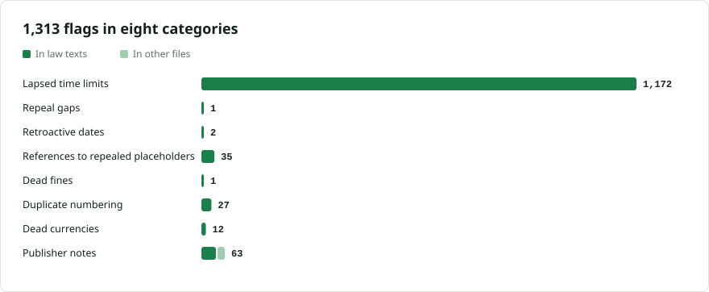

# Vulnerabilities in Liechtenstein law

[Deutsch](README.md) · **English**

<picture>
<source media="(prefers-color-scheme: dark)" srcset="img/flags-by-category-dark.svg">

</picture>

The vulnerability detectors from [lexifina/global-law](https://github.com/lexifina/global-law/tree/main/vulnerabilities) look for mechanical mistakes in legislation: a rule applying "until" a date that has passed, a time limit extended only after it had run out, a provision repealed before its replacement took effect, an amount changed in one place but still standing in another, a reference to an article that no longer exists. global-law's published list (9 November 2026) covered Liechtenstein with 4 flags from an earlier copy of this repository that held only the Constitution, the VRG and the StGHG: 1 repeal gap, 2 retroactive dates and 1 publisher note (listed there as a failed amendment). This is a run over this repository only, with all 3,689 acts in force, as it stood at commit [`0f5240b`](https://github.com/lexifina/liechtenstein-law/commit/0f5240b8388b57d8e44fe6269c4d820bb54f8a2c) on 15 November 2026, with versions in force up to 1 November 2026. It finds the same four and five categories that list did not have for Liechtenstein: lapsed time limits (1,172), references to repealed placeholders (35), dead fines (1), duplicate numbering (27) and dead currencies (12). Only the Constitution, the VRG and the StGHG have their earlier versions here; every other act has one version, its current text, so the detectors that compare versions (repeal gaps, retroactive dates, same-day conflicts, empty periods, stale amounts, references to deleted provisions) had almost nothing to read, and found only the three flags global-law's list already had. For this run the detectors were taught Liechtenstein German: "Franken" is the Swiss franc, legal tender here, not a dead currency; "Bst." (Buchstabe) stands where Austria writes "lit."; an ordinance's enabling clause ("Aufgrund von Art. ... des Gesetzes ... verordnet die Regierung:") cites the act it rests on.

**In short:** the detectors raised 1,313 flags. A language model reviewed 43 of the strongest, arguing each one for and against; 2 survived. Checked by hand, both are long spent: deadlines in decisions of the EEA Joint Committee, a payment by Norway due in 2012 and 2013 and programmes that ran to 31 December 2002. Reading a category the model does not review, the references to repealed placeholders, turned up eight likely drafting mistakes of one kind: an amendment repealed an article and left another article of the same act citing it. The Stipendiengesetz still cites Art. 23 and Art. 32 Abs. 2, both repealed by LGBl. 2012 Nr. 263 (Art. 21 Abs. 3, Art. 24 Abs. 2 and Art. 37). Art. 6g of the Bezügegesetz still sets when the presidents' flat allowance of Art. 6e is settled, which LGBl. 2025 Nr. 25 abolished from 1 January 2026. Art. 24 Abs. 1 Bst. b of the Betäubungsmittelgesetz, a criminal provision, still cites Art. 11, repealed by LGBl. 2015 Nr. 25. Art. 19b of the ordinance on dangerous-goods safety advisers, Art. 6 of the Aussenlandeverordnung, Art. 60bis Abs. 3 of the IVG, Art. 7 of the Feuerbrandverordnung and Art. 26 of the Staatsschutzgesetz each name an article repealed since. One more was found by reading: Art. 23 Abs. 1 Bst. d of the Übernahmegesetz stands twice, word for word, in Lilex's consolidated text. Later, this will be formalised in Lean, similar to our work on [the US tax code](https://lexifina.com/blog/formalizing-the-us-tax-code) and [US case law](https://lexifina.com/blog/formalizing-all-us-case-law-in-lean).

A flag is a prompt to look, not legal advice, and nothing here has been tested in court.

## Flags by category

| Category | What it looks for | Flags | In law texts | Reviewed | Survived review |
| --- | --- | ---: | ---: | ---: | ---: |
| Lapsed time limits | Text still applying a rule "until" a date that has passed | 1,172 | 1,172 | 40 | 2 |
| Repeal gaps | A provision removed before its replacement took effect | 1 | 1 | 1 | 0 |
| Retroactive or pre-publication dates | A change in force before the act that made it was published | 2 | 2 | 2 | 0 |
| References to repealed placeholders | A provision citing an article that now reads only "Aufgehoben" | 35 | 35 | 0 | 0 |
| Dead fines | A penalty for breaching an article that has been repealed | 1 | 1 | 0 | 0 |
| Duplicate numbering | Two units with the same number in one provision | 27 | 27 | 0 | 0 |
| Dead currencies | Amounts in currencies no longer in use | 12 | 12 | 0 | 0 |
| Publisher notes | Words such as "gegenstandslos" and "nicht ausführbar", and notes on a slip in the text | 63 | 39 | 0 | 0 |

"In law texts" counts every file of the 3,689 acts, treaties and EEA texts among them. Not law are the root files, `data/`, `tools/` and the `README.md` that describes each act's folder; the 24 publisher notes outside law texts are in `data/`, the input files that hold the texts again. 1,221 acts are a single `text.md` here, often one line, so a flag in them points to the act, not to an article. The history detectors read 99 changes to the Constitution, the VRG and the StGHG; the first text of every other act counts as its first version, not as a change. Their commits carry the day each act was published, so the search for retroactive dates found the two changes to the Constitution that took effect before their publication.

*Edge cases: the 2 flags that survived the review, the nine likely mistakes found by reading, and what the other flags are, in [EDGE-CASES.en.md](EDGE-CASES.en.md).*

## Files

| File | What it holds |
| --- | --- |
| [data/flags.csv](data/flags.csv) | Every flag, one row per provision and issue |
| [data/reviewed.csv](data/reviewed.csv) | The 43 flags the model reviewed, with its verdict and reason |
| [data/by_category.csv](data/by_category.csv) | The counts in the table above |
| [tools/](tools/) | The scripts that made this run |

Columns: `category` and `category_de` (the category in English and German), `detector`, `kind` (`law` or `other`), `path` (the provision in this repository), `date` (the date the flag turns on), `reference` (the act or line involved), `summary`, `score` (the detector's ranking, 0 to 1), `review` (`artefact`, `lawful` or `candidate_defect`), `survives_rebuttal`, `review_note` (the model's reason, in English), `url` (the provision at the commit that was read).

## How it was made

- **Detectors:** global-law's [vulnerabilities/scripts](https://github.com/lexifina/global-law/tree/main/vulnerabilities/scripts), with the fixes in [tools/patch_detectors.py](tools/patch_detectors.py), the German ones in [tools/patch_de.py](tools/patch_de.py) and those for Liechtenstein in [tools/patch_li.py](tools/patch_li.py), run on this repository at commit `0f5240b`. global-law replays this repository only up to an earlier commit, so the history table the detectors read was built from this repository's own commits (the law that made each change and its `In-force` date); an act's first text, marked `Kind: baseline` or `Kind: start`, counts as its first version. The Liechtenstein fixes: the search for dead currencies no longer takes "Franken" for a dead franc, only a franc named as Belgian, French or Luxembourg, and reads the schilling "S" only after an amount and a space, not in codes such as "NO88S" or "BISD 27S/24" (dead currencies went from 2,259 to 12); the reference search reads "Bst." between a number and another act ("Art. 2 Abs. 2 Bst. d des Grundverkehrsgesetzes"), takes an EU regulation or directive named after the number as another act, and skips an ordinance's enabling clause (references to repealed placeholders went from 53 to 35).
- **Model review:** gpt-5.4-mini, the 40 strongest flags per category: 40 lapsed time limits, the repeal gap and the 2 retroactive dates; every lapsed time limit is in a law text, so the 40 strongest in law texts are the same 40. One pass says whether a flag is real, a second argues that it is not. There were no empty periods to review. The model does not review the last five categories. global-law's own list used a different model.
- **Hand check:** the 2 flags that survived were read in this repository, as were all 35 references to repealed placeholders, the dead fine, the 12 dead currencies, the 27 duplicate numbers, the 63 publisher notes and a sample of the lapsed time limits. Where a provision cites an article that now reads "Aufgehoben", Lilex's footnotes to the consolidated text and its earlier versions ([www.gesetze.li](https://www.gesetze.li)) gave the act that repealed it, what it said, and when the citing provision was last changed. The amending acts' own texts in the Landesgesetzblatt were not read: the nine open items still need the LGBl.

To report a correction, open an issue with the provision and an official source.

## Licence

The lists and notes are Lexifina's, dedicated to the public domain under CC0 1.0 like this repository's own history, tables and tools. Quoted law text is from Lilex, the law database of the Principality of Liechtenstein ([www.gesetze.li](https://www.gesetze.li), Rechtsdienst der Regierung). Laws, ordinances, treaties and other official enactments, and official collections of them, are not protected by copyright in Liechtenstein (Art. 5 of the Copyright Act, URG, LR 231.1). Consolidated texts have no legal effect; only the Liechtensteinisches Landesgesetzblatt is authoritative. See [LICENSE](../LICENSE).
