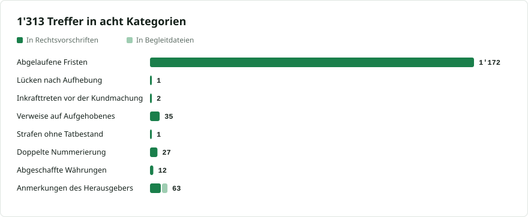

# Schwachstellen im liechtensteinischen Recht

**Deutsch** · [English](README.en.md)

<picture>
<source media="(prefers-color-scheme: dark)" srcset="img/flags-by-category-dark.de.svg">

</picture>

Die Schwachstellen-Detektoren von [lexifina/global-law](https://github.com/lexifina/global-law/tree/main/vulnerabilities) suchen nach mechanischen Fehlern in der Gesetzgebung: eine Regelung, die «bis» zu einem bereits verstrichenen Datum gilt, eine Frist, die erst nach ihrem Ablauf verlängert wurde, eine Bestimmung, die aufgehoben wurde, bevor ihre Nachfolgeregelung in Kraft trat, ein Betrag, der an einer Stelle geändert wurde und an einer anderen stehen blieb, ein Verweis auf einen Artikel, den es nicht mehr gibt. Die von global-law veröffentlichte Liste (9. November 2026) erfasste Liechtenstein mit 4 Treffern aus einem früheren Stand dieses Repositorys, der nur die Verfassung, das VRG und das StGHG enthielt: 1 Lücke nach Aufhebung, 2 Fälle von Inkrafttreten vor der Kundmachung und 1 Anmerkung (dort als gescheiterte Änderung geführt). Hier wurden die Detektoren nur über dieses Repository mit allen 3'689 geltenden Erlassen ausgeführt, und zwar auf dem Stand des Commits [`0f5240b`](https://github.com/lexifina/liechtenstein-law/commit/0f5240b8388b57d8e44fe6269c4d820bb54f8a2c) vom 15. November 2026, mit Fassungen, die bis zum 1. November 2026 in Kraft traten. Sie finden dieselben vier Treffer sowie fünf Kategorien, die jene Liste für Liechtenstein nicht hatte: abgelaufene Fristen (1'172), Verweise auf aufgehobene Bestimmungen (35), Strafbestimmungen ohne Grundtatbestand (1), doppelte Nummerierung (27) und abgeschaffte Währungen (12). Nur die Verfassung, das VRG und das StGHG haben hier ihre früheren Fassungen; jeder übrige Erlass hat eine einzige Fassung, seinen geltenden Text. Die Detektoren, die Fassungen vergleichen (Lücken nach Aufhebung, Inkrafttreten vor der Kundmachung, Änderungen am selben Tag, ungedeckte Zeiträume, nicht angepasste Beträge, Verweise auf weggefallene Bestimmungen), hatten daher kaum etwas zu lesen und fanden nur die drei Treffer, die schon in der Liste von global-law standen. Für diesen Lauf lernten die Detektoren liechtensteinisches Deutsch: «Franken» ist der Schweizer Franken, hier gesetzliches Zahlungsmittel, keine abgeschaffte Währung; «Bst.» (Buchstabe) steht, wo Österreich «lit.» schreibt; und der Ingress einer Verordnung («Aufgrund von Art. … des Gesetzes … verordnet die Regierung:») nennt das Gesetz, auf dem sie beruht.

**Kurz gesagt:** Die Detektoren lieferten 1'313 Treffer. Ein Sprachmodell prüfte die 43 stärksten und führte zu jedem Gründe dafür und dagegen an; 2 hielten stand. Von Hand geprüft, sind beide längst gegenstandslos: Fristen in Beschlüssen des Gemeinsamen EWR-Ausschusses, eine Zahlung Norwegens, fällig 2012 und 2013, und Programme, die bis 31. Dezember 2002 liefen. Die Durchsicht einer Kategorie, die das Modell nicht prüft, der Verweise auf aufgehobene Bestimmungen, ergab acht wahrscheinliche Redaktionsfehler derselben Art: Eine Abänderung hob einen Artikel auf, und ein anderer Artikel desselben Erlasses verweist weiter darauf. Das Stipendiengesetz verweist noch auf Art. 23 und Art. 32 Abs. 2, beide durch LGBl. 2012 Nr. 263 aufgehoben (Art. 21 Abs. 3, Art. 24 Abs. 2 und Art. 37). Art. 6g des Bezügegesetzes regelt noch die Abrechnung der Präsidialpauschale nach Art. 6e, die LGBl. 2025 Nr. 25 auf den 1. Januar 2026 abgeschafft hat. Art. 24 Abs. 1 Bst. b des Betäubungsmittelgesetzes, eine Strafbestimmung, verweist noch auf Art. 11, aufgehoben durch LGBl. 2015 Nr. 25. Art. 19b der Verordnung über die fachliche Eignung des Gefahrgutbeauftragten, Art. 6 der Aussenlandeverordnung, Art. 60bis Abs. 3 IVG, Art. 7 der Feuerbrandverordnung und Art. 26 des Staatsschutzgesetzes nennen je einen inzwischen aufgehobenen Artikel. Ein weiterer Fehler fiel bei der Durchsicht auf: Art. 23 Abs. 1 Bst. d des Übernahmegesetzes steht im konsolidierten Text von Lilex zweimal, Wort für Wort. Später wird dies in Lean formalisiert, ähnlich unserer Arbeit zum [US-Steuerrecht](https://lexifina.com/blog/formalizing-the-us-tax-code) und zur [US-Rechtsprechung](https://lexifina.com/blog/formalizing-all-us-case-law-in-lean).

Ein Treffer ist ein Anlass, genauer hinzusehen, keine Rechtsberatung, und nichts davon wurde vor Gericht erprobt.

## Treffer nach Kategorie

| Kategorie | Wonach gesucht wird | Treffer | In Rechtsvorschriften | Geprüft | Hielten stand |
| --- | --- | ---: | ---: | ---: | ---: |
| Abgelaufene Fristen | Text, der eine Regelung weiterhin «bis» zu einem verstrichenen Datum anordnet | 1'172 | 1'172 | 40 | 2 |
| Lücken nach Aufhebung | Eine Bestimmung, die wegfiel, bevor ihre Nachfolgeregelung in Kraft trat | 1 | 1 | 1 | 0 |
| Inkrafttreten vor der Kundmachung | Eine Änderung, die in Kraft trat, bevor der ändernde Erlass kundgemacht wurde | 2 | 2 | 2 | 0 |
| Verweise auf aufgehobene Bestimmungen | Eine Bestimmung, die auf einen Artikel verweist, der nur noch «Aufgehoben» lautet | 35 | 35 | 0 | 0 |
| Strafbestimmungen ohne Grundtatbestand | Eine Strafe für die Verletzung eines aufgehobenen Artikels | 1 | 1 | 0 | 0 |
| Doppelte Nummerierung | Zwei Gliederungseinheiten mit derselben Nummer in einer Bestimmung | 27 | 27 | 0 | 0 |
| Abgeschaffte Währungen | Beträge in Währungen, die nicht mehr gelten | 12 | 12 | 0 | 0 |
| Anmerkungen des Herausgebers | Wörter wie «gegenstandslos» und «nicht ausführbar» und Hinweise auf einen Fehler im Text | 63 | 39 | 0 | 0 |

«In Rechtsvorschriften» zählt jede Datei der 3'689 Erlasse, auch der Staatsverträge und EWR-Texte. Kein Recht sind die Dateien im Stammverzeichnis, `data/`, `tools/` und die `README.md`, die den Ordner jedes Erlasses beschreibt; die 24 Anmerkungen ausserhalb der Rechtsvorschriften stehen in `data/`, den Eingabedateien, welche die Texte nochmals enthalten. 1'221 Erlasse sind hier eine einzige `text.md`, oft eine einzige Zeile, sodass ein Treffer darin auf den Erlass zeigt, nicht auf einen Artikel. Die Detektoren für die Historie lesen 99 Änderungen der Verfassung, des VRG und des StGHG; der erste Text jedes übrigen Erlasses zählt als dessen erste Fassung, nicht als Änderung. Diese Commits tragen den Ausgabetag jedes Landesgesetzblatts, sodass die Suche nach Inkrafttreten vor der Kundmachung die zwei Änderungen der Verfassung fand, die vor ihrer Kundmachung in Kraft traten.

*Grenzfälle: die 2 Treffer, die der Prüfung standhielten, die neun bei der Durchsicht gefundenen wahrscheinlichen Fehler und was die übrigen Treffer sind, in [EDGE-CASES.md](EDGE-CASES.md).*

## Dateien

| Datei | Inhalt |
| --- | --- |
| [data/flags.csv](data/flags.csv) | Jeder Treffer, eine Zeile je Bestimmung und Befund |
| [data/reviewed.csv](data/reviewed.csv) | Die 43 vom Modell geprüften Treffer, mit Urteil und Begründung |
| [data/by_category.csv](data/by_category.csv) | Die Zahlen der obigen Tabelle |
| [tools/](tools/) | Die Skripte dieses Laufs |

Spalten: `category` und `category_de` (die Kategorie auf Englisch und Deutsch), `detector`, `kind` (`law` oder `other`), `path` (die Bestimmung in diesem Repository), `date` (das Datum, auf das sich der Treffer bezieht), `reference` (der betroffene Erlass oder die betroffene Zeile), `summary`, `score` (die Gewichtung des Detektors, 0 bis 1), `review` (`artefact`, `lawful` oder `candidate_defect`), `survives_rebuttal`, `review_note` (die Begründung des Modells, auf Englisch), `url` (die Bestimmung im gelesenen Commit).

## Wie es gemacht wurde

- **Detektoren:** die [vulnerabilities/scripts](https://github.com/lexifina/global-law/tree/main/vulnerabilities/scripts) von global-law mit den Korrekturen in [tools/patch_detectors.py](tools/patch_detectors.py), den deutschsprachigen in [tools/patch_de.py](tools/patch_de.py) und den liechtensteinischen in [tools/patch_li.py](tools/patch_li.py), ausgeführt auf diesem Repository im Commit `0f5240b`. global-law spielt dieses Repository nur bis zu einem früheren Commit nach; die Tabelle der Historie, welche die Detektoren lesen, wurde daher aus den eigenen Commits dieses Repositorys gebildet (das Gesetz, das jede Änderung vornahm, und sein `In-force`-Datum); der erste Text eines Erlasses, mit `Kind: baseline` oder `Kind: start` bezeichnet, zählt als dessen erste Fassung. Die liechtensteinischen Korrekturen: Die Suche nach abgeschafften Währungen hält «Franken» nicht mehr für einen abgeschafften Franken, sondern nur einen als belgisch, französisch oder luxemburgisch bezeichneten, und liest den Schilling als «S» nur nach einem Betrag und einem Leerschlag, nicht in Codes wie «NO88S» oder «BISD 27S/24» (abgeschaffte Währungen von 2'259 auf 12); die Suche nach Verweisen liest «Bst.» zwischen einer Nummer und einem anderen Erlass («Art. 2 Abs. 2 Bst. d des Grundverkehrsgesetzes»), behandelt eine nach der Nummer genannte EU-Verordnung oder -Richtlinie als anderen Erlass und überspringt den Ingress einer Verordnung (Verweise auf aufgehobene Bestimmungen von 53 auf 35).
- **Prüfung durch das Modell:** gpt-5.4-mini, die 40 stärksten Treffer je Kategorie: 40 abgelaufene Fristen, die Lücke nach Aufhebung und die 2 Fälle von Inkrafttreten vor der Kundmachung; da jede abgelaufene Frist in einer Rechtsvorschrift steht, sind die 40 stärksten in Rechtsvorschriften dieselben 40. Ein erster Durchgang beurteilt, ob ein Treffer echt ist, ein zweiter führt Gründe dagegen an. Ungedeckte Zeiträume zum Prüfen gab es keine. Die letzten fünf Kategorien prüft das Modell nicht. Die eigene Liste von global-law beruhte auf einem anderen Modell.
- **Prüfung von Hand:** Die 2 Treffer, die standhielten, wurden in diesem Repository gelesen, ebenso alle 35 Verweise auf aufgehobene Bestimmungen, die Strafbestimmung ohne Grundtatbestand, die 12 abgeschafften Währungen, die 27 doppelten Nummern, die 63 Anmerkungen und Stichproben der abgelaufenen Fristen. Wo eine Bestimmung auf einen Artikel verweist, der nur noch «Aufgehoben» lautet, ergaben die Fussnoten von Lilex zum konsolidierten Text und dessen frühere Fassungen ([www.gesetze.li](https://www.gesetze.li)), welcher Erlass ihn aufhob, was er besagte und wann die verweisende Bestimmung zuletzt geändert wurde. Die Abänderungserlasse selbst wurden im Landesgesetzblatt nicht gelesen: Die neun offenen Punkte sind noch am LGBl. zu prüfen.

Korrekturen bitte als Issue mit der Bestimmung und einer amtlichen Quelle melden.

## Lizenz

Die Listen und Anmerkungen stammen von Lexifina und sind wie die Historie, die Tabellen und die Werkzeuge dieses Repositorys unter CC0 1.0 gemeinfrei. Zitierter Rechtstext stammt aus Lilex, der Rechtsdatenbank des Fürstentums Liechtenstein ([www.gesetze.li](https://www.gesetze.li), Rechtsdienst der Regierung). Gesetze, Verordnungen, völkerrechtliche Verträge und andere amtliche Erlasse sowie amtliche Sammlungen davon sind in Liechtenstein urheberrechtlich nicht geschützt (Art. 5 URG, LR 231.1). Konsolidierte Texte entfalten keine Rechtswirkung; massgebend ist allein das Liechtensteinische Landesgesetzblatt. Siehe [LICENSE](../LICENSE).
